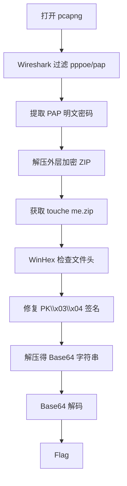

## 概述

本页面整理自 0W1 网络安全俱乐部微信公众号归档文章「题解 | MISC」，详细记录了六道 CTF MISC 方向题目的完整解题思路与工具操作步骤。题目涵盖 **音频频谱隐写**、**Base64+Telegram 社工**、**图片隐写+JSFuck**、**十六进制位运算凯撒密码**、**零宽字符隐写**、**PPPoE/PAP 流量分析+ZIP 修复+Base64 解码** 六大技术点，适合 CTF 初学者与取证分析爱好者参考学习。

> 归档来源：[[0w1club-wechat-archive-201908-202207]]  
> 关联团队早期索引：[[0w1club-wechat-archive-201707-201903]]  
> 同类早期三题解：[[0w1club-ctf-misc-writeup-steganography-traffic-analysis]]（JPEG 多层隐写、Wireshark ZIP/PNG 修复、WiFi 名称推理定位）

---

## 题目一：ARE YOU OK? —— 音频频谱隐写

### 核心考点
- 音频文件频谱图分析
- 隐写信息在频域可视化呈现
- Audition / Sonic Visualiser 等音频分析工具实战

### 解题步骤

1. **获取附件**：题目提供一个 `.mp3` 音频文件，提示「用你的眼睛听到雷总的声音」。
2. **打开频谱视图**：使用 **Adobe Audition**（或免费替代品 Sonic Visualiser、Spek、Audacity 的频谱图模式）打开音频，切换到 **频谱图/频谱视图**。
3. **观察频域图像**：在频谱图中可清晰看到由频率强度变化形成的字符轨迹，直接读出 Flag 字符串。
4. **提取 Flag**：`flag{1amv3ryokay233}`

### 技术总结

| 步骤 | 关键操作 | 推荐工具 |
|------|----------|----------|
| 1 | 加载音频文件 | Audition / Sonic Visualiser / Audacity |
| 2 | 切换至频谱/频谱图视图 | 同左 |
| 3 | 调整颜色映射/对比度增强可读性 | 同左 |
| 4 | 直接读取文本 Flag | 人眼识别 |

> 延伸阅读：音频隐写还包括 LSB 最低有效位隐写、相位编码、回声隐写等时域/频域技术，可结合 [[0w1club-week2-wifi-hijacking-arp-spoofing]] 中的信号分析基础理解频域特性。

---

## 题目二：海报中的密码？！ —— Base64 解码 + Telegram 社工

### 核心考点
- Base64 编码识别与解码
- Telegram 邀请链接格式识别
- 社工/开源情报（OSINT）获取 Flag

### 解题步骤

1. **识别编码**：海报图片中给出一串字符 `aHR0cHM6Ly90Lm1lL2pvaW5jaGF0L0RmOU1na05IVm5IRnZLVnpvNjRzWUE=`，特征明显为 **Base64**（长度为 4 倍数、字符集 A-Z/a-z/0-9/+/=、末尾有 `=` 补位）。
2. **Base64 解码**：在线工具 / Python `base64.b64decode()` / Linux `base64 -d` 得到明文 URL：
   ```
   https://t.me/joinchat/Df9MgkNHVnHFvKVzo64sYA
   ```
3. **识别 Telegram 邀请链接**：`t.me/joinchat/...` 为 Telegram 群组/频道邀请链接格式。
4. **加入群组查看聊天记录**：点击链接加入对应 Telegram 群组，翻阅历史消息即可发现 Flag。
5. **提取 Flag**：`flag{Th1s_1s_f1ag_?}`

### 技术总结

| 步骤 | 关键点 | 工具/命令 |
|------|--------|-----------|
| 1 | 识别 Base64 特征 | 目测 / `file` / 正则 |
| 2 | 解码 | `echo "..." | base64 -d` / Python / CyberChef |
| 3 | 识别 t.me/joinchat 链接 | 经验积累 |
| 4 | 加入群组获取情报 | Telegram 客户端 |
| 5 | 读取 Flag | 直接查看 |

> 同类社工/OSINT 技术：[[jwt漏洞原理与实战利用]] 中的信息泄露利用、[[0w1club-ctf-web-writeup-jwt-sqli-brute]] 中的 JWT None Alg 结合 SQL 注入均涉及情报收集与利用链构造。

---

## 题目三：0w1学习十九大 —— 图片隐写 + JSFuck 解码

### 核心考点
- Steghide 隐写工具提取嵌入文件（无密码）
- JSFuck 混淆代码识别与还原
- 浏览器控制台直接执行 JS 获取明文

### 解题步骤

1. **下载图片**：附件为一张 PNG/JPG 图片。
2. **Steghide 提取隐藏数据**：
   ```bash
   steghide extract -sf image.png
   # 提示输入密码，直接回车（无密码）
   ```
   得到 `data.txt` 文本文件。
3. **分析 data.txt 内容**：文件内容为一串由 `[]()!+` 等字符组成的极长字符串，典型 **JSFuck** 混淆代码特征。
4. **浏览器控制台执行**：打开浏览器开发者工具（F12）→ Console 标签，粘贴该字符串并回车执行，控制台直接输出解码后的明文。
5. **提取 Flag**：`flag{fuqiang minzhu wenming hexie}`（社会主义核心价值观拼音空格分隔）

### 技术总结

| 步骤 | 关键操作 | 工具 |
|------|----------|------|
| 1 | 无密码 Steghide 提取 | `steghide extract -sf file` |
| 2 | 识别 JSFuck 特征字符集 | 经验判断 |
| 3 | 控制台直接执行还原 | Chrome DevTools / Firefox Console |
| 4 | 读取输出 Flag | 控制台返回值 |

> JSFuck 原理：利用 JavaScript 类型转换特性，仅用 6 字符 `[]()!+` 即可构造任意 JS 代码。解混淆最简单方式即直接在 JS 引擎中执行。延伸阅读：[[0w1club-ctf-web-writeup-jwt-sqli-brute]] 中的 Brainfuck 签到题同属 esolang 解码范畴。

---

## 题目四：好好学习天天向上 —— 十六进制位运算凯撒密码

### 核心考点
- 十六进制字符串两两分组转 ASCII
- 位运算掩码 `& 0x7F`（保留低 7 位，去除最高位）
- 凯撒密码/位移暴力破解思想（题目已给出固定掩码逻辑，无需暴力）

### 解题步骤

1. **获取十六进制字符串**：
   ```
   b0f7b1e3f4e6fbc7b0b0e4dfe7b0efe4dfd3f4f5e4f9fd
   ```
2. **编写/理解解密脚本**（文章给出 Python 代码）：
   ```python
   s = "b0f7b1e3f4e6fbc7b0b0e4dfe7b0efe4dfd3f4f5e4f9fd"
   flag = ""
   for i in range(len(s)//2):
       tmp = int(s[2*i:2*i+2], 16)
       tmp = tmp & 0b01111111   # 等价于 tmp & 0x7F，保留低 7 位
       flag += chr(tmp)
   print(flag)
   ```
3. **执行脚本得到 Flag**：`0w1ctf{G00d_g0od_Study}`

### 核心逻辑解析

| 原始十六进制 | 二进制 | `& 0x7F` 后 | ASCII 字符 |
|--------------|--------|-------------|------------|
| `b0` | `1011 0000` | `0011 0000` (0x30) | `0` |
| `f7` | `1111 0111` | `0111 0111` (0x77) | `w` |
| `b1` | `1011 0001` | `0011 0001` (0x31) | `1` |
| ... | ... | ... | ... |

- **掩码 `0x7F` (0111 1111)** 作用：将扩展 ASCII（高位为 1）强制映射回标准 ASCII 范围（0-127），实现一种简单的「凯撒式」位移/截断变换。
- 题目提示「参考 DDCTF 杂项掀桌题」，同类思路常见于 **高位隐藏标志位** 的编码变体。

> 相关编码/密码学基础：[[0w1club-ctf-crypto-writeup-easyrsa-t9]] 中的 T9 九键解码、[[mtctf-2021-crypto-writeup]] 中的 RSA Padding Oracle 攻击均体现编码转换与数学变换结合的思想。

---

## 题目五：看不见的鬼 —— 零宽字符隐写统计

### 核心考点
- 零宽字符（Zero-Width Characters）识别：`U+200B` (ZWSP)、`U+200C` (ZWNJ)、`U+200D` (ZWJ)、`U+FEFF` (BOM) 等
- HTML 实体 `&#8203;` 对应 `U+200B` (ZERO WIDTH SPACE)
- 统计连续零宽字符数量映射字母表位置（A=1, B=2...）

### 解题步骤

1. **打开附件 txt 文件**：用浏览器或支持不可见字符显示的编辑器（VS Code、Notepad++、Sublime Text + 插件）打开。
2. **观察不可见字符**：在字符 `a` 之间发现大量 `&#8203;` HTML 实体，对应 Unicode **U+200B ZERO WIDTH SPACE**。
3. **统计连续段长度**：将文本按可见字符分割，统计每段连续零宽字符的个数，得到序列：
   ```
   15, 23, 12, 3, 12, 21, 2, 6, 21, 2
   ```
4. **映射字母表**（1=A, 2=B ... 26=Z）：
   - 15 → O
   - 23 → W
   - 12 → L
   - 3 → C
   - 12 → L
   - 21 → U
   - 2 → B
   - 6 → F
   - 21 → U
   - 2 → B
   拼接得：`owlclubfub`
5. **提取 Flag**：`flag{owlclubfub}`

### 技术总结

| 步骤 | 关键点 | 工具/方法 |
|------|--------|-----------|
| 1 | 识别零宽字符 | 浏览器查看源码 / VS Code `渲染控制字符` / Python `repr()` |
| 2 | 定位分隔符（本题为 `a`） | 观察可见字符模式 |
| 3 | 统计连续段长度 | 手工 / 正则 / Python 脚本 |
| 4 | 数字→字母映射 | A=1 表 / `chr(n+64)` |
| 5 | 组装 Flag | 字符串拼接 |

> 零宽字符隐写常用于 **水印追踪**、**隐蔽通信**、**绕过内容检测**。检测手段：`cat -A`、`od -c`、Python `unicodedata`、在线零宽字符检测器。延伸：[[0w1club-ctf-web-writeup-jwt-sqli-brute]] 中的验证码绕过亦涉及不可见字符干扰识别。

---

## 题目六：逢雪宿芙蓉山 —— PPPoE/PAP 流量分析 + ZIP 文件头修复 + Base64 解码

### 核心考点
- Wireshark 分析 PPPoE 认证流量
- PAP 协议明文传输密码漏洞
- ZIP 文件头结构识别与修复（`PK\x03\x04` / `50 4B 03 04`）
- Base64 解码获取最终 Flag

### 解题步骤

#### 流量包分析获取解压密码
- 用 **Wireshark** 打开 `柴门闻犬吠.pcapng`，过滤 `pppoe` 或 `pap`。
- 发现 **PPPoE 发现阶段** 后进入 **PAP 认证** 阶段。
- PAP（Password Authentication Protocol）**明文传输密码**，在 `Authenticate-Request` 报文中直接可见：
  - 用户名：`fengxueyeguiren`（题目诗句「逢雪宿芙蓉山」作者刘长卿，诗意「风雪夜归人」）
  - 密码：`/=3ngxu3y36uir3n`（Leet 变体：`fengxueyeguiren` → `f3ngxu3y36uir3n`，首字符 `/=` 干扰）
- 推测该密码为后续加密压缩包的解压密码。

#### 解压加密压缩包
- 使用密码 `/=3ngxu3y36uir3n` 解压 `加密压缩包.zip`，得到多个文件（含诗词赏析、作者生平等干扰文件）及关键文件 `touche me.zip`。

#### 发现 ZIP 损坏，WinHex 分析文件头
- 尝试解压 `touche me.zip` 提示损坏。
- 用 **WinHex** 打开，查看文件头：
  ```
  偏移 0x00: 99 93 D1 9C 7C 1E DD 33 B4 29 2E AC D9 B8 46 8C ...
  ```
  标准 ZIP 本地文件头签名应为 **`50 4B 03 04` (PK\x03\x04)**，此处被篡改。

#### 修复 ZIP 文件头
- 将前 4 字节 `99 93 D1 9C` 修改为 `50 4B 03 04`。
- 保存后可正常解压，直接得到明文文件内容（纯文本）：
  ```
  ekhhMHlpbmcxQWlzSGkxdQ==
  ```

#### Base64 解码获取 Flag
- 解码上述字符串：`flag{zHa0ying1AisHi1u}`

### 关键结构对照表

| 格式 | 标准签名/关键字段 | 题目篡改值 | 修复值 | 定位工具 |
|------|-------------------|------------|--------|----------|
| ZIP 本地文件头 | `50 4B 03 04` (PK\x03\x04) | `99 93 D1 9C` | `50 4B 03 04` | WinHex / 010 Editor |
| PAP 密码字段 | 明文 | Leet 变体 `/=3ngxu3y36uir3n` | 直接使用 | Wireshark 报文详情 |

### 技术总结流程图



> 相关流量分析与文件修复技术：
> - [[0w1club-ctf-misc-writeup-steganography-traffic-analysis]]：Wireshark 提取 ZIP、伪加密修复、PNG IHDR CRC 修复
> - [[burpsuite-basics-tutorial]]：HTTP 流量抓包改包基础
> - [[frp内网渗透应用]]：流量隧道与提取实战
> - [[ar-drone-2.0-penetration-testing]]：固件提取中的文件系统分析与文件头修复

---

## 工具箱速查

| 工具 | 用途 | 本文涉及题目 |
|------|------|--------------|
| **Adobe Audition / Sonic Visualiser / Audacity** | 音频频谱图查看 | 题目一 |
| **Base64 解码器 (在线/Python/CyberChef)** | Base64 编解码 | 题目二、题目六 |
| **Telegram 客户端** | 加入群组获取情报 | 题目二 |
| **Steghide** | 图片隐写提取（无密码） | 题目三 |
| **浏览器 DevTools Console** | JSFuck 直接执行还原 | 题目三 |
| **Python** | 十六进制转 ASCII + 位运算、零宽字符统计、Base64 解码、自动化脚本 | 题目四、五、六 |
| **VS Code / Notepad++ / 浏览器查看源码** | 零宽字符/不可见字符显示 | 题目五 |
| **Wireshark** | PPPoE/PAP 流量分析、密码提取 | 题目六 |
| **WinHex / 010 Editor** | ZIP 文件头十六进制修复 | 题目六 |
| **7-Zip / WinRAR / 360解压** | 解压（含自动容错伪加密） | 题目六 |

---

## 知识延伸与关联页面

| 方向 | 关联页面 | 说明 |
|------|----------|------|
| 团队文章索引 | [[0w1club-wechat-archive-201908-202207]] | 0W1 Club 2019-2022 微信归档总索引 |
| 团队早期招新 | [[0w1club-wechat-archive-201707-201903]] | 战队定位、战绩、文化介绍 |
| MISC 早期三题 | [[0w1club-ctf-misc-writeup-steganography-traffic-analysis]] | JPEG 多层隐写、Wireshark ZIP/PNG 修复、WiFi 名称推理 |
| Crypto 方向 | [[0w1club-ctf-crypto-writeup-easyrsa-t9]] | RSA 大数分解、T9 九键解码 |
| Web 方向 | [[0w1club-ctf-web-writeup-hash-extension-rsa]] | 哈希长度扩展、PHP 弱类型、RSA 解密 |
| Web 进阶 | [[0w1club-ctf-web-writeup-jwt-sqli-brute]] | JWT 漏洞、SQL 注入、Brainfuck、验证码绕过 |
| 网络攻击基础 | [[0w1club-week2-wifi-hijacking-arp-spoofing]] | ARP 欺骗、中间人攻击、Wireshark 实战 |
| 无线安全 | [[knob-bluetooth-bredr-key-negotiation-vulnerability]] | KNOB 攻击、蓝牙密钥协商降级 |
| 物联网固件 | [[ar-drone-2.0-penetration-testing]] | 固件提取、文件系统分析、Telnet 后门 |
| 流量分析工具 | [[burpsuite-basics-tutorial]] | Burp Suite Proxy/Repeater/Intruder 全流程 |
| 内网穿透流量 | [[frp内网渗透应用]] | frp Socks5/多级隧道/Metasploit 代理 |

---

## 结语

六道题目构建了完整的 **MISC 核心技能树**：

1. **音频频域隐写** —— 频谱图可视化直接读取
2. **编码+社工链** —— Base64 → Telegram OSINT
3. **图片隐写+JS 混淆** —— Steghide + JSFuck 执行还原
4. **编码变换+位运算** —— Hex → ASCII + `& 0x7F` 掩码
5. **零宽字符统计隐写** —— 不可见字符计数映射字母表
6. **协议流量取证+文件修复** —— PPPoE/PAP 明文密码 → ZIP 文件头修复 → Base64 解码

掌握 **频谱分析工具**、**Base64/十六进制/Unicode 编码识别**、**Steghide/JSFuck/零宽字符隐写原理**、**位运算掩码技巧**、**Wireshark 协议分析（PPPoE/PAP/HTTP 等）**、**常见文件格式文件头结构（ZIP/PNG/JPEG/MP3 等）**、**十六进制编辑器修复文件头**、**Python 自动化脚本编写**，即可覆盖绝大多数 CTF MISC 基础与进阶题型。

建议配合 [[0w1club-ctf-misc-writeup-steganography-traffic-analysis]]、[[burpsuite-basics-tutorial]]、[[frp内网渗透应用]] 等页面，构建完整的 **取证-流量-隐写-编码-情报** 立体技能体系。

---

> 页面维护：数字知识库策展人 | 来源：0W1 Club 微信公众号归档「题解 | MISC」 | 更新日期：2025-08-24

## 来源

- [0w1网络安全俱乐部-201707-201903_23](../sources/0w1网络安全俱乐部-201707-201903_23.md)
