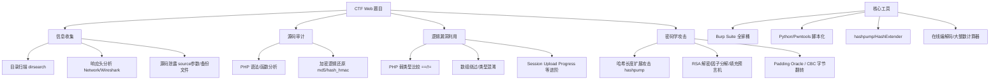

## 概述

本页面整理自 0W1 网络安全俱乐部微信公众号发布的《题解 | WEB》文章，详细解析了 CTF 比赛中 Web 方向的四道题目。题目涵盖了**信息收集（源码泄露/响应头）**、**哈希长度扩展攻击**、**PHP 弱类型比较绕过**以及 **RSA 非对称加密解密**四大核心知识点，展示了从基础信息收集到密码学攻击的完整解题链路。

> 关联阅读：[[0w1club-wechat-archive-201908-202207]]（0W1 Club 文章索引）、[[burpsuite-basics-tutorial]]（Burp Suite 基础教程）、[[mtctf-2021-web-writeup]]（MTCTF 2021 Web 方向 Writeup）、[[diwuzhijian-2020-web-writeup]]（第五空间 2020 Web Writeup）、[[mtctf-2021-crypto-writeup]]（MTCTF 2021 Crypto 方向 RSA 攻击）

---

## 题目一：God is a flag —— 源码泄露获取 Flag

### 题目描述
页面提示“God is a flag”，需要在页面源码中寻找 Flag。

### 解题思路
直接查看网页源代码（Chrome: `Ctrl+U` / Firefox: `Ctrl+U` 或右键“查看页面源码”），在 HTML 注释或隐藏标签中即可发现 Flag。

### 关键步骤
1. 打开目标网页
2. 右键选择“查看页面源码”或使用快捷键
3. 搜索关键字 `flag` 或浏览 `<script>`、`<meta>`、HTML 注释 `<!-- -->` 等位置
4. 直接提取 Flag

### 技术点
- **信息收集基础**：前端源码审计是 Web 渗透的第一步
- **浏览器开发者工具**使用：Elements/Network/Console 面板

---

## 题目二：快问我flag在哪 —— 响应头/302 跳转获取 Flag

### 题目描述
页面提示“快问我flag在哪”，Flag 不在页面内容中。

### 解题思路
利用浏览器开发者工具的 **Network 面板** 或 **Wireshark 抓包**，观察 HTTP 请求/响应过程，发现存在 **302 重定向**，Flag 位于响应头的 `Location` 或自定义 Header 中。

### 关键步骤
1. 打开开发者工具 → Network 面板，勾选 "Preserve log"
2. 刷新页面，观察请求列表
3. 找到状态码为 **302 Found** 的响应
4. 点击该请求，查看 **Response Headers**
5. 在 `Location` 头或自定义 Header（如 `X-Flag`、`Flag`）中获取 Flag

### 技术点
- **HTTP 状态码**：302 临时重定向
- **响应头分析**：敏感信息常泄露在 Header 中
- **工具**：Chrome DevTools Network / Firefox Network / Wireshark / Burp Suite

> 关联工具教程：[[burpsuite-basics-tutorial]]（Proxy 抓包改包、Repeater 复发）

---

## 题目三：哈哈哈希 —— MD5 哈希长度扩展攻击

### 题目描述
登录页面，Cookie 中包含可疑字段，修改 `source=1` 可获取源码。源码逻辑为：`cookie.getflag === md5(secret_key + username + password)`，需构造合法 Cookie 获取 Flag。

### 核心代码逻辑（源码关键片段）
```php
// 伪代码还原
if (isset($_COOKIE['getflag']) && $_COOKIE['username'] === '0w1' && $_COOKIE['password'] !== '0w1') {
    $secret = 'secret_key'; // 服务端密钥，未知长度
    $hash = md5($secret . $_COOKIE['username'] . $_COOKIE['password']);
    if ($_COOKIE['getflag'] === $hash) {
        echo $flag;
    }
}
```

### 攻击原理：哈希长度扩展攻击
- **前提**：已知 `hash = md5(secret + data)`，已知 `data`（username+password），已知 `hash` 值，**未知 `secret` 但知其长度范围**
- **利用**：MD5 采用 Merkle–Damgård 结构，可在不知 `secret` 的情况下，计算 `md5(secret + data + padding + append)`，其中 `padding` 由 `secret+data` 长度决定
- **工具**：`hashpump` 自动化完成填充计算与哈希延伸

### 解题步骤

#### 信息收集与源码获取
- 使用 **Burp Suite** 拦截登录请求
- 观察 Cookie：`username=xxx; password=xxx; getflag=xxx; source=0`
- 将 `source` 修改为 `1`，重发请求，响应返回 PHP 源码

#### 分析源码确定攻击参数
- 已知：`username=0w1`，原 `password` 值（如 `123`），原 `getflag` 值（即 `md5(secret+0w1+123)`）
- 目标：构造新 `password'` 使 `password' ≠ 0w1`，并计算对应的 `getflag' = md5(secret+0w1+password')`

#### 使用 hashpump 生成 Payload
```bash
# 语法：hashpump -s <原哈希> -d <原数据> -a <追加数据> -k <密钥长度范围>
hashpump -s "原getflag值" -d "0w1123" -a "newpass" -k 8 16
```
- `-s`：原始 MD5 哈希（Cookie 中的 getflag）
- `-d`：原始数据（username + password，无分隔符）
- `-a`：想要追加的数据（新 password 后缀，需 URL 编码）
- `-k`：secret_key 长度尝试范围（通常 8-32 字节）

工具输出：新哈希值、新数据（含填充字节，需 URL 编码）

#### 构造恶意 Cookie 并获取 Flag
- 修改 Cookie：
  - `username=0w1`
  - `password=<hashpump输出的新数据，URL编码>`（注意：`\x` 替换为 `%`）
  - `getflag=<hashpump输出的新哈希>`
  - `source=0`
- 发送请求，响应返回 Flag

### 关键注意点
- **URL 编码**：hashpump 输出的填充字节含不可打印字符，必须转为 `%XX` 格式
- **密钥长度枚举**：若一次失败，调整 `-k` 范围重试
- **密码不等于 0w1**：追加数据需导致最终 password ≠ "0w1"

### 关联知识
- **哈希长度扩展攻击**适用于 MD5、SHA-1、SHA-256 等 Merkle–Damgård 结构哈希
- **防御**：使用 HMAC（`hash(secret + hash(secret + data))`）或 SHA-3/Blake2
- **工具**：hashpump、HashExtender、在线计算器

---

## 题目四：逃亡计划 —— PHP 弱类型比较 + RSA 私钥解密

### 题目描述
前端无明显线索，扫描目录发现 `robots.txt` → `robots.php` → 二进制字符串 → `fangzhou.zip` 源码包。核心逻辑在 `api.php`：彩票购买、金币获取、RSA 解密 Flag。

### 解题链路

#### 目录扫描与源码获取
- 使用工具（dirsearch、DirBuster、Burp Suite Target Analyzer）扫描目录
- 发现 `robots.txt` 提示访问 `robots.php`
- `robots.php` 返回二进制字符串，转 ASCII 得到下载链接 `fangzhou.zip`
- 下载并解压源码，阅读 `api.php`

#### 核心逻辑分析（api.php 关键片段）
```php
// 彩票购买逻辑伪代码
$numbers = $_POST['numbers']; // 用户提交的 7 个数字
$win = true;
foreach ($numbers as $n) {
    if ($n != $winning_number) { // 弱类型比较 !=
        $win = false;
        break;
    }
}
if ($win) {
    $money += 1000000; // 获得大量金币
}
```

#### PHP 弱类型比较绕过
- **漏洞点**：`!=` 松散比较，`true == 任意非零整数/非空字符串` 为 `true`
- **利用**：提交 7 个 `true`（布尔值），在 PHP 中 `true != $winning_number` 判断：
  - 若 `$winning_number` 为整数，`true != 123` → `false`（因为 `true == 1`，但 `!=` 比较时会类型转换，实际 `true == 123` 为 `false`？需实测）
  - **更稳妥**：提交 7 个非零数字（如 `1`），或利用 `true` 在松散比较下等于任何非零值的特性
- **实战 Payload**：Burp Suite 拦截购买请求，将 `numbers[]` 全部修改为 `true`（或 `1`），重发 → 获得足够金币

> **PHP 弱类型对照表**：`true == 1`、`true == "1"`、`true == "abc"`、`0 == "abc"` 均为 `true`；`!=` 同理。

#### 购买 Ticket 与 RSA 挑战
- 拥有足够金币后购买 `ticket`，页面给出 RSA 公钥参数：
  - `N` (modulus)
  - `e` (public exponent)
  - `c` (ciphertext，即加密后的 Flag)
- **提示**：已知 `d` (private exponent) = `17183432177287`（或需由 p、q 计算）

#### RSA 解密原理与脚本编写
**RSA 密钥生成回顾**：
1. 选两大素数 `p`, `q`，`N = p * q`
2. `φ(N) = (p-1)(q-1)`
3. 选 `e` 与 `φ(N)` 互质，计算 `d ≡ e⁻¹ mod φ(N)`
4. 公钥 `(N, e)`，私钥 `(N, d)`，销毁 `p, q`
5. 加密 `c ≡ m^e mod N`，解密 `m ≡ c^d mod N`

**解密脚本**：
```python
# rsa_decrypt.py
N = <从页面获取的N>
e = <从页面获取的e>
c = <从页面获取的c>
d = 17183432177287  # 已知私钥指数

# 解密
m = pow(c, d, N)

# 整数转字符串
flag = m.to_bytes((m.bit_length() + 7) // 8, 'big').decode()
print("flag{" + flag + "}")
```

#### 运行脚本获取 Flag
```bash
python3 rsa_decrypt.py
# 输出: flag{...}
```

### 关键技术点总结
| 环节 | 技术点 | 工具/方法 |
|------|--------|-----------|
| 信息收集 | 目录扫描、隐藏文件、二进制转文本 | dirsearch, Burp Suite, 在线二进制转换器 |
| 逻辑绕过 | PHP 弱类型比较 `!=` / `==` 特性 | Burp Suite Repeater 修改参数为 `true`/`1` |
| 密码学 | RSA 非对称加密、模幂运算、私钥解密 | Python `pow(c, d, N)`、在线 RSA 计算器 |
| 编码转换 | 整数 ↔ 字节串 ↔ 字符串 | `int.to_bytes()`, `bytes.decode()` |

---

## 综合工具链与技能图谱



---

## 交叉引用与延伸阅读

| 相关页面 | 关联知识点 |
|----------|------------|
| [[burpsuite-basics-tutorial]] | Burp Suite Proxy/Repeater/Intruder 实战操作 |
| [[mtctf-2021-web-writeup]] | SQL注入绕过、PHP反序列化、Session Upload Progress、条件竞争 |
| [[mtctf-2021-crypto-writeup]] | RSA Padding Oracle 攻击、One-Time Pad 语义还原 |
| [[diwuzhijian-2020-web-writeup]] | PHP assert RCE、SSRF+XXE、反序列化 POP链、WebUploader 上传、Laravel POP链 |
| [[tctf-2021-1linephp-zip-include]] | PHP zip:// 协议包含临时文件/Session 文件利用链 |
| [[tctf-2021-worldcup-xss-go-ssti]] | XSS 绕过、Go 模板注入 SSTI |
| [[jwt漏洞原理与实战利用]] | JWT 算法混淆、密钥爆破、哈希长度扩展相关攻击面 |
| [[0w1club-wechat-archive-201908-202207]] | 0W1 Club 更多训练资料、比赛记录、萌新培养系列 |

---

## 小结

本次四道题目层层递进，覆盖了 Web 安全入门到进阶的核心技能树：

1. **基础信息收集**：源码泄露、响应头分析、目录扫描、编码转换
2. **密码学实战**：MD5 哈希长度扩展攻击原理与自动化工具使用
3. **语言特性漏洞**：PHP 弱类型比较导致的逻辑绕过
4. **非对称加密攻击**：RSA 密钥结构理解与私钥解密脚本编写

> **实战建议**：
> - 建立 **Burp Suite + Python** 双工具工作流
> - 熟练掌握 `hashpump`、`RsaCtfTool`、在线大整数计算器
> - 积累 PHP/JS/Java 等语言的 **类型比较表** 与 **危险函数清单**
> - 养成 **源码阅读 → 威胁建模 → 攻击面枚举 → 自动化验证** 的完整方法论

---

> 页面维护：0W1 网络安全俱乐部知识库  
> 最后更新：2021-03-15  
> 来源文章：微信公众号《题解 | WEB》

## 来源

- [0w1网络安全俱乐部-201707-201903_04](../sources/0w1网络安全俱乐部-201707-201903_04.md)
