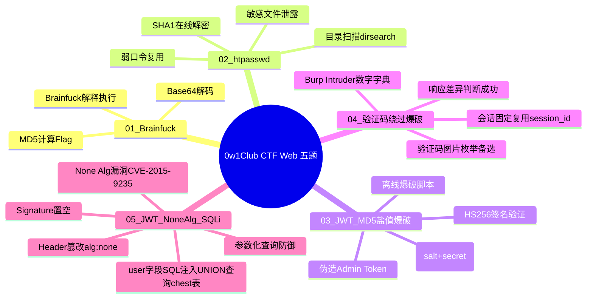

# 0w1Club CTF Web 方向五题完整解题思路

> 来源：0w1Club 微信公众号文章「题解 | WEB」，作者 Windwing。本页面将原文零散的题解整理为结构化知识页面，补充关键技术点并建立交叉引用。

---

## 概览

本次比赛共 5 道 Web 题目，涵盖编码解码、敏感文件泄露、JWT 认证绕过、验证码机制缺陷、JWT 算法混淆结合 SQL 注入等核心 Web 安全知识点。题目难度由浅入深，适合 Web 入门进阶练习。

| 序号 | 题目名称 | 核心考点 | 难度 |
|------|----------|----------|------|
| 01 | 签到题 | Base64 解码 + Brainfuck 解释执行 | 入门 |
| 02 | .htpasswd | Apache 站点保护配置文件泄露 + SHA1 解密 | 入门 |
| 03 | jwt验证 | JWT MD5 盐值爆破 + 伪造 Token | 中等 |
| 04 | 暴力破解 | 验证码固定绕过 + 会话复用 + 密码爆破 | 中等 |
| 05 | jwt+SQL | JWT None Alg 漏洞 + SQL 注入 | 困难 |

---

## 题目 01：签到题 — Base64 + Brainfuck

### 题目描述

查看 HTML 源代码第 1000 行，发现一串 Base64 编码的字符串。

### 解题步骤

1. **提取 Base64 字符串**：从 HTML 第 1000 行获取编码内容。
2. **Base64 解码**：解码得到一段 **Brainfuck** 代码（一种极简 esoteric 语言，仅包含 `><+-.,[]` 八个指令）。
3. **执行 Brainfuck**：使用在线解释器或本地脚本运行代码，输出一段文本（彩蛋）。
4. **计算 MD5**：将输出文本计算 MD5 值，即为 Flag。

### 关键技术点

- **Brainfuck 语言基础**：指针移动、字节增减、输入输出、循环结构。
- **在线工具推荐**：[Brainfuck Visualizer](https://fatiherikli.github.io/brainfuck-visualizer/)、[Copy.sh Brainfuck](https://copy.sh/brainfuck/)。
- **脚本化解码**：可用 Python `base64` + 自定义 BF 解释器自动化。

### 变体与延伸

- CTF 常见编码链：Base64 → Rot13 → Hex → Brainfuck → ...
- 结合 `pwnlib.tubes.process` 或 `subprocess` 自动化执行。

---

## 题目 02：.htpasswd — 敏感配置文件泄露

### 题目描述

Apache 服务器启用站点保护（Basic Auth），密码存储在 `.htpasswd` 文件中。目标站点根目录存在该文件且可直接访问。

### 解题步骤

1. **目录扫描**：使用 `dirsearch`、`dirb` 或 `gobuster` 扫描网站根目录，发现 `.htpasswd` 可访问。
   ```bash
   dirsearch -u http://target/ -e php,html,txt,bak,zip -w /path/to/wordlist
   ```
2. **下载文件**：获取 `.htpasswd` 内容，格式为 `username:hash`，Hash 为 **SHA1**（Apache 默认 `{SHA}` 或明文 SHA1）。
3. **在线解密**：将 Hash 提交至 [CMD5](https://www.cmd5.com/)、[CrackStation](https://crackstation.net/) 等在线彩虹表站点破解明文密码。
4. **登录后台**：使用破解出的凭据登录受保护站点，获得 Flag。

### 关键技术点

| 知识点 | 说明 |
|--------|------|
| `.htaccess` | Apache 分布式配置文件，控制目录访问权限 |
| `.htpasswd` | 存储用户名与加密密码，格式 `user:hash` |
| Hash 类型 | Apache 支持 `crypt`、`SHA1`（`{SHA}`）、`bcrypt`、`MD5`（`$apr1$`） |
| 防御措施 | 禁止 Web 直接访问 `.ht*` 文件（`<Files ~ "^\.ht"> Require all denied </Files>`） |

### 实战技巧

- **Fuzz 扩展名**：`.htpasswd.bak`、`.htpasswd.txt`、`.htpasswd~` 等备份文件。
- **组合利用**：若 Hash 为 `$apr1$` (MD5-based)，可用 `hashcat -m 1600` 或 `john --format=md5crypt` 离线爆破。
- **横向移动**：复用凭据尝试 SSH、FTP、数据库等服务。

---

## 题目 03：jwt验证 — JWT MD5 盐值爆破

### 题目描述

登录测试账号后，Cookie 中包含 JWT Token。解码发现采用 **HS256 (HMAC-SHA256)** 签名，但密钥为 **MD5(salt + secret)** 形式，需爆破盐值。

### 解题步骤

1. **获取 JWT**：登录测试账号，从 Cookie/响应头提取 Token。
2. **解码分析**：
   - Header: `{"alg":"HS256","typ":"JWT"}`
   - Payload: `{"user":"test",...}`
   - Signature: HMAC-SHA256(base64url(header)+"."+base64url(payload), key)
3. **确定密钥生成逻辑**：源码或猜测得知 `key = md5(salt + "secret_string")`，其中 `secret_string` 固定，`salt` 为短字符串（如 4-6 位数字/字母）。
4. **编写爆破脚本**（推荐 PHP 保持与后端一致）：
   ```php
   <?php
   $target_jwt = "eyJ...signature";
   $secret = "known_secret";
   $charset = '0123456789abcdefghijklmnopqrstuvwxyz';
   for ($len = 4; $len <= 6; $len++) {
       brute($len, "");
   }
   function brute($len, $prefix) {
       global $charset, $target_jwt, $secret;
       if (strlen($prefix) === $len) {
           $key = md5($prefix . $secret);
           $calc = hash_hmac('sha256', $payload, $key, true);
           if (base64url_encode($calc) === $signature) {
               echo "Found salt: $prefix\n";
               exit;
           }
           return;
       }
       foreach (str_split($charset) as $c) {
           brute($len, $prefix . $c);
       }
   }
   ```
5. **伪造 Admin Token**：爆破出 `salt` 后，计算 `key = md5(salt + secret)`，构造 Payload `{"user":"admin"}` 重新签名，替换 Cookie 刷新页面获取 Flag。

### 关键技术点

- **JWT 结构**：Header.Payload.Signature，Base64URL 编码。
- **HS256 签名验证**：服务端用相同密钥重算签名对比。
- **弱密钥爆破**：密钥熵低（短盐值 + 固定字符串）可离线暴力破解。
- **工具辅助**：
  - `jwt_tool` / `jwt-cracker` / `hashcat -m 16500` (HMAC-SHA256)
  - 本地脚本更灵活，适应自定义密钥派生逻辑。

### 相关页面

- [[jwt漏洞原理与实战利用]] — 系统梳理 JWT 结构、算法混淆、密钥爆破、信息泄露等漏洞类型与利用工具。
- [[0w1club-ctf-web-writeup-hash-extension-rsa]] — 同俱乐部另一篇 Web Writeup，含哈希长度扩展攻击、PHP 弱类型比较、RSA 解密等技术点。

---

## 题目 04：暴力破解 — 验证码绕过与会话复用

### 题目描述

后台登录接口：用户名 `admin`，密码为 6 位数字。存在图形验证码，但验证码机制存在缺陷。

### 解题思路

#### 方案一：验证码图片枚举（暴力破除）

- 观察发现验证码图片总共仅 **3 张**，文件名固定或可枚举。
- 预下载 3 张验证码图片 → 本地 OCR 或人工识别 → 建立 `filename -> code` 映射表。
- 爆破时直接根据返回的验证码图片文件名查表填入，绕过识别环节。

#### 方案二：会话固定复用（推荐，通用性强）

1. **发现机制**：验证码值存储在 Session 中，Session ID 由 Cookie `session_id` 标识。
2. **固定 Session**：
   - 先请求登录页面/验证码接口，获取 `Set-Cookie: session_id=abc123`。
   - **后续所有请求均携带同一 `session_id`**，服务端 Session 不变，验证码值不变。
3. **自动化爆破**：
   - 使用 **Burp Suite Intruder** 或 **Python 脚本** 循环尝试 `000000` ~ `999999`。
   - Payload 位置：`password` 参数；Cookie 固定 `session_id=abc123`。
   - 根据响应长度/关键字/状态码判断成功。

### 关键技术点

| 技术点 | 说明 |
|--------|------|
| Session 固定 | 攻击者预设 Session ID，诱导/强制受害者使用，实现会话劫持或绑定验证码 |
| 验证码存储 | 服务端 `$_SESSION['captcha'] = $code`，客户端仅需保持 Session ID 不变 |
| Burp Intruder | Payload Type: Numbers (0-999999, step 1, padding 6)；Grep Match 关键字 `flag`/`success`/`welcome` |
| 脚本并发 | Python `requests.Session()` 自动处理 Cookie，配合多线程/协程提速 |

### 实战技巧

- **响应差异分析**：成功登录通常 302 跳转、Set-Cookie 更新、Body 包含 `admin`/`flag`；失败返回原页面含错误提示。
- **防爆破绕过**：若有 IP 限制，尝试 `X-Forwarded-For` 伪造、代理池、分布式爆破。
- **验证码复用进阶**：若验证码随 Session 刷新，可「获取验证码 → 识别 → 立即登录」单线程串行，避免 Session 失效。

### 相关页面

- [[burpsuite-basics-tutorial]] — Burp Suite Proxy/Repeater/Intruder 全流程入门，适合快速上手本题自动化爆破。

---

## 题目 05：jwt+SQL — JWT None Alg + SQL 注入

### 题目描述

页面提示后台有数据库，Cookie 使用 JWT 认证。需结合 JWT **None Alg 漏洞** 绕过签名验证，在 Payload 中注入 SQL 语句查询 `chest` 表获取 Flag。

### 解题步骤

1. **识别 JWT 认证**：Cookie 中 Token 解码后 Header 含 `"alg":"HS256"`。
2. **利用 None Alg 漏洞（CVE-2015-9235）**：
   - 修改 Header 为 `{"alg":"none","typ":"JWT"}`（大小写不敏感，`None`/`NONE` 均可尝试）。
   - **Signature 置空**（删除最后一段或保留为空字符串）。
   - 服务端若未严格校验 `alg`，会直接跳过签名验证，信任 Payload 内容。
3. **构造 SQL 注入 Payload**：
   - 推测后端查询逻辑：`SELECT * FROM users WHERE username = '<payload_user>'`。
   - 在 `user` 字段注入：`admin' UNION SELECT flag FROM chest-- ` 或 `' OR 1=1--` 等。
   - 完整 Payload 示例：
     ```json
     {"user":"admin' UNION SELECT flag FROM chest-- "}
     ```
4. **组装 Token**：
   - `token = base64url(header_none) + "." + base64url(payload_sqli) + "."`
   - 替换 Cookie 访问目标页面，触发注入，回显 Flag。

### 关键技术点

| 漏洞 | 原理 | 利用条件 |
|------|------|----------|
| **None Alg** | JWT 规范允许 `alg: "none"` 表示无签名，库若未禁用会直接信任 Payload | 服务端使用易受影响库（早期 `node-jsonwebtoken`、`php-jwt` 等）且未显式限制算法白名单 |
| **SQL 注入** | 用户可控字段拼接进 SQL 语句，未使用参数化查询 | 后端直接拼接 `username` 进查询，且报错/回显可利用 |

### 防御与修复

- **JWT 库升级**：升级至修复版本（如 `jsonwebtoken@8.5.1+`、`firebase/php-jwt@v5.0.0+`）。
- **算法白名单**：验证时显式指定 `algorithms: ['HS256']`，拒绝 `none`。
- **参数化查询**：使用 Prepared Statements / ORM，严禁拼接用户输入。
- **最小权限**：数据库账号仅授予必要表的 SELECT 权限，禁止 UNION 跨表查询敏感表。

### 变体与延伸

- **JWKS 注入**：`Header` 指定 `jku` 指向恶意 JWKS 端点，控制公钥验证。
- **算法混淆**：HS256 公钥当 RSA 公钥用，利用公钥已知特性伪造签名。
- **嵌套 JWT**：Payload 再包含一个 JWT，绕过单层校验。

### 相关页面

- [[jwt漏洞原理与实战利用]] — 含 None Alg、算法混淆、密钥爆破、JWKS 注入等完整利用链与工具推荐。
- [[0w1club-ctf-web-writeup-hash-extension-rsa]] — 另一场 0w1Club Web Writeup，涉及哈希长度扩展、PHP 弱类型、RSA 解密，可对比学习。

---

## 总结与知识图谱



---

## 学习资源与工具箱

| 类别 | 推荐资源 |
|------|----------|
| **JWT 攻防** | [jwt.io](https://jwt.io/)、[jwt_tool](https://github.com/ticarpi/jwt_tool)、[PortSwigger JWT Labs](https://portswigger.net/web-security/jwt) |
| **SQL 注入** | [SQLMap](https://sqlmap.org/)、[PayloadsAllTheThings](https://github.com/swisskyrepo/PayloadsAllTheThings/tree/master/SQL%20Injection) |
| **暴力破解** | [Burp Suite](https://portswigger.net/burp)、[hydra](https://github.com/vanhauser-thc/thc-hydra)、[patator](https://github.com/lanjelot/patator) |
| **目录扫描** | [dirsearch](https://github.com/maurosoria/dirsearch)、[feroxbuster](https://github.com/epi052/feroxbuster) |
| **编码/解码** | [CyberChef](https://gchq.github.io/CyberChef/)、[Base64.guru](https://base64.guru/) |
| **Brainfuck** | [Esolangs Brainfuck](https://esolangs.org/wiki/Brainfuck)、[在线解释器](https://copy.sh/brainfuck/) |

---

## 相关页面索引

- [[0w1club-wechat-archive-201908-202207]] — 0w1Club 微信归档总索引（2019.08–2022.07），含本文来源文章。
- [[0w1club-ctf-web-writeup-hash-extension-rsa]] — 同俱乐部另一篇 Web Writeup（哈希长度扩展、PHP 弱类型、RSA）。
- [[0w1club-ctf-crypto-writeup-easyrsa-t9]] — 同俱乐部 Crypto 方向 Writeup（RSA 大数分解、T9 九键）。
- [[0w1club-ctf-misc-writeup-steganography-traffic-analysis]] — 同俱乐部 MISC 方向 Writeup（隐写、流量分析、WiFi 定位）。
- [[jwt漏洞原理与实战利用]] — JWT 漏洞系统总结（None Alg、算法混淆、密钥爆破、JWKS 注入）。
- [[burpsuite-basics-tutorial]] — Burp Suite 核心功能入门教程（Proxy/Repeater/Intruder/Scanner）。

---

*页面维护：数字知识库策展人 | 最后更新：2025-01-14*

## 来源

- [0w1网络安全俱乐部-201707-201903_22](../sources/0w1网络安全俱乐部-201707-201903_22.md)
