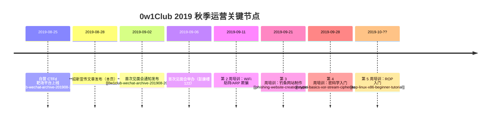

# 0w1Club 2019 年招新宣传文章

## 概述

2019 年 8 月下旬，0w1Club 通过微信公众号发布**秋季招新宣传文章**（mid=2247483664，早于首次见面会通知 mid=2247483705），面向西安交通大学全校本科生公开招募新成员。文章系统介绍了社团定位、核心活动（CTF 竞赛、安全峰会、企业实习、科研训练）、分层培养目标（萌新技能树 / 大佬交流环境）及入群验证机制，是社团**从线上组建转入公开招新、启动秋季培训序列**的关键启动文物。

> **原文链接**：[http://mp.weixin.qq.com/s?__biz=MzU3MTkzNzk4Mg==&mid=2247483664&idx=1&sn=22dfe7f7b9ef9c817f72231c3a117bfc&chksm=fcd9c4c1cbae4dd7db0b01cc6ebd72495ebc2db547d56f982201cb5ef7ab4692b2cdcc3b13c6&scene=27#wechat_redirect](http://mp.weixin.qq.com/s?__biz=MzU3MTkzNzk4Mg==&mid=2247483664&idx=1&sn=22dfe7f7b9ef9c817f72231c3a117bfc&chksm=fcd9c4c1cbae4dd7db0b01cc6ebd72495ebc2db547d56f982201cb5ef7ab4692b2cdcc3b13c6&scene=27#wechat_redirect)

## 核心信息速览

| 项目 | 详情 |
| :--- | :--- |
| **发布时间** | 2019-08 下旬（mid=2247483664，归档序列首篇） |
| **社团全称** | 西安交通大学 0w1 网络安全俱乐部 |
| **成立时间** | 2016 年 |
| **归属单位** | 西安交通大学网络安全学院 |
| **核心定位** | 构建本科生网络安全学习环境、统一学习、定期参赛、为科研/实战输送人才 |
| **招新 QQ 群** | 770991011 |
| **入群验证** | 问题答案需 Base64 编码提交（引导萌新自主搜索学习） |
| **作者/排版** | 夜晓 |

## 社团定位与从属关系

- **学院背书**：隶属西安交通大学网络安全学院，获得学院师资与课题组资源支持。
- **人才输送链**：显式提出“为网络安全科研、实战方向输送人才”，形成 **招新 → 培训 → 竞赛/科研/实习 → 就业/深造** 完整链条。
- **成立年份**：2016 年，至 2019 年招新已运营三年，具备成熟培训体系与赛事经验。

## 核心活动版图

### CTF 夺旗赛（核心竞技载体）

| 维度 | 内容 |
| :--- | :--- |
| **起源** | 1996 年 DEFCON 全球黑客大会，替代真实攻防对抗 |
| **现状** | 全球网络安全圈主流竞赛形式 |
| **文化梗** | 引用热播剧《亲爱的，热爱的》同款比赛，降低认知门槛 |
| **线下赛实况** | 强调体力消耗、团队协作，配图展示比赛现场、Flag 提交界面、队名“脸滚键盘”自嘲文化 |
| **关联训练** | 后续秋季培训序列（Web、逆向、Pwn、密码学、杂项）直接服务于 CTF 技能树构建 [[0w1club-wechat-archive-201908-202207]] |

### 安全峰会与行业视野拓展

- **参会记录**：组织成员参观国内顶级安全峰会（如腾讯安全、蚂蚁金服等厂商展台）。
- **副产出**：抽取厂商周边（公仔等），兼具社交与行业认知功能。
- **大佬面基**：照片记录与“黑客教父级”冰河大佬合影，强化成员荣誉感与榜样引领。

### 企业实习通道：绿盟科技

| 要素 | 详情 |
| :--- | :--- |
| **合作企业** | 绿盟科技（NSFOCUS），国内网络安全一线上市企业 |
| **合作模式** | 校企合作关系，假期定向推荐社团成员至安全岗位实习 |
| **实习场景** | 图文展示成员在绿盟工区、会议室、茶歇区活动，真实还原职场环境 |
| **人才流向** | 实习 → 留用/简历背书 → 头部厂商/红队/安全研究岗 |

### 科研训练机会：网安学院课题组

- **资源来源**：网络安全学院教师对社团支持，开放课题组名额。
- **参与形式**：有科研兴趣成员可加入课题组进行科研训练，产出论文/专利/竞赛成果。
- **双轨并行**：与“实战竞赛”形成 **科研-实战双轨培养** 特色，区别于纯技术社团。

## 分层培养体系设计

### 萌新技能树（显式清单化）

| 领域 | 目标技能点 |
| :--- | :--- |
| **编程/代码审计** | 快速掌握基本编程技能、代码审计入门 |
| **服务器/网络协议** | 服务器基本常识、网络通信协议原理 |
| **密码学** | 广泛了解密码学相关知识（后续第 4 周专项培训 [[crypto-basics-xor-stream-cipher-tutorial]]） |
| **逆向工程** | 反汇编、软件破解及相关知识（后续逆向专题 [[reverse-engineering-beginner-learning-path]]） |
| **二进制利用** | Pwn 相关技能，深入理解计算机运行原理（后续 ROP 入门 [[rop-linux-x86-beginner-tutorial]]） |

> **设计意图**：以“快速掌握/学习掌握/广泛了解”分级动词，隐含**入门→进阶→拓宽**三阶段认知负荷管理。

### 大佬/资深成员价值

- 轻松技术交流环境（高密度同伴学习）
- “一起搞事情”的愉悦体验（CTF 组队、漏洞挖掘、工具开发）
- “求大佬带飞”反向需求匹配（导师制萌芽）

### 全员通享红利

- **科研实习机会**：课题组 + 绿盟双通道
- **企业实习经历**：简历关键加分项

## 入群验证机制：Base64 解码门槛

| 设计点 | 说明 |
| :--- | :--- |
| **验证方式** | 入群问题答案需 Base64 编码后提交 |
| **隐性考察** | 搜索引擎使用能力、Base64 编解码基础认知、自主解决问题意识 |
| **文化隐喻** | “搜索引擎永远是最好的老师” —— 确立社团**自主学习、工具赋能**的文化基因 |
| **门槛定位** | 极低技术门槛，高筛选“主动学习意愿”人群，符合萌新友好却拒绝伸手党的社团治理哲学 |

## 在 2019 秋季运营序列中的时序定位

**逻辑链条**：
1. **基建先行**（8 月底靶场就绪） → 
2. **公开招新**（本文，引流入群） → 
3. **线下破冰**（见面会，人员聚合） → 
4. **周度培训序列启动**（技能树落地，靶场题目配套）

## 交叉引用与知识图谱关联

| 关联页面 | 关联说明 |
| :--- | :--- |
| [[0w1club-wechat-archive-201908-202207]] | 微信文章总索引页，本招新文为按 mid 排序的最早文章（mid=2247483664），拉开 2019-2022 归档序列 |
| [[0w1club-wechat-archive-201908-202207]] | 首次见面会通知为招新文后续动作，同属秋季运营启动三部曲（基建→招新→见面） |
| [[crypto-basics-xor-stream-cipher-tutorial]] | 第 4 周密码学培训兑现招新文“广泛了解密码学”承诺，配套靶场题目上线 |
| [[phishing-website-creation-tutorial]] | 第 3 周钓鱼网站培训对应“代码审计/Web 安全”技能树节点，SET/手工 PHP/Docker 三路径实战 |
| [[rop-linux-x86-beginner-tutorial]] | 第 5 周 ROP 入门兑现“Pwn 技能、深入理解计算机运行原理”承诺，GDB/GEF/Pwntools 全工具链实战 |
| [[reverse-engineering-beginner-learning-path]] | 逆向工程学习路径页面可引用招新文“反汇编/软件破解”技能点及后续逆向专题作为里程碑 |
| [[linux-kernel-hardening-mechanisms]] | 科研/实习方向延伸：内核加固机制为高阶二进制安全与漏洞利用对抗的理论基础 |

## 组织运营启示录

| 维度 | 表现 | 评价 |
| :--- | :--- | :--- |
| **品牌叙事** | 引用热播剧、自嘲队名、大佬合影、实习实景图 | 兼具破圈传播力与圈层真实感，极强的“种草”能力 |
| **资源整合** | 学院课题组 + 头部企业（绿盟）双通道 | 校企融合、科研实战双轨，稀缺资源显式承诺，极大提升加入期望值 |
| **培养承诺** | 技能清单化、分层描述、动词分级 | 降低认知负荷、设定合理预期、便于后续考核对标 |
| **入群筛选** | Base64 编码验证 | 零成本筛选“会搜索、会动手、有好奇心”种子用户，文化基因首秀 |
| **节奏把控** | 靶场就绪 → 招新 → 见面 → 培训，无真空期 | 标准化运营 SOP 雏形，后续三年持续复用 |

## 结语

0w1Club 2019 年招新宣传文章虽为一篇推文，实为**社团战略意图的公开宣示书**：以 CTF 为核心载体，以学院课题组与绿盟实习为双翼，构建“萌新有阶梯、大佬有舞台、全员有红利”的生态闭环。Base64 入群验证一笔勾勒出“自主学习、工具赋能”的社团基因，配合前置靶场建设与后续周度培训序列，展现出极高的组织成熟度与运营前瞻性。这篇文章不仅招来了 2019 级萌新，更确立了 0w1Club 后续三年持续产出高质量人才、承办校省级赛事、沉淀精品题库的组织范式。

---

## 数据维护记录

| 版本 | 日期 | 维护人 | 变更摘要 |
| :--- | :--- | :--- | :--- |
| 1.0 | 2026-11-13 | 知识库策展人 | 基于 2019-08 微信公众号原文创建，结合归档索引时间线与后续培训序列结构化整理 |

## 来源

- [0w1Club-201908-202207_27](../sources/0w1Club-201908-202207_27.md)
