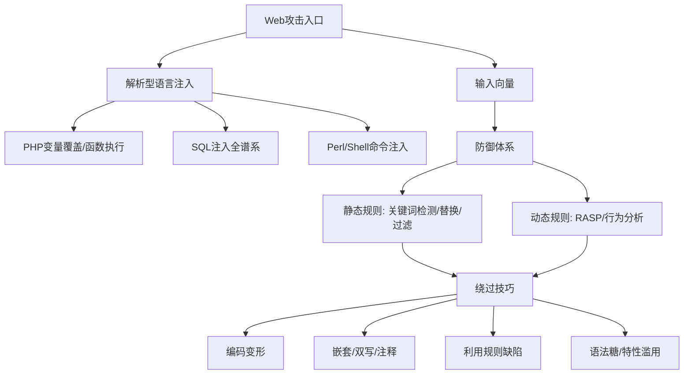

## 培训概况

| 项目 | 内容 |
|------|------|
| **主题** | Web攻击入口简介、各种脚本注入原理与实现、注入防御与绕过 |
| **时间** | 周日（5月6日）19:00，时长 60 分钟 |
| **地点** | 网络安全实验室会议室 |
| **主讲人** | windwing（网络安全业余爱好者，擅长 Web、Misc、Crypto 方向） |
| **归档来源** | 0w1Club 微信公众号历史文章 |

> 📌 **训练定位**：面向萌新的入门级知识梳理，仅提供思路与引子，具体技术细节需自行深入研究。

---

## 一、Web 攻击入口分类

主讲人将 Web 攻击面归纳为六大类入口，覆盖客户端可控数据提交的所有路径：

1. **输入框**  
   - 文字输入框（搜索、登录、留言等）  
   - 文件上传功能（文件名、Content-Type、文件内容）

2. **HTTP 请求参数**  
   - GET 请求：URL 查询字符串  
   - POST 请求：Body 参数（form-data、x-www-form-urlencoded、JSON 等）

3. **Cookie**  
   - Cookie 值、Session ID、自定义字段

4. **URL 结构本身**  
   - 子站点、虚拟目录  
   - 隐藏文件（如 `.htaccess`、`.git`、备份文件）

5. **其他端口服务**  
   - 非 80/443 端口的 Web 管理界面、API、调试接口

6. **前端交互层**  
   - JavaScript/AJAX 动态请求  
   - WebSocket、WebRTC 等新型通信通道

> **延伸阅读**：[[0w1club-week2-wifi-hijacking-arp-spoofing]] 中介绍的中间人攻击可进一步拦截/篡改上述入口的明文流量。

---

## 二、解析型语言注入原理

培训重点解析四类解释型语言的注入特性，核心在于**数据与代码边界模糊**：

| 语言 | 典型注入场景 | 关键机制 |
|------|--------------|----------|
| **PHP** | 变量覆盖、`eval()`/`assert()`、`preg_replace('/e')`、`create_function()` | 弱类型、动态变量解析、函数名可变调用 |
| **SQL** | 拼接查询、存储过程、ORDER BY/GROUP BY 子句 | 单引号闭合、注释截断、UNION/盲注/报错注入 |
| **Perl** | `open()` 管道符、`eval()`、反引号执行命令 | Taint 模式缺失、隐式命令执行 |
| **Windows Batch** | `%变量%` 展开、`FOR /F` 循环、`cmd /c` 传参 | 延迟环境变量扩展、特殊字符（`&` `|` `^`）转义缺失 |

> **关联页面**：  
> - [[0w1club-ctf-web-writeup-hash-extension-rsa]] 中的「哈哈哈希」题目涉及 PHP 弱类型比较绕过。  
> - [[0w1club-ctf-web-writeup-jwt-sqli-brute]] 实战演示了 JWT 盐值爆破与 SQL 注入组合利用。  
> - [[ecshop-414-sql-injection-analysis]] 深度剖析 ECShop 中从 HTTP 头到 SQL 执行的完整链路。  
> - [[h2-console-jndi注入rce利用]] 展示 Java 反序列化与 JNDI 注入的另类「注入」视角。

---

## 三、主流注入防御机制

防御体系按处理阶段分为**静态检测**与**动态阻断**两大类：

### 静态检测/处理（请求入口侧）

| 策略 | 典型实现 | 局限性 |
|------|----------|--------|
| **敏感关键词检测** | 正则匹配 `select|union|sleep|eval|system` 等 | 误报高、大小写/编码绕过 |
| **敏感关键词替换** | `select` → `""`、`script` → `scrscriptipt` | 递归替换可绕过、破坏正常业务 |
| **敏感关键词过滤/删除** | 直接移除危险字符（引号、分号、尖括号） | 双写绕过、编码绕过、截断绕过 |
| **禁止危险函数执行** | `disable_functions=exec,shell_exec,system,passthru` | 仅限 PHP、可通过 `LD_PRELOAD`、`putenv` 绕过 |

### 动态检测/阻断（运行时侧）

| 策略 | 典型实现 | 代表产品 |
|------|----------|----------|
| **敏感数据检测** | 响应体含身份证/信用卡/密码特征 → 脱敏/拦截 | DLP、WAF 出站规则 |
| **危险行为检测** | 进程创建子进程、文件写入可执行目录、网络反连 | RASP（如 OpenRASP）、HIDS、EDR |

> **实战对抗**：[[burpsuite-basics-tutorial]] 中的 Intruder/Repeater 可用于自动化测试各类防御规则的触发条件与绕过路径。

---

## 四、注入绕过核心技巧（实战思路）

培训提炼四类通用绕过模式，建议结合具体语言/中间件特性灵活组合：

### 编码变形
- **URL 编码/双重编码**：`%2527` → `%27` → `'`
- **Unicode/HTML 实体**：`&#x27;`、`\u0027`
- **Base64/Hex/ROT13**：配合解码函数（`atob`、`decodeURIComponent`、`base64_decode`）
- **数据库特有编码**：MySQL `0x61646D696E`、MSSQL `CHAR(0x61)+CHAR(0x64)...`

### 嵌套与分层绕过
- **关键词双写**：`seleselectct` → 单次替换后仍保留 `select`
- **注释分隔**：`/**/UNION/**/SELECT`、`/*!50000UNION*/`（MySQL 版本注释）
- **参数污染**：`id=1&id=2` 导致后端取值差异（PHP 取最后、ASP 取第一、Java 取数组）

### 利用防御规则本身
- **替换顺序漏洞**：先替换 `script` 再替换 `alert`，构造 `scralertipt` → 替换后变 `script`
- **截断长度限制**：超长 Payload 触发 WAF 截断，残留片段意外拼成有效攻击代码
- **正则回溯/ReDoS**：构造恶意输入耗尽 WAF 正则引擎资源，导致放行

### 语法糖与特性滥用
| 语言 | 技巧示例 |
|------|----------|
| **SQL** | `/*!50000SELECT*/`、`{fn NOW()}`（ODBC 标准）、`/**/` 内联注释 |
| **PHP** | `assert($_POST[x])`、`($f="system")($f("ls"))`、反引号 `` `ls` `` |
| **JavaScript** | `eval(unescape("%61%6c%65%72%74(1)"))`、JSFuck `[[][[]]+[]][+[]]...` |
| **Shell** | `${IFS}` 替代空格、`$@` 参数拼接、`<>` 重定向执行命令 |

> **CTF 实战案例**：  
> - [[0w1club-ctf-web-writeup-hash-extension-rsa]]：PHP 弱类型 `0e` 科学计数法绕过 `md5` 比较。  
> - [[mtctf-2021-web-writeup]]：PHP 反序列化条件竞争、`Session Upload Progress` 利用、`glob`/`copy`/`+a` 黑名单绕过。  
> - [[tctf-2021-1linephp-zip-include]]：`zip://` 协议包含临时文件、ZIP 头偏移绕过前缀限制。  
> - [[tctf-2021-worldcup-xss-go-ssti]]：Go 模板注入（SSTI）结合 Unicode 编码绕过 XSS 过滤。  
> - [[spring-boot-actuator配置不当rce利用]]：Spring Boot Actuator `/env` + `/restart` + H2 `CREATE ALIAS` 链式 RCE。  
> - [[java-urlconnection-ssrf-protocol-bypass]]：Java `URLConnection` 自动剥离 `url:` 前缀绕过协议黑名单。

---

## 五、训练提示（TIPS）

1. **分类不严格，勿纠结学术定义** —— 重点掌握攻击面覆盖与利用链拼接思维。  
2. **仅提供思路与引子** —— 具体 Payload 构造、工具用法、环境搭建需自行 Google/实验。  
3. **灵活组合，实战为王** —— 如「防火墙规则 + 应用层过滤」双层防御下，需分别测试并寻找差异点（编码解码顺序、规则优先级、长度限制等）。

---

## 六、关联知识图谱

---

## 七、延伸学习资源

| 方向 | 推荐页面/资源 |
|------|---------------|
| **0w1Club 历期培训** | [[0w1club-week2-wifi-hijacking-arp-spoofing]]、[[0w1club-week8-raspberry-pi-training]]、[[0w1club-training-shellshock-cgi-exploitation]] |
| **Web 安全系统化入门** | [[burpsuite-basics-tutorial]]、[[jwt漏洞原理与实战利用]] |
| **代码审计与漏洞挖掘** | [[cmseasy-7.3.8-code-audit]]、[[ecshop-414-sql-injection-analysis]]、[[zzzcms-v1.7.5-audit]]、[[spring-boot-actuator配置不当rce利用]] |
| **CTF Web 实战 Writeup** | [[0w1club-ctf-web-writeup-hash-extension-rsa]]、[[0w1club-ctf-web-writeup-jwt-sqli-brute]]、[[mtctf-2021-web-writeup]]、[[diwuzhijian-2020-web-writeup]] |
| **Java 生态漏洞链** | [[h2-console-jndi注入rce利用]]、[[spring-boot-devtools-deserialization-rce]]、[[java-urlconnection-ssrf-protocol-bypass]] |
| **日常安全动态跟踪** | [[daily-security-digest-20191120]] 等「每日安全看点」系列 |

---

> 📝 **页面维护提示**：本页基于 0w1Club 微信公众号历史文章整理，若原文存在更新或补充材料，请通过 PR 同步。交叉引用目标页面需确保已在知识库中存在（使用 `[[wikilink]]` 语法）。

## 来源

- [0w1网络安全俱乐部-201707-201903_29](../sources/0w1网络安全俱乐部-201707-201903_29.md)
