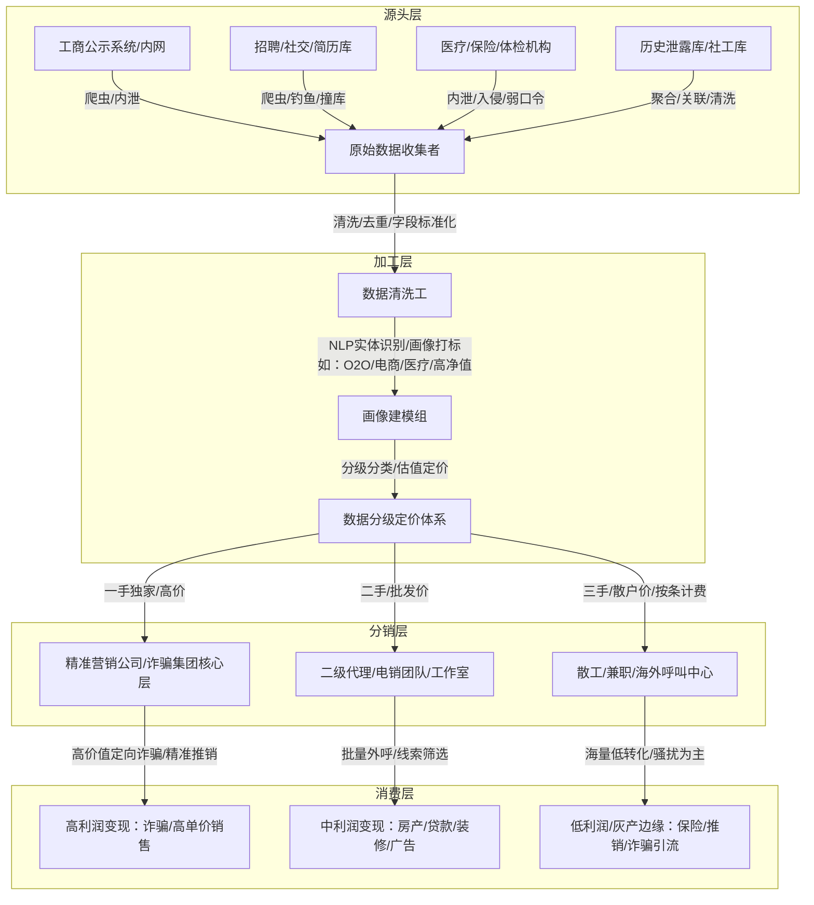

## 归档索引概述

本页面为 **301在路上** 微信公众号（2015年8月-2022年8月）归档文章的结构化索引沉淀页。围绕**隐私数据非法获取与黑产变现**这一核心主题，收录两篇高价值深度复盘文章：

1. **《你“窃取”了我的隐私，为何还这么嚣张？》**（2016-07）：以作者亲历精准营销骚扰电话为切入点，揭示企业工商注册数据如何被非法爬取、画像、分级、多级分销，延伸至艾滋病患者隐私诈骗等恶性场景，拆解黑产链条全貌与监管困境。
2. **《数据泄露！你的数据还安全吗？》**（2016-07）：盘点大麦网购票用户被诈骗、全国26省艾滋病感染者信息泄露、安徽6000名新生儿视频外泄三大典型案例，剖析源码复用漏洞连锁、撞库攻击、内鬼倒卖三大核心成因。

两文互为因果与佐证：前者从**数据流向与黑产生态**视角纵向溯源，后者从**典型案例与技术成因**视角横向切面，共同构建了2016年前后中国互联网数据黑产的立体画像。

> **归档范围**：2015-08 ~ 2022-08  
> **公众号ID**：MzIwMTQ2NzY4NA== (301在路上)  
> **本页定位**：程序分析 / 威胁情报 / 安全治理 参考资料

---

## 文章一：精准营销骚扰电话与隐私数据黑产链条深度复盘（2016-07）

> **原文链接**：http://mp.weixin.qq.com/s?__biz=MzIwMTQ2NzY4NA==&mid=2652520711&idx=1&sn=591c751b8bd6507fde2345768978ce12&chksm=8d03934cba741a5a553d02941f0641167a7eec8014054aae4f4d14c69b2b76f9d460728ea8a8&scene=126&sessionid=1681656737#rd  
> **原文归档**：[301在路上-201508-202208_101](../sources/301在路上-201508-202208_101.md)  
> **发布时间**：2016年7月中下旬

### 核心事件：一通"精准"到令人毛骨悚然的推销电话

| 维度 | 详情 |
|------|------|
| **受害主体** | 301在路上作者（安全从业者、创业者） |
| **受害时间** | 2016年7月中下旬某天下午 |
| **攻击向量** | 个人手机号码直拨（非400/95/虚拟运营商号段） |
| **精准画像维度** | 姓名、单位名称、职位、电话、公司经营领域（被归类为O2O） |
| **公司状态** | 刚注册不久，作者自己仍在探索业务定位 |
| **来电者话术** | 1. "信息获取来源合法" 2. "同行业大家都这样做，默许规则" 3. "相信你，同类电话不是第一次遇到"（暗示数据多次转手） 4. 主动提供单位名、业务范围，邀请合作 |

### 关键矛盾点

1. **时间悖论**：公司注册极短时间内，完整工商/经营信息即被结构化入库、画像标签（O2O）、分配至销售线索池。
2. **合法性伪装**：来电者以"合法获取""行业默许规则"为挡箭牌，将**非法爬取/内泄/多级转卖**合规化叙事。
3. **多轮转手铁证**："同类电话不是第一次" 直接佐证数据在黑产链条中**多级分销、重复变现**。
4. **从商业骚扰到生命威胁**：文中显性关联 **艾滋病患者隐私被欺诈骗钱**，揭示同一黑产基础设施支撑的**分级危害谱系**——从商业推销到诈骗敲诈，仅是数据标签与话术差异。

### 数据流向溯源：从"生产"到"消费"的完整链路

#### 数据源头画像

| 数据类型 | 可能来源 | 窃取/获取手法 | 关联技术页面 |
|----------|----------|---------------|--------------|
| **工商注册信息** | 国家企业信用信息公示系统、地方工商局内网、第三方企查查/天眼查/爱企查等聚合平台 | 爬虫规模化采集、内部人员违规导出、API滥用调用 | [[vulnerability-mining-recon-aiqicha-fofa#资产测绘与语法构造]]、[[api-business-logic-phone-enumeration#业务逻辑缺陷利用]] |
| **法人/高管/联系人身份信息** | 工商登记留存、社保/公积金缴纳记录、招聘平台简历库、社交网络、过往数据泄露库（社工库） | 撞库/凭据填充、社工钓鱼、内部贿赂、简历投递钓鱼 | [[social-engineering-attack-techniques#凭据窃取与账号劫持]]、[[threat-attribution-tracing-techniques#威胁情报来源与暗网监测]] |
| **企业经营范围/业务方向** | 工商登记经营范围、官网/招聘JD/公开宣传资料、竞品情报采集 | NLP自动化标签提取、人工研判打标 | [[vulnerability-mining-recon-aiqicha-fofa#技术栈指纹识别]] |
| **医疗/敏感人群隐私（如HIV患者）** | 医院HIS/EMR系统、疾控上报系统、第三方体检/保险/制药数据库、地下买卖历史泄露库 | 内部人员窃取、供应链攻击、漏洞入侵、弱口令爆破 | [[medical-system-internal-penetration-case-study#医疗系统渗透实战]]、[[redis-unauthorized-access-rce#未授权访问与数据窃取]] |

#### 数据流转与加工层



### 黑产链条拆解：角色分工、利益分配与风险隔离

#### 核心角色矩阵

| 角色 | 核心职能 | 技术门槛 | 法律风险承担 | 典型获利模式 |
|------|----------|----------|--------------|--------------|
| **上游数据源方** | 内部人员（工商/税务/银行/医院/运营商/平台员工）、黑客入侵团伙 | 低（内鬼）~ 高（APT级入侵） | 极高 | 按库/按条批发，单笔万元至百万 |
| **数据清洗/建模组** | 去重、字段映射、实体识别、画像打标、估值分级 | 中高（Python/SQL/NLP/大数据处理） | 高 | 技术服务费/分成/自建库倒卖 |
| **分销代理网络** | 多级代理（总代/一级/二级/散户），建立层级授权、区域保护、客户分配体系 | 低（销售/管理） | 中高 | 批发差价/按条提成/会员费 |
| **终端变现团伙** | 电销外呼中心、诈骗话术组、精准营销公司、非法药品/保健品销售、贷款中介 | 低中（话术/CRM/外呼系统/VOIP/号码池） | 极高 | 单单提成/业绩分红/自产自销利润 |
| **技术基础设施商** | 虚拟运营商/号码池提供商、VOIP网关/软交换/外呼系统开发商、短信通道/签名通道商、CRM/线索管理SaaS厂商 | 高（电信级开发/运维） | 中 | 通道费/坐席费/月租/授权费/流量分成 |
| **洗钱/资金通道** | 跑分平台、虚拟币OTC、地下钱庄、游戏币/充值卡变现 | 中 | 高 | 手续费 5%-20% |

#### 利益分配示例（以一条"精准企业主数据"为例，售价 10 元/条）

```
终端变现团伙最终变现：成功转化 1 单利润 500-50000 元
    ↑ 分成/提成 30%-50%
二级代理/电销团队采购成本：3-5 元/条
    ↑ 批发差价
一级总代采购成本：1-2 元/条
    ↑ 批发差价
数据清洗/建模组成本：0.3-0.5 元/条（人力/算力/存储）
    ↑ 采购成本
上游数据源方出售价：0.1-0.3 元/条（原始库按万条批发）
```

### 技术攻击面分析

#### 数据采集自动化与API滥用

| 技术手段 | 典型场景 | 对抗难点 | 关联知识库 |
|----------|----------|----------|------------|
| **工商/企业信息聚合平台API滥用** | 企查查/天眼查/爱企查/启信宝等开放/私有API，高频调用拉取新注册/变更企业全量字段 | 平台反爬/限流/签名验证/账号封禁 → 黑产使用分布式代理IP池、设备指纹伪造、账号养号池、签名破解/hook绕过 | [[vulnerability-mining-recon-aiqicha-fofa#资产测绘语法构造]]、[[api-business-logic-phone-enumeration#业务逻辑漏洞利用]] |
| **公开公示系统爬虫** | 国家/地方企业信用信息公示系统、裁判文书网、专利/商标/备案公示系统 | 验证码/行为分析/IP封禁 → 验证码打码平台/人工众包、浏览器指纹伪造、住宅IP代理池 | [[iot-reconnaissance-information-gathering#信息收集全流程]] |
| **招聘/社交平台简历/画像爬取** | BOSS直聘/拉勾/智联/前程无忧/领英/脉脉/微信公众号/小程序 | 登录态/加密接口/风控模型 → Cookie池维护、App逆向Hook/Frida/Xposed动态调试、协议破解、账号批发/养号 | [[android-shelling-unshelling-techniques#逆向工程与动态分析]]、[[social-engineering-attack-techniques#钓鱼攻击全链路]] |
| **内网/数据库直接窃取** | 医院HIS/疾控/保险/体检机构内网弱口令/未授权访问/注入/供应链投毒 | 内网隔离/审计/EDR → 内网渗透横向移动、凭据导出、域控制、数据分阶段外泄 | [[internal-network-pivoting-techniques#横向移动实战]]、[[redis-unauthorized-access-rce]]、[[cnvd-2021-49104-eoffice-v9-file-upload-rce]] |

#### 精准触达基础设施

| 组件 | 技术实现 | 黑产改造点 | 监管盲区 |
|------|----------|------------|----------|
| **虚拟运营商/号码池** | 170/171/165/167/162等号段，批量申请、实名制规避 | 号码标记/封号后快速换号、归属地伪装、主叫号码显示伪造（SPOOF） | 实名制穿透困难、号码资源监管滞后、跨省追踪取证成本高 |
| **VOIP软交换/网关** | Asterisk/FreeSWITCH/Kamailio/OpenSIPS + 网关设备 | 录音/通话记录本地化不上传、加密信令（TLS/SRTP）、动态路由跳板、混合PSTN/互联网出局 | 信令加密导致监管侧无法解密抓包、境外服务器部署规避管辖 |
| **智能外呼/机器人系统** | ASR/TTS/NLP多轮对话、预测式拨号、号码清洗/去重/黑名单过滤 | 话术树针对性定制（针对HIV患者/企业主/老人/大学生）、情绪识别转人工、通话数据实时回传画像优化 | AI外呼识别对抗持续迭代 |
| **CRM/线索管理/数据分发** | 线索分配/跟进记录/转化漏斗/绩效提成/数据权限隔离/多租户SaaS化 | 线索按画像标签自动分发至对应话术组/代理层级、数据脱敏展示、操作审计日志可篡改/关闭 | SaaS化部署在境外/容器化/频繁更换域名IP，取证链条断裂 |

> **关联技术**：VOIP/外呼/号码池技术栈见[[http-proxy-tunneling-goproxy-netsh#隧道技术与代理]]、[[c2-redirectors-malleable-c2-profiles#基础设施隐匿]]（红队C2隐匿技术与黑产外呼基建高度同构）；CRM/SaaS化运营见[[codetest-visual-poc-exploitation-tool#可视化管理平台]]。

### 监管与企业自律缺位

#### 法律法规执行困境

| 困境维度 | 具体表现 | 根因 |
|----------|----------|------|
| **取证链条长、易断裂** | 受害者仅有来电录音/号码 → 无法穿透虚拟运营商/VOIP网关/境外服务器定位真实主体 | 跨层级/跨地域/跨境取证协作机制缺失、技术手段滞后 |
| **定性争议大、门槛高** | "大数据分析/公开渠道获取"抗辩 → 难以认定"非法获取" | 立法对"公开信息聚合画像""合法来源抗辩"界定模糊 |
| **打击成本高、收益低** | 端掉一个电销团队/号码池/外呼系统，成本巨大；黑产快速重组复活 | 打击模式为"点状/事后/物理端掉"，黑产为"网状/进化/弹性架构" |
| **监管碎片化、推诿扯皮** | 工信部/公安/市场监管/网信办/银保监/卫健委/通管局/反诈中心 → 职责交叉/数据不通 | 缺乏统一指挥协调机制、数据共享法律依据不足 |

#### 企业自律失效的商业逻辑

```mermaid
graph LR
    A[获客成本高企<br/>合规渠道转化低] --> B[购买黑产线索<br/>低成本/高精准/即买即用]
    B --> C[业绩达标/融资叙事/生存压力]
    C --> D[管理层睁一只眼闭一只眼<br/>甚至默许/指派采购]
    D --> E[合规/法务/风控部门<br/>被边缘化/无否决权/无预算]
    E --> F[供应商准入/数据合规审计<br/>流于形式/仅查合同不查源头]
    F --> G[行业协会/自律公约<br/>无强制力/无惩戒/头部企业不带头]
    G --> H[全行业"劣币驱逐良币"<br/>不买黑产数据 = 竞争劣势 = 死亡]
    H --> A
```

### 防御与溯源建议

#### 个人/企业主维度

| 防御层面 | 具体措施 | 工具/方法 | 关联知识库 |
|----------|----------|-----------|------------|
| **源头减量** | 工商注册地址/联系电话/经营范围最小化填写、使用虚拟号/专用号/400号替代个人手机 | 虚拟号服务、工商登记委托代理隐私保护选项 | [[cookie-security-fundamentals#最小权限原则]]、[[domain-registrar-security-guide#WHOIS隐私保护]] |
| **主动监测** | 定期搜索自有企业/姓名/电话在搜索引擎/聚合平台/暗网/泄露库的暴露情况 | FOFA/ZoomEye/Quake资产测绘监控、暗网监控服务、有无被泄露/DeHashed/火狐监控 | [[vulnerability-mining-recon-aiqicha-fofa#持续化监控]]、[[threat-attribution-tracing-techniques#威胁情报融合]] |
| **来电防御** | 开通运营商/手机厂商/第三方骚扰拦截、陌生电话强制语音验证/IVR分流 | 来电防火墙APP、SIP/VOIP软电话自建IVR、企业统一通讯平台集成来电认证 | [[social-engineering-attack-techniques#电话诈骗防御清单]] |
| **数据水印/蜜罐** | 在对外留资表单/名片/官网/招聘JD植入唯一标识水印、部署蜜罐表单/假官网/假客服捕获爬虫 | Canarytoken/蜜罐平台（OpenCanary/Honeypot/自建）、唯一标识生成脚本 | [[threat-attribution-tracing-techniques#蜜罐与诱捕技术]]、[[xd-security-blue-team-defense#蜜罐技术与HFish部署]] |
| **法律维权** | 保留证据 → 向12321/12377/网信办/公安/市场监管/消协投诉 → 民事诉讼主张隐私权 | 证据保全（公证/区块链存证/时间戳）、律师函/法院调查令/公益诉讼 | - |

#### 监管/平台/行业维度

| 治理层级 | 核心抓手 | 关键动作 | 技术支撑 |
|----------|----------|----------|----------|
| **立法/司法** | 明确"公开信息规模化聚合画像/商业化转售"定性、降低"非法获取"认定门槛 | 修改《个保法/刑法/网络安全法/数据安全法》配套司法解释、发布典型指导性案例 | - |
| **监管协同** | 建立跨部门联席会议、数据共享标准化接口、联合执法常态化 | 公安牵头、多部门成员、周调度/月通报/季联合行动 | 统一数据交换平台、案件线索流转系统、技术取证共享库 |
| **源头治理** | 严查内鬼/供应链泄露、推行数据分级分类/脱敏/水印/最小必要原则 | 重点单位数据安全等保测评/渗透测试/内审/供应链安全评估 | [[medical-system-internal-penetration-case-study#医疗数据安全]]、[[internal-network-pivoting-techniques#内网渗透实战]]、[[code-audit-file-operation-vulnerabilities#代码审计方法论]] |
| **平台治理** | 聚合平台/企服SaaS/外呼系统/号码商/短信商：实名认证穿透、API调用审计/限流/画像、录音/记录留存/实时上传 | 监管沙箱/合规检测工具/自动化巡检/黑名单联动/信用惩戒/牌照挂钩 | [[observerward-0x727-web-fingerprint-tool#指纹识别与资产测绘]]、[[pocsuite3-vulnerability-testing-framework#自动化检测]] |
| **黑产打击** | "断卡/断网/断链/断财/断技"专项行动、基础设施溯源定位、核心骨干跨省/跨境抓捕 | 公安主导、反诈中心协同、电信运营商/支付机构/虚拟币交易所配合、国际警务合作 | [[named-pipe-smb-detection-sysmon#威胁情报融合]]、[[threat-attribution-tracing-techniques#攻击溯源全链路]]、[[c2-redirectors-malleable-c2-profiles#基础设施关联分析]] |
| **行业自律** | 头部企业带头签署《拒用非法数据联合声明》、建立供应商数据合规白名单/黑名单共享库 | 行业协会牵头、第三方审计机构认证、合规成本纳入准入门槛、ESG挂钩 | [[bug-bounty-program-history-evolution#白帽经济与生态建设]]、[[360bugcloud-vulnerability-response-platform#SRC建设]] |

---

## 文章二：数据泄露盘点——大麦网、艾滋病患者信息、新生儿视频泄露三大典型案例及成因分析（2016-07）

> **原文链接**：http://mp.weixin.qq.com/s?__biz=MzIwMTQ2NzY4NA==&mid=2652520693&idx=1&sn=6952dabe586b918da560843001aaf083&chksm=8d0392beba741ba806f6d4ce986902124179dd7dc69de78eb4f0cd5120789e3a5a0be8794b5d&scene=126&sessionid=1681656737#rd  
> **原文归档**：[301在路上-201508-202208_103](../sources/301在路上-201508-202208_103.md)  
> **发布时间**：2016年7月（文中提及艾滋病诈骗截至7月17日）

### 案例复盘：三大典型数据泄露事件

#### 案例一：大麦网购票用户信息泄露致诈骗
- **时间**：2016年7月初
- **受害群体**：在"某麦网"购买过门票的消费者
- **攻击手法**：诈骗者自称"某麦网客服"，准确报出消费者个人信息（姓名、电话、购票记录等），以"帮助取消VIP业务"为由，诱导受害者前往ATM机操作转账实施诈骗。
- **核心特征**：**高精准度画像 + 熟悉业务流程话术 + 实时诱导转账**，属于典型的"数据落地即变现"黑产模式。

#### 案例二：全国26省艾滋病感染者隐私信息大规模泄露
- **时间**：2016年7月17日前后集中爆发
- **受害群体**：全国26个省份的艾滋病感染者
- **攻击手法**：诈骗电话称将发放补助，掌握感染者姓名、身份证号、联系方式、感染时间、用药情况等极度敏感隐私。
- **来源线索**：艾滋病公益组织"白桦林"接到多位感染者求助后披露。
- **核心特征**：**医疗级敏感数据泄露 + 跨省域广度 + 定向诈骗话术**，直指医疗/疾控/保险/制药等高敏感数据链条内部泄露或入侵。

#### 案例三：安徽约6000名新生儿视频及信息被挂商业网站
- **时间**：2016年7月曝光
- **受害群体**：安徽某医院约6000名刚出生婴儿及其家庭
- **泄露内容**：新生儿视频、样貌、出生症状描述，**无任何马赛克处理**，包含姓名、出生时间、性别、体重等完整身份信息。
- **泄露源头**：医院内部系统（HIS/影像系统/护理系统）数据外泄，疑似通过内部人员违规导出或系统漏洞被拖库。
- **核心特征**：**极度脆弱群体（新生儿）+ 视频+结构化数据双重泄露 + 商业网站公开售卖/展示**，暴露医疗机构数据安全管理近乎为零。

### 成因溯源：三大核心技术与管理根因

#### 源码复用导致的漏洞连锁辐射
- **现象描述**："很多平台为了节约成本等原因使用相似的源代码进行更改，但是其中的一个网站被爆出过系统漏洞，同理，这些使用相同的源代码的网站也有这样的漏洞。"
- **技术机制**：
  - **代码克隆/复制粘贴开发**：多套业务系统共享同一套基础框架、CMS、组件库（如通用的用户中心、订单系统、支付模块、文件上传组件）。
  - **漏洞继承性**：父代码库存在SQL注入、文件上传、反序列化、越权等漏洞时，所有派生系统**零成本继承**该漏洞。
  - **修复不同步**：上游组件修复补丁发布后，下游业务方因版本锁定、定制化修改冲突、运维能力不足等原因，**长期不升级/不回港**，形成巨大的"漏洞存量池"。
- **实战关联**：
  - [[code-audit-installation-reinstallation-vulnerabilities#安装重装逻辑缺陷]]：通用安装向导复用导致的安装锁绕过、变量覆盖批量漏洞。
  - [[catfish-cms-arbitrary-image-deletion#CMS通用组件漏洞]]、[[feifei-cms-arbitrary-file-deletion#后台功能复用漏洞]]、[[iwebshop-cms-arbitrary-file-deletion#备份管理功能通用缺陷]]：多款CMS同类功能模块重复出现路径遍历/任意文件删除。
  - [[sourcerercc-code-clone-detection#大规模代码克隆检测]]：可用于资产侧识别同源代码库，预判漏洞辐射面。
- **防御对策**：
  - **软件物料清单（SBOM）管理**：梳理所有系统依赖的开源组件、内部公共库版本，建立组件-系统映射表。
  - **漏洞影响面自动化研判**：新增CVE/组件漏洞披露时，通过SBOM秒级定位受影响系统列表。
  - **统一补丁分发与强制回港机制**：核心公共库修复后，通过CI/CD流水线强制触发下游系统构建、测试、发布，纳入SLA考核。

#### 撞库攻击：凭据复用与验证缺失的双重奏鸣
- **现象描述**："很多网民隐私意识或数据安全意识不强，总爱使用同一组用户名和密码，这些数据在一个网站被泄漏后，有心人便可以通过这些公开的数据对另一个网站上的数据进行撞库，加上后一个网站并未设置验证机制。"
- **攻击链完整复现**：
  1. **源头泄露**：网站A（如论坛、电商、教育平台）数据库被脱库，泄露 `username/password/email/phone` 明文或弱哈希（MD5无盐/单次SHA1）。
  2. **凭据清洗聚合**：黑产将多源泄露数据去重、关联、破解弱哈希，构建**社工库/凭据库**（亿级规模）。
  3. **自动化撞库工具**：使用 Sentry MBA / SNIPR / 私有框架，配置目标站点B的登录接口、请求参数、成功/失败特征标识。
  4. **代理IP池与设备指纹伪造**：住宅IP代理池分发请求，模拟真实浏览器指纹（Canvas/WebGL/字体/音频指纹）、行为轨迹（鼠标移动/点击间隔），绕过WAF/风控。
  5. **验证机制缺失利用**：目标站点B**无验证码/验证码强度低/无设备指纹绑定/无异地登录告警/无限制单IP高频登录/无账号锁定策略**，撞库成功率极高。
  6. **高价值账号筛选变现**：命中账号按余额/权限/绑定卡/历史订单/隐私数据分级定价，转卖或自用实施二次诈骗/刷单/套现。
- **关联技术页面**：
  - [[social-engineering-attack-techniques#撞库攻击与凭据填充]]：撞库工具链、代理池、指纹伪造、风控对抗全流程。
  - [[lm-ntlm-hash-generation-analysis#哈希破解与离线爆破]]：弱哈希离线破解技术细节。
  - [[api-business-logic-phone-enumeration#业务逻辑缺陷利用]]：登录/注册/找回密码接口的枚举与爆破变种。
  - [[xd-security-pentest-basic-stage-notes#SQL注入与数据脱库]]：数据脱库前置攻击面。
- **防御体系化建议**：
  - **认证层**：强制多因子认证（MFA）、WebAuthn/FIDO2无密码登录、风控设备指纹绑定、异地/新设备登录二次验证（短信/邮件/推送/Authenticator）。
  - **接口层**：登录/注册/修改密码/找回密码全链路验证码（行为验证码/滑块/点选/图标旋转）、限流（IP/设备/账号/手机号多维）、账号锁定策略（失败N次锁定T分钟）。
  - **存储层**：Argon2id/scrypt/bcrypt/PBKDF2 高强度自适应哈希 + 唯一盐 + 服务端密钥加密存储（Pepper），杜绝明文/MD5/SHA1。
  - **监测层**：登录日志实时流式分析（Flink/Spark Streaming），异常登录模式（批量失败/单IP多账号/单账号多IP/非常用地/非常用设备）秒级告警封禁。
  - **用户侧**：推广密码管理器、普及唯一密码、检测账号是否出现在已知泄露库（Have I Been Pwned / Firefox Monitor / 国内同类服务）。

#### 内鬼倒卖：权限滥用与审计缺位的信任背叛
- **现象描述**："相关管理人员利益熏心，将公司的交易数据和用户的数据倒卖给有心人士。"
- **典型角色与手法**：
  | 角色 | 典型权限 | 倒卖手法 | 规避审计手段 |
  |------|----------|----------|--------------|
  | **数据库运维 (DBA)** | `SELECT *` / `mysqldump` / `pg_dump` / 备份文件访问 | 定时导出全量/增量数据，压缩加密上传网盘/私有云/即时通讯工具发送 | 利用合法备份窗口掩护、篡改审计日志、使用合法账号在非工作时间操作 |
  | **后台开发/运维** | 后台管理系统导出功能、API权限、内网跳板机 | 编写爬虫脚本调用内部API分页导出、直接下载后台导出的CSV/Excel、通过跳板机SCP外带 | 伪装成正常运维/测试流量、利用开发测试账号、删除操作历史记录 |
  | **客服/销售/风控** | 业务系统查询界面、工单系统、CRM导出权限 | 手工逐页复制/截图、使用浏览器插件批量导出、购买/自制自动化导出脚本 | 正常业务操作掩护、低频慢速导出避开阈值告警 |
  | **第三方外包/实习生** | 临时授权的数据库/后台/文件服务器访问 | 离职前批量打包带走、利用未回收的VPN/跳板机/账号持续访问 | 利用权限回收滞后窗口、社会工程学获取同事凭证 |
- **数据流向**：内鬼 → 数据清洗/画像组（去重/打标/定价） → 一级代理/买家群（诈骗团伙/精准营销/竞对情报） → 终端变现。
- **关联案例与技术页面**：
  - [[loan-company-penetration-test-case-study#堡垒机任意用户登录与会话审计绕过]]：堡垒机漏洞导致内鬼/攻击者获取最高权限审计盲区。
  - [[medical-system-internal-penetration-case-study#医疗系统内网渗透]]：医疗数据高价值导致内鬼/外部渗透双重威胁。
  - [[internal-network-pivoting-techniques#凭据导出与横向移动]]：内网渗透视角的内鬼攻击技术复现。
  - [[windows-scheduled-task-persistence-techniques#计划任务持久化与审计规避]]：内鬼植入长期窃取通道的技术手法。
- **治理体系（人防+技防+制防）**：
  - **最小权限与即时授权 (JIT/PAM)**：数据库/后台/跳板机账号零常驻权限，申请-审批-临时下发-用毕即回收，全程录屏/命令审计（如 Teleport / HashiCorp Boundary / 堡垒机）。
  - **数据分级分类与脱敏**：生产数据**严禁**流入开发/测试/外包环境；导出功能仅返回脱敏数据（手机中四位/身份证前六后四/金额加噪），全量明文导出需双人授权+审批单+水印溯源。
  - **行为基线与异常检测 (UEBA)**：建立各角色正常数据访问基线（时间/频次/量/表/字段），异常触发告警/自动熔断/强制MFA/冻结账号。
  - **水印溯源与指纹嵌入**：敏感数据字段植入不可见水印（零宽字符/同形异义字/唯一ID），泄露样本可溯源至具体导出操作/账号/时间。
  - **法律与背景审查**：核心数据岗入职背调、签署高额违约条款保密协议、离职交接审计、竞业限制落实。

### 文章二总结与警示

> **原文结语**：“针对这样的问题，各大网站都可能存在的问题，我们不能今天坐看别人家的安全出问题，之后被别人笑着看自家的安全问题。”

三大案例揭示的**数据安全生存法则**：
1. **漏洞具有传染性**：源码复用不等于安全复用，**组件级漏洞会放大为业务级灾难**，SBOM与补丁闭环是底线。
2. **用户习惯是最大攻击面**：撞库之所以屡禁不止，根源在于**认证体系脆弱**而非用户愚蠢，MFA/风控/强哈希是必须的基建投入。
3. **内部人员是最高危威胁**：内鬼倒卖成本最低、数据最全、危害最深，**零信任架构、数据水印、行为审计**不可或缺。
4. **监管与行业自律滞后**：文章发布至今（2016-2025），《网络安全法》《数据安全法》《个保法》相继出台，但**黑产工业化分工更精细、技术更隐蔽、跨境更常态**，防御必须从"合规打勾"转向"实战对抗"。

---

## 交叉引用总索引（双文合并版）

| 关联主题 | 知识库页面 | 文章一映射点 | 文章二映射点 |
|----------|------------|--------------|--------------|
| 社会工程学/钓鱼/电话诈骗/心理战术 | [[social-engineering-attack-techniques]] | 来电话术分析、数据展示建立信任、行业惯例施压、痛点焦虑营销、HIV患者诈骗案例 | 大麦网客服冒充话术、艾滋病补助诈骗话术、新生儿数据用于何种社工攻击 |
| API安全/业务逻辑漏洞/手机号枚举/数据聚合 | [[api-business-logic-phone-enumeration]] | 工商/企服平台API滥用采集、经营范围画像标签化、注册时间/变更实时监控 | 撞库利用登录/注册/找回密码接口逻辑缺陷、验证机制缺失 |
| 威胁溯源/攻击归因/基础设施关联/暗网监测 | [[threat-attribution-tracing-techniques]] | 数据流向溯源链路、虚拟运营商/VOIP/境外服务器穿透、黑产分层架构关联分析 | 三案例数据源头溯源（医院/票务平台/疾控）、内鬼/外部入侵研判 |
| 漏洞挖掘侦察/资产测绘/FOFA语法/持续监控 | [[vulnerability-mining-recon-aiqicha-fofa]] | 企业信息批量采集技术手法、自有资产暴露面监测、蜜罐数据布放 | 目标系统组件指纹识别、同源代码库资产关联、漏洞辐射面研判 |
| 内网渗透/横向移动/凭据导出/医疗数据窃取 | [[internal-network-pivoting-techniques]]、[[medical-system-internal-penetration-case-study]] | 医院/疾控/保险内网入侵窃取HIV患者数据、供应链攻击路径 | 艾滋病/新生儿数据泄露的内网渗透/内鬼路径复现、堡垒机/数据库审计绕过 |
| 红队OPSEC/基础设施隐匿/C2通信/VOIP隧道 | [[redteam-hw-opsec-guidelines]]、[[c2-redirectors-malleable-c2-profiles]]、[[http-proxy-tunneling-goproxy-netsh]] | 黑产外呼基建（VOIP/网关/加密信令/境外跳板/号码池）与红队C2隐匿技术同构 | 撞库/内鬼数据外带通道隐匿、C2基建复用 |
| Android逆向/动态分析/爬虫对抗/App加固 | [[android-shelling-unshelling-techniques]] | 招聘/社交/企服App逆向Hook协议破解、Frida/Xposed动态调试、设备指纹伪造 | 撞库工具对App端登录接口的协议破解与自动化脚本编写 |
| 代码审计/文件操作漏洞/数据泄露根因 | [[code-audit-file-operation-vulnerabilities]] | 平台/系统代码缺陷导致数据泄露（如CNVD-2021-49104类任意文件上传/下载） | **源码复用漏洞连锁**核心成因、CMS/框架通用组件漏洞挖掘方法论 |
| 蜜罐技术/诱捕/威胁情报/蓝队防御 | [[xd-security-blue-team-defense]]、[[observerward-0x727-web-fingerprint-tool]] | 蜜罐数据/水印追踪污染黑产画像库、指纹识别黑产爬虫/采集基础设施 | 部署蜜罐账号/数据监测撞库/内鬼外带、指纹识别扫描器/爬虫来源 |
| 社群运营/零基础培养/人才漏斗/安全教育 | [[security-study-group-methodology]] | 个人/企业安全意识培养、来电防御技能普及、数据最小化暴露最佳实践推广 | 开发/运维/客服人员数据安全红线教育、撞库/源码复用风险认知建设 |
| 域名/WHOIS隐私保护/资产保护 | [[domain-registrar-security-guide]] | 企业注册/备案/官网域名隐私保护、联系信息最小化公示 | 票务/医疗平台域名资产梳理、子域名枚举收敛攻击面 |
| 密码学/哈希破解/凭据存储安全 | [[lm-ntlm-hash-generation-analysis]]、[[crypto-basics-xor-stream-cipher-tutorial]] | - | 撞库前置：弱哈希（MD5无盐/单次SHA1）离线破解、Argon2id/bcrypt/scrypt/PBKDF2 强哈希部署规范 |
| 容器/云原生安全/供应链安全 | [[docker-container-security-fundamentals]]、[[kubernetes-penetration-testing]] | - | 微服务架构下公共基础镜像/Helm Chart/Operator 复用导致的漏洞供应链传播、SBOM 在 K8s 准入策略中的强制执行 |

---

## 结语：跨越九年的警示录

将 2016 年的两篇文章并置阅读，令人唏嘘又清醒：

1. **攻击面只增不减**：从工商注册数据到医疗/票务/政务全领域覆盖；从人工电销到 AI 智能外呼/深度伪造语音/视频；从单一撞库到 撞库+社工库+生物特征伪造+供应链投毒 组合拳。
2. **黑产分工更精细**：数据源方/清洗建模/分销代理/变现终端/基建服务/洗钱通道，**每一环都有专业化团队和成熟 SOP**，形成"数据黑产即服务"生态。
3. **防御本质未变**：**最小权限、零信任、数据分级分类、强认证、全审计、快速补丁闭环、供应链安全、人员背调与权限即时回收**——这套"老生常谈"的体系化工程，至今仍是绝大多数企业的"短板"与"欠账"。
4. **监管利剑需磨砺**：《网络安全法》《数据安全法》《个保法》《关键信息基础设施安全保护条例》等法律体系已成型，关键在于**执法穿透力（跨境/跨层/跨部门）、司法认定标准统一、惩戒成本显著高于犯罪收益、平台主体责任强制落地**。
5. **个人数字主权觉醒**：数据最小化暴露、唯一强密码+密码管理器、全员开启 MFA、警惕陌生来电/短信/链接、定期自查泄露库、行使知情权/决定权/删除权，**是普通人在数字时代保护尊严与财产的最后一道防线**。

> **「数据黑产不生产数据，只是数据的搬运工、加工厂、分销商、变现端。切断利益链条，比单纯封号封IP更彻底；倒逼数据源头合规，比事后惩罚更前置；建立个人数据主权意识，比任何技术拦截更根本。」**

---

## 版本记录
- **v2.0 (2025-07-10)**：合并第二篇归档文章《数据泄露！你的数据还安全吗？》，重构为双文档索引页，新增三大典型案例复盘、源码复用/撞库/内鬼三大成因深度溯源、双文交叉引用总索引，更新 tags 与 description。
- **v1.0 (2025-07-10)**：初版发布，基于301在路上2016年归档文章《你"窃取"了我的隐私，为何还这么嚣张？》结构化沉淀。

## 来源登记
- 文章一原文归档：[301在路上-201508-202208_101](../sources/301在路上-201508-202208_101.md)
- 文章一原文链接：http://mp.weixin.qq.com/s?__biz=MzIwMTQ2NzY4NA==&mid=2652520711&idx=1&sn=591c751b8bd6507fde2345768978ce12&chksm=8d03934cba741a5a553d02941f0641167a7eec8014054aae4f4d14c69b2b76f9d460728ea8a8&scene=126&sessionid=1681656737#rd
- 文章二原文归档：[301在路上-201508-202208_103](../sources/301在路上-201508-202208_103.md)
- 文章二原文链接：http://mp.weixin.qq.com/s?__biz=MzIwMTQ2NzY4NA==&mid=2652520693&idx=1&sn=6952dabe586b918da560843001aaf083&chksm=8d0392beba741ba806f6d4ce986902124179dd7dc69de78eb4f0cd5120789e3a5a0be8794b5d&scene=126&sessionid=1681656737#rd
- 对比参考：本库内社会工程学、API安全、威胁溯源、漏洞挖掘侦察、内网渗透、红队OPSEC、Android逆向、代码审计、蜜罐技术、域名隐私保护、密码学、容器安全等技术详解页面
- [301在路上-201508-202208_107](../sources/301在路上-201508-202208_107.md)
