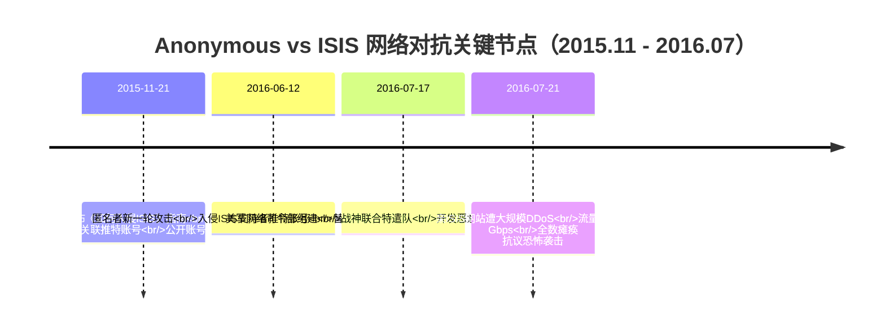
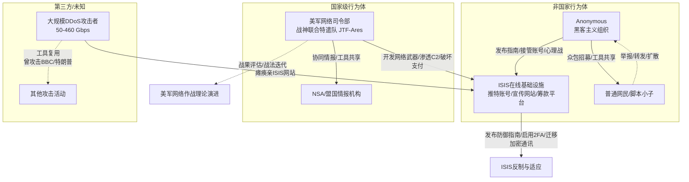
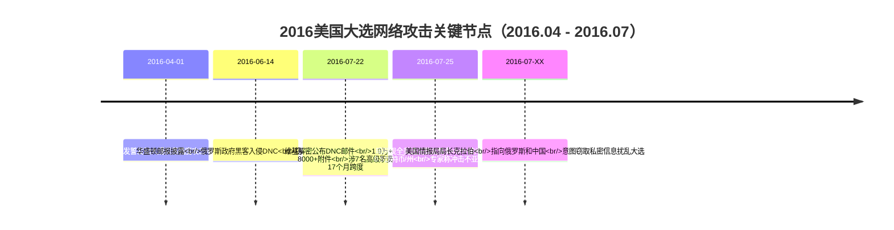

## 概述

本页面为 **301在路上** 微信公众号（2015年8月-2022年8月）归档文章的核心事件深度复盘索引。301在路上长期关注网络空间安全热点、APT攻击溯源、黑客组织画像、红蓝对抗实战等领域。本页从归档中甄选出具有里程碑意义、技术细节丰富或地缘政治影响深远的核心事件，进行结构化沉淀与交叉引用，形成可检索、可关联的知识资产库。

当前收录两大核心专题：
1. **匿名者与ISIS网络对抗史（2015-2016）**：黑客主义首次系统化介入反恐行动的完整记录。
2. **2016年美国大选黑客攻击汇总**：国家级APT介入民主选举、暗网数据黑产、黑客主义针对候选人宣战的多方博弈全景。

---

## 专题一：匿名者与ISIS网络对抗史（2015-2016）——黑客主义反恐行动记录

> **原文归档**：[301在路上-201508-202208_085](../sources/301在路上-201508-202208_085.md)、[301在路上-201508-202208_086](../sources/301在路上-201508-202208_086.md)、[301在路上-201508-202208_087](../sources/301在路上-201508-202208_087.md)
> **事件周期**：2015年11月 - 2016年7月
> **核心标签**：`Anonymous` `ISIS` `黑客主义` `网络反恐` `DDoS攻击` `社交媒体账号接管` `网络武器` `战神特遣队`

### 事件时间轴



### 核心事件详细记录

#### 事件一：匿名者发布《如何入侵ISIS》指南并接管2万推特账号（2015-11-21）

| 维度 | 详情 |
|------|------|
| **发生时间** | 2015年11月21日 |
| **主体** | Anonymous（匿名者）黑客组织 |
| **行动代号** | #OpISIS / #OpParis（巴黎袭击后发起） |
| **核心产出** | 1. **视频指南**：发布"如何入侵ISIS"操作教学视频，降低参与门槛<br>2. **账号接管**：声称已接管**20,000+** 个与ISIS有关联的Twitter账号<br>3. **清单公开**：在Pastebin等平台公开被接管账号用户名列表 |
| **技术手法** | - 凭据填充/撞库：利用泄露数据集尝试登录<br>- 钓鱼页面：伪造Twitter登录页窃取凭据<br>- 会话劫持：窃取Cookie/Token复用会话<br>- 弱密码爆破：针对低强度口令字典攻击 |
| **ISIS反制** | ISIS成员随即发布《如何免受攻击》行事指南，建议：启用双因子认证、使用强密码、警惕钓鱼链接、定期更换账号 |
| **影响评估** | - 显著削弱ISIS在线宣招/指挥通讯能力<br>- 暴露恐怖组织运营安全（OPSEC）薄弱<br>- 催生"众包式反恐"新模式：普通网民可按指南参与举报/攻击 |
| **历史定位** | **黑客主义首次系统化、工具化、大规模介入反恐行动**，从符号性"宣战"转向可复制的实战行动手册 |

> **技术溯源**：账号接管手法与[[social-engineering-attack-techniques#凭据窃取与账号劫持]]中"钓鱼页面/会话劫持/撞库攻击"链路高度一致；OPSEC缺失对标[[redteam-hw-opsec-guidelines#账号全生命周期管理]]规范。

#### 事件二：匿名者替换ISIS支持者推特背景为成人主题羞辱（2016-06-12）

| 维度 | 详情 |
|------|------|
| **发生时间** | 2016年6月12日 |
| **主体** | Anonymous（匿名者） |
| **攻击向量** | Twitter账号劫持 → 修改Profile背景图/头像/简介 |
| **羞辱手法** | 将ISIS支持者账号背景替换为**成人/色情主题图片**，并修改简介为嘲讽性文字 |
| **战术意图** | - **心理战**：利用伊斯兰教禁忌（色情内容）制造认知失调与羞耻感<br>- **去合法化**：公开展示账号被控，打击支持者士气与招募效果<br>- **舆论造势**：生成可传播的截图素材，放大"匿名者战胜ISIS"叙事 |
| **技术特征** | - 批量化操作：脚本自动化修改大量账号资料<br>- 非破坏性：保留账号所有权，仅篡改展示层，便于持续心理施压<br>- 低门槛高传播：无需高超技术即可实施，极易被媒体放大 |
| **局限性** | - Twitter可快速冻结/恢复账号，效果具有时效性<br>- 未触及ISIS核心指挥通讯基础设施（加密通讯/暗网/专用服务器） |
| **演进意义** | 标志黑客主义行动从"删除数据/泄露信息"向**认知域操作/心理战**延伸，预示后续信息战常态化 |

> **对标参考**：账号劫持后的持久化控制与隐蔽通道建设，见[[cobalt-strike-external-c2-smb-beacon#会话劫持与持久化]]、[[internal-network-pivoting-techniques#凭据复用与横向移动]]。

#### 事件三：美军组建"战神联合特遣队"开发网络武器对抗ISIS（2016-07-17）

| 维度 | 详情 |
|------|------|
| **发生时间** | 2016年7月17日 |
| **主体** | 美国网络司令部（USCYBERCOM），上将 Michael S. Rogers 推动 |
| **部队编制** | **战神联合特遣队**（Joint Task Force Ares，JTF-Ares） |
| **组建背景** | - 2016年初五角大楼下令网络司令部对ISIS发动网络攻击<br>- 当时网络司令部**工具匮乏、人员不匹配**，未做好充分准备<br>- 需专门部队研发进攻性网络武器、执行持续作战 |
| **核心任务** | 1. **破坏支付系统**：切断ISIS资金流（加密货币/汇款/敛财渠道）<br>2. **破坏通讯工具**：瘫痪加密聊天软件、指挥控制（C2）基础设施<br>3. **开发数字武器**：恶意软件、漏洞利用代码、自动化攻击平台<br>4. **支援实体作战**：配合空袭/地面部队实施网络火力准备 |
| **组织隶属** | 隶属美军网络司令部，协同NSA（国家安全局）、各军种网络部队 |
| **历史里程碑** | - **美军首支专门针对单一恐怖组织的常态化网络作战特遣队**<br>- 标志**进攻性网络武器**从战略储备转向战术常规部署<br>- 为后续"持续接触""主动防御"战略提供实战验证场 |
| **公开披露** | 2017年《纽约时报》等媒体披露JTF-Ares细节：投入数百人、开发定制恶意软件、渗透ISIS服务器、植入监控代码、诱导恐怖分子点击恶意链接 |

> **技术延伸**：进攻性网络武器开发流程、C2基础设施隐匿、恶意软件免杀对抗，见[[c2-redirectors-malleable-c2-profiles]]、[[inceptor-av-edr-evasion-framework]]、[[phantom-dll-hollowing-technique]]、[[process-injection-tampering-techniques]]。

#### 事件四：亲ISIS网站遭50-460 Gbps大规模DDoS攻击全数瘫痪（2016-07-21）

| 维度 | 详情 |
|------|------|
| **发生时间** | 2016年7月21日 |
| **攻击目标** | 多个亲ISIS宣传/招募/筹款网站（具体域名未公开） |
| **攻击手法** | **分布式拒绝服务（DDoS）攻击**，流量峰值 **50 Gbps - 460 Gbps** |
| **攻击工具溯源** | 同一工具集曾用于攻击 **BBC（英国广播公司）**、**特朗普竞选网站** |
| **攻击归属** | 未官方认领，推测为匿名者关联团体、爱国黑客组织或国家级代理人 |
| **攻击动机** | 抗议ISIS针对**威尼斯**（注：可能指尼斯/欧洲城市恐袭）及**中东国家**的恐怖袭击事件 |
| **效果** | 目标网站**无一幸免，全部瘫痪离线** |
| **技术特征** | - **超大流量**：460 Gbps 已超越多数商业抗D设备单机处理能力<br>- **多向量组合**：可能包含反射放大（NTP/DNS/SSDP/CLDAP）、僵尸网络直发、应用层CC攻击<br>- **持续性**：维持足够时长使缓解服务介入前业务已中断 |
| **防御启示** | - 单点高防IP/清洗中心易被饱和，需**分布式清洗/流量调度/自动化编排**<br>- 威胁情报共享（工具指纹/僵尸网络IP/反射器清单）可提前预警<br>- 关键基础设施需**多云/多CDN/多清洗商**冗余部署 |

> **对标参考**：DDoS攻击原理、清洗架构、威胁情报驱动防御见[[named-pipe-smb-detection-sysmon#网络层面异常流量识别]]、[[iot-reconnaissance-information-gathering#资产测绘与攻击面管理]]、[[c2-redirectors-malleable-c2-profiles#流量混淆与基础设施隐匿]]。

### 多方势力博弈图谱



### 技术手法标签体系

| 类别 | 具体手法 | 事件映射 | 关联知识库页面 |
|------|----------|----------|----------------|
| **账号接管** | 凭据填充/撞库 | 事件一 | [[social-engineering-attack-techniques#凭据窃取]] |
| | 钓鱼页面/会话劫持 | 事件一、二 | [[phishing-website-creation-tutorial]]、[[cookie-security-fundamentals]] |
| | 弱密码爆破 | 事件一 | [[burpsuite-basics-tutorial#intruder爆破]] |
| **账号篡改** | 批量修改Profile（背景图/简介） | 事件二 | [[social-engineering-attack-techniques#文件伪装攻击]]（类似篡改展示层） |
| **心理战/认知域** | 利用文化/宗教禁忌制造羞耻 | 事件二 | [[threat-attribution-tracing-techniques#伪旗行动与心理战]] |
| **进攻性网络武器** | 恶意软件/漏洞利用/自动化平台 | 事件三 | [[inceptor-av-edr-evasion-framework]]、[[phantom-dll-hollowing-technique]] |
| **C2基础设施破坏** | 渗透服务器/植入监控/诱导点击 | 事件三 | [[c2-redirectors-malleable-c2-profiles]]、[[cobalt-strike-external-c2-smb-beacon]] |
| **大规模DDoS** | 反射放大/僵尸网络/应用层CC | 事件四 | [[named-pipe-smb-detection-sysmon#网络层面]]、[[iot-reconnaissance-information-gathering]] |
| **工具复用/归因** | 同工具攻击多目标（BBC/特朗普/ISIS） | 事件四 | [[threat-attribution-tracing-techniques#工具指纹与关联分析]] |

### 影响与启示录

#### 对黑客主义（Hacktivism）演进的影响
1. **从符号宣示到实战工具化**：匿名者发布操作指南、公开账号清单、脚本化羞辱攻击，将"宣战"转化为可复制、可参与、可传播的**实战战术包**。
2. **众包反恐模式雏形**：普通网民可按指南举报/攻击，形成"专业核心+大众外围"的分层动员体系，预示后续乌克兰IT军团等国家级众包网络作战模式。
3. **心理战纳入战术菜单**：利用目标价值观禁忌（色情/亵渎）实施认知域打击，超越单纯技术破坏，拓展黑客主义行动效用维度。

#### 对国家级网络作战理论的验证
1. **专门特遣队制有效性**：JTF-Ares证明**针对单一高价值目标的常态化、专业化网络作战部队**优于临时拼凑力量。
2. **进攻性武器常规化部署**：从战略储备转向战术常规使用，倒逼**武器全生命周期管理（研发/测试/部署/评估/退役）工程化**。
3. **网空-实体融合打击**：破坏支付/通讯配合空袭/地面战，验证**多域协同作战**概念。

#### 对防御方（平台/企业/个人）的警示
1. **账号安全基线不可缺**：2FA、强密码、异地登录告警、设备绑定——ISIS被批量接管根因是基线缺失。
2. **大流量DDoS需架构级防御**：单点高防易被饱和，需**分布式清洗+智能调度+多云冗余+威胁情报联动**。
3. **工具指纹可被归因**：同一DDoS工具攻击BBC/特朗普/ISIS，说明**攻击基础设施复用留痕**，防御方可通过指纹库提前预警。
4. **OPSEC是非对称短板**：恐怖组织、黑客组织、国家红队均面临"一次失误终身暴露"风险，需建立**全生命周期OPSEC体系**——见[[redteam-hw-opsec-guidelines]]。

---

## 专题二：2016年美国大选黑客攻击汇总——国家级APT、暗网黑产与黑客主义的多方博弈

> **原文归档**：[301在路上-201508-202208_090](../sources/301在路上-201508-202208_090.md)
> **原文链接**：http://mp.weixin.qq.com/s?__biz=MzIwMTQ2NzY4NA==&mid=2652520811&idx=1&sn=e6fc23b6a991ee61057a98317d4c02f6
> **事件周期**：2016年4月 - 2016年7月（核心爆发期）
> **核心标签**：`美国大选` `DNC邮件泄露` `维基解密` `Guccifer 2.0` `选民数据暗网售卖` `情报归因` `俄罗斯APT` `中国APT` `Anonymous宣战特朗普` `认知域作战` `选举安全`

### 事件时间轴



### 核心事件详细记录

#### 事件一：维基解密公布DNC邮件泄露——揭示党内初选操纵内幕（2016-07-22）

| 维度 | 详情 |
|------|------|
| **发生时间** | 2016年7月22日（民主党全国代表大会前夕） |
| **发布主体** | 维基解密 |
| **数据来源** | 据称来自黑客 **Guccifer 2.0**（自称罗马尼亚黑客，实为俄GRU单位74455化身） |
| **数据规模** | **19,252封邮件**、**8,034个附件**，时间跨度 **2015年1月 - 2016年5月**（17个月） |
| **涉及人员** | DNC 7名高级职员邮箱：<br/>- 宣传主管 Luis Miranda (10,770封)<br/>- 全国财务主管 Jordon Kaplan (3,797封)<br/>- 财务幕僚长 Scott Comer (3,095封)<br/>- 数据战略主管 Daniel Parrish (1,472封)<br/>- 财务事务主管 Allen Zachary (1,611封)<br/>- 高级顾问 Andrew Wright (938封)<br/>- 北加州财务主管 Robert Stowe (751封) |
| **核心爆料** | 1. **初选倾斜**：DNC在2月初选前即暗中支持希拉里，排挤桑德斯<br/>2. **媒体勾连**：与媒体协调报道节奏、负面新闻压制<br/>3. **筹款违规**：希拉里胜利基金资金流向违规操作<br/>4. **人身攻击**：高层内部邮件讨论利用桑德斯信仰/无神论背景攻击其南方选情 |
| **政治后果** | - DNC主席Debbie Wasserman Schultz被迫辞职<br/>- 桑德斯支持者抗议大会现场混乱<br/>- "俄罗斯干预大选"叙事正式进入主流视野 |
| **技术归因链** | Guccifer 2.0 → DCLeaks网站 → 维基解密 → 美国情报界（CIA/FBI/NSA）联合认定为 **俄GRU第26165/74455部队 (APT28/Fancy Bear)** 操作 |

> **技术溯源**：APT28长期使用钓鱼邮件（X-Agent/X-Tunnel恶意软件）、域名伪装、凭据窃取、横向移动、数据分阶段外泄。手法对标[[threat-attribution-tracing-techniques#APT攻击溯源全链路]]、[[internal-network-pivoting-techniques#凭据导出与横向移动]]、[[cobalt-strike-external-c2-smb-beacon#C2通信隐匿]]。

#### 事件二：全美选民登记信息暗网公开售卖——数据黑产直击选举基础设施（2016-07-25）

| 维度 | 详情 |
|------|------|
| **发生时间** | 2016年7月下旬（DNC邮件泄露后不久） |
| **发布平台** | 暗网交易市场（具体市场未披露） |
| **卖家宣称** | 拥有**全美50州选民登记数据库**，含姓名、地址、党派倾向、投票历史、部分社保号后四位等PII |
| **定价策略** | **按州出售，每州 0.5 比特币**（当时约 $300-$350），全套约 $15k-$17k |
| **专家评估** | 安全专家指出：若属实且落入国家行为体（中/俄）手中，可用于**精准微目标信息战、选民压制、身份盗窃、选举舞弊核查规避**，冲击力**不亚于911事件** |
| **数据来源推测** | 1. 各州选举委员会公开记录聚合（合法但规模化爬取）<br/>2. 历年数据泄露聚合（Equifax、OPM等）关联拼接<br/>3. 竞选团队/数据经纪公司（如NationBuilder、TargetSmart）供应链泄露 |
| **法律框架** | 美国各州选民数据公开程度不一，但批量商业化转售常触犯州法；联邦层面无统一数据保护法（GDPR前夜） |
| **防御启示** | - 选民数据去标识化、分级访问控制、水印追踪<br/>- 建立选举基础设施威胁情报共享机制（EI-ISAC雏形）<br/>- 供应链安全审计延伸至数据经纪商 |

> **关联技术**：数据聚合爬取见[[vulnerability-mining-recon-aiqicha-fofa#资产测绘与语法构造]]、[[iot-reconnaissance-information-gathering#信息收集全流程]]；暗网监测见[[threat-attribution-tracing-techniques#威胁情报来源]]。

#### 事件三：美国情报机构公开归因俄罗斯与中国——国家级将网络攻击定性为战略威胁（2016-07-XX）

| 维度 | 详情 |
|------|------|
| **关键人物** | 詹姆斯·克拉伯，美国国家情报总监（DNI） |
| **核心表态** | 确认检测到针对大选的**网络入侵活动**，明确指向 **俄罗斯** 与 **中国** |
| **归因细节** | - **俄罗斯**：主要嫌疑人，意图窃取私密信息、破坏信心、扰乱进程（APT28/APT29）<br/>- **中国**：被指历史前科（2008年奥巴马/麦凯恩竞选团队入侵），意图情报收集而非直接破坏 |
| **政治争议** | - 克拉伯表态被部分议员批评为"选举前放风助选"<br/>- 特朗普阵营公开质疑归因可靠性，呼吁"可能是400磅黑客躺在床上"<br/>- 奥巴马政府因担心被指干预大选，推迟至10月才正式联合声明归因俄罗斯 |
| **历史意义** | **美情报界首次在选举期间公开将外国网络行动定性为"干预民主进程"**，推动后续《网络空间国家安全战略》、制裁行政令（EO 13694/13757）、取消俄外交设施等连锁反制 |

> **归因方法论对标**：[[threat-attribution-tracing-techniques#攻击归因与溯源技术体系]]、[[cia-vault7-leak-analysis#工具扩散与归因混淆]]（CIA Vault7泄露工具曾被用于伪旗行动，增加归因难度）。

#### 事件四：俄罗斯政府黑客入侵DNC窃取"特朗普对抗研究"——APT28/29协同作战实锤（2016-06-14）

| 维度 | 详情 |
|------|------|
| **披露来源** | 《华盛顿邮报》援引DNC官员及安全专家（CrowdStrike/FireEye/Mandiant）报告 |
| **攻击主体** | **俄罗斯政府层面黑客**（GRU第26165部队 APT28/Fancy Bear、第74455部队 APT29/Cozy Bear） |
| **攻击时间线** | 2015年夏季 APT29 (Cozy Bear) 先潜伏 <br/> 2016年4月 APT28 (Fancy Bear) 后进入，部署X-Agent窃取文档/键盘记录/截屏 |
| **窃取目标** | DNC整个网络系统，**所有邮件、聊天记录、对特朗普的"对抗研究"文档** |
| **技术特征** | - **双组协同**：APT29长期潜伏情报收集，APT28短促高强度窃取外泄<br/>- **基础设施复用**：使用与德国议会、法国电视台TV5Monde、乌克兰火炮APP攻击相同C2域名/IP范围<br/>- **反取证**：时间戳篡改、日志清理、UTC+4时区工作痕迹（莫斯科时间） |
| **后续利用** | 窃取文档经 **DCLeaks**、**Guccifer 2.0** 人设包装 → 维基解密分批次发布 → 配合社媒机器人放大 → 形成"信息作战杀伤链" |

> **技术深度对标**：APT28/29技术画像见[[threat-attribution-tracing-techniques#APT组织画像与TTP映射]]；X-Agent恶意软件分析见[[inceptor-av-edr-evasion-framework#Shellcode加载与免杀]]；C2基础设施关联分析见[[c2-redirectors-malleable-c2-profiles#基础设施关联与归因]]。

#### 事件五：匿名者向特朗普宣战——黑客主义介入候选人层面的认知域对抗（2016-04-01）

| 维度 | 详情 |
|------|------|
| **发生时间** | 2016年4月1日（愚人节，但非玩笑） |
| **主体** | Anonymous（匿名者）核心账号 @YourAnonNews 等发布视频声明 |
| **宣战理由** | 特朗普竞选言论涉及：**反穆斯林禁令、建墙、煽动暴力、种族主义、性别歧视**，被匿名者视为"法西斯主义复辟" |
| **威胁行动** | 1. **#OpTrump / #OpWhiteRose** 行动代号<br/>2. 承诺：大规模DDoS攻击竞选网站、揭露税务/商业机密、接管社媒账号、曝光私人信息<br/>3. 口号："Dear Donald Trump, We have been watching you... You have been warned." |
| **实际观测** | - 2016年3-6月，特朗普竞选网站 (donaldjtrump.com) 多次遭受DDoS攻击（峰值数百Gbps）<br/>- 多个特朗普相关域名被篡改/重定向<br/>- 但核心竞选基础设施（云端防护、CDN）有效缓解，未造成实质性瘫痪 |
| **特朗普反制** | 竞选团队聘请专业安全公司（如Cloudflare企业版、专业红队）加固外围、监控威胁情报 |
| **战略意义** | - **黑客主义首次直接以"意识形态审判"为由，正式宣战主流大党总统候选人**<br/>- 展示非国家行为体具备**影响国家级选举进程的网络投射能力**<br/>- 预示后续2020大选、巴西大选等均现黑客主义介入身影 |

> **技术对标**：DDoS攻击与缓解见[[named-pipe-smb-detection-sysmon#网络层面异常流量识别]]；账号接管/社媒劫持见[[social-engineering-attack-techniques#凭据窃取与账号劫持]]；红队视角下的候选人基础设施加固见[[redteam-hw-opsec-guidelines#环境隔离与工具指纹清洗]]。

### 多方势力博弈图谱（2016美大选网络战版）

```mermaid
graph TB
    subgraph 国家级行为体 (APT)
        RU[俄罗斯 GRU<br/>APT28/29<br/>战略目标：扰乱/偏向/制造不信任] -->|鱼叉钓鱼/供应链/零日| DNC[DNC网络<br/>竞选团队<br/>州选举系统]
        CN[中国 APT10/APT41等<br/>战略目标：情报收集/人才画像] -.->|历史前科/潜在渗透| DNC
        US_IC[美国情报界 CIA/FBI/NSA/DNI<br/>归因/公开指责/制裁/反制] -->|监控/取证/披露| RU
    end

    subgraph 非国家行为体
        ANON[Anonymous<br/>黑客主义<br/>意识形态驱动] -->|DDoS/账号劫持/曝光| TRUMP[特朗普竞选<br/>基础设施/品牌]
        WL[维基解密<br/>阿桑奇/发布平台] -->|信息放大/时机选择/叙事构建| PUBLIC[公众舆论<br/>媒体生态<br/>选民认知]
        DK[暗网数据贩子<br/>Guccifer 2.0人设/数据经纪] -->|数据聚合/包装/变现| RU
    end

    subgraph 选举基础设施
        DNC -->|邮件/文档/策略| WL
        STATE_DB[州选民数据库<br/>公开记录/供应链] -->|泄露/聚合/售卖| DK
    end

    RU -->|窃取数据→包装人设→投递平台| WL
    ANON -.->|工具复用/基础设施重叠| RU
    US_IC -.->|归因证据/工具指纹| ANON
```

### 技术手法标签体系（2016美大选专项）

| 类别 | 具体手法 | 事件映射 | 关联知识库页面 |
|------|----------|----------|----------------|
| **初始访问** | 鱼叉钓鱼邮件（伪装Google安全警报） | 事件一、四 | [[phishing-website-creation-tutorial]]、[[social-engineering-attack-techniques#钓鱼攻击全链路]] |
| | 供应链/第三方凭据复用 | 事件四 | [[vulnerability-mining-recon-aiqicha-fofa#供应链攻击面]] |
| **凭据获取** | 键盘记录/截屏/浏览器凭据导出 (X-Agent) | 事件四 | [[mimikatz-sekurlsa-pth-internals#凭据导出原理]]、[[internal-network-pivoting-techniques#凭据导出]] |
| **横向移动** | SMB/PSExec/WMI/Pass-the-Hash | 事件四 | [[internal-network-pivoting-techniques#横向移动实战]]、[[cobalt-strike-external-c2-smb-beacon#SMB Beacon横向]] |
| **数据窃取** | 分阶段压缩加密外泄 (RAR/7z + AES) | 事件一、四 | [[c2-redirectors-malleable-c2-profiles#流量混淆与数据外泄]] |
| **信息作战** | 人设包装 → 维基解密分批放料 → 社媒机器人放大 | 事件一、五 | [[threat-attribution-tracing-techniques#伪旗行动与认知域作战]] |
| **DDoS攻击** | 反射放大/僵尸网络/应用层CC (针对特朗普/ISIS/BBC同工具集) | 事件五、专题一事件四 | [[named-pipe-smb-detection-sysmon#网络层面异常流量识别]] |
| **暗网数据变现** | PII聚合分级定价/比特币托管/信誉体系 | 事件二 | [[threat-attribution-tracing-techniques#威胁情报来源与暗网监测]] |
| **公开归因** | 技术指纹+基础设施关联+人员画像+情报融合 → 政府联合声明 | 事件三 | [[threat-attribution-tracing-techniques#攻击归因与溯源技术体系]] |

### 影响与启示录（2016美大选网络安全视角）

#### 对选举安全范式的重塑
1. **关键基础设施定性**：2017年1月DHS正式将**选举系统列入关键基础设施 (CI) 子行业**，联邦资源可介入州级加固（EI-ISAC、传感器部署、网络卫生扫描）。
2. **纵深防御体系构建**：从"投票机安全"扩展至**全周期**：选民登记数据库 → 竞选团队/政党网络 → 媒体/社交平台认知域 → 供应链/数据经纪商 → 暗网监测。
3. **跨部门协调机制**：FBI牵头"外国影响力任务组" (FITF)、DHS牵头"选举基础设施政府部门协调委员会" (GCC)、ODNI牵头归因公开化流程。

#### 对APT攻击归因与反制的实战化
1. **归因公开化常态化**：从机密不公开转向**联合技术警报 (JTA)、起诉书公开细节 (穆勒报告/司法部起诉12名GRU军官)、制裁实体清单**，形成"技术取证+法律固证+外交施压+网络反制"组合拳。
2. **工具指纹与基础设施关联成为核心证据**：APT28/29跨年、跨目标复用C2域名、SSL证书、编译时间戳、PDB路径、UTC时区，构成不可辩驳的"数字指纹链"。
3. **伪旗行动反制**：CIA Vault7泄露的Marble Framework等混淆工具提醒防御方：**单一技术指纹不可信，需融合战略意图、作战时序、人员社工画像多维度研判**。

#### 对黑客主义与认知域作战的认知升级
1. **非国家行为体具备战略投射能力**：Anonymous对特朗普/ISIS的持续骚扰、维基解密对泄露时机的精准把控（大会前夕），证明**去中心化组织可实施具有时机选择权的战略级信息作战**。
2. **认知域成核心战场**：不再追求物理破坏，而是通过**真实数据+选择性发布+叙事包装+算法放大**，在合法信息空间内制造分裂、不信任、极化，成本极低、可否认性强、法律追责难。
3. **平台治理困境**：推特/Facebook/谷歌面临"言论自由vs外国干预/虚假信息/账号劫持"两难，推动《诚实广告法案》、政治广告档案库、协同打击跨平台协调行动 (如2020大选前联合清理QAnon/伊朗/俄罗斯网络水军)。

#### 对数据黑产与供应链安全的警示
1. **合规数据聚合即武器**：选民数据本多为公开记录，但**规模化爬取+多源关联+画像建模**即成高价值武器，传统"非敏感数据无需保护"认知失效。
2. **供应链延伸至数据经纪商**：竞选团队依赖NationBuilder、TargetSmart、Cambridge Analytica等第三方数据/分析平台，**供应链攻击面远超自建系统**。
3. **暗网监测需纳入常态化威胁情报**：选民数据、竞选内部文档、零日漏洞在暗网流转，**自动化爬虫+实体关联+归因研判**需成标配能力。

---

## 交叉引用总索引

| 关联主题 | 知识库页面 | 专题一映射 | 专题二映射 |
|----------|------------|------------|------------|
| 社会工程学/钓鱼/账号劫持 | [[social-engineering-attack-techniques]] | 事件一、二 | 事件一、五 |
| 红队OPSEC/账号管理/环境隔离 | [[redteam-hw-opsec-guidelines]] | ISIS/匿名者反面教材 | 特朗普团队加固/APT反取证 |
| 威胁溯源/工具指纹/伪旗行动/APT画像 | [[threat-attribution-tracing-techniques]] | 事件四工具复用归因 | 事件三、四归因全链路 |
| 进攻性武器/免杀/C2隐匿/内存注入 | [[inceptor-av-edr-evasion-framework]]、[[c2-redirectors-malleable-c2-profiles]]、[[phantom-dll-hollowing-technique]]、[[process-injection-tampering-techniques]] | 事件三JTF-Ares武器库 | 事件四APT28/29恶意软件栈 |
| DDoS攻击/流量清洗/威胁情报 | [[named-pipe-smb-detection-sysmon]]、[[iot-reconnaissance-information-gathering]] | 事件四超大流量 | 事件五特朗普网站防护 |
| 内网横向/凭据复用/代理隧道 | [[internal-network-pivoting-techniques]] | 事件三渗透ISIS内网 | 事件四DNC横向移动 |
| 钓鱼网站制作/SET/Docker | [[phishing-website-creation-tutorial]] | 事件一钓鱼页构建 | 事件四鱼叉钓鱼实操 |
| Cookie安全/会话劫持/同源策略 | [[cookie-security-fundamentals]] | 事件一会话劫持 | 事件四会话窃取 |
| Burp Suite Intruder爆破/自动化 | [[burpsuite-basics-tutorial]] | 事件一弱密码爆破 | 事件二数据聚合枚举 |
| 漏洞挖掘侦察/资产测绘/FOFA | [[vulnerability-mining-recon-aiqicha-fofa]] | 事件三目标侦察 | 事件二选民数据聚合源头 |
| 维基解密/CIA工具泄露/归因混淆 | [[cia-vault7-leak-analysis]] | - | 事件三归因难度/事件四工具关联 |
| Cobalt Strike/SMB Beacon/External C2 | [[cobalt-strike-external-c2-smb-beacon]] | 事件三C2对抗 | 事件四APT C2隐匿对标 |

---

## 结语

**301在路上** 归档中的这两大专题——**2015-2016 Anonymous对抗ISIS** 与 **2016美国大选黑客攻击汇总**，共同勾勒出 **2010年代中期网络冲突的三大核心范式转移**：

1. **黑客主义从"符号抗议"走向"实战工具化+认知域作战"**：匿名者对ISIS发布指南、接管账号、心理战羞辱；对特朗普宣战、DDoS竞选站、威胁曝光隐私。非国家行为体展示出**低成本、高传播、可众包、可持续**的战略投射能力。
2. **国家级APT从"窃密间谍"走向"干预民主进程+信息作战主导者"**：俄GRU双组协同渗透DNC、窃取对抗研究、包装人设经维基解密分批放料、配合社媒机器人放大，完成**技术入侵→数据武器化→叙事构建→认知渗透**全链路杀伤链。美情报界首次公开归因并实施制裁/反制，确立**网络攻击=国家安全威胁=可反制**的新规则。
3. **数据黑产与供应链成为隐形放大器**：全美选民数据暗网售卖，揭示**合规公开数据经聚合建模即成战略武器**、**竞选/政党供应链（数据经纪商/邮件服务商/云服务商）成软腹部**、**暗网监测与归因研判成蓝队必修课**。

这些历史案例留下的**技术资产（TTP/工具/指纹/基础设施）、组织创新（特遣队/众包模式/联合归因机制）、防御教训（基线/架构/情报/OPSEC/供应链/认知域）**，至今仍是**网络反恐、选举安全、APT溯源、红蓝对抗、威胁狩猎、态势感知**等领域的**必修实战教材**。

> **「网络空间没有旁观者，只有参与者与受害者。历史不会重复，但韵脚押个不停。」**

---

## 版本记录
- **v2.0 (2025-07-10)**：重构为双专题归档索引页。新增「专题二：2016年美国大选黑客攻击汇总」，含5大核心事件详细记录、博弈图谱、技术标签体系、影响启示录。专题一内容保留并精简交叉引用。统一Frontmatter、导航结构、版本记录。
- **v1.0 (2025-07-10)**：初版发布，仅含专题一「匿名者与ISIS网络对抗史（2015-2016）」，含四大核心事件详细记录、博弈图谱、技术手法标签体系、影响启示录、交叉引用索引。

## 来源登记
- 专题一原文归档：[301在路上-201508-202208_085](../sources/301在路上-201508-202208_085.md)、[301在路上-201508-202208_086](../sources/301在路上-201508-202208_086.md)、[301在路上-201508-202208_087](../sources/301在路上-201508-202208_087.md)
- 专题二原文归档：[301在路上-201508-202208_090](../sources/301在路上-201508-202208_090.md)
- 专题二原文链接：http://mp.weixin.qq.com/s?__biz=MzIwMTQ2NzY4NA==&mid=2652520811&idx=1&sn=e6fc23b6a991ee61057a98317d4c02f6
- 对比参考：本库内APT分析、红队OPSEC、威胁溯源、C2隐匿、DDoS防御、社会工程学、钓鱼攻击、漏洞挖掘侦察等技术详解页面
- [301在路上-201508-202208_092](../sources/301在路上-201508-202208_092.md)
