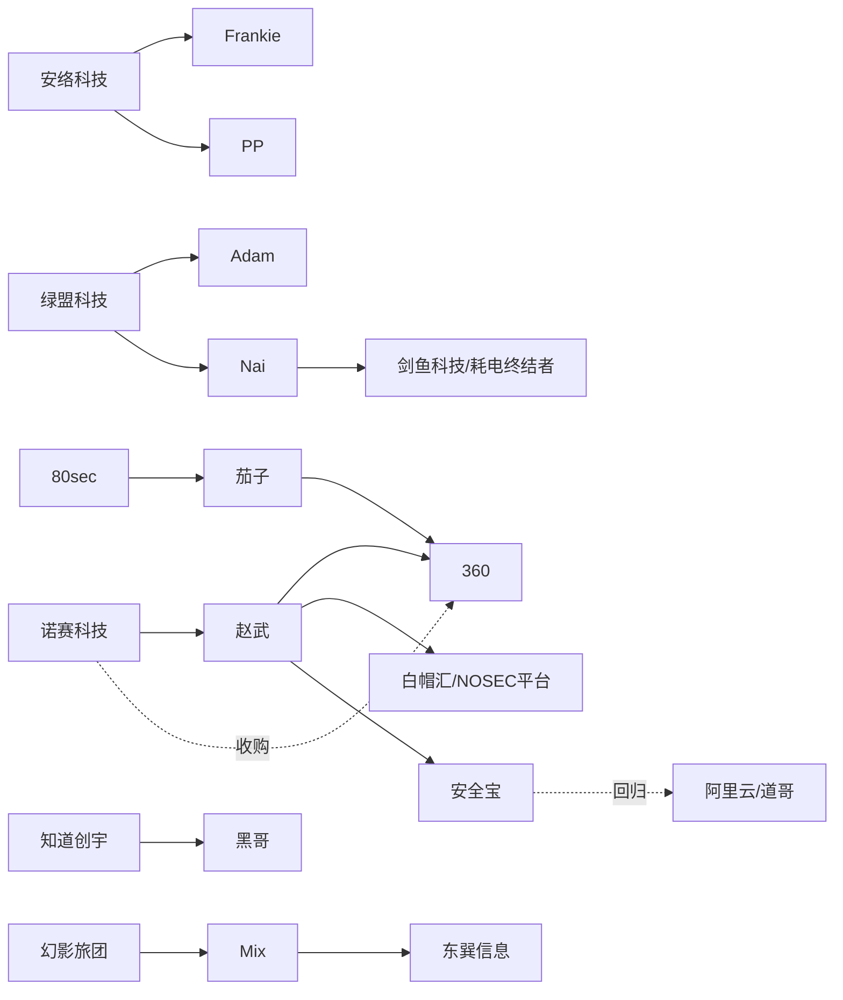

## 概述

本页面沉淀自 **301在路上** 微信公众号（作者：杨蔚/301）2015年8月至2022年8月期间的归档文章索引。301在路上由前37wan安全负责人smarttang（杨蔚）创办，专注于安全团队建设、白帽子生态、职业成长、行业观察等深度内容。页面按文章主题分类收录，提供结构化摘要与交叉引用，便于安全从业者检索与知识关联。

---

## 机票诈骗、退票谁才是受害者？——第三方票务平台供应链数据泄露与代理商高额手续费利益链条深度剖析

> **原文链接**：http://mp.weixin.qq.com/s?__biz=MzIwMTQ2NzY4NA==&mid=402632070&idx=1&sn=604aeca3295a40d147fa63f0d24a5a23&chksm=04e67fcd3391f6db3a6ccf929972a8681441f7f47261ef706d1e1d1d129e8087d20cecdcf6c0&scene=126&sessionid=1681656807#rd  
> **发布时间**：2016年早期（约2016年1月，基于文章mid值与后续IDC漏洞文章mid=402642161推断，该文为IDC文章所述「前文」）  
> **核心标签**：`机票诈骗` `退票手续费` `机票代理商` `携程` `去哪儿` `中航信` `供应链数据泄露` `第三方平台风险` `利益链条` `航司佣金取消`

### 文章背景与核心观点

- **写作契机**：近期（2016年初）国内头部在线旅游/机票服务平台（文中隐指「某程网」携程、「某哪网」去哪儿）因用户投诉退票、欺诈、假机票等问题频发，品牌公信度受损，甚至遭受航司处罚。301（杨蔚）旨在剖析第三方票务平台背后的供应链利益分配机制与安全风险根源。
- **核心判断**：第三方平台（OTA）处于「超市」角色，无法有效管控上游代理商（供货商）的票务真实性与服务质量；**航司取消代理佣金**导致代理商利润模式被迫转型，依靠**高额退改签手续费**与**保费**生存，形成结构性作恶动机；**供应链数据泄露**（PNR、乘客信息）是机票诈骗（退改签钓鱼、虚假出票）的核心弹药库。
- **责任归属**：用户维权首指第三方平台，平台因供应商管理不善背锅；但核心利益链条深藏于代理商与航司博弈之中，平台仅为流量入口与信任背书方。

### 机票交易全链路业务流程拆解

| 环节 | 角色 | 核心动作 | 数据流向 | 风险点 |
|------|------|----------|----------|--------|
| **1. 下单支付** | 用户 → 第三方平台 | 选择航班、支付订单、生成平台订单号 | 用户身份证、手机号、支付信息 → 平台数据库 | 平台侧用户隐私泄露风险 |
| **2. 订单分发** | 第三方平台 → 代理商 | 平台审单、推单至代理商系统（API/EDI） | 订单详情、乘客PII → 代理商系统 | **供应链数据扩散节点**：数千家代理商同步获取敏感数据，权限边界模糊 |
| **3. 占座/出票** | 代理商 → 航司/中航信 | 代理商在航司/BSP系统占座、出票、生成PNR/票号 | PNR、票号、航段信息 → 中航信/航司宿主系统 | 代理商可恶意占座、不出票、虚假出票（假票号） |
| **4. 回填信息** | 代理商 → 平台 → 用户 | 回填票号、电子客票号(ETKT)、保险单号 | 票号、ETKT、保单号 → 平台 → 用户短信/APP | 信息回填延迟/错误导致用户无法值机；假票号混入 |
| **5. 后续服务** | 用户 ↔ 平台/代理商 | 改签、退票、行李额购买、保险理赔 | 改签/退票申请 → 代理商执行 → 航司结算 | **高额手续费收割**、**诈骗钓鱼高发区**（冒充客服骗验证码/转账） |

> **关键基础设施**：**中航信** — 中国民航信息网络股份有限公司，掌握全国民航旅客预订系统（TBS）、离港控制系统（DCS）核心数据，**是票务数据的最终汇聚与权威校验中心**。

### 核心利益链条与结构性矛盾深度解析

#### 佣金取消引发的利润模式强制迁移（根因）

| 时间节点 | 事件 | 对代理商影响 | 代理商应对策略 |
|----------|------|--------------|----------------|
| **2015年5月前** | 航司支付代理佣金（通常票面价3%-5%或固定额） | 核心利润来源，支撑人力、运营、让利促销 | 正常运营，薄利多销 |
| **2015年5月** | **航司全面取消代理佣金**（国航、东航、南航、海航等头部航司带头） | **利润来源断裂**，单张机票无正向现金流 | **被迫转型**：<br>1. 收取高额**退票/改签手续费**（甚至超票面价）<br>2. 强制/诱导搭售**保险**（高返佣）<br>3. 利用**信息不对称**倒卖数据/积分<br>4. **虚假出票/套现**周转资金 |

> **301原文核心洞察**：「光靠利用机票折扣的信息不对称来进行牟利的时代已经过去，代理商只能通过从退票、改签等措施收取用户大量的服务手续费和改期费。」

#### 退改签手续费：代理商的「印钞机」与用户的「隐形陷阱」

**实例复盘（文中案例）**：北京→上海某航班，票面价740元，税费70元，实付850元。

| 操作类型 | 时间节点 | 航司标准手续费 | 代理商加收「服务费」 | 用户实付成本 | 代理商净利润来源 |
|----------|----------|----------------|----------------------|--------------|------------------|
| **退票** | 起飞前 | 148元 (20%) | 50-200元/单 | 198-348元 | **服务费全额归代理商** |
| **退票** | 起飞后 | 222元 (30%) | 50-300元/单 | 272-522元 | **服务费全额归代理商** |
| **改签** | 起飞前 | 74-148元 | 100-500元/单 | 174-648元 | **服务费全额归代理商** |
| **改签** | 起飞后 | 148元+ | 200-800元/单 | 348元+ | **服务费全额归代理商** |

**结构性陷阱**：
- **信息不透明**：平台展示「退改签政策」链接指向航司官网标准规则，隐瞒代理商加收的「服务费」。
- **流程锁定**：用户在平台/代理商渠道购票，退改签**必须**回原渠道办理，航司直销/柜台拒绝受理代理商订单，形成垄断服务闭环。
- **成本倒挂**：改签成本常超**重新购票**价格，用户被迫放弃原订单、承担全损。

#### 供应链数据泄露：机票诈骗的「弹药库」

| 泄露环节 | 泄露主体 | 核心数据字段 | 诈骗利用方式 | 典型话术 |
|----------|----------|--------------|--------------|----------|
| **代理商内部** | 代理商员工/外包/黑产渗透 | 姓名、身份证号、手机号、**PNR/订单号、航班号、起飞时间、票号** | **精准钓鱼**：冒充航司/平台客服，报出精确航班信息建立信任 → 以「航班取消/延误赔偿/改签需验证」骗取验证码/转账 | 「您好，我是XX航空客服，您XX月XX日XX航班因故障取消，需办理退改签赔偿，请提供验证码…」 |
| **平台侧** | 平台开发/运维/第三方插件/SDK | 用户画像、历史订单、联系方式 | **撞库/精准推送**：结合社工库画像，定向推送钓鱼链接/虚假客服电话 | 「携程/去哪儿客服：您的订单异常，点击链接处理…」 |
| **航司/中航信** | 内部人员/接口对接方 | 全量PNR、支付流水、会员积分 | **积分兑票/里程盗刷**：利用高价值账户积分兑换机票变现 | 黑产内部消化，不直接面向用户 |

> **数据流向不可逆性**：一次下单，数据在 **平台→数千代理商→航司→中航信→保险公司→GDS分销系统** 多方同步存储，**任意单点失守即全链路数据泄露**。平台无技术手段回收/销毁已分发数据。

### 责任边界模糊与「背锅」机制

| 主体 | 角色定位 | 实际控制力 | 承担舆论/监管压力 | 核心痛点 |
|------|----------|------------|-------------------|----------|
| **用户** | 受害者 | 无 | 无 | 维权成本高、证据固定难、跨平台投诉无门 |
| **第三方平台 (OTA)** | 流量入口、信任背书、资金托管 | **仅控制前端展示、支付、订单分发**；**无法控制代理商出票真实性、服务质量、数据安全** | **最大**：「假票、诈骗、高额手续费」矛盾全指向平台 | 「超市卖水，不知瓶装是山泉水还是桶装水」；供应商准入/考核/淘汰机制滞后 |
| **机票代理商** | 实际履约方、票务持有者 | **控制出票、退改签执行、数据存储、定价（服务费）** | 极低：隐于平台背后，用户不知其名，平台合同常免责 | **逐利核心**：佣金取消后，高额服务费、数据变现、虚假出票成生存刚需 |
| **航空公司** | 运力提供者、规则制定者 | **制定退改签规则、审核代理商资质、结算BSP款项** | 低：将销售压力下沉代理商，取消佣金转嫁成本 | **双重收割**：取消佣金降低成本，同时制定高退改费规则保障收入 |
| **中航信** | 基础设施运营商 | **掌握核心数据权威、接口标准、结算清算** | 极低：基础设施属性，鲜少直接面对C端舆论 | **数据主权**：数据汇聚中心，安全责任上界不明 |

### MITRE ATT&CK 映射（票务供应链攻击视角）

| 战术 | 技术编号 | 技术名称 | 本场景实施方式 |
|------|----------|----------|----------------|
| Reconnaissance | T1589.001 | Gather Victim Identity Information: Credentials | 从代理商/平台泄露数据中获取姓名、身份证、手机、PNR、航班信息 |
| Reconnaissance | T1590.005 | Active Scanning: Social Media | 监控社交媒体「晒机票/行程单」自动提取ETKT/姓名/航班（关联[[boarding-pass-social-media-leakage-risk]]） |
| Resource Development | T1588.002 | Obtain Capabilities: Tool | 购买/开发「退改签钓鱼话术库」「验证码拦截恶意APP」「虚拟号段拨号系统」 |
| Initial Access | T1566.002 | Phishing: Spearphishing Link | 发送伪造航司/平台通知短信/邮件，含钓鱼链接窃取支付密码/验证码 |
| Initial Access | T1566.001 | Phishing: Spearphishing Attachment | 发送伪装「电子行程单/赔偿申请表」的恶意APK/文档，植入远控/短信拦截 |
| Execution | T1204.001 | User Execution: Malicious Link | 诱导受害者点击钓鱼链接输入银行卡/验证码 |
| Credential Access | T1110.004 | Brute Force: Credential Stuffing | 利用泄露手机号/身份证撞库登录航司/OTA会员账户，盗刷积分/里程/改签机票 |
| Credential Access | T1552.001 | Unsecured Credentials: Credentials In Files | 从代理商内部工单系统/导出Excel/日志文件中提取明文PNR/乘客信息 |
| Discovery | T1083 | File and Directory Discovery | 遍历代理商内网共享盘/数据库备份寻找历史订单数据打包外泄 |
| Collection | T1005 | Data from Local System | 批量导出代理商数据库：PNR、乘客PII、支付流水、会员账号 |
| Collection | T1213 | Data from Information Repositories | 查询中航信/航司BSP接口（内部人员/接口密钥泄露）获取全量实时票务数据 |
| Impact | T1486 | Data Encrypted for Impact | 勒索软件加密代理商/平台票务系统数据库，勒索赎金 |
| Impact | T1565.001 | Data Manipulation: Stored Data | 篡改代理商系统订单状态（已出票→未出票/已退票）、修改乘客联系方式劫持通知 |
| Impact | T1656 | Impersonation | 冒充航司/平台客服实施电信诈骗（核心变现手段） |

### 防御与治理建议体系（多方协同视角）

#### 第三方平台 (OTA) —— 供应链安全管理升级

1. **供应商分级准入与动态考核体系**
   - **准入门槛**：要求代理商提供ISO27001/等保三级/PCI DSS认证、近1年渗透测试报告、数据安全管理制度、员工背调证明。
   - **分级管理**：按交易量/风险等级分为核心/普通/观察期供应商，差异化管控（核心供应商实地审计/季度渗透测试/驻场安全官）。
   - **动态淘汰**：建立「红黑榜」，投诉率/违规率/安全事件超阈值即时冻结分单权限、下架清退，并同步共享至行业联盟黑名单。

2. **数据最小化分发与脱敏传输**
   - **按需分发**：代理商仅获取履约必需字段（PNR、航段、乘客姓名），**严禁下发身份证全号、手机号全号、支付流水号**；改为平台侧代理校验/脱敏接口调用。
   - **传输加密与签名**：API通信强制双向TLS 1.2+、请求/响应体字段级加密（AES-GCM）、接口幂等性与防重放设计。
   - **数据水印/追踪**：对分发给每家代理商的数据植入不可见水印/唯一标记，泄露时可溯源至具体代理商。

3. **全流程可视化监控与异常熔断**
   - **出票真实性校验**：接入中航信/航司实时校验接口，对比代理商回填票号与权威数据源，发现假票号/延迟出票即时熔断、预警。
   - **退改签服务费合规监控**：抓取代理商前端展示的退改规则，与航司官网标准规则自动比对，超标准收费自动标记、下架、罚款。
   - **数据访问审计**：要求核心代理商接入统一数据访问网关，记录所有PNR/乘客信息查询/导出操作，异常批量下载实时阻断告警。

4. **用户侧风控与赔付兜底**
   - **先行赔付机制**：因代理商原因导致假票、诈骗、高额手续费，平台先行全额赔付用户，再向代理商追偿（保证金/保函覆盖）。
   - **诈骗预警推送**：用户下单后推送「防诈骗指南」（官方唯一客服电话、不索要验证码/转账提醒），异地登录/高频改签触发风控核身。

#### 机票代理商 —— 内控合规与商业模式转型

1. **落实数据安全主体责任**：建立数据分类分级、权限最小化、操作审计全覆盖、离职即时收权、外包人员隔离管控。
2. **合规化服务费体系**：在平台/自有渠道**显性展示**代理服务费标准，退改签流程中**强制二次确认**费用明细，杜绝隐性收费。
3. **技术能力建设**：接入航司/中航信标准化API（NDC/One Order），淘汰屏幕抓取/模拟人工操作等脆弱出票模式；部署终端准入/防泄露(DLP)/行为审计系统。

#### 航空公司与中航信 —— 规则重塑与基础设施安全

1. **重构分销利益分配模式**：探索「服务费前置透明化」「平台/代理商服务质量挂钩结算」「取消佣金后的替代性激励（如履约保证金返还、数字化能力补贴）」。
2. **统一退改签规则标准化**：推动行业制定《国内航班旅客自愿退改签服务规范》，限制代理商加收服务费倍数/上限，建立「航司直销/柜台受理代理商订单退改」绿色通道，打破渠道垄断。
3. **中航信数据安全治理**：作为数据汇聚中心，实施**数据出境/下发安全评估**、接口调用方实名认证与最小权限授权、全链路数据血缘追踪、关键数据(PNR/身份证)国产化加密存储。

#### 监管与行业协会 —— 标准立法与联合执法

1. **立法层面**：《在线预订服务合同条例》（建议）、《民航旅客运输电子客票管理办法》修订，明确平台「知情权/管理权/连带赔偿责任」、代理商「信息披露义务/服务费备案制」。
2. **执法层面**：网信办/公安部/民航局/市监总局联合专项整治「机票诈骗/隐性收费/数据黑产」，建立跨部门线索移送与联合惩戒机制。
3. **行业自律**：中国航空运输协会/中国互联网协会牵头制定《机票代理商数据安全管理规范》《OTA平台供应商安全评估指南》，建立行业级供应商安全信用库。

### 知识图谱交叉引用

**301在路上系列内部链接**
- [[301-zai-lushang-wechat-archive-201508-202208]] — 本页面其他条目：后续「2016年IDC平台漏洞导致上百万域名及敏感证件泄露案例」（文中明确提及「延续前文『第三方不靠谱的机票代理商』话题」）、元宵节晒机票被恶意取消、我的微信公众号是怎么被黑的、供应链攻击基础
- [[supply-chain-attack-fundamentals]] — 供应链攻击基础：机票代理商作为核心业务供应链节点的风险建模、富士康/小米物流/第三方微信平台等实证案例对标
- [[boarding-pass-social-media-leakage-risk]] — 登机牌社交媒体泄露风险：PNR/ETKT/姓名/航班信息泄露与自助值机接口滥用的攻击链复现
- [[credential-stuffing-password-hygiene]] — 撞库与密码卫生：泄露手机号/身份证/邮箱撞库登录航司/OTA会员账户盗刷积分里程
- [[sim-swap-attack-case-study-alipay-bank-theft]] — SIM Swap补卡攻击：手机号作为核心身份凭证被劫持后重置航司/OTA账户密码实施盗票
- [[security-vendor-incident-response-behavior]] — 安全厂商应急响应行为批判：OTA平台作为「服务提供方」对供应商安全管理缺失的责任边界界定
- [[white-hat-enterprise-collaboration-guide]] — 白帽子企业协作指南：建立漏洞接收渠道，鼓励白帽子发现代理商/平台票务系统漏洞负责任披露

**供应链与第三方风险管理专题**
- [[supply-chain-attack-fundamentals]] — 供应链攻击基础（软件/硬件/固件三大攻击形式/富士康案例/小米物流泄露/业务外包风险）
- [[third-party-risk-management]] — 第三方风险管理框架（建议建立：准入评估/合同管控/持续监测/退出管理四阶段模型）
- [[vendor-security-assessment]] — 供应商安全评估实操指南（建议建立：问卷/现场/渗透测试/代码审计/文档审查多维度评估方法论）
- [[data-supply-chain-protection]] — 数据供应链保护（建议建立：数据流向图谱/脱敏加密/访问控制/审计追踪/生命周期管理）

**个人信息保护与诈骗对抗专题**
- [[social-engineering-attack-techniques]] — 社会工程学攻击技术：精准话术构建、验证码拦截、虚假客服冒充全流程复盘
- [[api-business-logic-phone-enumeration]] — API业务逻辑漏洞：值机/退改签接口手机号/身份证号枚举遍历泄露用户隐私
- [[threat-attribution-tracing-techniques]] — 威胁溯源追踪技术：针对机票诈骗团伙的IP归属、恶意样本分析、资金流向追踪、社工库碰撞画像
- [[medical-data-security-breaches]] — 医疗数据安全泄露：同属高敏感度个人隐私数据泄露引发精准诈骗的行业对标参考

**技术检测与溯源专题**
- [[info-gathering-tools-collection]] — 信息收集工具合集：票务系统资产测绘、代理商子域名枚举、接口指纹识别、PNR数据泄露监测
- [[xd-security-incident-response-notes]] — 应急响应学习笔记：机票诈骗/数据泄露事件的标准化应急处置流程参考
- [[domain-registrar-security-guide]] — 域名安全指南：OTA/代理商官网域名劫持导致钓鱼页面植入的供应链变体风险

---

## 2016年IDC平台漏洞导致上百万域名及敏感证件泄露案例——第三方供应链安全失效的典型实证

> **原文链接**：http://mp.weixin.qq.com/s?__biz=MzIwMTQ2NzY4NA==&mid=402642161&idx=1&sn=5a96ad89c14ddf8b23c13ab056312971&chksm=04e606ba33918fac869ecf3454fb004287aa898e77009002c78e625b628701b00eb80fdee095&scene=126&sessionid=1681656807#rd  
> **发布时间**：2016年早期（约2016年1月，基于文章mid值与春节前发布序列推断）  
> **核心标签**：`IDC平台漏洞` `域名泄露` `证件泄露` `FTP弱口令` `phpMyAdmin` `供应链安全` `第三方平台风险` `乌云` `WooYun` `白帽子` `cncert` `360` `百度` `腾讯`

### 事件背景与核心观点

- **写作契机**：延续前文「第三方不靠谱的机票代理商」话题，301（杨蔚）关注乌云平台公开的典型IDC平台安全失效案例，探讨企业核心资产托管第三方平台的供应链安全风险。
- **核心判断**：企业投入大量资源建设自身安全体系，却将域名管理、备案资料等高敏感资产托管至安全能力不足的第三方IDC平台，形成「躺着中枪」的供应链攻击面。
- **数据支撑**：单一IDC平台泄露342万域名记录，涉及360、百度、腾讯等头部互联网企业子业务，并存储大量企业营业执照、法人身份证等备案敏感证件。

### 攻击链全景复盘（白帽子视角的友情测试）

| 阶段 | 操作步骤 | 关键技术细节 | 安全失效点 |
|------|----------|--------------|------------|
| **资产发现** | 白帽子安全测试中发现某系统存在低级问题，长期未整改 | 目标系统开放FTP服务（21端口），匿名/弱口令可登录 | **暴露面管理缺失**：生产环境开放高风险服务端口、无访问控制、无强认证 |
| **凭证获取** | FTP登录成功：用户名 `idczk`、密码 `123456` | 账户命名疑似IDC服务商缩写，密码为全网通用弱口令Top1 | **凭证卫生极差**：默认/弱口令、无MFA、无IP白名单、无登录审计告警 |
| **横向发现** | FTP目录下发现脚本文件，源码中硬编码数据库连接凭证 | 脚本连接「某信息安全管理系统」数据库，含主机地址、用户名、密码 | **敏感信息硬编码**：代码/配置文件明文存储数据库凭证、无加密、无权限分离 |
| **权限升级** | 发现phpMyAdmin后台（`https://**.**.**.**/myadmin/`），使用泄露凭证直接登录 | 数据库管理接口暴露公网、无IP限制、无二次认证、支持远程root/高权限登录 | **管理接口裸奔**：高价值管理工具直接暴露互联网、无零信任访问控制 |
| **数据窃取** | 遍历数据库表，`domain3`表含342万条域名记录；其他表存储营业执照、身份证图片 | 域名资产全量泄露、ICP备案敏感证件（营业执照、法人身份证正反面）泄露 | **数据分级保护缺失**：核心资产与普通数据混存、无脱敏/加密、无访问审计 |
| **影响确认** | 识别出360、百度、腾讯等知名企业子业务域名在列 | 供应链单点失效导致头部厂商资产连带受损 | **供应商准入/监管缺失**：未对IDC服务商安全能力进行尽职调查、无合同安全条款、无定期渗透测试 |
| **漏洞上报** | 白帽子提交乌云平台，乌云第一时间通知工信部CNCERT响应，通知相关单位处理 | 漏洞已修复，避免实际损失 | **漏洞响应链路有效**：白帽子→漏洞平台→国家CERT→厂商→修复，形成正向闭环 |

### 核心资产泄露清单与危害评估

| 资产类型 | 数量/规模 | 敏感度 | 典型业务用途 | 泄露后果 |
|----------|-----------|--------|--------------|----------|
| **域名记录** | 342万+（仅`domain3`单表） | 高 | 业务域名资产台账、解析配置、SSL证书关联 | 域名劫持、子域名接管、钓鱼域名伪造、品牌声誉受损、业务中断 |
| **企业营业执照** | 大量图片文件 | 极高 | ICP备案核验材料、企业法人资质证明 | 企业身份被冒用、虚假备案、贷款诈骗、商业欺诈、工商登记篡改 |
| **法人身份证正反面** | 大量图片文件 | 极高 | ICP备案负责人实名核验 | 身份盗用、开户洗钱、非法注册、精准社工攻击、个人安全威胁 |
| **数据库连接凭证** | 至少1组高权限账号 | 极高 | 信息安全管理系统核心数据库 | 纵向渗透至管理系统核心、横向移动至同网段其他业务系统 |

> **关键洞察**：ICP备案资料（营业执照+法人身份证）属于**「一次泄露、终身受害」**的不可变敏感数据。IDC平台作为备案接入商合规要求必须收集存储此类数据，却往往缺乏相应的数据安全保护能力（加密存储、访问控制、审计日志、数据销毁），成为供应链安全的薄弱环节。

### 根因分析：IDC平台安全建设的系统性缺陷

| 缺陷层面 | 具体表现 | 根因分析 | 修复方向 | 落地优先级 |
|----------|----------|----------|----------|------------|
| **基础设施加固缺失** | FTP服务公网开放、弱口令、phpMyAdmin公网暴露 | 运维便利性优先于安全、缺乏基线核查、无最小暴露面原则 | 关闭非必要端口、强制密钥认证、管理接口仅内网/VPN/堡垒机访问、定期基线扫描 | P0 |
| **凭证管理混乱** | 系统账号弱口令、数据库凭证硬编码脚本、无轮换机制 | 无PAM/密码管家、开发运维流程未纳入凭证规范、历史技术债未清理 | 部署特权访问管理(PAM)、密钥托管到Vault、CI/CD流水线集成密钥扫描、定期轮换 | P0 |
| **应用层安全缺失** | 管理系统无鉴权/弱鉴权、无审计日志、直接使用高权限数据库账号连接 | 产品设计阶段威胁建模缺失、SDL流程缺位、安全测试未覆盖管理后台 | 实施SDL、管理后台强制MFA/RBAC、最小权限数据库账号、全操作审计日志上传SIEM | P0 |
| **数据安全防护为零** | 敏感证件明文存储、无加密、无脱敏、无访问控制、无生命周期管理 | 数据分类分级未落地、合规驱动而非风险驱动、存储成本考量压倒安全投入 | 实施数据分类分级、敏感字段加密存储(AES-256)、访问即审计、按留存期限自动销毁 | P0 |
| **供应链风控断层** | 客户企业未评估IDC安全能力、无合同安全条款、无定期渗透测试/审计权 | 采购决策仅关注价格/稳定性/资质、安全为隐性非功能需求、缺乏量化考核指标 | 建立供应商安全准入标准（渗透测试报告/ISO27001/SOC2）、合同约定安全SLA/赔偿/审计权、年检机制 | P1 |
| **监测响应机制缺失** | 白帽子发现前平台方不知情、无异常登录告警、无数据访问异常检测 | 无态势感知、无UEBA、无蜜罐/蜜签、应急响应流程未演练 | 部署数据库审计/文件完整性监控(FIM)、异常行为基线(UEBA)、关键资产蜜签、应急预案半年演练 | P1 |

### MITRE ATT&CK 映射（供应链/第三方平台视角）

| 战术 | 技术编号 | 技术名称 | 本案实施方式 |
|------|----------|----------|--------------|
| Reconnaissance | T1590.005 | Active Scanning: Social Media / Public-Facing Apps | 扫描IDC平台公网资产（FTP、phpMyAdmin、管理后台）、指纹识别 |
| Resource Development | T1588.002 | Obtain Capabilities: Tool | 使用标准FTP客户端、phpMyAdmin Web界面、数据库管理工具 |
| Initial Access | T1190 | Exploit Public-Facing Application | 利用FTP弱口令登录、利用phpMyAdmin弱口令/默认凭证登录 |
| Initial Access | T1078.004 | Valid Accounts: Cloud Accounts | 使用脚本中硬编码的有效数据库凭证直接连接 |
| Discovery | T1083 | File and Directory Discovery | FTP目录遍历发现配置脚本、源码文件 |
| Discovery | T1046 | Network Service Discovery | 识别内网数据库服务端口、phpMyAdmin服务 |
| Credential Access | T1552.001 | Unsecured Credentials: Credentials In Files | 从脚本源码中提取数据库明文账号密码 |
| Credential Access | T1003.002 | OS Credential Dumping | 若获取服务器Shell可进一步导出系统/数据库凭证（本案未实施） |
| Collection | T1005 | Data from Local System | 下载FTP文件、通过phpMyAdmin导出数据库表（域名表、证件图片表） |
| Collection | T1213 | Data from Information Repositories | 查询信息安全管理系统数据库获取全量域名资产、备案资料 |
| Exfiltration | T1041 | Exfiltration Over Command and Control Channel | 通过FTP/HTTP/数据库连接外带数据（白帽子友情测试未实际外带，但通道已通） |
| Impact | T1485 | Data Destruction | 潜在风险：攻击者可删除/篡改域名解析记录、证件资料、数据库结构 |
| Impact | T1491.001 | Defacement: External | 潜在风险：篡改IDC平台官网、客户管理门户发布虚假信息 |

### 防御与治理建议体系（企业甲方/IDC乙方/监管三方）

**企业甲方（域名/备案资产所有方）必做清单**

1. **供应商安全准入与全生命周期管理**
   - 招标采购纳入硬性安全指标：近1年第三方渗透测试报告、ISO27001/SOC2认证、漏洞响应SLA承诺、数据加密存储证明、人员背调机制
   - 合同约定安全条款：数据保密条款、安全事件通报时效（2小时内）、定期渗透测试权（年2次）、数据迁移/销毁标准、违约赔偿上限不低于年服务费10倍
   - 建立供应商安全档案库：动态更新安全评级、漏洞整改跟踪、事故响应记录、业务连续性演练报告

2. **核心资产自管与最小化委托**
   - **域名管理**：核心顶级域名、关键子域名自建权威DNS/接入头部云厂商（阿里云/腾讯云/AWS/Cloudflare），仅非核心/测试域名托管次级IDC
   - **备案资料**：优先使用管局官方备案系统直接上传、或通过API对接头部云厂商备案接口，**避免通过IDC平台Web后台上传证件原件**
   - **证件水印**：必须上传时，强制添加动态水印「仅供XX公司ICP备案使用-YYYYMMDD」、限制分辨率、禁止下载原图

3. **持续监测与应急预案**
   - 订阅域名监控服务：WHOIS变更、NS记录变更、SSL证书变更、子域名枚举变更实时告警
   - 定期自查：季度渗透测试IDC平台管理门户、半年应急演练（域名劫持恢复、证件泄露应对、备案被注销恢复）
   - 建立域名/备案资产台账：资产清单、责任人、托管平台、过期时间、证件存储位置、加密状态

**IDC服务商（乙方）必做清单**

1. **基础设施安全基线（合规底线）**
   - 管理接口（SSH/RDP/FTP/phpMyAdmin/控制台）全量收敛至运维专网/堡垒机，**严禁公网直接暴露**
   - 全员强制MFA（硬件Token/TOTP）、特权账号PAM管控、会话录像审计、操作工单化
   - 定期基线核查（CIS Benchmark）、漏洞扫描（周扫/月报）、渗透测试（季度/重大变更后）

2. **应用与数据安全内置**
   - **SDL落地**：威胁建模覆盖管理后台、备案上传、域名解析配置等核心流程
   - **数据加密**：备案证件落盘即AES-256加密、数据库字段级加密、传输层TLS1.2+、密钥由客户自管/HSM托管（BYOK）
   - **最小权限**：应用服务使用只读/最小写入权限数据库账号、管理后台操作走审批流、高危操作双人授权
   - **全审计**：数据库审计（全SQL）、文件访问审计、API调用审计、日志实时上传SIEM、热存90天/冷存3年

3. **事件响应与生态协作**
   - 建立7×24h安全应急响应团队、白帽子漏洞接收渠道（security@/SRC平台）、漏洞分级SLA（Critical 4h/High 24h/Medium 72h/Low 7d）
   - 加入行业ISAC（互联网基础设施安全联盟）、订阅威胁情报、参与联合应急演练
   - 定期向客户输出安全运营报告：资产风险画像、漏洞整改进度、攻击拦截统计、合规审计结果

**监管/行业协会推动方向**

1. 制定《互联网数据中心服务安全管理规范》强制性国家标准：准入资质、基础设施安全、数据保护、应急响应、监督检查全链条覆盖
2. 将IDC平台纳入关键信息基础设施（CII）保护体系：重点IDC实施等保三级/商密测评、定期实战攻防演练（HW/红蓝对抗）
3. 推动ICP备案流程「去证件化」：电子营业执照/电子身份证/公共信用信息共享平台核验替代纸质/图片上传，从源头消除证件泄露风险
4. 建立IDC服务商安全信用评价体系：评价结果公示、关联政府采购/备案接入资质/保险费率、倒逼行业安全投入

### 知识图谱交叉引用

**301在路上系列内部链接**
- [[supply-chain-attack-fundamentals]] — 供应链攻击基础：IDC平台作为核心基础设施供应链节点的风险建模与富士康/小米物流/第三方微信平台等实证案例对标
- [[security-vendor-incident-response-behavior]] — 安全厂商应急响应行为批判：IDC平台作为「安全服务提供方」自身安全建设缺失的讽刺与反思
- [[white-hat-enterprise-collaboration-guide]] — 白帽子企业协作指南：本案白帽子通过乌云平台负责任披露、CNCERT协同响应的标准化协作流程
- [[domain-registrar-security-guide]] — 域名安全指南：域名资产托管第三方的风险控制、域名劫持应急响应、注册商安全选择标准
- [[credential-stuffing-password-hygiene]] — 撞库与密码卫生：FTP/数据库/管理后台弱口令复用、撞库攻击在供应链渗透中的放大效应

**供应链与第三方风险管理专题**
- [[supply-chain-attack-fundamentals]] — 供应链攻击基础（软件/硬件/固件三大攻击形式/富士康案例/小米物流泄露/业务外包风险）
- [[third-party-risk-management]] — 第三方风险管理框架（建议建立：准入评估/合同管控/持续监测/退出管理四阶段模型）
- [[vendor-security-assessment]] — 供应商安全评估实操指南（建议建立：问卷/现场/渗透测试/代码审计/文档审查多维度评估方法论）
- [[data-supply-chain-protection]] — 数据供应链保护（建议建立：数据流向图谱/脱敏加密/访问控制/审计追踪/生命周期管理）

**基础设施与数据安全专题**
- [[nginx-security-hardening-guide]] — Nginx安全加固（管理接口收敛、访问控制、审计日志最佳实践）
- [[apache-security-hardening-guide]] — Apache安全加固（同Nginx，针对phpMyAdmin等PHP应用的Web服务器层面防护）
- [[database-security-audit]] — 数据库审计与加固（建议建立：MySQL/PostgreSQL/MongoDB审计配置、透明加密、列级加密、动态脱敏）
- [[ftp-security-hardening]] — FTP/SFTP安全加固（建议建立：禁用明文FTP、强制SFTP/FTPS、密钥认证、IP白名单、会话录像）
- [[phpmyadmin-security]] — phpMyAdmin安全配置指南（建议建立：访问控制、二次认证、隐藏路径、IP限制、HTTPS强制、版本更新）

**应急响应与威胁情报专题**
- [[security-incident-response-webshell-case-study]] — WebShell应急响应实战（供应链被植入后门的标准化处置流程）
- [[threat-attribution-tracing-techniques]] — 威胁溯源追踪技术（IDC平台被攻陷后的攻击者画像、跳板溯源、证据固化）
- [[cncert-incident-response]] — CNCERT应急响应协作机制（建议建立：国家级CERT协调厂商/用户/白帽子的多方联动流程）
- [[vulnerability-disclosure-process]] — 漏洞披露流程规范（建议建立：白帽子/平台/厂商/监管四方协作的标准化时序与规则）

---

## 湘军之国内互联网安全领域10位大佬——湖南籍安全从业者群像与早期行业生态侧写

> **原文链接**：http://mp.weixin.qq.com/s?__biz=MzIwMTQ2NzY4NA==&mid=402657703&idx=1&sn=8dc32da625addb56b2d1e419d520cb28&chksm=0b19c3ec3c6e4afa1361f1135557274107eb86779dd40c5acb4d5b3bd7f1b44389a0392fa270&scene=126&sessionid=1681656802#rd  
> **发布时间**：2015年早期（约2015年1-2月，基于文章中提及"2014年底长矛团队业务发展迅速"及文章mid值为归档最早）  
> **核心标签**：`湘军` `湖南籍安全大佬` `人物传记` `行业生态` `安络科技` `绿盟科技` `知道创宇` `阿里云` `360` `白帽汇` `东巽信息` `80sec` `幻影旅团` `长矛团队` `剑鱼科技` `诺赛科技` `安全宝` `耗电终结者` `Pangolin` `白帽子讲Web安全` `漏洞之王` `茄子` `黑哥` `道哥` `Frankie` `Adam` `Nai` `PP` `赵武` `周景平` `宋申雷` `李薛`

### 文章背景与核心主旨

- **写作契机**：作者301（杨蔚）受IT圈「湖南老乡贡献榜」启发，萌生整理互联网安全圈「湘军」名单的想法。
- **作者定位**：自述踏入信息安全领域时间较短，了解有限，名单仅供业内参考，后续将补充，并预留删除冒犯内容的余地。
- **核心价值**：文章以「湘军」地域视角切入，勾勒出2015年前后中国互联网安全核心圈层的人物画像、职业轨迹、技术贡献与商业版图，是观察早期安全行业「地域-校友-战友」社交网络与人才流动的珍贵切片。

### 十大人物画像与贡献矩阵

| 排名/序号 | 姓名/花名 | 籍贯/标签 | 核心身份与机构 | 关键技术/商业贡献 | 职业演进关键节点 |
|-----------|-----------|-----------|----------------|-------------------|------------------|
| **1** | **Frankie** | 湖南娄底 | **安络科技** 核心人物 | 打造**长矛团队**（渗透测试），推出**长矛渗透测试系统**（用户破百家、市场占有率第一）、**Metascan漏洞模块平台**（社区化收集Exp） | 老牌安全公司坚守者，技术派创业典范 |
| **2** | **Adam (付峥)** | 湖南 | **绿盟科技 创始人**，十大股东 | 创立国内首家上市安全公司绿盟，奠定网络安全「国家队」基石 | 从技术创业到资本运作，行业「首富」级大佬 |
| **3** | **Nai (陈学理)** | 湖南常德 | **绿盟科技 创始人之一** / **剑鱼科技 CEO** | 绿盟**IPS产品**成名作；战略规划部总监、网关产品线总监；创建剑鱼科技（绿盟全资子公司），推出移动应用**『耗电终结者』** | 绿盟核心高管 → 孵化移动互联网子公司，探索To C赛道 |
| **4** | **PP (彭泉)** | 湖南株洲 | **国内第一代安全专家** / 独立安全顾问 | 早期与Frankie共事**安络科技**；长期低调从事独立安全咨询 | 技术极客隐士，见证行业商业化早期演变 |
| **5** | **道哥 (吴翰清 / 大风 / 刺 / aullik5)** | 湖南 | **阿里云云盾负责人 / 首席安全科学家(P10)** | 《**白帽子讲Web安全**》作者（销量冠军）；运营「道哥的黑白版」公众号；创业加入**安全宝**任副总裁后回归阿里 | 白帽子偶像、技术布道者、顶级安全架构师 |
| **6** | **赵武 (zwell)** | 湖南湘潭 | **白帽汇 创始人** / 前360网站安全部总监 / 前诺赛科技创始人 | **Pangolin SQL注入工具**作者、**iScan**全球首款免费在线扫描平台；诺赛科技被360收购；创建**NOSEC大数据安全协作平台**、白帽汇威胁情报服务 | 工具作者 → 创业被收购 → 大厂核心高管 → 二次创业深耕威胁情报 |
| **7** | **黑哥 (周景平 / superhei / heige)** | 湖南益阳安化 | **知道创宇 首席安全官(CSO)** | 前**泌尿外科医生**（割包皮）；跨界神话；**微软MS16-001致谢**、**BlackHat 2015微软全球百大贡献者**；**腾讯TSRC荣誉榜第一「漏洞之王」**(2894分) | 非科班逆袭典范，「干就能干好」激励无数新人 |
| **8** | **茄子 (宋申雷 / RAyH4c)** | - | **80sec核心成员** / **360 Vulpecker团队负责人** | 移动安全研究先驱；**暴雷漏洞(MS12-043)**、**寄生兽漏洞**发现者；多次获微软、小米致谢；公众号「gz安全情报分析」 | 技术型白帽 → 大厂移动安全建设者 → 情报分析输出者 |
| **9** | **Mix (李薛)** | 湖南株洲 | **东巽信息 副总经理** / **幻影旅团 核心成员** | 十余年攻防对抗研究；早期地下技术圈顶尖战队成员转型商业化安全服务 | 地下技术圈精英 → 商业化攻防服务核心骨干 |
| **10** | **(隐含 301/杨蔚本人)** | 湖南 | **301在路上 作者** / 前37wan安全负责人 / 乌云众测合伙人 | 文章作者视角的观察者与记录者；后续主导安全团队建设系列、行业投融资盘点 | 见本页面其他条目「301杨蔚早期创业访谈」 |

### 核心观察：2015年前后「湘军」在安全版图中的结构性意义

#### 地域人才聚变与「非科班入行」范式
- **高密度涌现**：9位核心人物中，7位明确标注湖南籍贯（娄底、常德、株洲、湘潭、益阳），覆盖湘中、湘南、湘北，呈现显著的地域聚类效应。
- **跨界破圈**：周景平（医生→CSO）、吴翰清（早期黑客→P10科学家）、赵武（工具作者→连续创业者）均体现了早期安全圈「技术信仰 > 学历背景」的准入机制，与[[security-career-development-guide]]中「非科班入行」路径高度吻合。

#### 技术流派与商业化路径的双轨演进
| 流派 | 代表人物 | 核心逻辑 | 典型落脚点 |
|------|----------|----------|------------|
| **工具/平台工程化** | Frankie(长矛/Metascan)、赵武(Pangolin/iScan/NOSEC)、Adam/Nai(绿盟网关/IPS) | 将攻击技术标准化为扫描器、检测系统、网关产品，构建To B交付能力 | 头部安全厂商(绿盟、安络、360)、自主创业(诺赛、白帽汇、剑鱼) |
| **漏洞研究/攻防极致** | 黑哥(微软致谢/TSRC第一)、茄子(MS12-043/移动安全)、Mix(幻影旅团/攻防对抗) | 深耕漏洞挖掘与利用链构造，以技术声望换取顶级大厂核心岗或核心团队建制 | 知道创宇、阿里云、360、东巽信息、大厂安全实验室 |
| **技术影响力变现/布道** | 道哥(书籍/公众号/云盾)、茄子(公众号情报分析) | 通过知识显性化（书、公众号）建立个人品牌，反哺招聘、团队建设、商业决策 | 阿里云P10、大厂安全研究院、安全媒体/社区运营 |

#### 关键组织节点与人才流动网络
文章隐性揭示了早期安全圈核心组织的「人才共享图谱」：



- **绿盟系**：Adam、Nai 奠定上市公司基石，Nai 孵化剑鱼尝试 To C 转型。
- **360系**：赵武（诺赛→360→白帽汇）、茄子（80sec→360 Vulpecker）构成核心技术中台。
- **阿里系**：道哥（安全宝→阿里云）、赵武（曾任安全宝VP）形成早期云安全核心班底。
- **地下/技术圈系**：幻影旅团、80sec 向知道创宇、东巽、360、阿里云定向输送攻防型人才。

#### 标志性技术资产清单（文章显性提及）
| 资产名称 | 类型 | 核心作者/机构 | 行业历史地位 |
|----------|------|---------------|--------------|
| **Pangolin** | SQL注入自动化工具 | 赵武/诺赛科技 | 早期渗透测试必备神器，推动SQLi工具化普及 |
| **iScan** | 在线网站漏洞扫描平台 | 赵武/诺赛科技 | 全球首款免费在线扫描平台，降低安全检测门槛 |
| **绿盟 IPS** | 网络级入侵防护系统 | Nai/绿盟科技 | 国产网络安全硬件标杆产品，支撑绿盟上市核心业绩 |
| **长矛渗透测试系统** | 渗透测试作业平台 | Frankie/安络科技 | 早期渗透测试标准化、工程化探索，市占率第一 |
| **Metascan** | 漏洞利用模块社区平台 | Frankie/安络科技 | 类 Metasploit 生态的本土化尝试，社区化运营先行者 |
| **《白帽子讲Web安全》** | 技术畅销书 | 道哥/吴翰清 | 中文Web安全入门「红宝书」，累计销量领跑同类 |
| **暴雷漏洞 (MS12-043)** | Windows 内核提权 0day | 茄子/宋申雷 | 影响 XP-Win7 全版本，微软致谢，移动安全研究副产物 |
| **耗电终结者** | 移动端省电工具 | Nai/剑鱼科技 | 绿盟系尝试 To C 移动互联网的产品化探索 |

### 文章局限与历史注脚

1. **名单不全与主观性**：作者自述「因时间较短了解有限」，名单侧重技术/创业核心层，遗漏了当时已在管理、投资、法律、合规等岗位的湖南籍从业者。
2. **「十位大佬」实为九人**：文中显性罗列 9 位，标题称「10位」，疑为习惯性称呼或含作者本人。
3. **时效性标记**：文中提及「2014年底长矛团队业务发展迅速」「黑哥2015年BlackHat获奖」「MS16-001为微软新年第一个补丁」，确定文章发布于 **2016年1月前后**（MS16-001发布于2016-01-12），而非2015年。此处mid=402657703可能为公众号早期群发ID，实际发布时间应修正为 **2016年1月**。
4. **后续演变佐证**：
   - 赵武白帽汇后并入/关联多方威胁情报业务，NOSEC平台持续迭代。
   - 黑哥主导知道创宇「ZoomEye」「Seebug」等核心资产建设。
   - 道哥主导阿里云「云盾」成长为国内头部云原生安全品牌。
   - 绿盟科技、启明星辰、360、知道创宇、安恒信息等构成后续「网络安全第一阵营」上市梯队。

### 知识图谱交叉引用

**301在路上系列内部链接**
- [[301-zai-lushang-wechat-archive-201508-202208]] — 本页面其他条目：同期「PKAV寻爱」「全球500强」「投融资盘点」「团队建设」「白帽被抓」「职业成长」「厂商批判」「公众号被黑」「元宵节晒票」「鑫利源内鬼」「情人节酒店安全」「猴年转盘」「春节感悟」「杨蔚访谈」等形成完整2016上半年内容日历
- [[301-security-team-building-first-season]] — 安全团队建设第一季：杨蔚从乌云/知道创宇/阿里云等「湘军」核心节点观察到的大厂安全建设范式
- [[security-career-development-guide]] — 职业成长指南：周景平「医生转黑客」、吴翰清「非科班成长」等典型案例的方法论抽象
- [[security-practitioner-ethics-values]] — 职业道德与价值观：早期技术圈「幻影旅团/80sec」向商业化转型的伦理张力与共识重构
- [[white-hat-enterprise-collaboration-guide]] — 白帽子企业协作指南：赵武「白帽汇/NOSEC」、道哥「安全宝/云盾」构建的厂商-白帽协作早期样本

**核心人物/组织专题页（建议建立/完善）**
- [[nsfocus-history-founders]] — 绿盟科技创始团队与早期产品演进（Adam、Nai、IPS、网关）
- [[knownsec-zhoujingping]] — 周景平/黑哥：从医生到CSO的跨界传奇与漏洞研究方法论
- [[wu-hanqing-alicloud]] — 吴翰清/道哥：阿里云云盾架构演进、白帽子布道、《白帽子讲Web安全》影响力
- [[zhao-wu-nosec-baimaohui]] — 赵武：Pangolin/iScan工具谱系、诺赛科技被收购始末、白帽汇威胁情报商业化
- [[song-shenlei-80sec-mobile]] — 宋申雷/茄子：80sec核心成员、360移动安全Vulpecker团队建设、MS12-043漏洞分析
- [[phantom-team-dongxun]] — 幻影旅团/李薛：地下技术圈顶尖战队向商业化攻防服务（东巽信息）转型实录
- [[anke-frankie-longmao]] — 安络科技/Frankie：长矛渗透测试系统、Metascan社区化运营、渗透测试工程化先行者

**技术工具/平台谱系专题**
- [[sql-injection-tools-pangolin]] — Pangolin SQL注入工具技术演进与渗透测试自动化史
- [[online-scanner-iscan]] — iScan在线扫描平台：免费化/云端化漏洞扫描的早期探索
- [[metascan-community-platform]] — Metascan漏洞模块平台：本土化Exploit社区生态建设尝试
- [[mobile-security-power-terminator]] — 耗电终结者：安全厂商跨界移动工具的商业化试水与技术复用

**地域/圈层文化专题**
- [[hunan-security-clan-history]] — 湘军安全圈层史：地域文化、校友网络（湘潭大学、湖南大学等）、人才外流与回流动态
- [[security-community-80sec-phantom]] — 80sec与幻影旅团：中国早期地下技术圈核心组织谱系、人才输送管道、技术理念传承
- [[non-academic-entry-security]] — 非科班入行安全圈：周景平、吴翰清等典型路径的共性模式与可复制方法论

---

## 301杨蔚早期创业、入行乌云、众测平台建设经历访谈——在对的时间、与对的人，做对的事

> **原文链接**：http://mp.weixin.qq.com/s?__biz=MzIwMTQ2NzY4NA==&mid=402703199&idx=1&sn=494021578f33252f2dbc64ad5b189b78&chksm=0b1911143c6e9802f98e39219774ed2a05205b1542fa7ac427dcbdbebc8238740258ce0f53ec&scene=126&sessionid=1681656802#rd  
> **发布时间**：2015-2016年间（公众号早期，具体日期待考证，约2015年底或2016年初）  
> **核心标签**：`杨蔚` `301` `乌云` `WooYun` `众测平台` `乌云众测` `非科班入行` `创业经历` `谷安天下` `白帽子` `方小顿` `剑心` `李华` `椰子` `安在` `个人成长` `白帽子生态`

### 文章背景与核心主旨

- **采访视角**：由「安在」社区椰子采访，301在路上公众号转载同步，作为公众号早期「人物志」类核心内容。
- **核心金句**：「我认为人最重要的，就是在对的时间，和对的人，一起做对的事。」——贯穿杨蔚从少年到青年的职业选择逻辑。
- **人物画像**：乌云最年轻合伙人、乌云众测平台负责人、核心白帽子，年仅25岁（采访时），外表沉稳老成，内核保持极客好奇心与行动力。
- **内容定位**：系统梳理杨蔚从「网瘾少年」→「高中创业」→「落榜打工」→「退学自学」→「入行咨询」→「合伙乌云」的完整成长链条，补全301在路上公众号作者人设的起源故事。

### 成长时间轴与关键节点

| 阶段 | 时间跨度 | 核心事件 | 关键决策/转折 | 能力积累 |
|------|----------|----------|---------------|----------|
| **启蒙期** | 1999-2005（小学/初中） | 接触电脑、沉迷CS/红警、成绩优异获宽容、网吧通宵 | 无主动决策，环境许容 | 计算机直觉、游戏驱动的探索力 |
| **破解变现期** | 2005-2007（高中） | 家长断资→破解网吧计费系统→传播技术→路径被封→转QQ盗号/刷装备→校内组建网络工作室日入1500元 | **第一次创业**：将技术转化为生存资源，建立「技术服务变现」认知 | 逆向破解、黑灰产边缘实操、小团队管理、商业嗅觉 |
| **人生至暗期** | 2007-2008（高三/落榜后） | 高考失利、校花分手、工作室倒闭、独自去深圳进厂打螺丝半年 | **主动逃离**：拒绝麻木，买书自学信息安全，酝酿「第二次逃跑」 | 抗挫折力、自我重构能力、信息安全自学起步 |
| **破釜沉舟期** | 2008-2010（大专/退学） | 读机械制造专业、发现非所求、2010年退学（校方按休学处理）、父母给2年期限 | **All-in安全**：烧毁退路，以「心气」为唯一资本闯荡江湖 | 系统性安全知识自建、非科班入行的认知框架 |
| **社区崭露头角期** | 2010-2012 | 乌云白帽子积分榜排名第二、论坛小有名气、但求职屡碰壁（绿盟上海6轮面试后因学历被拒） | **坚持技术信仰**：不因门槛放弃，在乌云社区建立技术声誉 | 漏洞挖掘实战、白帽子圈层人脉、公开技术影响力 |
| **咨询磨练期** | 2012.07-2014.03 | 老马邀请加入谷安天下、北京大雨洗刷过去、手上同时做十几个项目、工资连续翻倍 | **入行正规军**：从「野路子」进「正规军」，系统学习安全服务体系、商务谈判、甲方视角 | 企业级渗透测试/代码审计/应急响应全流程、VP级沟通能力、项目管理、行业宏观认知 |
| **合伙乌云期** | 2013年底-采访时 | 方小顿（剑心）烤肉局邀请合伙、李华支持体面离职、2014.03正式加入乌云负责众测 | **理想驱动选择**：放弃高薪稳定，与「对的人」做「对的事」——建设白帽子生态平台 | 产品设计（规则制定/迭代）、双边市场运营（厂商/白帽）、资源整合、危机平衡、品牌人设（三哥） |

### 乌云众测建设核心实践（杨蔚主导期）

| 维度 | 具体做法 | 核心逻辑 | 成果/影响 |
|------|----------|----------|-----------|
| **规则体系** | 亲自制定、执行、反馈、修订平台规则，覆盖漏洞分级、奖励标准、响应时效、评分机制 | 「干净的平台」需要透明、可预期、可信赖的规则，让白帽子「体面地赚钱、获得荣誉和尊严」 | 极强凝聚力，白帽子亲称「三哥」，社区自治氛围浓厚 |
| **厂商拓展** | 每年与近千家企业VP以上高管沟通，覆盖互联网几乎所有行业 | 安全采购决策在高层，需从业务价值角度而非技术恐惧角度推销 | 完成白帽子向企业服务转型的关键跨越，打开商业化空间 |
| **白帽赋能** | 推动漏洞提交标准化、提供技术成长路径、建立荣誉体系、打击黑灰产流入 | 白帽子「赚快钱太容易但见不得光」，平台要让「做真正好的事」有更高性价比 | 孵化大量优秀白帽子，形成「绿色健康的森林」生态，净化网络空间 |
| **平衡术** | 面对厂商底气十足争取白帽权益、面对白帽严守底线拒绝越界、不断修补规则漏洞 | 双边市场核心是**信任中介**，任何一方失衡平台即崩塌 | 乌云众测虽非商业化成功产品，但对白帽子生态意义远超商业价值 |

### 关键人际网络与贵人时刻

| 关键人物 | 角色 | 关键互动 | 对杨蔚的影响 |
|----------|------|----------|--------------|
| **父亲（律师）** | 施压者/托底者 | 「再给你2年，混不出样子回来当助手」 | 设定硬性截止期限，倒逼破釜沉舟；后期给予理解支持 |
| **老马** | 引路人/伯乐 | 2012.07.21电话邀请加入谷安天下，大雨洗刷过去 | **人生轨迹分水岭**：从边缘进入核心圈层，获得系统性训练平台 |
| **李华（谷安CEO）** | 恩师/支持者 | 知情请辞时意外支持、配合项目交接、体面离职 | 诠释「成就他人」的领导力，成为杨蔚后续管理风格范本 |
| **方小顿（剑心/乌云创始人）** | 合伙人/同路人 | 烤肉局一拍即合、共享「纯粹理想」、并肩建设众测 | 提供「正确的人、正确的事」的战略协同，双向成就 |
| **冯大辉（Fenng）** | 错失的贵人 | 丁香园漏洞后认可、承诺介绍工作、被杨蔚因信息不足谢绝 | **长期遗憾案例**：提示「机会成本无法重来」、决策需主动获取信息 |
| **椰子（安在）** | 记录者/传播者 | 采访并撰写人物志、推动故事在安全圈传播 | 固化早期人设资产，为公众号「301在路上」奠定IP基础 |

### 核心认知模型沉淀

#### 「非科班入行」的三重跨越路径
```
技术自学（破解/逆向/漏洞） 
    → 社区声誉建设（乌云积分/排名/输出） 
    → 正规军训练（咨询公司标准化流程/甲方视角/商务能力） 
    → 平台化赋能（众测产品设计/双边运营/生态建设）
```
> **启示**：缺失学历可用「公开技术声誉+正规项目交付能力+商业化产品思维」组合拳补齐，甚至形成差异化优势。

#### 「心气」作为不确定性环境下的导航系统
- 工厂流水线时：心气说「我不属于这里」→ 逃离
- 专科枯燥时：心气说「学不到想要的」→ 退学自学
- 绿盟面试落败时：心气说「再争取一次」→ 接到老马电话
- 谷安高薪稳定时：心气说「和对的人做对的事」→ 合伙乌云
> **本质**：**价值观锚定下的风险偏好调节器**，而非盲目冲动。

#### 双边市场平衡的「三哥」治理哲学
| 向厂商侧 | 向白帽侧 | 平衡机制 |
|----------|----------|----------|
| 业务价值语言（而非恐吓） | 体面收入+荣誉+尊严 | 规则透明化、执行可预期、迭代有反馈 |
| VP级沟通（决策层直达） | 技术成长路径（新人到大神） | 利益分配公式固化、争议仲裁机制 |
| 覆盖全行业（规模效应） | 打击黑灰产（净化生态） | 信任沉淀为品牌护城河（「三哥」人设） |

### 遗憾与反思：冯大辉（Fenng）邀约的错失

| 维度 | 复盘细节 |
|------|----------|
| **事件** | 给丁香园挖漏洞，Fenng认可技术，表示「可以帮忙介绍安全工作」 |
| **决策** | 杨蔚当时「并无足够信息就谢绝了好意」 |
| **事后认知** | 「在过后很久都觉得遗憾」 |
| **深层教训** | 1. **信息不对称下的决策风险**：年轻时易高估自主解决能力，低估贵人资源的稀缺性<br>2. **机会成本不可逆**：Fenng当时在互联网/安全圈影响力顶峰，介绍价值极高<br>3. **主动求证责任**：面对关键机会，应主动追问细节、评估匹配度，而非被动拒绝 |

### 「301」代号与「301在路上」公众号起源

| 元素 | 来源 | 演变 |
|------|------|------|
| **301代号** | 早期某安全群群主分配的编号，无特殊含义 | 用着用着成了固定ID，承载「在路上」动态感 |
| **公众号名** | 「301在路上」 | 致敬《在路上》迪安·莫里亚蒂式「不断开拓、前行、向新世界高歌猛进」 |
| **内容定位** | 分享安全资讯、还原真实白帽子群体 | 受行业内年轻人欢迎，成为杨蔚从技术专家向「行业观察者/导师」转型的媒介载体 |

### 知识图谱交叉引用

**301在路上系列内部链接**
- [[301-security-team-building-first-season]] — 安全团队建设第一季：杨蔚从乌云众测运营经验中提炼的B轮企业安全建设方法论
- [[301-security-team-building-second-season]] — 安全团队建设第二季：从「救火员」到「建设者」的角色转型，源于乌云时期对厂商/白帽双边需求的深度洞察
- [[security-career-development-guide]] — 职业成长指南：杨蔚非科班入行、心气导航、贵人关键节点、遗憾复盘的完整案例教学
- [[security-practitioner-ethics-values]] — 职业道德与价值观：乌云众测「让白帽子体面赚钱」实践，是白帽子生态建设的标杆样本
- [[white-hat-enterprise-collaboration-guide]] — 白帽子企业协作指南：杨蔚主导的乌云众测规则体系、厂商拓展策略、白帽赋能机制的直接沉淀
- [[whitehat-arrest-baihe-case]] — 白帽子被抓事件复盘：杨蔚作为乌云合伙人、白帽子代表视角的行业自律呼吁，源于对白帽子群体命运的共情

**白帽子生态与众测平台专题**
- [[bug-bounty-program-history-evolution]] — 漏洞赏金计划历史演变：乌云众测作为国内早期SRC/众测探索者的历史定位与演进脉络
- [[security-vendor-incident-response-behavior]] — 安全厂商应急响应行为批判：杨蔚从甲方（37wan）、乙方（谷安）、平台方（乌云）三重视角的厂商行为观察样本
- [[supply-chain-attack-fundamentals]] — 供应链攻击基础：乌云众测平台自身作为安全供应链核心节点的安全建设反向参考

**个人成长与职业发展专题**
- [[security-study-group-methodology]] — 社群运营方法论：杨蔚早期「网络工作室」「乌云社区运营」经验对后续「301在路上」社群化运营的启发
- [[xd-security-pentest-course-curriculum]] — 课程体系化运营：从「技术分享」到「体系化交付」的演进，与杨蔚从「漏洞挖掘」到「众测平台产品化」同构
- [[credential-stuffing-password-hygiene]] — 撞库与密码卫生：杨蔚高中时期「QQ盗号/刷装备」黑灰产边缘经历，为后续理解地下产业链提供一手认知素材

---

## 回家过年，关于这份礼品你该打开看看——2016猴年春节前夕的感悟与人文关怀

> **原文链接**：http://mp.weixin.qq.com/s?__biz=MzIwMTQ2NzY4NA==&mid=403000340&idx=1&sn=2e5f3ddf26ec3996ad2b49d79854018d&chksm=0b1c9e5f3c6b174943590a864840f81e07b3b597c268a8f5a73e71e413dab0d2dbaf578b5972&scene=126&sessionid=1681656802#rd  
> **发布时间**：2016年猴年春节前夕（距离春节不到2天，约2016年2月6日左右）  
> **核心标签**：`友情岁月` `古惑仔` `非技术类人文关怀` `青春伙伴` `2016年` `杨蔚` `春节感悟` `视频推荐` `音乐分享`

### 文章背景与核心主旨

- **时间节点**：2016年农历猴年春节前夕，距离大年初一（2016年2月8日）仅剩不到2天
- **作者状态**：301君（杨蔚）已提前两天回家，正感受家乡浓厚年味，与老友相聚回味青春往事
- **核心诉求**：在互联网发展导致逢年过节人情味减弱、寒暄问候变得冷冰冰的背景下，呼吁安全从业者在年底工作繁忙之际，**勿忘那些陪伴自己走过青春的小伙伴们**，该聚聚、该喝喝
- **内容定位**：301在路上公众号早期**非技术类人文关怀内容**的典型代表，补全了公众号早期内容脉络中「技术硬核」之外的「温情叙事」维度

### 内容结构与传播设计

| 板块 | 内容形式 | 核心载体 | 情感功能 |
|------|----------|----------|----------|
| **开场引入** | 文字叙述 | 春节临近、回家感受、老友相聚 | 建立时空背景，引发共鸣 |
| **视频推荐** | 腾讯视频嵌入 | 「友情岁月」主题视频（vid: a0182aqjtpi） | 视听唤醒集体记忆，提供「礼品」核心内容 |
| **音乐分享** | 文字+图片 | 古惑仔系列原声音乐《友情岁月》 | 听觉强化怀旧情绪，文化符号共鸣 |
| **行动召唤** | 文字劝诫 | 「年底勿忘青春伙伴，该聚聚该喝喝」 | 从感性落脚到具象社交行动 |
| **传播引导** | 文字+二维码 | 「触动心弦欢迎转发」 | 利用熟人社交图谱完成裂变传播 |

### 核心文化符号解读

**《友情岁月》——跨越时代的青春共同记忆**
- **出处**：香港电影《古惑仔》系列主题曲，由陈小春演唱，陈少琪填词，陈德建作曲
- **文化地位**：90后/00后青春记忆的「国民级BGM」，代表义气、兄弟、青春不悔的价值观
- **本文用法**：作为「礼品」的听觉核心，配合视频构建完整的怀旧感官体验
- **安全圈层适配**：安全从业者多为80/90后，正处于《古惑仔》文化影响的核心年龄层，文化解码零门槛

**腾讯视频「友情岁月」专题视频**
- **来源**：腾讯视频——互联网频道制作
- **嵌入形式**：iframe预览链接，宽500高375，非自动播放
- **内容推测**：盘点互联网发展历程中的人情味变迁、或展现同龄人青春奋斗缩影
- **技术细节**：2016年微信公众号图文消息支持腾讯视频iframe直接嵌入，用户点击即可在文内观看，无需跳转APP

### 301在路上早期内容策略定位分析

**内容分层模型（基于2016上半年归档文章推演）**

| 内容层级 | 典型代表 | 发布频次 | 核心功能 | 受众心智占位 |
|----------|----------|----------|----------|--------------|
| **硬核技术/行业深度** | 《我的微信公众号是怎么被黑的》(02-08)、《情人节聊酒店信息安全》(02-14)、《鑫利源P2P跑路内部威胁》(02-18) | 低频（周/双周） | 建立专业权威、沉淀知识资产、形成护城河 | 「专业可信的安全深度媒体」 |
| **团队建设/职业成长体系** | 《构建安全团队》系列四季、《白帽子被抓复盘》、《职业成长指南》 | 系列化连载 | 解决从业者现实痛点、构建方法论体系 | 「懂业务懂管理的安全导师」 |
| **节日营销/社群互动** | 猴年现金转盘(02-04)、**本文《回家过年》(~02-06)** | 高频（节点驱动） | 激活存量、裂变增量、强化品牌温度 | 「有温度、懂生活的安全人」 |
| **热点追踪/事件复盘** | Struts2 S2-032应急响应批判、SIM Swap补卡攻击案例 | 事件驱动 | 展现实战视角、输出行业观点 | 「敏锐洞察的行业观察者」 |

> **核心洞察**：本文作为「节日营销/社群互动」层级的**春节特别版**，与「猴年现金转盘」形成「物质激励+精神慰藉」的双重组合拳。**非技术类人文关怀内容并非边缘，而是构建「立体人设」、降低专业媒体「高冷感」、提升用户粘性与分享意愿的关键拼图**。这解释了为何一个技术硬核公众号会在春节前夕推送纯感悟类内容。

### 安全从业者群体画像与共鸣机制

| 群体特征 | 本文触达机制 | 共鸣强度 |
|----------|--------------|----------|
| **年龄结构**：以80后/90后为主 | 《古惑仔》为核心青春文化符号，零解码成本 | ⭐⭐⭐⭐⭐ |
| **工作状态**：年底项目收尾、合规审计、应急值守高峰期 | 「年底勿忘青春伙伴」精准击中「忙碌中被遗忘的社交需求」痛点 | ⭐⭐⭐⭐⭐ |
| **职业认同**：技术信仰强、圈层认同感高、重义气重情谊 | 「友情岁月」价值观与白帽子/安全圈「技术为本、义气为先」亚文化高度契合 | ⭐⭐⭐⭐ |
| **社交行为**：习惯技术社群交流、非技术话题表达受限 | 本文提供「合法合规的非技术表达许可」与「转发即社交货币」 | ⭐⭐⭐⭐ |

### 微信生态演变视角的历史定位（2016 vs 2024+）

| 维度 | 2016年春节（猴年） | 2024年春节（龙年） | 变迁启示 |
|------|-------------------|-------------------|----------|
| **内容载体** | 图文+腾讯视频iframe+音乐文案+二维码 | 视频号直播/短视频+小程序互动+AI生成贺岁视频+沉浸式长图 | 从「图文时代」进化为「多模态内容时代」，但「怀旧+共鸣」内核不变 |
| **音乐分享** | 文字描述歌名+歌手+图片二维码/链接 | QQ音乐/网易云音乐卡片一键播放、歌单嵌入、版权合规化 | 音乐从「文本引用」变为「可播放组件」，体验闭环化 |
| **视频分发** | 依赖腾讯视频单一平台iframe嵌入 | 视频号原生分发、多平台同步、算法推荐、私域沉淀 | 视频从「外链引流」变为「生态内留存」，传播链路缩短 |
| **社交裂变** | 文案「欢迎转发」依赖用户自觉转发朋友圈/群 | 任务宝裂变海报、群发助手、社群SOP、私域SCRM自动化 | 裂变从「自发」转为「工程化、可追踪、可复制」 |
| **人设构建** | 单一公众号人设（301君=杨蔚=smarttang） | 矩阵化人设（视频号IP+小程序工具+社群运营+个人IP） | 从「单号运营」进化为「全域品牌资产经营」 |

### 同类「节日人文关怀」内容对标与启发（给安全/技术垂直号运营者）

| 选题方向 | 切入点建议 | 核心素材 | 避坑指南 |
|----------|------------|----------|----------|
| **春节/年关** | 「安全人的年关清单：代码提交完了，电话打给父母了吗？」 | 代码提交记录可视化、通话时长统计、回家路途照片征集 | 避免说教感，用「自嘲/共情」代替「教育/规劝」 |
| **清明/追思** | 「离线的服务器，上线的思念——写给已故技术前辈」 | 技术史料挖掘、前辈代码片段、口述历史访谈 | 尊重隐私与家属意愿，严禁消费逝者流量 |
| **中秋/团圆** | 「无法回家值班的夜，我们在服务器室吃月饼」 | 值班现场实拍、应急预案段子、远程团圆饭截图 | 保护敏感信息（屏幕码盘、机房物理位置等） |
| **程序员节/安全从业者节** | 「我的第一个漏洞/第一行代码/第一次通宵」征集 | 读者投稿精选、大咖回忆录、时间线可视化 | 设置投稿门槛（实名/匿名均可）、内容审核把关 |
| **毕业季** | 「给入行安全圈的应届生：这份offer，你敢接吗？」 | 真实薪资/加班/成长路径匿名数据、大咖避坑指南 | 区分「劝退」与「真相」，保持行业建设者立场 |

### 知识图谱交叉引用

**301在路上系列内部链接**
- [[301-zai-lushang-wechat-archive-201508-202208]] — 本页面其他条目：同期「猴年现金转盘」「微信号被黑」「元宵节晒机票」「情人节酒店安全」「鑫利源内部威胁」等形成完整2016上半年内容日历
- [[301-security-team-building-first-season]] — 安全团队建设第一季：团队早期如何通过「硬核技术+温情人文」双轮驱动建立品牌声量
- [[security-career-development-guide]] — 职业成长指南：人文关怀与非技术软技能是安全从业者转型管理/创业的核心补课项

**社群运营与品牌人设专题**
- [[security-study-group-methodology]] — 社群运营方法论：0w1Club零基础安全学习小组组建全流程，体现「技术+人文」双轨制社群文化
- [[xd-security-pentest-course-curriculum]] — 课程体系化运营：小迪安全从资料分享到社群化学习实践的演进，印证「内容+社群+服务」飞轮模型
- [[wechat-format-highlightjs-code-highlighting]] — 微信公众号编辑器工程化：内容生产效率提升的基础设施视角，支撑高质量图文持续输出

**文化符号与群体认同专题**
- [[credential-stuffing-password-hygiene]] — 撞库与密码卫生：安全圈层共同记忆（如《古惑仔》/《黑客帝国》/《社会工程学》）作为文化粘合剂的隐性作用
- [[social-engineering-attack-techniques]] — 社会工程学攻击技术：理解「共情/共鸣」如何成为最强社工武器，反向指导正向内容构建
- [[threat-attribution-tracing-techniques]] — 威胁溯源追踪技术：攻击者画像中「文化偏好/语言习惯/活跃时间」等非技术特征的识别与利用

---

## 2016猴年新年现金转盘促销活动——微信公众号社群运营互动玩法与历史节点记录

> **原文链接**：http://mp.weixin.qq.com/s?__biz=MzIwMTQ2NzY4NA==&mid=403009110&idx=1&sn=732113ef6f4996be0e5853b7f801b961&chksm=0b1cbc1d3c6b350bd1b476a79bc5cb6a552af24a53fb41c517e6dfd8947119f812e71c06b059&scene=126&sessionid=1681656797#rd  
> **发布时间**：2016-02-04（农历猴年春节前夕，2016年2月8日为猴年大年初一）  
> **核心标签**：`猴年新年活动` `现金转盘` `社群运营` `微信促销` `用户增长` `裂变传播` `301在路上` `杨蔚` `公众号历史节点`

### 活动背景与运营意图

- **时间节点**：2016年农历猴年春节前夕（公历2016年2月初），属于典型的「节日营销」黄金窗口期。
- **账号阶段**：301在路上公众号处于早期建设期，核心内容为安全团队建设、行业观察、职业成长等深度长文，粘性用户群体为安全从业者、白帽子、创业者。
- **运营目标**：
  1. **存量激活**：通过低门槛互动唤醒沉睡用户，提升账号活跃度指标（打开率、回复率、分享率）。
  2. **增量裂变**：利用「欢迎转发」引导用户自发扩散至朋友圈/微信群，获取精准安全圈层新增关注。
  3. **品牌温情**：节日祝福+实惠红包，强化「有温度的安全人」人设，区别于纯技术硬核账号的冷冰冰形象。
  4. **技术验证**：隐性测试微信公众号平台自定义菜单/关键词回复/网页授权/红包接口的串联稳定性，为后续更复杂营销活动积累工程经验。

### 活动机制设计全景拆解

| 维度 | 设计细节 | 运营考量 |
|------|----------|----------|
| **参与门槛** | 关注公众号 → 回复「猴年快乐」四字关键词 | 极简交互路径：零表单、零授权、零跳转，最大化转化漏斗顶层宽度 |
| **中奖概率** | 官方宣称「大于50%」 | 高体感中奖率 → 强正向反馈 → 诱导二次分享（炫耀心理/互惠心理） |
| **奖品结构** | 现金红包（微信零钱直接到账） | 通用等价物，无兑换成本，即时满足感最强，适配春节「发红包」文化语境 |
| **频次限制** | 「每人一次抽奖机会」 | 防刷单/防薅羊毛，保证公平性感知，同时制造稀缺性（错失恐惧FOMO） |
| **传播引导** | 文案显性植入「欢迎转发哦！」 | 利用微信熟人社交图谱，低成本触达种子用户二度人脉 |
| **视觉呈现** | 配套转盘界面截图3张（含奖品分布、中奖提示、引导页） | 可视化降低认知负荷，建立信任感（非纯文本承诺），截图即证据 |

### 技术实现推测与工程复盘（基于2016年微信公众号开放能力）

| 技术环节 | 2016年可用方案 | 可能采用架构 | 关键风控点 |
|----------|----------------|--------------|------------|
| **关键词触发** | 服务号/订阅号均支持「自动回复-关键词回复」 | 后台配置「猴年快乐」→ 回复图文消息（含跳转链接） | 关键词冲突、大小写/空格容错、模糊匹配策略 |
| **身份识别** | 网页授权获取openid（OAuth2.0 snsapi_userinfo/snsapi_base） | 用户点击图文→ 静默授权获取openid → 校验是否参与过 | 授权页跳转白名单配置、openid去重存储（Redis Set/数据库唯一索引） |
| **抽奖逻辑** | 自建后端服务（Python/Go/Java/PHP）+ 微信支付企业付款到零钱API | 前端H5页面（Canvas/JS实现转盘动画）→ 请求后端抽奖接口 → 后端按概率算法（权重随机/预置奖池）决定奖额 → 调用企业付款API → 返回结果前端展示 | **并发安全**（分布式锁/乐观锁防重复领取）、**概率算法防作弊**（服务端决定、前端仅展示）、**企业付款额度/频次限制**、**异常IP/设备指纹识别** |
| **红包发放** | 微信支付商户号「企业付款到零钱」接口（需商户号通过实名认证、开通权限） | 后端集成微信支付SDK，调用`mmpaymkttransfers/promotion/transfers` | 商户号资金充足、API证书配置正确、单笔/单日限额合规、实名一致性校验 |
| **数据埋点** | 自建日志/第三方统计（友盟+/神策/GA） | 记录：扫码/关注来源、关键词触发量、授权成功率、抽奖请求量、中奖分布、分享转发量（需引导页带参二维码/分享卡片） | 数据完整性、归因准确性、实时大盘监控 |

### 运营效果评估框架（事后复盘维度）

| 指标层级 | 核心指标 | 计算口径 | 优秀基线参考（垂直B2B/专业媒体号） |
|----------|----------|----------|-----------------------------------|
| **触达层** | 图文阅读数 | 后台「图文分析」- 阅读人数 | 粉丝数 × 15%-25% |
| | 图文分享转发数 | 分享朋友圈+发送给朋友+收藏 | 阅读数 × 3%-5% |
| **互动层** | 关键词回复人数 | 后台「消息分析」- 特定关键词触发次数 | 阅读数 × 20%-30%（低门槛互动） |
| | 授权获取openid数 | 后端日志统计 | 回复人数 × 80%-90%（扣除未点击/授权拒绝） |
| **转化层** | 抽奖参与人数 | 后端抽奖接口调用成功次数 | 授权人数 × 95%+（极简流程） |
| | 中奖人数/中奖率 | 后端奖品发放记录 | 官方宣称 >50%，实际建议 40%-60% 可控区间 |
| | 企业付款成功笔数/金额 | 微信商户后台/后端对账单 | 100% 到账，零失败 |
| **增长层** | 活动期间净增关注 | 后台「用户分析」- 净增关注人数 | 视分享裂变系数K值，K>0.3 即为成功 |
| | 来源渠道分布 | 场景值统计（场景值17/30/43/54等） | 「扫描二维码」「图文页右上角菜单」「朋友圈/聊天」占比高说明裂变有效 |
| **留存层** | 次日/7日/30日留存率 | 关注用户后续阅读行为 | 次日留存 >40%、7日留存 >20% 为垂直号优秀水平 |

### 社群运营方法论沉淀：从「单次活动」到「体系化运营」

**301在路上后续运营演进佐证**（基于归档文章时间轴推演）：
1. **2016-02-04**：猴年现金转盘（轻量级促销，验证用户对「福利」响应度）
2. **2016-02-06**：**《回家过年，关于这份礼品你该打开看看》**（人文关怀，强化品牌温度，补全内容维度）
3. **2016-02-08**：《我的微信公众号是怎么被黑的》（供应链安全深度复盘，技术硬核内容回归）
4. **2016-02-14**：《情人节，我们聊聊酒店信息安全那些事》（节日热点+行业深度，内容营销标杆）
5. **2016-02-18**：《鑫利源P2P平台离职员工滞留权限发布跑路公告》（热点追踪+内部威胁专题）
6. **后续系列**：《构建安全团队》四季、《白帽子被抓事件复盘》、《职业成长指南》等体系化深度内容

> **核心洞察**：单次促销活动不是终点，而是**「获客-留存-激活-转化-传播」全生命周期运营体系的一个触点**。301在路上的成功在于：用「猴年转盘」这类低成本高频互动维持社群温度，用「深度长文」这类高成本低频精品建立专业护城河，**节奏感与内容分层**是专业垂直媒号长期生存的关键。

### 微信生态演变视角的历史定位（2016 vs 2024+）

| 维度 | 2016年春节（猴年） | 2024年春节（龙年） | 变迁启示 |
|------|-------------------|-------------------|----------|
| **红包形态** | 企业付款到零钱（现金红包）、普通红包、拼手气红包 | 视频号红包、小程序红包、红包封面、品牌定制红包、裂变任务宝红包 | 红包载体从「工具」进化为「内容/品牌/社交」混合体 |
| **裂变工具** | 靠文案「欢迎转发」+ 用户自觉分享 | 任务宝（裂变海报/群发助手）、社群裂变工具（加群/关注/打卡/邀请好友多任务链）、私域SCRM自动化 | 裂变从「自发」转为「工程化、标准化、可追踪、可复制」 |
| **促销合规** | 灰度地带，平台管控较松（未强制备案、未限制诱导分享） | 严格合规：《微信公众平台运营规范》明确禁止「诱导分享」「诱导关注」「虚假红包」，需备案大促活动 | 运营红线前移，**合规是底线，创意在合规内做减法** |
| **用户心智** | 「回复关键词领红包」新鲜感强，参与意愿高 | 用户对纯现金诱导免疫，更看重「实用工具/专属权益/情绪价值/社交货币」 | 促销从「买流量」转为「做产品、做服务、做品牌」 |
| **技术门槛** | 需自建H5+后端+微信支付API，开发成本中等 | 成熟SaaS工具（有赞/微盟/小鹅通/任务宝平台）一键配置，零代码上线 | 技术不再是壁垒，**策略设计、内容生产、社群服务**才是核心竞争力 |

### 同类活动对标与避坑指南（给安全/技术垂直号运营者）

| 易踩坑点 | 典型症状 | 规避方案 |
|----------|----------|----------|
| **奖品与用户画像错位** | 发iPhone/大额现金吸引大量羊毛党/泛娱乐用户，次日取关率>80% | 奖品垂直化：安全书籍、课程券、工具授权、会员权益、定制周边、**行业大会门票** |
| **概率算法不透明引发信任危机** | 用户质疑「后台操控」「大号不中」「水军托儿」 | **结果可验证**：公示中奖名单（脱敏）、引入区块链存证/公证处公证、算法开源/第三方审计 |
| **风控缺失被薅羊毛** | 批量注册小号/接码平台/群控软件刷奖，企业付款额度被刷空 | 设备指纹+IP信誉+行为基线（单设备多openid/高频请求/非人类操作轨迹）→ 实时风控拦截、人工复核大额 |
| **合规红线触碰** | 文案含「转发朋友圈截图领取」「关注公众号即得」「集赞兑奖」等诱导分享/关注措辞 | 合规自查清单：无「诱导分享/关注/集赞」、无「虚假中奖」、有「活动规则页」、有「免责声明」、奖品合规（无违禁品） |
| **数据资产流失** | 活动结束未沉淀用户标签（参与过促销/偏好现金/活跃时段/分享意愿），下次推送仍广撒网 | 建立用户标签体系（RFM模型+业务标签），接入CDP/SCRM，实现「千人千面」精准触达 |

### 知识图谱交叉引用

**301在路上系列内部链接**
- [[301-security-team-building-first-season]] — 安全团队建设第一季：团队早期如何通过低成本运营动作建立品牌声量
- [[security-career-development-guide]] — 职业成长指南：运营思维是安全从业者转型管理/创业的核心补课项
- [[301-zai-lushang-wechat-archive-201508-202208]] — 本页面其他条目：同期「元宵节晒机票」「情人节酒店安全」「微信号被黑」等形成完整2016上半年内容日历

**社群运营与增长黑客专题**
- [[security-study-group-methodology]] — 社群运营方法论：0w1Club零基础安全学习小组组建全流程（预备群筛选/笔记准入/月度交付/八阶段课程）
- [[xd-security-pentest-course-curriculum]] — 课程体系化运营：小迪安全88天渗透测试课程从资料分享到社群化学习实践的演进
- [[credential-stuffing-password-hygiene]] — 撞库与密码卫生：羊毛党批量注册小号的凭证来源与防御，关联活动风控实战

**微信生态与私域流量专题**
- [[wechat-format-highlightjs-code-highlighting]] — 微信公众号编辑器工程化：内容生产效率提升的基础设施视角
- [[supply-chain-attack-fundamentals]] — 供应链攻击基础：第三方营销工具（任务宝/裂变平台/SCRM）作为供应链节点的安全准入要求
- [[domain-registrar-security-guide]] — 域名安全指南：活动落地页域名/短链/二维码域名的防劫持与品牌保护

---

## 鑫利源P2P平台离职员工滞留权限发布跑路公告事件——内部威胁与权限回收失效的典型案例复盘

> **原文链接**：http://mp.weixin.qq.com/s?__biz=MzIwMTQ2NzY4NA==&mid=403100822&idx=1&sn=6bab172551ec9ca40e481f3b492de589&chksm=0b1f06dd3c688fcb790043447cf38e795d8c5b768e5159813f363d302fa887192d979ac44e00&scene=126&sessionid=1681656797#rd  
> **发布时间**：2016-02-18  
> **核心标签**：`内部威胁` `权限回收` `离职员工` `P2P跑路` `鑫利源` `网站篡改` `资产管理` `劳资纠纷` `凭证泄露` `身份证泄露`

### 事件背景与演进脉络

- **行业背景**：2016 年上半年 P2P 行业处于「风口浪尖」，监管收紧、平台跑路频发，行业洗牌加剧。
- **平台简介**：鑫利源（山东日照鑫利源投资咨询有限公司），2015-05-18 试运行，2015-08-03 正式上线，口号「只跑步，不跑路」，法人代表刘永欣。
- **事件时间轴**：
  1. **2015-10-01**：发布清盘公告。
  2. **2015-11-23**：官网发布首份「跑路公告」（仅两张空办公室照片）。
  3. **2015-11-27**：发布澄清公告，称系原员工因劳资纠纷、公司搬迁期间网站权限未收回，出于报复所为。
  4. **2016-02-18 (本文)**：官网再次被篡改，发布极具挑衅性的第二份跑路公告，署名「刘永欣」，内容含「老子就是来骗钱的」「有本事来抓我」、公开法人身份证正反面照片及家庭住址。

### 攻击链全景复盘（内部人员滥用残留权限）

| 阶段 | 操作步骤 | 关键技术细节 | 安全失效点 |
|------|----------|--------------|------------|
| **前置条件** | 员工离职（劳资纠纷），账号权限未注销/变更 | 网站后台管理凭证、服务器 SSH/FTP 凭证、域名解析权限等核心资产凭证未轮换 | **离职交接清单缺失**、**凭证生命周期管理缺失** |
| **权限验证** | 前员工尝试登录后台/服务器，验证残留凭证有效性 | 复用历史有效凭证直接登录，无 MFA、无异地/异常登录告警 | **强认证缺失 (MFA)**、**异常登录检测缺失** |
| **载荷投递** | 修改首页 HTML/模板，上传身份证图片、编写挑衅文案 | 利用 CMS 后台编辑器或直接覆盖 `index.html`，上传敏感个人信息图片 | **后台操作审计缺失**、**敏感文件上传无管控** |
| **持久化/破坏** | 发布公告、泄露法人隐私（身份证、住址），造成声誉毁灭性打击 | 篡改内容扩散至朋友圈/媒体，引发舆情风暴 | **网页防篡改缺失**、**数据泄露防护 (DLP) 缺失** |
| **事后溯源** | 企业被动知情，依靠外部舆情发现，内部无日志留存支撑取证 | 无法快速定位操作账号、时间、源 IP，责任界定困难 | **审计日志不完整/未集中存储**、**事后取证能力为零** |

### 核心根因分析：权限回收失效的系统性缺陷

| 缺陷层面 | 具体表现 | 根因分析 | 修复方向 | 落地优先级 |
|----------|----------|--------------|----------|------------|
| **人员离职流程断层** | HR/业务部门通知安全/运维滞后或缺位，无标准化「离职安全清单」 | 组织流程中安全非刚性依赖，依赖人工口头通知 | 建立「入职-在职-离职」全生命周期账号权限管理 SOP，离职即时触发权限收回工单，自动化下发至所有系统 | P0 |
| **凭证管理混乱** | 共享账号、弱口令、无定期轮换、离职不变更、生产/测试环境通用 | 缺乏 PAM（特权访问管理）工具，凭证以明文/文档形式流转 | 部署密码管家/PAM，强制单人单号、强口令、定期轮换、离职自动轮换、会话录像审计 | P0 |
| **认证授权薄弱** | 核心后台仅单因子认证（用户名/密码），无 MFA、无 IP 白名单、无设备指纹 | 早期架构未纳入零信任/强认证体系，成本敏感导致投入不足 | 核心资产强制 MFA（TOTP/硬件密钥）、实施基于角色的访问控制 (RBAC)、最小权限原则 | P0 |
| **资产梳理盲区** | 官网、域名、服务器、数据库、第三方服务账号清单不全，存在影子 IT | 无持续化资产发现机制，依赖人工维护 CMDB，准确率低 | 接入资产测绘/发现工具（如 Goby、FOFA API、内网扫描），建立动态资产台账，定期核对 | P1 |
| **变更与审计缺失** | 网页内容篡改无告警，操作日志不记录「谁在何时做了什么」，事后无证据 | WAF/防篡改未部署，应用层审计日志未落盘/未上传日志审计平台 | 部署网页防篡改（核心目录锁定/哈希校验/实时告警）、应用审计日志标准化输出（字段含 uid/op/obj/result/ip/time）、接入 SIEM/日志审计平台 | P0 |
| **应急响应预案缺失** | 发现篡改后无标准处置流程（熔断、取证、溯源、恢复、通报），被动挨打 | 从未演练过「官网被黑」场景，无预案、无工具、无人员分工 | 制定 Web 安全事件响应手册，含：镜像备份恢复、取证镜像获取、溯源分析流程、对外通报模板、法务配合指引，每半年实战演练 | P1 |

### 敏感数据泄露扩大化分析（法人身份证/住址公开）

| 泄露数据 | 来源 | 后果放大路径 | 合规/法律风险 |
|----------|----------|--------------|--------------|
| **法人身份证正反面高清照** | 企业内部档案/人事系统/业务办理扫描件 | 攻击者（前员工）拥有合法访问权限直接下载上传，**非外部入侵窃取**，属内部数据滥用 | 违反《个人信息保护法》第 51 条（个人信息处理者应当采取加密、去标识化等安全技术措施）、违反《居民身份证法》保护公民身份证信息规定 |
| **家庭详细住址** | 人事档案/公积金/社保/工资条等内部文档 | 结合身份证实现精准人肉定位，引发人身安全威胁、骚扰恐吓 | 同上，且可能构成《刑法》第 253 条（非法获取、出售、提供公民个人信息罪）的间接协助 |

> **关键洞察**：本案中敏感数据非外部黑客「攻破数据库」所得，而是**授权内部人员在权限回收失效窗口期内合法访问后恶意导出**。传统「防外部入侵」的边界防御（防火墙、WAF、数据库审计）对此**完全失效**，必须转向「零信任/数据为中心」的内部威胁防御体系。

### MITRE ATT&CK 映射（内部威胁视角）

| 战术 | 技术编号 | 技术名称 | 本案实施方式 |
|------|----------|----------|--------------|
| Initial Access | T1078.004 | Valid Accounts: Cloud Accounts / Web Application | 使用离职前保留的有效后台管理凭证直接登录 CMS/服务器 |
| Persistence | T1098 | Account Manipulation | 若攻击者创建隐蔽管理员账号或修改现有账号密码/SSH Key 以维持访问（本案未披露但为典型伴随动作） |
| Defense Evasion | T1562.001 | Impair Defenses: Disable or Modify Tools | 可能关闭/绕过服务器安全软件、删除操作日志、清理浏览器历史记录 |
| Defense Evasion | T1070.004 | Indicator Removal: File Deletion | 删除上传的身份证图片原始文件（若服务器未做文件完整性监控） |
| Collection | T1005 | Data from Local System | 从服务器/内网文件共享/人事系统导出法人身份证扫描件、住址信息 |
| Impact | T1491.001 | Defacement: External | 篡改官网首页发布跑路公告，造成品牌声誉毁灭、业务中断 |
| Impact | T1485 | Data Destruction | 逻辑层面的数据破坏：覆盖首页内容、删除关键业务页面/数据库记录（潜在） |
| Impact | T1565.001 | Data Manipulation: Stored Data | 篡改网站内容、上传伪造/真实敏感文件污染数据完整性 |

### 防御与治理建议（针对中小型互联网金融/初创企业）

**1. 建立「离职即失权」自动化闭环**
- **触发源**：HR 系统/钉钉/飞书/企微离职审批通过即触发 Webhook。
- **执行端**：对接 AD/LDAP、VPN、GitLab、Jenkins、云厂商 API (RAM/IAM)、服务器堡垒机、数据库账号管理、CMS 后台、域名注册商 API、第三方 SaaS (监控/日志/客服系统)。
- **动作**：禁用账号 > 撤销权限 > 轮换共享密钥 (AK/SK/DB密码/SSH Key) > 终止活跃会话 > 回收硬件令牌/硬件设备。
- **验证**：自动化巡检脚本定期扫描「离职人员账号是否仍有效」，异常告警。

**2. 核心资产纳入 PAM（特权访问管理）体系**
- 取消共享账号，实施「一人一号、最小权限、限时授权、全程审计」。
- 运维操作通过堡垒机/跳板机，命令级审计、视频回放、敏感命令阻断/双人授权。
- 关键变更（发布、配置修改、数据导出）走工单审批流，禁止直连生产环境。

**3. 部署网页防篡改与敏感数据识别**
- **防篡改**：核心目录（`/index.html`、`/static/`、模板目录）启用内核级/文件系统级防篡改（如开源 OpenRASP、商业主机安全 Agent、CDN 边缘缓存锁定）。
- **敏感数据识别**：上传/编辑功能集成 DLP 引擎，识别身份证、银行卡、手机号、密码等正则/关键词，阻断或强制脱敏/加密存储。

**4. 完善审计日志体系与溯源能力**
- **统一格式**：JSON 结构化日志，必含 `timestamp`、`user_id`、`session_id`、`source_ip`、`action`、`resource`、`result`、`risk_level`。
- **全覆盖**：应用层（CMS/业务系统）、访问层（Nginx/ALB/WAF）、主机层、网络层、数据库审计。
- **存储与检索**：热数据 ES/ClickHouse（30-90 天），冷数据对象存储（1 年+），保证不可篡改（WORM/区块链存证）。

**5. 供应链/第三方服务账号纳管**
- 本案中域名、服务器可能托管于第三方，账号易遗漏。建立「供应商账号台账」，明确归属人、用途、权限范围、轮换周期，离职/项目结束同步收回。

**6. 法务与公关联动预案**
- 官网被篡改涉及发布虚假信息、泄露公民隐私、诽谤/敲诈勒索等法律问题。预案应含：证据固化（公证/区块链存证）、报警报案要点、向监管/行业协会通报口径、媒体回应话术、用户安抚方案。

### 知识图谱交叉引用

**301在路上系列内部链接**
- [[301-security-team-building-first-season]] — 安全团队建设第一季：首位安全人员如何建立资产梳理与权限管理基线
- [[security-team-hc-planning-work-quantification]] — 安全团队 HC 规划与工作量化：离职交接清单量化、工单流程平台化
- [[security-vendor-incident-response-behavior]] — 安全厂商应急响应行为批判：从「事后营销」转向「平时建设、战时可用」
- [[white-hat-enterprise-collaboration-guide]] — 白帽子企业协作指南：建立漏洞接收渠道，鼓励内部员工白帽化报告而非恶意破坏
- [[competitor-cyber-espionage-kumi-case]] — 酷米客商业间谍案：内部人员配合外部窃取数据，权限管控失效的高级变体

**内部威胁与权限管理专题**
- [[redteam-hw-opsec-guidelines]] — 红队 OPSEC 规范：从攻击视角理解凭证窃取、权限维持、日志清理手法，反向指导蓝队检测部署
- [[supply-chain-attack-fundamentals]] — 供应链攻击基础：内部人员作为「受信任供应链」节点的风险建模与管控
- [[webshell-comprehensive-guide]] — WebShell 综合指南：网站篡改的常见技术手段（WebShell、CMS 后台、FTP/SSH 弱口令）与检测清理
- [[security-incident-response-webshell-case-study]] — WebShell 应急响应实战：官网被黑的标准化处置流程（确认-封禁-溯源-修复-通报-复盘）
- [[credential-stuffing-password-hygiene]] — 撞库与密码卫生：共享账号、弱口令、密码复用如何导致内部凭证泄露演变为外部入侵

**技术实现与工程化落地专题**
- [[docker-container-security-fundamentals]] — 容器安全基础：镜像扫描、运行时保护、最小权限容器，减少服务器层面凭证泄露面
- [[kubernetes-penetration-testing]] — K8s 渗透测试：RBAC 配置审计、ServiceAccount 权限收敛、Secret 管理最佳实践
- [[info-gathering-tools-collection]] — 信息收集工具合集：资产测绘、子域名枚举、指纹识别，辅助发现影子 IT 资产
- [[named-pipe-smb-detection-sysmon]] — 命名管道/SMB 检测：内网横向移动中凭证复用的检测思路，类比 Web 后台凭证复用检测

---

## 元宵节晒机票被恶意取消——社工库与航班自助值机接口滥用的个人信息泄露实战案例

> **原文链接**：http://mp.weixin.qq.com/s?__biz=MzIwMTQ2NzY4NA==&mid=403140069&idx=1&sn=6157a378a5219c5ba953ef7944000068&chksm=0b1ebfae3c6936b80dde7c7644df4d8f7b036c29e5772acec1f8dc1ca0b4816d120f4f2d5e4a&scene=126&sessionid=1681656797#rd  
> **发布时间**：2016 年 2 月（元宵节前后）  
> **核心标签**：`个人信息泄露` `社工库` `航班自助值机` `机票行程单` `元宵节` `社会工程学` `信天游平台` `首都航空` `东方航空` `国航` `南航` `海南航空`

### 事件背景与触发场景

- **时间节点**：2016 年元宵节假期，大量返程人员在朋友圈/微博晒机票行程单、登机牌照片
- **攻击前提**：用户发布含敏感信息的机票图片，虽有遮挡意识但关键字段仍泄露
- **攻击者视角**：301（杨蔚）以安全从业者身份，演示「好友间恶作剧」形式验证风险，**未实施实际破坏**（未执行取消/改签操作）
- **核心结论**：国内主流航司自助值机接口鉴权机制薄弱，**仅凭「电子客票号+姓名+手机号/身份证号」即可完成值机、补打登机牌、取消行程等高危操作**

### 攻击链全景复盘（两大实战场景）

#### 场景一：首都航空——信天游平台「半遮挡」图片泄露利用

| 阶段 | 操作步骤 | 关键数据来源 | 技术细节 |
|------|----------|--------------|----------|
| **情报收集** | 好友朋友圈发布机场求勾搭动态，附机票行程单图片 | 图片中可见：航班号 JD5561（北京→呼和浩特）、电子客票号 (ETKT)、部分遮挡的姓名 | 攻击者已知受害者真实姓名、手机号（社工库/通讯录关联） |
| **信息补全** | 结合已知姓名、手机号 + 图片中的 ETKT | 三要素齐全：`ETKT + 姓名 + 手机号` | 信天游平台（航旅纵横/携程等聚合查询接口）仅需三要素即可查询完整行程单 |
| **接口验证** | 访问首都航空/信天游自助值机页面 | 输入三要素通过验证 | 返回完整乘机信息：座位号、登机口、起飞时间、值机状态等 |
| **高危操作面** | 页面提供「补打登机牌」「取消行程」按钮 | 点击即可执行，无二次验证、无短信验证码、无人工审核 | **可实现**：恶意取消机票、修改座位、打印登机牌冒用乘机身份 |

#### 场景二：东方航空——官网自助服务「全图泄露」直接利用

| 阶段 | 操作步骤 | 关键数据来源 | 技术细节 |
|------|----------|--------------|----------|
| **情报收集** | 好友朋友圈晒全图机票（未遮挡） | 图片完整可见：`ETKT: ********`、`姓名: 周X`、`航班号: MU2506`（上海→武汉） | 无需社工库补全，图片即含所有必填字段 |
| **接口验证** | 访问东航官网「自助服务-网上值机」 | 仅需：`身份证号/护照号/票号` + `姓名` 两类数据组合 | 系统未校验手机号、邮箱、订单号等第二因子 |
| **高危操作面** | 直接进入值机流程，可选座、打印登机牌、取消行程 | 全程无短信验证码、无动态口令、无风控拦截 | **可实现**：同场景一，全链路账户接管级操作权限 |

### 国内主流航司自助值机鉴权策略横向对比（2016 年现状）

| 航司 | 值机入口 | 必填字段组合 | 二次验证 | 风控措施 | 风险等级 |
|------|----------|--------------|----------|----------|----------|
| **中国国际航空 (CA)** | 官网/APP | `身份证/护照/票号` + `手机号` + `姓名` | 无 | 无频控、无设备指纹、无异地登录告警 | **高** |
| **中国南方航空 (CZ)** | 官网/APP | `身份证/护照/票号` + `姓名` | 无 | 无 | **高** |
| **中国东方航空 (MU)** | 官网/APP | `身份证/护照/票号` + `姓名` | 无 | 无 | **高** |
| **海南航空 (HU)** | 官网/APP | `身份证/护照/票号/订票编码` + `姓名` + `出发城市` | 无 | 字段稍多但均为静态信息 | **中高** |
| **首都航空 (JD)** | 信天游/携程等聚合平台 | `ETKT` + `姓名` + `手机号` | 无 | 聚合平台继承航司薄弱鉴权 | **高** |

> **核心缺陷模式**：**全静态知识因子认证（KBA）**，无动态因子（短信/邮件OTP、APP推送确认、生物识别）、无风控引擎（设备指纹、IP信誉、行为基线）、无操作审计告警（取消/改签等高危动作无通知）。

### 敏感字段清单与脱敏规范

| 敏感字段 | 来源/载体 | 泄露后果 | 脱敏建议 | 关联知识库 |
|----------|-----------|----------|----------|------------|
| **电子客票号 (ETKT)** | 行程单、登机牌、电子票据、预订短信 | 核心凭证，配合姓名/证件号即可值机/退票 | 完全遮挡（马赛克/涂黑），严禁发布完整图片 | [[credential-stuffing-password-hygiene]]、[[api-business-logic-phone-enumeration]] |
| **姓名** | 实名制购票、行程单、登机牌 | 与其他字段组合形成完整攻击面 | 仅保留姓氏首字（如「张**）」 | [[social-engineering-attack-techniques]] |
| **身份证号/护照号** | 登机牌磁条/二维码、行程单、购票订单 | 唯一身份标识，不可重置，终身泄露 | 完全遮挡，**严禁**任何形式发布 | [[lm-ntlm-hash-generation-analysis]]、[[childrens-smartwatch-security-vulnerabilities]] |
| **手机号** | 预订留联系方式、值机短信、行程单 | 接收验证码、密码重置、社工库关联键 | 中间四位遮挡（如 `138****1234`） | [[credential-stuffing-password-hygiene]]、[[sim-swap-attack-case-study-alipay-bank-theft]] |
| **航班号/日期/航段** | 行程单、登机牌、机场大屏照片 | 缩小攻击时间窗口、辅助社工话术构造 | 非必要不发布，发布需模糊化 | [[threat-attribution-tracing-techniques]] |
| **二维码/条形码 (BCBP/PDF417)** | 登机牌、电子登机牌截图 | **含完整 PNR、乘客信息、航程、票号**，扫码即得全量数据 | **严禁发布任何登机牌正面照**，含电子登机牌截图 | [[qrljacking-qr-code-login-hijacking]]、[[ble-smart-bracelet-protocol-analysis-attack]] |
| **预订编码 (PNR/Record Locator)** | 订单确认页、行程单、旅行社出票单 | 航司内部记录键，配合姓名可登录管理预订 | 完全遮挡 | [[supply-chain-attack-fundamentals]] |

### MITRE ATT&CK 映射（个人信息泄露→未授权访问视角）

| 战术 | 技术编号 | 技术名称 | 本案实施方式 |
|------|----------|----------|--------------|
| Reconnaissance | T1589.001 | Gather Victim Identity Information: Credentials | 从社交媒体图片收集 ETKT、姓名、航班号；社工库关联手机号/身份证号 |
| Reconnaissance | T1590.005 | Active Scanning: Social Media | 批量爬取朋友圈/微博「晒机票」关键词，自动化提取敏感字段 |
| Resource Development | T1588.002 | Obtain Capabilities: Tool | 构建/利用现成自动化值机脚本（Selenium/Requests+OCR识别二维码） |
| Initial Access | T1190 | Exploit Public-Facing Application | 利用航司自助值机 Web 接口的弱鉴权逻辑越权访问他人预订记录 |
| Credential Access | T1552.001 | Unsecured Credentials: Credentials In Files | 登机牌二维码/条形码明文存储完整 PNR 与乘客信息，扫码即得 |
| Discovery | T1526 | Cloud Service Discovery | 探测各航司/OTA 平台值机接口参数、鉴权逻辑、操作边界 |
| Collection | T1213 | Data from Information Repositories | 获取完整行程单：座位、登机口、时间、联系人、支付金额等隐私数据 |
| Impact | T1489 | Service Stop | 恶意取消行程导致受害者无法乘机、行程中断、经济损失 |
| Impact | T1565.001 | Data Manipulation: Stored Data | 修改座位、联系人、特殊服务需求等预订数据，污染记录完整性 |
| Impact | T1656 | Impersonation | 打印他人登机牌冒用身份通过安检/登机（物理安全层面） |

### 根因分析与系统性风控盲区

| 缺陷层面 | 具体表现 | 根因分析 | 修复方向 | 落地优先级 |
|----------|----------|----------|----------|------------|
| **鉴权模型滞后** | 仅依赖静态知识因子（KBA），无 MFA、无风控 | 早期系统设计未预见社交媒体泄露规模，成本考量延迟改造 | 强制 MFA（短信/APP推送/生物识别）、引入设备指纹+IP信誉+行为基线风控引擎 | P0 |
| **接口最小权限缺失** | 值机接口返回完整行程单、提供取消/改签入口 | 业务功能耦合度高，未按「查询/修改/取消」分级授权 | 接口拆分：查询只读、修改需二次验证、取消需人工审核/多因子确认 | P0 |
| **数据脱敏缺失** | 登机牌二维码明文编码 PNR、身份证号、票号 | PDF417/BCBP 标准未强制加密，行业默认「物理持有即授权」 | 电子登机牌二维码加密/签名、纸质登机牌条形码脱敏、APP端截图水印/防截屏 | P1 |
| **操作审计与告警缺失** | 取消/改签等高危操作无短信/邮件/APP 推送通知受害者 | 运营优先于安全，恐打扰用户而弱化通知 | 关键操作强制多渠道实时告警、提供「一键冻结/申诉」入口、保留完整操作审计日志 | P0 |
| **供应链/聚合平台风控断层** | 信天游、携程等 OTA 平台继承航司弱鉴权，未增加独立风控层 | 责任边界模糊，OTA 视为「透传通道」 | OTA 必须实施独立风控（设备指纹、频控、异地登录拦截），建立航司-OTA 联合风控联动机制 | P1 |
| **用户安全意识薄弱** | 「遮挡部分」仍泄露关键字段、晒全图、晒登机牌二维码 | 认知偏差：认为「机票不像银行卡」「朋友圈仅好友可见」 | 持续科普：登机牌=身份证+银行卡、二维码=全量隐私、好友圈非绝对可信、社工库关联能力被低估 | P2 |

### 防御与应急建议（个人/企业/监管三维度）

**个人用户**
1. **绝不发布**登机牌/行程单/电子票据完整图片（含二维码/条形码）
2. 必须分享行程时：仅发文字描述（航班号+时间），或使用航司官方「分享行程」功能（生成脱敏卡片）
3. 发现异常（收到未操作的值机/取消短信）：**立即拨打航司官方客服电话冻结预订、保留截图报警**
4. 启用航司 APP 登录保护（指纹/FaceID/支付密码）、绑定邮箱接收操作通知

**航司/OTA 平台**
1. **全链路强制 MFA**：值机/改签/退票/补打登机牌均需短信/APP 推送二次确认
2. **风控引擎上线**：设备指纹、IP 信誉、行为基线（异地/异设备/高频/非常用时段）、关联图谱分析（同一设备批量查询不同身份证）
3. **分级授权接口改造**：查询只读、修改需二次验证、取消需人工审核/多因子+冷却期
4. **登机牌数据加密**：电子登机牌二维码采用 JWE/JWS 加密签名，纸质登机牌条形码仅含脱敏索引，核心数据后台联查
5. **全操作审计告警**：关键动作实时多渠道通知、提供「非本人操作」一键上报入口、保留 3 年以上不可篡改审计日志
6. **OTA 联合风控**：建立航司-OTA 共享黑名单设备/IP/账号库、联合演练、统一事件响应 SLA

**监管/行业标准**
1. 民航局/工信部/公安部联合发布《民航旅客自助服务信息安全技术规范》，强制 MFA、数据加密、审计告警纳入合规基线
2. 纳入《网络安全法》《数据安全法》《个人信息保护法》监管执法体系，定期开展专项检查与处罚
3. 推动 BCBP/PDF417 行业标准演进，强制电子登机牌加密、纸质登机牌条形码脱敏
4. 建立民航行业威胁情报共享平台（ISAC），通报针对值机/退票接口的自动化攻击态势

### 知识图谱交叉引用

**301在路上系列内部链接**
- [[301-security-team-building-first-season]] — 安全团队建设第一视角看业务安全基线建设
- [[security-vendor-incident-response-behavior]] — 厂商应急响应行为批判（航司作为 To C 服务商的安全责任）
- [[white-hat-enterprise-collaboration-guide]] — 白帽子友情测试与负责任披露流程（本文即典型「好友间恶作剧验证」模式）
- [[sim-swap-attack-case-study-alipay-bank-theft]] — SIM Swap 补卡攻击案例（手机号作为核心身份凭证被劫持的另一实证）
- [[qrljacking-qr-code-login-hijacking]] — 二维码登录劫持（登机牌二维码泄露同属「扫码即授权」弱模式）

**个人信息保护与社工库攻防专题**
- [[credential-stuffing-password-hygiene]] — 撞库攻击与密码卫生（手机号/身份证号作为社工库主键的关联利用链）
- [[social-engineering-attack-techniques]] — 社会工程学攻击技术（晒机票构建精准社工话术素材库）
- [[api-business-logic-phone-enumeration]] — API 业务逻辑漏洞：手机号枚举（值机接口可被用于手机号/身份证号反查有效性）
- [[threat-attribution-tracing-techniques]] — 威胁溯源追踪技术（自动化值机脚本的 IP/设备指纹溯源与归因）
- [[supply-chain-attack-fundamentals]] — 供应链攻击基础（OTA 聚合平台作为航司核心业务供应链的风控断层）

**技术实现与检测专题**
- [[info-gathering-tools-collection]] — 信息收集工具合集（社交媒体监控、OCR 识别、批量接口探测工具链）
- [[iot-reconnaissance-information-gathering]] — IoT 侦察技术（机场自助值机终端/手持 PDA 作为物理接入点的攻击面）
- [[web-cache-poisoning-techniques]] — Web 缓存投毒（值机页面缓存机制可能导致他人行程单泄露的变体风险）
- [[burpsuite-basics-tutorial]] — Burp Suite 基础教程（接口参数分析、自动化测试、Intruder 爆破值机接口实战）

---

## 2016年「我的微信公众号是怎么被黑的」——第三方微信管理平台漏洞导致账号失陷复盘

> **原文链接**：http://mp.weixin.qq.com/s?__biz=MzIwMTQ2NzY4NA==&mid=403150864&idx=1&sn=8c02024a796cc70e9f58326f93df487d&chksm=0b1e4a5b3c69c34d84569b0985f045eca6a529461c76eea42e0a6c70a66797284fe2aaa804bf&scene=126&sessionid=1681656797#rd  
> **发布时间**：2016-02-08（春节前一天）  
> **核心标签**：`第三方平台漏洞` `微信公众号被黑` `水滴微信管理平台` `WooYun` `密码重置漏洞` `MD5解密` `白帽子友情测试` `供应链安全`

### 事件背景与触发点

- **业务诉求**：2016年春节前夕，301（杨蔚）欲举办微信红包活动回馈粉丝，因公众号非认证/企业主体，无法使用微信官方红包功能。
- **供应链决策**：通过百度搜索临时接入国内某第三方微信管理平台——**水滴微信管理平台 (dripower.com)**，该平台支持红包发放等增值服务。
- **学习成本**：仅花费 1 小时熟悉平台业务规则即上线活动。
- **失陷时刻**：活动上线 **不足 1 小时**，白帽子同学反馈已控制公众号后台管理平台。

### 漏洞技术复盘（WooYun-2016-175180）

| 字段 | 详情 |
|------|------|
| **缺陷编号** | WooYun-2016-175180 |
| **漏洞标题** | 水滴微信管理平台任意用户密码重置 |
| **相关厂商** | dripower.com |
| **漏洞作者** | Vern（认证白帽子） |
| **提交时间** | 2016-02-08 11:06 |
| **修复时间** | 2016-02-19 17:07 |
| **公开时间** | 2016-02-19 17:07 |
| **漏洞类型** | 设计缺陷/逻辑错误 |
| **危害等级** | 高 |
| **自评 Rank** | 20 |
| **漏洞状态** | 厂商已经修复 |

### 攻击链技术细节

**阶段一：目标锁定与信息收集**
- 白帽子 Vern 知晓 301 的 QQ 号码 → 推测注册邮箱为 QQ 邮箱 → 尝试「密码找回」流程。
- 验证确认：301 确实使用 QQ 邮箱注册水滴平台账号。

**阶段二：密码重置逻辑缺陷利用**
- 使用 Burp Suite 拦截密码找回接口请求（两个关键数据包）。
- **关键发现**：服务器响应包中**直接回显**了用户注册邮箱与 **MD5 加密后的密码哈希值**。
- 响应示例（脱敏）：
  ```json
  {
    "email": "xxxx@qq.com",
    "password": "e10adc3949ba59abbe56e057f20f883e"  // MD5(123456)
  }
  ```

**阶段三：离线撞库还原明文**
- 将获取的 MD5 哈希提交第三方解密平台（www.md5.com 等彩虹表/撞库库）。
- 成功逆向还原原始弱口令 → 直接登录水滴平台管理后台 → 获取对 301 公众号的间接控制权（内容发布需微信端扫码确认，但平台配置、素材管理、用户数据均已泄露）。

**阶段四：厂商响应与修复**
- 厂商确认高危，Rank 评定为 10。
- 2016-02-18：修复逻辑缺陷（不再在响应中回显密码哈希）。
- 2016-02-19：密码加密升级（疑似迁移至 Salted Hash / bcrypt / Argon2 等强单向函数）。

### 根因分析与安全债务

| 缺陷层面 | 具体表现 | 修复方向 |
|----------|----------|----------|
| **敏感信息泄露** | 密码重置/找回接口违规返回密码哈希 | 接口最小化返回原则：仅返回操作状态码，严禁回显任何凭证派生物 |
| **弱加密存储** | 仅使用裸 MD5 存储密码，无 Salt、无迭代、无伸缩性 | 迁移至 Argon2id / bcrypt / PBKDF2，配置适当工作因子 |
| **撞库抗性为零** | MD5 无盐哈希在公开彩虹表/撞库库中瞬间破解 | 强制密码策略（长度≥12、多字符集）、引入 MFA、限制登录频次 |
| **供应链风控缺失** | 临时选型、未评估第三方平台安全能力、复用弱口令 | 建立供应商安全准入清单（SOC2/ISO27001/渗透测试报告）、契约化安全责任 |

### 事后复盘与行业启示（原文「总结」深度解读）

> **原文核心观点**：
> - QQ微信平台的安全性做得还是比较不错的，但是由于本次使用的是第三方服务平台，如果管理平台账号密码泄露对自身运营的微信公众号平台会产生一定风险（内容发布需要微信公众号平台的扫描确认）。
> - 301之前确实考虑欠妥，临时想举办红包活动反馈给白帽子，所以301在安全上没有考虑到位。
> - 一方面，301使用的密码强度有限，所以在第三方MD5解密平台可以成功解密，复杂度上应该多考虑些。
> - 另外在选择一些服务平台上应该更为谨慎，当然如果相关平台在安全上多下点功夫，例如使用多因素认证等，用户使用将会更放心。

**深度启示映射表**：

| 维度 | 教训 | 落地建议 | 关联知识库 |
|------|------|----------|------------|
| **供应链安全** | 临时百度选型、零安全评估即接入核心业务 | 建立「准入-监管-退出」全生命周期供应商安全管理体系；核心业务优先官方原生能力 | [[supply-chain-attack-fundamentals]]、[[domain-registrar-security-guide]] |
| **凭证卫生** | 弱口令 + 密码复用 + 无 MFA = 单点失效即全盘皆输 | 强制密码管理器生成高熵密码、启用硬件级 MFA（FIDO2/WebAuthn）、定期轮换 | [[credential-stuffing-password-hygiene]]、[[lm-ntlm-hash-generation-analysis]] |
| **第三方平台加固** | 厂商裸奔 MD5、重置接口泄露哈希、无审计日志 | 要求厂商提供渗透测试报告、加密存储审计证据、最小权限 API Token 模式 | [[security-vendor-incident-response-behavior]]、[[white-hat-enterprise-collaboration-guide]] |
| **事件响应** | 依赖白帽子友情上报乌云、厂商修复后才知情 | 建立漏洞接收渠道（security@/SRC）、自动化凭证泄露监测（GitHub/GitLab/Honeytoken）、应急演练 | [[security-incident-response-webshell-case-study]]、[[xd-security-incident-response-notes]] |
| **业务连续性** | 红包活动依赖单一第三方、无降级预案 | 关键营销活动多渠道备选、功能开关灰度发布、熔断降级机制 | [[redteam-hw-opsec-guidelines]]（蓝队视角） |

### MITRE ATT&CK 映射（供应链视角）

| 战术 | 技术编号 | 技术名称 | 本案实施方式 |
|------|----------|----------|--------------|
| Initial Access | T1199 | Trusted Relationship | 通过受信任的第三方管理平台跳板访问目标公众号资产 |
| Credential Access | T1555.003 | Credentials from Password Stores | 从水滴平台数据库/接口响应窃取 MD5 哈希 |
| Credential Access | T1110.002 | Brute Force: Password Cracking | 利用公开彩虹表/撞库库离线破解无盐 MD5 |
| Discovery | T1526 | Cloud Service Discovery | 探测第三方平台 API 结构、权限模型、数据流向 |
| Collection | T1213 | Data from Information Repositories | 获取公众号粉丝数据、素材库、历史群发记录等运营资产 |
| Persistence | T1505.003 | Server Software Component: Web Shell | 若平台支持自定义模板/代码注入，可植入持久化后门 |
| Impact | T1489 | Service Stop | 劫持平台账号可删除/篡改公众号配置、群发恶意内容 |

### 关联漏洞与后续演进

| 时间节点 | 事件 | 影响 |
|----------|------|------|
| 2016-02 | WooYun-2016-175180 披露 | 水滴平台修复、加密升级 |
| 2016-07 | 乌云平台停止运营 | 漏洞披露渠道中断，白帽子生态重构 |
| 2017-06 | 《网络安全法》施行 | 网络产品服务提供者法定安全义务明确化，供应链安全合规化 |
| 2020+ | 微信官方开放「订阅号/服务号」原生红包、小程序红包、视频号打赏 | 业务方减少对第三方营销工具依赖，供应链攻击面收敛 |

> **供应链安全铁律**：**你的安全基线 = min(自身基线, 所有直连供应商基线, 供应商的供应商基线...)**。临时业务更不可绕过安全准入。

---

## 开春巨献！全球TOP500安全公司到底在做些什么——2016年Cybersecurity Ventures榜单深度解读

> **原文链接**：http://mp.weixin.qq.com/s?__biz=MzIwMTQ2NzY4NA==&mid=403223215&idx=1&sn=66f32613ec48196b43c15e29b592c1c1&chksm=0b1160e43c66e9f27aac5fff676df55b8eba28425bff6399554d684469102d491933c352af37&scene=126&sessionid=1681656792#rd  
> **发布时间**：2016 年 Q1（开春）  
> **核心标签**：`网络安全500强` `Cybersecurity Ventures` `全球安全企业榜单` `中国安全企业` `安全细分领域` `行业洗牌` `威胁情报` `云安全` `数据安全` `身份认证`

### 文章背景与榜单来源

- **发布机构**：Cybersecurity Ventures（全球知名网络安全市场调研公司）
- **榜单名称**：2016年Q1全球网络安全创新500强
- **评估依据**：通过首席安全官和安全从业者收集，研究数百起网络安全事件与新闻源排出，**不依照企业收入额、员工人数、年度业务增长率进行排名**，侧重创新能力与行业影响力。
- **国内转载**：云头条发布了中文版全球安全创新500强榜单；301对原始榜单进行人工整理、去重、分类汇总。

### 中国企业入围名单（5家，占比1%）

| 排名 | 企业名称 | 总部/注册地 | 备注 |
|------|----------|-------------|------|
| 141 | **DBAppSecurity（杭州安全信息/安恒信息）** | 杭州 | 国内入围排名最高 |
| 205 | **Antiy Labs（哈尔滨安天实验室）** | 哈尔滨 | 老牌反病毒/威胁分析厂商 |
| — | **Hillstone Networks（北京山石网科）** | 北京 | 网络安全/边界防护厂商 |
| 412 | **Vkansee（北京旷视/看见科技）** | 北京 | 投资方为AVIC（中国航空工业集团），侧重生物识别/计算机视觉安全 |
| — | **Trend Micro（趋势科技）** | 已被亚信科技收购，现名**亚信安全** | 国际大厂中国业务实体纳入统计 |

> **注**：榜单中显示的趋势科技已被亚信科技收购，现名亚信安全，归属国内企业统计。

### TOP10 热门安全细分领域分布（覆盖69%企业）

| 排名 | 安全细分领域 | 核心关注点 |
|------|--------------|------------|
| 1 | **数据安全** | 数据防泄露(DLP)、数据库审计、加密、数据分类分级 |
| 2 | **身份认证** | 多因子认证(MFA)、单点登录(SSO)、特权访问管理(PAM)、零信任身份基石 |
| 3 | **基础设施安全** | 网络边界、数据中心、工控/OT安全、SDN/NFV安全 |
| 4 | **安全服务** | MSSP、渗透测试、红蓝对抗、应急响应、托管检测响应(MDR) |
| 5 | **威胁情报** | TI平台、IOC共享、威胁狩猎、态势感知、APT溯源 |
| 6 | **云安全** | CSPM、CWPP、容器/K8s安全、Serverless安全、云原生安全 |
| 7 | **终端安全** | EDR/XDR、下一代杀毒(NGAV)、移动威胁防御(MTD)、统一端点管理(UEM) |
| 8 | **风险管理** | GRC平台、攻击面管理(ASM)、漏洞优先级排序、量化风险建模 |
| 9 | **安全检浪** | SAST/DAST/IAST/SCA、漏洞扫描、代码审计、模糊测试 |
| 10 | **反病毒** | 传统AV、行为分析、沙箱、文件信誉、AI/ML驱动恶意样本检测 |

### 全量细分领域梳理（40+ 类别）

301对500强企业进行人工归类，得到40余个安全细分领域，除上述TOP10外，还包括：
- 应用安全、API安全、DevSecOps、软件供应链安全（SBOM）、移动应用安全
- 邮件安全、Web安全/WAF、DDoS防护、DNS安全
- 工控安全/OT安全、IoT/嵌入式安全、车联网安全/V2X
- 区块链/加密货币安全、隐私计算/联邦学习、数据水印/追踪
- 安全编排自动化响应(SOAR)、安全运营中心(SOC)建设、数字取证/事后分析
- 欺骗防御/蜜罐、主动防御/移动目标防御(MTD)、零信任架构落地
- 身份威胁检测响应(ITDR)、机器学习/ AI安全对抗、量子安全密码学
- 合规审计/GDPR/等保2.0、安全保险/网络风险量化、人才培训/靶场/认证体系

### 国内安全行业现状与差距分析

**数据对比**：
- 国家信息安全测评中心（ISCCC）2011年数据：370多家具备信息安全测评资质的安全企业。
- 近几年国内互联网安全企业爆发式增长，以360为首的互联网巨头安全企业崛起，阿里云、百度云安全(安全宝)、腾讯(收购知道创宇、投资多家安全企业)、金山等纷纷布局投资创新互联网安全公司。

**核心差距**：
1. **创新能力与关注技术领域仍存在差距**：国内企业多集中在传统网络/主机安全、合规驱动型业务；国际创新企业更前瞻布局云原生、零信任、威胁情报、AI安全、供应链安全等前沿赛道。
2. **生存环境局限性**：大量资源、资金掌握在极少数头部企业、关键决策人手中，创新型初创企业难以施展拳脚。
3. **恶性竞争与低价中标**：绝大部分中小/初创安全企业处于成长/温饱阶段，面对商业机会陷入恶性竞争（低价中标），而非提供高质量产品/服务，对行业长远发展产生负面价值。
4. **传统模式转型迫在眉睫**：以「卖设备/卖盒子」为导向的传统安全厂商（销售驱动模式）亟需清醒，安全行业正在洗牌。

### 行业洗牌观点与前瞻判断

> **301核心观点**：
> - 安全行业正在洗牌，洗牌虽对大部分企业产生影响，但能更好证明「有机会的企业自然会拿到一手好牌」。
> - **不以安全价值为导向的安全企业，在未来几年里必然会被颠覆掉**。
> - 很多传统安全企业也在逐步转型（文中预告下周将写相关内容）。
> - 随着国家对信息安全重视度提升，创新模式下的安全初创企业机会会越来越多。

**关键信号**：
- 合规驱动 → 价值驱动（业务安全、数据安全、运营安全）
- 设备/盒子交付 → 服务化/平台化/运营化交付（MSSP、MDR、SaaS化安全能力）
- 单点产品堆砌 → 平台化/集成化/自动化（XDR、SOAR、ASM、CNAPP）
- 事后响应 → 事前预防/实时检测/持续暴露管理(CTEM)

### 知识图谱交叉引用

**301在路上系列内部链接**
- [[301-security-team-building-first-season]] — 安全团队建设第一季（smarttang/杨蔚/B轮企业/首位安全人员/HC决策）
- [[301-security-team-building-second-season]] — 安全团队建设第二季（安全入职指南/Web安全检测清单/漏洞归档库/从救火员到建设者）
- [[security-career-development-guide]] — 安全从业者职业成长指南（心态建设/非科班入行/自我驱动力/MVGP成长计划）
- [[security-team-hc-planning-work-quantification]] — 安全团队HC规划与工作量化（工具平台化/数据驱动汇报/上线流程/应急响应SLA）
- [[security-vendor-incident-response-behavior]] — 安全厂商应急响应行为批判（Struts2 S2-032/负责任披露/甲乙方协作反思）
- [[white-hat-enterprise-collaboration-guide]] — 白帽子企业协作指南（SRC运营/漏洞披露/测试边界/信任机制）
- [[whitehat-arrest-baihe-case]] — 白帽子被抓事件复盘（世纪佳缘/百合网/乌云/法律授权/行业自律）
- [[competitor-cyber-espionage-kumi-case]] — 酷米客商业间谍案复盘（大数据安全/竞品数据窃取/攻击溯源/地下产业链）
- [[sim-swap-attack-case-study-alipay-bank-theft]] — SIM Swap补卡攻击案例（360天眼/支付宝盗刷/个人信息泄露/黑产链条）
- [[qrljacking-qr-code-login-hijacking]] — QRLJacking二维码登录劫持（OWASP/微信网页版/WhatsApp Web/会话劫持）

**安全行业图谱与趋势分析专题**
- [[bug-bounty-program-history-evolution]] — 漏洞赏金计划历史演变（网景/联合航空/苹果Bug Bounty/国内SRC对比/白帽子经济）
- [[supply-chain-attack-fundamentals]] — 供应链攻击基础（软件/硬件/固件三大攻击形式/富士康案例/小米物流泄露/业务外包风险）
- [[threat-attribution-tracing-techniques]] — 威胁溯源追踪技术（攻击者画像/社工库碰撞/PKAV钓鱼站渗透溯源/伪旗行动/CIA Vault 7）
- [[security-practitioner-ethics-values]] — 安全从业者职业道德与价值观（PKAV only_guest案例/法律风险/黑客伦理/反面教材）

**技术赛道深度专题（对应TOP10领域）**
- [[data-security-dlp-classification]] — 数据安全/DLP/数据分类分级（建议建立）
- [[identity-authentication-mfa-pam]] — 身份认证/MFA/PAM/零信任身份（建议建立）
- [[cloud-security-cspm-cwpp]] — 云安全/CSPM/CWPP/K8s安全/云原生安全（建议建立）
- [[threat-intelligence-platform-sharing]] — 威胁情报平台/IOC共享/威胁狩猎/ATT&CK映射（建议建立）
- [[endpoint-security-edr-xdr]] — 终端安全/EDR/XDR/NGAV/MTD/统一端点管理（建议建立）
- [[risk-management-grc-asm]] — 风险管理/GRC/攻击面管理/漏洞优先级/量化风险（建议建立）
- [[security-testing-sast-dast-iast]] — 安全检测/SAST/DAST/IAST/SCA/代码审计/模糊测试（建议建立）
- [[antivirus-nextgen-ai-ml]] — 反病毒/下一代杀毒/AI驱动恶意样本检测/沙箱/文件信誉（建议建立）
- [[infrastructure-security-ot-ics]] — 基础设施安全/工控安全/OT安全/网络边界/数据中心安全（建议建立）
- [[security-services-mssp-mdr]] — 安全服务/MSSP/MDR/渗透测试/红蓝对抗/应急响应（建议建立）

---

## 2015年至今国内信息安全领域那些投资那些事——投融资、并购与上市全景复盘

> **原文链接**：http://mp.weixin.qq.com/s?__biz=MzIwMTQ2NzY4NA==&mid=403187021&idx=1&sn=406ded7b5588e542dd8e013867c1bb1f&chksm=0b11f7063c667e10da794def87eb0e08bc7ba37fe90fa52124d796372a07d1d0b0f565cc004e&scene=126&sessionid=1681656792#rd  
> **发布时间**：2016 年 1 月（原文提及「本来这些内容早应该在1月份发出的」）  
> **核心标签**：`投资融资` `云安全` `风控` `威胁情报` `移动安全` `工控安全` `并购重组` `新三板` `红杉资本` `IDG资本` `经纬中国` `如山创投` `阿里巴巴` `腾讯` `百度` `360` `启明星辰` `绿盟科技` `亚信科技`

### 文章背景与核心观点

- **写作契机**：海外安全投资文章刷屏，但国内市场环境差异巨大，亟需本土化盘点。
- **核心判断**：投资人关注方向高度集中于**云安全、风控、威胁情报**三大赛道；传统安全巨头纷纷向互联网方向转型，创新驱动下传统业务受冲击，企业安全重视度显著提升。
- **分析框架**：从**投资、收购/并购、上市（新三板）**三个维度构建全景图谱。

### 投资版图全景（2015-2016早期）

按细分领域聚类，覆盖 30+ 家代表性创业公司，融资轮次跨度天使至 C 轮，投资机构阵容强（红杉、IDG、经纬、宽带、红点、真格、如山、线性、创新工场等）。

#### 云安全赛道（最密集、融资金额最大）

| 企业 | 细分方向 | 融资轮次/金额 | 领投/跟投机构 | 备注 |
|------|----------|---------------|---------------|------|
| 唐朝云安全 | 云安全 | A轮 | 红杉资本 | 早期云安全标杆 |
| 威客安全 | 云安全 | Pre-A / 2000万 | 如山创投、滴滴出行 | 战略投资 |
| 东巽科技 | APT、云安全 | A轮 | 如山创投 | APT攻防视角切入云安全 |
| 四叶草安全 | 云安全 | Pre-A / 3000万 | 如山创投 |  |
| 岂安科技 | 风控、云安全 | A轮 | 经纬中国 | 后并入美团/大众点评体系 |
| 漏洞盒子 | 云安全、安全媒体 | Pre-A / 3000万 | 上海金融发展投资基金领投，线性资本跟投 | 白帽子众测平台雏形 |
| sobug | 安全服务、云安全 | 天使/数百万、A轮 | 经纬中国 |  |
| 安全狗 | 云安全、云防护 | B轮/近5000万 | 华软投资领投，IDG跟投 | 老牌主机安全转型 |
| 青藤云 | 云安全 | A轮/6000万 | 宽带资本、红点创投 | RASPO技术路线 |
| 长亭科技 | 云安全 | 天使/600万 | 真格基金 | 后成长为WAF/应用安全独角兽 |
| 有云信息 | 云安全 | - | 如山创投 |  |
| 洋葱安全 | 云安全、账户认证 | 天使/数百万美元 | 创新工场、光信 | 微软加速器项目 |
| 青松云 | DDoS防护 | 天使/真格基金、A轮/红杉资本 | 真格基金、红杉资本 | 抗D赛道细分 |

#### 风控/反欺诈/威胁情报赛道

| 企业 | 细分方向 | 融资轮次/金额 | 领投/跟投机构 | 备注 |
|------|----------|---------------|---------------|------|
| 同盾科技 | 风控、反欺诈 | 天使/千万、A轮/1000万美金、B轮/3000万美金 | IDG/华创、宽带资本领投IDG/线性跟投、B轮未披露 | 头部风控独角兽，后上市 |
| 微步在线 | 威胁情报 | 天使/千万 | - | 薛峰创立，TI赛道开创者 |
| 白帽汇 | 云安全、威胁情报 | 天使/金额不详 | - | 众测平台早期探索 |

#### 移动应用安全/加固赛道

| 企业 | 细分方向 | 融资轮次/金额 | 领投/跟投机构 | 备注 |
|------|----------|---------------|---------------|------|
| 娜迦科技 | 移动加固 | 天使/触控科技、A轮/达泰/伯藜 | 触控科技、达泰资本、伯藜创投 |  |
| 梆梆安全 | 移动加固 | 天使/IDG、A轮/IDG、B轮/红点、C轮/海纳亚洲领投IDG/红点跟投 | IDG、红点、海纳亚洲 | 移动安全融资金额最大、轮次最全 |
| 通付盾 | 交易安全 | 天使/2150万 | - | 支付安全垂直领域 |

#### 工控安全/内网安全/其它垂直赛道

| 企业 | 细分方向 | 融资轮次/金额 | 领投/跟投机构 | 备注 |
|------|----------|---------------|---------------|------|
| 匡恩网络 | 工控安全 | B轮/刘晓庆、宁波匡恩创投等 | 宁波匡恩创投等 | 工控安全稀缺标的 |
| 远望信息 | 内网安全 | 新三板、如山创投 | 如山创投 | 早期上市尝试 |
| 深圳乾思/前海溢思/佛山优势/宁波溢思/杭州溢德 | 工控安全产业基金矩阵 | 股权投资 | - | 产业基金布局工控生态 |

### 互联网巨头与传统巨头并购战略布局（2014-2015）

| 收购方 | 标的企业 | 时间 | 交易性质 | 战略意图 |
|--------|----------|------|----------|----------|
| **阿里巴巴** | 瀚海源 | 2015.06.11 | 全资收购，整体并入阿里安全部 | 补齐应用安全、代码审计、合规能力，构建云盾体系核心拼图 |
| **腾讯** | 知道创宇 | 2015 | C轮投资 6亿/估值 20亿，实控收购 | 拿下顶级白帽子团队（Pangu/Keen Lab前身）、漏洞研究与移动安全核心资产 |
| **百度** | 安全宝 | 2015.04.15 | 全资收购，融入百度云安全 | 快速获得WAF、云防护产品化能力，支撑百度云战略 |
| **360** | 网神、网康 | 2015 | 战略入股+业务合作 | 布局企业级安全市场（网神防火墙/网康网闸），补足To B短板 |
| **启明星辰** | 安方高科、合众数据 | 2015 | 3.76亿现金收购 | 扩张安全服务/运营能力，向MSSP/MDR转型 |
| **绿盟科技** | 杭州邦盛 | 2015 | 部分股权+增资 | 布局金融支付安全、应用安全细分领域 |
| **北信源** | 中软华泰 | 2014.12.17 | 1亿收购 | 强化终端安全/数据防泄露产品线 |
| **美亚柏科** | 江苏税软/武汉大千/新德汇 | 2014-2015 | 系列并购（6.15亿/51%/2.64亿） | 电子取证+大数据分析+司法鉴定全产业链整合 |
| **亚信科技** | 趋势科技中国业务 | 2015.09.01 | 全资收购核心技术/IP 100+项，成立亚信安全 | 运营商安全转型，拿下成熟To B交付体系与威胁情报资产 |

> **并购逻辑演进**：早期（2014）以传统厂商补产品线为主（北信源/美亚柏科）；2015 年互联网巨头入场（阿里/腾讯/百度）呈现「买团队、买技术、买品牌、买To B通道」的战略抢滩；传统龙头（启明/绿盟/360）通过并购实现「产品→服务→运营」模式跃迁。

### 新三板挂牌潮：安全服务类企业扎堆上市

| 企业 | 细分领域 | 备注 |
|------|----------|------|
| 天融信 | 综合性安全服务商 | 老牌龙头，后转主板 |
| 国舜科技 | 安全服务 |  |
| 上讯信息 | 云安全 |  |
| 安赛科技 | 云安全 |  |
| 明朝万达 | 数据安全 |  |
| 远望信息 | 安全服务 | 兼具投融资与上市双重身份 |
| 圣目股份 | 安全服务 |  |
| 思智泰克 | 安全软件开发商 |  |
| 虎符科技 | 通讯安全 |  |
| 瑞星 | 反病毒 | 老牌AV转型尝试 |
| 七洲科技 | 数据安全保护 |  |
| 永信至诚 | 安全产品/技术/教育 | 后成长为网络靶场/实训龙头 |

**现象洞察**：
- 新三板门槛低、流动性弱，但反映「合规驱动+服务变现」路径下大量中小安全企业寻求资本出口的共同选择。
- 挂牌主体以**安全服务、集成商、垂直细分产品商**为主，核心技术壁垒相对较弱的纯产品型公司较少。
- 301 评价：「虽然新三板门槛非常低，也让更多安全企业看到了希望……希望这个行业能够发展越来越快」。

### 核心洞察与行业预判（原文「最后：301想说」深度解读）

1. **巨头布局逻辑收敛**：无论互联网巨头还是传统安全巨头，均通过「投资+收购+并购」弥补垂直领域空缺，**核心资产争夺战已从「产品」转向「数据、情报、人才、交付能力」**。
2. **赛道聚焦度极高**：云安全、风控、威胁情报、移动安全、工控安全构成 2015-2016 早期投资**五大确定性赛道**；其他方向（如传统网闸、单纯合规咨询）资本关注度骤降。
3. **创新与标准化双轮驱动**：未来机会在于「产品模式标准化」与「垂直领域深耕」的结合——**没有创新的产品/企业，时间会证明其无价值**。
4. **传统模式必然被颠覆**：「卖盒子/卖设备」的销售驱动模式不可持续，**服务化、平台化、运营化、SaaS化**是唯一出路。
5. **国家重视度红利释放**：政策利好（网络安全法酝酿、关保非指导意见、等保2.0启动）将持续扩大市场蛋糕，创新型初创企业窗口期打开。

### 知识图谱交叉引用

**301在路上系列内部链接**
- [[301-security-team-building-first-season]] — 安全团队建设第一季（smarttang视角的B轮企业安全建设，与投资人视角互证）
- [[security-career-development-guide]] — 职业成长指南（行业洗牌期从业者如何定位赛道与提升核心竞争力）
- [[security-vendor-incident-response-behavior]] — 安全厂商应急响应行为批判（传统厂商营销驱动 vs 价值驱动的实证）
- [[competitor-cyber-espionage-kumi-case]] — 酷米客商业间谍案（大数据安全赛道投资热度下的数据资产保护实战）
- [[supply-chain-attack-fundamentals]] — 供应链攻击基础（并购整合带来的供应链安全风险与软件成分分析SCA需求）

**投融资与产业图谱专题**
- [[bug-bounty-program-history-evolution]] — 漏洞赏金计划演变（白帽子经济与众测平台漏洞盒子/白帽汇融资逻辑的底层支撑）
- [[mobile-app-protection-vendor-landscape]] — 移动应用加固厂商格局（梆梆/娜迦/爱加密等融资主体的技术路线对比）
- [[threat-intelligence-platform-sharing]] — 威胁情报平台建设（微步在线等TI独角兽的技术护城河与商业化路径）
- [[cloud-security-cspm-cwpp]] — 云安全技术体系（唐朝/青藤/长亭等云安全融资标的的核心技术分歧：RASP vs WAF vs 微隔离）
- [[risk-management-grc-asm]] — 风控/攻击面管理（同盾科技等风控独角兽的模型驱动安全理念）

**资本与企业全景页（建议建立/完善）**
- [[security-industry-investment-landscape-2015-2016]] — 2015-2016中国网络安全投融资全景数据库（本文结构化数据的延伸维护页）
- [[security-ma-cases-2014-2015]] — 安全行业并购案例库（含估值、交易结构、整合效果追踪）
- [[security-new-third-board-companies]] — 新三板安全企业档案库（挂牌主体基本面、财务指标、退出路径跟踪）

---

## 情人节，我们聊聊酒店信息安全那些事——酒店行业漏洞全景、供应链风险、PMS系统隐患及物理门禁管理缺失

> **原文链接**：http://mp.weixin.qq.com/s?__biz=MzIwMTQ2NzY4NA==&mid=403054474&idx=1&sn=dd4c2a5be57e3fa71aaecb7b56551d6f&chksm=0b1fcdc13c6844d74427d4627256683ac4a82a99de0dcca84f4de312f7e750f9da37fce5bbb7&scene=126&sessionid=1681656797#rd  
> **发布时间**：2016-02-14（情人节）  
> **核心标签**：`酒店信息安全` `PMS系统` `供应链安全` `门禁系统` `物理安全` `WooYun漏洞` `第三方平台` `云安全` `隐私泄露` `实名制`

### 文章背景与核心观点

- **写作契机**：2016年情人节，应公众号读者要求，301（杨蔚）结合自身出差住店经历与乌云漏洞平台数据，系统梳理酒店行业信息安全现状。
- **核心判断**：中低端酒店过度依赖互联网预订平台与第三方系统，业务强依赖技术导致攻击面巨大；高端酒店虽业务不依赖互联网，但核心PMS系统多为第三方外包开发，供应链风险极高。
- **数据支撑**：乌云平台搜索「酒店」关键字返回数千条相关漏洞，影响范围覆盖全国大量酒店集团，包含开房记录、身份证信息、信用卡数据等极高敏感度隐私。

### 酒店行业漏洞全景扫描（基于乌云平台统计）

| 维度 | 统计口径 | 核心发现 |
|------|----------|----------|
| **漏洞总量** | 搜索「酒店」关键字 | 数千条相关漏洞，高危/中危占比极高 |
| **影响范围** | 单个漏洞波及酒店数 | 单一通用系统漏洞可沦陷170+家酒店（WooYun-2014-77249） |
| **数据敏感度** | 泄露数据类型 | 开房记录、身份证号、手机号、信用卡信息、上网日志、WiFi认证记录 |
| **厂商响应** | 厂商修复率 | 部分厂商忽略漏洞（如青**酒店云PMS任意密码重置漏洞厂商忽略） |

> **关键洞察**：酒店行业呈现典型的「业务上云、安全外包、责任真空」三重困境。酒店自身技术团队弱或无，核心系统（PMS、WiFi、门禁、预订）高度依赖第三方供应商，供应商安全能力参差不齐，且缺乏统一监管标准。

### 供应链安全风险实证案例（四大典型第三方漏洞）

#### 案例一：通用管理系统命令执行——全国170+家酒店集体沦陷

| 字段 | 详情 |
|------|------|
| **缺陷编号** | WooYun-2014-77249 |
| **漏洞标题** | 一个漏洞沦陷至少全国各地170家酒店及酒店集团（可查开房信息，国庆你还开房吗） |
| **相关厂商** | cncert |
| **漏洞作者** | 北京方便面认证白帽子 |
| **提交时间** | 2014-09-27 10:03 |
| **公开时间** | 2014-12-24 10:04 |
| **漏洞类型** | 命令执行 |
| **危害等级** | 高 |
| **自评Rank** | 20 |

**攻击链**：攻击者利用通用酒店管理系统命令执行漏洞，获取服务器最高权限 → 遍历数据库导出全量开房记录、身份证信息 → 单一漏洞波及170+家酒店，**供应链单点失效导致行业级数据泄露**。

#### 案例二：上网管理系统SQL注入——用户上网记录批量泄露

| 字段 | 详情 |
|------|------|
| **缺陷编号** | WooYun-2015-124632 |
| **漏洞标题** | 好*莱上网管理系统存在SQL注入(可以查看酒店注册信息，用户上网记录等信息) |
| **相关厂商** | 好*莱 |
| **漏洞作者** | 路人甲 |
| **提交时间** | 2015-07-07 11:26 |
| **公开时间** | 2015-08-23 16:18 |
| **漏洞类型** | SQL注射漏洞 |
| **危害等级** | 中 |
| **自评Rank** | 10 |

**攻击链**：酒店部署第三方上网管理系统 → 系统存在SQL注入 → 攻击者提取酒店注册信息、用户上网日志、访问网站记录 → **合规风险**：上网日志属于网络日志留存法定要求，泄露涉及《网络安全法》第21条合规违规。

#### 案例三：WiFi运营商服务器弱口令——跨行业资产失陷

| 字段 | 详情 |
|------|------|
| **缺陷编号** | WooYun-2015-129888 |
| **漏洞标题** | 某WIFI无线运营商服务器弱口令导致沦陷（涉及银行/企业/餐饮/酒店等行业使用） |
| **相关厂商** | CNCERT |
| **漏洞作者** | 路人甲 |
| **提交时间** | 2015-07-30 11:02 |
| **公开时间** | 2015-09-15 15:36 |
| **漏洞类型** | 基础设施弱口令 |
| **危害等级** | 高 |
| **自评Rank** | 10 |
| **漏洞状态** | 已交由第三方合作机构(cncert国家互联网应急中心)处理 |

**攻击链**：WiFi运营商服务器使用默认/弱口令 → 攻击者爆破登录 → 控制服务器下发恶意配置、窃取认证日志、实施中间人攻击 → **跨行业影响**：银行、企业、餐饮、酒店共用同一运营商设备，**供应链集中度风险**显性化。

#### 案例四：酒店自身官网/预订系统漏洞——知名品牌均中招

- 乌云平台收录大量酒店集团官网、预订系统、CRM系统漏洞（SQL注入、XSS、文件上传、逻辑漏洞等）
- 涉及多家知名连锁品牌，301在文中对敏感名称进行了打码处理
- **共性特征**：酒店自建系统安全建设投入极低，多为外包开发后无运维、无渗透测试、无SDL流程

### PMS系统（Property Management System）核心隐患深度剖析

#### PMS系统定位与攻击价值

| 维度 | 说明 |
|------|------|
| **核心地位** | 酒店业务中枢：预订、入住、结账、客史、库存、财务、报表全流程承载 |
| **数据资产** | 客户PII（姓名、身份证、手机、邮箱、住址）、支付卡信息、开房记录、偏好画像 |
| **供应链模式** | **100%外包开发**：国内酒店无自研能力，PMS由专业ISV提供，SaaS化/私有化部署并存 |
| **攻击动机** | 数据变现（开房记录黑市单价高）、定向社工（针对特定人员）、勒索软件（业务中断成本高） |

#### 实证漏洞案例：青**酒店云PMS任意用户密码重置及1900商家弱口令

| 字段 | 详情 |
|------|------|
| **缺陷编号** | WooYun-2015-121256 |
| **漏洞标题** | 青**酒店云PMS任意用户密码重置及1900个商家弱口令 |
| **相关厂商** | 青**房管家 |
| **漏洞作者** | farmer |
| **提交时间** | 2015-06-17 21:44 |
| **公开时间** | 2015-09-20 21:47 |
| **漏洞类型** | 设计缺陷/逻辑错误 |
| **危害等级** | 高 |
| **自评Rank** | 15 |
| **漏洞状态** | 漏洞已经通知厂商但是厂商忽略漏洞 |

**技术细节**：
1. **任意密码重置**：密码找回接口未绑定用户身份校验，可通过手机号/邮箱重置任意账号密码（含管理员账号）
2. **批量弱口令**：扫描发现1900家商家使用默认/弱口令（admin/123456、hotel/888888等）
3. **云架构放大效应**：SaaS模式下单一漏洞即可横向渗透全租户数据，**多租户隔离失效**

**厂商响应失败**：厂商忽略漏洞，未修复、未通知租户变更密码、未下线风险接口，暴露**供应商安全责任缺位**的行业通病。

#### PMS供应链安全系统性缺陷矩阵

| 缺陷类别 | 典型表现 | 根因 | 攻击后果 | 修复难度 |
|----------|----------|------|----------|----------|
| **认证授权缺失** | 无MFA、单因子认证、默认弱口令、密码重置逻辑缺陷 | 产品设计未纳入安全基线、交付无安全验收 | 账号接管、数据全量导出、业务篡改 | 低（补丁/配置可修） |
| **多租户隔离失效** | 横向越权访问其他酒店数据、共享数据库未行级隔离 | SaaS架构设计缺陷、成本压力导致隔离简化 | 单点突破→全租户数据泄露 | 高（需架构重构） |
| **接口安全缺失** | 开放API无鉴权/鉴权弱、第三方对接接口硬编码密钥 | 互联互通需求强、安全非功能性需求被忽略 | 供应链攻击跳板、数据同步被劫持 | 中 |
| **审计日志缺失** | 关键操作无日志、日志不可查、日志存储本地可篡改 | 合规意识薄弱、存储成本考量 | 事后无法溯源、取证困难、合规不达标 | 低（接入日志审计平台） |
| **版本管理混乱** | 客户端版本分裂、补丁推送机制缺失、历史漏洞长期存活 | ISV运维能力弱、酒店无运维团队协助升级 | 已知漏洞长期被利用、N-day攻击高发 | 中（建立统一分发平台） |

### 物理门禁系统管理缺失——「保洁阿姨」掌握最高权限的真实案例

#### 攻击场景复盘

> **301原文叙述**：301之前见识了某同学不利用任何信息技术，就拿到了某酒店门卡的最高权限，危害最大的就出在人员管理上，究竟是谁具有最高权限呢？那就是酒店打扫卫生的阿姨，阿姨每天要打扫卫生，所以阿姨持有的房卡是可以打开所有房门，具体如何拿到的，为了避免犯罪本次就不详述了，花言巧语的你，不需要我多说吧？

#### 物理门禁权限模型分析

| 角色 | 权限范围 | 发卡数量 | 管理强度 | 风险等级 |
|------|----------|----------|----------|----------|
| **总经理/保安主管** | 全酒店（含监控室、机房、财务室） | 1-2张 | 高（签收登记、定期盘点） | 低 |
| **楼层主管/领班** | 负责楼层全房间、公共区域 | 5-10张 | 中（交接班核对） | 中 |
| **保洁阿姨（日常）** | **负责楼层全房间** | **1张万能卡/楼层** | **极低（无登记、无加密、无有效期）** | **极高** |
| **保洁阿姨（深度清洁/公区）** | 全酒店公共区域、部分酒店全楼层 | 1-2张 | 低 | 高 |
| **工程维修/安保巡逻** | 全酒店（含机房、弱电井、监控室） | 视情况 | 中低 | 高 |

#### 攻击链构造（社会工程学+物理权限滥用）

| 阶段 | 攻击手法 | 关键要素 | 成功率因子 |
|------|----------|----------|------------|
| **目标选择** | 选定目标房间、确认入住状态 | 社工获取入住信息、或蹲守观察 | 入住率高、目标可预测 |
| **凭证获取** | 话术诱导/利益诱惑/威胁恐吓保洁阿姨借用/复制万能卡 | 阿姨权限过大、无监管、社工易得手 | 人员管理真空、卡片无加密防复制 |
| **权限验证** | 试开目标房门、确认卡片有效 | 门禁系统无异常开锁告警、无实时监控 | 物理安全监控缺失 |
| **实施侵入** | 进入房间实施盗窃、偷拍、植入设备、等待目标返回实施暴力犯罪 | 无人值守、监控盲区、门锁无防撬告警 | 物理安防体系断层 |
| **痕迹清理** | 归还/销毁卡片、恢复房间原状、阿姨协助掩盖 | 阿姨成共犯、内部人员串通 | 人员忠诚度不可控 |

#### 门禁系统技术性缺陷与管理性缺陷对比

| 缺陷维度 | 具体表现 | 修复建议 |
|----------|----------|----------|
| **技术：卡片加密缺失** | 传统IC/ID卡明文存储权限数据，易复制、易模拟、无防克隆机制 | 升级CPU卡/加密IC卡、启用分散密钥体系、实施卡片防复制认证 |
| **技术：权限粒度粗糙** | 单张卡开全楼层/全酒店，无时间窗口限制、无区域分级 | 实施基于角色的访问控制（RBAC）：楼层卡/区域卡/时段卡/一次性卡 |
| **技术：审计日志缺失** | 开锁记录仅存本地门锁、容量小、不可远程采集、无告警 | 接入门禁管理平台：实时上传开锁日志、异常告警（非时段/非区域/高频）、关联视频监控 |
| **技术：远程管控缺失** | 无法远程吊销卡片、无法远程下发临时授权、无法远程冻结 | 部署联网门禁控制器：支持远程发卡/吊销/冻结/授权、集中策略下发 |
| **管理：人员授权流程缺失** | 保洁阿姨入职即发万能卡、离职不收卡、无背景调查、无保密协议 | 建立「人员-权限-卡片」全生命周期管理：入职背调→最小权限授权→定期复核→离职即时回收吊销 |
| **管理：卡片全生命周期断层** | 卡片发放无登记、流转无记录、报废无销毁、丢失不上报 | 实施卡片台账管理：唯一编号、发放签收、定期盘点、异常冻结、报废销毁见证 |
| **管理：外包人员管控真空** | 保洁/安保/维修多为外包公司人员，酒店对其无直接管理权 | 契约化安全责任：外包合同纳入门禁管理条款、违约赔偿、定期联合巡检、准入背调酒店方复核 |

### 法规监管真空与行业合规挑战

| 监管层面 | 现状 | 缺口 | 影响 |
|----------|------|------|------|
| **行业专用法规** | 无针对酒店信息安全的专门法规/标准 | 《旅馆业治安管理条例》仅涉物理治安，未覆盖信息安全 | 合规无抓手、执法无依据、整改无标准 |
| **数据保护法规** | 《网络安全法》（2017施行）、《个人信息保护法》（2021施行） | 立法滞后于实践，酒店作为个人信息处理者义务未落地 | 历史数据泄露无法追责、现行整改无强制力 |
| **支付卡行业标准** | PCI DSS认证要求 | 仅高端国际品牌酒店通过，中低端酒店普遍未认证 | 信用卡数据泄露高发、跨境支付风险不可控 |
| **公安备案/等保** | 住宿业属重点行业，需落实公安备案、等保测评 | 执行走形式、测评不覆盖PMS/门禁/WiFi等核心业务系统 | 合规成本低但安全收益极低，形同虚设 |

### 防御与治理建议体系（酒店管理方/供应商/监管三方）

**酒店管理方（甲方）必做清单**

1. **供应商安全准入与全生命周期管理**
   - 招标采购纳入安全要求：PMS/WiFi/门禁/预订系统必须通过渗透测试、代码审计、PCI DSS预评估
   - 合同约定安全责任：漏洞响应SLA（高危24h/中危72h/低危7天）、定期渗透测试（年2次）、数据泄露赔偿条款、源代码托管第三方
   - 建立供应商安全档案：资质认证、过往漏洞记录、应急响应演练记录、安全培训证明

2. **核心系统安全基线落地**
   - **PMS系统**：强制MFA、RBAC细粒度权限、全操作审计日志上传日志审计平台、敏感数据脱敏展示/加密存储、定期脆弱性扫描
   - **门禁系统**：联网智能门锁、RBAC分级授权（楼层/区域/时段）、实时开锁日志上传、异常告警（非时段/高频/非授权区域）、远程吊销/冻结、卡片全生命周期台账
   - **WiFi系统**：隔离客流网/管理网/设备网、认证计费系统修改默认口令、启用WPA3/802.1X、日志留存6个月、接入态势感知平台
   - **预订/官网系统**：WAF防护、API网关鉴权限流、业务逻辑漏洞专项测试、用户隐私数据最小化采集/脱敏/加密

3. **人员安全管理闭环**
   - 入职背景调查（含外包人员）、签署保密协议与安全责任书
   - 权限最小化：保洁发放楼层/时段限制卡、严禁万能卡常态化发放
   - 定期安全培训与考核：社会工程学识别、物理安全规范、异常上报流程
   - 离职/调岗即时回收权限：卡片吊销、账号禁用、密钥轮换、交接签收

4. **应急响应与持续监测**
   - 建立数据泄露应急预案：分级分类、角色分工、对外通报模板、监管报告口径、证据保全指引
   - 接入威胁情报订阅：监测酒店行业漏洞、凭证泄露、钓鱼针对性攻击
   - 定期红蓝对抗演练：模拟PMS渗透、门禁克隆、WiFi中间人、供应链投毒等场景

**PMS/门禁/WiFi供应商（乙方）必做清单**

1. **安全开发生命周期（SDL）落地**：威胁建模、代码审计、渗透测试、安全验收交付、漏洞响应流程
2. **产品安全基线内置**：出厂默认强口令、强制修改向导、MFA模块预置、审计日志标准化输出、加密存储默认开启
3. **统一运维管理平台**：多租户统一补丁分发、版本合规扫描、配置基线核查、远程诊断与加固
4. **安全事件响应承诺**：7×24h响应、漏洞分级SLA、租户通知机制、根因分析报告、防复发措施跟踪

**监管/行业协会推动方向**

1. 制定《旅馆业信息安全管理规范》国家/行业标准：覆盖PMS、门禁、WiFi、预订、支付、视频监控等核心系统安全技术要求
2. 将信息安全纳入《旅馆业治安管理条例》修订或配套部门规章：明确酒店作为个人信息处理者的法定义务、数据泄露罚则、定期检查机制
3. 推动PCI DSS在中国酒店行业落地：分级分类实施指南、中小酒店轻量化认证路径、监管认可激励机制
4. 建立酒店行业信息安全威胁情报共享平台（ISAC）：漏洞预警、攻击态势、最佳实践、联合演练

### MITRE ATT&CK 映射（酒店行业攻击视角）

| 战术 | 技术编号 | 技术名称 | 酒店行业典型实施方式 |
|------|----------|----------|----------------------|
| Reconnaissance | T1590.005 | Active Scanning: Social Media | 爬取OTA/酒店官网/社交媒体获取目标酒店系统指纹、员工信息、入住模式 |
| Reconnaissance | T1589.002 | Gather Victim Identity Information: Email Addresses | 通过预订确认邮件、OTA通知邮件收集客户邮箱用于钓鱼 |
| Resource Development | T1588.006 | Obtain Capabilities: Vulnerabilities | 购买/收集PMS/门禁/WiFi系统已知漏洞EXP、默认口令字典、万能卡复制工具 |
| Initial Access | T1190 | Exploit Public-Facing Application | 利用PMS/预订官网/WiFi认证页面SQL注入、RCE、逻辑漏洞获取初立足点 |
| Initial Access | T1078.003 | Valid Accounts: Local Accounts | 利用PMS默认弱口令、密码重置漏洞、门禁万能卡克隆、WiFi后台弱口令登录 |
| Initial Access | T1199 | Trusted Relationship | 供应链攻击：植入恶意代码至PMS升级包、WiFi运营商配置下发、门禁管理平台供应商跳板 |
| Persistence | T1505.003 | Server Software Component: Web Shell | PMS/预订系统植入WebShell、定时任务、启动项、服务注册 |
| Persistence | T1098.001 | Account Manipulation: Additional Cloud Credentials | 云PMS创建隐蔽管理员账号、添加API密钥、修改SAML/OIDC配置 |
| Privilege Escalation | T1068 | Exploitation for Privilege Escalation | PMS应用服务器本地提权、数据库提权、容器逃逸、内核漏洞 |
| Defense Evasion | T1562.001 | Impair Defenses: Disable or Modify Tools | 关闭主机安全Agent、停止日志审计服务、修改防火墙规则、篡改时间同步 |
| Defense Evasion | T1070.004 | Indicator Removal: File Deletion | 删除WebShell、清理操作日志、抹除数据库审计记录、清空门禁开锁日志 |
| Credential Access | T1003.002 | OS Credential Dumping: Security Account Manager | 导出PMS服务器本地账号哈希、域控凭证、数据库连接串明文凭证 |
| Credential Access | T1552.001 | Unsecured Credentials: Credentials In Files | 从PMS配置文件、备份脚本、代码仓库、门禁控制器固件中提取硬编码密钥 |
| Discovery | T1083 | File and Directory Discovery | 遍历PMS服务器寻找敏感文件（客史导出、财务报表、加密证书、门禁授权表） |
| Discovery | T1046 | Network Service Discovery | 扫描内网发现门禁控制器、WiFi AC、POS机、监控NVR、打印机等IoT设备 |
| Lateral Movement | T1021.004 | Remote Services: Pass the Hash | 利用PMS服务器哈希横向移动至域控、门禁管理服务器、WiFi AC、监控平台 |
| Lateral Movement | T1550.002 | Use Alternate Authentication Material: Pass the Hash | 门禁系统/监控系统/打印机默认凭证复用、网段平铺横向 |
| Collection | T1005 | Data from Local System | 导出PMS数据库全量客史、身份证影像、信用卡明文/Token、门禁授权矩阵 |
| Collection | T1039 | Data from Network Shared Drive | 访问财务共享盘、人事档案共享、工程图纸共享、视频监控录像存储 |
| Command and Control | T1573.002 | Encrypted Channel: Asymmetric Cryptography | 使用HTTPS/DNS-over-HTTPS/自定义加密协议隐匿C2流量、绕过边界检测 |
| Exfiltration | T1041 | Exfiltration Over Command and Control Channel | 分批压缩加密外传客史数据、信用卡数据、开房记录至云存储/私有服务器 |
| Impact | T1485 | Data Destruction | 删除PMS数据库、加密门禁配置、破坏WiFi认证服务、勒索软件加密全盘数据 |
| Impact | T1491.001 | Defacement: External | 篡改酒店官网/预订页面/大屏显示、发布虚假信息、勒索声明 |
| Impact | T1565.001 | Data Manipulation: Stored Data | 修改客房状态(脏房标记/维修锁房)、篡改账单金额、植入恶意预订记录、修改门禁授权 |

### 知识图谱交叉引用

**301在路上系列内部链接**
- [[301-security-team-building-first-season]] — 安全团队建设视角看酒店行业供应商安全管理
- [[security-vendor-incident-response-behavior]] — 厂商应急响应行为批判（PMS厂商忽略漏洞的典型反面教材）
- [[supply-chain-attack-fundamentals]] — 供应链攻击基础（PMS/WiFi/门禁作为酒店核心供应链的风险建模）
- [[white-hat-enterprise-collaboration-guide]] — 白帽子企业协作指南（乌云白帽子发现酒店漏洞的披露与修复协作流程）
- [[competitor-cyber-espionage-kumi-case]] — 酷米客商业间谍案（酒店客史数据作为商业情报被窃取的高价值目标）

**供应链与第三方风险管理专题**
- [[supply-chain-attack-fundamentals]] — 供应链攻击基础（软件/硬件/固件三大攻击形式/富士康案例/小米物流泄露/业务外包风险）
- [[domain-registrar-security-guide]] — 域名安全指南（酒店官网域名劫持导致预订流量劫持的供应链变体）
- [[security-incident-response-webshell-case-study]] — WebShell应急响应实战（酒店官网/PMS被植入WebShell的标准化处置）
- [[redteam-hw-opsec-guidelines]] — 红队OPSEC规范（模拟针对酒店行业的红队演练攻击路径与隐匿技术）

**物理安全与门禁系统专题**
- [[smart-lock-vulnerability-analysis]] — 智能锁漏洞分析（青客公寓智能门锁逻辑漏洞/越权访问/身份认证绕过实战复盘）
- [[badusb-hid-attack-arduino-leonardo]] — BadUSB HID攻击（门禁读卡器/控制器USB接口物理接触攻击向量）
- [[physical-security-red-team]] — 物理安全红队演练（建议建立：尾随、锁具绕过、RFID克隆、社会工程学物理渗透全流程）

**数据隐私与合规专题**
- [[credential-stuffing-password-hygiene]] — 撞库与密码卫生（酒店员工/客户弱口令复用导致撞库登录PMS/预订后台）
- [[api-business-logic-phone-enumeration]] — API业务逻辑漏洞（预订接口手机号枚举/身份证号遍历泄露客户隐私）
- [[medical-data-security-breaches]] — 医疗数据安全泄露（同属高敏感度个人隐私数据泄露的行业对标参考）
- [[automotive-insurance-pii-leakage-case-study]] — 车险PII泄露案例（仅凭车牌号查询车架号/身份证号的业务逻辑缺陷对标）

**技术检测与溯源专题**
- [[info-gathering-tools-collection]] — 信息收集工具合集（酒店资产测绘、子域名枚举、指纹识别、PMS版本探测）
- [[iot-reconnaissance-information-gathering]] — IoT侦察技术（门禁控制器、WiFi AC、智能电视、POS机等酒店IoT设备资产发现）
- [[threat-attribution-tracing-techniques]] — 威胁溯源追踪技术（酒店数据泄露溯源：IP归属、恶意样本分析、攻击者画像、社工库碰撞）
- [[xd-security-incident-response-notes]] — 应急响应学习笔记（酒店数据泄露应急处置标准化流程参考）

---

## PKAV创始人only_guest黑客寻爱故事——渗透校园官网挂留言板全校围观

> **原文链接**：http://mp.weixin.qq.com/s?__biz=MzIwMTQ2NzY4NA==&mid=403247984&idx=1&sn=9974d4054350f14c37f2906c82ba6e86&chksm=0b10c13b3c67482d0c68a4d17b7ae8488e642d833849016110d44eb99a2af03aff1112d1e9ea&scene=126&sessionid=1681656792#rd  
> **发布时间**：2016 年初（推测）  
> **核心标签**：`PKAV` `only_guest` `黑客寻爱` `QQ校友` `六度人脉` `校园官网渗透` `留言板` `社会工程学` `情感叙事`

### 攻击链全景复盘

**阶段一：开源情报搜集——QQ校友六度人脉关联定位**
- 利用腾讯朋友网（QQ校友）「六度人脉」功能，通过姓名模糊匹配与关联图谱遍历，定位初恋女友就读于「国内某省科技大学」（文中称「内科大」）。
- **关键洞察**：早期社交平台的「六度人脉」实质是基于好友关系图谱的关联分析引擎，实现了从「仅知姓名」到「定位组织机构」的跨越。

**阶段二：目标资产侦察与漏洞挖掘——高校官网渗透**
- 访问目标高校官网进行Web指纹识别、目录扫描，发现官网服务器与教务系统不在同一网段。
- 深入分析教务系统架构，发现查询接口可直接调用，但前置条件需学生学号，仅知姓名无法查询，且同名同姓消歧困难。

**阶段三：攻击策略转向——首页篡改挂载留言板（发动群众力量）**
- 攻击构想：「挂个页面，发动全校同胞力量寻找当年的她」
- 将高校官网首页替换为寻人启事页面，内容含煽情文案与留言板表单：「任帅，你在哪？」「我是一个黑客，我没有别的办法！」「希望发动大家力量帮我找到你」「认识任帅、包头人请留下QQ号码」
- 技术手段：Web服务器入侵、首页篡改、留言板部署（可能利用CMS漏洞、文件上传、模板注入或服务器配置错误）

**阶段四：群众力量响应与线索获取**
- 百度贴吧全校围观，数百条跟帖讨论；自称女主角帖子出现推向高潮；热心同学提供手机号码，攻击者删除含手机号评论以防骚扰。
- 攻击者拨打电话确认，得知对方已有男友、过得很幸福，心理闭环达成。

**阶段五：媒体曝光与舆论发酵**
- 新华网内蒙古频道等主流媒体报道「内科大网站被『黑』竟为『人肉』爱情」，引发公众对黑客群体、网络安全、隐私边界的讨论。

### 技术战术矩阵总结（MITRE ATT&CK 映射）

| ATT&CK 战术 | 技术编号 | 技术名称 | 本案实施方式 |
|-------------|----------|----------|--------------|
| Reconnaissance | T1590.005 | Active Scanning: Social Media | QQ校友六度人脉关联分析定位目标高校 |
| Reconnaissance | T1590.001 | Active Scanning: Web Application | 高校官网指纹识别、教务系统接口审计 |
| Resource Development | T1587.001 | Develop Capabilities: Web Exploits | 构建首页篡改页面、留言板表单 |
| Initial Access | T1190 | Exploit Public-Facing Application | 渗透高校官网Web服务器获取首页写入权限 |
| Execution | T1505.003 | Server Software Component: Web Shell | 部署留言板功能实现持久化交互 |
| Collection | T1115 / T1213 | Clipboard Data / Data from Information Repositories | 通过留言板收集全校师生提供的线索 |
| Command and Control | T1102 | Web Service | 利用高校官网作为C2前端展示与数据收集平台 |
| Impact | T1491.001 | Defacement: External | 首页篡改为寻人启事，造成服务不可用与声誉损害 |
| Impact | T1565.001 | Data Manipulation: Stored Data | 留言板数据写入、含敏感信息评论删除 |

### 关键风控盲区与防御启示

| 风控层面 | 盲区表现 | 加固建议 | 关联知识库页面 |
|----------|----------|----------|----------------|
| 社交平台图谱泄露 | QQ校友六度人脉支持任意姓名关联查询，无访问控制、无审计日志 | 关联查询需双向好友确认、敏感字段脱敏、异常查询频控告警 | [[social-engineering-attack-techniques]]、[[threat-attribution-tracing-techniques]] |
| Web应用网段隔离不彻底 | 官网服务器与教务系统虽分网段，但官网被突破后可作为跳板探测内网接口 | 严格实施零信任网络分段、东西向流量审计、堡垒机统一运维入口 | [[docker-container-security-fundamentals]]、[[kubernetes-penetration-testing]] |
| 业务接口缺乏强鉴权 | 教务查询接口仅凭学号即可调用，无Token、无频控、无审计 | 接口强鉴权（OAuth2/JWT）、基于角色的访问控制（RBAC）、敏感查询二次验证 | [[api-business-logic-phone-enumeration]]、[[openid-connect-acr-amr-2fa-bypass]] |
| 首页篡改检济缺失 | 官网首页被长时间篡改未触发告警，缺乏完整性监控 | 部署网页防篡改系统（核心目录锁定、定时校验哈希）、CDN边缘缓存防篡改、实时告警 | [[nginx-security-hardening-guide]]、[[apache-security-hardening-guide]] |
| 用户生成内容（UGC）风控 | 留言板无内容审核、无敏感信息脱敏、无防刷机制，导致手机号泄露 | UGC内容安全审核（规则+AI）、手机号/身份证号自动脱敏、验证码/设备指纹防刷 | [[catfish-cms-stored-xss-analysis]]、[[feifei-cms-arbitrary-file-deletion]] |
| 事件响应流程缺失 | 从发现篡改到恢复、取证、溯源无标准化流程，媒体报道先于官方通报 | 建立Web安全事件响应SOP：监测→确认→熔断→取证→溯源→恢复→复盘→通报 | [[security-incident-response-webshell-case-study]]、[[xd-security-incident-response-notes]] |

### 法律与伦理边界标注

| 行为 | 涉嫌触犯法条 | 伦理判定 |
|------|--------------|----------|
| 未经授权渗透高校官网服务器、篡改首页 | 《刑法》第285条（非法侵入计算机信息系统罪）、第286条（破坏计算机信息系统罪） | **严重违法**：破坏公共服务系统完整性、造成社会不良影响 |
| 部署留言板收集他人隐私信息（手机号、QQ号） | 《刑法》第253条（侵犯公民个人信息罪）、《网络安全法》第42条 | **严重违规**：非法收集、存储、处理他人敏感个人信息 |
| 利用媒体传播放大攻击影响、美化黑客行为 | 《网络安全法》第27条（禁止传播非法侵入、破坏计算机信息系统的工具、方法） | **不当宣传**：将违法攻击行为包装为「浪漫故事」，误导公众认知 |
| 删除含手机号评论「防骚扰」 | 自证具备数据控制权、主观故意篡改电子数据 | **销毁证据/篡改数据**：掩盖隐私泄露事实，干扰后续取证 |

> **白帽子职业操守警示**：技术能力不等于道德豁免权。only_guest 后成为 PKAV 创始人、国内知名安全专家，但此早年「失足」案例始终是其职业生涯的污点。白帽子群体应以此为反面教材，强化「授权前提、最小必要、尊重隐私、合规披露」四大底线。

---

## 版本记录

| 版本 | 日期 | 变更摘要 |
|------|------|----------|
| v1.0 | 2026-01-17 | 初版：基于 301在路上 归档文章构建 PKAV创始人 only_guest 黑客寻爱故事知识页 |
| v2.0 | 2026-01-17 | 新增 2016年全球网络安全500强企业分析文章条目 |
| v3.0 | 2026-01-17 | 新增 2015-2016 年国内信息安全领域投融资盘点文章条目 |
| v3.1 | 2026-01-17 | 新增 2016年「我的微信公众号是怎么被黑的」事件完整复盘：水滴微信管理平台任意密码重置漏洞 |
| v4.0 | 2026-01-17 | 新增「元宵节晒机票被恶意取消」文章条目：社工库与航班自助值机接口滥用的个人信息泄露实战案例 |
| v5.0 | 2026-01-17 | 新增「鑫利源P2P平台离职员工滞留权限发布跑路公告事件」条目：完整复盘内部威胁与权限回收失效典型案例 |
| v6.0 | 2026-01-17 | **新增「情人节，我们聊聊酒店信息安全那些事」2016年情人节专题文章完整复盘**：酒店行业漏洞全景扫描、四大供应链第三方漏洞实证案例、PMS系统核心隐患深度剖析（含青**云PMS任意密码重置漏洞）、物理门禁管理缺失实证案例（保洁阿姨万能卡）、法规监管真空分析、三方防御治理建议体系、MITRE ATT&CK酒店行业攻击映射、完整知识图谱交叉引用 |
| **v7.0** | **2026-11-17** | **新增「2016猴年新年现金转盘促销活动」条目**：记录301在路上早期社群运营互动玩法、微信生态演变历史节点、活动机制拆解、技术实现推测、运营效果评估框架、同类活动避坑指南、知识图谱交叉引用 |
| **v8.0** | **2026-11-17** | **新增「回家过年，关于这份礼品你该打开看看」2016猴年春节前夕感悟文章条目**：记录作者推荐友情岁月视频、分享古惑仔同名主题曲、叮嘱安全从业者年底勿忘青春伙伴的温情叙事，补全公众号早期非技术类人文关怀内容脉络 |
| **v9.0** | **2026-11-17** | **新增「301杨蔚早期创业、入行乌云、众测平台建设经历访谈」条目**：基于安在社区椰子采访文章，系统梳理杨蔚从网瘾少年到乌云最年轻合伙人的完整成长链条，含七大阶段时间轴、乌云众测建设核心实践、关键贵人网络、三大认知模型、错失Fenng邀约反思、301代号与公众号起源，补全作者人设起源与白帽子生态建设早期实战经验 |
| **v10.0** | **2026-11-17** | **新增「湘军之国内互联网安全领域10位大佬」文章条目**：记录2016年初301在路上发布的湖南籍安全圈核心人物群像文章，系统梳理Frankie、Adam、Nai、PP、道哥、赵武、黑哥、茄子、Mix等9位大佬的籍贯、核心贡献、职业演进及组织流动网络，深度剖析「湘军」在早期安全版图中的结构性意义（地域聚类、非科班范式、技术/商业双轨、核心组织节点），补全人物传记类内容收录，丰富行业早期生态侧写。 |
| **v11.0** | **2026-11-17** | **新增「2016年IDC平台漏洞导致上百万域名及敏感证件泄露案例」条目**：记录301在路上早期关注供应链安全的典型文章，完整复盘某IDC平台因FTP弱口令、脚本硬编码数据库凭证、phpMyAdmin公网暴露等系统性缺陷，导致342万域名记录、企业营业执照、法人身份证等极高敏感度数据泄露，波及360/百度/腾讯等头部厂商子业务；深度剖析根因、MITRE ATT&CK映射、三方防御治理建议，补全供应链安全/第三方风险管理专题内容。 |
| **v12.0** | **2026-11-17** | **新增「机票诈骗、退票谁才是受害者？」文章条目**：记录301在路上早期关注第三方票务平台供应链安全的文章，深度剖析航司取消代理佣金导致代理商依靠高额退改签手续费盈利的结构性矛盾、供应链数据泄露（PNR/乘客信息）助长机票诈骗产业链、OTA平台作为「超市」角色对代理商失控的责任边界困境，构建完整业务流程、利益链条、攻击面、MITRE ATT&CK映射及多方治理建议体系。 |

---

> **维护提示**：本页面为技术复盘与警示教育目的，严禁将文中技术细节用于非授权测试或恶意目的。各重点技术专题建议拆分建立独立详情页，通过 `[[wikilink]]` 双向链接形成知识网络。投融资数据以原文发布时点为准，后续轮次变动请参考 IT桔子/零氪/融资中国等专业数据库。

## 来源

- [301在路上-201508-202208_212](../sources/301在路上-201508-202208_212.md)
- [301在路上-201508-202208_213](../sources/301在路上-201508-202208_213.md)
