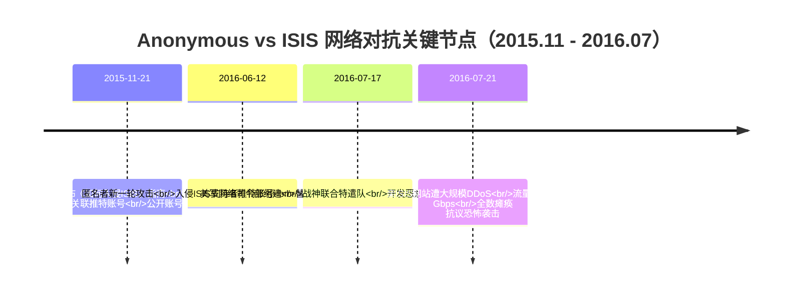
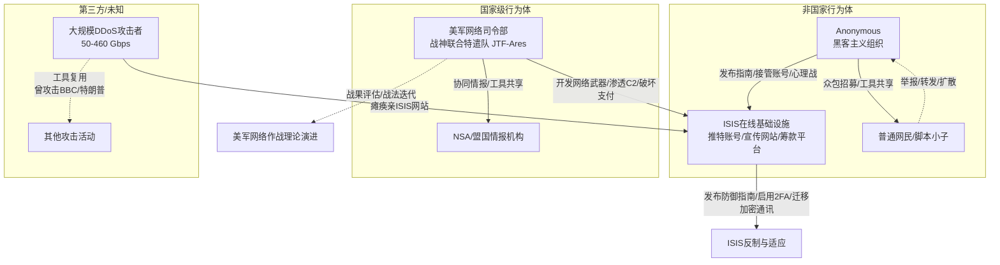
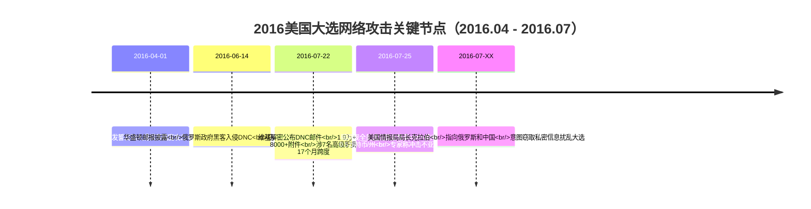
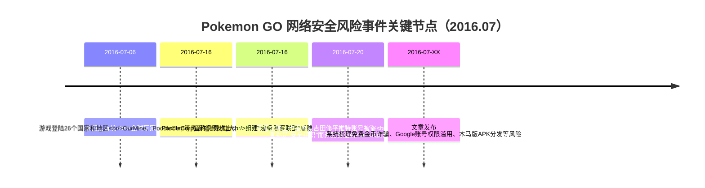
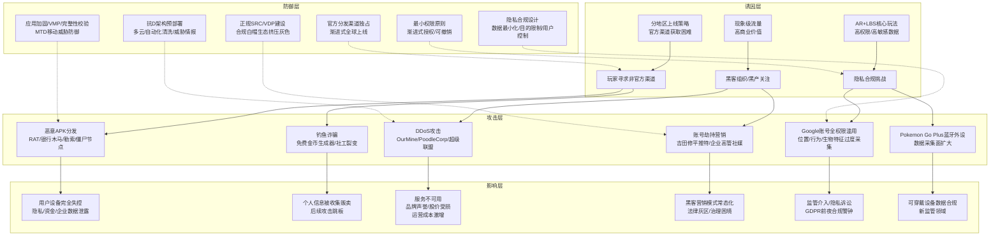
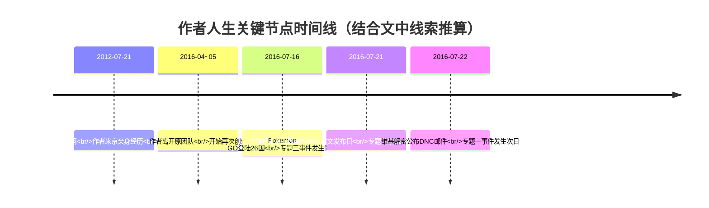

## 概述

本页面为 **301在路上** 微信公众号（2015年8月-2022年8月）归档文章的核心事件深度复盘索引。301在路上长期关注网络空间安全热点、APT攻击溯源、黑客组织画像、红蓝对抗实战等领域。本页从归档中甄选出具有里程碑意义、技术细节丰富或地缘政治影响深远的核心事件，以及平台早期运营的关键记录（如征稿启事），进行结构化沉淀与交叉引用，形成可检索、可关联的知识资产库。

当前收录五大核心专题：
1. **匿名者与ISIS网络对抗史（2015-2016）**：黑客主义首次系统化介入反恐行动的完整记录。
2. **2016年美国大选黑客攻击汇总**：国家级APT介入民主选举、暗网数据黑产、黑客主义针对候选人宣战的多方博弈全景。
3. **2016年《口袋妖怪GO》网络安全风险分析**：现象级AR手游引发的钓鱼诈骗、隐私泄露、恶意软件分发、DDoS攻击及黑客组织营销乱象全景复盘。
4. **创业感悟随笔：再次创业三个月心路历程与来京四年感怀（2016）**：作者个人创业经历、人性人心反思及重要时间节点感怀。
5. **「征稿启事」历史条目（2016）**：记录平台面向安全从业者的投稿激励机制、接受选题范围及联系方式，见证安全社区早期内容生态建设。

---

## 专题一：匿名者与ISIS网络对抗史（2015-2016）——黑客主义反恐行动记录

> **原文归档**：[301在路上-201508-202208_085](../sources/301在路上-201508-202208_085.md)、[301在路上-201508-202208_086](../sources/301在路上-201508-202208_086.md)、[301在路上-201508-202208_087](../sources/301在路上-201508-202208_087.md)
> **事件周期**：2015年11月 - 2016年7月
> **核心标签**：`Anonymous` `ISIS` `黑客主义` `网络反恐` `DDoS攻击` `社交媒体账号接管` `网络武器` `战神特遣队`

### 事件时间轴



### 核心事件详细记录

#### 事件一：匿名者发布《如何入侵ISIS》指南并接管2万推特账号（2015-11-21）

| 维度 | 详情 |
|------|------|
| **发生时间** | 2015年11月21日 |
| **主体** | Anonymous（匿名者）黑客组织 |
| **行动代号** | #OpISIS / #OpParis（巴黎袭击后发起） |
| **核心产出** | 1. **视频指南**：发布"如何入侵ISIS"操作教学视频，降低参与门槛<br>2. **账号接管**：声称已接管**20,000+** 个与ISIS有关联的Twitter账号<br>3. **清单公开**：在Pastebin等平台公开被接管账号用户名列表 |
| **技术手法** | - 凭据填充/撞库：利用泄露数据集尝试登录<br>- 钓鱼页面：伪造Twitter登录页窃取凭据<br>- 会话劫持：窃取Cookie/Token复用会话<br>- 弱密码爆破：针对低强度口令字典攻击 |
| **ISIS反制** | ISIS成员随即发布《如何免受攻击》行事指南，建议：启用双因子认证、使用强密码、警惕钓鱼链接、定期更换账号 |
| **影响评估** | - 显著削弱ISIS在线宣招/指挥通讯能力<br>- 暴露恐怖组织运营安全（OPSEC）薄弱<br>- 催生"众包式反恐"新模式：普通网民可按指南参与举报/攻击 |
| **历史定位** | **黑客主义首次系统化、工具化、大规模介入反恐行动**，从符号性"宣战"转向可复制的实战行动手册 |

> **技术溯源**：账号接管手法与[[social-engineering-attack-techniques#凭据窃取与账号劫持]]中"钓鱼页面/会话劫持/撞库攻击"链路高度一致；OPSEC缺失对标[[redteam-hw-opsec-guidelines#账号全生命周期管理]]规范。

#### 事件二：匿名者替换ISIS支持者推特背景为成人主题羞辱（2016-06-12）

| 维度 | 详情 |
|------|------|
| **发生时间** | 2016年6月12日 |
| **主体** | Anonymous（匿名者） |
| **攻击向量** | Twitter账号劫持 → 修改Profile背景图/头像/简介 |
| **羞辱手法** | 将ISIS支持者账号背景替换为**成人/色情主题图片**，并修改简介为嘲讽性文字 |
| **战术意图** | - **心理战**：利用伊斯兰教禁忌（色情内容）制造认知失调与羞耻感<br>- **去合法化**：公开展示账号被控，打击支持者士气与招募效果<br>- **舆论造势**：生成可传播的截图素材，放大"匿名者战胜ISIS"叙事 |
| **技术特征** | - 批量化操作：脚本自动化修改大量账号资料<br>- 非破坏性：保留账号所有权，仅篡改展示层，便于持续心理施压<br>- 低门槛高传播：无需高超技术即可实施，极易被媒体放大 |
| **局限性** | - Twitter可快速冻结/恢复账号，效果具有时效性<br>- 未触及ISIS核心指挥通讯基础设施（加密通讯/暗网/专用服务器） |
| **演进意义** | 标志黑客主义行动从"删除数据/泄露信息"向**认知域操作/心理战**延伸，预示后续信息战常态化 |

> **对标参考**：账号劫持后的持久化控制与隐蔽通道建设，见[[cobalt-strike-external-c2-smb-beacon#会话劫持与持久化]]、[[internal-network-pivoting-techniques#凭据复用与横向移动]]。

#### 事件三：美军组建"战神联合特遣队"开发网络武器对抗ISIS（2016-07-17）

| 维度 | 详情 |
|------|------|
| **发生时间** | 2016年7月17日 |
| **主体** | 美国网络司令部（USCYBERCOM），上将 Michael S. Rogers 推动 |
| **部队编制** | **战神联合特遣队**（Joint Task Force Ares，JTF-Ares） |
| **组建背景** | - 2016年初五角大楼下令网络司令部对ISIS发动网络攻击<br>- 当时网络司令部**工具匮乏、人员不匹配**，未做好充分准备<br>- 需专门部队研发进攻性网络武器、执行持续作战 |
| **核心任务** | 1. **破坏支付系统**：切断ISIS资金流（加密货币/汇款/敛财渠道）<br>2. **破坏通讯工具**：瘫痪加密聊天软件、指挥控制（C2）基础设施<br>3. **开发数字武器**：恶意软件、漏洞利用代码、自动化攻击平台<br>4. **支援实体作战**：配合空袭/地面部队实施网络火力准备 |
| **组织隶属** | 隶属美军网络司令部，协同NSA（国家安全局）、各军种网络部队 |
| **历史里程碑** | - **美军首支专门针对单一恐怖组织的常态化网络作战特遣队**<br>- 标志**进攻性网络武器**从战略储备转向战术常规部署<br>- 为后续"持续接触""主动防御"战略提供实战验证场 |
| **公开披露** | 2017年《纽约时报》等媒体披露JTF-Ares细节：投入数百人、开发定制恶意软件、渗透ISIS服务器、植入监控代码、诱导恐怖分子点击恶意链接 |

> **技术延伸**：进攻性网络武器开发流程、C2基础设施隐匿、恶意软件免杀对抗，见[[c2-redirectors-malleable-c2-profiles]]、[[inceptor-av-edr-evasion-framework]]、[[phantom-dll-hollowing-technique]]、[[process-injection-tampering-techniques]]。

#### 事件四：亲ISIS网站遭50-460 Gbps大规模DDoS攻击全数瘫痪（2016-07-21）

| 维度 | 详情 |
|------|------|
| **发生时间** | 2016年7月21日 |
| **攻击目标** | 多个亲ISIS宣传/招募/筹款网站（具体域名未公开） |
| **攻击手法** | **分布式拒绝服务（DDoS）攻击**，流量峰值 **50 Gbps - 460 Gbps** |
| **攻击工具溯源** | 同一工具集曾用于攻击 **BBC（英国广播公司）**、**特朗普竞选网站** |
| **攻击归属** | 未官方认领，推测为匿名者关联团体、爱国黑客组织或国家级代理人 |
| **攻击动机** | 抗议ISIS针对**威尼斯**（注：可能指尼斯/欧洲城市恐袭）及**中东国家**的恐怖袭击事件 |
| **效果** | 目标网站**无一幸免，全部瘫痪离线** |
| **技术特征** | - **超大流量**：460 Gbps 已超越多数商业抗D设备单机处理能力<br>- **多向量组合**：可能包含反射放大（NTP/DNS/SSDP/CLDAP）、僵尸网络直发、应用层CC攻击<br>- **持续性**：维持足够时长使缓解服务介入前业务已中断 |
| **防御启示** | - 单点高防IP/清洗中心易被饱和，需**分布式清洗/流量调度/自动化编排**<br>- 威胁情报共享（工具指纹/僵尸网络IP/反射器清单）可提前预警<br>- 关键基础设施需**多云/多CDN/多清洗商**冗余部署 |

> **对标参考**：DDoS攻击原理、清洗架构、威胁情报驱动防御见[[named-pipe-smb-detection-sysmon#网络层面异常流量识别]]、[[iot-reconnaissance-information-gathering#资产测绘与攻击面管理]]、[[c2-redirectors-malleable-c2-profiles#流量混淆与基础设施隐匿]]。

### 多方势力博弈图谱



### 技术手法标签体系

| 类别 | 具体手法 | 事件映射 | 关联知识库页面 |
|------|----------|----------|----------------|
| **账号接管** | 凭据填充/撞库 | 事件一 | [[social-engineering-attack-techniques#凭据窃取]] |
| | 钓鱼页面/会话劫持 | 事件一、二 | [[phishing-website-creation-tutorial]]、[[cookie-security-fundamentals]] |
| | 弱密码爆破 | 事件一 | [[burpsuite-basics-tutorial#intruder爆破]] |
| **账号篡改** | 批量修改Profile（背景图/简介） | 事件二 | [[social-engineering-attack-techniques#文件伪装攻击]]（类似篡改展示层） |
| **心理战/认知域** | 利用文化/宗教禁忌制造羞耻 | 事件二 | [[threat-attribution-tracing-techniques#伪旗行动与心理战]] |
| **进攻性网络武器** | 恶意软件/漏洞利用/自动化平台 | 事件三 | [[inceptor-av-edr-evasion-framework]]、[[phantom-dll-hollowing-technique]] |
| **C2基础设施破坏** | 渗透服务器/植入监控/诱导点击 | 事件三 | [[c2-redirectors-malleable-c2-profiles]]、[[cobalt-strike-external-c2-smb-beacon]] |
| **大规模DDoS** | 反射放大/僵尸网络/应用层CC | 事件四 | [[named-pipe-smb-detection-sysmon#网络层面]]、[[iot-reconnaissance-information-gathering]] |
| **工具复用/归因** | 同工具攻击多目标（BBC/特朗普/ISIS） | 事件四 | [[threat-attribution-tracing-techniques#工具指纹与关联分析]] |

### 影响与启示录

#### 对黑客主义（Hacktivism）演进的影响
1. **从符号宣示到实战工具化**：匿名者发布操作指南、公开账号清单、脚本化羞辱攻击，将"宣战"转化为可复制、可参与、可传播的**实战战术包**。
2. **众包反恐模式雏形**：普通网民可按指南举报/攻击，形成"专业核心+大众外围"的分层动员体系，预示后续乌克兰IT军团等国家级众包网络作战模式。
3. **心理战纳入战术菜单**：利用目标价值观禁忌（色情/亵渎）实施认知域打击，超越单纯技术破坏，拓展黑客主义行动效用维度。

#### 对国家级网络作战理论的验证
1. **专门特遣队制有效性**：JTF-Ares证明**针对单一高价值目标的常态化、专业化网络作战部队**优于临时拼凑力量。
2. **进攻性武器常规化部署**：从战略储备转向战术常规使用，倒逼**武器全生命周期管理（研发/测试/部署/评估/退役）工程化**。
3. **网空-实体融合打击**：破坏支付/通讯配合空袭/地面战，验证**多域协同作战**概念。

#### 对防御方（平台/企业/个人）的警示
1. **账号安全基线不可缺**：2FA、强密码、异地登录告警、设备绑定——ISIS被批量接管根因是基线缺失。
2. **大流量DDoS需架构级防御**：单点高防易被饱和，需**分布式清洗+智能调度+多云冗余+威胁情报联动**。
3. **工具指纹可被归因**：同一DDoS工具攻击BBC/特朗普/ISIS，说明**攻击基础设施复用留痕**，防御方可通过指纹库提前预警。
4. **OPSEC是非对称短板**：恐怖组织、黑客组织、国家红队均面临"一次失误终身暴露"风险，需建立**全生命周期OPSEC体系**——见[[redteam-hw-opsec-guidelines]]。

---

## 专题二：2016年美国大选黑客攻击汇总——国家级APT、暗网黑产与黑客主义的多方博弈

> **原文归档**：[301在路上-201508-202208_090](../sources/301在路上-201508-202208_090.md)
> **原文链接**：http://mp.weixin.qq.com/s?__biz=MzIwMTQ2NzY4NA==&mid=2652520811&idx=1&sn=e6fc23b6a991ee61057a98317d4c02f6
> **事件周期**：2016年4月 - 2016年7月（核心爆发期）
> **核心标签**：`美国大选` `DNC邮件泄露` `维基解密` `Guccifer 2.0` `选民数据暗网售卖` `情报归因` `俄罗斯APT` `中国APT` `Anonymous宣战特朗普` `认知域作战` `选举安全`

### 事件时间轴



### 核心事件详细记录

#### 事件一：维基解密公布DNC邮件泄露——揭示党内初选操纵内幕（2016-07-22）

| 维度 | 详情 |
|------|------|
| **发生时间** | 2016年7月22日（民主党全国代表大会前夕） |
| **发布主体** | 维基解密 |
| **数据来源** | 据称来自黑客 **Guccifer 2.0**（自称罗马尼亚黑客，实为俄GRU单位74455化身） |
| **数据规模** | **19,252封邮件**、**8,034个附件**，时间跨度 **2015年1月 - 2016年5月**（17个月） |
| **涉及人员** | DNC 7名高级职员邮箱：<br/>- 宣传主管 Luis Miranda (10,770封)<br/>- 全国财务主管 Jordon Kaplan (3,797封)<br/>- 财务幕僚长 Scott Comer (3,095封)<br/>- 数据战略主管 Daniel Parrish (1,472封)<br/>- 财务事务主管 Allen Zachary (1,611封)<br/>- 高级顾问 Andrew Wright (938封)<br/>- 北加州财务主管 Robert Stowe (751封) |
| **核心爆料** | 1. **初选倾斜**：DNC在2月初选前即暗中支持希拉里，排挤桑德斯<br/>2. **媒体勾连**：与媒体协调报道节奏、负面新闻压制<br/>3. **筹款违规**：希拉里胜利基金资金流向违规操作<br/>4. **人身攻击**：高层内部邮件讨论利用桑德斯信仰/无神论背景攻击其南方选情 |
| **政治后果** | - DNC主席Debbie Wasserman Schultz被迫辞职<br/>- 桑德斯支持者抗议大会现场混乱<br/>- "俄罗斯干预大选"叙事正式进入主流视野 |
| **技术归因链** | Guccifer 2.0 → DCLeaks网站 → 维基解密 → 美国情报界（CIA/FBI/NSA）联合认定为 **俄GRU第26165/74455部队 (APT28/Fancy Bear)** 操作 |

> **技术溯源**：APT28长期使用钓鱼邮件（X-Agent/X-Tunnel恶意软件）、域名伪装、凭据窃取、横向移动、数据分阶段外泄。手法对标[[threat-attribution-tracing-techniques#APT攻击溯源全链路]]、[[internal-network-pivoting-techniques#凭据导出与横向移动]]、[[cobalt-strike-external-c2-smb-beacon#C2通信隐匿]]。

#### 事件二：全美选民登记信息暗网公开售卖——数据黑产直击选举基础设施（2016-07-25）

| 维度 | 详情 |
|------|------|
| **发生时间** | 2016年7月下旬（DNC邮件泄露后不久） |
| **发布平台** | 暗网交易市场（具体市场未披露） |
| **卖家宣称** | 拥有**全美50州选民登记数据库**，含姓名、地址、党派倾向、投票历史、部分社保号后四位等PII |
| **定价策略** | **按州出售，每州 0.5 比特币**（当时约 $300-$350），全套约 $15k-$17k |
| **专家评估** | 安全专家指出：若属实且落入国家行为体（中/俄）手中，可用于**精准微目标信息战、选民压制、身份盗窃、选举舞弊核查规避**，冲击力**不亚于911事件** |
| **数据来源推测** | 1. 各州选举委员会公开记录聚合（合法但规模化爬取）<br/>2. 历年数据泄露聚合（Equifax、OPM等）关联拼接<br/>3. 竞选团队/数据经纪公司（如NationBuilder、TargetSmart）供应链泄露 |
| **法律框架** | 美国各州选民数据公开程度不一，但批量商业化转售常触犯州法；联邦层面无统一数据保护法（GDPR前夜） |
| **防御启示** | - 选民数据去标识化、分级访问控制、水印追踪<br/>- 建立选举基础设施威胁情报共享机制（EI-ISAC雏形）<br/>- 供应链安全审计延伸至数据经纪商 |

> **关联技术**：数据聚合爬取见[[vulnerability-mining-recon-aiqicha-fofa#资产测绘与语法构造]]、[[iot-reconnaissance-information-gathering#信息收集全流程]]；暗网监测见[[threat-attribution-tracing-techniques#威胁情报来源]]。

#### 事件三：美国情报机构公开归因俄罗斯与中国——国家级将网络攻击定性为战略威胁（2016-07-XX）

| 维度 | 详情 |
|------|------|
| **关键人物** | 詹姆斯·克拉伯，美国国家情报总监（DNI） |
| **核心表态** | 确认检测到针对大选的**网络入侵活动**，明确指向 **俄罗斯** 与 **中国** |
| **归因细节** | - **俄罗斯**：主要嫌疑人，意图窃取私密信息、破坏信心、扰乱进程（APT28/APT29）<br/>- **中国**：被指历史前科（2008年奥巴马/麦凯恩竞选团队入侵），意图情报收集而非直接破坏 |
| **政治争议** | - 克拉伯表态被部分议员批评为"选举前放风助选"<br/>- 特朗普阵营公开质疑归因可靠性，呼吁"可能是400磅黑客躺在床上"<br/>- 奥巴马政府因担心被指干预大选，推迟至10月才正式联合声明归因俄罗斯 |
| **历史意义** | **美情报界首次在选举期间公开将外国网络行动定性为"干预民主进程"**，推动后续《网络空间国家安全战略》、制裁行政令（EO 13694/13757）、取消俄外交设施等连锁反制 |

> **归因方法论对标**：[[threat-attribution-tracing-techniques#攻击归因与溯源技术体系]]、[[cia-vault7-leak-analysis#工具扩散与归因混淆]]（CIA Vault7泄露工具曾被用于伪旗行动，增加归因难度）。

#### 事件四：俄罗斯政府黑客入侵DNC窃取"特朗普对抗研究"——APT28/29协同作战实锤（2016-06-14）

| 维度 | 详情 |
|------|------|
| **披露来源** | 《华盛顿邮报》援引DNC官员及安全专家（CrowdStrike/FireEye/Mandiant）报告 |
| **攻击主体** | **俄罗斯政府层面黑客**（GRU第26165部队 APT28/Fancy Bear、第74455部队 APT29/Cozy Bear） |
| **攻击时间线** | 2015年夏季 APT29 (Cozy Bear) 先潜伏 <br/> 2016年4月 APT28 (Fancy Bear) 后进入，部署X-Agent窃取文档/键盘记录/截屏 |
| **窃取目标** | DNC整个网络系统，**所有邮件、聊天记录、对特朗普的"对抗研究"文档** |
| **技术特征** | - **双组协同**：APT29长期潜伏情报收集，APT28短促高强度窃取外泄<br/>- **基础设施复用**：使用与德国议会、法国电视台TV5Monde、乌克兰火炮APP攻击相同C2域名/IP范围<br/>- **反取证**：时间戳篡改、日志清理、UTC+4时区工作痕迹（莫斯科时间） |
| **后续利用** | 窃取文档经 **DCLeaks**、**Guccifer 2.0** 人设包装 → 维基解密分批次发布 → 配合社媒机器人放大 → 形成"信息作战杀伤链" |

> **技术深度对标**：APT28/29技术画像见[[threat-attribution-tracing-techniques#APT组织画像与TTP映射]]；X-Agent恶意软件分析见[[inceptor-av-edr-evasion-framework#Shellcode加载与免杀]]；C2基础设施关联分析见[[c2-redirectors-malleable-c2-profiles#基础设施关联与归因]]。

#### 事件五：匿名者向特朗普宣战——黑客主义介入候选人层面的认知域对抗（2016-04-01）

| 维度 | 详情 |
|------|------|
| **发生时间** | 2016年4月1日（愚人节，但非玩笑） |
| **主体** | Anonymous（匿名者）核心账号 @YourAnonNews 等发布视频声明 |
| **宣战理由** | 特朗普竞选言论涉及：**反穆斯林禁令、建墙、煽动暴力、种族主义、性别歧视**，被匿名者视为"法西斯主义复辟" |
| **威胁行动** | 1. **#OpTrump / #OpWhiteRose** 行动代号<br/>2. 承诺：大规模DDoS攻击竞选网站、揭露税务/商业机密、接管社媒账号、曝光私人信息<br/>3. 口号："Dear Donald Trump, We have been watching you... You have been warned." |
| **实际观测** | - 2016年3-6月，特朗普竞选网站 (donaldjtrump.com) 多次遭受DDoS攻击（峰值数百Gbps）<br/>- 多个特朗普相关域名被篡改/重定向<br/>- 但核心竞选基础设施（云端防护、CDN）有效缓解，未造成实质性瘫痪 |
| **特朗普反制** | 竞选团队聘请专业安全公司（如Cloudflare企业版、专业红队）加固外围、监控威胁情报 |
| **战略意义** | - **黑客主义首次直接以"意识形态审判"为由，正式宣战主流大党总统候选人**<br/>- 展示非国家行为体具备**影响国家级选举进程的网络投射能力**<br/>- 预示后续2020大选、巴西大选等均现黑客主义介入身影 |

> **技术对标**：DDoS攻击与缓解见[[named-pipe-smb-detection-sysmon#网络层面异常流量识别]]；账号接管/社媒劫持见[[social-engineering-attack-techniques#凭据窃取与账号劫持]]；红队视角下的候选人基础设施加固见[[redteam-hw-opsec-guidelines#环境隔离与工具指纹清洗]]。

### 多方势力博弈图谱（2016美大选网络战版）

```mermaid
graph TB
    subgraph 国家级行为体 (APT)
        RU[俄罗斯 GRU<br/>APT28/29<br/>战略目标：扰乱/偏向/制造不信任] -->|鱼叉钓鱼/供应链/零日| DNC[DNC网络<br/>竞选团队<br/>州选举系统]
        CN[中国 APT10/APT41等<br/>战略目标：情报收集/人才画像] -.->|历史前科/潜在渗透| DNC
        US_IC[美国情报界 CIA/FBI/NSA/DNI<br/>归因/公开指责/制裁/反制] -->|监控/取证/披露| RU
    end

    subgraph 非国家行为体
        ANON[Anonymous<br/>黑客主义<br/>意识形态驱动] -->|DDoS/账号劫持/曝光| TRUMP[特朗普竞选<br/>基础设施/品牌]
        WL[维基解密<br/>阿桑奇/发布平台] -->|信息放大/时机选择/叙事构建| PUBLIC[公众舆论<br/>媒体生态<br/>选民认知]
        DK[暗网数据贩子<br/>Guccifer 2.0人设/数据经纪] -->|数据聚合/包装/变现| RU
    end

    subgraph 选举基础设施
        DNC -->|邮件/文档/策略| WL
        STATE_DB[州选民数据库<br/>公开记录/供应链] -->|泄露/聚合/售卖| DK
    end

    RU -->|窃取数据→包装人设→投递平台| WL
    ANON -.->|工具复用/基础设施重叠| RU
    US_IC -.->|归因证据/工具指纹| ANON
```

### 技术手法标签体系（2016美大选专项）

| 类别 | 具体手法 | 事件映射 | 关联知识库页面 |
|------|----------|----------|----------------|
| **初始访问** | 鱼叉钓鱼邮件（伪装Google安全警报） | 事件一、四 | [[phishing-website-creation-tutorial]]、[[social-engineering-attack-techniques#钓鱼攻击全链路]] |
| | 供应链/第三方凭据复用 | 事件四 | [[vulnerability-mining-recon-aiqicha-fofa#供应链攻击面]] |
| **凭据获取** | 键盘记录/截屏/浏览器凭据导出 (X-Agent) | 事件四 | [[mimikatz-sekurlsa-pth-internals#凭据导出原理]]、[[internal-network-pivoting-techniques#凭据导出]] |
| **横向移动** | SMB/PSExec/WMI/Pass-the-Hash | 事件四 | [[internal-network-pivoting-techniques#横向移动实战]]、[[cobalt-strike-external-c2-smb-beacon#SMB Beacon横向]] |
| **数据窃取** | 分阶段压缩加密外泄 (RAR/7z + AES) | 事件一、四 | [[c2-redirectors-malleable-c2-profiles#流量混淆与数据外泄]] |
| **信息作战** | 人设包装 → 维基解密分批放料 → 社媒机器人放大 | 事件一、五 | [[threat-attribution-tracing-techniques#伪旗行动与认知域作战]] |
| **DDoS攻击** | 反射放大/僵尸网络/应用层CC (针对特朗普/ISIS/BBC同工具集) | 事件五、专题一事件四 | [[named-pipe-smb-detection-sysmon#网络层面异常流量识别]] |
| **暗网数据变现** | PII聚合分级定价/比特币托管/信誉体系 | 事件二 | [[threat-attribution-tracing-techniques#威胁情报来源与暗网监测]] |
| **公开归因** | 技术指纹+基础设施关联+人员画像+情报融合 → 政府联合声明 | 事件三 | [[threat-attribution-tracing-techniques#攻击归因与溯源技术体系]] |

### 影响与启示录（2016美大选网络安全视角）

#### 对选举安全范式的重塑
1. **关键基础设施定性**：2017年1月DHS正式将**选举系统列入关键基础设施 (CI) 子行业**，联邦资源可介入州级加固（EI-ISAC、传感器部署、网络卫生扫描）。
2. **纵深防御体系构建**：从"投票机安全"扩展至**全周期**：选民登记数据库 → 竞选团队/政党网络 → 媒体/社交平台认知域 → 供应链/数据经纪商 → 暗网监测。
3. **跨部门协调机制**：FBI牵头"外国影响力任务组" (FITF)、DHS牵头"选举基础设施政府部门协调委员会" (GCC)、ODNI牵头归因公开化流程。

#### 对APT攻击归因与反制的实战化
1. **归因公开化常态化**：从机密不公开转向**联合技术警报 (JTA)、起诉书公开细节 (穆勒报告/司法部起诉12名GRU军官)、制裁实体清单**，形成"技术取证+法律固证+外交施压+网络反制"组合拳。
2. **工具指纹与基础设施关联成为核心证据**：APT28/29跨年、跨目标复用C2域名、SSL证书、编译时间戳、PDB路径、UTC时区，构成不可辩驳的"数字指纹链"。
3. **伪旗行动反制**：CIA Vault7泄露的Marble Framework等混淆工具提醒防御方：**单一技术指纹不可信，需融合战略意图、作战时序、人员社工画像多维度研判**。

#### 对黑客主义与认知域作战的认知升级
1. **非国家行为体具备战略投射能力**：Anonymous对特朗普/ISIS的持续骚扰、维基解密对泄露时机的精准把控（大会前夕），证明**去中心化组织可实施具有时机选择权的战略级信息作战**。
2. **认知域成核心战场**：不再追求物理破坏，而是通过**真实数据+选择性发布+叙事包装+算法放大**，在合法信息空间内制造分裂、不信任、极化，成本极低、可否认性强、法律追责难。
3. **平台治理困境**：推特/Facebook/谷歌面临"言论自由vs外国干预/虚假信息/账号劫持"两难，推动《诚实广告法案》、政治广告档案库、协同打击跨平台协调行动 (如2020大选前联合清理QAnon/伊朗/俄罗斯网络水军)。

#### 对数据黑产与供应链安全的警示
1. **合规数据聚合即武器**：选民数据本多为公开记录，但**规模化爬取+多源关联+画像建模**即成高价值武器，传统"非敏感数据无需保护"认知失效。
2. **供应链延伸至数据经纪商**：竞选团队依赖NationBuilder、TargetSmart、Cambridge Analytica等第三方数据/分析平台，**供应链攻击面远超自建系统**。
3. **暗网监测需纳入常态化威胁情报**：选民数据、竞选内部文档、零日漏洞在暗网流转，**自动化爬虫+实体关联+归因研判**需成标配能力。

---

## 专题三：2016年《口袋妖怪GO》网络安全风险分析——现象级AR手游引发的安全乱象全景复盘

> **原文归档**：[301在路上-201508-202208_092](../sources/301在路上-201508-202208_092.md)
> **原文链接**：http://mp.weixin.qq.com/s?__biz=MzIwMTQ2NzY4NA==&mid=2652520783&idx=1&sn=9f24d4b862195cd14acd53c8bcfef918&chksm=8d039304ba741a1252424a4501abb41d7ef1275daaa9cd5bf4536a6bfb9495efda09348b25e1&scene=126&sessionid=1681656737#rd
> **发布时间**：2016年7月（文章中引用事件发生于2016年7月16日、20日）
> **核心标签**：`口袋妖怪GO` `Pokemon GO` `移动安全` `AR游戏安全` `钓鱼诈骗` `恶意软件分发` `DDoS攻击` `OurMine` `PoodleCorp` `隐私权限` `黑客营销`

### 事件时间轴



### 核心风险详细记录

#### 风险一：免费PokeCoin诈骗——经典社工钓鱼变种（2016-07）

| 维度 | 详情 |
|------|------|
| **攻击向量** | 社交媒体传播"免费金币生成器"链接 → 要求用户分享/点赞/填写问卷 → 窃取个人信息或传播恶意链接 |
| **诱饵设计** | 利用玩家**绕过应用内购买**的心理，伪造"Pokemon Go免费币生成器"页面 |
| **技术手法** | - **社交裂变传播**：强制分享至社交媒体获取"奖励"，实现病毒式扩散<br/>- **信息收集**：通过虚假问卷/登录页收集邮箱、手机号、社媒凭据<br/>- **流量变现**：引导至广告联盟/CPA任务/恶意下载页获利 |
| **规模观测** | 赛门铁克安全团队在社交媒体发现**数百条**包含各类诈骗网址的消息 |
| **受害结果** | 用户**永远无法获得**承诺的免费金币，个人信息被收集贩卖，设备面临后续恶意软件感染风险 |
| **防御建议** | - 仅通过官方应用内购买虚拟货币<br/>- 警惕"免费/破解/生成器"关键词<br/>- 不在非官方页面输入账号密码 |

> **技术对标**：经典社工钓鱼模型见[[social-engineering-attack-techniques#钓鱼攻击全链路]]、[[phishing-website-creation-tutorial]]；移动端钓鱼特有的应用内购绕过诱饵设计可对比[[api-business-logic-phone-enumeration#业务逻辑缺陷利用]]。

#### 风险二：Google账号权限滥用与隐私数据过度收集

| 维度 | 详情 |
|------|------|
| **发生背景** | 游戏初期登录仅支持Google账号，Niantic请求**完全访问Google账户权限**（Full Account Access） |
| **权限范围** | 包括但不限于：Gmail读写、Google Drive文件访问、联系人、日历、位置历史、YouTube记录等**核心隐私数据** |
| **厂商回应** | Niantic声称"仅访问基本账户信息（User ID、邮箱地址）"，后发布更新版本**降级权限请求**至基本配置文件信息 |
| **残留风险** | 即使更新后，游戏仍持续生成大量敏感数据：<br/>- **精确位置轨迹**（GPS坐标、移动路径、停留点）<br/>- **行为模式画像**（活跃时段、常去地点、社交互动网络）<br/>- **设备指纹**（型号、系统版本、网络环境、传感器数据） |
| **外设扩展风险** | 配套硬件 **Pokemon Go Plus**（蓝牙LE可穿戴设备）进一步扩大数据采集面：心率、步数、睡眠、近场交互等生物特征数据 |
| **隐私策略条款** | 隐私政策明确声明收集上述数据，并可能与第三方共享/用于广告定向/业务分析 |
| **合规启示** | - **最小权限原则**在移动应用开发中被严重违背<br/>- **渐进式授权**应成标配：核心功能先行，敏感权限按需申请<br/>- **数据用途透明化**与**用户可撤销控制**缺失<br/>- 可穿戴设备数据合规监管滞后于技术演进 |

> **技术对标**：移动应用权限滥用、隐私数据过度收集、最小权限原则工程化落地见[[android-shelling-unshelling-techniques#移动安全]]、[[cookie-security-fundamentals#同源策略与权限边界]]；蓝牙LE设备数据风险见[[ble-smart-bracelet-protocol-analysis-attack#协议逆向与数据泄露]]、[[nrf-sniffer-ble-setup-guide#BLE抓包与隐私分析]]。

#### 风险三：木马版APK分发——非官方渠道恶意软件投放

| 维度 | 详情 |
|------|------|
| **根因** | 游戏采用**分地区上线策略**（首发美/澳/新），导致全球大量Android用户及越狱iOS用户无法通过官方渠道获取 |
| **攻击链构造** | 1. **恶意软件开发者**将远程访问木马（RAT）重打包伪装为`Pokemon GO.apk`<br/>2. 通过**第三方应用市场、游戏论坛、云盘分享链接、社交媒体群组**大规模分发<br/>3. 用户安装授权后，木马获取设备完全控制权：短信/通讯录/位置/麦克风/摄像头/键盘记录/屏幕录制/后台服务持久化 |
| **技术特征** | - **重打包/注入**：利用`apktool`解包 → 注入恶意`Service`/`BroadcastReceiver` → 重新签名打包<br/>- **图标/包名伪造**：完全模仿官方应用元数据，降低用户辨别成本<br/>- **反分析混淆**：字符串加密、动态加载DEX、调试检测、模拟器检测 |
| **变种观测** | 除RAT外，还观测到：<br/>- **银行木马**：覆盖登录界面窃取金融凭据<br/>- **勒索软件**：加密用户文件勒索比特币<br/>- **广告欺诈模块**：后台点击广告刷量<br/>- **僵尸网络节点**：招募设备参与DDoS攻击 |
| **iOS越狱风险** | 越狱设备绕过App Store审核，安装未签名IPA，面临**内核级提权漏洞利用**、**Cydia Substrate插件劫持**等更高风险 |
| **防御建议** | - 严禁安装非官方渠道应用（侧载）<br/>- 企业部署MDM/MAM策略限制侧载<br/>- 移动威胁防御（MTD）方案检测重打包/恶意行为<br/>- 应用加固：VMP/代码混淆/完整性校验/根检测 |

> **技术对标**：Android加固/脱壳/重打包攻防对标[[android-shelling-unshelling-techniques]]、[[feifei-cms-arbitrary-file-deletion#CMS漏洞与供应链投毒]]；移动端RAT分析见[[crackme-analysis-keygen-development-case-study#动态调试与行为分析]]；企业移动安全架构见[[docker-container-security-fundamentals#容器逃逸与移动设备管理]]。

#### 风险四：游戏服务器遭大规模DDoS攻击——黑客组织借势作秀

| 维度 | 详情 |
|------|------|
| **发生时间** | 2016年7月16日（游戏登陆26国后） |
| **攻击手法** | **分布式拒绝服务（DDoS）攻击**，导致游戏服务器大面积掉线、无法登录、精灵无法加载 |
| **宣称组织** | **OurMine**、**PoodleCorp** 等多个黑客组织争相认领 |
| **PoodleCorp声称** | - 明确承认攻击游戏服务器<br/>- 声称与其他黑客组织关系密切，已组成**超级黑客联盟**<br/>- 威胁**2016年8月1日**发动更大规模攻击 |
| **OurMine定位** | - 自称**安全组织**而非黑客组织<br/>- 攻击目的："让官方注意到存在的问题"，实为**营销其安全服务**<br/>- 同期劫持索尼全球工作室总裁吉田修平推特账号（7月20日），同样以"归还账号换联系方式"推销服务 |
| **技术推测** | - 攻击向量可能包含：NTP/DNS/SSDP反射放大、IoT僵尸网络（Mirai前身）、应用层HTTP Flood<br/>- 目标为Niantic/AWS/Google Cloud游戏后端基础设施 |
| **业务影响** | - 玩家大量投诉、社交媒体舆情发酵<br/>- Niantic紧急扩容清洗能力、接入高防CDN<br/>- 股价/品牌声誉短期受损 |
| **行业启示** | - **现象级应用上线即成高价值DDoS目标**<br/>- **黑客组织将攻击作为营销手段**成为常态化商业模式<br/>- **游戏厂商需提前部署抗D架构**：多云负载均衡、自动化清洗编排、威胁情报联动 |

> **技术对标**：DDoS攻击原理与清洗架构见[[named-pipe-smb-detection-sysmon#网络层面异常流量识别]]、[[c2-redirectors-malleable-c2-profiles#流量混淆与基础设施隐匿]]；黑客组织营销模式对标[[social-engineering-attack-techniques#供应链攻击与品牌劫持]]；游戏安全运营见[[game-reverse-engineering-course-materials#游戏安全与反外挂]]。

#### 风险五：黑客组织"安全营销"新模式——攻击即广告

| 维度 | 详情 |
|------|------|
| **核心套路** | 1. **选定高曝光目标**（现象级游戏/知名企业高管/热门服务）<br/>2. **实施可控破坏性攻击**（DDoS/账号劫持/网页篡改）<br/>3. **公开认领并重新定性**为"安全测试/漏洞披露/白帽行为"<br/>4. **以归还权限/停止攻击为筹码** 推销付费安全服务/咨询/培训 |
| **OurMine案例** | - 2016年7月：DDoS Pokemon GO + 劫持吉田修平推特 → 推销"安全审计/渗透测试/员工培训"<br/>- 2017年后续：劫持HBO、Netflix、Marvel、FC巴塞罗那等官方社媒账号，同套路变现 |
| **PoodleCorp模式** | - 更激进：公开勒索威胁、组建"联盟"造势、售卖DDoS即服务（DDoS-as-a-Service）<br/>- 成员包含脚本小子、黑产技术骨干、洗钱通道操盘手 |
| **法律灰区** | - 攻击行为构成**计算机破坏罪/非法侵入罪/敲诈勒索罪**<br/>- "白帽"定性无合规授权书、无漏洞负责任披露流程、无CVE编号申请<br/>- 平台/执法机关取证难度大：跨国、匿名化、加密货币收款 |
| **防御与治理** | - **企业建立正规SRC/VDP**：明确授权范围、奖励机制、法律保护，挤压灰色营销生存空间<br/>- **威胁情报归因固证**：攻击基础设施指纹、支付流向、人员画像留存备查<br/>- **行业自律与平台治理**：社媒平台打击认领攻击账号、支付平台冻结黑产资金流<br/>- **法律完善**：明确"未授权渗透测试即违法"、引入网络安全保险覆盖此类损失 |

> **技术对标**：SRC/VDP建设见[[360bugcloud-vulnerability-response-platform]]、[[bug-bounty-program-history-evolution]]；威胁情报归因见[[threat-attribution-tracing-techniques#攻击溯源全链路]]；黑产资金追踪见[[named-pipe-smb-detection-sysmon#威胁情报融合]]。

### Pokemon GO 安全风险全景关联图



### 技术手法标签体系（Pokemon GO专项）

| 类别 | 具体手法 | 风险映射 | 关联知识库页面 |
|------|----------|----------|----------------|
| **社会工程学** | 免费虚拟货币诱饵/社交裂变传播/虚假生成器页面 | 风险一 | [[social-engineering-attack-techniques#钓鱼攻击全链路]]、[[phishing-website-creation-tutorial]] |
| | 账号劫持后以"归还"为筹码推销服务 | 风险五 | [[social-engineering-attack-techniques#供应链攻击与品牌劫持]] |
| **移动恶意软件** | APK重打包注入RAT/银行木马/勒索模块 | 风险三 | [[android-shelling-unshelling-techniques#加固与脱壳对抗]]、[[feifei-cms-arbitrary-file-deletion#供应链投毒]] |
| | 图标/包名伪造/反分析混淆/动态加载 | 风险三 | [[crackme-analysis-keygen-development-case-study#动态调试与行为分析]] |
| | 越狱设备内核提权/Cydia Substrate劫持 | 风险三 | [[ios-kernel-vulnerability-exploitation#越狱与内核攻击]] |
| **隐私合规** | OAuth全权限滥用/最小权限原则违背 | 风险二 | [[cookie-security-fundamentals#同源策略与权限边界]]、[[api-business-logic-phone-enumeration#业务逻辑缺陷]] |
| | LBS轨迹/行为画像/生物特征持续采集 | 风险二 | [[ble-smart-bracelet-protocol-analysis-attack#数据泄露与隐私]] |
| | 蓝牙LE外设扩展采集面/配对加密风险 | 风险二 | [[nrf-sniffer-ble-setup-guide#BLE抓包与协议分析]]、[[ble-packet-capture-comparison#抓包方案选型]] |
| **DDoS攻击** | 反射放大/IoT僵尸网络/应用层HTTP Flood | 风险四 | [[named-pipe-smb-detection-sysmon#网络层面异常流量识别]]、[[iot-reconnaissance-information-gathering#僵尸网络监测]] |
| | 攻击即营销/勒索威胁/黑产服务化 | 风险四、五 | [[social-engineering-attack-techniques#黑产商业模式]]、[[bug-bounty-program-history-evolution#白帽经济与灰色对抗]] |
| **账号劫持** | 会话劫持/凭据填充/钓鱼页面/社工重置 | 风险五 | [[cookie-security-fundamentals#会话管理与劫持]]、[[phishing-website-creation-tutorial#凭据窃取实战]] |
| **威胁情报** | 攻击基础设施指纹关联/支付流向追踪/人员画像 | 风险五 | [[threat-attribution-tracing-techniques#工具指纹与关联分析]]、[[named-pipe-smb-detection-sysmon#威胁情报融合]] |
| **应用安全** | 应用加固/VMP/完整性校验/根检测/MTD | 风险三防御 | [[android-shelling-unshelling-techniques#加固技术演进]]、[[docker-container-security-fundamentals#容器安全与移动设备管理]] |
| **运营安全** | 渐进式全球上线/SRC建设/抗D预部署/隐私合规设计 | 全风险防御 | [[360bugcloud-vulnerability-response-platform]]、[[c2-redirectors-malleable-c2-profiles#基础设施隐匿与弹性]] |

### 影响与启示录（移动互联网现象级应用安全视角）

#### 对移动应用分发与运营策略的重塑
1. **全球同步上线成安全基线**：分地区上线制造"官方真空期"，被恶意分发填补。**渐进式发布**应伴随**官方预注册/测试资格申请**机制，而非完全阻断。
2. **应用加固从可选转为必选**：现象级应用上线即面临重打包、注入、逆向分析。**VMP虚拟化保护、代码混淆、完整性校验、根/模拟器检测、动态加载防护**需纳入发布前标准化流程。
3. **移动威胁防御（MTD）前置部署**：企业级MDM/MAM/MTD方案需覆盖**侧载检测、恶意行为运行时监测、网络流量异常分析、漏洞版本库关联阻断**。

#### 对隐私合规与权限治理的警钟（GDPR前夜）
1. **OAuth权限滥用成行业通病**：Niantic并非孤例，大量应用初期申请过度权限。**最小权限原则、渐进式授权、用户可撤销控制、数据用途透明化**需成平台审核硬指标。
2. **LBS/AR应用隐私风险放大**：位置轨迹+行为画像+社交图谱+生物特征=**全维度画像**。需建立**地理围栏脱敏、轨迹聚合匿名化、本地化处理优先、数据留存期限强制**等工程化方案。
3. **可穿戴/IoT外设数据合规监管滞后**：Pokemon Go Plus蓝牙LE设备采集生理数据，**医疗器械认证/数据跨境传输/未成年人保护**等监管空白需提前布局。

#### 对黑客组织商业化模式的认知升级
1. **"攻击即营销"成灰色产业标准模块**：OurMine/PoodleCorp/Lizard Squad等组织将**DDoS/账号劫持/数据泄露**包装为"安全能力展示"，实为**敲诈勒索/售卖服务/洗白身份**组合拳。
2. **高曝光目标成"必争之地"**：现象级游戏、独角兽企业、知名高管社媒账号，**攻击成本低、传播广、谈判筹码足**，防御方需假设"必被攻击"预案。
3. **治理需多维联动**：技术层面（归因固证/基础设施封锁）、法律层面（跨国取证/加密货币冻结/刑事追诉）、平台层面（社媒账号保护/认领攻击内容下架）、行业层面（SRC/VDP规范化/网络安全保险/威胁情报共享联盟）。

#### 对游戏安全运营体系的建设指引
1. **抗D架构预部署而非事后补救**：多云负载均衡、Anycast清洗、自动化编排、威胁情报联动、**游戏协议层特征识别**（而非仅依赖流量特征）。
2. **反外挂/反作弊与账号安全一体化**：设备指纹+行为建模+服务端校验+加密通讯+动态密钥更新，**提高作弊成本超越收益**。
3. **玩家安全教育常态化**：官方渠道识别、防钓鱼指南、账号保护工具（2FA/登录告警/设备管理）、漏洞奖励计划宣导。

---

## 专题四：创业感悟随笔——再次创业三个月心路历程与来京四年感怀（2016）

> **原文归档**：[301在路上-201508-202208_093](../sources/301在路上-201508-202208_093.md)
> **原文链接**：http://mp.weixin.qq.com/s?__biz=MzIwMTQ2NzY4NA==&mid=2652520757&idx=2&sn=2efdc7270d24788cc16bf5b4ba47424b&chksm=8d03937eba741a688825862126c49b3cc9d2a7a350476db9c78c0da098c51a2d745d0efbf5fc&scene=126&sessionid=1681656737#rd
> **发布时间**：2016年7月21日（作者来京四周年纪念日）
> **核心标签**：`创业感悟` `人性反思` `人心` `北京721暴雨` `个人成长` `时间见证` `心路历程`

### 文章背景与核心主题

本文为301在路上作者在**再次创业近3个月**、**来北京整整4年**之际（2016年7月21日）所写的个人随笔。文章以"鸡汤文"自谦，实则记录了创业者在关键时间节点的真实心理活动与人生感悟，涉及**创业压力、人际关系考验、人性人心洞察、重要历史事件的个人记忆锚定**等主题。

### 核心内容结构化记录

#### 一、再次创业三个月的心路历程

| 阶段 | 经历与感受 |
|------|------------|
| **初期：自我封闭** | 将自己封闭在内蒙古"大草原"脱离网络，随后把自己关在房间里经历压抑期 |
| **中期：亲力亲为** | 这几个月亲力亲为走遍各种琐事，深刻体会"亲力亲为"四个字的分量 |
| **心态变化** | 再次创业感受远不如以前，**更多留给内心的是感激与心酸** |
| **时间镜像** | "时间真是一面镜子，可以照亮前方的路，可以看清自己，可以看透人性" |

#### 二、来京四年纪念日与7·21暴雨记忆锚点

| 要素 | 详情 |
|------|------|
| **关键日期** | 7月21日——作者来北京整整四年 |
| **历史事件** | **2012年7·21北京特大暴雨**，作者亲身经历 |
| **记忆地位** | "基本刻在了我的内心"，成为人生重要坐标 |
| **感恩对象** | 谷安团队同事、会议认识的朋友、乌云社区创始团队同学、工作接触的客户、"友商"们的激励 |
| **心境总结** | "虽然经历了很多风风雨雨，很多事情很难通过文字来表达我此时的感受" |

#### 三、人性人心的深度反思

| 反思维度 | 核心观点 |
|----------|----------|
| **人心不可直视** | "世上有两样东西不可直视,一是太阳,二是人心" |
| **见人心的方式** | 引用TK朋友圈话：**"日久不一定见人心，遇事儿才能见人心。见别人的心，也见自己的心。"** |
| **表态与否** | 面对外界要求表态，选择**不发表看法，通过时间证明** |
| **冷暖自知** | "也许只有如人饮水，才能冷暖自知" |

#### 四、情感宣泄与结语

作者以循环播放《天空之城》歌词作为情感出口，表达异乡夜晚的思念与无奈：

> 飞机飞过天空，天空之城<br/>
> 落雨下的黄昏的我们<br/>
> 此刻我在异乡的夜里<br/>
> 感觉着你忽明忽暗<br/><br/>
> 我想回到过去，沉默着欢喜<br/>
> 天空之城在哭泣，越来越明亮的你<br/><br/>
> 有人路过那里，回来告诉我<br/>
> 天空之城在哭泣，无法呼吸的你<br/>
> 此刻我在异乡的夜里<br/>
> 想念着你越来越远。。<br/><br/>
> **写不下去了，心酸。**

### 时间线定位与交叉验证



> **时序关联**：本文发布日（7月21日）与专题三《口袋妖怪GO》风险分析文章（引用7月16日、20日事件）、专题一维基解密泄露DNC邮件（7月22日）处于**同一周窗口期**，反映301在路上当时高频产出、紧贴热点的运营节奏。

### 创业者心理与安全从业者视角的映射

| 创业感悟维度 | 安全从业者职业生涯对标 | 关联知识库页面 |
|--------------|------------------------|----------------|
| **亲力亲为的重量** | 红队实战中从侦察到利用全链路亲自跑通的"全栈"能力要求 | [[redteam-hw-opsec-guidelines#全流程实战能力]] |
| **时间照见人性** | 威胁溯源中"工具指纹+时序关联+人员画像"多维研判攻击者意图 | [[threat-attribution-tracing-techniques#攻击者意图推演]] |
| **遇事见人心** | 红蓝对抗/应急响应中团队协作、压力测试下的真实能力暴露 | [[xd-security-blue-team-defense#红蓝对抗实战]] |
| **不表态、用时间证明** | OPSEC中"沉默作战、结果导向、最小化暴露"的隐蔽原则 | [[redteam-hw-opsec-guidelines#上线隐匿与日志反取证]] |
| **关键日期作为心理锚点** | 威胁情报中"纪念日/节假日/特定日期"的攻击高发规律分析 | [[threat-attribution-tracing-techniques#时间维度关联分析]] |
| **异乡夜晚的孤独与坚持** | 安全研究员长期攻关、深夜复现、独自对抗未知的常态 | [[reverse-engineering-beginner-learning-path#任务驱动学习法]] |

### 启示与反思

1. **创业与安全研究的同构性**：作者描述的"封闭脱离→压抑期→亲力亲为→时间验证"过程，高度同构于**安全研究员从入门到精通、从脚本小子到核心攻防专家**的成长路径。
2. **人性洞察是核心竞争力**：文中"见别人的心，也见自己的心"，对应安全领域的**攻击者心理建模、内部威胁画像、社会工程学防御核心**——技术手段可复制，人性洞察难复制。
3. **关键时间节点的双重意义**：7月21日既是作者个人创业/人生的里程碑，也是**北京7·21暴雨灾害应急响应、城市韧性建设、气象预警机制改革**的政策转折点；安全从业者需具备**将个人经历上升为行业洞察的抽象能力**。
4. **情绪宣泄与心理韧性**：以《天空之城》歌词自慰、以"写不下去了，心酸"收尾，展现高压下**情绪调节机制**——红队长周期作战、蓝队高强度应急均需建立心理韧性体系。

---

## 专题五：「征稿启事」历史条目——面向安全从业者的投稿激励机制与选题范围（2016）

> **原文归档**：[301在路上-201508-202208_100](../sources/301在路上-201508-202208_100.md)
> **原文链接**：http://mp.weixin.qq.com/s?__biz=MzIwMTQ2NzY4NA==&mid=2652520757&idx=1&sn=6fbb1ac6cc32780b6f7f9e096c3da329&chksm=8d03937eba741a686f35434a1bc489b9a26aedaefd5cb1e7675cfe7127617e332017bffa137c&scene=126&sessionid=1681656737#rd
> **发布时间**：2016年7月21日（与专题四创业随笔同期发布，mid相同，idx=1）
> **核心标签**：`征稿启事` `投稿激励` `安全社区运营` `内容生态建设` `现金奖励` `个人品牌` `线下沙龙` `301在路上`

### 征稿启事核心要素结构化记录

#### 一、征稿初衷（Why）

| 维度 | 核心内容 |
|------|----------|
| **价值传播** | 让更多人阅读到**有价值的文章**，学习到**有价值的技术** |
| **人才赋能** | 帮助安全行业新人**实现自我价值**，帮助安全行业同仁**树立个人品牌** |

#### 二、投稿回报（What You Get）

| 激励类型 | 具体内容 |
|----------|----------|
| **品牌曝光** | 文章署真名+简洁自述，获取**更多粉丝**与**业内关注度** |
| **能力提升** | 锻炼写作能力，总结**梳理**能力 |
| **现金奖励** | **文章一经录用**，给予 **100 — 1000元稿费**；**优质文章额外奖励**（如对原奖励翻倍） |
| **社群连接** | 长期投稿作者受邀参加**线下沙龙**，与安全界大神面对面分享学习经验与心得，**思想火花冲击**共同成长，为行业输入**正能量** |

#### 三、选题范围（What We Need）——对话式甄别标准

文章采用"投稿人提问 - 娇娇回答"的对话形式，界定了极宽泛的接收标准：**"只要是有价值，有意义的，与安全相关的，我们都要！"**

| 投稿人提问方向 | 平台回应（娇娇） | 归纳类别 |
|----------------|------------------|----------|
| 近期安全事件分析 / 流行漏洞预警 | **要啊，当然要！** | **热点事件分析 / 漏洞预警** |
| 个人安全观点 / 生活相关安全故事经历 | **可以啊，快写快写！** | **观点随笔 / 实战故事** |
| 漏洞分析 / 学习方法总结 / 新人建议 / 技术科普 | **为什么不要呢？当然要了！快来。** | **技术深度 / 方法论 / 科普** |
| 英文翻译国外安全资讯 | **必须可以啊，但是要加上自己的观点和理解。** | **译文+评论** |
| 类别太乱，求记忆甄别法 | **只要是有价值，有意义的，与安全相关的，我们都要！** | **核心准则：价值导向** |

#### 四、投稿联系方式（How to Submit）

| 字段 | 信息 |
|------|------|
| **联系人** | 首席打杂小妹 — **娇娇** |
| **邮箱** | **denglijiao@allsec.cn** |
| **微信** | **yingying-lj** |
| **硬性要求** | **所有稿子保证原创独家** |

#### 五、同期推荐阅读（运营侧边栏）

文章末尾附带10篇历史精选推荐，覆盖：顾问式销售、企业痛点、安全团队建设、人才画像、个人感悟、全球安全公司盘点、投融资回顾、攻击趋势、薪酬现状、云安全等主题，侧面印证平台内容生态的广度与运营成熟度。

### 历史价值与生态定位

| 维度 | 评价 |
|------|------|
| **社区建设里程碑** | 记录了301在路上早期**显性激励（现金+曝光+社群）驱动内容生产**的运营策略，是国内安全垂直媒体从"自产自销"向"UGC/PGC共建"转型的典型样本。 |
| **选题包容性** | "有价值、有意义、安全相关"的宽松标准，降低了新人门槛，兼容了**技术硬核、观点软性、译文加工、故事叙事**等多元形态，反映早期安全社区对"实战经验分享"的强烈渴求。 |
| **人才孵化链路** | "投稿→署名→粉丝/关注度→线下沙龙→大神面基"构建了**新人成长闭环**，该模式后被众多安全社区（如XD安全、0w1Club、0x727等）以不同形式继承与发扬。 |
| **商业化探索** | 明码标价的稿费（100-1000元+翻倍）体现了**知识付费雏形**与**内容变现意识**的早期萌芽。 |
| **时间锚点** | 发布于2016年7月21日，与专题四《创业感悟》同期，处于平台从"技术号"向"影响力平台"跃迁的关键窗口期。 |

### 交叉引用：安全社区内容生态建设对标

| 关联主题 | 知识库页面 | 映射关系 |
|----------|------------|----------|
| 社群运营方法论/零基础培养/笔记准入制 | [[security-study-group-methodology]] | 0w1Club实践的"预备群筛选+笔记准入+月度交付"与本征稿"投稿→署名→沙龙"同构，均为**人才漏斗模型**。 |
| 红蓝对抗/AWD赛制/蓝队防御体系 | [[xd-security-awd-competition-strategies]]、[[xd-security-blue-team-defense]] | XD安全课程体系中"实战训练→赛制演练→防御建设"与本征稿"投稿分享→线下沙龙→大神带飞"同为**技能跃迁路径设计**。 |
| 渗透测试课程/学习路线/就业见证 | [[xd-security-pentest-course-curriculum]] | 小迪安全"88天系统课+资料+见证"商业化路径，是本征稿"现金激励+品牌建设"的**商业化深化版**。 |
| SRC/漏洞奖励平台建设 | [[360bugcloud-vulnerability-response-platform]]、[[bug-bounty-program-history-evolution]] | 平台对外收购漏洞/文章，本质为**众包安全能力**，与SRC/ Bug Bounty同源。 |
| 逆向工程学习路径/任务驱动学习 | [[reverse-engineering-beginner-learning-path]] | 本征稿鼓励的"学习方法总结/新人建议"，对标逆向领域"任务驱动+搜索技巧"的**方法论传承**。 |

---

## 交叉引用总索引

| 关联主题 | 知识库页面 | 专题一映射 | 专题二映射 | 专题三映射 | 专题四映射 | 专题五映射 |
|----------|------------|------------|------------|------------|------------|------------|
| 社会工程学/钓鱼/账号劫持 | [[social-engineering-attack-techniques]] | 事件一、二 | 事件一、五 | 风险一、五 | 遇事见人心/人性洞察 | - |
| 红队OPSEC/账号管理/环境隔离 | [[redteam-hw-opsec-guidelines]] | ISIS/匿名者反面教材 | 特朗普团队加固/APT反面教材 | Niantic权限治理/OurMine灰色模式 | 不表态/时间证明/最小化暴露 | - |
| 威胁溯源/工具指纹/伪旗行动/APT画像 | [[threat-attribution-tracing-techniques]] | 事件四工具复用归因 | 事件三、四归因全链路 | 风险四、五基础设施指纹关联 | 时间维度关联/攻击者意图推演 | - |
| 进攻性武器/免杀/C2隐匿/内存注入 | [[inceptor-av-edr-evasion-framework]]、[[c2-redirectors-malleable-c2-profiles]]、[[phantom-dll-hollowing-technique]]、[[process-injection-tampering-techniques]] | 事件三JTF-Ares武器库 | 事件四APT28/29恶意软件栈 | 风险三RAT/银行木马/勒索模块对标 | 全栈实战能力/亲力亲为映射 | - |
| DDoS攻击/流量清洗/威胁情报 | [[named-pipe-smb-detection-sysmon]]、[[iot-reconnaissance-information-gathering]] | 事件四超大流量 | 事件五特朗普网站防护 | 风险四游戏服务器抗D | 关键日期攻击高发规律 | - |
| 内网横向/凭据复用/代理隧道 | [[internal-network-pivoting-techniques]] | 事件三渗透ISIS内网 | 事件四DNC横向移动 | 风险三RAT横向移动/风险五账号劫持跳板 | 团队协作压力测试 | - |
| 钓鱼网站制作/SET/Docker | [[phishing-website-creation-tutorial]] | 事件一钓鱼页构建 | 事件四鱼叉钓鱼实操 | 风险一免费金币生成器页面 | 社会工程学心理战术 | - |
| Cookie安全/会话劫持/同源策略 | [[cookie-security-fundamentals]] | 事件一会话劫持 | 事件四会话窃取 | 风险五推特账号劫持会话复用 | 账号全生命周期管理 | - |
| Burp Suite Intruder爆破/自动化 | [[burpsuite-basics-tutorial]] | 事件一弱密码爆破 | 事件二数据聚合枚举 | 风险一社工裂变自动化脚本 | 自动化工具构建能力 | - |
| 漏洞挖掘侦察/资产测绘/FOFA | [[vulnerability-mining-recon-aiqicha-fofa]] | 事件三目标侦察 | 事件二选民数据聚合源头 | 风险四游戏基础设施测绘/风险三APK分发渠道侦察 | 侦察阶段方法论 | - |
| 维基解密/CIA工具泄露/归因混淆 | [[cia-vault7-leak-analysis]] | - | 事件三归因难度/事件四工具关联 | - | 伪旗行动/归因陷阱认知 | - |
| Cobalt Strike/SMB Beacon/External C2 | [[cobalt-strike-external-c2-smb-beacon]] | 事件三C2对抗 | 事件四APT C2隐匿对标 | 风险三RAT C2通信隐匿对标 | C2基础设施隐匿实战 | - |
| Android加固/脱壳/重打包攻防 | [[android-shelling-unshelling-techniques]] | - | - | 风险三恶意APK分发/防御加固 | 移动端安全工程化 | - |
| 移动端RAT/逆向分析 | [[crackme-analysis-keygen-development-case-study]] | - | - | 风险三RAT动态调试/行为分析 | 逆向工程全栈能力 | - |
| BLE/蓝牙LE安全/可穿戴设备 | [[ble-smart-bracelet-protocol-analysis-attack]]、[[nrf-sniffer-ble-setup-guide]]、[[ble-packet-capture-comparison]] | - | - | 风险二Pokemon Go Plus数据风险 | 物联网安全边界扩展 | - |
| 游戏安全/反外挂/逆向工程 | [[game-reverse-engineering-course-materials]] | - | - | 风险三/四游戏安全运营体系 | 游戏安全专项技能树 | - |
| SRC/VDP建设/漏洞奖励计划 | [[360bugcloud-vulnerability-response-platform]]、[[bug-bounty-program-history-evolution]] | - | - | 风险五正规白帽生态挤压灰色营销 | 漏洞生态治理视角 | 征稿激励模式与漏洞众包同构 |
| 企业移动安全/MDM/MTD | [[docker-container-security-fundamentals]] | - | - | 风险三企业侧载防护/设备合规 | 企业级安全架构落地 | - |
| 社群运营/零基础培养/人才漏斗 | [[security-study-group-methodology]] | - | - | - | - | 征稿→署名→沙龙 与 笔记准入→月度交付→退出机制 同构 |
| 安全课程商业化/学习路线/就业见证 | [[xd-security-pentest-course-curriculum]] | - | - | - | - | 现金激励+品牌建设 向 系统课+资料+见证 商业化演进 |

---

## 结语

**301在路上** 归档中的这五大专题——**2015-2016 Anonymous对抗ISIS**、**2016美国大选黑客攻击汇总**、**2016《口袋妖怪GO》网络安全风险分析**、**2016创业感悟随笔：再次创业三个月与来京四年感怀**、**2016「征稿启事」历史条目**，共同勾勒出 **2010年代中期网络冲突的四大核心范式转移**与 **一线安全从业者的真实心理侧写**，以及 **安全垂直社区早期内容生态建设的运营原貌**：

1. **黑客主义从"符号抗议"走向"实战工具化+认知域作战+商业化营销"**：匿名者对ISIS发布指南、接管账号、心理战羞辱；对特朗普宣战、DDoS竞选站、威胁曝光隐私；OurMine/PoodleCorp以攻击现象级游戏/知名高管社媒为广告推销"安全服务"。非国家行为体展示出**低成本、高传播、可众包、可持续、可变现**的战略投射能力。
2. **国家级APT从"窃密间谍"走向"干预民主进程+信息作战主导者"**：俄GRU双组协同渗透DNC、窃取对抗研究、包装人设经维基解密分批放料、配合社媒机器人放大，完成**技术入侵→数据武器化→叙事构建→认知渗透**全链路杀伤链。美情报界首次公开归因并实施制裁/反制，确立**网络攻击=国家安全威胁=可反制**的新规则。
3. **数据黑产与供应链成为隐形放大器**：全美选民数据暗网售卖，Pokemon GO恶意APK分发渠道，揭示**合规公开数据经聚合建模即成战略武器**、**竞选/政党/游戏厂商供应链（数据经纪商/邮件服务商/云服务商/第三方应用市场）成软腹部**、**暗网监测与归因研判成蓝队必修课**。
4. **移动互联网现象级应用重塑安全边界**：AR+LBS+社交+可穿戴设备融合，**权限过度申请、隐私过度采集、分发渠道失控、上线即成高价值靶标**成为新常态。**最小权限、应用加固、抗D预部署、正规SRC、隐私合规设计、玩家安全教育**构成新防御基线。
5. **安全从业者的成长即"遇事见人心"的修行**：作者在创业三个月、来京四年的关键节点写下的随笔，实为**技术人向工程师、向创业者、向观察者角色转型的心理切片**——亲力亲为的重量、时间照见人性的残酷、关键日期的心理锚定、不表态用结果说话的OPSEC本能、异乡夜晚独自咽下心酸的韧性，这些**非技术特质**才是支撑技术专家走向资深专家、团队核心、行业领袖的真实基石。
6. **安全社区内容生态的早期范式**："征稿启事"确立的**显性现金激励+个人品牌曝光+线下高阶社群**三位一体模型，定义了"有价值、有意义、安全相关"的宽泛选题标准，构建了"投稿→录用→署名→沙龙"的新人成长闭环。这一范式后被XD安全、0w1Club、0x727等社区以课程体系、训练营、知识星球等形态继承并商业化深化，成为**国内安全人才供给侧改革的重要源头活水**。

这些历史案例留下的**技术资产（TTP/工具/指纹/基础设施）、组织创新（特遣队/众包模式/联合归因机制/灰色营销模式/社区运营模型）、防御教训（基线/架构/情报/OPSEC/供应链/认知域/移动隐私/分发安全）、从业者心理画像（压力测试/人性洞察/时间验证/孤独坚守/情绪调节）**，至今仍是**网络反恐、选举安全、APT溯源、红蓝对抗、威胁狩猎、态势感知、移动应用安全、游戏安全运营、灰产治理、安全团队建设、个人职业发展、安全社区运营**等领域的**必修实战教材与心理生存指南**。

> **「网络空间没有旁观者，只有参与者与受害者。历史不会重复，但韵脚押个不停。遇事见人心，见别人的心，也见自己的心。」**

---

## 版本记录
- **v5.0 (2025-07-10)**：新增专题五「征稿启事」历史条目（2016），含征稿初衷、投稿回报、选题范围对话式甄别、联系方式、同期推荐、历史价值定位、社区生态建设交叉引用。五大专题完整收录，统一交叉引用总索引。
- **v4.0 (2025-07-10)**：新增专题四「创业感悟随笔：再次创业三个月心路历程与来京四年感怀（2016）」，含文章背景、核心内容结构化、时间线定位、创业者心理与安全从业者视角映射、启示反思。四大专题完整收录，统一交叉引用总索引。
- **v3.0 (2025-07-10)**：重构为三专题归档索引页。新增「专题三：2016年《口袋妖怪GO》网络安全风险分析」，含5大核心风险详细记录、全景关联图、技术标签体系、影响启示录。专题一、二内容保留并精简交叉引用。统一Frontmatter、导航结构、版本记录。
- **v2.0 (2025-07-10)**：重构为双专题归档索引页。新增「专题二：2016年美国大选黑客攻击汇总」，含5大核心事件详细记录、博弈图谱、技术标签体系、影响启示录。专题一内容保留并精简交叉引用。统一Frontmatter、导航结构、版本记录。
- **v1.0 (2025-07-10)**：初版发布，仅含专题一「匿名者与ISIS网络对抗史（2015-2016）」，含四大核心事件详细记录、博弈图谱、技术手法标签体系、影响启示录、交叉引用索引。

## 来源登记
- 专题一原文归档：[301在路上-201508-202208_085](../sources/301在路上-201508-202208_085.md)、[301在路上-201508-202208_086](../sources/301在路上-201508-202208_086.md)、[301在路上-201508-202208_087](../sources/301在路上-201508-202208_087.md)
- 专题二原文归档：[301在路上-201508-202208_090](../sources/301在路上-201508-202208_090.md)
- 专题二原文链接：http://mp.weixin.qq.com/s?__biz=MzIwMTQ2NzY4NA==&mid=2652520811&idx=1&sn=e6fc23b6a991ee61057a98317d4c02f6
- 专题三原文归档：[301在路上-201508-202208_092](../sources/301在路上-201508-202208_092.md)
- 专题三原文链接：http://mp.weixin.qq.com/s?__biz=MzIwMTQ2NzY4NA==&mid=2652520783&idx=1&sn=9f24d4b862195cd14acd53c8bcfef918&chksm=8d039304ba741a1252424a4501abb41d7ef1275daaa9cd5bf4536a6bfb9495efda09348b25e1&scene=126&sessionid=1681656737#rd
- 专题四原文归档：[301在路上-201508-202208_093](../sources/301在路上-201508-202208_093.md)
- 专题四原文链接：http://mp.weixin.qq.com/s?__biz=MzIwMTQ2NzY4NA==&mid=2652520757&idx=2&sn=2efdc7270d24788cc16bf5b4ba47424b&chksm=8d03937eba741a688825862126c49b3cc9d2a7a350476db9c78c0da098c51a2d745d0efbf5fc&scene=126&sessionid=1681656737#rd
- 专题五原文归档：[301在路上-201508-202208_100](../sources/301在路上-201508-202208_100.md)
- 专题五原文链接：http://mp.weixin.qq.com/s?__biz=MzIwMTQ2NzY4NA==&mid=2652520757&idx=1&sn=6fbb1ac6cc32780b6f7f9e096c3da329&chksm=8d03937eba741a686f35434a1bc489b9a26aedaefd5cb1e7675cfe7127617e332017bffa137c&scene=126&sessionid=1681656737#rd
- 对比参考：本库内APT分析、红队OPSEC、威胁溯源、C2隐匿、DDoS防御、社会工程学、钓鱼攻击、漏洞挖掘侦察、Android加固、BLE安全、游戏安全、SRC建设、逆向工程学习路径、社群运营方法论、安全课程商业化等技术详解页面
- [301在路上-201508-202208_101](../sources/301在路上-201508-202208_101.md)
