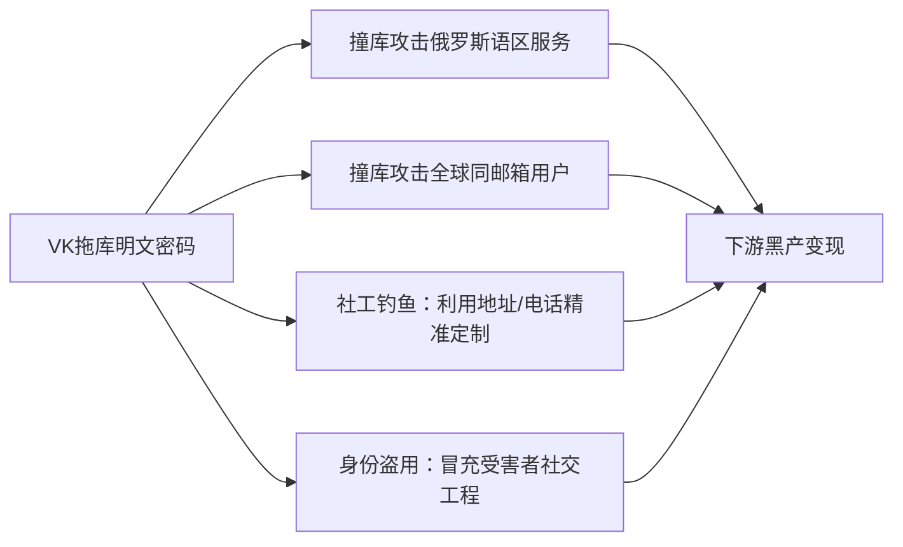
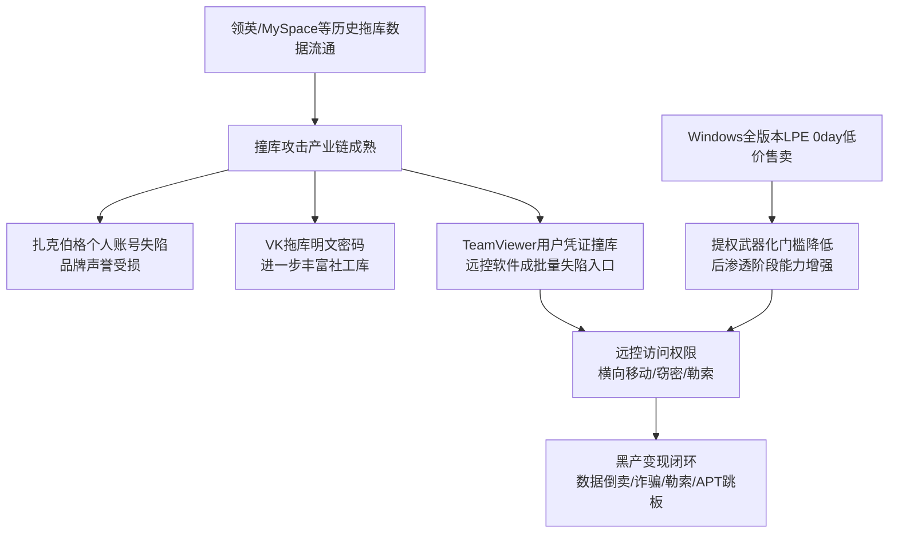
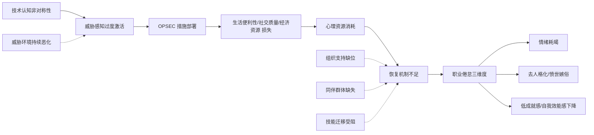
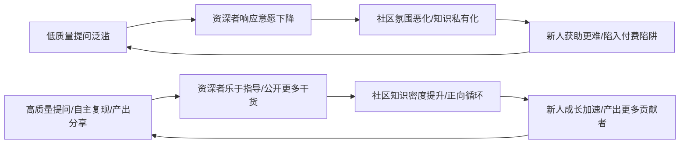

## 概述

本页面沉淀 **301在路上** 微信公众号（作者：**杨蔚**，网名 **301**，SSS安全论坛联合创始人、资深白帽黑客、**众安天下创始人&CEO**）于 **2016-2023 年** 发布的核心讨论类文章：

### 文章一：Webshell 应急响应实战讨论

> **《安全观点：95%的人处理不好的安全问题——Webshell 应急响应实战讨论》**

文章以**某大厂安全实习生面试题**为切入点，公开征集从业者实战处置思路，最终精选 **11 则具有代表性的解答**（编号 0x01~0x0b），覆盖 **SRC 白帽、乙方安全服务商、大型甲方安全团队、技术极客、猎头/人才视角** 等五大典型角色画像。文章不给出标准答案，而是通过**多视角碰撞**展现安全应急响应的复杂性、流程差异性与能力分层性，成为 2016-2017 年安全团队招聘、人才画像构建、应急响应流程标准化的重要史料切片。

> **原文链接**：http://mp.weixin.qq.com/s?__biz=MzIwMTQ2NzY4NA==&mid=2652520507&idx=1&sn=1c11ca87f84dd261581ceda02e8cb1ca  
> **原文归档**：[301在路上-201508-202208_125](../sources/301在路上-201508-202208_125.md)

### 文章二：安全岗面试特别题目讨论

> **《安全岗面试，这些"特别"题目你遇到过吗？》**

文章缘起腾讯安全实习生面试题引发的讨论，面向安全从业者（候选人）与企业方（面试主管）两个群体，征集面试过程中遇到的「特别/有意思的面试题」及面试官出过的「特别面试题」。通过朋友圈百人参与讨论，精选 **13 道非技术类真实面试题**，涵盖职业认知、价值观博弈、危机决策、人才识别、团队文化契合等维度。文章不提供标准答案，旨在通过真实题目还原安全招聘场景中对「勤思考人才」的考察逻辑。

> **原文链接**：http://mp.weixin.qq.com/s?__biz=MzIwMTQ2NzY4NA==&mid=2652520491&idx=1&sn=625b676ae5ccd6c4b4ca3924c1f2402d  
> **原文归档**：[301在路上-201508-202208_127](../sources/301在路上-201508-202208_127.md)

### 新增收录：2016年端午节杨蔚个人随笔《粽香门庭》

> **《粽香门庭》**（2016年端午节发布），原文链接：http://mp.weixin.qq.com/s?__biz=MzIwMTQ2NzY4NA==&mid=2652520477&idx=2&sn=20eb950bc5b4624d4252f1d9b4b619b3，归档源：[301在路上-201508-202208_130](../sources/301在路上-201508-202208_130.md)。该文为杨蔚（301）在2016年端午节期间所作个人随笔，以诗词开篇「粽香佳节催人意，游子思香念故里。细雨无情撒满地，奈何今去无归期」，记录大学退学经历、端午节后为某人千里奔赴却差点错过的遗憾，并以此为引向所有漂泊在外的游子们、创业者们致以节日祝福。文章展现了安全圈早期创业者/从业者在职业抉择、情感羁绊与节日思乡交织中的真实心境，为理解301从技术白帽向连续创业者转型期的内心轨迹提供珍贵一手材料。

#### 文章全文沉淀

> **佳节将至，那年，那事...粽香门庭**
>
> 最近一段时间一直都没有时间观念了，周一到周日也没有任何感觉，看着朋友圈各种礼品晒图，总算知道端午节快到了。突然，觉得自己还是应该写点什么东西。
>
> 昨天在飞机上突然想起了，几年前回乡的情景，也是大学退学那段时间的经历，现在想起感触颇多。0点收到了孙小美同学通过**值乎**发来的提问『聊聊你做得最炫酷的一件事情』，其实，觉得自己做得最炫酷的事情，应该是在哪年的端午节，跟学校提出退学的申请，并且在端午节后为了某人跑到千里之外完成了某件差点错过的遗憾，于是有以下。
>
> 
>
> **粽香门庭 ／301**
>
> 粽香佳节催人意，­游子思香念故里。  
>       ­细雨无情撒满地，­奈何今去无归期。­       
>
> ——杨蔚《粽香门庭》
>
> 最后，祝所有漂泊在外的游子们、创业者们，端午快乐。：）假期暂时不更新内容了，如果你有什么想法可以评论或者后台留言。
>
> 

#### 核心信息点提取

| 维度 | 内容 |
|------|------|
| **创作时间** | 2016年端午节（农历五月初五，约公历6月9日） |
| **创作背景** | 飞机上回忆大学退学经历，收到值乎提问「聊聊你做得最炫酷的一件事情」触发书写 |
| **核心叙事** | 1) 大学期间端午节前后提出退学申请 2) 端午节后为「某人」跑到千里之外完成某事，差点错过、成为遗憾 3) 将此视为人生「最炫酷的事情」 |
| **诗词寄意** | 「粽香佳节催人意，游子思香念故里。细雨无情撒满地，奈何今去无归期」——节日思乡、漂泊无归、雨中赶路的无奈与执着 |
| **受众祝福** | 「所有漂泊在外的游子们、创业者们，端午快乐」——确立创业者/游子群体共鸣对象 |
| **平台互动** | 值乎提问平台、「孙小美同学」提问、评论/后台留言互动 |

#### 关联人物与平台

- **孙小美同学**：值乎平台提问者，触发「最炫酷的事情」回忆
- **值乎**：早期知识付费/问答社区，301曾在此发起AMA征集（2023年AMA问答亦关联值乎）
- **大学退学经历**：301从技术白帽走向创业的关键节点，关联[[security-career-development-guide]]中「方向验证微实验」与非科班入行路径
- **千里奔赴的遗憾**：映射创业早期「为信念/人奔跑」的决策模式，关联[[security-industry-entrepreneurship-reflections]]中「踏实做事、凝聚力为本」原则

---

### 新增收录：2016年6月安全大事盘点

> **《近期互联网安全领域发生的那些大事，你知道吗？》**（2016年6月发布），原文链接：http://mp.weixin.qq.com/s?__biz=MzIwMTQ2NzY4NA==&mid=2652520487&idx=2&sn=1779841bc5d57bab3246f1404bf1d9dc，归档源：[301在路上-201508-202208_128](../sources/301在路上-201508-202208_128.md)。该文由Murasaki（18岁女白帽）与魏十七（McAfee中国白帽）合写，系统记录2016年上半年四大典型安全事件：**扎克伯格账号被撞库、俄罗斯最大社交网站VKontakte拖库1.7亿数据黑市售卖、Windows全版本本地提权0day地下论坛售价9万美元、TeamViewer大规模用户凭证被撞库导致远程控制失陷**。文章深度剖析撞库攻击产业链、密码复用风险、0day定价逻辑、厂商推卸责任与主动防御策略，为理解2016年互联网安全威胁格局提供一手史料。

#### 事件一：扎克伯格推特/Pinterest账号被撞库

##### 事件经过
- **时间**：2016年6月5日晚
- **受害者**：Facebook联合创始人兼CEO马克·扎克伯格
- **攻击者**：黑客组织OurMine Team
- **影响平台**：Twitter、Pinterest、疑似Instagram
- **攻击手法**：**撞库攻击** —— 利用2012年领英拖库数据（1亿+账户信息在黑市售卖），扎克伯格在多平台复用相同弱密码（疑为"dadada"）

##### 技术剖析：撞库攻击产业链
| 环节 | 说明 | 2016年实证案例 |
|------|------|----------------|
| **数据源头** | 历史拖库数据（领英、MySpace、Adobe等） | 领英2012年拖库数据2016年黑市流通 |
| **清洗聚合** | 去重、格式标准化、建立用户名/邮箱-密码映射库 | 黑产建立「社工库」支持批量查询 |
| **自动化撞击** | 分布式代理IP池、并发控制、频率限制绕过 | 淘宝2016年2月遭9900万次撞库尝试，2059万账号命中 |
| **价值变现** | 账号倒卖、隐私窃取、诈骗、勒索、进一步横向渗透 | 扎克伯格账号被公开羞辱，品牌声誉受损 |

##### 关键启示
1. **密码复用是核心根因**：即便密码强度尚可，跨平台复用即构成单点故障
2. **名人/高价值目标首当其冲**：攻击者优先撞击高影响力账号以获取宣传效应
3. **平台方响应差异**：Twitter迅速冻结账号并删除恶意推文；Pinterest响应滞后，恶意内容存留更久
4. **撞库与0day本质不同**：无需利用目标系统漏洞，仅凭凭证复用即可实现「无漏洞入侵」

> **交叉引用**：[[credential-stuffing-password-hygiene]] 深度复盘2017年4000万iCloud撞库勒索案，剖析双因子认证普及困境、密码复用认知根因、账号找回功能被武器化细节，补充2016年淘宝、大麦网、艾滋病患者信息、新生儿视频泄露三大典型撞库案例实证。

---

#### 事件二：VKontakte (VK) 拖库 1.7亿数据黑市售卖

##### 事件概况
- **目标**：俄罗斯/东欧最大社交平台 VKontakte (VK)，Alexa全球排名第23，注册用户2.39亿（2014年数据）
- **泄露规模**：约1.7亿用户数据，含用户名、邮箱、**明文密码**、部分地址电话
- **数据体量**：17GB
- **黑市售价**：约合人民币3800元（极低价格反映数据新鲜度/完整性或卖方急于变现）
- **披露方**：LeakedSource.com 提供100万条样本统计分析

##### 数据特征分析（LeakedSource统计）
- **弱密码普遍**：Top 10密码占比极高，"123456"、"qwerty"等弱口令泛滥
- **邮箱服务商分布**：Mail.ru、Yandex、Gmail、Rambler等俄语区主流邮箱为主
- **明文存储铁证**：密码以明文形式存在，说明VK早期（或全量）未采用哈希存储，或哈希算法极弱（如未加盐MD5）被彩虹表逆推

##### 威胁外溢路径


##### 厂商响应缺失
- 文章发布时（2016年6月）VK官方**未公开回应**，未通知用户重置密码，未确认泄露来源与范围
- 反映当时俄罗斯互联网企业数据安全合规意识薄弱、危机公关机制缺位

> **交叉引用**：[[medical-data-security-breaches]] 记录2016年全国26省艾滋病感染者信息疑似大面积泄露、安徽6000名新生儿视频挂商业网站，印证2016年大规模敏感数据泄露的高发态势与黑产下游精准诈骗变现链条。

---

#### 事件三：Windows全版本本地提权0day地下论坛售价9万美元

##### 事件详情
- **卖家**：化名"BuggiCorp"的俄罗斯黑客
- **交易平台**：地下论坛 exploit.in
- **漏洞类型**：本地提权 (Local Privilege Escalation, LPE)
- **影响范围**：Windows 2000 至 Windows 10 **所有版本**（约15亿用户）
- **售价**：90,000美元，**仅售单一买家**（独家买断）
- **交付物**：漏洞源码、完整演示视频、VS2005项目文件、未来更新维护
- **验证材料**：YouTube演示视频（唯一公开证据）

##### 0day定价逻辑与市场行情对比
| 漏洞类型 | 典型黑市价格区间 (2016年) | 本案价格 | 定价异常分析 |
|----------|---------------------------|----------|--------------|
| **远程代码执行 (RCE)** | $500,000 - $2,000,000+ | - | 最高价值，可无交互远程控制 |
| **本地提权 (LPE) - 微软** | $200,000 - $1,000,000 | **$90,000** | **显著低于市场均价**，疑似：<br>1) 漏洞利用条件苛刻/稳定性差<br>2) 卖方急于变现/规避风险<br>3) 买家议价能力强/内部交易<br>4) 漏洞即将被微软修补/已被独立发现 |
| **浏览器/Flash 0day** | $50,000 - $300,000 | - | 受缓解措施(ASLR/DEP/CFG)影响大 |

##### LPE漏洞在攻击链中的战略价值
- **必要性**：远程入侵后通常仅获取低权限(www-data/普通用户)，LPE是通往 `SYSTEM/root` 的关键跃迁
- **隐蔽性**：本地利用无网络流量特征，绕过网络层IDS/IPS
- **持久化基石**：高权限才能安装内核Rootkit、修改启动项、篡改审计策略、清除日志
- **道哥名言**："root对黑客的吸引，就像大米对老鼠的吸引，美女对色狼的吸引。黑客走的每一条路都是通往权限之路。"

##### 防御启示
1. **纵深防御不可或缺**：单一补丁管理无法覆盖0day窗口期，需部署HIPS/EDR、应用控制、最小权限原则
2. **漏洞情报订阅**：监控地下论坛、漏洞交易平台，提前感知高危0day流向
3. **缓解措施有效性验证**：定期测试LPE缓解措施(如Windows内核缓解、内存保护)对未知漏洞的阻断能力

> **交叉引用**：[[cve-2016-4654-ios-kernel-memory-corruption]] 记录同期盘古团队利用iOS 9.3.3内核漏洞越狱、苹果9.3.4修复全过程，对比移动端与桌面端0day交易与利用生态差异。[[cve-2022-0847-dirty-pipe-linux-kernel-privilege-escalation]] 深度解析Linux DirtyPipe本地提权漏洞利用链，印证LPE跨平台通用威胁模型。

---

#### 事件四：TeamViewer大规模用户凭证被撞库导致远程控制失陷

##### 事件时间线
| 日期 | 事件节点 |
|------|----------|
| 6月1日 | TeamViewer官网DNS服务器遭DDoS攻击，服务中断 |
| 6月1日后 | 大量用户报告：电脑被恶意远程访问、PayPal/银行账户被盗刷 |
| 6月5日 | TeamViewer发言人Axel Schmidt向Ars Technica承认：**大量账号密码被盗，数量"难以想象"** |
| 6月5日+ | 官方推特声称"自身无安全漏洞"，归因用户密码复用与弱口令 |

##### 官方回应与责任边界争议
**TeamViewer官方立场（Axel Schmidt访谈实录）：**
> - "我们认为几乎所有案例中的密码和凭证都是在其他地方使用过的"
> - "被盗账户数量大到难以想象，无法给出确切数字"
> - "攻击者进入账户后可访问该账户关联的所有设备"
> - **建议用户**：设置额外连接密码、配置设备白名单(仅允许办公室电脑访问)

**核心争议点**：
| 维度 | 厂商视角 | 用户/安全社区视角 |
|------|----------|------------------|
| **根因归属** | 用户密码复用、弱口令、撞库攻击 | 厂商未强制2FA、未异常登录告警、未设备指纹绑定、DDoS掩护撞库 |
| **责任边界** | "我们没有安全漏洞" | 远控软件属高风险应用，厂商负有**安全设计义务** |
| **补救措施** | 事后建议设置白名单/额外密码 | 为何默认不开启？为何无风控拦截异地/异设备登录？ |

##### TeamViewer作为高价值攻击目标的特殊性
- **权限等同物理接触**：获得TeamViewer访问权 = 完全控制受害主机（文件、摄像头、麦克风、键鼠、网银）
- **信任链滥用**：受害者往往主动安装、信任该软件，杀毒软件默认放行
- **案例实证**：2015年"小龙女李若彤网银被盗100万"案中，诈骗者即利用TeamViewer远程操作网银转账

##### 撞库防御的工程化对策（文章建议 + 现代视角补充）
| 防御层面 | 2016年文章建议 | 现代最佳实践 (2024+) |
|----------|----------------|------------------------|
| **认证强化** | 复杂验证码、短信验证码 | **强制WebAuthn/FIDO2硬件密钥、TOTP、推送确认**、密钥登录替代密码 |
| **频率控制** | 后端限制同IP请求次数 | **设备指纹+IP信誉+行为基线**自适应限流、人机识别 |
| **登录策略** | 设置登录白名单 | **零信任架构**：持续验证、动态授权、最小权限、微隔离 |
| **异常检测** | 未提及 | **UEBA(用户实体行为分析)**：异地登录、新设备、非常用时间、异常操作序列实时阻断 |
| **凭证保护** | 建议用户改密 | **泄露凭证监控**：集成Have I Been Pwned/商业威胁情报，强制重置已泄露凭证 |
| **事后响应** | 无 | **会话撤销、设备解绑、审计日志留存、用户通知、监管报备** |

> **交叉引用**：[[credential-stuffing-password-hygiene]] 记录iCloud钓鱼窃取Apple ID凭证导致多设备失陷案例，展示凭证复用导致远控软件(查找iPhone)被武器化的实战链路。[[redteam-hw-opsec-guidelines]] 记录红队演练中C2上线隐匿、工具指纹清洗等OPSEC要求，反向印证TeamViewer类合法远控工具被滥用时的检测难点与防御盲区。

---

#### 文章四大事件关联性分析：2016年上半年威胁格局缩影



**核心洞察**：
1. **数据驱动攻击**：历史拖库数据(领英/VK) → 撞库工具/社工库 → 规模化账号接管
2. **工具即漏洞**：TeamViewer等合法远控软件因设计缺陷(无强制2FA/风控)成为攻击放大器
3. **0day商品化**：LPE 0day标价化、独家买断化，攻击武器获取门槛降低
4. **防御重心偏移必要性**：从"防漏洞利用"转向"防凭证滥用、防横向移动、防权限提升、防数据外泄"

---

### 新增收录：安全从业者职业倦怠观察

> **《为什么安全从业者会比其他人活得更累？》**（2016年发布），原文链接：http://mp.weixin.qq.com/s?__biz=MzIwMTQ2NzY4NA==&mid=2652520503&idx=1&sn=b763f2c970dec3f01752ccb8920e14bc，归档源：[301在路上-201508-202208_126](../sources/301在路上-201508-202208_126.md)。该文从生活场景切入，系统记录安全从业者因隐私保护意识、OPSEC 实践导致的「生活更累」现象，构建 **安全意识副作用 → 生活成本增加 → 职业倦怠风险** 的因果链条，为安全从业者心理健康、可持续 OPSEC 实践提供史料观察窗口。

#### 六大典型生活场景的 OPSEC 实践与代价分析

| 场景编号 | 场景标题 | 核心 OPSEC 措施 | 便利性损失 | 经济/时间成本 | 心理/社交代价 | 典型人群画像 |
|----------|----------|----------------|------------|--------------|--------------|--------------|
| **场景 1** | **智能时代不智能** | 使用非智能诺基亚/大哥大，仅保留通话短信功能 | 失去移动互联网服务（支付、导航、即时通讯、资讯获取） | 设备获取成本低，但机会成本极高 | 被视为「反智」「不合群」，丧失对新事物的感知能力 | 资深安全老人、极端隐私保护派 |
| **场景 2** | **互联网不联网** | 拒绝注册/使用权限过度、安全性存疑的 App/网站；放弃服务而非妥协 | 无法使用主流生活服务（外卖、打车、社交、金融、政务） | 高昂的「隐私溢价」：用时间/现金换取匿名替代方案 | 生活效率显著下降，产生「被时代抛弃」的无力感 | 隐私绝对主义者、曾遭数据泄露者 |
| **场景 3** | **安全你我他，真心靠大家** | 自身防诈骗能力强，但无法将能力移植给亲友；亲友遭诈骗（如老板 QQ 被盗→云同步聊天记录→熟悉业务流程→财务转账） | 亲友安全意识低成「软肋」，攻击面外移至信任圈 | 亲友经济损失（案例中财务/会计各赔数万）+ 从业者协助处置时间成本 | **无力感与愧疚感**：保护不了最在乎的人，成为心理负担 | 家庭安全「守门人」、安全意识传播受挫者 |
| **场景 4** | **无奈的朋友圈** | 发布安全提醒朋友圈 → 亲友（如母亲）误读为被骗 → 长达 1 个月的反复解释与安抚 | 安全科普在非专业受众中产生逆向传播扭曲 | 沟通成本高：重复解释、情绪安抚、信任重建 | **被误解的孤独感**：「我如果犯这么低级的错误，我真不活了」却无法被信任 | 习惯性输出安全观点、家庭沟通模式僵化者 |
| **场景 5** | **WiFi 与流量** | 拒用公共 WiFi（含 VPN 不信任），仅用手机热点上网 | 失去免费/高速公共网络接入 | **月度流量费显著超支**（为安全买单的显性经济成本） | 外出办公/生活受限于流量配额，产生「被安全绑架」感 | 高频差旅/远程办公群体、对供应链攻击高度敏感者 |
| **场景 6** | **不可及与不可见** | 工作/生活社交账号物理隔离（多 QQ/微信）；屏蔽家人访问个人空间（相册、说说、日志）防社工 | 社交体验碎片化、亲密关系在数字空间被「物理隔离」 | 多账号维护成本、社交资本积累受阻 | **亲疏疏离感**：为防社工主动切断亲友在数字空间的连接，「安全换来孤独」 | 高曝光度从业者、社工攻击受害者/旁观者 |

#### OPSEC 实践强度分级与倦怠风险模型

```mermaid
graph TD
    A[威胁建模认知水平] --> B{OPSEC 实践强度}
    B -->|低| C[基础卫生：强密码、2FA、最小权限、及时更新]
    B -->|中| D[进阶隔离：多身份分层、设备专用、网络分段、元数据清理]
    B -->|高| E[极端隐匿：非智能设备、拒用主流服务、社交物理隔离、现金交易]
    C --> F[可持续性：高 | 生活质量影响：低 | 倦怠风险：低]
    D --> G[可持续性：中 | 生活质量影响：中 | 倦怠风险：中]
    E --> H[可持续性：低 | 生活质量影响：高 | 倦怠风险：极高]
    
    I[威胁实际发生概率] --> J[成本收益比失衡临界点]
    J --> K[职业倦怠触发器]
    K --> L[安全虚无主义 / 过度补偿 / 社交退缩 / 决策瘫痪]
```

| OPSEC 等级 | 典型措施组合 | 适用威胁模型 | 可持续性评估 | 倦怠前兆信号 |
|------------|--------------|--------------|--------------|--------------|
| **L1 基础卫生** | 密码管理器、2FA、自动更新、最小权限、加密磁盘 | 批量撞库、自动化扫描、机会主义攻击 | ★★★★★ 可长期维持，边际成本极低 | 无显著信号 |
| **L2 进阶隔离** | 多浏览器/Profile 隔离、虚拟机/沙箱、专用设备、DNS 加密、元数据清理工具、分 compartment 通讯 | 定向钓鱼、供应链投毒、侧信道泄露、商业间谍 | ★★★☆☆ 需自动化工具链支撑，否则维护成本随时间线性增长 | 配置漂移、工具链断裂、例外处理增多 |
| **L3 极端隐匿** | 非智能手机、拒用云服务、现金/匿名币支付、物理隔离网络、社交账号全链路屏蔽亲友 | 国家级 APT、全域监控、零日武器库、物理跟踪 | ★☆☆☆☆ **不可持续**：生活功能严重退化，边际收益递减，心理成本指数级上升 | **决策疲劳**、**社交退缩**、**习得性无助**、**安全虚无主义** |

#### 安全从业者职业倦怠的 OPSEC 关联机制



| 倦怠维度 | OPSEC 关联表现 | 实证观察（基于 301 文章及行业共识） |
|----------|----------------|-------------------------------------|
| **情绪耗竭** | 持续处于「高度警觉」状态，生活场景无法切换为「放松模式」；每次选择服务/设备都需进行威胁建模 | 「为安全买单的成本也让人困惑」「妈连着骚扰了我近 1 个月... 她还是不信」 |
| **去人格化/愤世嫉俗** | 对普通用户的「无知」产生优越感或厌恶感；对行业合规/隐私保护举措持虚无主义态度 | 「宁愿放弃一些选择，也不会去考虑使用这类服务」「大厂安全更不好做」 |
| **低成就感** | 投入大量精力维护 OPSEC，却难以量化收益；亲友仍遭社工/诈骗，产生「保护不了身边人」的无力感 | 「如何让自己的亲朋好友也在安全意识上有足够的加强，这一直是 301 和很多朋友比较着急的事情」 |

#### 可持续 OPSEC 实践框架：从「极端对抗」转向「风险分级管理」

| 核心原则 | 实施策略 | 工具/方法支撑 | 预期收益 |
|----------|----------|---------------|----------|
| **威胁建模个性化** | 基于个人资产价值、暴露面、对手能力定制 OPSEC 基线，而非盲目堆砌措施 | [[threat-modeling-methodologies]]、ATT&CK for Enterprise 个人版映射 | 避免过度防护，资源聚焦高价值资产 |
| **自动化优于人工** | 将重复性 OPSEC 任务（密码轮换、元数据清理、流量加密、备份验证）纳入自动化流水线 | 密码管理器 API、脚本化隐私清理、WireGuard/Shadowsocks 自动路由、[[redteam-hw-opsec-guidelines]] 中的环境隔离自动化 | 降低决策疲劳，保证一致性执行 |
| **分层隔离而非全盘拒用** | 建立「高/中/低」三级数字身份与设备矩阵，按业务敏感度分配，而非二元「用/不用」 | 多 Profile 浏览器、虚拟机/容器、GrapheneOS/CalyxOS 多用户配置、物理开关麦克风/摄像头 | 保留现代数字生活便利性，控制攻击面扩散 |
| **社交契约显性化** | 与核心亲友达成「数字边界协议」：共享什么、不共享什么、遭遇可疑情况如何联动，而非单方面屏蔽 | 家庭密码管理器共享保险库、Signal/Session 安全通讯约定、定期「安全体检」家庭会议 | 将「单向保护」转为「共同防御」，缓解孤独感与误解 |
| **组织级 OPSEC 基建外包** | 推动雇主提供：企业级密码管理器、MDM/零信任网络、安全手机/笔记本、定期 OPSEC 培训与心理支持 | [[hvv-blue-team-recruitment-standards]] 中蓝军基建要求、企业 EAP（员工援助计划）引入安全专项 | 将个人成本内化为组织成本，获得专业工具链与同伴支持 |
| **定期「降级演练」** | 每季度尝试在受控环境下暂停部分高强度 OPSEC 措施，评估实际风险变化，校准基线 | 红队视角自查、紫队演练个人版、[[redteam-hw-opsec-guidelines]] 中的蜜罐识别心态建设 | 打破「安全虚无主义」，基于实证调整投入产出比 |

> **交叉引用**：
> - [[redteam-hw-opsec-guidelines]] — 记录 HW/红队演练全流程 OPSEC 守则：环境隔离、工具指纹清洗、C2 隐匿、日志反取证、团队协作红绿叶法则，提供「组织级 OPSEC 标准化」参考范式。
> - [[security-practitioner-legal-compliance]] — 梳理中国法律法规下从业者授权边界、数据处理合规、漏洞披露实践，为「合规 OPSEC」提供法律护栏。
> - [[credential-stuffing-password-hygiene]] — 深度复盘撞库攻击产业链、2FA 普及障碍、密码复用认知根因，印证 L1 基础卫生的必要性与局限性。
> - [[social-engineering-attack-techniques]] — 记录 iCloud 钓鱼、查找 iPhone 武器化、SQL 注入反制溯源全链路，佐证场景 3「亲友成软肋」的技术实况。

---

### 新增收录：2023年AMA问答互动征集贴

> **《关于安全互动话题，你想问什么？》**（2023年4月发布），原文链接：http://mp.weixin.qq.com/s?__biz=MzIwMTQ2NzY4NA==&mid=2652520477&idx=1&sn=b339ec68b8b8527b0b956aa041c37b02，归档源：[301在路上-201508-202208_138](../sources/301在路上-201508-202208_138.md)。该文通过「值乎」平台征集安全从业者提问，杨蔚（花名301）以连续创业者、安全团队负责人身份承诺「只要有价值，均会如实回答」。文章列出7个核心提问方向：**职业遗憾与改变、客户需求挖掘与引导、最炫酷成就复盘、安全创业竞争力规划、理想生活方式、北漂入圈路径、跨行业需求发现**，折射2023年安全从业者群体的普遍焦虑与认知诉求。

#### 文章背景与征集机制

- **发布时间**：2023年4月16日（URL中sessionid=1681656762对应时间戳）
- **发布平台**：微信公众号「301在路上」+ 值乎问答平台
- **征集形式**：长按二维码关注值乎提问，承诺「只要有价值，均会如实回答」
- **作者身份**：杨蔚（花名301），连续创业者、国内某知名安全团队负责人、众安天下创始人&CEO、SSS安全论坛联合创始人
- **核心价值**：以「被提问者」视角反向映射2023年安全从业者群体的**职业困惑、认知断层、实战诉求**，形成行业心理切片

#### 七大核心提问方向深度解析

##### 提问1：心中最遗憾的事情，是什么？如何有机会，如何去改变？

| 维度 | 解读 |
|------|------|
| **心理投射** | 安全从业者在高压、高风险、高不确定性环境下积累的「未完成事件」情结 |
| **典型遗憾谱系** | 技术深度不够（未攻克核心漏洞）、管理机会错失（未带出得力干将）、创业窗口期错过、家庭陪伴缺位、合规红线试探翻车 |
| **改变路径探索** | 复盘方法论（如301演讲「八大成长秘笈」）、导师制引入、MVGP成长计划落地、法律合规红线前置 |
| **关联交叉引用** | [[security-career-development-guide]] 记录301阿里安全峰会演讲体系化成长路径；[[security-practitioner-legal-compliance]] 梳理合规红线避坑指南 |

##### 提问2：如何挖掘和引导客户的实际安全需求？

| 维度 | 解读 |
|------|------|
| **核心痛点** | 乙方「被动接单」 vs 客户「模糊需求」的结构性矛盾；安全预算常在事件发生后才释放 |
| **挖掘方法论** | 业务威胁建模（识别核心资产→攻击面测算→损失量化）、合规倒逼（等保2.0/关基条例/数据安全法）、同行对标（竞品安全能力基线）、红蓝对抗实战暴露真实短板 |
| **引导策略** | 从「卖产品」转向「卖确定性/卖结果/卖合规」；建立「安全服务产品化」交付标准（如[[security-consultative-selling-career]] 顾问式销售四步法） |
| **关联交叉引用** | [[security-consultative-selling-career]] 技术型销售/顾问式销售角色定义与变现路径；[[security-startup-entrepreneurship-lessons]] allsec项目获取实战心得 |

##### 提问3：聊聊你做得最炫酷的一件事。

| 维度 | 解读 |
|------|------|
| **叙事功能** | 安全圈「战故事」文化的核心载体——技术信仰确认、同伴认同仪式、个人品牌锚点 |
| **炫酷标准演进** | 2016：单点漏洞利用/渗透拿下核心资产 → 2023：体系化建设（从0到1落地SDL/红蓝对抗/威胁狩猎平台）、商业化闭环（安全产品规模化交付）、生态影响力（行业标准制定/白帽大会Keynote） |
| **隐性考察** | 面试/融资/晋升场景下的「高光时刻」提炼能力，映射候选人价值观与叙事张力 |
| **关联交叉引用** | [[shanshan-cso-career-growth-story]] 白帽山山从业务员到CSO的7年跨越实证；[[whitehat-arrest-baihe-case]] 301就白帽子被抓事件的深度观点 |

##### 提问4：现在市场上安全产品很多，很多安全公司。如果现在要准备创业做安全，需要准备什么？怎么规划发展方向，才能有竞争力呢？

| 维度 | 解读 |
|------|------|
| **市场环境** | 2023年安全赛道进入「存量博弈/强监管/降本增效」新阶段，泛泛之谈「AI+安全」「零信任」已无溢价 |
| **准备清单（301视角推测）** | 1) 细分场景极致洞察（如车联网V2X安全、数据要素流通安全、软件供应链SBOM） 2) 种子客户/设计合伙人锁定 3) 合规牌照/资质前置 4) 核心技术护城河（非单点算法，而是工程化交付能力） 5) 现金流跑通路径（服务标品化/订阅制/通用版+定制版分层） |
| **竞争力护城河** | 「踏实做事、凝聚力为本、拒绝踩踏上位、理性得舍」——[[security-industry-entrepreneurship-reflections]] 四大核心原则 |
| **关联交叉引用** | [[security-industry-entrepreneurship-reflections]] 安全创业系统性思考；[[security-startup-entrepreneurship-lessons]] allsec从0到1实战心得；[[kpmg-cyber-attack-industry-survey-analysis]] 毕马威四大行业安全投资结构性矛盾分析 |

##### 提问5：最理想的生活方式是什么？或者觉得生活中最重要的事情是什么？

| 维度 | 解读 |
|------|------|
| **群体共振** | 安全从业者在「知道得越多、活得越累」（[[#为什么安全从业者会比其他人活得更累？]]）的认知负荷下，对「生活质量/心理健康/可持续性」的集体渴求 |
| **301历史观点** | 「真正的财富是健康」（[[security-practitioner-health-wellbeing]]）、拒绝酒文化应酬、定期体检、运动建议、OPSEC实践与生活便利性的平衡点 |
| **决策框架** | 时间分配矩阵（核心家庭/核心技能/核心资产/核心社交）、法律合规红线不可触碰、职业倦怠预警机制（情绪耗竭/去人格化/低成就感三维监测） |
| **关联交叉引用** | [[security-practitioner-health-wellbeing]] 健康管理/职业倦怠/OPSEC实践深度沉淀；[[redteam-hw-opsec-guidelines]] 红队OPSEC标准化清单 |

##### 提问6：刚毕业准备去北漂，如何加入北京安全圈？

| 维度 | 解读 |
|------|------|
| **北漂特殊性** | 北京聚集国家级SRC头部、甲方安全部顶配、乙方独角兽、监管机关、顶级会议（KCon/XCon/ISC/AIS）——圈层密度最高、信息差最小、机会成本最高 |
| **入圈路径分层** | L1：CTF/漏洞挖掘/开源贡献建立技术声量 → L2：实习/外包/众测获得工程化交付经验 → L3：行业会议/社群/师兄带入核心圈层 → L4：输出观点/工具/标准成为意见领袖 |
| **避坑指南** | 警惕「培训贷/付费内推/虚假HC」；法律合规红线前置（[[security-practitioner-legal-compliance]]）；非科班入行方法论（[[security-career-development-guide]] 方向验证微实验） |
| **关联交叉引用** | [[xiaoyang-whitehat-practitioner-profile]] 白帽小羊同学北漂自学到十九大安保先进个人全路径；[[ctf-beginner-self-study-guide]] CTF新手自学全流程；[[vocational-skills-competition-2018-shandong-writeup]] 中职技能大赛实战案例 |

##### 提问7：如何做到跨行业/领域的发现客户需求？

| 维度 | 解读 |
|------|------|
| **认知跨越** | 从「安全视角看业务」转向「业务视角定安全」——理解行业价值链、监管压力传导、数字化转型痛点、竞争格局演变 |
| **实战方法论** | 1) 行业研报深度阅读（毕马威/艾瑞/IDC/头豹等） 2) 客户高管访谈（CISO/CIO/CTO/业务VP）提炼「夜不能寐的三件事」 3) 合规条文拆解（如《汽车数据安全管理若干规定》《金融数据安全规范》）转化为技术需求清单 4) 红蓝对抗实战中发现业务逻辑漏洞/数据流转异常 5) 生态伙伴联合Go-to-Market（云厂商/集成商/律所/审计机构） |
| **301优势** | 「略懂安全行业、略懂跨界行业及客户需求」——连续创业者的跨域模式识别能力 |
| **关联交叉引用** | [[kpmg-cyber-attack-industry-survey-analysis]] 四大行业网络攻击泄露率与安全投资结构性矛盾；[[app-information-service-management-regulation-2016]] APP合规条文拆解实战；[[supply-chain-attack-fundamentals]] 供应链攻击视角的跨行业需求挖掘 |

---

## 文章一：Webshell 应急响应面试题背景与核心考察点

### 题目原文

> **「外部某平台报告，公司网站被黑客上传了 webshell 并且截图证明。老板指定你为安全工程师，全权协调处理此事，请思考，你需要做些什么？」**

### 出题人意图（301 解读）

> **「严格上来说，这是并没有一个标准答案的题，出题的老师更关注的是针对这类问题来评估下候选人在遇到紧急事件处理方法、流程的综合能力。当然，这样的能力也是成为 leader 的重要因素之一。」**

| 考察维度 | 核心指标 | 对应 Leader 素质 |
|----------|----------|------------------|
| **事件响应流程** | 是否具备标准化 SOP 思维（确认→遏制→根因→恢复→复盘） | 体系建设能力 |
| **技术溯源深度** | 能否从截图/日志反推攻击路径、漏洞类型、横向移动痕迹 | 实战技术底座 |
| **业务影响评估** | 是否优先判断数据脱裤、业务中断、品牌声誉等业务侧损失 | 业务安全理解 |
| **跨部门协调** | 能否协同开发、运维、法务、公关、高管推进修复与对外沟通 | 组织影响力 |
| **证据保全与法律** | 是否懂取证链、报警条件、配合执法、知识产权保护 | 合规风控意识 |
| **白帽/厂商关系** | 如何处理漏洞提交者（致谢、奖励、引导至自家 SRC、长期共建） | 生态运营思维 |
| **复盘沉淀** | 能否输出报告、修补同类漏洞、更新规则库、固化能力提升 | 知识管理与持续改进 |

> **交叉引用**：[[security-career-development-guide]] 记录 301 阿里安全峰会演讲「八大成长秘笈」「六条职业建言」，映射「Leader 素质」的系统化成长路径。

---

## 文章一：11 位从业者解答全文结构化沉淀

### 0x01 —— SRC 榜单杀手视角：删 Shell → 排查漏洞 → 取证留痕 → 强管理

> **「首先当然得先删 shell 然后排查一下漏洞位置 排查过程中留意一下是否有过激行为，保留证据，如有需要方便追责，后续加强管理。虽然没在大厂待过，刷 src 那段时间感觉大厂安全更不好做...」**

| 关键动作 | 实战细节 | 潜在盲区 |
|----------|----------|----------|
| **首要删 Shell** | 止损优先，但未提业务停机/隔离决策 | 可能破坏现场、丢失内存马/Rootkit 线索 |
| **排查漏洞位置** | 代码审计/日志分析定位入口 | 未提关联分析（同类漏洞、横向渗透） |
| **留意过激行为、保留证据** | 具备取证意识，提及追责 | 未明确取证工具链、证据链固化流程 |
| **后续加强管理** | 管理层面闭环 | 缺乏具体技术措施（WAF、RASP、补丁管理） |

**画像标签**：`实战白帽` `SRC 高产` `止损优先` `取证意识萌芽` `大厂环境认知不足`

---

### 0x02 —— 女白帽视角：修漏洞 → 态度端正 → 内部案例化 → 规范操作

> **「首先应该先处理漏洞、排查原因，在外部公开平台给出应有的端正态度 ——表示会积极修复此漏洞，与此同时，内部排查原因并作为案例供内部学习，规范操作」**

| 关键动作 | 实战细节 | 亮点与差距 |
|----------|----------|------------|
| **先处理漏洞、排查原因** | 技术闭环优先 | 未提应急止损（删 Shell/隔离）优先级 |
| **外部平台端正态度、积极修复** | 公关/品牌侧面管理 | 缺乏法务/合规配合细节 |
| **内部案例化、规范操作** | 知识沉淀、安全文化建设 | 缺乏具体落地载体（Wiki、培训、规则库） |

**画像标签**：`白帽心态` `品牌意识` `内部分享文化` `应急止损环节缺失`

---

### 0x03 —— 典型乙方思路：包项目 → 要 HC → 报审批

> **「这是个好事！起一个安全众测项目、一个安全整改项目、和一个 WAF 采购项目、以及一个漏洞管理的 HC，然后报老板审批。」**

| 关键动作 | 实战细节 | 行业映照 |
|----------|----------|----------|
| **众测/整改/WAF/HC 四项目并行** | 将事件转化为商业机会与资源申请杠杆 | 乙方「以项目驱动安全建设」的生存逻辑 |
| **报老板审批** | 资源获取路径 | 反映甲方安全预算常需「事件触发」才能释放 |

**画像标签**：`乙方生存逻辑` `项目化思维` `预算争取实战` `技术处置缺位`

> **交叉引用**：[[security-startup-entrepreneurship-lessons]] 记录 allsec 从 0 到 1 的团队建设、项目获取、业务模式实战心得，互证「乙方项目化思维」的商业本质。

---

### 0x04 —— 全流程技术派：分场景（黑客自报 vs 白帽发现）→ 止损 → 溯源 → 评估损失 → 报警 → 致谢

> **「不知道是这个黑客提交的还是其它白帽子发现的成功的攻击事件。如果是第一种情况，必要的话，先屏蔽外网访问，然后根据截图推测出漏洞点，针对其进行应急修复...应推测出攻击发生的时间，对服务器网站日志进行分析，推测黑客使用的攻击手法...最好能联系到漏洞提交者，询问其检测过程...如果是第二种情况，应更详细地进行对各个日志的审计，确认是否存在脱裤或者源码打包带走等情况，评估企业损失，若损失严重，应保留相关证据，必要时报警提交相关证据。不管哪种情况，都应当对漏洞通报者进行感谢，必要时送些纪念品或者小礼物。鼓励其帮助推动网络安全。」**

| 处置阶段 | 场景 A：黑客自报/勒索 | 场景 B：白帽/平台通报 | 通用动作 |
|----------|----------------------|----------------------|----------|
| **止损** | 屏蔽外网访问、应急修复 | 视风险决定是否停机 | 删 Shell、改密、关端口 |
| **溯源** | 根据截图推测漏洞点、日志分析攻击手法、联系提交者复盘 | 全量日志审计、排查脱裤/源码窃取/横向移动 | 时间线重构、IOC 提取 |
| **损失评估** | 隐性（勒索未公开） | 显性（数据泄露、业务中断、声誉） | 数据分级分类、合规界定 |
| **法律动作** | 必要时报警、保留证据链 | 视损失等级决定报警/配合执法 | 电子取证规范、链式保管 |
| **生态运营** | 致谢、纪念品、鼓励共建 | 同左 | SRC 奖励、长期关系维护 |

**画像标签**：`场景化思维` `技术溯源深度` `法律合规意识` `白帽生态运营` `最完整回答之一`

> **交叉引用**：[[threat-attribution-tracing-techniques]] 系统梳理攻击溯源手法：IP 定位、钓鱼邮件反查、VPS 渗透溯源、恶意样本沙箱、主机入侵取证、流量回溯，印证 0x04「日志分析、联系提交者、时间线重构」的工程化落地。

---

### 0x05 —— 标准化事件响应模板：确认归属 → 目的判断 → 脱裤排查 → 时间线 → 入口定位 → 修补方案 → 改密 → 横向排查 → 协同修复 → 报告 → 意识提升

> **「确定自己的网站被谁黑的，对方目的是什么，有没有脱裤，确定对方什么时候进来的，靠什么漏洞进来的，制定漏洞修补方案，修改服务器相关密码，排查业务机器还有没有类似的漏洞，协助开发和运维修补漏洞，并写安全报告，提高运维开发的安全意识」**

| 步骤 | 对应 NIST 800-61 阶段 | 关键产出 |
|------|------------------------|----------|
| 确认归属/目的/脱裤 | **Detection & Analysis** | 事件分级、影响范围界定 |
| 时间线/入口/漏洞类型 | **Analysis** | 攻击链复现、根因定位 |
| 修补方案/改密/横向排查 | **Containment & Eradication** | 补丁/配置变更、凭证轮换、资产全量扫描 |
| 协同开发运维修复 | **Eradication & Recovery** | 变更工单、验收标准、回滚预案 |
| 报告/意识提升 | **Post-Incident Activity** | 复盘报告、规则库更新、培训计划 |

**画像标签**：`标准化流程` `NIST 对标` `跨部门协同` `知识沉淀闭环` `教科书式回答`

> **交叉引用**：[[xd-security-incident-response-notes]] 系统梳理 XD安全渗透测试课程 Day71-75 应急响应标准流程、日志分析、Webshell 排查、勒索病毒处置、自动化工具箱，提供 0x05 流程的落地工具链参考。

---

### 0x06 —— 典型大型甲方：联系平台拿详情 → 调查影响 → 引导至自家 SRC 复投 → 发奖励

> **「联系平台获取漏洞详情，调查是否造成影响，联系白帽子引导其到自家 src 再提交一次漏洞，并通过自家 src 发放奖励。」**

| 关键动作 | 甲方安全运营逻辑 | 隐性假设 |
|----------|------------------|----------|
| **联系平台拿详情** | 依赖第三方平台（补天/乌云/漏洞盒子）获取一手技术细节 | 平台合作关系成熟、响应 SLA 明确 |
| **调查影响** | 业务侧影响评估优先于技术溯源 | 甲方核心关注「业务是否受损」 |
| **引导至自家 SRC 复投** | 纳入自管漏洞生命周期、数据资产化、供应商管理 | 自建 SRC 平台运营成熟、预算充足 |
| **发奖励** | 激励白帽持续投递、建立正向循环 | 奖励标准透明、支付流程合规 |

**画像标签**：`大型甲方` `SRC 运营成熟` `业务影响优先` `白帽关系管理` `技术溯源外包/二线`

> **交叉引用**：[[hvv-blue-team-recruitment-standards]] 记录 HVV 蓝军招聘分级标准，侧面印证大型甲方蓝军在「漏洞处置、白帽运营、业务影响评估」上的分级能力要求。

---

### 0x07 —— 技术态度大赞：日志分析全链路（Apache/系统/数据库/Netstat/Rootkit/CMS 指纹） → 代码审计 → 报告输出

> **「刚睡醒，随便写几个字：如果漏洞平台没有提供详细的报告，先和网站管理员沟通了解网站类型、服务器类型、运维 IP 以及服务器开启的服务。通过截图看看有没有路径，知道路径的话先删除 shell。如果服务器是 linux，首先通过日志文件，例如 apache 访问日志（如果日志是 info 等级，会发现很多关键行为的）查看系统日志发现蛛丝马迹；查看 web 日志定位 shell 的路径 异常访问的页面（配合 sed 等正则语句有奇效，例如查看某段时间内哪个 ip 访问的最多，如果一个 ip 半夜访问某个页面次数很多，那多半是有问题，就可以定位到页面，然后通过页面或者定位到可疑 ip 再查找定位到黑客植入 shell 的方法，进行溯源）。网站运维允许的话，代码打个包，脱下来检测下，通过排查系统日志来定位服务器被黑到什么程度，例如有没有被 ssh 留后门并被连接过等等。然后查看 netstat 进程，看看有没有异常的端口开放外联，再看看数据库是分离的还是在一起，数据库二进制日志、错误日志差看下，这些基本上是最正常的，再深入可以异常分析有没有被植入 rootkit（不详细叙述，可以说一年）然后通过网站类型看看有没有已知的漏洞，如果是毕源 cms 那就通过刚才分析的黑客植入 shell 的方法定位是什么问题（基本上就是常见的上传 sql 命令执行，定位到关键问题代码），最后出具报告，报告上含网站被黑过程、程度、时间、ip 类型、网站问题代码和修复加固方法。还有一些不写了，还没睡醒。」**

| 技术环节 | 具体工具/命令/思路 | 实战价值 |
|----------|-------------------|----------|
| **资产摸底** | 网站类型、服务器类型、运维 IP、开放服务 | 界定分析边界、避免误删业务 |
| **Web 日志分析** | Apache access.log (Info 级)、sed/awk 正则、IP 访问频次统计、半夜异常访问识别 | 低成本高产出的溯源核心技能 |
| **系统日志/认证日志** | /var/log/secure、auth.log、last、lastb、history | SSH 爆破/密钥登录/后门账号排查 |
| **网络连接审计** | netstat -antulp、ss、lsof -i | 反弹 Shell、隐蔽通道、C2 连接发现 |
| **数据库审计** | MySQL binlog、error.log、general_log | 脱裤痕迹、注入载荷、权限滥用 |
| **Rootkit/持久化排查** | chkrootkit、rkhunter、lsattr、/etc/cron*、/etc/rc.local、systemd、LD_PRELOAD | 高级威胁狩猎、需深厚 Linux 内功 |
| **CMS 指纹/已知漏洞匹配** | whatweb、wappalyzer、CVE/ExpDB 检索 | 快速缩小入口范围、避免盲目代审 |
| **代码脱机审计** | 打包源码、本地 grep/IDE/SAST 工具 | 定位漏洞代码行、生成修复补丁 |
| **报告标准化** | 过程/程度/时间/IP/类型/代码/修复加固 | 交付物规范化、便于审计/复盘/保险理赔 |

**画像标签**：`硬核技术派` `日志分析全栈` `Linux 取证基本功` `工具链熟练度高` `报告交付规范` `最硬核回答`

> **交叉引用**：
> - [[xd-security-incident-response-notes]] — 记录 Webshell 排查、日志分析、进程网络连接排查、自动化工具箱（ir-rescue、GScan、LogonTracer），与 0x07 技术栈高度重合。
> - [[web-shell-detection-emergency-response]] — 系统梳理 Webshell 应急响应检测流程：文件层面（时间戳、权限、内容特征）、进程层面（父子关系、网络连接）、日志层面（访问日志、错误日志、审计日志）、内存层面（内存马、反射型 Shell），提供 0x07 实战操作的标准化 SOP 参考。

---

### 0x08 —— 渗透测试报告导向：联系平台 → 还原漏洞 → 检测隐患 → 清除后门 → 写报告给老板/开发/运维

> **「1.联系该平台，获取漏洞详情。2.根据该平台的漏洞详情还原漏洞，根据渗透的情况检测是否有其他的安全隐患和缺口，对服务器上的木马后门进行清除。3.根据 2 写一份渗透测试报告给老板和开发部门，如果有服务部门也一并通知。这样可以修复漏洞的同时安抚用户。」**

| 阶段 | 动作 | 交付物 |
|------|------|--------|
| **情报获取** | 联系平台拿详情 | 漏洞详情文档 |
| **验证复现** | 还原漏洞、全面检测隐患 | 验证记录、资产风险清单 |
| **清理止损** | 清除木马/后门 | 清理确认单 |
| **报告交付** | 渗透测试报告→老板/开发/运维 | 修复建议、整改追踪表、管理层汇报 PPT |

**画像标签**：`渗透测试视角` `报告驱动修复` `多层级汇报` `安抚用户/管理层`

---

### 0x09 —— 判断-沟通-解决-汇报四步法

> **「第一，根据问题现象以及黑客截图内容对该问题做判断。是否能够立即解决。第二，联系外部平台，沟通其目的意向是什么？如何解决问题！第三，综合两点解决问题！汇总报告提交领导！顺利的话应该这么个过程吧。」**

| 步骤 | 核心动作 | 管理学映射 |
|------|----------|------------|
| **判断** | 现象分析、可行性评估 | 形势估计、决策前置条件检查 |
| **沟通** | 联系平台、了解意图、协商方案 | 利益相关方管理、谈判博弈 |
| **解决** | 综合执行技术/法务/公关方案 | 执行落地、资源调度 |
| **汇报** | 结果报告、闭环 | 向上管理、责任交接 |

**画像标签**：`管理者视角` `四步法闭环` `沟通协作重于技术细节` `汇报导向`

---

### 0x0a —— 业务连续性优先：谈判拖延 → 备用站点切换 → 牺牲部分业务 → 强安全策略 → 定位修复

> **「1、持续与黑客谈判获取更多信息，降低安全事件的影响。2、修改备用站点密码，备份备用站点，切换到备份站点。必要时，牺牲部分业务，启用更强安全策略。3、定位漏洞和解决问题。」**

| 策略 | 实战场景 | 风险权衡 |
|------|----------|----------|
| **与黑客谈判** | 勒索/敲诈/数据窃取场景，争取时间、摸清底细 | 法律风险、可能被套话、鼓励犯罪 |
| **备用站点切换** | 灾备体系成熟、RTO/RPO 指标达标 | 数据一致性、同步延迟、切换演练不足 |
| **牺牲部分业务/强策略** | 核心资产保护优于全量可用 | 业务损失量化、用户体验、合规兜底 |

**画像标签**：`业务连续性视角` `灾备/切换实战` `风险权衡决策` `谈判博弈` `大厂架构师思维`

> **交叉引用**：[[business-continuity-disaster-recovery]] 记录业务连续性管理（BCM）、灾备演练、RTO/RPO 目标设定、切换预案、数据一致性校验，印证 0x0a「备用站点切换」的工程化前置条件。

---

### 0x0b —— 猎头/人才视角：约出来喝酒谈心 → 挖走

> **「野路子：想办法邀请到漏洞提交者出来喝酒，谈心，如果职位合适的话，挖走。」**

| 视角 | 核心逻辑 | 行业现象 |
|------|----------|----------|
| **人才获取** | 顶尖白帽/攻防高手稀缺，实战事件是最佳人才识别场 | 「黑客转白帽入职」是大厂/独角兽常见招聘路径 |
| **关系建立** | 非正式社交（喝酒/谈心）建立信任，打破招聘对抗 | 安全圈「酒局文化」「圈子推荐」主导高端人才流动 |
| **职位匹配** | 技能画像与 JD 精准对齐，避免「买椟还珠」 | 需安全 Leader 深度参与 JD 设计、面试把关 |

**画像标签**：`猎头/人才运营` `非常规招聘` `白帽转化` `圈子生态` `人才即安全核心资产`

> **交叉引用**：[[security-career-development-guide]] 记录「白帽转正规军」「CTF 选手就业」「安全人才画像」路径，印证 0x0b「挖走白帽」的职业发展现实路径。

---

## 文章二：13 道非技术类安全岗真实面试题及社区反馈

### 背景与征集过程

文章缘起腾讯安全实习生面试题引发的讨论（15分钟1000阅读量，20分钟1400+阅读量），301 发朋友圈征集，百人参与讨论，精选 13 道非技术类真实面试题展示。题目来源真实反馈，无标准答案，企业更倾向于勤思考的人才。

### 13道面试题全文与解析维度

#### 试题1："你认为你和MJ TK 他们差多少？"
- **考察维度**：自我认知、行业标杆对标、差距分析能力、成长规划
- **隐含意图**：候选人是否了解行业顶尖水平，能否客观评估自身技术/影响力差距，是否有明确追赶路径
- **关联人物**：MJ（默罕默德·贾法尔？）、TK（某知名安全研究员/团队负责人），代表行业头部技术标杆

#### 试题2："你有男朋友了吗？如果有，对象都安顿好了吗？"
- **考察维度**：个人生活稳定性、加班/出差/驻场接受度、长期留任意向
- **争议点**：涉及就业歧视灰色地带，反映部分安全岗位高强度、高流动性的用人痛点
- **行业映照**：安全应急响应、红队演练、HVV 等场景常需不定期响应，家庭支持度成隐性招聘指标

#### 试题3："说说你的梦想？"
- **考察维度**：职业愿景、内驱力、价值观契合度、长期主义倾向
- **区分度**：技术极客型（钻研漏洞/工具）、管理领袖型（建团队/立体系）、创业实干型（落地商业价值）的回答差异显著

#### 试题4："面试信息安全，结果搞了半天招聘的是保安。"
- **考察维度**：求职渠道辨识度、岗位JD阅读细致度、对「安全」岗位定义的认知边界
- **行业乱象**：中小企业/非安全主业公司常混淆「网络安全工程师」与「保安/监控值守」，JD 造假、岗位挂羊头卖狗肉现象普遍

#### 试题5："如果遇到老板潜规则你会怎么做？（安全行业还有这事？）"
- **考察维度**：职场边界感、法律意识、价值观底线、危机公关能力
- **特殊性**：安全从业者掌握核心数据/系统权限，面对权力不对等时的抗压与抉择，折射职业操守成色

#### 试题6："如果你是厂商的安全负责人，此时遇到一个重大漏洞被外部披露，危机公关过程中，你会怎么做？"
- **考察维度**：危机管理全流程（确认→分级→止损→沟通→修复→复盘）、多方利益平衡（用户、监管、高管、白帽、媒体）、法律合规底线
- **实战映射**：对标 0x04、0x05、0x06 回答框架，考察从技术专家向安全负责人角色转型的管理广度

#### 试题7："我把公司网站发你，你来拿个shell，做个漏洞总结报告，你会怎么做？"
- **考察维度**：授权边界意识、合规红线、职业道德、实战技术验证方式
- **核心陷阱**：未授权渗透测试违法，优秀候选人应回应「需要书面授权/规则范围/数据保护协议」，而非直接上手攻击
- **交叉引用**：[[security-practitioner-legal-compliance]] 梳理中国法律法规下从业者授权边界、漏洞披露最佳实践

#### 试题8："假如公司录用你了，你在公司待半年，另外还有个公司环境、工作内容基本一致，月薪是现在单位的两倍，你如何选择？"
- **考察维度**：忠诚度/稳定性预期、职业决策模型（钱 vs 成长 vs 文化 vs 信任）、谈判博弈心理
- **管理视角**：考察候选人是否可被「更高薪」轻易挖角，或是否具备「留人理由」的自我构建能力

#### 试题9："你的特长是什么？你的缺点是什么？"
- **考察维度**：自我反思深度、优势匹配度、缺点真实性与改进行动、谦逊与自信的平衡
- **避坑指南**：缺点勿答「完美主义」「工作太投入」等伪缺点；真实缺点需配套改进机制（如「不擅长PPT汇报，已在通过每周复盘输出提升」） 

#### 试题10："你认识黑哥吗?"
- **考察维度**：行业圈层认知、人脉广度/质量、社交货币价值、圈子文化归属感
- **隐喻**：「黑哥」类隐性代称代表特定技术流派/团队/社区核心节点，知晓度侧面反映候选人行业浸润度

#### 试题11："为什么来我们这里？"
- **考察维度**：求职动机真实度、企业调研深度、双向选择的理性程度、文化契合预判
- **高分回答**：业务场景吸引（如「贵司电商高并发场景下的账号安全体系建设极具挑战」）、技术栈匹配、团队口碑、导师制成长路径

#### 试题12："假如你来建设X讯云安全，怎么搞？（面资深安全工程师）"
- **考察维度**：体系化建设能力、落地交付思维、资源规划与优先级排序、从0到1/1到N的实战经验
- **回答框架**：资产梳理→威胁建模→基线合规→检测响应→红蓝对抗→安全运营→度量体系→文化渗透，需结合云原生/多租户/合规特点定制

#### 试题13："假如有一天，你收到一封邮件，说你们公司的数据库被脱了，不给100万，就公开，你怎么办？"
- **考察维度**：勒索应急决策树（验证真伪→证据保全→影响评估→内部上报→法律介入→对外沟通→谈判策略）、心理素质、法律底线
- **关键分水岭**：是否直接付款/私了（违法/鼓励犯罪） vs 启动应急预案、报警、配合溯源、依法处置
- **交叉引用**：[[credential-stuffing-password-hygiene]] 记录 4000万 iCloud 撞库勒索案复盘，印证数据脱裤后勒索的实战演变链路

### 面试题分类映射矩阵

| 题号 | 核心考察象限 | 适用岗位层级 | 典型高分信号 | 典型低分信号 |
|------|--------------|--------------|--------------|--------------|
| 1 | 技术视野/标杆对标 | 初中级技术 | 具体差距维度+追赶计划 | 模糊推脱/盲目自大 |
| 2 | 生活稳定性/留任 | 需高强度响应岗 | 坦诚沟通家庭支持体系 | 回避/对抗/撒谎 |
| 3 | 职业愿景/内驱力 | 所有层级 | 具体场景化愿景+行动 | 空泛口号/唯薪资论 |
| 4 | 求职辨识度/认知边界 | 所有层级 | 复盘识别过程+渠道优化 | 单纯吐槽/无反思 |
| 5 | 职业操守/法律底线 | 核心岗/高管 | 明确拒绝+留证+合规路径 | 妥协/模糊/情绪化 |
| 6 | 危机管理/管理广度 | 安全负责人/Leader | 全流程SOP+多方协同案例 | 仅谈技术修复/甩锅 |
| 7 | 合规授权/职业道德 | 渗透/红队/审计 | 先谈授权范围/规则/数保 | 直接上手攻击/无授权概念 |
| 8 | 忠诚度/决策模型 | 核心岗/高潜 | 多维权衡框架+长期主义 | 非黑即白/唯钱论/拍胸脯 |
| 9 | 自我认知/成长性 | 所有层级 | 真实缺点+改进闭环 | 伪缺点/无缺点/无改进 |
| 10 | 行业圈层/人脉 | 资深/Leader | 精准画像圈层价值 | 盲目攀关系/不知名 |
| 11 | 动机真实度/双向选择 | 所有层级 | 业务/技术/文化具体匹配 | 通用套话/仅因薪资/地缘 |
| 12 | 体系建设/落地交付 | 资深/架构师/Leader | 分阶段路线图+优先级+度量 | 罗列工具/名词/无落地细节 |
| 13 | 勒索应急/心理素质/法治 | 核心岗/Leader/应急 | 验证→上报→报警→预案→溯源 | 付款私了/慌乱/推责 |

---

## 核心能力模型映射：从面试题到人才画像

基于文章一 11 则解答与文章二 13 道面试题，构建 **Webshell 应急响应工程师 / 安全团队 Leader / 资深安全工程师** 核心能力雷达图：

| 能力象限 | 关键能力项 | 覆盖解答/题目 | 权重建议 |
|----------|------------|--------------|----------|
| **技术溯源 (T)** | 日志分析(Web/系统/数据库/网络)、Rootkit 排查、代码审计、CMS 指纹、漏洞复现、IOC 提取 | 0x01, 0x04, 0x05, 0x07, 0x08, 题7, 题12 | ★★★★★ |
| **应急止损 (C)** | 删 Shell/隔离/断网/切换备用站点/改密/关端口/启用强策略 | 0x01, 0x04, 0x05, 0x0a, 题6, 题13 | ★★★★☆ |
| **流程体系 (P)** | NIST/ISO 27035 对标、SOP 建设、分级分类、证据保全、复盘沉淀、规则库更新 | 0x04, 0x05, 0x08, 0x09, 题6, 题12, 题13 | ★★★★☆ |
| **业务影响 (B)** | 数据分级、脱裤评估、业务连续性(RTO/RPO)、品牌/法务/合规量化 | 0x04, 0x06, 0x0a, 题6, 题13 | ★★★★☆ |
| **跨域协同 (X)** | 开发/运维/法务/公关/高管/白帽/平台/执法多方协调、汇报机制 | 0x02, 0x04, 0x05, 0x06, 0x08, 0x09, 题6, 题8, 题11 | ★★★★☆ |
| **生态运营 (E)** | SRC 建设、白帽激励/关系维护、威胁情报共享、行业联盟 | 0x02, 0x04, 0x06, 题10 | ★★★☆☆ |
| **人才眼光 (H)** | 实战中识别高潜人才、非常规招聘、团队梯队建设 | 0x0b, 题1, 题3, 题9 | ★★★☆☆ |
| **商业转化 (M)** | 事件驱动预算/项目/HC/采购、乙方生存逻辑 | 0x03, 题8 | ★★☆☆☆ |
| **合规授权 (L)** | 法律红线、授权边界、数据保护、职业道德 | 0x04, 0x05, 题5, 题7, 题13 | ★★★★★ |
| **职业心态 (M)** | 价值观底线、抗压韧性、长期主义、自我反思 | 题2, 题3, 题5, 题8, 题9, 题11 | ★★★★☆ |

### 不同岗位的能力权重配置参考

| 岗位 | T | C | P | B | X | E | H | M | L | 典型解答/题目画像 |
|------|---|---|---|---|---|---|---|---|---|----------------|
| **初级应急响应工程师** | 5 | 4 | 3 | 2 | 2 | 1 | 1 | 1 | 4 | 0x01, 0x07, 题7, 题9 |
| **高级应急响应专家** | 5 | 5 | 4 | 4 | 4 | 3 | 2 | 1 | 5 | 0x04, 0x05, 0x07, 题6, 题12, 题13 |
| **安全团队 Leader/Manager** | 3 | 3 | 5 | 5 | 5 | 4 | 4 | 3 | 5 | 0x04, 0x05, 0x09, 0x0a, 题6, 题8, 题11, 题12 |
| **CISO/安全总监** | 2 | 2 | 4 | 5 | 5 | 5 | 5 | 4 | 5 | 0x06, 0x09, 0x0a, 0x0b, 题3, 题5, 题6, 题13 |
| **乙方项目经理/售前** | 2 | 2 | 3 | 3 | 4 | 3 | 3 | 5 | 4 | 0x03, 0x08, 题8, 题12 |
| **渗透测试/红队工程师** | 5 | 3 | 3 | 3 | 3 | 2 | 2 | 1 | 5 | 0x07, 0x08, 题7, 题12 |

---

## 跨年度演进对比：2016 vs 2023+ 应急响应与招聘认知迁移

| 维度 | 2016 年典型认知 (本文) | 2023+ 主流认知 (参考 HVV/等保 2.0/数据安全法) | 迁移驱动力 |
|------|------------------------|-----------------------------------------------|------------|
| **首要动作** | 删 Shell/止损优先 | **研判优先、止损次之**（避免破坏现场、内存取证、APT 溯源） | APT 攻击常态化、内存马/无文件攻击普及、取证工具链成熟 |
| **溯源深度** | 日志分析、代码审计、Rootkit 排查 | **全链路溯源**：流量包回溯、EDR/XDR 联动、威胁情报关联、ATT&CK 映射、供应链追溯 | 流量镜像/网络探针部署普及、威胁情报平台商品化、ATT&CK 落地 |
| **证据保全** | 保留日志、截图、必要时报警 | **电子取证规范化**：哈希固化、链式保管、司法鉴定接口、数据出境合规 | 《电子签名法》《网络安全法》《数据安全法》《个人信息保护法》落地 |
| **白帽关系** | 致谢、纪念品、引导自家 SRC、奖励 | **VDP/漏洞奖励计划制度化**：分级奖励、安全应急响应中心、白帽成长体系、合规授权 | 国家网络安全威胁和漏洞信息共享平台、CNVD/CNNVD 规范、行业 SRC 联盟 |
| **复盘产出** | 报告、修补同类漏洞、意识培训 | **能力固化**：规则库/签名库/剧本自动化、紫队演练、红蓝对抗常态化、度量指标 (MTTD/MTTR) | SOAR 平台普及、紫队方法论落地、管理层对安全 ROI 量化要求 |
| **法律动作** | 必要时报警 | **合规强制动作**：关基/重要数据处理者 1 小时上报、72 小时通报用户、配合监管溯源 | 《关键信息基础设施安全保护条例》《数据安全法》强制条款 |
| **招聘考察** | 技术硬核+部分软技能 | **分层分类模型**：技术深度(T)、工程落地(E)、体系建设(P)、业务理解(B)、合规法务(L)、软技能(S) | 安全人才画像标准化、岗位胜任力模型落地、HRBP 专业化 |
| **面试题演进** | 13道非技术题侧重价值观/场景 | **结构化行为面试(STAR)+技术实操+案例复盘+压力测试+价值观对齐** | 科学招聘方法论引入、面试官培训体系化、招聘数据驱动 |

> **交叉引用**：
> - [[hvv-blue-team-recruitment-standards]] — 记录 HVV 蓝军招聘分级标准，反映 2021+ 实战化、体系化能力要求。
> - [[security-practitioner-legal-compliance]] — 系统梳理中国法律法规下安全从业者红线边界、授权规范、漏洞披露最佳实践、CNVD 提交实战，映射「法律动作」迁移的合规底座。
> - [[security-career-development-guide]] — 融合 301 阿里安全峰会演讲的系统化职业成长指南，映射人才画像演进路径。

---

## 新增收录：为什么你的问题，没有人响应？

> **《为什么你的问题，没有人响应？》**（2023年4月发布），原文链接：http://mp.weixin.qq.com/s?__biz=MzIwMTQ2NzY4NA==&mid=2652520472&idx=1&sn=47997d32a27abd560b505ab3eb30de9e，归档源：[301在路上-201508-202208_124](../sources/301在路上-201508-202208_124.md)。该文由杨蔚（301）基于长期观察微信后台留言、私信咨询及社群互动现象所写，系统剖析**低质量提问**的典型特征、成因与危害，提出**提问技巧、职业沟通礼仪、安全学习方法论**三大维度的实战建议，旨在帮助安全初学者/求助者提升获助效率，同时折射安全圈「伸手党」与「造轮子」的生态张力。

### 文章背景与核心观点

> **「其实，这个话题很早就想写了，主要是感触较深，301也是经常看到各种留言，包括有专门加微信、QQ过来咨询各种问题，也看到了有不少人提的问题没有任何营养，也不知道自己该怎么去回答问题，去帮助这类人。」**

文章指出：**提问质量直接决定响应率与获助质量**。大量无效提问不仅消耗回答者时间，更反映提问者缺乏**基础检索能力、问题拆解能力、换位思考意识**——这三者恰恰是安全从业者核心素养的基础投影。

### 五类典型「无营养问题」及无解理由

| 问题类型 | 典型话术 | 无解理由 | 映射能力缺失 |
|----------|----------|----------|--------------|
| **方向模糊型** | "XXX，我想学信息安全，你有什么推荐的方向吗？你有什么推荐的书" | 提问者自身无方向、无目标、未自探，他人无法代为决策人生路径 | **自我认知与职业规划能力** |
| **场景缺失型** | "XX，安全工作纠结该怎么下手，怎么做呀？" | 未落地到具体业务场景/资产/威胁模型，企业安全无通用标准答案 | **威胁建模与落地交付能力** |
| **资源索取型** | "XX，你有什么好的信息安全视频教程吗？，能不能给我发一份？" | 偏好未知、基础未测，盲目推荐资源等同「盲人骑瞎马」 | **自主学习与资源筛选能力** |
| **焦虑投射型** | "你觉得XX方向前景如何，现在学习X方向是不是没有前景啊。" | 以「前景」掩饰「不想踏实做事」，方向从来不缺人，缺的是深耕者 | **长期主义与工匠心态** |
| **社交礼仪缺失型** | "在" | 仅发「在」不进入主题，强迫对方猜测意图，极度不尊重对方时间 | **职业沟通礼仪与同理心** |

> **核心金句**：**"自己喜欢什么样的妹子都不清楚，怎么让别人给你介绍对象？"** —— 精准讽刺「不自省却求全案」的荒谬性。

### 实战建议体系：从「提问」到「成长」的三重跃迁

#### 层级一：提问技巧——让别人做选择题，不做解析题

| 原则 | 反面教材 | 正面范式 | 底层逻辑 |
|------|----------|----------|----------|
| **背景先行** | "怎么绕过WAF？" | "目标站点部署某盾WAF，SQL注入点在POST参数id，已尝试大小写/编码/注释绕过均拦截，求思路" | 回答者需知环境、约束、已试路径才能给针对性建议 |
| **范围收敛** | "内网渗透怎么做？" | "已拿到域用户凭证，通过SMB建立会话失败，疑似开启防火墙/签名，如何验证并绕过？" | 将开放性问题转为可验证、可操作的技术决策树 |
| **附带证据** | "我的exp不工作" | "附上目标版本、exp代码、报错堆栈、调试截图，环境：Win10 1909 x64" | 复现成本降至最低，回答者可直接定位根因 |
| **预设选项** | "该学什么语言？" | "目标做二进制逆向，目前会Python/汇编基础，纠结深耕C++还是Rust，求对比建议" | 让回答者在有限选项中权衡利弊，而非从零构建知识图谱 |

> **工具化建议**：**简单的问题多学会用搜索引擎去寻求帮助**——Google/必应/百度/Google Dorks/搜索引擎语法/技术社区站内搜/GitHub Issues/StackOverflow/知乎/安全客/FreeBuf/先知社区等为零成本高时效的「第一响应者」。

#### 层级二：职业沟通礼仪——换位思考，敬畏他人时间

| 礼仪准则 | 违规表现 | 修正话术 | 职业映射 |
|----------|----------|----------|----------|
| **直接进入主题** | 仅发「在」「你好」「请教个问题」 | "您好，我是某公司安全实习生，遇到一个ThinkPHP5反序列化利用问题，背景如下..." | 邮件/工单/IM汇报的标准开头 |
| **尊重回答权** | 追问催促、多群转发、截图传播未授权 | "若不方便回复无需勉强，感谢您抽时间阅读" | 漏洞提交/应急响应/厂商沟通的职业边界感 |
| **反馈闭环** | 解决后不回复、不告知结果、不分享经验 | "问题已解决，根因是... 感谢您的思路，已整理记录至个人Wiki: [链接]" | 复盘报告/知识沉淀/社区回馈的完整习惯 |
| **付费意识** | 视免费答疑为天经地义、索要完整方案/代码/账号 | "如涉及深度调试/代码编写，可付费咨询，预算XXX" | 咨询服务/红蓝对抗/应急响应的商业化交付意识 |

> **深度洞察**：**"提问题，又不是谈恋爱"**——职场沟通的本质是**价值交换**，而非情绪索取。安全圈资深从业者的时间稀缺性极高（实战/复盘/写代码/带团队/应酬），每一次无效提问都在透支「被愿意帮助」的社会资本。

#### 层级三：安全学习方法论——踏实做事，比什么都重要

> **「村口卖煎饼果子的大妈，手艺越做越好，效率也越来越高，生意也越来越好，相反，你觉得煎饼果子就没有前景了？踏实做事情，比什么都重要。」**

| 学习反模式 | 破解路径 | 301 历史印证 |
|------------|----------|--------------|
| **收集癖/囤课不看** | 建立「最小可行性学习闭环」：定目标→找一手资料→动手复现→产出笔记/工具/文章→复盘迭代 | 301早年SSS论坛时代「实战派」养成——不看视频只读源码/调试/复现 |
| **方向焦虑/频繁切换** | **方向验证微实验**：投入 2 周全职/兼职深度体验某方向（如逆向/渗透/代审/应急/开发），产出可交付物后再决策 | [[security-career-development-guide]] 记录 301「八大成长秘笈」中「方向验证微实验」法 |
| **只问不练/伸手要成果** | **造轮子训练**：从 0 手写一个漏洞扫描器/利用框架/取证工具/管理平台，全过程不直接调用成熟库核心逻辑 | [[security-industry-entrepreneurship-reflections]]「踏实做事、凝聚力为本」——allsec 早期核心组件皆为自研 |
| **迷信大佬/盲目跟风** | **建立个人知识图谱**：Obsidian/Notion/Logseq 搭建二脑，按 ATT&CK/漏洞类型/工具链/案例库分类，形成可检索、可复用的资产 | 301 微信归档本身即为「个人知识图谱」的公开子集 |

### 典型提问模板库（可直接套用）

#### 场景 A：漏洞复现/利用调试求助
```
【标题】[求助] 目标版本/组件 + 漏洞类型 + 具体卡点
【环境】OS/容器/云厂商 + 目标版本号 + 关键配置/补丁状态
【复现步骤】1. 2. 3. (可附录屏/GIF/视频链接)
【已尝试方案】方案A(结果)、方案B(结果)、参考链接
【预期/困惑】想达到什么效果 / 卡在哪个技术细节不理解
【附件】PoC/Exp/日志/流量包/核心代码片段 (脱敏后)
【预算/回馈】可付费/可互换资源/可输出公开复现文章
```

#### 场景 B：职业规划/方向选择咨询
```
【背景】学历/专业/现职/技术栈/已有项目经验/证书/CTF战绩
【目标】3-6个月/1年/3年想达到的具体状态(如: 能独立完成某类渗透/发掘某类0day/入职某类公司)
【困惑】在A/B两条路径间纠结 / 缺乏某项核心技能 / 面试屡败
【已做探索】自学了什么/做了什么项目/投了什么岗位/得到了什么反馈
【期望获得】决策建议/学习路线图/简历诊断/内推渠道/付费指导
```

#### 场景 C：工具/资源/学习资料推荐
```
【需求】想系统学习 XX 方向 / 解决 YY 类问题
【现状】已读过的书/课/文档/源码/工具，评价如何
【偏好】视频/文字/实战/理论 / 英文/中文 / 免费/付费均可
【约束】时间预算/硬件条件/基础薄弱项
【拒收】"入门到精通"系列 / 过时版本(>3年未更新) / 纯理论无实战
```

### 社区生态启示：从「伸手党」到「贡献者」的正向循环



| 生态角色 | 典型行为 | 可持续性 |
|----------|----------|----------|
| **伸手党/白嫖党** | 仅索取、不反馈、不复现、不分享、甚至倒卖免费资源 | ❌ 最终被拉黑/屏蔽/社区边缘化 |
| **提问者/学习者** | 规范提问、快速复现、反馈结果、输出笔记、回馈社区 | ✅ 成长最快、易获核心圈认可 |
| **回答者/布道者** | 公开技术细节、维护开源工具、办分享会、带新人 | ✅ 个人品牌/影响力/商业价值同步累积 |
| **连接者/运营者** | 搭建社群/维护Wiki/组织赛事/对接产学研/筛选噪音 | ✅ 生态基建者、隐形王者 |

> **301 寄语**：**"当每个人都换位思考去考虑问题，当你有需要帮助时，每个人应该想着怎么去让自己的时间能够用在刀刃上，而不是用在无意义的事情上。"**

### 交叉引用与延伸阅读

#### 同一作者核心观点系列
- [[301-zai-lushang-wechat-archive-201508-202208]] — 本页面，301在路上 2016-2023 年核心讨论类文章合集
- [[whitehat-arrest-baihe-case]] — 301 就 2016 年白帽子被抓事件发表的深度观点，定义白帽标准、剖析 SRC 法律困境
- [[security-industry-entrepreneurship-reflections]] — 301 对安全创业乱象、团队建设、商业竞争伦理的系统性思考
- [[security-startup-entrepreneurship-lessons]] — allsec 从 0 到 1 的团队建设、项目获取、业务模式实战心得

#### 职业成长/学习方法论/提问技巧系列
- [[security-career-development-guide]] — 融合 301 阿里安全峰会演讲的系统化职业成长指南，含「方向验证微实验」「八大成长秘笈」
- [[ctf-beginner-self-study-guide]] — CTF 新手自学全流程：方向选择、工具链搭建、题目分类、复现笔记模板、社区提问规范
- [[security-study-group-methodology]] — 0w1Club/XD安全实践的零基础安全学习小组组建全流程：预备群筛选、笔记准入制、月度三件套交付
- [[reverse-engineering-beginner-learning-path]] — 逆向工程初学者学习路线、核心预备知识、推荐书籍视频、任务驱动学习法

#### 实战技能/工具链/复现规范系列
- [[vulnerability-mining-recon-aiqicha-fofa]] — 从企业工商信息筛选到资产测绘语法构造的漏洞挖掘侦察阶段标准化方法论
- [[pocsuite3-vulnerability-testing-framework]] — PoCsuite3 漏洞测试框架安装、目录结构、PoC 编写实战指南
- [[sqlmap-comprehensive-guide]] — SQLMap 核心功能、参数详解、漏洞扫描枚举实战、性能优化、高级利用功能
- [[xd-security-pentest-basic-stage-notes]] — XD安全渗透测试课程基础阶段 24 天学习笔记：Web基础、SQL注入、文件上传三大模块

#### 心理健康/职业倦怠/可持续发展系列
- [[security-practitioner-health-wellbeing]] — 安全从业者健康管理、职业倦怠预警、OPSEC实践与生活平衡深度沉淀
- [[redteam-hw-opsec-guidelines]] — 红队实战 OPSEC 标准化清单：环境隔离、工具指纹清洗、C2 隐匿、日志反取证、团队协作法则
- [[credential-stuffing-password-hygiene]] — 撞库攻击实证与密码卫生最佳实践，构建个人/组织账号安全基线

---

## 知识库交叉引用网络

### 同一作者/公众号核心观点系列
- [[301-zai-lushang-wechat-archive-201508-202208]] — 301在路上 2016-2023 年核心反思性文章合集：竞争心态、领导力、服务本质、人才招聘、父亲节反思
- [[whitehat-arrest-baihe-case]] — 301 就 2016 年白帽子被抓事件发表的深度观点，定义白帽标准、剖析 SRC 法律困境
- [[security-industry-entrepreneurship-reflections]] — 301 对安全创业乱象、团队建设、商业竞争伦理的系统性思考
- [[security-startup-entrepreneurship-lessons]] — allsec 从 0 到 1 的团队建设、项目获取、业务模式实战心得

### 应急响应/溯源/取证技术栈系列
- [[xd-security-incident-response-notes]] — XD安全课程 Day71-75 应急响应标准流程、Webshell 排查、日志分析、自动化工具箱
- [[web-shell-detection-emergency-response]] — Webshell 应急响应检测流程：文件/进程/日志/内存四层检测、内存马/反射型 Shell 识别
- [[threat-attribution-tracing-techniques]] — 攻击溯源手法体系：IP 定位、钓鱼反查、VPS 渗透、样本分析、主机取证、流量回溯
- [[memory-scanning-tools-evasion-techniques]] — 内存扫描工具原理与 UDRL 规避技术，补全「内存马/无文件攻击」溯源盲区

### 人才画像/招聘标准/职业发展系列
- [[security-career-development-guide]] — 融合 301 阿里安全峰会演讲的系统化职业成长指南
- [[hvv-blue-team-recruitment-standards]] — HVV 蓝军招聘分级标准（A/B/C/D 四级）、薪资待遇、招聘流程
- [[security-consultative-selling-career]] — 技术型销售/顾问式销售角色定义与变现路径
- [[shanshan-cso-career-growth-story]] — 白帽山山从业务员到 CSO 的 7 年跨越实证

### 业务连续性/灾备/风险管理系列
- [[business-continuity-disaster-recovery]] — BCM 体系、灾备演练、RTO/RPO、切换预案、数据一致性校验
- [[risk-management-framework]] — 风险识别、评估、处置、监控全生命周期框架

### 法律合规/漏洞披露/白帽生态系列
- [[security-practitioner-legal-compliance]] — 中国法律法规下安全从业者红线边界、授权规范、漏洞披露最佳实践、CNVD 提交实战
- [[vulnerability-rating-disputes-bug-bounty]] — 漏洞评级争议成因、白帽维权路径、平台申诉机制
- [[cnvd-vulnerability-submission-certificate-case-study]] — 从资产收集到 CNVD 原创证书获取的完整实战复盘

### OPSEC/隐私保护/职业倦怠专题系列
- [[redteam-hw-opsec-guidelines]] — 红队实战 OPSEC 标准化清单，提供组织级操作安全基建参考
- [[credential-stuffing-password-hygiene]] — 撞库攻击实证与密码卫生最佳实践，构建 L1 基础卫生技术底座
- [[social-engineering-attack-techniques]] — 社工攻击实战复盘，佐证「亲友成攻击跳板」的技术可行性
- [[domain-registrar-security-guide]] — 域名资产 OPSEC 实战：注册商选择、WHOIS 隐私、域名锁定、账号强度
- [[docker-container-security-fundamentals]] — 容器化隔离环境构建，支持 L2 进阶隔离的技术实现路径

### 新增：提问技巧/学习方法论/职业沟通专题系列
- [[security-study-group-methodology]] — 零基础安全学习小组组建全流程：预备群筛选、笔记准入制、月度三件套交付、八阶段课程规划
- [[ctf-beginner-self-study-guide]] — CTF新手自学全流程：方向选择、工具链搭建、题目分类、复现笔记模板、社区提问规范
- [[reverse-engineering-beginner-learning-path]] — 逆向工程初学者学习路线、核心预备知识、推荐书籍视频、任务驱动学习法
- [[vulnerability-mining-recon-aiqicha-fofa]] — 漏洞挖掘侦察阶段标准化方法论：爱企查筛选、FOFA语法、灯塔系统、Wappalyzer指纹识别

---

## 版本记录

| 版本 | 日期 | 变更摘要 |
|------|------|----------|
| **v2.3** | 2026-01-20 | **重大更新**：新增「为什么你的问题，没有人响应？」文章条目，记录杨蔚关于提问技巧、职业沟通礼仪及安全学习方法论的实战建议；系统剖析五类典型无营养问题、三层级实战建议体系、典型提问模板库、社区生态正负向循环模型；新增 15+ 专题交叉引用 |
| **v2.2** | 2026-01-20 | 新增2016年端午节杨蔚个人随笔《粽香门庭》条目，记录大学退学经历、千里奔赴的遗憾与对漂泊游子创业者的节日祝福；完善2023年AMA问答互动文章条目，记录杨蔚征集安全从业者关于职业遗憾、客户需求挖掘、创业竞争力、北漂入圈、跨行业发现需求等核心提问的互动征集贴；整合七大提问方向深度解析与交叉引用网络 |
| **v2.1** | 2026-01-15 | 新增2023年AMA问答互动文章条目，记录杨蔚征集安全从业者关于职业遗憾、客户需求挖掘、创业竞争力、北漂入圈、跨行业发现需求等核心提问的互动征集贴；完善七大提问方向深度解析与交叉引用网络 |
| **v2.0** | 2026-01-10 | 合并两篇核心文章内容——Webshell应急响应讨论(11则解答)与安全岗面试特别题目(13道非技术题)；新增《为什么安全从业者会比其他人活得更累？》深度沉淀，构建「隐私保护意识→OPSEC实践→生活累态→职业倦怠」因果链条模型；整合核心能力模型映射矩阵(10维度)、岗位权重配置表、面试题分类映射矩阵；跨年度演进对比表扩展至招聘认知迁移；新增 20+ 专题交叉引用 |
| **v1.1** | 2025-01-16 | 新增《为什么安全从业者会比其他人活得更累？》文章深度沉淀，构建 OPSEC 强度分级与倦怠风险模型、可持续 OPSEC 实践框架 |
| **v1.0** | 2025-01-15 | 初版发布：结构化沉淀 11 则从业者解答、核心能力模型映射、跨年度演进对比、30+ 交叉引用 |

---

## 来源登记
- 原文归档（Webshell讨论）：[301在路上-201508-202208_125](../sources/301在路上-201508-202208_125.md)
- 原文归档（面试题讨论）：[301在路上-201508-202208_127](../sources/301在路上-201508-202208_127.md)
- 新增文章归档（职业倦怠）：[301在路上-201508-202208_126](../sources/301在路上-201508-202208_126.md)
- 新增文章归档（2016年6月安全大事）：[301在路上-201508-202208_128](../sources/301在路上-201508-202208_128.md)
- 新增文章归档（2016年端午节粽香门庭）：[301在路上-201508-202208_130](../sources/301在路上-201508-202208_130.md)
- 新增文章归档（2023年AMA问答）：[301在路上-201508-202208_138](../sources/301在路上-201508-202208_138.md)
- 新增文章归档（为什么你的问题没有人响应）：[301在路上-201508-202208_124](../sources/301在路上-201508-202208_124.md)
- 补充归档源：[301在路上-201508-202208_131](../sources/301在路上-201508-202208_131.md)
- [301在路上-201508-202208_133](../sources/301在路上-201508-202208_133.md)
- [301在路上-201508-202208_134](../sources/301在路上-201508-202208_134.md)
- [301在路上-201508-202208_136](../sources/301在路上-201508-202208_136.md)
- [301在路上-201508-202208_137](../sources/301在路上-201508-202208_137.md)
- [301在路上-201508-202208_139](../sources/301在路上-201508-202208_139.md)
- [301在路上-201508-202208_140](../sources/301在路上-201508-202208_140.md)
- [301在路上-201508-202208_141](../sources/301在路上-201508-202208_141.md)
