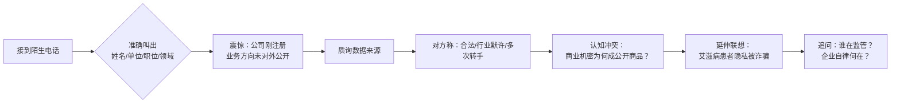
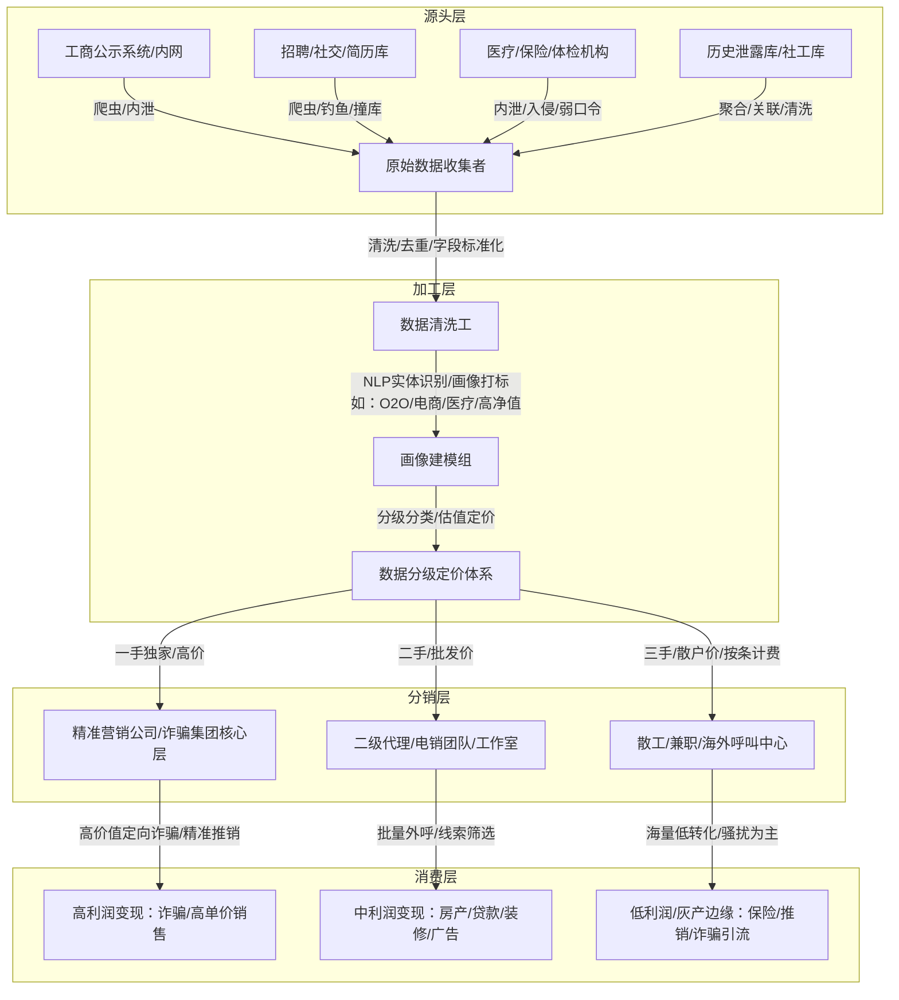

## 概述

本页面基于 **301在路上** 微信公众号 2016 年归档文章《你“窃取”了我的隐私，为何还这么嚣张？》进行结构化沉淀。文章以作者亲身经历的精准营销骚扰电话为切入点，揭示了**企业工商注册数据、经营范围、联系人信息**等商业敏感数据如何被非法获取、多次转卖、用于精准画像营销，甚至延伸至**艾滋病患者隐私信息诈骗**等恶性黑产场景。

本页将零散叙事重组为：**事件复盘、数据流向溯源、黑产链条拆解、技术攻击面分析、监管与企业自律缺位、防御与溯源建议**六大维度，并交叉引用知识库现有技术详解页面，形成可检索、可关联的知识资产。

> **原文归档**：[301在路上-201508-202208_101](../sources/301在路上-201508-202208_101.md)
> **原文链接**：http://mp.weixin.qq.com/s?__biz=MzIwMTQ2NzY4NA==&mid=2652520711&idx=1&sn=591c751b8bd6507fde2345768978ce12&chksm=8d03934cba741a5a553d02941f0641167a7eec8014054aae4f4d14c69b2b76f9d460728ea8a8&scene=126&sessionid=1681656737#rd
> **发布时间**：2016年7月（文章中提及"昨天下午"接到电话，结合专题四创业随笔7月21日发布，推测发布于7月中下旬）

---

## 事件复盘：一通"精准"到令人毛骨悚然的推销电话

### 核心事件要素

| 维度 | 详情 |
|------|------|
| **受害主体** | 301在路上作者（安全从业者、创业者） |
| **受害时间** | 2016年7月中下旬某天下午 |
| **攻击向量** | 个人手机号码直拨（非400/95/虚拟运营商号段） |
| **精准画像维度** | 姓名、单位名称、职位、电话、公司经营领域（被归类为O2O） |
| **公司状态** | 刚注册不久，作者自己仍在探索业务定位 |
| **来电者话术** | 1. "信息获取来源合法"<br/>2. "同行业大家都这样做，默许规则"<br/>3. "相信你，同类电话不是第一次遇到"（暗示数据多次转手）<br/>4. 主动提供单位名、业务范围，邀请合作 |

### 受害者心理与认知冲突



### 关键矛盾点

1. **时间悖论**：公司注册极短时间内，完整工商/经营信息即被结构化入库、画像标签（O2O）、分配至销售线索池。
2. **合法性伪装**：来电者以"合法获取""行业默许规则"为挡箭牌，将**非法爬取/内泄/多级转卖**合规化叙事。
3. **多轮转手铁证**："同类电话不是第一次" 直接佐证数据在黑产链条中**多级分销、重复变现**。
4. **从商业骚扰到生命威胁**：文中显性关联 **艾滋病患者隐私被欺诈骗钱**，揭示同一黑产基础设施支撑的**分级危害谱系**——从商业推销到诈骗敲诈，仅是数据标签与话术差异。

---

## 数据流向溯源：隐私数据从"生产"到"消费"的完整链路

### 数据源头画像（Supply Side）

| 数据类型 | 可能来源 | 窃取/获取手法 | 关联技术页面 |
|----------|----------|---------------|--------------|
| **工商注册信息** | 国家企业信用信息公示系统、地方工商局内网、第三方企查查/天眼查/爱企查等聚合平台 | 爬虫规模化采集、内部人员违规导出、API滥用调用 | [[vulnerability-mining-recon-aiqicha-fofa#资产测绘与语法构造]]、[[api-business-logic-phone-enumeration#业务逻辑缺陷利用]] |
| **法人/高管/联系人身份信息** | 工商登记留存、社保/公积金缴纳记录、招聘平台简历库、社交网络（领英/脉脉/微信）、过往数据泄露库（社工库） | 撞库/凭据填充、社工钓鱼、内部贿赂、简历投递钓鱼 | [[social-engineering-attack-techniques#凭据窃取与账号劫持]]、[[threat-attribution-tracing-techniques#威胁情报来源与暗网监测]] |
| **企业经营范围/业务方向** | 工商登记经营范围、官网/招聘JD/公开宣传资料、竞品情报采集 | NLP自动化标签提取、人工研判打标 | [[vulnerability-mining-recon-aiqicha-fofa#技术栈指纹识别]] |
| **医疗/敏感人群隐私（如HIV患者）** | 医院HIS/EMR系统、疾控上报系统、第三方体检/保险/制药数据库、地下买卖历史泄露库 | 内部人员窃取、供应链攻击、漏洞入侵、弱口令爆破 | [[medical-system-internal-penetration-case-study#医疗系统渗透实战]]、[[redis-unauthorized-access-rce#未授权访问与数据窃取]] |

### 数据流转与加工层



### 数据定价参考（2016年黑产行情估算）

| 数据包类型 | 字段丰富度 | 单价区间（元/条） | 典型买家 |
|------------|------------|-------------------|----------|
| 基础工商注册信息 | 名称/法人/电话/地址/经营范围 | 0.1 - 0.5 | 批量电销、推广引流 |
| 带高管/联系人详细画像 | +身份证/微信/邮箱/社保/简历/社交图谱 | 1 - 10 | 精准营销、高客单价销售、定向诈骗前置侦察 |
| 医疗/敏感人群标签数据 | +病历/用药/就诊记录/身份证/家庭联系方式 | 50 - 500+ | 靶向诈骗（如HIV患者骗保/卖药）、保险欺诈、非法药品销售 |
| 实时变更/新注册企业库 | 注册N天内、经营范围变更、融资信息 | 5 - 20/条 | 创业服务、代账/注册/商标/融资中介、精准诈骗 |

> **技术溯源**：数据采集自动化、API滥用、爬虫对抗见[[vulnerability-mining-recon-aiqicha-fofa]]、[[api-business-logic-phone-enumeration]]；数据清洗/画像建模/NLP标签提取属于**数据工程黑产化**范畴，手法与合法商业智能（BI）高度同构，仅数据来源非法。

---

## 黑产链条拆解：角色分工、利益分配与风险隔离

### 核心角色矩阵

| 角色 | 核心职能 | 技术门槛 | 法律风险承担 | 典型获利模式 |
|------|----------|----------|--------------|--------------|
| **上游数据源方** | 内部人员（工商/税务/银行/医院/运营商/平台员工）、黑客入侵团伙 | 低（内鬼）~ 高（APT级入侵） | 极高（贪污/非法获取公民个人信息罪/非法侵入计算机信息系统罪） | 按库/按条批发，单笔万元至百万 |
| **数据清洗/建模组** | 去重、字段映射、实体识别、画像打标、估值分级 | 中高（Python/SQL/NLP/大数据处理） | 高（协助非法获取/销售数据） | 技术服务费/分成/自建库倒卖 |
| **分销代理网络** | 多级代理（总代/一级/二级/散户），建立层级授权、区域保护、客户分配体系 | 低（销售/管理） | 中高（销售/提供公民个人信息罪） | 批发差价/按条提成/会员费 |
| **终端变现团伙** | 电销外呼中心、诈骗话术组、精准营销公司、非法药品/保健品销售、贷款中介 | 低中（话术/CRM/外呼系统/VOIP/号码池） | 极高（诈骗罪/非法经营/侵犯公民个人信息罪） | 单单提成/业绩分红/自产自销利润 |
| **技术基础设施商** | 虚拟运营商/号码池提供商、VOIP网关/软交换/外呼系统开发商、短信通道/签名通道商、CRM/线索管理SaaS厂商 | 高（电信级开发/运维） | 中（明知配合犯罪构成共犯，否则属灰色地带） | 通道费/坐席费/月租/授权费/流量分成 |
| **洗钱/资金通道** | 跑分平台、虚拟币OTC、地下钱庄、游戏币/充值卡变现 | 中 | 高（掩饰隐瞒犯罪所得罪/洗钱罪） | 手续费 5%-20% |

### 利益分配示例（以一条"精准企业主数据"为例，售价 10 元/条）

```
终端变现团伙（电销/诈骗）最终变现：成功转化 1 单利润 500-50000 元
    ↑ 分成/提成 30%-50%
二级代理/电销团队采购成本：3-5 元/条
    ↑ 批发差价
一级总代采购成本：1-2 元/条
    ↑ 批发差价
数据清洗/建模组成本：0.3-0.5 元/条（人力/算力/存储）
    ↑ 采购成本
上游数据源方出售价：0.1-0.3 元/条（原始库按万条批发）
```

### 风险隔离机制

1. **层级授权制**：上游不直接接触终端变现，仅对接一级代理；代理之间仅单线联系，不知全貌。
2. **技术切片外包**：外呼系统、号码池、CRM、短信通道由专业技术商合法/灰色运营，变现团伙仅租用服务。
3. **资金流与数据流分离**：数据按条结算/预付，变现收款走跑分/虚拟币，数据源方收款走地下钱庄/USDT。
4. **人员匿名化招募**：电销/话务员多为兼职/大学生/海外呼叫中心，实名入职少，事发易切割。
5. **法律灰区操话术**：“合法获取""行业惯例""用户授权""大数据分析"，将刑事犯罪包装为商业合规。

---

## 技术攻击面分析：精准营销骚扰的底层技术支撑

### 数据采集自动化与API滥用

| 技术手段 | 典型场景 | 对抗难点 | 关联知识库 |
|----------|----------|----------|------------|
| **工商/企业信息聚合平台API滥用** | 企查查/天眼查/爱企查/启信宝等开放/私有API，高频调用拉取新注册/变更企业全量字段 | 平台反爬/限流/签名验证/账号封禁 → 黑产使用分布式代理IP池、设备指纹伪造、账号养号池、签名破解/hook绕过 | [[vulnerability-mining-recon-aiqicha-fofa#资产测绘语法构造]]、[[api-business-logic-phone-enumeration#业务逻辑漏洞利用]] |
| **公开公示系统爬虫** | 国家/地方企业信用信息公示系统、裁判文书网、专利/商标/备案公示系统 | 验证码/行为分析/IP封禁 → 验证码打码平台/人工众包、浏览器指纹伪造（Selenium/Playwright/无头Chrome）、住宅IP代理池 | [[iot-reconnaissance-information-gathering#信息收集全流程]] |
| **招聘/社交平台简历/画像爬取** | BOSS直聘/拉勾/智联/前程无忧/领英/脉脉/微信公众号/小程序 | 登录态/加密接口/风控模型 → Cookie池维护、App逆向Hook/Frida/Xposed动态调试、协议破解、账号批发/养号 | [[android-shelling-unshelling-techniques#逆向工程与动态分析]]、[[social-engineering-attack-techniques#钓鱼攻击全链路]] |
| **内网/数据库直接窃取** | 医院HIS/疾控/保险/体检机构内网弱口令/未授权访问/注入/供应链投毒 | 内网隔离/审计/EDR → 内网渗透横向移动、凭据导出、域控制、数据分阶段外泄 | [[internal-network-pivoting-techniques#横向移动实战]]、[[redis-unauthorized-access-rce]]、[[cnvd-2021-49104-eoffice-v9-file-upload-rce]] |

### 画像建模与标签体系工程化

```mermaid
graph TB
    subgraph 原始字段
        F1[企业名称] --> M1
        F2[法人姓名/身份证] --> M1
        F3[注册资本/时间/地址] --> M1
        F4[经营范围/行业代码] --> M1
        F5[股东/高管/对外投资] --> M1
        F6[变更记录/行政处罚/司法涉诉] --> M1
        F7[招聘JD/官网/公众号/社交内容] --> M1
        F8[联系人电话/微信/邮箱/社保/简历] --> M1
    end

    subgraph 清洗标准化
        M1[字段映射/去重/归一化/实体对齐] --> M2
    end

    subgraph 画像打标（NLP/规则/图谱）
        M2 --> T1[行业标签：O2O/电商/SaaS/制造/医疗/金融...]
        M2 --> T2[企业阶段：种子/天使/A轮/成熟/上市/僵尸]
        M2 --> T3[意图标签：融资/招聘/采购/办公/合规/上云/知识产权...]
        M2 --> T4[决策人画像：年龄/学历/从业史/社交影响力/决策偏好/联系方式有效性]
        M2 --> T5[风险标签：失信/涉诉/行政处罚/经营异常/高管变更频次]
    end

    subgraph 估值分级
        T1 & T2 & T3 & T4 & T5 --> V1[高价值：高意图+强决策力+高客单价赛道]
        T1 & T2 & T3 & T4 & T5 --> V2[中价值：泛意图/中决策力/标准化服务赛道]
        T1 & T2 & T3 & T4 & T5 --> V3[低价值：无意图/弱决策力/长尾/僵尸企业]
    end
```

> **技术对标**：实体识别/关系抽取/知识图谱构建属于**NLP/图计算**范畴，黑产将合法商业智能（BI/CDP）技术栈**非法数据源化、武器化应用**。防御侧可部署**蜜罐数据/水印追踪/假实体注入**污染黑产画像库。

### 精准触达基础设施：外呼系统、号码池、VOIP、CRM

| 组件 | 技术实现 | 黑产改造点 | 监管盲区 |
|------|----------|------------|----------|
| **虚拟运营商/号码池** | 170/171/165/167/162等号段，批量申请、实名制规避（批量代实名/租用身份证/照片合成） | 号码标记/封号后快速换号、归属地伪装、主叫号码显示伪造（SPOOF） | 实名制穿透困难、号码资源监管滞后、跨省追踪取证成本高 |
| **VOIP软交换/网关** | Asterisk/FreeSWITCH/Kamailio/OpenSIPS + 网关设备（GoIP/网关/模拟中继） | 录音/通话记录本地化不上传、加密信令（TLS/SRTP）、动态路由跳板、混合PSTN/互联网出局 | 信令加密导致监管侧无法解密抓包、境外服务器部署规避管辖 |
| **智能外呼/机器人系统** | ASR/TTS/NLP多轮对话、预测式拨号/预览式/强制式、号码清洗/去重/黑名单过滤 | 话术树针对性定制（针对HIV患者/企业主/老人/大学生）、情绪识别转人工、通话数据实时回传画像优化 | AI外呼识别对抗：静音检测/关键词触发/语速异常/背景音指纹 → 黑产持续迭代对抗 |
| **CRM/线索管理/数据分发** | 线索分配/跟进记录/转化漏斗/绩效提成/数据权限隔离/多租户SaaS化 | 线索按画像标签自动分发至对应话术组/代理层级、数据脱敏展示（仅显示姓名/电话/标签，隐藏来源/身份证）、操作审计日志可篡改/关闭 | SaaS化部署在境外/容器化/频繁更换域名IP，取证链条断裂 |

> **关联技术**：VOIP/外呼/号码池技术栈见[[http-proxy-tunneling-goproxy-netsh#隧道技术与代理]]、[[c2-redirectors-malleable-c2-profiles#基础设施隐匿]]（红队C2隐匿技术与黑产外呼基建高度同构）；CRM/SaaS化运营见[[codetest-visual-poc-exploitation-tool#可视化管理平台]]。

### 话术工程与社会工程学融合

| 话术模块 | 核心逻辑 | 心理杠杆 | 典型场景 |
|----------|----------|----------|----------|
| **身份确认/建立信任** | "王总您好，我是XX公司的李经理，您现在方便吗？" | 权威性/熟悉感/个性化称呼 | 通用开场 |
| **数据展示/证明合法** | "我们是通过大数据分析/公开渠道合法获取的您公司刚注册、经营O2O业务的信息" | 合法性背书/专业感/信息优势 | 企业主推销/诈骗前置 |
| **行业惯例/同伴施压** | "同行业大家都在做，王总您同行接到过类似电话吧？" | 从众心理/正常化/降低警惕 | 克服拒绝 |
| **痛点击中/制造焦虑** | "刚注册公司如果不做推广/合规/知识产权/融资规划，很容易走弯路/被竞对超越/面临罚款" | 损失厌恶/稀缺性/恐惧营销 | 服务推销/合规诈骗 |
| **低门槛/免费试用/钩子** | "免费送您一份企业合规体检报告/融资路演PPT模板/首单0元设计" | 互惠心理/零风险尝试/沉没成本 | 引流加微信/进群/留资 |
| **紧迫感/限时/权威背书** | "今天名额仅剩3个/政策月底截止/我们是政府指定/央企背景服务商" | 稀缺性/权威性/时间压力 | 逼单成交 |

> **技术对标**：话术工程即**社会工程学攻击载体的标准化、产品化、A/B测试迭代**。见[[social-engineering-attack-techniques#心理战术与话术设计]]、[[phishing-website-creation-tutorial#钓鱼页面心理设计]]。

---

## 监管与企业自律缺位：为何"嚣张"成常态？

### 法律法规执行困境（2016年视角，至今核心矛盾未变）

| 困境维度 | 具体表现 | 根因 |
|----------|----------|------|
| **取证链条长、易断裂** | 受害者仅有来电录音/号码 → 无法穿透虚拟运营商/VOIP网关/境外服务器定位真实主体 → 无法锁定数据上游源头 | 跨层级/跨地域/跨境取证协作机制缺失、技术手段滞后、电信运营商/虚拟运营商配合度不一 |
| **定性争议大、门槛高** | "大数据分析/公开渠道获取"抗辩 → 难以认定"非法获取" → 不构成《刑法》第253条"非法获取公民个人信息罪" | 立法对"公开信息聚合画像""合法来源抗辩"界定模糊、司法实践认定标准不一 |
| **打击成本高、收益低** | 端掉一个电销团队/号码池/外呼系统，成本巨大；黑产快速重组、换号、换话术、换主体、换域名复活 | 打击模式为"点状/事后/物理端掉"，黑产为"网状/进化/弹性架构"，不对称博弈 |
| **监管碎片化、推诿扯皮** | 工信部/公安/市场监管/网信办/银保监/卫健委/通管局/反诈中心 → 职责交叉/数据不通/考核不挂钩 | 缺乏统一指挥协调机制、数据共享法律依据不足、部门利益博弈 |

### 企业自律失效的商业逻辑

```mermaid
graph LR
    A[获客成本高企<br/>合规渠道转化低] --> B[购买黑产线索<br/>低成本/高精准/即买即用]
    B --> C[业绩达标/融资叙事/生存压力]
    C --> D[管理层睁一只眼闭一只眼<br/>甚至默许/指派采购]
    D --> E[合规/法务/风控部门<br/>被边缘化/无否决权/无预算]
    E --> F[供应商准入/数据合规审计<br/>流于形式/仅查合同不查源头]
    F --> G[行业协会/自律公约<br/>无强制力/无惩戒/头部企业不带头]
    G --> H[全行业"劣币驱逐良币"<br/>不买黑产数据 = 竞争劣势 = 死亡]
    H --> A
```

### 平台/基础设施商的灰色地带生存术

| 主体 | 灰色操作 | 合规外壳 |
|------|----------|----------|
| **虚拟运营商/号码商** | 批量开卡不严查实名、提供号码池API、不记录/不配合溯源 | 持有合法牌照、主营合规业务、黑产收入占比隐蔽 |
| **VOIP/网关/外呼系统商** | 提供加密信令、境外服务器部署、号码显示伪造、录音本地化 | 产品合法销售、客户合同约定"合规使用"、不知情抗辩 |
| **聚合数据/企服平台** | API高频调用不限流、数据脱敏不彻底、画像标签输出、间接供给黑产 | 主营企业查询/营销SaaS/风控服务、数据来源标注"公开/授权" |
| **短信/通道商** | 群发/变签/通道包装、不审核内容/模板、提供上行回复/黑名单过滤 | 持有SP许可证、签报备案、主营验证码/通知类合规业务 |

---

## 防御与溯源建议：从被动受害到主动免疫

### 个人/企业主维度：数据最小化暴露与主动防御

| 防御层面 | 具体措施 | 工具/方法 | 关联知识库 |
|----------|----------|-----------|------------|
| **源头减量** | 工商注册地址/联系电话/经营范围最小化填写、使用虚拟号/专用号/400号替代个人手机、法人/高管信息最小化公示 | 虚拟号服务（阿里小号/腾讯天籁/运营商副卡）、工商登记委托代理隐私保护选项 | [[cookie-security-fundamentals#最小权限原则]]、[[domain-registrar-security-guide#WHOIS隐私保护]] |
| **主动监测** | 定期搜索自有企业/姓名/电话在搜索引擎/聚合平台/暗网/泄露库的暴露情况、设置Google Alerts/微信指数/企业预警监控 | FOFA/ZoomEye/Quake资产测绘监控自有资产、暗网监控服务、有无被泄露/DeHashed/火狐监控 | [[vulnerability-mining-recon-aiqicha-fofa#持续化监控]]、[[threat-attribution-tracing-techniques#威胁情报融合]] |
| **来电防御** | 开通运营商/手机厂商/第三方（腾讯电话管家/360/百度/真caller）骚扰拦截、陌生电话强制语音验证/IVR分流、重要沟通仅认可微信/邮件/官网验证 | 来电防火墙APP、SIP/VOIP软电话自建IVR、企业统一通讯平台集成来电认证 | [[social-engineering-attack-techniques#电话诈骗防御清单]] |
| **数据水印/蜜罐** | 在对外留资表单/名片/官网/招聘JD植入唯一标识水印（如专用邮箱后缀/专用电话分机/唯一拼写变体）、部署蜜罐表单/假官网/假客服捕获爬虫/采集者 | Canarytoken/蜜罐平台（OpenCanary/Honeypot/自建）、唯一标识生成脚本 | [[threat-attribution-tracing-techniques#蜜罐与诱捕技术]]、[[xd-security-blue-team-defense#蜜罐技术与HFish部署]] |
| **法律维权** | 保留通话录音/短信/来电记录/APP截图 → 向12321/12377/网信办/公安/市场监管/消协投诉 → 要求数据源平台删除/封禁 → 民事诉讼主张隐私权/人格尊严权/消费者权益 | 证据保全（公证/区块链存证/时间戳）、律师函/法院调查令/公益诉讼 | - |

### 监管/平台/行业维度：体系化治理

| 治理层级 | 核心抓手 | 关键动作 | 技术支撑 |
|----------|----------|----------|----------|
| **立法/司法** | 明确"公开信息规模化聚合画像/商业化转售"定性、降低"非法获取"认定门槛、建立数据处理者举证责任倒置 | 修改《个保法/刑法/网络安全法/数据安全法》配套司法解释、发布典型指导性案例 | - |
| **监管协同** | 建立跨部门"打击侵犯公民个人信息犯罪联席会议"、数据共享标准化接口、联合执法常态化 | 公安牵头、工信/网信/市监/银保/卫健/通管/反诈中心成员、周调度/月通报/季联合行动 | 统一数据交换平台、案件线索流转系统、技术取证共享库 |
| **源头治理** | 严查内鬼/供应链泄露、推行数据分级分类/脱敏/水印/最小必要原则、审计追责到人 | 重点单位（工商/税务/银行/医院/运营商/平台）数据安全等保测评/渗透测试/内审/供应链安全评估 | [[medical-system-internal-penetration-case-study#医疗数据安全]]、[[internal-network-pivoting-techniques#内网渗透实战]]、[[code-audit-file-operation-vulnerabilities#代码审计方法论]] |
| **平台治理** | 聚合平台/企服SaaS/外呼系统/号码商/短信商：实名认证穿透、API调用审计/限流/画像、录音/记录留存/实时上传、异常模型封禁 | 监管沙箱/合规检测工具/自动化巡检/黑名单联动/信用惩戒/牌照挂钩 | [[observerward-0x727-web-fingerprint-tool#指纹识别与资产测绘]]、[[pocsuite3-vulnerability-testing-framework#自动化检测]] |
| **黑产打击** | "断卡/断网/断链/断财/断技"专项行动、基础设施溯源定位、核心骨干跨省/跨境抓捕、犯罪资金全链条冻结追赃 | 公安主导、反诈中心协同、电信运营商/支付机构/虚拟币交易所配合、国际警务合作 | [[named-pipe-smb-detection-sysmon#威胁情报融合]]、[[threat-attribution-tracing-techniques#攻击溯源全链路]]、[[c2-redirectors-malleable-c2-profiles#基础设施关联分析]] |
| **行业自律** | 头部企业带头签署《拒用非法数据联合声明》、建立供应商数据合规白名单/黑名单共享库、违规联合抵制/公开曝光 | 行业协会牵头、第三方审计机构认证、合规成本纳入准入门槛、ESG挂钩 | [[bug-bounty-program-history-evolution#白帽经济与生态建设]]、[[360bugcloud-vulnerability-response-platform#SRC建设]] |

---

## 交叉引用总索引

| 关联主题 | 知识库页面 | 本文映射点 |
|----------|------------|------------|
| 社会工程学/钓鱼/电话诈骗/心理战术 | [[social-engineering-attack-techniques]] | 来电话术分析、数据展示建立信任、行业惯例施压、痛点焦虑营销、HIV患者诈骗案例 |
| API安全/业务逻辑漏洞/手机号枚举/数据聚合 | [[api-business-logic-phone-enumeration]] | 工商/企服平台API滥用采集、经营范围画像标签化、注册时间/变更实时监控 |
| 威胁溯源/攻击归因/基础设施关联/暗网监测 | [[threat-attribution-tracing-techniques]] | 数据流向溯源链路、虚拟运营商/VOIP/境外服务器穿透、黑产分层架构关联分析 |
| 漏洞挖掘侦察/资产测绘/FOFA语法/持续监控 | [[vulnerability-mining-recon-aiqicha-fofa]] | 企业信息批量采集技术手法、自有资产暴露面监测、蜜罐数据布放 |
| 内网渗透/横向移动/凭据导出/医疗数据窃取 | [[internal-network-pivoting-techniques]]、[[medical-system-internal-penetration-case-study]] | 医院/疾控/保险内网入侵窃取HIV患者数据、供应链攻击路径 |
| 红队OPSEC/基础设施隐匿/C2通信/VOIP隧道 | [[redteam-hw-opsec-guidelines]]、[[c2-redirectors-malleable-c2-profiles]]、[[http-proxy-tunneling-goproxy-netsh]] | 黑产外呼基建（VOIP/网关/加密信令/境外跳板/号码池）与红队C2隐匿技术同构 |
| Android逆向/动态分析/爬虫对抗/App加固 | [[android-shelling-unshelling-techniques]] | 招聘/社交/企服App逆向Hook协议破解、Frida/Xposed动态调试、设备指纹伪造 |
| 代码审计/文件操作漏洞/数据泄露根因 | [[code-audit-file-operation-vulnerabilities]] | 平台/系统代码缺陷导致数据泄露（如CNVD-2021-49104类任意文件上传/下载） |
| 蜜罐技术/诱捕/威胁情报/蓝队防御 | [[xd-security-blue-team-defense]]、[[observerward-0x727-web-fingerprint-tool]] | 蜜罐数据/水印追踪污染黑产画像库、指纹识别黑产爬虫/采集基础设施 |
| 社群运营/零基础培养/人才漏斗/安全教育 | [[security-study-group-methodology]] | 个人/企业安全意识培养、来电防御技能普及、数据最小化暴露最佳实践推广 |
| 域名/WHOIS隐私保护/资产保护 | [[domain-registrar-security-guide]] | 企业注册/备案/官网域名隐私保护、联系信息最小化公示 |

---

## 结语

这篇 2016 年的归档文章，以一通亲历骚扰电话为引，**精准切开了彼时乃至当下"数据黑产工业化、精准化、分级化、灰色合规化"的核心病灶**：

1. **数据源头合法性被武器化**：公开工商信息、招聘简历、社交画像经**规模化采集+结构化清洗+NLP画像打标**，披上"大数据分析/合法渠道"外衣，实为**非法聚合画像商业化**。
2. **黑产链条高度工业化分工**：上游源方/中游清洗建模/下游分销变现/底层基建商/洗钱通道，**角色固化、利益分配明确、风险隔离成熟**，形成抗打击弹性极强的灰色产业生态。
3. **技术栈与合法商业智能高度同构**：爬虫/API/ NLP/知识图谱/VOIP/CRM/AI外呼，**技术本身无罪，数据来源与使用目的定性犯罪**。防御侧难以从技术特征单一维度阻断，需**溯源数据流向、打击利益闭环、切断基建供给**。
4. **监管滞后于黑产进化**：取证难、定性争议大、部门碎片化、打击成本高、法律门槛高，**治理模式亟需从"事后点状打击"转向"源头治理+体系协同+平台共治+刑民行衔接"**。
5. **企业自律缺位源于商业生存压力**：获客成本高企、合规渠道低效、竞争对手全用黑产数据，**不买即死、买了违法、全行业陷入"劣币驱逐良币"囚徒困境**，需头部企业带头破局、监管倒逼合规成本内化。
6. **个人隐私暴露面不可逆扩大**：从商业骚扰到HIV患者诈骗，**同一套基建支撑分级危害**，个人唯有**数据最小化暴露、主动监测预警、来电零信任验证、法律证据保全维权**构建纵深防御。

> **「数据黑产不生产数据，只是数据的搬运工、加工厂、分销商、变现端。切断利益链条，比单纯封号封IP更彻底；倒逼数据源头合规，比事后惩罚更前置；建立个人数据主权意识，比任何技术拦截更根本。」**

---

## 版本记录
- **v1.0 (2025-07-10)**：初版发布，基于301在路上2016年归档文章《你"窃取"了我的隐私，为何还这么嚣张？》结构化沉淀，含事件复盘、数据流向溯源、黑产链条拆解、技术攻击面分析、监管困境、防御建议、交叉引用索引。

## 来源登记
- 原文归档：[301在路上-201508-202208_101](../sources/301在路上-201508-202208_101.md)
- 原文链接：http://mp.weixin.qq.com/s?__biz=MzIwMTQ2NzY4NA==&mid=2652520711&idx=1&sn=591c751b8bd6507fde2345768978ce12&chksm=8d03934cba741a5a553d02941f0641167a7eec8014054aae4f4d14c69b2b76f9d460728ea8a8&scene=126&sessionid=1681656737#rd
- 对比参考：本库内社会工程学、API安全、威胁溯源、漏洞挖掘侦察、内网渗透、红队OPSEC、Android逆向、代码审计、蜜罐技术、域名隐私保护等技术详解页面
- [301在路上-201508-202208_103](../sources/301在路上-201508-202208_103.md)
