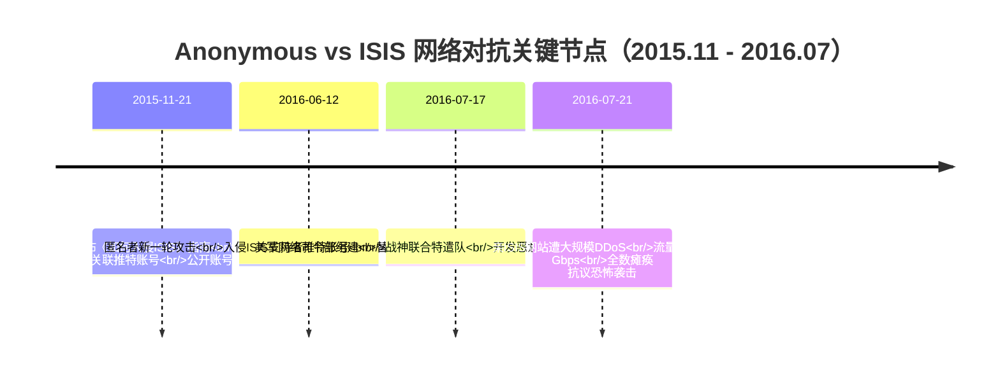
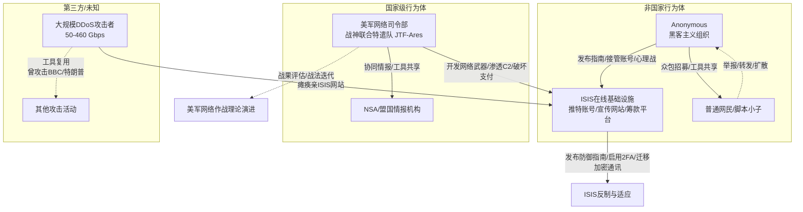

## 概述

2015年11月至2016年7月期间，**Anonymous（匿名者）**黑客组织与**ISIS（伊斯兰国，自称"伊斯兰国"）**之间爆发了一系列高曝光度的网络对抗事件。这段时间见证了**黑客主义（Hacktivism）**力量主动介入反恐议程、国家级网络作战部队（美军**战神联合特遣队**）正式组建并开发进攻性网络武器、以及大规模DDoS攻击成为打击恐怖主义在线基础设施的常态化手段。

本页面按时间顺序梳理四大核心事件，构建**非国家行为体（匿名者）与恐怖组织（ISIS）在网络空间博弈**的完整图景，并标注国家级力量（美国网络司令部）介入的关键节点，为研究**黑客主义反恐行动演进、网络反恐协作模式、进攻性网络武器部署实战**提供可检索的历史知识基座。

> **定位**：历史事件编年史、攻防技术手法档案、多方势力博弈复盘  
> **维护策略**：按事件时间线固化、技术手法标签化、关联实体交叉引用化  
> **关联深度页**：[[social-engineering-attack-techniques]]（社会工程学攻击技术，含钓鱼/账号劫持）、[[redteam-hw-opsec-guidelines]]（红队演练OPSEC规范，含账号安全/流量隐匿）、[[threat-attribution-tracing-techniques]]（威胁溯源技术，含归因分析/伪旗行动）

---

## 事件时间轴

---

## 核心事件详细记录

### 事件一：匿名者发布《如何入侵ISIS》指南并接管2万推特账号（2015-11-21）

| 维度 | 详情 |
|------|------|
| **发生时间** | 2015年11月21日 |
| **主体** | Anonymous（匿名者）黑客组织 |
| **行动代号** | #OpISIS / #OpParis（巴黎袭击后发起） |
| **核心产出** | 1. **视频指南**：发布"如何入侵ISIS"操作教学视频，降低参与门槛 2. **账号接管**：声称已接管**20,000+** 个与ISIS有关联的Twitter账号 3. **清单公开**：在Pastebin等平台公开被接管账号用户名列表 |
| **技术手法** | - 凭据填充/撞库：利用泄露数据集尝试登录 - 钓鱼页面：伪造Twitter登录页窃取凭据 - 会话劫持：窃取Cookie/Token复用会话 - 弱密码爆破：针对低强度口令字典攻击 |
| **ISIS反制** | ISIS成员随即发布《如何免受攻击》行事指南，建议：启用双因子认证、使用强密码、警惕钓鱼链接、定期更换账号 |
| **影响评估** | - 显著削弱ISIS在线宣招/指挥通讯能力 - 暴露恐怖组织运营安全（OPSEC）薄弱 - 催生"众包式反恐"新模式：普通网民可按指南参与举报/攻击 |
| **历史定位** | **黑客主义首次系统化、工具化、大规模介入反恐行动**，从符号性"宣战"转向可复制的实战行动手册 |

> **技术溯源**：账号接管手法与[[social-engineering-attack-techniques#凭据窃取与账号劫持]]中"钓鱼页面/会话劫持/撞库攻击"链路高度一致；OPSEC缺失对标[[redteam-hw-opsec-guidelines#账号全生命周期管理]]规范。

---

### 事件二：匿名者替换ISIS支持者推特背景为成人主题羞辱（2016-06-12）

| 维度 | 详情 |
|------|------|
| **发生时间** | 2016年6月12日 |
| **主体** | Anonymous（匿名者） |
| **攻击向量** | Twitter账号劫持 → 修改Profile背景图/头像/简介 |
| **羞辱手法** | 将ISIS支持者账号背景替换为**成人/色情主题图片**，并修改简介为嘲讽性文字 |
| **战术意图** | - **心理战**：利用伊斯兰教禁忌（色情内容）制造认知失调与羞耻感 - **去合法化**：公开展示账号被控，打击支持者士气与招募效果 - **舆论造势**：生成可传播的截图素材，放大"匿名者战胜ISIS"叙事 |
| **技术特征** | - 批量化操作：脚本自动化修改大量账号资料 - 非破坏性：保留账号所有权，仅篡改展示层，便于持续心理施压 - 低门槛高传播：无需高超技术即可实施，极易被媒体放大 |
| **局限性** | - Twitter可快速冻结/恢复账号，效果具有时效性 - 未触及ISIS核心指挥通讯基础设施（加密通讯/暗网/专用服务器） |
| **演进意义** | 标志黑客主义行动从"删除数据/泄露信息"向**认知域操作/心理战**延伸，预示后续信息战常态化 |

> **对标参考**：账号劫持后的持久化控制与隐蔽通道建设，见[[cobalt-strike-external-c2-smb-beacon#会话劫持与持久化]]、[[internal-network-pivoting-techniques#凭据复用与横向移动]]。

---

### 事件三：美军组建"战神联合特遣队"开发网络武器对抗ISIS（2016-07-17）

| 维度 | 详情 |
|------|------|
| **发生时间** | 2016年7月17日 |
| **主体** | 美国网络司令部（USCYBERCOM），上将 Michael S. Rogers 推动 |
| **部队编制** | **战神联合特遣队**（Joint Task Force Ares，JTF-Ares） |
| **组建背景** | - 2016年初五角大楼下令网络司令部对ISIS发动网络攻击 - 当时网络司令部**工具匮乏、人员不匹配**，未做好充分准备 - 需专门部队研发进攻性网络武器、执行持续作战 |
| **核心任务** | 1. **破坏支付系统**：切断ISIS资金流（加密货币/汇款/敛财渠道） 2. **破坏通讯工具**：瘫痪加密聊天软件、指挥控制（C2）基础设施 3. **开发数字武器**：恶意软件、漏洞利用代码、自动化攻击平台 4. **支援实体作战**：配合空袭/地面部队实施网络火力准备 |
| **组织隶属** | 隶属美军网络司令部，协同NSA（国家安全局）、各军种网络部队 |
| **历史里程碑** | - **美军首支专门针对单一恐怖组织的常态化网络作战特遣队** - 标志**进攻性网络武器**从战略储备转向战术常规部署 - 为后续"持续接触""主动防御"战略提供实战验证场 |
| **公开披露** | 2017年《纽约时报》等媒体披露JTF-Ares细节：投入数百人、开发定制恶意软件、渗透ISIS服务器、植入监控代码、诱导恐怖分子点击恶意链接 |

> **技术延伸**：进攻性网络武器开发流程、C2基础设施隐匿、恶意软件免杀对抗，见[[c2-redirectors-malleable-c2-profiles]]、[[inceptor-av-edr-evasion-framework]]、[[phantom-dll-hollowing-technique]]、[[process-injection-tampering-techniques]]。

---

### 事件四：亲ISIS网站遭50-460 Gbps大规模DDoS攻击全数瘫痪（2016-07-21）

| 维度 | 详情 |
|------|------|
| **发生时间** | 2016年7月21日 |
| **攻击目标** | 多个亲ISIS宣传/招募/筹款网站（具体域名未公开） |
| **攻击手法** | **分布式拒绝服务（DDoS）攻击**，流量峰值 **50 Gbps - 460 Gbps** |
| **攻击工具溯源** | 同一工具集曾用于攻击 **BBC（英国广播公司）**、**特朗普竞选网站** |
| **攻击归属** | 未官方认领，推测为匿名者关联团体、爱国黑客组织或国家级代理人 |
| **攻击动机** | 抗议ISIS针对**威尼斯**（注：可能指尼斯/欧洲城市恐袭）及**中东国家**的恐怖袭击事件 |
| **效果** | 目标网站**无一幸免，全部瘫痪离线** |
| **技术特征** | - **超大流量**：460 Gbps 已超越多数商业抗D设备单机处理能力 - **多向量组合**：可能包含反射放大（NTP/DNS/SSDP/CLDAP）、僵尸网络直发、应用层CC攻击 - **持续性**：维持足够时长使缓解服务介入前业务已中断 |
| **防御启示** | - 单点高防IP/清洗中心易被饱和，需**分布式清洗/流量调度/自动化编排** - 威胁情报共享（工具指纹/僵尸网络IP/反射器清单）可提前预警 - 关键基础设施需**多云/多CDN/多清洗商**冗余部署 |

> **对标参考**：DDoS攻击原理、清洗架构、威胁情报驱动防御见[[named-pipe-smb-detection-sysmon#网络层面异常流量识别]]、[[iot-reconnaissance-information-gathering#资产测绘与攻击面管理]]、[[c2-redirectors-malleable-c2-profiles#流量混淆与基础设施隐匿]]。

---

## 多方势力博弈图谱

---

## 技术手法标签体系

| 类别 | 具体手法 | 事件映射 | 关联知识库页面 |
|------|----------|----------|----------------|
| **账号接管** | 凭据填充/撞库 | 事件一 | [[social-engineering-attack-techniques#凭据窃取]] |
| | 钓鱼页面/会话劫持 | 事件一、二 | [[phishing-website-creation-tutorial]]、[[cookie-security-fundamentals]] |
| | 弱密码爆破 | 事件一 | [[burpsuite-basics-tutorial#intruder爆破]] |
| **账号篡改** | 批量修改Profile（背景图/简介） | 事件二 | [[social-engineering-attack-techniques#文件伪装攻击]]（类似篡改展示层） |
| **心理战/认知域** | 利用文化/宗教禁忌制造羞耻 | 事件二 | [[threat-attribution-tracing-techniques#伪旗行动与心理战]] |
| **进攻性网络武器** | 恶意软件/漏洞利用/自动化平台 | 事件三 | [[inceptor-av-edr-evasion-framework]]、[[phantom-dll-hollowing-technique]] |
| **C2基础设施破坏** | 渗透服务器/植入监控/诱导点击 | 事件三 | [[c2-redirectors-malleable-c2-profiles]]、[[cobalt-strike-external-c2-smb-beacon]] |
| **大规模DDoS** | 反射放大/僵尸网络/应用层CC | 事件四 | [[named-pipe-smb-detection-sysmon#网络层面]]、[[iot-reconnaissance-information-gathering]] |
| **工具复用/归因** | 同工具攻击多目标（BBC/特朗普/ISIS） | 事件四 | [[threat-attribution-tracing-techniques#工具指纹与关联分析]] |

---

## 影响与启示录

### 对黑客主义（Hacktivism）演进的影响
1. **从符号宣示到实战工具化**：匿名者发布操作指南、公开账号清单、脚本化羞辱攻击，将"宣战"转化为可复制、可参与、可传播的**实战战术包**。
2. **众包反恐模式雏形**：普通网民可按指南举报/攻击，形成"专业核心+大众外围"的分层动员体系，预示后续乌克兰IT军团等国家级众包网络作战模式。
3. **心理战纳入战术菜单**：利用目标价值观禁忌（色情/亵渎）实施认知域打击，超越单纯技术破坏，拓展黑客主义行动效用维度。

### 对国家级网络作战理论的验证
1. **专门特遣队制有效性**：JTF-Ares证明**针对单一高价值目标的常态化、专业化网络作战部队**优于临时拼凑力量。
2. **进攻性武器常规化部署**：从战略储备转向战术常规使用，倒逼**武器全生命周期管理（研发/测试/部署/评估/退役）工程化**。
3. **网空-实体融合打击**：破坏支付/通讯配合空袭/地面战，验证**多域协同作战**概念。

### 对防御方（平台/企业/个人）的警示
1. **账号安全基线不可缺**：2FA、强密码、异地登录告警、设备绑定——ISIS被批量接管根因是基线缺失。
2. **大流量DDoS需架构级防御**：单点高防易被饱和，需**分布式清洗+智能调度+多云冗余+威胁情报联动**。
3. **工具指纹可被归因**：同一DDoS工具攻击BBC/特朗普/ISIS，说明**攻击基础设施复用留痕**，防御方可通过指纹库提前预警。
4. **OPSEC是非对称短板**：恐怖组织、黑客组织、国家红队均面临"一次失误终身暴露"风险，需建立**全生命周期OPSEC体系**——见[[redteam-hw-opsec-guidelines]]。

---

## 交叉引用索引

| 关联主题 | 知识库页面 | 关联说明 |
|----------|------------|----------|
| 社会工程学/账号劫持/钓鱼 | [[social-engineering-attack-techniques]] | 事件一、二核心手法溯源 |
| 红队OPSEC/账号管理/流量隐匿 | [[redteam-hw-opsec-guidelines]] | ISIS与匿名者OPSEC对标反面教材 |
| 威胁溯源/工具指纹/伪旗行动 | [[threat-attribution-tracing-techniques]] | 事件四工具复用归因分析方法论 |
| 进攻性网络武器/免杀/C2隐匿 | [[inceptor-av-edr-evasion-framework]]、[[c2-redirectors-malleable-c2-profiles]] | 事件三武器开发技术栈对标 |
| DDoS攻击/流量清洗/威胁情报 | [[named-pipe-smb-detection-sysmon]]、[[iot-reconnaissance-information-gathering]] | 事件四攻防技术对标 |
| 内存注入/进程镂空/反射加载 | [[process-injection-tampering-techniques]]、[[phantom-dll-hollowing-technique]] | 事件三恶意软件落地与隐匿技术 |
| 内网横向/凭据复用/代理隧道 | [[internal-network-pivoting-techniques]] | 事件三渗透ISIS内网后续利用链对标 |
| 钓鱼网站制作/SET工具/Docker部署 | [[phishing-website-creation-tutorial]] | 事件一钓鱼页面构建实操参考 |
| Cookie安全/会话劫持/同源策略 | [[cookie-security-fundamentals]] | 事件一会话劫持原理与防御 |
| Burp Suite Intruder爆破模式 | [[burpsuite-basics-tutorial]] | 事件一弱密码爆破工具化实操 |

---

## 结语

2015-2016年的Anonymous vs ISIS网络对抗，是**黑客主义力量主动介入国家安全议程、国家级网络作战部队常态化部署进攻性武器、大规模DDoS成为常规打击手段**三大趋势交汇的历史切片。它展示了：

- **非国家行为体**如何以低成本、高传播、可众包的方式撕开恐怖组织网络脆弱面
- **国家行为体**如何从"工具不足、人员不匹配"走向建立专门特遣队、工程化武器研发、常态化网络火力打击
- **技术手法**如何从账号接管、篡改展示层心理战、进阶至C2基础设施渗透、支付系统破坏、超大流量DDoS瘫痪，形成全谱系攻击链

这些事件留下的技术资产（指南/工具/指纹/战法）、组织创新（特遣队/众包模式/心理战战术）、防御教训（基线/架构/情报/OPSEC），至今仍是网络反恐、红蓝对抗、威胁狩猎、态势感知等领域的**必修历史案例**。

> **「网络空间没有旁观者，只有参与者与受害者。历史不会重复，但韵脚押个不停。」**

---

## 版本记录
- v1.0 (2025-07-10)：初版发布，含四大核心事件详细记录、博弈图谱、技术手法标签体系、影响启示录、交叉引用索引
- 后续版本将按新增归档材料、关联实体页面更新、威胁情报演进滚动补充

## 来源登记
- 原文归档：[301在路上-201508-202208_085](../sources/301在路上-201508-202208_085.md)、[301在路上-201508-202208_086](../sources/301在路上-201508-202208_086.md)、[301在路上-201508-202208_087](../sources/301在路上-201508-202208_087.md)
- 原文链接：http://mp.weixin.qq.com/s?__biz=MzIwMTQ2NzY4NA==&mid=2652520819&idx=1&sn=fba0dcf7c2d6a2416a42553a3c4e66d9
- 对比参考：本库内APT分析、红队OPSEC、威胁溯源、C2隐匿、DDoS防御、社会工程学等技术详解页面
- [301在路上-201508-202208_090](../sources/301在路上-201508-202208_090.md)
