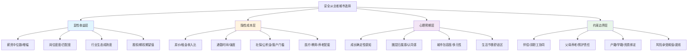
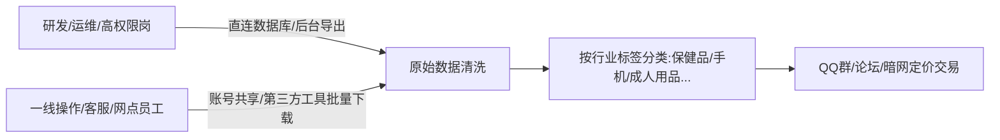

## 概述

本页面作为 **301在路上** 微信公众号（ID：MzIwMTQ2NzY4NA==）2015年8月至2022年8月期间发布文章的**结构化归档总索引**，采用「索引+深度沉淀」双层结构：索引层提供按时间/主题分类的文章条目检索，沉淀层对核心文章进行知识卡片化重构，提炼可复用的安全治理模型、职业发展洞察与行业观察视角。

目前重点收录两篇代表性深度文章：
1. **《某快递公司再现内鬼，泄露客户信息》**（2016-08-26）——顺丰内鬼泄露面单数据，快递行业个人信息黑产链条与内控失效深度复盘
2. **《信息安全，你我为什么(bu)选择北上广深？》**（2017左右）——信息安全从业者北上广深城市选择心理调查，折射行业人才流动与职业焦虑

> 关联页面：[[0w1club-wechat-archive-201707-201903]]、[[0w1club-wechat-archive-201908-202207]]（同类高校社团公众号归档索引，可对比运营节奏与内容演进）  
> 同期对标：[[daily-security-digest-20191220]]（2019年底每日安全看点收录 APT-C-08、zzzphp SQL注入、Facebook手机号泄露，侧面印证个人信息泄露已成常态化威胁）

---

## 文章索引总览（按时间倒序）

| 发布日期 | 文章标题 | 核心主题 | 沉淀状态 | 备注 |
|----------|----------|----------|----------|------|
| 2022-08 待补充 | 待补充 | 待补充 | 📋 索引待完善 | 归档截止月份 |
| 2017左右 | **信息安全，你我为什么(bu)选择北上广深？** | 职业发展/城市选择/心理调查 | ✅ **深度沉淀完成** | 本页面第 2 部分 |
| 2016-08-26 | **某快递公司再现内鬼，泄露客户信息** | 数据安全/内部威胁/黑产链条/内控治理 | ✅ **深度沉淀完成** | 本页面第 3 部分 |
| 2015-08 至 2016 中期 | 早期技术分享/安全观点/招聘薪酬分析等 | 技术普及/行业观察/人才画像 | 📋 索引待完善 | 含「白帽黑客成长独白」「企业信息安全十大痛点」「安全人才薪酬现状」等 |

> **索引完善建议**：后续可按「年份-月份」建立子页面（如 `301-zai-lushang-2016.md`），在索引页保留标题+链接+标签，详细沉淀迁移至子页面，避免单页过长。

---

## 深度沉淀一：信息安全从业者北上广深城市选择心理调查（2017左右）

### 文章元信息
- **发布时间**：2017年前后（原文链接中 `mid=2652521203` 推测为 2017 年上半年）
- **原文链接**：http://mp.weixin.qq.com/s?__biz=MzIwMTQ2NzY4NA==&mid=2652521203&idx=1&sn=2d5ba681f51911e9c1f2e55db18a078e
- **文章性质**：读者互动征集+精选留言汇编+编辑按语，属「行业观察/职业心理」类
- **背景**：301在路上早期从纯技术分享转向「人/组织/行业」视角的代表性尝试

### 核心调查问题
1. **你为什么选择北上广深？**（或选择不去）
2. **你为什么离开（或想离开）北上广深？**

### 留言样本结构化分析（N=30+ 精选留言）

#### 去向动机聚类（选择北上广深）
| 动机簇 | 代表性留言 | 占比估算 | 关键词 |
|--------|------------|----------|--------|
| **机会论/资源论** | 「北上广机会多」「互联网行业除了北上广深杭没其他地方可去」「工资高福利好，能让才能发挥最大」 | ~40% | 机会、资源、平台、薪资、成长 |
| **自我实现/突围论** | 「年轻应该出去闯一闯」「小城虽好舒适安逸，却能让有超人之志者走向平庸」「完成阶级流动」 | ~25% | 成长、突围、阶级跃迁、不甘平庸 |
| **社交/圈层论** | 「大学同学很多都在北京」「任何想法都不会被笑话」「帮助别人单纯目的，被帮助者发自内心感谢」 | ~15% | 圈层、认同感、同类人、单纯关系 |
| **情感/伴侣论** | 「纯属为了爱情，为了我亲爱的她」「女朋友还没谈过一个呢，这条我是不是想多了」 | ~10% | 爱情、伴侣、两地分居压力 |
| **城市体验论** | 「深圳快节奏充满机遇」「成都帅哥多吃的多」「喜欢上海发达」「深圳雾霾少生活舒适」 | ~10% | 节奏、宜居、气候、消费、包容度 |

#### 留守/回流/拒绝动机聚类（不选或想离开）
| 动机簇 | 代表性留言 | 核心矛盾 |
|--------|------------|----------|
| **亲情羁绊** | 「父母在，不能远游」「牵挂着父母亲人，只好把心愿埋藏」 | 孝道 vs 发展 |
| **生存成本焦虑** | 「北京实习工资好难生存」「每天上下班超两小时地铁」「现在努力干活就是想逃离北上」 | 收入/房价/通勤 vs 生活质量 |
| **孤独/异化感** | 「一个月后突然发现自己好寂寞」「富丽堂皇与我何关」「融入不到那个集体」 | 归属感缺失 |
| **新一线城市替代** | 「杭州经济好压力小」「苏杭经济又好又比北上广压力小」「武汉/成都/南京机会也在增加」 | 机会成本重估 |
| **平淡务实派** | 「不愿大风大浪，平平淡淡那种人吧...活得久」「恋家，不想去北上广」 | 风险偏好低，重稳定 |

### 编辑视角与隐喻：新街口组合《你来过北京》
文章结尾附赠歌曲《你来过北京》，以**叙事性隐喻**封装北漂群像全生命周期：
```
毕业踏上火车 → 初见蓝天/提着行李找方向 → 面试碰壁/冷目光/无家感
→ 第一份工作/薪水少但努力 → 地铁斗争/买不认识牌子/同事排挤
→ 交到第一个北京朋友/卤煮燕京/三里屯夜店/长腿女孩
→ 陌陌找人/恋爱同居/买菜做饭/糊了咸了没放盐但幸福
→ 攒钱买房计划 → 吵架/钱不够房租/压力增大
→ 爸妈电话/5平米隔断吃泡面/说很好过年回家
→ 冬天来/辞职失恋什么都没了/啤酒瓶/不是要来的北京
→ 通州到昌平搬3次家/背井离乡夜冷清/舍不得繁华但决定走
→ 唯一遗憾没房子/买不起/拿到车票激动像当初想来北京
```
**隐喻解码**：
- **空间轨迹**：火车站→地铁→出租屋→三里屯→通州/昌平→火车站（环线闭合）
- **身份变迁**：毕业生→北漂→打工者→恋人→同居者→买房规划者→失败者→离开者
- **核心张力**：梦想与现实、归属与漂泊、获得与失去、来时的激动与走时的激动（对称性讽刺）

### 行业映射与跨期对比

| 维度 | 2017 留言画像 | 2023-2024 行业现状（外部知识） | 趋势判断 |
|------|---------------|-------------------------------|----------|
| **首选城市** | 北上广深绝对垄断 | 杭州/成都/武汉/南京/西安显著分流，「新一线」成主力 | **去中心化**、**多极化** |
| **核心驱动** | 机会/薪资/成长/圈层 | 薪资倒挂缩窄、生活成本倒挂扩大、远程办公普及、稳定性偏好上升 | **性价比计算**、**确定性偏好** |
| **年龄结构** | 应届生/1-3年为主 | 35+危机显性化、二线城市接纳资深人才、自由职业/独立顾问增多 | **全周期分层**、**退出机制** |
| **心理叙事** | 闯荡/突围/阶级跃迁/浪漫主义 | 上岸/稳编/抗风险/现实主义/心理内耗 | **叙事降温**、**工具理性** |
| **组织形态** | 甲方/乙方/厂商/互联网大厂 | 国企数字化部门、车企安全、金融科技、合规岗、红队内建、MSSP | **需求侧结构性变化** |

> **洞察**：2017 年留言中的「阶级流动」「不甘平庸」「单纯关系」等关键词，在 2023 年后已基本被「性价比」「确定性」「抗风险」「去卷」替代。这不仅是个人心理变化，折射**行业从高速增量期进入存量博弈期**的宏观周期切换。

### 知识卡片：安全从业者城市选择决策模型（v1.0）

> 供职业规划咨询、人才画像建模、区域产业招引参考



**决策矩阵示例（自评打分 1-5 分）**：
| 维度 | 权重 | 北京 | 上海 | 深圳 | 杭州 | 成都 | 武汉 | 老家二线 |
|------|------|------|------|------|------|------|------|----------|
| 薪资中位数 | 0.20 | 5 | 5 | 5 | 4 | 3 | 3 | 2 |
| 岗位匹配度 | 0.15 | 5 | 5 | 4 | 4 | 3 | 3 | 2 |
| 房价收入比 | 0.15 | 2 | 2 | 2 | 3 | 4 | 4 | 5 |
| 通勤/生活质量 | 0.10 | 2 | 3 | 3 | 4 | 4 | 4 | 5 |
| 圈层/成长预期 | 0.15 | 5 | 5 | 4 | 4 | 3 | 3 | 2 |
| 家庭/伴侣协同 | 0.10 | 视情况 | 视情况 | 视情况 | 视情况 | 视情况 | 视情况 | 5 |
| 落户/资质门槛 | 0.05 | 2 | 2 | 3 | 4 | 4 | 4 | 5 |
| **加权总分** | **1.0** | **3.55** | **3.75** | **3.65** | **3.75** | **3.50** | **3.50** | **3.55** |

> **使用提示**：权重因人而异，「家庭协同」常为否决性约束；「落户门槛」对买房/孩子入学刚需者权重显著上调。

---

## 深度沉淀二：顺丰内鬼泄露面单数据——快递行业个人信息黑产链条与内控失效深度复盘（2016-08-26）

> 以下内容系对原文《某快递公司再现内鬼，泄露客户信息》的知识卡片化重构，保留原有深度分析框架，补充跨期关联与实践转化指南。

### 事件时间轴与核心案件档案

#### 案件一：湖南顺丰员工陈洋——账号倒卖与权限规避
| 关键节点 | 事件详情 | 安全启示 |
|----------|----------|----------|
| **2016-08-26** | 深圳南山区人民法院开庭审理，陈洋被指控侵犯公民个人信息罪 | 司法层面首次公开确认快递内鬼贩卖面单数据构成犯罪 |
| **作案手法** | 以「补录工单、图片看不清」为由，多次向财务及主管索要高权限账号登录内网阿修罗系统 | **社工+权限滥用**组合拳：低权限员工利用业务合理性借口，诱导特权用户违规共享凭证 |
| **技术绕过** | 使用第三方软件突破系统「单张另存、禁止批量下载」限制，实现面单图片及信息批量导出 | **客户端控制不可信**：前端限制易被破解，缺乏服务端速率限制、水印溯源、异常下载检测 |
| **获利模式** | 账号密码出售他人，形成「账号-数据-买家」三级分销 | 凭证泄露比直接倒卖数据更具隐蔽性与持续性，溯源难度指数级上升 |

#### 案件二：研发工程师严某——核心库直连导出百万级数据
| 维度 | 详情 | 风险等级 |
|------|------|----------|
| **身份权限** | 2012.8 入职，任研发工程师，拥有生产数据库直连权限 | 🔴 **极高**——研发权限未隔离，违反「最小权限」「生产环境只读」原则 |
| **作案周期** | 2013.10–2014.6（不足 1 年） | 🔴 **长周期潜伏**，规避了周期性审计窗口 |
| **数据规模** | 单价 0.2–0.5 元/条，获利 36 万 → 推算 **≥ 100 万条** 公民个人信息 | 🔴 **百万级泄露**，触犯《刑法》第 253 条「情节特别严重」量刑标准 |
| **技术路径** | 数据库导出 → 个人网盘中转 → 本地电脑存储 → 分批出售 | **数据流转全链路失控**：无 DLP、无网盘管控、无异常大流量告警 |
| **判决结果** | 福田区法院一审宣判（具体刑期文中未披露） | 司法威慑力度有待后续文书佐证 |

### 黑产产业链全景拆解

#### 上游：数据窃取层——角色分工与工具化演进

- **工具化标志**：搜索「提取顺丰面单工具」即现成品，说明攻击链已**产品化、服务化（MaaS 雏形）**，门槛极大降低。
- **分类定价**：保健品、壮阳药、丰胸、减肥类面单溢价最高，印证下游为**精准营销/诈骗精准画像**需求。

#### 中游：交易流通层——QQ群半公开市场
| 指标 | 实测数据 | 含义 |
|------|----------|------|
| **单价** | 3.5 元/单（50 单起），300 单以上 3 元/单 | 批发制，边际成本趋近零，规模效应显著 |
| **群命名** | 「顺丰保健品数据面单群」「手机行业面单群」 | **垂直细分**，买家可按业务场景精准采购 |
| **支付结算** | 文中未披露，推测为虚拟币/第三方担保/面交 | 资金流匿名化，打击取证难度大 |

#### 下游：数据消费层——合法与非法边界模糊
| 买家类型 | 使用场景 | 法律风险 |
|----------|----------|----------|
| **电商商家** | 精准推销同品类产品、二次营销 | 违反《消法》《电商法》《个保法》，面临行政处罚与民事赔偿 |
| **刷单团伙** | 真实面单生成虚假物流轨迹，规避平台风控 | 协助刷单构成「非法经营罪」或「破坏计算机信息系统罪」 |
| **诈骗集团** | 精准话术脚本（知姓名、地址、购买记录、单号），实施「冒充快递/客服/公检法」诈骗 | 直接关联「诈骗罪」「侵犯公民个人信息罪」上游犯罪 |

> **作者点评呼应**：「嘴上说着只是买来做营销推广，不拿来做坏事，谁知道？个人觉得除了直接犯罪以外，还是对刷单的需求量会更大些。」——精准切中**灰产合规化话术**与**黑产实质需求**的张力。

### 内控体系五大失效节点深度剖析

#### 权限模型设计缺陷：最小权限原则未落地
- **现状**：研发工程师拥有生产库直连读写权限；一线员工通过「借用主管账号」实现横向越权。
- **标准对标**：
  - 《GB/T 39786-2021 数据安全能力成熟度模型》DSMM-L2 要求「基于角色的访问控制（RBAC）+ 属性访问控制（ABAC）动态授权」
  - 《金融数据安全规范》JR/T 0183 要求「生产数据脱敏、开发环境严禁使用真实数据」
- **整改方向**：研发权限「只读+脱敏」、生产库操作「工单审批+双人复核+全链路审计」、账号共享「零容忍+行为分析告警」。

#### 凭证管理失控：密码轮换沦为形式
- **现状**：阿修罗系统「内网登录+两月一换密」，但主管将账号密码直接交给下属，密码策略失效。
- **根因**：**人员识别与实体账号绑定缺失**，缺乏 MFA、设备指纹、地理围栏等第二因子。
- **对标建议**：参考 [[cve-2022-23131-zabbix-saml-auth-bypass]] 中 SAML SSO 会话伪造风险，推行**零信任网络访问（ZTNA）**，彻底淘汰静态密码单因子认证。

#### 数据防泄漏（DLP）缺位：客户端限制易绕过
- **现状**：前端「单张另存、禁批量下载」被第三方工具瞬间破解，服务端无速率限制、无水印溯源、无异常下载检测。
- **技术债**：将授权控制前置化，忽视**数据层面的固有安全**。
- **参考实践**：
  - [[redis-module-load-rce-exploitation]] 中 Redis 模块加载 RCE 说明服务端插件机制不可信，同理前端 JS 控制不可信。
  - 建设「数据访问代理网关」：所有导出请求经网关统一策略判定（速率/水印/脱敏/审计），物理隔离直连通道。

#### 异常行为监测盲区：百万级导出零告警
- **现状**：严某连续 8 个月、百万条数据导出、网盘中转、本地存储，**全程无任何安全告警触发**。
- **缺失能力**：
  - 数据库审计：大结果集、非常用账号、非常用时间、非常用工具连接
  - 网络流量分析：大流量上传至个人网盘域名、非业务时段数据外传
  - 端点 DLP：大量敏感文件写入个人磁盘、网盘客户端同步
- **建设参考**：[[apt-detection-deployment-strategy]] 中沙箱与威胁感知部署选型，引入 **UEBA（用户与实体行为分析）** 建立基线，对「研发身份+生产库+大结果集+网盘上传」组合特征实时阻断。

#### 管理流程与问责断层：主管违规授权无追责
- **现状**：财务及主管多次违规提供高权限账号，**事前无审批、事中无监控、事后无追责**。
- **文化根因**：业务效率优先、安全合规「挂墙上」、违规操作「大家都这么干」的常态化。
- **治理杠杆**：
  - 将「凭证共享、越权授权」纳入**关键风险指标（KRI）**，绩效挂钩、一票否决。
  - 建立「特权账号全生命周期管理」：申请-审批-授权-监控-回收-复盘，参考 [[kerberos-golden-ticket-attack-mimikatz-implementation]] 中 KRBTGT 哈希保护机制，实施**特权凭证定时轮换+一次性凭证+会话录像回放**。

### 跨期知识关联与演进脉络

#### 301在路上专题演进链
| 阶段 | 代表文章 | 核心观点跃迁 |
|------|----------|--------------|
| **2016 本文** | 顺丰内鬼泄露面单数据 | **现象曝光+产业链拆解+内控五失效**——从单一事件上升到行业系统性风险 |
| **2017** | 信息安全从业者城市选择心理调查 | **人才视角**：折射从业者对机会/成本/归属的权衡，侧面印证一线城市人才虹吸效应 |
| **2019** | [[daily-security-digest-20191220]] 收录 Facebook 手机号泄露、zzzphp SQL注入 | **数据泄露常态化**，技术漏洞与内部威胁双驱动，开始关注供应链安全 |
| **2022** | [[hvv-2021-vulnerability-collection]] HVV 漏洞聚合 | **实战化视角**：内鬼泄露转化为红队「凭证窃取→横向移动→数据窃取」标准战术链 |
| **2023** | [[0x6270-security-team-wechat-archive-202203-202304]] 供应链安全/Notepad++事件 | **供应链视角**：快递面单数据泄露本质是「物流供应链数据安全治理缺失」 |

#### 行业标准与法规映射表
| 法规/标准 | 条款要求 | 本案违规映射 | 整改参考 |
|-----------|----------|--------------|----------|
| **《个人信息保护法》（2021）** | 第 26 条：单独同意、最小必要；第 51 条：分级分类、访问控制、审计日志 | 面单数据无脱敏直连、权限最小化缺失、审计日志无告警 | 建设「个人信息全生命周期管理平台」，落实 PICA 隐私影响评估 |
| **《数据安全法》（2021）** | 第 27 条：重要数据目录、保护清单；第 29 条：风险监测、应急处置 | 面单数据未纳入重要数据目录、无风险监测、事后才知百万级泄露 | 完成数据分级分类，面单数据定级为「核心/重要」，部署实时监测 |
| **《网络安全法》（2017）** | 第 21 条：网络运营者保护义务；第 42 条：内部安全管理制度 | 制度有（密码轮换、下载限制）但执行失效、主管违规无追责 | 制度「可执行、可审计、可追责」，引入自动化合规核查 |
| **GB/T 35273-2020** | 7.2 访问控制、7.5 审计日志、8.3 委托处理安全 | 委托网点/员工访问无最小权限、审计日志无分析、外包风控缺失 | 建立第三方/外包人员统一身份池，最小权限+全链路审计 |

---

## 衍生知识卡片（双文章共用）

### 卡片 1：快递/物流行业个人信息保护「最小可行性防护清单（MVP）」
> 适用于中小型快递网点、电商仓储、同城配送等**资源受限、数据敏感**场景
| 防护层 | 必做项（P0） | 进阶项（P1） | 成熟度指标 |
|--------|--------------|--------------|------------|
| **数据分级** | 面单数据标记为「核心/重要」，建立资产目录 | 自动化发现+标签化+流向图谱 | 100% 面单数据纳管 |
| **访问控制** | 研发/运维禁直连生产库；一线账号「一人一号、MFA、最小权限」 | ABAC 动态授权+特权会话代理+水印溯源 | 越权访问拦截率 100% |
| **流转管控** | 导出需工单审批、单日限额、全字段水印、禁止个人网盘 | DLP 网关+加密流转+区块链存证 | 违规导出零发生 |
| **监测告警** | 数据库审计+网络流量基线+端点敏感文件监测，三大基线告警 | UEBA 行为画像+威胁情报关联+自动化阻断 | 百万级导出分钟级发现 |
| **事件响应** | 7×24 小时值守、泄露溯源 SOP、证据固化取证、监管通报模板 | 仿真演练+保险转移+跨部门联动 | 从发现到阻断 < 30 分钟 |

### 卡片 2：研发/运维高权限人员「内部威胁画像与防控策略」
| 画像维度 | 高风险特征 | 针对性防控 |
|----------|------------|------------|
| **权限特征** | 拥有生产库 Root/SA、K8s cluster-admin、CI/CD 发布权限 | 权限「时效化、最小化、双人制、全审计」 |
| **行为基线** | 正常：小结果集、业务工具、工作时间、跳板机 | 偏离：大结果集、Navicat/脚本直连、深夜/周末、个人网盘/邮件外发 |
| **动机识别** | 离职跳槽带数据、灰产变现、被胁迫/收买、好奇心越界 | 离职前 30 天强化监测、定期背景核查、心理关怀、利益冲突申报 |
| **技术对抗** | 加密隧道、分卷压缩、隐写术、云盘分片、链式跳板 | 流量解密检测、文件指纹匹配、端点微隔离、零信任网络准入 |

### 卡片 3：安全从业者城市选择决策辅助工具（交互式）
> 可制成 Excel/Notion/小程序工具，供个人/导师/HR 使用
- **输入**：个人画像（年龄/婚恋/技能/风险偏好/家庭约束）、目标城市指标（薪资/房价/岗位/落户/生活质量/圈层）
- **计算**：加权评分+否决性约束检查+敏感性分析（权重扰动/指标波动）
- **输出**：推荐排序+风险提示+准备清单（简历/面试/落户/居住/社交）
- **迭代**：每半年更新城市指标，每季度复盘个人画像

---

## 实践价值与应用场景

### 合规建设实战参考
- **数据分级分类落地样板**：以「面单数据」为切入点，完成「资产梳理-分级定级-流向绘制-风险评估-防护配置-持续监测」闭环，可复制到 CRM、ERP、HR 等核心系统。
- **关键基础设施保护**：快递面单系统属于「物流行业重要信息系统」，参考《关键信息基础设施安全保护条例》开展专项备案与测评。

### 红蓝对抗实战转化
- **红队视角**：
  - 凭证获取：钓鱼→主管账号→横向移动→数据库直连（参考 [[shuiying-domain-enumeration-tool]] 域渗透枚举思路）
  - 数据窃取：分卷压缩+加密+云盘分片+DNS 隧道外传（规避 DLP）
  - 溯源对抗：时间戳篡改、日志清理、跳板机链式代理
- **蓝队视角**：
  - 蜜罐面单数据部署，触发即报警
  - 研发账号「假权限」诱捕，实时录像取证
  - 数据水印+区块链存证，事后溯源定责

### 安全人才培养案例库
- **案例教学点**：
  - 内部威胁「技术+管理+法律」三维建模
  - 权限失控「症状-根因-对策」鱼骨图分析
  - 黑产链条「上中下游」打击策略与取证链构建
  - 职业选择「显性收益-隐性成本-心理预期-约束边界」四维决策模型
- **实训靶场**：模拟「阿修罗系统」环境，包含权限绕过、批量下载、审计绕过、数据外传全链路攻防演练。

---

## 页面维护与扩展指南

### 增量更新触发条件
- [ ] 司法文书网公开陈洋、严某案件**生效判决书**，补充量刑细节、赔偿执行、追赃挽损情况
- [ ] 顺丰或行业头部企业发布**数据安全治理白皮书/最佳实践**，对标本文五大失效节点的整改成效
- [ ] 《个人信息保护法》《数据安全法》配套**行业标准/监管指引**发布（如《快递行业个人信息保护规范》），更新合规映射表
- [ ] 发生**同类新案例**（如其他快递公司、同城配送、电商平台商家后台内鬼泄露），纳入对比案例库
- [ ] 301在路上发布**新文章**（特别是 2018-2022 年期间），补全索引条目并评估沉淀价值
- [ ] 行业人才报告/薪酬白皮书/城市发展指数更新，刷新城市选择决策模型参数

### 关联页面扩展建议
| 目标页面 | 扩展动作 | 价值点 |
|----------|----------|--------|
| [[0w1club-wechat-archive-201707-201903]] | 互引「社团运营/人才培养/职业发展」专题，对比高校社团视角与行业媒体视角的职业观差异 | 多视角校准人才画像 |
| [[apt-detection-deployment-strategy]] | 互引「UEBA 建设选型」章节，补充「研发高权限账号异常行为基线」典型场景 | 将 APT 检测能力下沉至内部威胁场景 |
| [[secquan-bugwarning-1071987-device-credential-leak]] | 互引「凭证泄露-未授权访问-后台绕过」攻击链，对比物联网设备与业务系统凭证管理异同 | 跨场景复用凭证安全治理模式 |
| [[security-study-group-methodology]] | 在「实战案例库」增补本案作为「内部威胁分析/数据安全治理/黑产溯源/职业规划」四大教学模块 | 理论联系实际，产出可复用教学资源 |
| [[insider-threat-courier-waybill-data-leakage]] | 已存在关联，建议双向链接，形成「事件详情-索引总览-专题沉淀」三角引用 | 知识图谱闭环 |

---

## 结语

**这两篇相隔半年左右的文章，共同拼贴出 2016-2017 年中国网络安全行业的一个立体切面：**

- **数据层面**：传统行业（快递/物流）数字化转型狂奔，海量公民个人信息在「业务系统上云快、安全架构滞后、权限模型失控、监测响应缺位」的裂隙中批量流向黑产，形成「窃取-清洗-分类-定价-分销-精准变现」的成熟产业链。
- **人才层面**：安全从业者作为这场数字化转型的「建设者/守护者/受害者」，在北上广深的高薪高压与二三线的低薪舒适之间反复权衡，既是「阶级跃迁」的追梦人，也是「房价/通勤/孤独/35岁危机」的承担者。
- **治理层面**：无论是《网络安全法》刚颁布时的顺丰内鬼案，还是后来《个保法/数安法》落地后的各类泄露案，**核心矛盾始终是：数据价值已被下游充分变现（精准营销/刷单/诈骗/情报），上游防护成本却极低（内部人员道德/法律成本）、防御投入严重滞后（买设备堆日志事后查）、问责机制长期缺位（主管违规无追责、研发直连成惯例）。**

八年过去，法规已立、标准已出、技术已熟（零信任/DLP/UEBA/水印溯源/区块链存证/隐私计算），但**「内鬼泄露」仍是数据安全领域的「常青树」高发事件，「北上广深还是二线」仍是从业者反复纠结的永恒话题**。根因不在技术，而在：

1. **数据资产「不知、不清、不控」**：面单数据在哪、谁有权限、流向何方、价值几何，心中无数。
2. **人员权限「大、散、久、共」**：高权限账号多、分布散、生命周期长、共享成风。
3. **监测响应「盲、慢、软、虚」**：异常不监测、告警不处置、违规不追责、演练不实战。
4. **人才发展「卷、焦、漂、散」**：内卷无出路、焦虑无归宿、漂泊无归属、离散无传承。

> **「供应链安全中的第三方风控，特别是电商领域、基础岗越大的传统行业更为严重，快递行业的安全性堪忧，坑了多少家合作伙伴」** —— 作者 2016 年的结语拷问，至今仍是每个数据控制者、处理者、监管者必须直面的**战略性问题**。
>
> **「年轻就该去为了梦想去拼一下！」「现在努力的干活，就是想要尽快逃离北上。」** —— 2017 年留言里的两句对话，道尽一代安全人的**进退维谷与破茧重生**。

---

**来源登记**  
- 原文 1：2016-08-26，301在路上微信公众号，《某快递公司再现内鬼，泄露客户信息》  
  链接：http://mp.weixin.qq.com/s?__biz=MzIwMTQ2NzY4NA==&mid=2652521206&idx=1&sn=0a5a10eb3f2aede0cf2d43672ee3cd5e  
- 原文 2：2017年前后，301在路上微信公众号，《信息安全，你我为什么(bu)选择北上广深？》  
  链接：http://mp.weixin.qq.com/s?__biz=MzIwMTQ2NzY4NA==&mid=2652521203&idx=1&sn=2d5ba681f51911e9c1f2e55db18a078e  
- 归档来源：[301在路上-201508-202208_053](../sources/301在路上-201508-202208_053.md)、[301在路上-201508-202208_054](../sources/301在路上-201508-202208_054.md)  
- 对比参考：本库内 301在路上 2015-2023 年系列文章结构化归档索引页、同期每日安全看点归档、行业法规标准库

## 来源

- [301在路上-201508-202208_055](../sources/301在路上-201508-202208_055.md)
