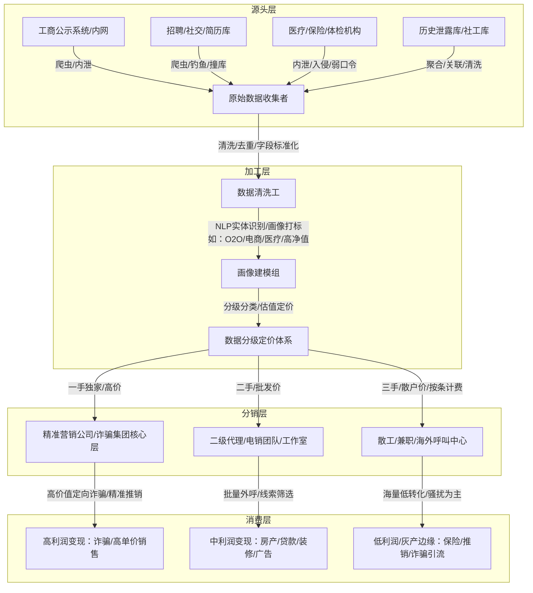
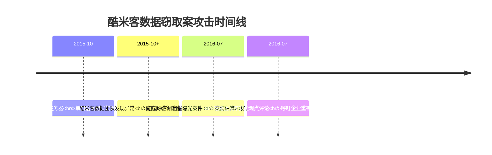
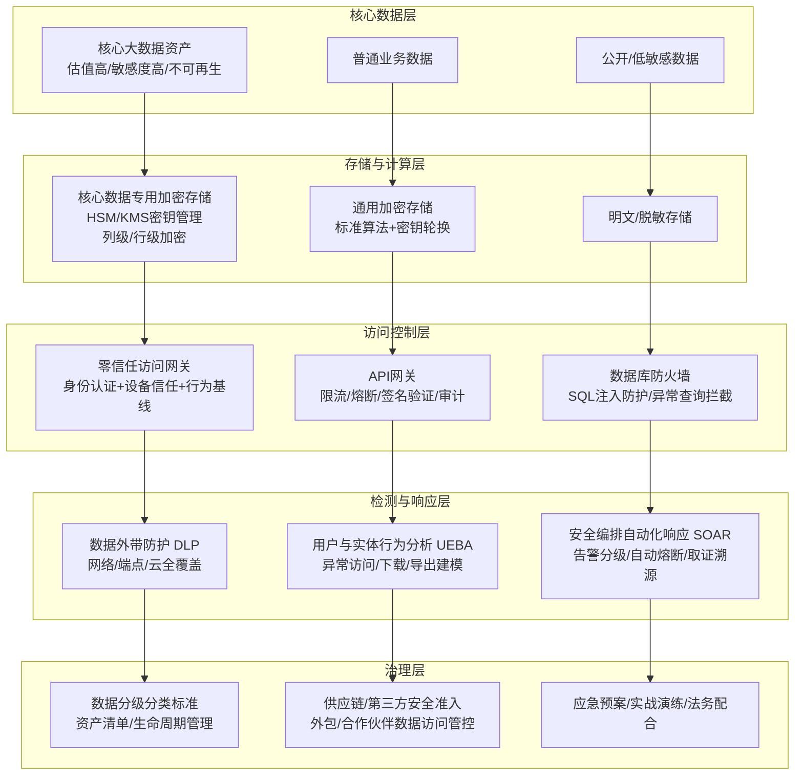

## 归档索引概述

本页面为 **301在路上** 微信公众号（2015年8月-2022年8月）归档文章的结构化索引沉淀页。围绕**隐私数据非法获取与黑产变现**、**商业竞争情报安全**、**网络安全竞赛生态**及**白帽黑客成长路径**四大核心主题，收录五篇高价值深度内容：

1. **《你"窃取"了我的隐私，为何还这么嚣张？》**（2016-07）：以作者亲历精准营销骚扰电话为切入点，揭示企业工商注册数据如何被非法爬取、画像、分级、多级分销，延伸至艾滋病患者隐私诈骗等恶性场景，拆解黑产链条全貌与监管困境。
2. **《数据泄露！你的数据还安全吗？》**（2016-07）：盘点大麦网购票用户被诈骗、全国26省艾滋病感染者信息泄露、安徽6000名新生儿视频外泄三大典型案例，剖析源码复用漏洞连锁、撞库攻击、内鬼倒卖三大核心成因。
3. **《安全观点|又一件互联网友商数据"窃取"案》**（2016-07）：深度复盘深圳酷米客公交软件后台数据被竞争对手通过黑客手段盗取案件，剖析大数据领域商业间谍攻击手法、企业数据资产保护严重缺失现状，呼吁企业重视核心数据资产安全建设。
4. **《白帽黑客成长独白：301消失的那几年》**（2016-07-14）：2016年阿里安全峰会分享实录，记录杨蔚（301）从高考失利、隐退三年到入行乌云、主导乌云众测、创办众安天下的完整成长轨迹，及其总结的安全人才八大成长原则与职业建言。
5. **《话说，今年的XCTF总决赛你去了么？》**（2017-07）：记录2017年XCTF国际联赛总决赛（第二届）现场直击，详细记录AWD对抗赛制、16支参赛队伍构成、Gamebox配置、零和博弈计分规则、三大展区布局及赞助商展台情况。

前四文互为因果与佐证：前三文从**数据流向与黑产生态**、**典型案例与技术成因**、**商业竞争视角的数据窃取**三个维度纵横溯源，共同构建了2016年前后中国互联网数据安全威胁的立体画像；第四文从**白帽从业者第一人称视角**复盘成长路径，揭示安全人才培养的心法与方法论；第五文则补充了同一时期国内顶级网络安全竞赛的生态侧写，形成"攻防两端、人才成长、商业竞争安全"的完整观察视角。

> **归档范围**：2015-08 ~ 2022-08  
> **公众号ID**：MzIwMTQ2NzY4NA== (301在路上)  
> **本页定位**：程序分析 / 威胁情报 / 安全治理 / CTF竞赛生态 / 安全人才培养 / 商业竞争情报安全 参考资料

---

## 文章一：精准营销骚扰电话与隐私数据黑产链条深度复盘（2016-07）

> **原文链接**：http://mp.weixin.qq.com/s?__biz=MzIwMTQ2NzY4NA==&mid=2652520711&idx=1&sn=591c751b8bd6507fde2345768978ce12&chksm=8d03934cba741a5a553d02941f0641167a7eec8014054aae4f4d14c69b2b76f9d460728ea8a8&scene=126&sessionid=1681656737#rd  
> **原文归档**：[301在路上-201508-202208_101](../sources/301在路上-201508-202208_101.md)  
> **发布时间**：2016年7月中下旬

### 核心事件：一通"精准"到令人毛骨悚然的推销电话

| 维度 | 详情 |
|------|------|
| **受害主体** | 301在路上作者（安全从业者、创业者） |
| **受害时间** | 2016年7月中下旬某天下午 |
| **攻击向量** | 个人手机号码直拨（非400/95/虚拟运营商号段） |
| **精准画像维度** | 姓名、单位名称、职位、电话、公司经营领域（被归类为O2O） |
| **公司状态** | 刚注册不久，作者自己仍在探索业务定位 |
| **来电者话术** | 1. "信息获取来源合法" 2. "同行业大家都这样做，默许规则" 3. "相信你，同类电话不是第一次遇到"（暗示数据多次转手） 4. 主动提供单位名、业务范围，邀请合作 |

### 关键矛盾点

1. **时间悖论**：公司注册极短时间内，完整工商/经营信息即被结构化入库、画像标签（O2O）、分配至销售线索池。
2. **合法性伪装**：来电者以"合法获取""行业默许规则"为挡箭牌，将**非法爬取/内泄/多级转卖**合规化叙事。
3. **多轮转手铁证**："同类电话不是第一次" 直接佐证数据在黑产链条中**多级分销、重复变现**。
4. **从商业骚扰到生命威胁**：文中显性关联 **艾滋病患者隐私被欺诈骗钱**，揭示同一黑产基础设施支撑的**分级危害谱系**——从商业推销到诈骗敲诈，仅是数据标签与话术差异。

### 数据流向溯源：从"生产"到"消费"的完整链路

#### 数据源头画像

| 数据类型 | 可能来源 | 窃取/获取手法 | 关联技术页面 |
|----------|----------|---------------|--------------|
| **工商注册信息** | 国家企业信用信息公示系统、地方工商局内网、第三方企查查/天眼查/爱企查等聚合平台 | 爬虫规模化采集、内部人员违规导出、API滥用调用 | [[vulnerability-mining-recon-aiqicha-fofa#资产测绘与语法构造]]、[[api-business-logic-phone-enumeration#业务逻辑缺陷利用]] |
| **法人/高管/联系人身份信息** | 工商登记留存、社保/公积金缴纳记录、招聘平台简历库、社交网络、过往数据泄露库（社工库） | 撞库/凭据填充、社工钓鱼、内部贿赂、简历投递钓鱼 | [[social-engineering-attack-techniques#凭据窃取与账号劫持]]、[[threat-attribution-tracing-techniques#威胁情报来源与暗网监测]] |
| **企业经营范围/业务方向** | 工商登记经营范围、官网/招聘JD/公开宣传资料、竞品情报采集 | NLP自动化标签提取、人工研判打标 | [[vulnerability-mining-recon-aiqicha-fofa#技术栈指纹识别]] |
| **医疗/敏感人群隐私（如HIV患者）** | 医院HIS/EMR系统、疾控上报系统、第三方体检/保险/制药数据库、地下买卖历史泄露库 | 内部人员窃取、供应链攻击、漏洞入侵、弱口令爆破 | [[medical-system-internal-penetration-case-study#医疗系统渗透实战]]、[[redis-unauthorized-access-rce#未授权访问与数据窃取]] |

#### 数据流转与加工层



### 黑产链条拆解：角色分工、利益分配与风险隔离

#### 核心角色矩阵

| 角色 | 核心职能 | 技术门槛 | 法律风险承担 | 典型获利模式 |
|------|----------|----------|--------------|--------------|
| **上游数据源方** | 内部人员（工商/税务/银行/医院/运营商/平台员工）、黑客入侵团伙 | 低（内鬼）~ 高（APT级入侵） | 极高 | 按库/按条批发，单笔万元至百万 |
| **数据清洗/建模组** | 去重、字段映射、实体识别、画像打标、估值分级 | 中高（Python/SQL/NLP/大数据处理） | 高 | 技术服务费/分成/自建库倒卖 |
| **分销代理网络** | 多级代理（总代/一级/二级/散户），建立层级授权、区域保护、客户分配体系 | 低（销售/管理） | 中高 | 批发差价/按条提成/会员费 |
| **终端变现团伙** | 电销外呼中心、诈骗话术组、精准营销公司、非法药品/保健品销售、贷款中介 | 低中（话术/CRM/外呼系统/VOIP/号码池） | 极高 | 单单提成/业绩分红/自产自销利润 |
| **技术基础设施商** | 虚拟运营商/号码池提供商、VOIP网关/软交换/外呼系统开发商、短信通道/签名通道商、CRM/线索管理SaaS厂商 | 高（电信级开发/运维） | 中 | 通道费/坐席费/月租/授权费/流量分成 |
| **洗钱/资金通道** | 跑分平台、虚拟币OTC、地下钱庄、游戏币/充值卡变现 | 中 | 高 | 手续费 5%-20% |

#### 利益分配示例（以一条"精准企业主数据"为例，售价 10 元/条）

```
终端变现团伙最终变现：成功转化 1 单利润 500-50000 元
    ↑ 分成/提成 30%-50%
二级代理/电销团队采购成本：3-5 元/条
    ↑ 批发差价
一级总代采购成本：1-2 元/条
    ↑ 批发差价
数据清洗/建模组成本：0.3-0.5 元/条（人力/算力/存储）
    ↑ 采购成本
上游数据源方出售价：0.1-0.3 元/条（原始库按万条批发）
```

### 技术攻击面分析

#### 数据采集自动化与API滥用

| 技术手段 | 典型场景 | 对抗难点 | 关联知识库 |
|----------|----------|----------|------------|
| **工商/企业信息聚合平台API滥用** | 企查查/天眼查/爱企查/启信宝等开放/私有API，高频调用拉取新注册/变更企业全量字段 | 平台反爬/限流/签名验证/账号封禁 → 黑产使用分布式代理IP池、设备指纹伪造、账号养号池、签名破解/hook绕过 | [[vulnerability-mining-recon-aiqicha-fofa#资产测绘语法构造]]、[[api-business-logic-phone-enumeration#业务逻辑漏洞利用]] |
| **公开公示系统爬虫** | 国家/地方企业信用信息公示系统、裁判文书网、专利/商标/备案公示系统 | 验证码/行为分析/IP封禁 → 验证码打码平台/人工众包、浏览器指纹伪造、住宅IP代理池 | [[iot-reconnaissance-information-gathering#信息收集全流程]] |
| **招聘/社交平台简历/画像爬取** | BOSS直聘/拉勾/智联/前程无忧/领英/脉脉/微信公众号/小程序 | 登录态/加密接口/风控模型 → Cookie池维护、App逆向Hook/Frida/Xposed动态调试、协议破解、账号批发/养号 | [[android-shelling-unshelling-techniques#逆向工程与动态分析]]、[[social-engineering-attack-techniques#钓鱼攻击全链路]] |
| **内网/数据库直接窃取** | 医院HIS/疾控/保险/体检机构内网弱口令/未授权访问/注入/供应链投毒 | 内网隔离/审计/EDR → 内网渗透横向移动、凭据导出、域控制、数据分阶段外泄 | [[internal-network-pivoting-techniques#横向移动实战]]、[[redis-unauthorized-access-rce]]、[[cnvd-2021-49104-eoffice-v9-file-upload-rce]] |

#### 精准触达基础设施

| 组件 | 技术实现 | 黑产改造点 | 监管盲区 |
|------|----------|------------|----------|
| **虚拟运营商/号码池** | 170/171/165/167/162等号段，批量申请、实名制规避 | 号码标记/封号后快速换号、归属地伪装、主叫号码显示伪造（SPOOF） | 实名制穿透困难、号码资源监管滞后、跨省追踪取证成本高 |
| **VOIP软交换/网关** | Asterisk/FreeSWITCH/Kamailio/OpenSIPS + 网关设备 | 录音/通话记录本地化不上传、加密信令（TLS/SRTP）、动态路由跳板、混合PSTN/互联网出局 | 信令加密导致监管侧无法解密抓包、境外服务器部署规避管辖 |
| **智能外呼/机器人系统** | ASR/TTS/NLP多轮对话、预测式拨号、号码清洗/去重/黑名单过滤 | 话术树针对性定制（针对HIV患者/企业主/老人/大学生）、情绪识别转人工、通话数据实时回传画像优化 | AI外呼识别对抗持续迭代 |
| **CRM/线索管理/数据分发** | 线索分配/跟进记录/转化漏斗/绩效提成/数据权限隔离/多租户SaaS化 | 线索按画像标签自动分发至对应话术组/代理层级、数据脱敏展示、操作审计日志可篡改/关闭 | SaaS化部署在境外/容器化/频繁更换域名IP，取证链条断裂 |

> **关联技术**：VOIP/外呼/号码池技术栈见[[http-proxy-tunneling-goproxy-netsh#隧道技术与代理]]、[[c2-redirectors-malleable-c2-profiles#基础设施隐匿]]（红队C2隐匿技术与黑产外呼基建高度同构）；CRM/SaaS化运营见[[codetest-visual-poc-exploitation-tool#可视化管理平台]]。

### 监管与企业自律缺位

#### 法律法规执行困境

| 困境维度 | 具体表现 | 根因 |
|----------|----------|------|
| **取证链条长、易断裂** | 受害者仅有来电录音/号码 → 无法穿透虚拟运营商/VOIP网关/境外服务器定位真实主体 | 跨层级/跨地域/跨境取证协作机制缺失、技术手段滞后 |
| **定性争议大、门槛高** | "大数据分析/公开渠道获取"抗辩 → 难以认定"非法获取" | 立法对"公开信息聚合画像""合法来源抗辩"界定模糊 |
| **打击成本高、收益低** | 端掉一个电销团队/号码池/外呼系统，成本巨大；黑产快速重组复活 | 打击模式为"点状/事后/物理端掉"，黑产为"网状/进化/弹性架构" |
| **监管碎片化、推诿扯皮** | 工信部/公安/市场监管/网信办/银保监/卫健委/通管局/反诈中心 → 职责交叉/数据不通 | 缺乏统一指挥协调机制、数据共享法律依据不足 |

#### 企业自律失效的商业逻辑

```mermaid
graph LR
    A[获客成本高企<br/>合规渠道转化低] --> B[购买黑产线索<br/>低成本/高精准/即买即用]
    B --> C[业绩达标/融资叙事/生存压力]
    C --> D[管理层睁一只眼闭一只眼<br/>甚至默许/指派采购]
    D --> E[合规/法务/风控部门<br/>被边缘化/无否决权/无预算]
    E --> F[供应商准入/数据合规审计<br/>流于形式/仅查合同不查源头]
    F --> G[行业协会/自律公约<br/>无强制力/无惩戒/头部企业不带头]
    G --> H[全行业"劣币驱逐良币"<br/>不买黑产数据 = 竞争劣势 = 死亡]
    H --> A
```

### 防御与溯源建议

#### 个人/企业主维度

| 防御层面 | 具体措施 | 工具/方法 | 关联知识库 |
|----------|----------|-----------|------------|
| **源头减量** | 工商注册地址/联系电话/经营范围最小化填写、使用虚拟号/专用号/400号替代个人手机 | 虚拟号服务、工商登记委托代理隐私保护选项 | [[cookie-security-fundamentals#最小权限原则]]、[[domain-registrar-security-guide#WHOIS隐私保护]] |
| **主动监测** | 定期搜索自有企业/姓名/电话在搜索引擎/聚合平台/暗网/泄露库的暴露情况 | FOFA/ZoomEye/Quake资产测绘监控、暗网监控服务、有无被泄露/DeHashed/火狐监控 | [[vulnerability-mining-recon-aiqicha-fofa#持续化监控]]、[[threat-attribution-tracing-techniques#威胁情报融合]] |
| **来电防御** | 开通运营商/手机厂商/第三方骚扰拦截、陌生电话强制语音验证/IVR分流 | 来电防火墙APP、SIP/VOIP软电话自建IVR、企业统一通讯平台集成来电认证 | [[social-engineering-attack-techniques#电话诈骗防御清单]] |
| **数据水印/蜜罐** | 在对外留资表单/名片/官网/招聘JD植入唯一标识水印、部署蜜罐表单/假官网/假客服捕获爬虫 | Canarytoken/蜜罐平台（OpenCanary/Honeypot/自建）、唯一标识生成脚本 | [[threat-attribution-tracing-techniques#蜜罐与诱捕技术]]、[[xd-security-blue-team-defense#蜜罐技术与HFish部署]] |
| **法律维权** | 保留证据 → 向12321/12377/网信办/公安/市场监管/消协投诉 → 民事诉讼主张隐私权 | 证据保全（公证/区块链存证/时间戳）、律师函/法院调查令/公益诉讼 | - |

#### 监管/平台/行业维度

| 治理层级 | 核心抓手 | 关键动作 | 技术支撑 |
|----------|----------|----------|----------|
| **立法/司法** | 明确"公开信息规模化聚合画像/商业化转售"定性、降低"非法获取"认定门槛 | 修改《个保法/刑法/网络安全法/数据安全法》配套司法解释、发布典型指导性案例 | - |
| **监管协同** | 建立跨部门联席会议、数据共享标准化接口、联合执法常态化 | 公安牵头、多部门成员、周调度/月通报/季联合行动 | 统一数据交换平台、案件线索流转系统、技术取证共享库 |
| **源头治理** | 严查内鬼/供应链泄露、推行数据分级分类/脱敏/水印/最小必要原则 | 重点单位数据安全等保测评/渗透测试/内审/供应链安全评估 | [[medical-system-internal-penetration-case-study#医疗数据安全]]、[[internal-network-pivoting-techniques#内网渗透实战]]、[[code-audit-file-operation-vulnerabilities#代码审计方法论]] |
| **平台治理** | 聚合平台/企服SaaS/外呼系统/号码商/短信商：实名认证穿透、API调用审计/限流/画像、录音/记录留存/实时上传 | 监管沙箱/合规检测工具/自动化巡检/黑名单联动/信用惩戒/牌照挂钩 | [[observerward-0x727-web-fingerprint-tool#指纹识别与资产测绘]]、[[pocsuite3-vulnerability-testing-framework#自动化检测]] |
| **黑产打击** | "断卡/断网/断链/断财/断技"专项行动、基础设施溯源定位、核心骨干跨省/跨境抓捕 | 公安主导、反诈中心协同、电信运营商/支付机构/虚拟币交易所配合、国际警务合作 | [[named-pipe-smb-detection-sysmon#威胁情报融合]]、[[threat-attribution-tracing-techniques#攻击溯源全链路]]、[[c2-redirectors-malleable-c2-profiles#基础设施关联分析]] |
| **行业自律** | 头部企业带头签署《拒用非法数据联合声明》、建立供应商数据合规白名单/黑名单共享库 | 行业协会牵头、第三方审计机构认证、合规成本纳入准入门槛、ESG挂钩 | [[bug-bounty-program-history-evolution#白帽经济与生态建设]]、[[360bugcloud-vulnerability-response-platform#SRC建设]] |

---

## 文章二：数据泄露盘点——大麦网、艾滋病患者信息、新生儿视频泄露三大典型案例及成因分析（2016-07）

> **原文链接**：http://mp.weixin.qq.com/s?__biz=MzIwMTQ2NzY4NA==&mid=2652520693&idx=1&sn=6952dabe586b918da560843001aaf083&chksm=8d0392beba741ba806f6d4ce986902124179dd7dc69de78eb4f0cd5120789e3a5a0be8794b5d&scene=126&sessionid=1681656737#rd  
> **原文归档**：[301在路上-201508-202208_103](../sources/301在路上-201508-202208_103.md)  
> **发布时间**：2016年7月（文中提及艾滋病诈骗截至7月17日）

### 案例复盘：三大典型数据泄露事件

#### 案例一：大麦网购票用户信息泄露致诈骗
- **时间**：2016年7月初
- **受害群体**：在"某麦网"购买过门票的消费者
- **攻击手法**：诈骗者自称"某麦网客服"，准确报出消费者个人信息（姓名、电话、购票记录等），以"帮助取消VIP业务"为由，诱导受害者前往ATM机操作转账实施诈骗。
- **核心特征**：**高精准度画像 + 熟悉业务流程话术 + 实时诱导转账**，属于典型的"数据落地即变现"黑产模式。

#### 案例二：全国26省艾滋病感染者隐私信息大规模泄露
- **时间**：2016年7月17日前后集中爆发
- **受害群体**：全国26个省份的艾滋病感染者
- **攻击手法**：诈骗电话称将发放补助，掌握感染者姓名、身份证号、联系方式、感染时间、用药情况等极度敏感隐私。
- **来源线索**：艾滋病公益组织"白桦林"接到多位感染者求助后披露。
- **核心特征**：**医疗级敏感数据泄露 + 跨省域广度 + 定向诈骗话术**，直指医疗/疾控/保险/制药等高敏感数据链条内部泄露或入侵。

#### 案例三：安徽约6000名新生儿视频及信息被挂商业网站
- **时间**：2016年7月曝光
- **受害群体**：安徽某医院约6000名刚出生婴儿及其家庭
- **泄露内容**：新生儿视频、样貌、出生症状描述，**无任何马赛克处理**，包含姓名、出生时间、性别、体重等完整身份信息。
- **泄露源头**：医院内部系统（HIS/影像系统/护理系统）数据外泄，疑似通过内部人员违规导出或系统漏洞被拖库。
- **核心特征**：**极度脆弱群体（新生儿）+ 视频+结构化数据双重泄露 + 商业网站公开售卖/展示**，暴露医疗机构数据安全管理近乎为零。

### 成因溯源：三大核心技术与管理根因

#### 源码复用导致的漏洞连锁辐射
- **现象描述**："很多平台为了节约成本等原因使用相似的源代码进行更改，但是其中的一个网站被爆出过系统漏洞，同理，这些使用相同的源代码的网站也有这样的漏洞。"
- **技术机制**：
  - **代码克隆/复制粘贴开发**：多套业务系统共享同一套基础框架、CMS、组件库（如通用的用户中心、订单系统、支付模块、文件上传组件）。
  - **漏洞继承性**：父代码库存在SQL注入、文件上传、反序列化、越权等漏洞时，所有派生系统**零成本继承**该漏洞。
  - **修复不同步**：上游组件修复补丁发布后，下游业务方因版本锁定、定制化修改冲突、运维能力不足等原因，**长期不升级/不回港**，形成巨大的"漏洞存量池"。
- **实战关联**：
  - [[code-audit-installation-reinstallation-vulnerabilities#安装重装逻辑缺陷]]：通用安装向导复用导致的安装锁绕过、变量覆盖批量漏洞。
  - [[catfish-cms-arbitrary-image-deletion#CMS通用组件漏洞]]、[[feifei-cms-arbitrary-file-deletion#后台功能复用漏洞]]、[[iwebshop-cms-arbitrary-file-deletion#备份管理功能通用缺陷]]：多款CMS同类功能模块重复出现路径遍历/任意文件删除。
  - [[sourcerercc-code-clone-detection#大规模代码克隆检测]]：可用于资产侧识别同源代码库，预判漏洞辐射面。
- **防御对策**：
  - **软件物料清单（SBOM）管理**：梳理所有系统依赖的开源组件、内部公共库版本，建立组件-系统映射表。
  - **漏洞影响面自动化研判**：新增CVE/组件漏洞披露时，通过SBOM秒级定位受影响系统列表。
  - **统一补丁分发与强制回港机制**：核心公共库修复后，通过CI/CD流水线强制触发下游系统构建、测试、发布，纳入SLA考核。

#### 撞库攻击：凭据复用与验证缺失的双重奏鸣
- **现象描述**："很多网民隐私意识或数据安全意识不强，总爱使用同一组用户名和密码，这些数据在一个网站被泄漏后，有心人便可以通过这些公开的数据对另一个网站上的数据进行撞库，加上后一个网站并未设置验证机制。"
- **攻击链完整复现**：
  1. **源头泄露**：网站A（如论坛、电商、教育平台）数据库被脱库，泄露 `username/password/email/phone` 明文或弱哈希（MD5无盐/单次SHA1）。
  2. **凭据清洗聚合**：黑产将多源泄露数据去重、关联、破解弱哈希，构建**社工库/凭据库**（亿级规模）。
  3. **自动化撞库工具**：使用 Sentry MBA / SNIPR / 私有框架，配置目标站点B的登录接口、请求参数、成功/失败特征标识。
  4. **代理IP池与设备指纹伪造**：住宅IP代理池分发请求，模拟真实浏览器指纹（Canvas/WebGL/字体/音频指纹）、行为轨迹（鼠标移动/点击间隔），绕过WAF/风控。
  5. **验证机制缺失利用**：目标站点B**无验证码/验证码强度低/无设备指纹绑定/无异地登录告警/无限制单IP高频登录/无账号锁定策略**，撞库成功率极高。
  6. **高价值账号筛选变现**：命中账号按余额/权限/绑定卡/历史订单/隐私数据分级定价，转卖或自用实施二次诈骗/刷单/套现。
- **关联技术页面**：
  - [[social-engineering-attack-techniques#撞库攻击与凭据填充]]：撞库工具链、代理池、指纹伪造、风控对抗全流程。
  - [[lm-ntlm-hash-generation-analysis#哈希破解与离线爆破]]：弱哈希离线破解技术细节。
  - [[api-business-logic-phone-enumeration#业务逻辑缺陷利用]]：登录/注册/找回密码接口的枚举与爆破变种。
  - [[xd-security-pentest-basic-stage-notes#SQL注入与数据脱库]]：数据脱库前置攻击面。
- **防御体系化建议**：
  - **认证层**：强制多因子认证（MFA）、WebAuthn/FIDO2无密码登录、风控设备指纹绑定、异地/新设备登录二次验证（短信/邮件/推送/Authenticator）。
  - **接口层**：登录/注册/修改密码/找回密码全链路验证码（行为验证码/滑块/点选/图标旋转）、限流（IP/设备/账号/手机号多维）、账号锁定策略（失败N次锁定T分钟）。
  - **存储层**：Argon2id/scrypt/bcrypt/PBKDF2 高强度自适应哈希 + 唯一盐 + 服务端密钥加密存储（Pepper），杜绝明文/MD5/SHA1。
  - **监测层**：登录日志实时流式分析（Flink/Spark Streaming），异常登录模式（批量失败/单IP多账号/单账号多IP/非常用地/非常用设备）秒级告警封禁。
  - **用户侧**：推广密码管理器、普及唯一密码、检测账号是否出现在已知泄露库（Have I Been Pwned / Firefox Monitor / 国内同类服务）。

#### 内鬼倒卖：权限滥用与审计缺位的信任背叛
- **现象描述**："相关管理人员利益熏心，将公司的交易数据和用户的数据倒卖给有心人士。"
- **典型角色与手法**：
  | 角色 | 典型权限 | 倒卖手法 | 规避审计手段 |
  |------|----------|----------|--------------|
  | **数据库运维 (DBA)** | `SELECT *` / `mysqldump` / `pg_dump` / 备份文件访问 | 定时导出全量/增量数据，压缩加密上传网盘/私有云/即时通讯工具发送 | 利用合法备份窗口掩护、篡改审计日志、使用合法账号在非工作时间操作 |
  | **后台开发/运维** | 后台管理系统导出功能、API权限、内网跳板机 | 编写爬虫脚本调用内部API分页导出、直接下载后台导出的CSV/Excel、通过跳板机SCP外带 | 伪装成正常运维/测试流量、利用开发测试账号、删除操作历史记录 |
  | **客服/销售/风控** | 业务系统查询界面、工单系统、CRM导出权限 | 手工逐页复制/截图、使用浏览器插件批量导出、购买/自制自动化导出脚本 | 正常业务操作掩护、低频慢速导出避开阈值告警 |
  | **第三方外包/实习生** | 临时授权的数据库/后台/文件服务器访问 | 离职前批量打包带走、利用未回收的VPN/跳板机/账号持续访问 | 利用权限回收滞后窗口、社会工程学获取同事凭证 |
- **数据流向**：内鬼 → 数据清洗/画像组（去重/打标/定价） → 一级代理/买家群（诈骗团伙/精准营销/竞对情报） → 终端变现。
- **关联案例与技术页面**：
  - [[loan-company-penetration-test-case-study#堡垒机任意用户登录与会话审计绕过]]：堡垒机漏洞导致内鬼/攻击者获取最高权限审计盲区。
  - [[medical-system-internal-penetration-case-study#医疗系统内网渗透]]：医疗数据高价值导致内鬼/外部渗透双重威胁。
  - [[internal-network-pivoting-techniques#凭据导出与横向移动]]：内网渗透视角的内鬼攻击技术复现。
  - [[windows-scheduled-task-persistence-techniques#计划任务持久化与审计规避]]：内鬼植入长期窃取通道的技术手法。
- **治理体系（人防+技防+制防）**：
  - **最小权限与即时授权 (JIT/PAM)**：数据库/后台/跳板机账号零常驻权限，申请-审批-临时下发-用毕即回收，全程录屏/命令审计（如 Teleport / HashiCorp Boundary / 堡垒机）。
  - **数据分级分类与脱敏**：生产数据**严禁**流入开发/测试/外包环境；导出功能仅返回脱敏数据（手机中四位/身份证前六后四/金额加噪），全量明文导出需双人授权+审批单+水印溯源。
  - **行为基线与异常检测 (UEBA)**：建立各角色正常数据访问基线（时间/频次/量/表/字段），异常触发告警/自动熔断/强制MFA/冻结账号。
  - **水印溯源与指纹嵌入**：敏感数据字段植入不可见水印（零宽字符/同形异义字/唯一ID），泄露样本可溯源至具体导出操作/账号/时间。
  - **法律与背景审查**：核心数据岗入职背调、签署高额违约条款保密协议、离职交接审计、竞业限制落实。

### 文章二总结与警示

> **原文结语**：“针对这样的问题，各大网站都可能存在的问题，我们不能今天坐看别人家的安全出问题，之后被别人笑着看自家的安全问题。”

三大案例揭示的**数据安全生存法则**：
1. **漏洞具有传染性**：源码复用不等于安全复用，**组件级漏洞会放大为业务级灾难**，SBOM与补丁闭环是底线。
2. **用户习惯是最大攻击面**：撞库之所以屡禁不止，根源在于**认证体系脆弱**而非用户愚蠢，MFA/风控/强哈希是必须的基建投入。
3. **内部人员是最高危威胁**：内鬼倒卖成本最低、数据最全、危害最深，**零信任架构、数据水印、行为审计**不可或缺。
4. **监管与行业自律滞后**：文章发布至今（2016-2025），《网络安全法》《数据安全法》《个保法》相继出台，但**黑产工业化分工更精细、技术更隐蔽、跨境更常态**，防御必须从"合规打勾"转向"实战对抗"。

---

## 文章三：竞品数据窃取案——酷米客公交软件大数据被盗事件安全观点复盘（2016-07）

> **原文链接**：http://mp.weixin.qq.com/s?__biz=MzIwMTQ2NzY4NA==&mid=2652520668&idx=1&sn=cd140f6b2e4793048d7642c32faa8fcb&chksm=8d039297ba741b81d09072fdb0fcf1404614d9e5918d593f5c4534b7ae5b9bb2c7fd27adc256&scene=126&sessionid=1681656742#rd  
> **原文归档**：[301在路上-201508-202208_110](../sources/301在路上-201508-202208_110.md)  
> **发布时间**：2016年7月（评论截止07.14 12点）  
> **新闻来源**：南方网/广州日报《深圳一公交软件数据疑被黑客盗走 案值20亿》

### 核心事件：深圳酷米客后台数据疑被竞争对手盗取

| 维度 | 详情 |
|------|------|
| **受害企业** | 深圳酷米客科技公司（公交实时软件"酷米客"运营方） |
| **发现时间** | 2015年10月 |
| **攻击向量** | 黑客入侵北京服务器，大肆盗取后台数据 |
| **异常指标** | 北京服务器其中一个IP地址单日访问量达100万+次（正常热点地区日访问量<10万次） |
| **数据保护现状** | 采用专门设计的加密算法保护，有验证数据来源的验证机制，普通人难以破解 |
| **溯源结果** | 入侵服务器定位于浙江省杭州市 |
| **损失评估** | 直接投入资金近亿元，衍生价值估值约20亿元人民币 |

### 攻击链复现与技术分析

#### 攻击时间线



#### 攻击手法特征分析

| 攻击阶段 | 技术特征 | 安全启示 |
|----------|----------|----------|
| **目标侦察** | 针对性选择大数据型创业公司、明确核心数据资产位置（北京服务器） | 资产测绘与攻击面管理缺失，核心数据未做分级分类保护 |
| **初始访问** | 绕过专用加密算法与验证机制，大规模并发访问（100万+/天/IP） | 加密算法安全性依赖"保密性"而非标准算法，验证机制未防住自动化脚本/分布式爬取 |
| **持久化/窃取** | 长期、大批量数据外带，未触发告警阈值 | 缺乏异常流量行为基线检测、数据外带监控（DLP）、API速率限制与熔断机制 |
| **溯源对抗** | 攻击服务器位于杭州（跨省），可能利用跳板/代理/僵尸网络 | 取证溯源困难，需联动跨省警力，攻击基础设施隐匿性强 |

#### 核心安全缺陷剖析

1. **加密算法"自研即隐患"**：文中提及"专门设计的加密算法"，这类**安全通过模糊性**的做法一旦逆向破解或密钥泄露，防线瞬间崩塌。应采用标准化、经受住密码学界验证的算法（AES-GCM、ChaCha20-Poly1305等）并配合密钥管理体系（KMS/HSM）。

2. **验证机制缺乏行为分析**：仅验证"数据来源合法性"（如签名/Token），未结合**访问频率、IP信誉、用户代理指纹、请求时序模式**等行为维度进行风控。100万+/天/IP的异常流量本应触发熔断。

3. **数据分级分类缺位**：核心大数据资产（估值20亿）与普通业务数据混存，未实施**数据分级分类、差异化防护、核心资产隔离存储/访问控制/审计**。

4. **缺乏实时威胁检测与响应**：从入侵发生（2015年10月）到媒体曝光（2016年7月）间隔**9个月**，说明企业内部未建立有效的**安全运营中心（SOC）、态势感知、应急响应流程**。

5. **商业竞争情报安全盲区**：竞争对手作为疑似主谋，属于典型的**商业间谍/竞争情报收集**攻击。企业往往重防"黑客勒索/破坏"，轻防"竞对窃密"，导致针对性防护缺失。

### 大数据企业数据资产保护参考架构



### 行业警示与建议

> **原文金句**：
> - "利用商业/PR，市场营销手段获取用户很容易，通过产品功能的角度获取用户信息也容易。"
> - "如何把安全工作落实到位，守护好自家的节操很难；但不用安全技术作恶这事应该挺容易吧？"

#### 给大数据/云计算/互联网金融企业的五条硬核建议

| 建议 | 核心行动 | 优先级 |
|------|----------|--------|
| **1. 正视核心资产价值，投入匹配资产估值的安全预算** | 核心数据资产估值20亿 → 安全投入不应仅为合规打勾，需按资产价值比例（建议3%-5%）持续投入建设、运营、人才 | ⭐⭐⭐⭐⭐ |
| **2. 废除"自研加密/私有协议"迷信，拥抱标准化密码体系** | 替换所有自研加密为国密/国际标准算法，引入KMS/HSM统一密钥生命周期管理，定期密钥轮换与泄露应急预案 | ⭐⭐⭐⭐⭐ |
| **3. 建立数据分级分类与差异化防护体系** | 梳理全量数据资产，按业务价值/敏感度/法规要求分级（核心/重要/一般/公开），核心数据专库专网专管专审 | ⭐⭐⭐⭐ |
| **4. 部署以行为为中心的实时威胁检测（UEBA+DLP+SOAR）** | 核心数据访问全审计，建立基线（频率/量/时段/来源/指纹），异常实时告警+自动熔断+取证溯源，缩短MTTD/MTTR | ⭐⭐⭐⭐ |
| **5. 将商业竞争情报安全纳入威胁建模** | 识别竞对为核心威胁主体之一，模拟竞对窃密攻击路径（爬虫/内鬼/供应链/APT），针对性加固核心数据获取/计算/输出全链路 | ⭐⭐⭐ |

---

## 文章四：白帽黑客成长独白——301消失的那几年（2016-07-14）

> **原文链接**：http://mp.weixin.qq.com/s?__biz=MzIwMTQ2NzY4NA==&mid=2652520671&idx=1&sn=f29be84d7f3101f0e2e449e30589c13b&chksm=8d039294ba741b8220fef9c51115171881c4b200a17b2477cd9287555f5bd8bd7c3ff2f03d86&scene=126&sessionid=1681656742#rd  
> **原文归档**：[301在路上-201508-202208_108](../sources/301在路上-201508-202208_108.md)  
> **发布时间**：2016年7月14日  
> **场景**：2016年阿里安全峰会——安全人才成长论坛分享实录  
> **分享者**：杨蔚（ID：301），众安天下负责人、前乌云网合伙人/乌云众测负责人、"301在路上"自媒体运营者

### 核心叙事："消失的那几年"定义与背景

#### 双重含义的"消失"

| 维度 | 具体内涵 |
|------|----------|
| **物理/社交消失** | 高考失利后放弃学业，离开亲朋好友创办网络工作室；工作室因经营不善关闭；因脸皮薄不愿让亲友看到落魄状态，**在亲朋好友视野中消失近3年** |
| **职业/身份消失** | 一心想挤进"安全圈"却反复受挫，未能正式进入圈子；这段经历是**众多白帽子共有的成长轨迹**——渴望却无门、努力却不被看见 |

> **名句**："而在这几年里，我经常会在路上，所以，运营的公众号平台名称就叫**301在路上**。当然，由于工作性质的问题，身边的合作伙伴和团队的同学都经常开玩笑说：'301，什么时候来北京出差。'"

### 成长轨迹：从边缘到核心的四次跃迁

#### 跃迁一：谷安天下——安全职业化的入场券
- **时间节点**："消失"结束后，首份真正意义的安全工作
- **角色**：渗透测试方向安全顾问
- **CEO李华**提供职位机会
- **投入模式**：除吃睡外时间**疯狂投入学习安全知识与拓展人脉**，对自己要求极严格
- **关键词**：**职业化起点、导师贵人、高强度自我驱动**

#### 跃迁二：乌云网合伙人——从执行者到规则制定者
- **身份**：合伙人之一
- **职责**：负责乌云企业方向**商业运营、技术服务、创新业务**
- **自封头衔**："**乌云首席服务官**"——致力**服务于企业与白帽子**
- **核心成果**：利用几乎所有空余时间将**乌云众测**做到该领域**国内第一**
- **影响力**：帮助**数百家企业**和**很多白帽子**实现绝大多数人认为不可能的事情
- **关键词**：**平台思维、双边市场、商业化落地、行业标准制定**

#### 跃迁三：众安天下创办——从参与者到生态建设者
- **定位**：未来方向主要给更多企业和白帽子人才提供安全帮助，提供**深度的一站式顾问服务**
- **理念**："**聚天下英才而用之**，帮助更多企业和安全人才实现价值"
- **企业文化**："**以人为本，众安天下。301在路上。**"
- **关键词**：**生态建设、人才赋能、顾问式服务、长期主义**

#### 跃迁四："301在路上"自媒体——从受益者到传播者
- **使命**：将自己经历的事情分享给大家，传递观点、经验及安全知识，**帮助更多人少走弯路**
- **影响**：曾单日因"安全人才如何入门、快速学习"话题吸引**近300人加微信**咨询
- **关键词**：**知识沉淀、社群影响力、反哺生态**

### 安全人才八大成长原则（快速成长秘笈与手册）

> **背景**：作者虽自称"不合格的安全技术从业者"，但基于对比在场同仁经验与视野、接触海量新人咨询、亲身走过弯路，总结出以下方法论。

| 序号 | 原则 | 核心要义 | 关键行动指南 | 反面教材/避坑点 |
|------|------|----------|--------------|------------------|
| **1** | **养成健康心态** | 安全行业诱惑力极大，成长过程中必经诱惑；选正道、保持健康积极心态，才能把工作做好 | 拒绝黑灰产诱惑；建立长期主义价值观；把"白帽"作为身份底色 | 一旦选错黑路，未来路被堵；短期利益换长期毁灭 |
| **2** | **学会换位思考** | 任何事有两面性；勤思考、换位思考才能从本质解决安全信任问题 | 做错时反思"为什么会做错"找本质；切勿活在自己世界里"自嗨" | 单向视角导致信任断裂；技术自嗨脱离业务价值 |
| **3** | **学会自我驱动** | 学习路上极其枯燥；只有主动获取新知识、自我驱动，才能真正提升能力 | 培养主动学习习惯；拒绝被动等待喂食；"人懒则死" | 依赖培训/师傅带；无主动性则无成长 |
| **4** | **学习方法效率** | 做人做事要取长补短；提升效率最好方式是画思维导图、锻炼思维逻辑 | 重复做事时思考"每步是否还能更好更快"；保持头脑清醒不受干扰 | 机械重复无复盘；低效勤奋=无效内耗 |
| **5** | **自信不自负** | 安全本质解决信任问题；自信建立在确有准备基础上，自负是过高估计自己 | 充分准备后行动；量力而行不夸大；自信≠盲目乐观 | 无准备硬上=自负；自我怀疑=瘫痪 |
| **6** | **懂得"合理试错"** | 试错前提必须考虑"合理"；不断思考总结判断才能少走弯路、降低试错成本 | 脱离"合理"的试错=对自己不负责；实践验证但设定止损线 | 盲目试错=赌博；不复盘=重复犯错 |
| **7** | **专业技能提升** | 安全分支极多、门槛极高；无落后技术只有不思进取的人；打牢擅长领域核心竞争力 | 聚焦擅长/热爱方向深耕；技术转化为生产力；拒绝贪多嚼不烂 | 广撒网不深耕；技术不落地=空中楼阁 |
| **8** | **行业知识储备** | 除安全技术外，必须学习各行业业务知识；技术人员懂业务才能把技术转化为生产力 | 快速了解目标行业/企业背景；技术能力与行业知识融合；积累沉淀 | 纯技术视角脱离业务；不懂业务的安全=成本中心非价值中心 |

### 职业建言与总结：给安全新人的七条硬核忠告

| 忠告 | 核心观点 | 深度解读 | 实操建议 |
|------|----------|----------|----------|
| **原地踏步，就是退步** | 互联网安全技术飞速发展，抱着"差不多"心态无法立足；存在好高骛远/眼高手低浮躁混圈子现象 | 技术半衰期极短，不进则退；圈子社交≠能力增长 | 多花时间学习新知识、扩充储备；拒绝"差不多"、拒绝浮躁混圈子 |
| **最大的对手是自己** | 绝大多数新人最大竞争对手不是别人、不是艰难，是**自己**——心态未端正、对自己无信心 | 内耗比外部竞争更致命；消极心理=自我设限 | 端正心态、建立自信；在理想路上"打怪升级"而非自我消耗 |
| **真正懂你的人，不是自己，而是竞争对手** | 每个人易见别人弱点/自己优势，难见自己弱点；竞争对手花更多时间研究你，比你更懂你 | 盲区源于自视角局限；对手视角=最客观的镜像 | 主动寻求对手/同行反馈；用竞争对手视角审视自己弱点 |
| **执行力是成功的第一生产力** | 很多聪明人输在执行力；作者自认执行力欠缺、输在实践和时间上 | 创意廉价，执行昂贵；想法不落地=零价值 | "觉得值得做就开始执行"；提升执行力=做成事的第一步 |
| **多数失败，死在"快"的路上** | 核心问题输在执行力、错失机会，根本死在"快"准备去做事的路上，见不到明天太阳 | 完美主义拖延症="快"的陷阱；准备过度=不行动 | 拥抱不完美行动；MVP思维、快速迭代、在做中修正 |
| **简单的事情做到极致，就是核心竞争力** | 大多数人不愿做简单/基础事；把简单基础事做到极致=核心竞争力 | 基础功=护城河；极致=稀缺性 | 识别本职工作中的"简单基础事"；持续打磨至行业顶尖 |
| **意欲取之，必先予之** | 别先想受益；先考虑如何帮助他人实现自我价值，才能实现团队价值；这是团队企业文化 | 利他先行=长期复利；零和博弈无未来 | 指导新人、分享知识、赋能合作伙伴；构建正和博弈生态 |

### 终极愿景：安全是一种能力，技术转化为生产力

> **"安全是一种能力，它可以体现在工作和生活的方方面面，但是如何把技术转化为生产力，这也是所有安全从业者需要思考的问题，未来安全产业对这块人才的需求远远比某个技术领域更为重要，因为这群人，需要走在产业的最前沿。"**

> **"在对的时间里，跟对的人，一起做对的事情"**——整个社会更应给安全新人**认可、包容和机会**，去让大家实现自我价值。

> **"聚天下英才而用之，帮助更多企业和安全人才实现价值，是我现在团队需要去做的事情，也是未来我们团队需要去做的事情。以人为本，众安天下。301在路上。"**

---

## 文章五：2017年XCTF国际联赛总决赛现场直击（2017-07）

> **原文链接**：http://mp.weixin.qq.com/s?__biz=MzIwMTQ2NzY4NA==&mid=2652520679&idx=1&sn=c8433711100384586018724a467d683a&chksm=8d0392acba741bba51419444a8419e0ade5dd5e82eaa207f33e0f00c279b551b21dbe5b7177f&scene=126&sessionid=1681656742#rd  
> **原文归档**：[301在路上-201508-202208_107](../sources/301在路上-201508-202208_107.md)  
> **发布时间**：2017年7月16日（比赛当天）  
> **关联知识库**：[[xctf-2017-finals-writeup]]（XCTF 2017总决赛详情页）

### 赛事概况

| 维度 | 详情 |
|------|------|
| **赛事名称** | XCTF国际联赛总决赛（第二届） |
| **举办时间** | 2017年7月16日 |
| **举办地点** | 北京国际会议中心 |
| **主办性质** | 国内水平最高、规模最大、最具影响力的中立性赛事平台 |
| **组织架构** | 高校与企事业单位携手组织 |

### 赛制规则：AWD对抗模式

#### 核心赛制参数

| 参数 | 设定值 | 说明 |
|------|--------|------|
| **赛制模式** | AWD（Attack With Defense，攻防兼备） | 对抗模式，而非传统Jeopardy解题模式 |
| **场景隔离** | 每队场景互相隔离 | 仅映射6个gamebox端口供访问 |
| **参赛队伍** | 16支 + 1支NPC战队 | 10支国内队 + 6支国际队 |
| **NPC战队** | 命题组控制 | 不频繁发起攻击，仅在需放出提示时发出攻击流量 |
| **Gamebox配置** | 每队6个（4个PWN + 2个Web） | 每个gamebox一个flag |
| **积分池** | 每个gamebox 960分 | 总分固定，零和博弈 |

#### 计分规则：零和博弈

| 规则项 | 详情 |
|--------|------|
| **初始分数** | 每队 6000 分 |
| **总分守恒** | 竞赛过程总分不变 |
| **竞赛轮次** | 默认 5 分钟/轮，FLAG每轮刷新 |
| **动态间隔** | 轮次间隔支持动态更新 |
| **丢失FLAG** | 扣 16 分 |
| **Gamebox Down** | 扣 16 分 |
| **夺取得分** | 服务正常队伍平分 |
| **归零保护** | Gamebox分为0后不再扣分 |

### 现场三大展区布局

#### 比赛区
- **核心功能**：16支参赛队伍现场对抗，选手"指尖开战"
- **环境要求**：极高保密性与稳定性，严禁打扰选手
- **观察方式**：通过解说区实时了解赛况

#### 解说区
- **核心功能**：实时赛况解说、规则讲解、技术点拆解
- **受众价值**：不熟悉AWD规则的观众可快速上手，兼具直播观赛体验
- **内容覆盖**：攻防动态、得分变化、关键漏洞利用演示

#### 主论坛
- **核心功能**：大V分享干货、技术前沿探讨、行业趋势研判
- **定位**：高强度竞技间隙的深度思考空间

### 赞助商展区与生态呈现

| 赞助商/合作伙伴 | 展区特色 | 互动形式 |
|----------------|----------|----------|
| **百度安全** | Cosplay真人展 | 吸引大批技术宅合影打卡 |
| **阿里安全** | 史努比公仔周边 | 高颜值周边发放、技术交流 |
| **永信至诚** | 现场版攻防体验赛CTF | 集趣味性、技术挑战、夺旗为一体 |
| **各SRC联合展区** | 精美小礼品 + 趣味互动 | 高颜值工作人员引导、安全技术答题送礼 |

> **现场氛围**："小伙伴们玩得不亦乐乎，乐不思蜀"——技术硬核与娱乐社交的融合，体现国内网络安全社区的年轻化、多元化特征。

### 赛事生态意义

1. **人才选拔与认证**：通过公开竞赛选拔顶尖技术人才，对夺旗者进行奖励，建立"技术即话语权"的行业认证体系。
2. **攻防技术实战化**：AWD模式强制选手在实时对抗中同时兼顾漏洞挖掘、利用开发、防护加固、流量分析、应急响应全链路能力，倒逼技能从"理论掌握"向"实战肌肉记忆"转化。
3. **产学研协同范式**：高校提供人才储备与理论创新，企业提供实战场景与资源投入，联赛作为中立平台连接双向需求。
4. **安全生态可视化**：将原本隐蔽的攻防对抗转化为可观测、可传播、可商业化的赛事IP，提升行业公众认知度与人才吸引力。

---

## 交叉引用总索引（五文合并版）

| 关联主题 | 知识库页面 | 文章一映射点 | 文章二映射点 | 文章三映射点 | 文章四映射点 | 文章五映射点 |
|----------|------------|--------------|--------------|--------------|--------------|--------------|
| 社会工程学/钓鱼/电话诈骗/心理战术 | [[social-engineering-attack-techniques]] | 来电话术分析、数据展示建立信任、行业惯例施压、痛点焦虑营销、HIV患者诈骗案例 | 大麦网客服冒充话术、艾滋病补助诈骗话术、新生儿数据用于何种社工攻击 | 竞对窃密中的社工手段可能性（内鬼勾结/供应链钓鱼） | - | - |
| API安全/业务逻辑漏洞/手机号枚举/数据聚合 | [[api-business-logic-phone-enumeration]] | 工商/企服平台API滥用采集、经营范围画像标签化、注册时间/变更实时监控 | 撞库利用登录/注册/找回密码接口逻辑缺陷、验证机制缺失 | 酷米客API验证机制被绕过、大规模并发访问未触发限流 | - | - |
| 威胁溯源/攻击归因/基础设施关联/暗网监测 | [[threat-attribution-tracing-techniques]] | 数据流向溯源链路、虚拟运营商/VOIP/境外服务器穿透、黑产分层架构关联分析 | 三案例数据源头溯源（医院/票务平台/疾控）、内鬼/外部入侵研判 | 攻击服务器定位杭州、跨省溯源取证难点、竞对基础设施关联分析 | - | - |
| 漏洞挖掘侦察/资产测绘/FOFA语法/持续监控 | [[vulnerability-mining-recon-aiqicha-fofa]] | 企业信息批量采集技术手法、自有资产暴露面监测、蜜罐数据布放 | 目标系统组件指纹识别、同源代码库资产关联、漏洞辐射面研判 | 酷米客核心资产（北京服务器）暴露面未收敛、资产测绘盲区 | - | - |
| 内网渗透/横向移动/凭据导出/医疗数据窃取 | [[internal-network-pivoting-techniques]]、[[medical-system-internal-penetration-case-study]] | 医院/疾控/保险内网入侵窃取HIV患者数据、供应链攻击路径 | 艾滋病/新生儿数据泄露的内网渗透/内鬼路径复现、堡垒机/数据库审计绕过 | 竞对可能通过供应链/合作伙伴内网横向移动窃取数据 | - | - |
| 红队OPSEC/基础设施隐匿/C2通信/VOIP隧道 | [[redteam-hw-opsec-guidelines]]、[[c2-redirectors-malleable-c2-profiles]]、[[http-proxy-tunneling-goproxy-netsh]] | 黑产外呼基建（VOIP/网关/加密信令/境外跳板/号码池）与红队C2隐匿技术同构 | 撞库/内鬼数据外带通道隐匿、C2基建复用 | 攻击者使用杭州服务器作为跳板/代理、基础设施隐匿与红队手法同构 | - | - |
| Android逆向/动态分析/爬虫对抗/App加固 | [[android-shelling-unshelling-techniques]] | 招聘/社交/企服App逆向Hook协议破解、Frida/Xposed动态调试、设备指纹伪造 | 撞库工具对App端登录接口的协议破解与自动化脚本编写 | 酷米客可能存在App端/API端被逆向分析构造自动化爬取工具 | - | - |
| 代码审计/文件操作漏洞/数据泄露根因 | [[code-audit-file-operation-vulnerabilities]] | 平台/系统代码缺陷导致数据泄露（如CNVD-2021-49104类任意文件上传/下载） | **源码复用漏洞连锁**核心成因、CMS/框架通用组件漏洞挖掘方法论 | 酷米客后台数据接口可能存在未授权访问/越权/注入等代码级缺陷 | - | - |
| 蜜罐技术/诱捕/威胁情报/蓝队防御 | [[xd-security-blue-team-defense]]、[[observerward-0x727-web-fingerprint-tool]] | 蜜罐数据/水印追踪污染黑产画像库、指纹识别黑产爬虫/采集基础设施 | 部署蜜罐账号/数据监测撞库/内鬼外带、指纹识别扫描器/爬虫来源 | 核心数据区部署蜜罐数据/水印，污染竞对窃取数据价值、溯源窃取路径 | - | - |
| 社群运营/零基础培养/人才漏斗/安全教育 | [[security-study-group-methodology]] | 个人/企业安全意识培养、来电防御技能普及、数据最小化暴露最佳实践推广 | 开发/运维/客服人员数据安全红线教育、撞库/源码复用风险认知建设 | **八大成长原则、七条职业建言、自媒体反哺生态** | 赛事作为人才筛选/认证/训练的核心基础设施 |
| 域名/WHOIS隐私保护/资产保护 | [[domain-registrar-security-guide]] | 企业注册/备案/官网域名隐私保护、联系信息最小化公示 | 票务/医疗平台域名资产梳理、子域名枚举收敛攻击面 | 酷米客子域名/测试环境/开发环境资产未收敛导致攻击面扩大 | - | - |
| 密码学/哈希破解/凭据存储安全 | [[lm-ntlm-hash-generation-analysis]]、[[crypto-basics-xor-stream-cipher-tutorial]] | - | 撞库前置：弱哈希（MD5无盐/单次SHA1）离线破解、Argon2id/bcrypt/scrypt/PBKDF2 强哈希部署规范 | 自研加密算法风险、标准化密码体系（KMS/HSM/国密算法）部署必要性 | - | - |
| 容器/云原生安全/供应链安全 | [[docker-container-security-fundamentals]]、[[kubernetes-penetration-testing]] | - | 微服务架构下公共基础镜像/Helm Chart/Operator 复用导致的漏洞供应链传播、SBOM 在 K8s 准入策略中的强制执行 | 大数据平台常基于K8s/容器化部署，供应链安全/镜像签名/运行时防护缺失 | - | - |
| CTF竞赛/AWD模式/赛事生态/人才培养 | [[xctf-2017-finals-writeup]]、[[xctf-nanjing-station-jiangsu-talent-forum]]、[[xctf-nanjing-station-online-2017]]、[[xd-security-awd-competition-strategies]] | - | - | **白帽成长路径与CTF人才选拔的共振** | XCTF联赛体系、南京分站赛、人才培养论坛、AWD攻防策略 |
| 逆向工程/PWN/Web/二进制利用 | [[attack-defense-world-pwn-writeup]]、[[buuctf-pwn-writeup-collection]]、[[mtctf-2021-pwn-writeup]]、[[xihulunjian-2020-iot-pwn3-ezarmpwn-writeup]] | - | - | - | Gamebox配置（4 PWN + 2 Web）、零和博弈下的漏洞利用与防护实战 |
| 安全人才成长/职业规划/白帽生态 | [[security-engineer-recruitment-requirements]]、[[huoxian-security-wechat-archive-2023]]、[[xd-security-pentest-course-curriculum]] | - | - | **301个人成长史=行业人才培养缩影**；八大原则/七条建言=通用方法论 | 赛事作为人才筛选/认证/训练的核心基础设施 |
| 商业竞争情报安全/数据资产保护/大数据安全 | [[card-game-platform-penetration-test-case-study]]、[[listed-company-penetration-test-case-study]]、[[gambling-site-penetration-test-case-study]] | - | - | **竞品数据窃取=商业间谍活动**；核心数据资产分级分类/差异化防护/实时检测/供应链管控 | - |

---

## 结语：跨越九年的警示录与生态观察

将 2016 年的四篇深度内容（三篇数据黑产复盘 + 一篇竞品数据窃取案）与 2017 年的 XCTF 总决赛现场直击、以及 2016 年阿里安全峰会的白帽成长独白并置阅读，呈现出中国网络安全生态的**四面镜像**：

### 面一：黑产面——工业化、分工化、隐蔽化、跨境化
1. **攻击面只增不减**：从工商注册数据到医疗/票务/政务/大数据创业公司全领域覆盖；从人工电销到 AI 智能外呼/深度伪造语音/视频；从单一撞库到 撞库+社工库+生物特征伪造+供应链投毒+商业间谍 组合拳。
2. **黑产分工更精细**：数据源方/清洗建模/分销代理/变现终端/基建服务/洗钱通道，**每一环都有专业化团队和成熟 SOP**，形成"数据黑产即服务"生态。
3. **商业竞争成新攻击动因**：酷米客案例揭示**竞争对手成为高级持续性威胁（APT）主体**之一，攻击目标从"泛用户数据"转向"核心商业数据资产"，手法更隐蔽、持续时间更长、价值评估更精准。
4. **防御本质未变**：**最小权限、零信任、数据分级分类、强认证、全审计、快速补丁闭环、供应链安全、人员背调与权限即时回收、标准化密码体系、实时威胁检测**——这套"老生常谈"的体系化工程，至今仍是绝大多数企业的"短板"与"欠账"。
5. **监管利剑需磨砺**：《网络安全法》《数据安全法》《个保法》《关键信息基础设施安全保护条例》《反不正当竞争法》等法律体系已成型，关键在于**执法穿透力（跨境/跨层/跨部门）、司法认定标准统一、惩戒成本显著高于犯罪收益、平台主体责任强制落地、商业秘密保护与数据安全法衔接**。
6. **个人数字主权觉醒**：数据最小化暴露、唯一强密码+密码管理器、全员开启 MFA、警惕陌生来电/短信/链接、定期自查泄露库、行使知情权/决定权/删除权，**是普通人在数字时代保护尊严与财产的最后一道防线**。

### 面二：商业竞争安全面——核心数据资产保护的战略盲区
1. **数据即核心资产，安全投入须匹配资产价值**：酷米客核心数据估值20亿，若安全投入不足6000万（3%），即为"裸奔"。大数据/AI/云计算/金融科技企业必须建立**数据资产估值模型**，按比例持续投入安全建设与运营。
2. **自研加密/私有协议=技术债而非护城河**："专门设计的加密算法"一旦逆向破解即全盘皆错。必须**拥抱标准化密码体系（国密SM2/3/4、AES-GCM、ChaCha20-Poly1305）、引入KMS/HSM统一密钥管理、定期轮换与泄露应急预案**。
3. **验证≠风控，行为分析才是核心**：仅验证数据来源合法性（签名/Token）无法防御大规模分布式爬取/自动化脚本。需部署**UEBA（用户与实体行为分析）、API限流熔断、设备指纹/信誉评分、时序模式异常检测**，实现"知己知彼、实时熔断"。
4. **商业竞争情报安全须纳入威胁建模**：传统威胁建模多关注"黑客勒索/破坏/窃密"，**竞争对手作为有明确动机、资源、耐心的APT主体**常被忽视。需识别竞对攻击路径（爬虫/内鬼/供应链/合作伙伴/物理渗透），针对性加固核心数据全生命周期。
5. **数据分级分类与差异化防护是基建底座**：核心数据（估值高/敏感/不可再生）必须**专库专网专管专审**，与普通业务数据物理/逻辑隔离，实施最高等级加密/访问控制/审计/外带防护。

### 面三：白帽成长面——从"消失"到"在路上"的方法论沉淀
1. **成长非线性、必经阵痛**：高考失利→工作室失败→社交消失3年→入行受挫→谷安天下入职→乌云合伙人→众测第一→创办众安天下，**每个跃迁点都伴随巨大不确定性与心理博弈**。
2. **心法先于技法**：八大成长原则中，**心态、换位思考、自我驱动、合理试错、自信不自负**占5席——技术可速成，心性需磨砺。
3. **执行力>聪明才智"快"是陷阱"极致"是护城河**："多数失败死在快的路上""简单事情做到极致=核心竞争力"——反直觉的实战智慧。
4. **利他先行构建生态"意欲取之必先予之"**：从乌云首席服务官服务企业与白帽子，到众安天下聚天下英才，再到301在路上帮人少走弯路，**个人成长半径=生态贡献半径**。
5. **安全本质=技术转化生产力的能力**：不止于找漏洞，而在于**懂业务、通商业、建体系、带人才、创生态**——这是产业最稀缺、最核心的能力。

### 面四：竞技生态面——赛制驱动进化、产学研共生
1. **赛制驱动技术进化**：AWD 模式将"单向利用"升维为"攻防博弈"，强制选手在实时压力下完成漏洞发现→利用开发→流量分析→防护加固→应急响应全链路闭环，**倒逼工程化能力跃迁**。
2. **人才标准显性化**：通过 Gamebox 配置（4 PWN + 2 Web）、零和计分、动态轮次等标准化规则，**建立可量化、可对比、可迁移的技术能力评价体系**。
3. **产学研协同落地**：高校输出人才与理论，企业提供场景与资源，联赛作为中立平台连接双向需求，**形成"比赛-训练-就业-创新"正向循环**。
4. **生态可视化与商业化**：赞助商展区（百度、阿里、永信至诚、各大SRC）将技术硬核与品牌传播、人才招聘、社区运营融合，**打造网络安全行业的"达沃斯论坛"雏形**。
5. **国际化视野确立**：6支国际队同场竞技，推动中国网络安全技术与国际顶尖水平对标交流，**提升全球话语权**。

### 终极洞见：攻防同源、生态共生、成长共振

> **「数据黑产不生产数据，只是数据的搬运工、加工厂、分销商、变现端；竞对窃密不创造价值，只是价值的掠夺者、复制者、贬损者。切断利益链条，比单纯封号封IP更彻底；倒逼数据源头合规，比事后惩罚更前置；建立个人数据主权意识，比任何技术拦截更根本；将核心数据资产安全上升至企业战略高度，比任何合规打勾更关键。」**
>
> **「白帽成长不靠捷径，靠的是心法正、驱动强、执行狠、利他先、生态建。从'消失的那几年'到'在路上'，每个跃迁都是对诱惑的拒绝、对枯燥的坚守、对极致的追求、对价值的传递。」**
>
> **「CTF竞赛不生产漏洞，只是漏洞的发现者、利用者、修复者、标准化者。以赛代练、以赛促学、以赛选才、以赛会友，将攻防对抗转化为技术迭代的加速器、人才成长的孵化器、生态建设的连接器。」**

**同一群人，同一套技术，同一个生态。** 在黑产链条上，他们是"窃取者""加工者""贩卖者""变现者"；在商业竞争中，他们是"窃密者""受害者""防守者""规则制定者"；在 XCTF 赛场上，他们是"挖掘者""利用者""防守者""规则制定者"；在成长路上，他们是"迷茫者""坚守者""跃迁者""引路人"。**技术无善恶，用途定善恶；生态无高低，规则定高低；成长无捷径，心法定高度。**

> **2016-2025，九年回望：法律长了牙齿，技术长了翅膀，黑产长了触角，竞对长了手脚，白帽长了肌肉，赛事长了规模，人才长了心法。下一个九年，谁能守住数据尊严，谁能定义攻防规则，谁能培养真正的安全英才，谁能将安全技术转化为生产力，拭目以待。**

---

## 版本记录
- **v5.0 (2025-07-10)**：新增第三篇归档文章《安全观点|又一件互联网友商数据"窃取"案》（酷米客竞品数据窃取案，2016年7月），完善 2016 年度文章收录，重构为五文档索引页，新增攻击链复现、核心安全缺陷剖析、大数据企业数据资产保护参考架构、行业五条硬核建议，更新交叉引用总索引表（五文映射），补充 tags 与 description，新增商业竞争情报安全主题交叉引用。
- **v4.0 (2025-07-10)**：新增第三篇归档文章《白帽黑客成长独白：301消失的那几年》（2016年阿里安全峰会分享实录），完善 2016 年度文章收录，重构为四文档索引页，新增杨蔚成长轨迹四次跃迁、安全人才八大成长原则、七条职业建言深度解析，更新交叉引用总索引表（四文映射），补充 tags 与 description。
- **v3.0 (2025-07-10)**：新增第三篇归档文章《话说，今年的XCTF总决赛你去了么？》，完善 2017 年度文章收录，重构为三文档索引页，新增 XCTF 赛制规则详解、现场三大展区布局、赞助商生态呈现、赛事生态意义分析，更新交叉引用总索引表，补充 tags 与 description。
- **v2.0 (2025-07-10)**：合并第二篇归档文章《数据泄露！你的数据还安全吗？》，重构为双文档索引页，新增三大典型案例复盘、源码复用/撞库/内鬼三大成因深度溯源、双文交叉引用总索引，更新 tags 与 description。
- **v1.0 (2025-07-10)**：初版发布，基于301在路上2016年归档文章《你"窃取"了我的隐私，为何还这么嚣张？》结构化沉淀。

## 来源登记
- 文章一原文归档：[301在路上-201508-202208_101](../sources/301在路上-201508-202208_101.md)
- 文章一原文链接：http://mp.weixin.qq.com/s?__biz=MzIwMTQ2NzY4NA==&mid=2652520711&idx=1&sn=591c751b8bd6507fde2345768978ce12&chksm=8d03934cba741a5a553d02941f0641167a7eec8014054aae4f4d14c69b2b76f9d460728ea8a8&scene=126&sessionid=1681656737#rd
- 文章二原文归档：[301在路上-201508-202208_103](../sources/301在路上-201508-202208_103.md)
- 文章二原文链接：http://mp.weixin.qq.com/s?__biz=MzIwMTQ2NzY4NA==&mid=2652520693&idx=1&sn=6952dabe586b918da560843001aaf083&chksm=8d0392beba741ba806f6d4ce986902124179dd7dc69de78eb4f0cd5120789e3a5a0be8794b5d&scene=126&sessionid=1681656737#rd
- 文章三原文归档：[301在路上-201508-202208_110](../sources/301在路上-201508-202208_110.md)
- 文章三原文链接：http://mp.weixin.qq.com/s?__biz=MzIwMTQ2NzY4NA==&mid=2652520668&idx=1&sn=cd140f6b2e4793048d7642c32faa8fcb&chksm=8d039297ba741b81d09072fdb0fcf1404614d9e5918d593f5c4534b7ae5b9bb2c7fd27adc256&scene=126&sessionid=1681656742#rd
- 文章四原文归档：[301在路上-201508-202208_108](../sources/301在路上-201508-202208_108.md)
- 文章四原文链接：http://mp.weixin.qq.com/s?__biz=MzIwMTQ2NzY4NA==&mid=2652520671&idx=1&sn=f29be84d7f3101f0e2e449e30589c13b&chksm=8d039294ba741b8220fef9c51115171881c4b200a17b2477cd9287555f5bd8bd7c3ff2f03d86&scene=126&sessionid=1681656742#rd
- 文章五原文归档：[301在路上-201508-202208_107](../sources/301在路上-201508-202208_107.md)
- 文章五原文链接：http://mp.weixin.qq.com/s?__biz=MzIwMTQ2NzY4NA==&mid=2652520679&idx=1&sn=c8433711100384586018724a467d683a&chksm=8d0392acba741bba51419444a8419e0ade5dd5e82eaa207f33e0f00c279b551b21dbe5b7177f&scene=126&sessionid=1681656742#rd
- 对比参考：本库内社会工程学、API安全、威胁溯源、漏洞挖掘侦察、内网渗透、红队OPSEC、Android逆向、代码审计、蜜罐技术、域名隐私保护、密码学、容器安全、CTF竞赛、AWD攻防策略、XCTF联赛体系、安全人才培养、安全职业规划、商业竞争情报安全、大数据安全等技术详解页面
- [301在路上-201508-202208_111](../sources/301在路上-201508-202208_111.md)
