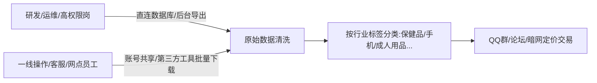

## 概述

本页面沉淀 **301在路上** 微信公众号于 2016 年 8 月 26 日发布的安全观点文章《某快递公司再现内鬼，泄露客户信息》。文章以湖南顺丰员工陈洋、研发工程师严某两起典型案件为切入点，系统复盘了快递行业**个人信息黑产产业链**的完整生态：从数据窃取手段（越权访问、工具化批量导出）、定价交易模式（QQ群按单标价、行业定向分类）、下游买家画像（精准营销、刷单、诈骗前置），到企业内控体系的多层失效（权限最小化原则落地缺失、账号共享违规常态化、下载限制被第三方工具绕过、异常访问缺乏监控告警、主管违规授权无追责）。该文是 301在路上早期从纯技术分享转向「行业安全治理视角」的代表性条目，为后续「供应链安全」「第三方风控」「数据分级分类」等专题奠定了实证基础。

> 关联索引页：[[301-zai-lushang-wechat-archive-201508-202208]]（301在路上2015-2023年文章结构化归档总索引）  
> 同期对标：[[daily-security-digest-20191220]]（同日归档收录 APT-C-08 移动攻击、zzzphp SQL注入、Facebook手机号泄露等资讯，侧面印证 2019 年个人信息泄露已成常态化威胁）

---

## 事件时间轴与核心案件档案

### 案件一：湖南顺丰员工陈洋——账号倒卖与权限规避
| 关键节点 | 事件详情 | 安全启示 |
|----------|----------|----------|
| **2016-08-26** | 深圳南山区人民法院开庭审理，陈洋被指控侵犯公民个人信息罪 | 司法层面首次公开确认快递内鬼贩卖面单数据构成犯罪 |
| **作案手法** | 以「补录工单、图片看不清」为由，多次向财务及主管索要高权限账号登录内网阿修罗系统 | **社工+权限滥用**组合拳：低权限员工利用业务合理性借口，诱导特权用户违规共享凭证 |
| **技术绕过** | 使用第三方软件突破系统「单张另存、禁止批量下载」限制，实现面单图片及信息批量导出 | **客户端控制不可信**：前端限制易被破解，缺乏服务端速率限制、水印溯源、异常下载检测 |
| **获利模式** | 账号密码出售他人，形成「账号-数据-买家」三级分销 | 凭证泄露比直接倒卖数据更具隐蔽性与持续性，溯源难度指数级上升 |

### 案件二：研发工程师严某——核心库直连导出百万级数据
| 维度 | 详情 | 风险等级 |
|------|------|----------|
| **身份权限** | 2012.8 入职，任研发工程师，拥有生产数据库直连权限 | 🔴 **极高**——研发权限未隔离，违反「最小权限」「生产环境只读」原则 |
| **作案周期** | 2013.10–2014.6（不足 1 年） | 🔴 **长周期潜伏**，规避了周期性审计窗口 |
| **数据规模** | 单价 0.2–0.5 元/条，获利 36 万 → 推算 **≥ 100 万条** 公民个人信息 | 🔴 **百万级泄露**，触犯《刑法》第 253 条「情节特别严重」量刑标准 |
| **技术路径** | 数据库导出 → 个人网盘中转 → 本地电脑存储 → 分批出售 | **数据流转全链路失控**：无 DLP、无网盘管控、无异常大流量告警 |
| **判决结果** | 福田区法院一审宣判（具体刑期文中未披露） | 司法威慑力度有待后续文书佐证 |

---

## 黑产产业链全景拆解

### 上游：数据窃取层——角色分工与工具化演进

- **工具化标志**：搜索「提取顺丰面单工具」即现成品，说明攻击链已**产品化、服务化（MaaS 雏形）**，门槛极大降低。
- **分类定价**：保健品、壮阳药、丰胸、减肥类面单溢价最高，印证下游为**精准营销/诈骗精准画像**需求。

### 中游：交易流通层——QQ群半公开市场
| 指标 | 实测数据 | 含义 |
|------|----------|------|
| **单价** | 3.5 元/单（50 单起），300 单以上 3 元/单 | 批发制，边际成本趋近零，规模效应显著 |
| **群命名** | 「顺丰保健品数据面单群」「手机行业面单群」 | **垂直细分**，买家可按业务场景精准采购 |
| **支付结算** | 文中未披露，推测为虚拟币/第三方担保/面交 | 资金流匿名化，打击取证难度大 |

### 下游：数据消费层——合法与非法边界模糊
| 买家类型 | 使用场景 | 法律风险 |
|----------|----------|----------|
| **电商商家** | 精准推销同品类产品、二次营销 | 违反《消法》《电商法》《个保法》，面临行政处罚与民事赔偿 |
| **刷单团伙** | 真实面单生成虚假物流轨迹，规避平台风控 | 协助刷单构成「非法经营罪」或「破坏计算机信息系统罪」 |
| **诈骗集团** | 精准话术脚本（知姓名、地址、购买记录、单号），实施「冒充快递/客服/公检法」诈骗 | 直接关联「诈骗罪」「侵犯公民个人信息罪」上游犯罪 |

> **作者点评呼应**：「嘴上说着只是买来做营销推广，不拿来做坏事，谁知道？个人觉得除了直接犯罪以外，还是对刷单的需求量会更大些。」——精准切中**灰产合规化话术**与**黑产实质需求**的张力。

---

## 内控体系五大失效节点深度剖析

### 权限模型设计缺陷：最小权限原则未落地
- **现状**：研发工程师拥有生产库直连读写权限；一线员工通过「借用主管账号」实现横向越权。
- **标准对标**：
  - 《GB/T 39786-2021 数据安全能力成熟度模型》DSMM-L2 要求「基于角色的访问控制（RBAC）+ 属性访问控制（ABAC）动态授权」
  - 《金融数据安全规范》JR/T 0183 要求「生产数据脱敏、开发环境严禁使用真实数据」
- **整改方向**：研发权限「只读+脱敏」、生产库操作「工单审批+双人复核+全链路审计」、账号共享「零容忍+行为分析告警」。

### 凭证管理失控：密码轮换沦为形式
- **现状**：阿修罗系统「内网登录+两月一换密」，但主管将账号密码直接交给下属，密码策略失效。
- **根因**：**人员识别与实体账号绑定缺失**，缺乏 MFA、设备指纹、地理围栏等第二因子。
- **对标建议**：参考 [[cve-2022-23131-zabbix-saml-auth-bypass]] 中 SAML SSO 会话伪造风险，推行**零信任网络访问（ZTNA）**，彻底淘汰静态密码单因子认证。

### 数据防泄漏（DLP）缺位：客户端限制易绕过
- **现状**：前端「单张另存、禁批量下载」被第三方工具瞬间破解，服务端无速率限制、无水印溯源、无异常下载检测。
- **技术债**：将授权控制前置化，忽视**数据层面的固有安全**。
- **参考实践**：
  - [[redis-module-load-rce-exploitation]] 中 Redis 模块加载 RCE 说明服务端插件机制不可信，同理前端 JS 控制不可信。
  - 建设「数据访问代理网关」：所有导出请求经网关统一策略判定（速率/水印/脱敏/审计），物理隔离直连通道。

### 异常行为监测盲区：百万级导出零告警
- **现状**：严某连续 8 个月、百万条数据导出、网盘中转、本地存储，**全程无任何安全告警触发**。
- **缺失能力**：
  - 数据库审计：大结果集、非常用账号、非常用时间、非常用工具连接
  - 网络流量分析：大流量上传至个人网盘域名、非业务时段数据外传
  - 端点 DLP：大量敏感文件写入个人磁盘、网盘客户端同步
- **建设参考**：[[apt-detection-deployment-strategy]] 中沙箱与威胁感知部署选型，引入 **UEBA（用户与实体行为分析）** 建立基线，对「研发身份+生产库+大结果集+网盘上传」组合特征实时阻断。

### 管理流程与问责断层：主管违规授权无追责
- **现状**：财务及主管多次违规提供高权限账号，**事前无审批、事中无监控、事后无追责**。
- **文化根因**：业务效率优先、安全合规「挂墙上」、违规操作「大家都这么干」的常态化。
- **治理杠杆**：
  - 将「凭证共享、越权授权」纳入**关键风险指标（KRI）**，绩效挂钩、一票否决。
  - 建立「特权账号全生命周期管理」：申请-审批-授权-监控-回收-复盘，参考 [[kerberos-golden-ticket-attack-mimikatz-implementation]] 中 KRBTGT 哈希保护机制，实施**特权凭证定时轮换+一次性凭证+会话录像回放**。

---

## 跨期知识关联与演进脉络

### 301在路上专题演进链
| 阶段 | 代表文章 | 核心观点跃迁 |
|------|----------|--------------|
| **2016 本文** | 顺丰内鬼泄露面单数据 | **现象曝光+产业链拆解+内控五失效**——从单一事件上升到行业系统性风险 |
| **2019** | [[daily-security-digest-20191220]] 收录 Facebook 手机号泄露、zzzphp SQL注入 | **数据泄露常态化**，技术漏洞与内部威胁双驱动，开始关注供应链安全 |
| **2022** | [[hvv-2021-vulnerability-collection]] HVV 漏洞聚合 | **实战化视角**：内鬼泄露转化为红队「凭证窃取→横向移动→数据窃取」标准战术链 |
| **2023** | [[0x6270-security-team-wechat-archive-202203-202304]] 供应链安全/Notepad++事件 | **供应链视角**：快递面单数据泄露本质是「物流供应链数据安全治理缺失」 |

### 行业标准与法规映射表
| 法规/标准 | 条款要求 | 本案违规映射 | 整改参考 |
|-----------|----------|--------------|----------|
| **《个人信息保护法》（2021）** | 第 26 条：单独同意、最小必要；第 51 条：分级分类、访问控制、审计日志 | 面单数据无脱敏直连、权限最小化缺失、审计日志无告警 | 建设「个人信息全生命周期管理平台」，落实 PICA 隐私影响评估 |
| **《数据安全法》（2021）** | 第 27 条：重要数据目录、保护清单；第 29 条：风险监测、应急处置 | 面单数据未纳入重要数据目录、无风险监测、事后才知百万级泄露 | 完成数据分级分类，面单数据定级为「核心/重要」，部署实时监测 |
| **《网络安全法》（2017）** | 第 21 条：网络运营者保护义务；第 42 条：内部安全管理制度 | 制度有（密码轮换、下载限制）但执行失效、主管违规无追责 | 制度「可执行、可审计、可追责」，引入自动化合规核查 |
| **GB/T 35273-2020** | 7.2 访问控制、7.5 审计日志、8.3 委托处理安全 | 委托网点/员工访问无最小权限、审计日志无分析、外包风控缺失 | 建立第三方/外包人员统一身份池，最小权限+全链路审计 |

---

## 衍生知识卡片

### 卡片 1：快递/物流行业个人信息保护「最小可行性防护清单（MVP）」
> 适用于中小型快递网点、电商仓储、同城配送等**资源受限、数据敏感**场景
| 防护层 | 必做项（P0） | 进阶项（P1） | 成熟度指标 |
|--------|--------------|--------------|------------|
| **数据分级** | 面单数据标记为「核心/重要」，建立资产目录 | 自动化发现+标签化+流向图谱 | 100% 面单数据纳管 |
| **访问控制** | 研发/运维禁直连生产库；一线账号「一人一号、MFA、最小权限」 | ABAC 动态授权+特权会话代理+水印溯源 | 越权访问拦截率 100% |
| **流转管控** | 导出需工单审批、单日限额、全字段水印、禁止个人网盘 | DLP 网关+加密流转+区块链存证 | 违规导出零发生 |
| **监测告警** | 数据库审计+网络流量基线+端点敏感文件监测，三大基线告警 | UEBA 行为画像+威胁情报关联+自动化阻断 | 百万级导出分钟级发现 |
| **事件响应** | 7×24 小时值守、泄露溯源 SOP、证据固化取证、监管通报模板 | 仿真演练+保险转移+跨部门联动 | 从发现到阻断 < 30 分钟 |

### 卡片 2：研发/运维高权限人员「内部威胁画像与防控策略」
| 画像维度 | 高风险特征 | 针对性防控 |
|----------|------------|------------|
| **权限特征** | 拥有生产库 Root/SA、K8s cluster-admin、CI/CD 发布权限 | 权限「时效化、最小化、双人制、全审计」 |
| **行为基线** | 正常：小结果集、业务工具、工作时间、跳板机 | 偏离：大结果集、Navicat/脚本直连、深夜/周末、个人网盘/邮件外发 |
| **动机识别** | 离职跳槽带数据、灰产变现、被胁迫/收买、好奇心越界 | 离职前 30 天强化监测、定期背景核查、心理关怀、利益冲突申报 |
| **技术对抗** | 加密隧道、分卷压缩、隐写术、云盘分片、链式跳板 | 流量解密检测、文件指纹匹配、端点微隔离、零信任网络准入 |

---

## 实践价值与应用场景

### 合规建设实战参考
- **数据分级分类落地样板**：以「面单数据」为切入点，完成「资产梳理-分级定级-流向绘制-风险评估-防护配置-持续监测」闭环，可复制到 CRM、ERP、HR 等核心系统。
- **关键基础设施保护**：快递面单系统属于「物流行业重要信息系统」，参考《关键信息基础设施安全保护条例》开展专项备案与测评。

### 红蓝对抗实战转化
- **红队视角**：
  - 凭证获取：钓鱼→主管账号→横向移动→数据库直连（参考 [[shuiying-domain-enumeration-tool]] 域渗透枚举思路）
  - 数据窃取：分卷压缩+加密+云盘分片+DNS 隧道外传（规避 DLP）
  - 溯源对抗：时间戳篡改、日志清理、跳板机链式代理
- **蓝队视角**：
  - 蜜罐面单数据部署，触发即报警
  - 研发账号「假权限」诱捕，实时录像取证
  - 数据水印+区块链存证，事后溯源定责

### 安全人才培养案例库
- **案例教学点**：
  - 内部威胁「技术+管理+法律」三维建模
  - 权限失控「症状-根因-对策」鱼骨图分析
  - 黑产链条「上中下游」打击策略与取证链构建
- **实训靶场**：模拟「阿修罗系统」环境，包含权限绕过、批量下载、审计绕过、数据外传全链路攻防演练。

---

## 页面维护与扩展指南

### 增量更新触发条件
- [ ] 司法文书网公开陈洋、严某案件**生效判决书**，补充量刑细节、赔偿执行、追赃挽损情况
- [ ] 顺丰或行业头部企业发布**数据安全治理白皮书/最佳实践**，对标本文五大失效节点的整改成效
- [ ] 《个人信息保护法》《数据安全法》配套**行业标准/监管指引**发布（如《快递行业个人信息保护规范》），更新合规映射表
- [ ] 发生**同类新案例**（如其他快递公司、同城配送、电商平台商家后台内鬼泄露），纳入对比案例库

### 关联页面扩展建议
| 目标页面 | 扩展动作 | 价值点 |
|----------|----------|--------|
| [[301-zai-lushang-wechat-archive-201508-202208]] | 索引页「2016年」板块增补本条目，标注「内部威胁治理/供应链数据安全/黑产链条拆解」三大专题标签 | 完善归档索引的专题检索维度 |
| [[apt-detection-deployment-strategy]] | 互引「UEBA 建设选型」章节，补充「研发高权限账号异常行为基线」典型场景 | 将 APT 检测能力下沉至内部威胁场景 |
| [[secquan-bugwarning-1071987-device-credential-leak]] | 互引「凭证泄露-未授权访问-后台绕过」攻击链，对比物联网设备与业务系统凭证管理异同 | 跨场景复用凭证安全治理模式 |
| [[security-study-group-methodology]] | 在「实战案例库」增补本案作为「内部威胁分析/数据安全治理/黑产溯源」三大教学模块 | 理论联系实际，产出可复用教学资源 |

---

## 结语

**这篇 2016 年 8 月的文章，像一面镜子，照见了彼时快递行业——乃至所有拥有海量公民个人信息的传统行业数字化转型期的共性困境：**

- **业务系统上云上线快，安全架构设计滞后**（研发直连生产库、前端 JS 控制替代服务端授权）
- **合规制度「挂墙上」，执行落地「靠自觉」**（密码轮换成形式、主管违规授权无追责）
- **黑产链条「专业化、工具化、分工化」，防御端仍在「买设备、堆日志、事后查」**
- **数据价值被下游充分变现（精准营销/刷单/诈骗），上游成本却极低（内部人员道德/法律成本）**

八年过去，法规已立（个保法/数安法/网安法）、标准已出（DSMM/GB/T 35273/JR/T 0183）、技术已熟（零信任/DLP/UEBA/水印溯源/区块链存证），但**「内鬼泄露」仍是数据安全领域的「常青树」高发事件**。根因不在技术，而在：

1. **数据资产「不知、不清、不控」**：面单数据在哪、谁有权限、流向何方、价值几何，心中无数。
2. **人员权限「大、散、久、共」**：高权限账号多、分布散、生命周期长、共享成风。
3. **监测响应「盲、慢、软、虚」**：异常不监测、告警不处置、违规不追责、演练不实战。

> **「供应链安全中的第三方风控，特别是电商领域、基础岗越大的传统行业更为严重，快递行业的安全性堪忧，坑了多少家合作伙伴」** —— 作者 2016 年的结语拷问，至今仍是每个数据控制者、处理者、监管者必须直面的**战略性问题**。

---

**来源登记**  
- 原文发布：2016-08-26，301在路上微信公众号（ID：MzIwMTQ2NzY4NA==）  
- 原文链接：[http://mp.weixin.qq.com/s?__biz=MzIwMTQ2NzY4NA==&mid=2652521206&idx=1&sn=0a5a10eb3f2aede0cf2d43672ee3cd5e](http://mp.weixin.qq.com/s?__biz=MzIwMTQ2NzY4NA==&mid=2652521206&idx=1&sn=0a5a10eb3f2aede0cf2d43672ee3cd5e)  
- 归档来源：[301在路上-201508-202208_053](../sources/301在路上-201508-202208_053.md)  
- 对比参考：本库内 301在路上 2015-2023 年系列文章结构化归档索引页、同期每日安全看点归档、行业法规标准库

## 来源

- [301在路上-201508-202208_054](../sources/301在路上-201508-202208_054.md)
