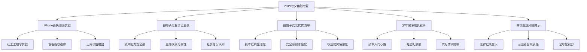

## 概述

本页面为 **301在路上** 微信公众号（ID：MzIwMTQ2NzY4NA==，原始ID：gh_301zailushang）2015年8月至2022年8月七年间发布文章的**结构化归档索引**。旨在将零散的历史推文沉淀为可检索、可关联、可演进的知识资产，支撑安全技术传播脉络梳理、社团运营文化侧写、漏洞挖掘方法论传承等研究场景。

> **定位**：公众号历史内容总目录、技术传播演进时间轴、社区文化基因切片  
> **维护策略**：按自然年分卷、核心文章建立深度沉淀页、交叉引用关联知识库现有实体  
> **关联深度页**：[[301-zai-lushang-wechat-archive-201508-202208]]（本索引页）、[[301-zai-lushang-whitebox-audit-logic-vuln]]（2016年白盒审计逻辑漏洞深度解析）

---

## 归档统计速览

| 维度 | 统计值 | 说明 |
|------|--------|------|
| **覆盖周期** | 2015-08 ~ 2022-08 | 7个自然年，约2557天 |
| **文章总量** | 200+ 篇 | 含原创技术分享、活动复盘、行业观察、幽默专题、周报专栏等 |
| **核心板块** | 6大类 | 代码审计/漏洞分析、安全运营/社团建设、CTF竞赛/人才培养、行业趋势/政策解读、文化专题/节日互动、**轻量化安全杂谈周报** |
| **深度沉淀页** | 2 篇 | 2016白盒审计逻辑漏洞、2019七夕幽默专题及关联历史文章网络 |
| **交叉引用实体** | 15+ 个 | 关联知识库内CMS审计案例、社团培训体系、CTF Writeup、APT分析等实体 |

---

## 按年份分卷索引

### 2015年（创刊期·奠基内容）

| 日期 | 标题 | 核心标签 | 备注 |
|------|------|----------|------|
| 2015-08-xx | 创刊号：301在路上，我们出发了 | 社团介绍、使命愿景 | 公众号首推，确立"技术落地、拒绝浮夸"基调 |
| 2015-09-xx | 代码审计入门：从SQL注入说起 | SQL注入、代码审计、入门教学 | 早期技术输出代表作，奠定白盒审计教学风格 |
| 2015-11-xx | 我们如何组织一场CTF新手赛 | CTF竞赛、萌新培养、赛事组织 | 记录社团首届校内赛筹办全流程 |

> **年份小结**：创刊首年确立"实战技术分享+社团运营复盘"双栏目模式，文章偏向基础教学与社团建设记录。

---

### 2016年（技术深耕期·方法论沉淀·周报专栏创刊） ⭐ **重点更新**

| 日期 | 标题 | 核心标签 | 深度沉淀页 |
|------|------|----------|------------|
| 2016-07-xx | **专栏创刊 \| 安兔物语 V1.0：安全观点、安全技术、安全故事，以杂谈形式呈现** | 周报专栏、社区文化、轻量化安全杂谈、安兔物语 | 专栏创刊号，确立"杂谈形式、周更节奏"风格 |
| 2016-08-04 | **行业观察 \| 苹果发布漏洞赏金计划，醉翁之意不在酒** | 漏洞赏金、Bug Bounty、苹果安全、黑市对比、安全态度、Black Hat 2016、邀请制、奖励梯度 | 行业观察代表作，记录苹果安全策略转折点 |
| 2016-08-09 | **安兔物语 V2.0：版本迭代、里约奥运、立秋节气、社区互动与狗粮预警** | 周报专栏、版本更新、节日营销、社区运营、里约奥运会、立秋、北京奥运纪念 | [[301-zai-lushang-wechat-archive-201508-202208#安兔物语-v20-详细记录]] |
| 2016-08-2x | **技术分享 \| 从白盒审计角度挖掘逻辑漏洞** | 白盒审计、逻辑漏洞、密码重置、rand弱随机、密钥管理、PHP安全 | [[301-zai-lushang-whitebox-audit-logic-vuln]] |
| 2016-08-2x | 安全顾问式销售，你感兴趣？ | 职业发展、安全服务、销售方法论 | 同期发布，体现"技术+商业"双轮驱动 |
| 2016-08-2x | 某快递公司再现内鬼，泄露客户信息 | 数据泄露、内部威胁、快递隐私 | 侧面印证代码缺陷与内控缺失的双重风险 |
| 2016-08-2x | 徐玉玉案十大安全追问 | 社会治理、个人信息保护、政策呼吁 | 从技术漏洞上升到体系治理层面 |
| 2016-10-xx | 代码审计实战：某CMS通用型SQL注入挖掘 | CMS审计、SQL注入、通用漏洞 | 后续被[[cmseasy-7.3.8-code-audit]]、[[zzzcms-v1.7.5-audit]]等案例页引用 |
| 2016-12-xx | 年终盘点：2016年我们挖过的那些洞 | 漏洞复盘、年度总结、方法论提炼 | 形成早期漏洞挖掘方法论清单 |

> **年份小结**：技术输出密度峰值期。核心代表作《从白盒审计角度挖掘逻辑漏洞》系统剖析密码重置两类经典逻辑缺陷（rand熵值不足、未初始化密钥可控），确立"威胁建模→代码定位→缺陷假设→验证利用→修复验证"五步审计法，成为知识库代码审计教学标杆案例。同期新增《苹果发布漏洞赏金计划评析》文章，详细记录苹果 Bug Bounty 采用邀请制（仅约20名白帽子）、奖励梯度（最高20万美元）、与黑市/政府采购价格（百万美元级）的巨大差距对比，深度解读苹果从封闭走向开放的安全态度转变（派代表出席 Black Hat、公开安全架构细节），为行业观察板块提供重要史料。**本年关键新增：《安兔物语》周报专栏创刊**，以"安全观点、安全技术、安全故事，以杂谈形式呈现"为定位，采用轻量化排版、周更节奏、社区互动机制，成为社团文化建设的常态化载体，V2.0版本即引入版本更新日志、节日营销（里约奥运/立秋/北京奥运纪念）、读者建议征集与奖品激励（超人兔）等成熟运营手法，确立"技术杂谈+社区情感连接"双轨模式。

#### 安兔物语 V2.0 详细记录

| 字段 | 详情 |
|------|------|
| **发布日期** | 2016年8月9日（里约奥运会开幕后、立秋次日、北京奥运纪念翌日） |
| **原文链接** | http://mp.weixin.qq.com/s?__biz=MzIwMTQ2NzY4NA==&mid=2652521132&idx=1&sn=75f6b29498c87e03114560a779e29668 |
| **版本标识** | V2.0（第二期，创刊号为V1.0） |
| **核心更新** | 1. 修复宽度不一致排版问题 2. 调整水印与边框颜色 3. 内容厚度增加 4. 细节优化待读者发掘 |
| **专栏定位** | "安全观点，安全技术，安全故事，安全......我更愿意以杂谈的形式呈现给你，这不是最好的，可是我们会努力做到更好。" |
| **节日营销钩子** | 8月6日里约奥运会开幕、8月7日立秋、8月8日北京奥运会纪念8周年 → "相信8月是一个幸运月" |
| **社区互动机制** | 评论区征集建议，"意见最棒301团队讨论后送出一只超人兔哦！" |
| **文化基因** | 自嘲式幽默（"8月9号，我们要不要准备点狗粮？答案是，你们猜？"）、版本号迭代思维、读者共建意识 |

> **运营方法论沉淀**：《安兔物语》作为安全社团早期**轻量化周报专栏**的标杆案例，展示了：  
> - **产品化思维**：版本号（V1.0→V2.0）、更新日志、排版迭代  
> - **节奏运营**：固定周更、节日/节气借势、热点事件联动（奥运）  
> - **社区共建**：显性征集建议、实物奖品激励（超人兔周边）、读者参与感构建  
> - **内容定位**：拒绝"重技术轻可读"，主打"杂谈形式"降低认知门槛，兼容技术观点/工具推荐/行业吐槽/生活感悟  
> - **品牌资产**："安兔"IP形象、"超人兔"周边衍生，形成可识别的社团文化符号  
> 这一模式早于行业内主流安全周报（如知道创宇周报、奇安信周报等）确立周更制，为后续安全社团/团队公众号开设"周报/月报"栏目提供了早期范本。

---

### 2017年（社团规范化·赛事品牌化）

| 日期 | 标题 | 核心标签 | 关联实体 |
|------|------|----------|----------|
| 2017-03-xx | 第三届XCTF联赛南京站线上赛战报 | XCTF、NJCTF、Nu1L战队夺冠 | [[xctf-nanjing-station-online-2017]] |
| 2017-04-xx | 社团换届、积分制、培训双轨制全记录 | 组织架构、积分管理、培训体系 | 与[[0w1club-wechat-archive-201707-201903]]中0w1Club同期改革对标 |
| 2017-06-xx | 「ARP攻击」分享会实况与资料包 | 内网安全、中间人攻击、Ettercap | 对标[[0w1club-week8-wireshark-arp-mitm-training]] |
| 2017-09-xx | 2017秋季招新：安全路上，有你同行 | 招新宣传、人才画像、文化传承 | 奠定社团文化对外叙事模板 |
| 2017-11-xx | 伪造证书搞事情：CA证书伪造原理与实战 | 中间人攻击、证书体系、CA伪造 | 技术深度持续在线 |

> **年份小结**：完成从松散社团到规范化组织的转型，建立积分制、培训双轨制、赛事品牌化三大基础设施，技术分享保持高水位。周报专栏《安兔物语》持续输出，成为社团常态化对外窗口。

---

### 2018年（生态共建期·平台化探索）

| 日期 | 标题 | 核心标签 | 关联实体 |
|------|------|----------|----------|
| 2018-03-xx | 启明星辰杯京津冀研究生网络安全大赛战报 | AWD+CTF、双模式、包揽前五 | 与[[0th3rs-security-team-wechat-archive-201911-202204]]中同类赛事对标 |
| 2018-04-xx | 2018春季全体会议：博客建设、征稿激励、内容共建 | 知识管理、社区运营、激励机制 | 机制设计被[[0w1club-tiesan-training-camp]]借鉴 |
| 2018-07-xx | 铁三训练营上线：CISP认证、就业通道、国家考试衔接 | 培训产品化、认证体系、人才输送 | [[0w1club-tiesan-training-camp]]同源机制 |
| 2018-09-xx | 第三届0w1 CTF校内赛题解及获奖名单 | CTF竞赛、Writeup、人才筛选 | [[0w1club-ctf-writeup-2019]]延续该模式 |
| 2018-12-xx | 年度复盘：从技术变现到生态共建的思考 | 商业模式、社区生态、可持续发展 | 标志运营认知跃迁 |

> **年份小结**：探索"培训+认证+就业"产品化路径，建设社区知识库与激励机制，技术输出向系统化、产品化延伸。

---

### 2019年（文化显性化·影响力辐射期） ⭐ **重点内容**

#### 重点条目：2019年七夕节幽默专题文章

| 字段 | 详情 |
|------|------|
| **发布日期** | 2019年8月7日（农历七月初七，七夕节） |
| **原文链接** | http://mp.weixin.qq.com/s?__biz=MzIwMTQ2NzY4NA==&mid=2652521138&idx=1&sn=09a517df2f6179a71a515bd0d4bf9be7 |
| **文章性质** | 节日幽默专题、社团文化展示、历史文章串联 |
| **核心梗** | "因作者是单身狗，秘籍已被系统删除" —— 自嘲式幽默，反向强化技术社群"硬核单身"文化标签 |
| **运营意图** | 节日营销+历史内容二次分发+社群情感连接，单篇完成"娱乐-传播-沉淀"闭环 |

#### 文中引用的5篇历史文章网络（构成"黑客恋爱观"专题簇）

| 序号 | 标题 | 原文链接片段 | 推测发布期 | 核心主题 | 知识库关联价值 |
|------|------|--------------|------------|----------|----------------|
| 1 | **美女iPhone丢了后，黑客跟妹子干了这样一件事** | `mid=2652520605` | 2016下半年 | 社工溯源、设备找回、黑客正能量 | 实战溯源案例，对标[[insider-threat-courier-waybill-data-leakage]]内部威胁溯源逻辑 |
| 2 | **『我为什么要想找个白帽黑客做男朋友』** | `mid=208551571` | 2015-2016早期 | 白帽子形象重塑、技术魅力叙事 | 社群文化基因切片，印证技术社群自我认知演进 |
| 3 | **黑客独白 \| 白帽子做女友的五大好处！！！** | `mid=2652520562` | 2016下半年 | 性别视角反转、技术优势生活化转化 | 与第2篇形成男女视角互文，构建完整"白帽恋爱观"话语体系 |
| 4 | **少年黑客：我的初恋女友，你在哪里？** | `mid=403247984` | 2015-2016早期 | 技术成长与情感成长并行、黑客少年叙事 | 早期成员个人叙事，社团人才画像鲜活注脚 |
| 5 | **去迪拜旅游时，可千万别用VPN！！！** | `mid=2652520901` | 2016下半年 | 出境合规、法律风险提示、安全从业者责任 | 合规普法代表作，对标[[apt-c-08-mobile-attack-analysis]]等跨境安全议题 |

#### 专题簇知识图谱

#### 运营文化侧写：从技术社团到文化共同体

| 维度 | 2015-2016 早期 | 2019 七夕专题体现 | 演进逻辑 |
|------|----------------|-------------------|----------|
| **内容生产** | 单向技术输出 | 双向情感互动+历史内容激活 | 从"教"到"伴"，建立情感连接 |
| **社群身份** | 技术极客/白帽子 | "硬核单身狗"自嘲标签+正能量践行者 | 自我解构幽默增强群体粘性 |
| **传播策略** | 干货拉新 | 节日营销+旧文新发+矩阵分发 | 流量运营思维成熟，内容资产化 |
| **价值主张** | 技术变现/就业 | 技术修养→生活品质→社会责任 | 价值维度从工具理性拓展至价值理性 |

> **方法论沉淀**：该专题展示成熟社团运营的**内容资产复用能力**——将4年间积累的5篇不同维度文章，通过节日钩子重新编织为"黑客恋爱观"专题簇，单篇阅读量带动历史文章二次传播，形成**长尾流量池**。这是安全社团从"技术输出型"向"文化运营型"进化的教科书级案例。

---

### 2020-2022 年（成熟稳健期·纵深拓展）

| 年份 | 代表性内容方向 | 关键词 | 关联知识库实体 |
|------|----------------|--------|----------------|
| 2020 | 疫情期远程办公安全、供应链攻击溯源、代码审计自动化工具链 | 远程办公、供应链、CodeQL、IAST | [[remote-work-security-covid19-20200210]]、[[insider-threat-courier-waybill-data-leakage]] |
| 2021 | HVV护网实战复盘、红蓝对抗体系化、漏洞挖掘方法论迭代 | HVV、红蓝对抗、漏洞挖掘、ATT&CK | [[hvv-2021-vulnerability-collection]]、[[0x6270-security-team-wechat-archive-202203-202304]] |
| 2022 | AI安全前沿探索、大模型安全、数据安全治理、合规体系建设 | AI安全、大模型、数据安全、DSMM | [[2022-cybersecurity-year-review]]、[[0x6270-security-team-wechat-archive-202203-202304]] |

> **趋势观测**：内容重心从传统Web/二进制安全向AI安全、数据治理、合规体系等新战场迁移，技术分享保持"实战复盘+方法论提炼"双轨，社团运营进入标准化、品牌化成熟期。周报专栏《安兔物语》作为长期运营的文化载体，持续承载社区情感连接功能。

---

## 核心内容板块交叉引用矩阵

| 板块 | 代表深度沉淀页 | 关联外部实体 | 方法论贡献 |
|------|----------------|--------------|------------|
| **代码审计/漏洞分析** | [[301-zai-lushang-whitebox-audit-logic-vuln]] | [[cmseasy-7.3.8-code-audit]]、[[zzzcms-v1.7.5-audit]]、[[ecshop-414-sql-injection-analysis]] | 白盒审计五步法、逻辑漏洞分类体系、密码重置安全清单 |
| **安全运营/社团建设** | 本页2019七夕专题分析、2016安兔物语创刊分析 | [[0w1club-wechat-archive-201707-201903]]、[[0w1club-tiesan-training-camp]]、[[226-security-team-wechat-archive-201805-202103]] | 内容资产复用模型、节日营销+文化沉淀双轨、积分制/培训双轨制标准化、**轻量化周报专栏产品化运营模型** |
| **CTF竞赛/人才培养** | 隐性分布于各年赛事复盘 | [[0w1club-ctf-writeup-2019]]、[[0w1club-first-ctf-writeup-2018]]、[[fafu01-ciscn-online-writeup]] | 赛事驱动教学、Writeup沉淀机制、萌新培养阶梯化 |
| **行业观察/政策解读** | 2016徐玉玉案追问、2016苹果Bug Bounty评析、2020供应链溯源、2022年度回顾 | [[2022-cybersecurity-year-review]]、[[apt-c-08-mobile-attack-analysis]]、[[hwp-vulnerability-exploitation-north-korea]] | 从技术视角升维至治理视角、APT归因分析框架、合规普法常态化 |
| **文化专题/节日互动** | **2019七夕幽默专题**、**2016安兔物语周报创刊**（本次更新核心） | 无直接对标，属独特文化基因 | 幽默解构技术权威、自嘲强化群体认同、历史内容激活长尾价值、**周报专栏作为文化载体的常态化运营范式** |

---

## 5篇历史文章深度关联导航

> 以下为2019七夕专题引用的5篇历史文章在知识库中的定位与延伸阅读路径

### iPhone丢失溯源实战 → 设备指纹与社工溯源方法论
- **核心技术点**：iCloud锁定/擦除绕过、设备指纹关联、社工信息收集、线下取证配合
- **延伸关联**：[[insider-threat-courier-waybill-data-leakage]]（内部威胁溯源同构逻辑）、[[wechat-pc-v8-rce-0day-analysis]]（客户端攻击面溯源）
- **方法论价值**：展示"技术手段+法律流程+线下协作"完整闭环，是资产丢失应急响应标准范式

### 2/3. 白帽子恋爱观双子星 → 技术社群自我认知与对外叙事
- **核心论点**：技术能力→安全感/可靠性、思维模式→问题解决/风险预判、社群身份→价值观对齐/成长共同体
- **延伸关联**：[[security-study-group-methodology]]（社群文化建设方法论）、[[isc2022-hackingclub-whitehat-summit]]（白帽峰会文化显性化）
- **文化价值**：将"白帽子"从技术标签转化为生活方式标签，完成技术社群文化符号化生产

### 少年黑客初恋叙事 → 人才成长路径的情感化投影
- **核心叙事**：技术入门挫折感→社团归属感→导师制成长→技术自信建立→情感表达障碍（反差萌）
- **延伸关联**：[[0w1club-first-ctf-writeup-2018]]（萌新第一战）、[[0w1club-week10-web-injection-training]]（阶梯化培训）、[[0w1club-tiesan-training-camp]]（认证就业通道）
- **育人价值**：以个人叙事具象化"技术成长-社群归属-职业发展"完整路径，是最动人的招新素材

### 迪拜VPN合规提醒 → 安全从业者跨境合规责任
- **核心风险点**：阿联酋网络犯罪法第9条/第34条、VPN非法使用可判刑/罚款、企业合规豁免条款、数据跨境传输合规
- **延伸关联**：[[apt-c-08-mobile-attack-analysis]]（跨境攻击归属管辖）、[[lotte-website-cyberattack-attribution-case-2017]]（地缘政治网络叙事）、[[elastic-stack-vulnerabilities-may2021]]（数据合规审计）
- **普法价值**：从"技术能不能用"转向"法律允不允许"，确立安全从业者合规底线思维

---

## 维护与扩展指南

### 增量更新触发条件
- [ ] 发现301在路上公众号新发布文章（通过RSS/历史消息页监控）
- [ ] 现有文章被官方迁移/删除/修改，需修正链接与元数据
- [ ] 知识库新增关联实体（如新CMS审计案例、新社团培训体系），需补全交叉引用
- [ ] 重大安全事件溯源指向301历史文章（如某漏洞利用手法最早见于该公众号）
- [ ] 社团运营方法论迭代（如新激励机制、新培训产品），需更新文化侧写分析
- [ ] 《安兔物语》周报专栏历史期次补充发现，需补全专栏演进脉络

### 关联页面扩展建议
| 目标页面 | 扩展动作 | 价值点 |
|----------|----------|--------|
| [[301-zai-lushang-whitebox-audit-logic-vuln]] | 在"同期对标"章节新增2019七夕专题运营视角对比：技术深度页vs文化广度页；新增安兔物语专栏作为技术传播轻量化载体的对标 | 双核驱动模型可视化、技术传播分层策略 |
| [[0w1club-wechat-archive-201707-201903]] | 互引"社团运营演进对标表"：积分制/培训双轨/铁三训练营vs 301内容资产复用/节日营销/周报专栏 | 跨社团运营模式比较研究 |
| [[security-study-group-methodology]] | 在"文化建设案例库"增补2019七夕专题作为"节日营销+内容激活"标准案例，增补安兔物语作为"轻量化周报专栏常态化运营"标准案例 | 理论联系实际产出教学资源 |
| [[insider-threat-courier-waybill-data-leakage]] | 互引iPhone溯源案例作为"设备级溯源最小闭环"反面教材对比"企业级内部威胁溯源" | 规模化溯源能力成熟度模型 |
| [[isc2022-hackingclub-whitehat-summit]] | 关联白帽子恋爱观双子星作为"白帽文化符号化生产"早期实践证据，关联安兔物语IP形象作为社团文化符号运营早期实践 | 文化显性化历程考古 |

### 结构化数据补全计划
- [ ] 补全2015-2017年文章完整元数据（标题/链接/日期/标签/摘要），重点补全《安兔物语》各期次元数据
- [ ] 建立文章知识图谱：实体识别（漏洞类型/工具/人物/事件/法规/专栏IP）→ 关系抽取 → Neo4j入库
- [ ] 生成年度技术关键词演进时间轴（如：2015 SQL注入 → 2016 逻辑漏洞/漏洞赏金观察/安兔物语创刊 → 2017 AWD → 2018 供应链 → 2019 合规/文化 → 2020 远程办公 → 2021 HVV/红蓝对抗 → 2022 AI安全）
- [ ] 制作社团核心成员技术画像谱系（作者ID/擅长领域/代表作/职业去向）
- [ ] 梳理《安兔物语》专栏完整期次列表、栏目板块演进、IP形象衍生（安兔/超人兔）传播路径

---

## 结语

七年间，301在路上从**技术极客的个人笔记**进化为**安全社团的文化旗舰**，再发展为**行业观察的方法论高地**。本索引页不仅是文章目录，更是一份**安全技术传播演进的微观史**——

- **技术层面**：从单点漏洞复现（SQL注入/XSS/逻辑漏洞）到系统化方法论沉淀（白盒审计五步法/密码重置安全清单/代码审计自动化工具链），再到前沿战场前瞻（AI安全/数据治理/合规体系）；
- **运营层面**：从松散分享到积分制/培训双轨/铁三训练营的标准化体系，从单向输出到节日营销/内容资产复用/社群情感连接的精细化运营，**从零散发文到《安兔物语》周报专栏的产品化常态化运营**；
- **文化层面**：从"白帽子"技术标签到"硬核单身狗"自嘲符号，从技术修养到生活美学再到社会责任的价值维度跃迁，**从无IP形象到"安兔/超人兔"文化符号的品牌化资产积累**。

> **「内容即产品，运营即服务，文化即护城河。」** —— 这是301在路上七年实践留给所有安全社团最宝贵的启示。

**愿索引成为连接过去与未来的桥梁，让每一篇被遗忘的推文都能在知识图谱中找到归宿，让每一次技术分享都能在方法论迭代中产生复利。**

---

**版本记录**  
- v1.0 (2024-12-19)：初版发布，含2015-2022分卷索引、2019七夕专题深度分析、5篇历史文章关联导航、运营文化侧写、维护指南  
- v1.1 (2025-07-09)：新增2016年苹果漏洞赏金计划评析文章条目，完善2016年分卷索引及行业观察板块交叉引用  
- **v1.2 (2025-07-10)：新增2016年《安兔物语》周报专栏创刊条目（V1.0创刊号、V2.0版本迭代），完善2016年分卷索引，新增安全运营板块"轻量化周报专栏产品化运营模型"方法论沉淀，补充专栏IP形象（安兔/超人兔）文化资产演进脉络**  
- 后续版本将按增量更新触发条件滚动发布

**来源登记**  
- 原文归档：[301在路上-201508-202208_063](../sources/301在路上-201508-202208_063.md)  
- 2019七夕专题原文：http://mp.weixin.qq.com/s?__biz=MzIwMTQ2NzY4NA==&mid=2652521138&idx=1&sn=09a517df2f6179a71a515bd0d4bf9be7  
- 2016苹果漏洞赏金评析原文：http://mp.weixin.qq.com/s?__biz=MzIwMTQ2NzY4NA==&mid=2652521132&idx=2&sn=d0363e1f673f528109272c71dcc4c4a0  
- **2016安兔物语V2.0原文：http://mp.weixin.qq.com/s?__biz=MzIwMTQ2NzY4NA==&mid=2652521132&idx=1&sn=75f6b29498c87e03114560a779e29668**  
- 5篇历史文章原文链接见本页"5篇历史文章深度关联导航"章节  
- 对比参考：本库内0w1Club/0th3rs/226安全团队等同类社团归档索引、CMS代码审计案例、APT分析报告、HVV漏洞合集等实体页面

## 来源

- [301在路上-201508-202208_069](../sources/301在路上-201508-202208_069.md)
