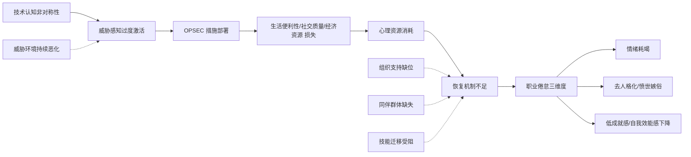

## 概述

本页面沉淀 **301在路上** 微信公众号（作者：**杨蔚**，网名 **301**，SSS安全论坛联合创始人、资深白帽黑客、**众安天下创始人&CEO**）于 **2016-2017 年** 发布的核心讨论类文章：

> **《安全观点：95%的人处理不好的安全问题——Webshell 应急响应实战讨论》**

文章以**某大厂安全实习生面试题**为切入点，公开征集从业者实战处置思路，最终精选 **11 则具有代表性的解答**（编号 0x01~0x0b），覆盖 **SRC 白帽、乙方安全服务商、大型甲方安全团队、技术极客、猎头/人才视角** 等五大典型角色画像。文章不给出标准答案，而是通过**多视角碰撞**展现安全应急响应的复杂性、流程差异性与能力分层性，成为 2016-2017 年安全团队招聘、人才画像构建、应急响应流程标准化的重要史料切片。

> **原文链接**：http://mp.weixin.qq.com/s?__biz=MzIwMTQ2NzY4NA==&mid=2652520507&idx=1&sn=1c11ca87f84dd261581ceda02e8cb1ca  
> **原文归档**：[301在路上-201508-202208_125](../sources/301在路上-201508-202208_125.md)

> **新增收录**：**《为什么安全从业者会比其他人活得更累？》**（2016年发布），原文链接：http://mp.weixin.qq.com/s?__biz=MzIwMTQ2NzY4NA==&mid=2652520503&idx=1&sn=b763f2c970dec3f01752ccb8920e14bc，归档源：[301在路上-201508-202208_126](../sources/301在路上-201508-202208_126.md)。该文从生活场景切入，系统记录安全从业者因隐私保护意识、OPSEC 实践导致的「生活更累」现象，构建 **安全意识副作用 → 生活成本增加 → 职业倦怠风险** 的因果链条，为安全从业者心理健康、可持续 OPSEC 实践提供史料观察窗口。

---

## 面试题背景与核心考察点

### 题目原文

> **「外部某平台报告，公司网站被黑客上传了 webshell 并且截图证明。老板指定你为安全工程师，全权协调处理此事，请思考，你需要做些什么？」**

### 出题人意图（301 解读）

> **「严格上来说，这是并没有一个标准答案的题，出题的老师更关注的是针对这类问题来评估下候选人在遇到紧急事件处理方法、流程的综合能力。当然，这样的能力也是成为 leader 的重要因素之一。」**

| 考察维度 | 核心指标 | 对应 Leader 素质 |
|----------|----------|------------------|
| **事件响应流程** | 是否具备标准化 SOP 思维（确认→遏制→根因→恢复→复盘） | 体系建设能力 |
| **技术溯源深度** | 能否从截图/日志反推攻击路径、漏洞类型、横向移动痕迹 | 实战技术底座 |
| **业务影响评估** | 是否优先判断数据脱裤、业务中断、品牌声誉等业务侧损失 | 业务安全理解 |
| **跨部门协调** | 能否协同开发、运维、法务、公关、高管推进修复与对外沟通 | 组织影响力 |
| **证据保全与法律** | 是否懂取证链、报警条件、配合执法、知识产权保护 | 合规风控意识 |
| **白帽/厂商关系** | 如何处理漏洞提交者（致谢、奖励、引导至自家 SRC、长期共建） | 生态运营思维 |
| **复盘沉淀** | 能否输出报告、修补同类漏洞、更新规则库、固化能力提升 | 知识管理与持续改进 |

> **交叉引用**：[[security-career-development-guide]] 记录 301 阿里安全峰会演讲「八大成长秘笈」「六条职业建言」，映射「Leader 素质」的系统化成长路径。

---

## 位从业者解答全文结构化沉淀

### 0x01 —— SRC 榜单杀手视角：删 Shell → 排查漏洞 → 取证留痕 → 强管理

> **「首先当然得先删 shell 然后排查一下漏洞位置 排查过程中留意一下是否有过激行为，保留证据，如有需要方便追责，后续加强管理。虽然没在大厂待过，刷 src 那段时间感觉大厂安全更不好做...」**

| 关键动作 | 实战细节 | 潜在盲区 |
|----------|----------|----------|
| **首要删 Shell** | 止损优先，但未提业务停机/隔离决策 | 可能破坏现场、丢失内存马/Rootkit 线索 |
| **排查漏洞位置** | 代码审计/日志分析定位入口 | 未提关联分析（同类漏洞、横向渗透） |
| **留意过激行为、保留证据** | 具备取证意识，提及追责 | 未明确取证工具链、证据链固化流程 |
| **后续加强管理** | 管理层面闭环 | 缺乏具体技术措施（WAF、RASP、补丁管理） |

**画像标签**：`实战白帽` `SRC 高产` `止损优先` `取证意识萌芽` `大厂环境认知不足`

---

### 0x02 —— 女白帽视角：修漏洞 → 态度端正 → 内部案例化 → 规范操作

> **「首先应该先处理漏洞、排查原因，在外部公开平台给出应有的端正态度 ——表示会积极修复此漏洞，与此同时，内部排查原因并作为案例供内部学习，规范操作」**

| 关键动作 | 实战细节 | 亮点与差距 |
|----------|----------|------------|
| **先处理漏洞、排查原因** | 技术闭环优先 | 未提应急止损（删 Shell/隔离）优先级 |
| **外部平台端正态度、积极修复** | 公关/品牌侧面管理 | 缺乏法务/合规配合细节 |
| **内部案例化、规范操作** | 知识沉淀、安全文化建设 | 缺乏具体落地载体（Wiki、培训、规则库） |

**画像标签**：`白帽心态` `品牌意识` `内部分享文化` `应急止损环节缺失`

---

### 0x03 —— 典型乙方思路：包项目 → 要 HC → 报审批

> **「这是个好事！起一个安全众测项目、一个安全整改项目、和一个 WAF 采购项目、以及一个漏洞管理的 HC，然后报老板审批。」**

| 关键动作 | 实战细节 | 行业映照 |
|----------|----------|----------|
| **众测/整改/WAF/HC 四项目并行** | 将事件转化为商业机会与资源申请杠杆 | 乙方「以项目驱动安全建设」的生存逻辑 |
| **报老板审批** | 资源获取路径 | 反映甲方安全预算常需「事件触发」才能释放 |

**画像标签**：`乙方生存逻辑` `项目化思维` `预算争取实战` `技术处置缺位`

> **交叉引用**：[[security-startup-entrepreneurship-lessons]] 记录 allsec 从 0 到 1 的团队建设、项目获取、业务模式实战心得，互证「乙方项目化思维」的商业本质。

---

### 0x04 —— 全流程技术派：分场景（黑客自报 vs 白帽发现）→ 止损 → 溯源 → 评估损失 → 报警 → 致谢

> **「不知道是这个黑客提交的还是其它白帽子发现的成功的攻击事件。如果是第一种情况，必要的话，先屏蔽外网访问，然后根据截图推测出漏洞点，针对其进行应急修复...应推测出攻击发生的时间，对服务器网站日志进行分析，推测黑客使用的攻击手法...最好能联系到漏洞提交者，询问其检测过程...如果是第二种情况，应更详细地进行对各个日志的审计，确认是否存在脱裤或者源码打包带走等情况，评估企业损失，若损失严重，应保留相关证据，必要时报警提交相关证据。不管哪种情况，都应当对漏洞通报者进行感谢，必要时送些纪念品或者小礼物。鼓励其帮助推动网络安全。」**

| 处置阶段 | 场景 A：黑客自报/勒索 | 场景 B：白帽/平台通报 | 通用动作 |
|----------|----------------------|----------------------|----------|
| **止损** | 屏蔽外网访问、应急修复 | 视风险决定是否停机 | 删 Shell、改密、关端口 |
| **溯源** | 根据截图推测漏洞点、日志分析攻击手法、联系提交者复盘 | 全量日志审计、排查脱裤/源码窃取/横向移动 | 时间线重构、IOC 提取 |
| **损失评估** | 隐性（勒索未公开） | 显性（数据泄露、业务中断、声誉） | 数据分级分类、合规界定 |
| **法律动作** | 必要时报警、保留证据链 | 视损失等级决定报警/配合执法 | 电子取证规范、链式保管 |
| **生态运营** | 致谢、纪念品、鼓励共建 | 同左 | SRC 奖励、长期关系维护 |

**画像标签**：`场景化思维` `技术溯源深度` `法律合规意识` `白帽生态运营` `最完整回答之一`

> **交叉引用**：[[threat-attribution-tracing-techniques]] 系统梳理攻击溯源手法：IP 定位、钓鱼邮件反查、VPS 渗透溯源、恶意样本沙箱、主机入侵取证、流量回溯，印证 0x04「日志分析、联系提交者、时间线重构」的工程化落地。

---

### 0x05 —— 标准化事件响应模板：确认归属 → 目的判断 → 脱裤排查 → 时间线 → 入口定位 → 修补方案 → 改密 → 横向排查 → 协同修复 → 报告 → 意识提升

> **「确定自己的网站被谁黑的，对方目的是什么，有没有脱裤，确定对方什么时候进来的，靠什么漏洞进来的，制定漏洞修补方案，修改服务器相关密码，排查业务机器还有没有类似的漏洞，协助开发和运维修补漏洞，并写安全报告，提高运维开发的安全意识」**

| 步骤 | 对应 NIST 800-61 阶段 | 关键产出 |
|------|------------------------|----------|
| 确认归属/目的/脱裤 | **Detection & Analysis** | 事件分级、影响范围界定 |
| 时间线/入口/漏洞类型 | **Analysis** | 攻击链复现、根因定位 |
| 修补方案/改密/横向排查 | **Containment & Eradication** | 补丁/配置变更、凭证轮换、资产全量扫描 |
| 协同开发运维修复 | **Eradication & Recovery** | 变更工单、验收标准、回滚预案 |
| 报告/意识提升 | **Post-Incident Activity** | 复盘报告、规则库更新、培训计划 |

**画像标签**：`标准化流程` `NIST 对标` `跨部门协同` `知识沉淀闭环` `教科书式回答`

> **交叉引用**：[[xd-security-incident-response-notes]] 系统梳理 XD安全渗透测试课程 Day71-75 应急响应标准流程、日志分析、Webshell 排查、勒索病毒处置、自动化工具箱，提供 0x05 流程的落地工具链参考。

---

### 0x06 —— 典型大型甲方：联系平台拿详情 → 调查影响 → 引导至自家 SRC 复投 → 发奖励

> **「联系平台获取漏洞详情，调查是否造成影响，联系白帽子引导其到自家 src 再提交一次漏洞，并通过自家 src 发放奖励。」**

| 关键动作 | 甲方安全运营逻辑 | 隐性假设 |
|----------|------------------|----------|
| **联系平台拿详情** | 依赖第三方平台（补天/乌云/漏洞盒子）获取一手技术细节 | 平台合作关系成熟、响应 SLA 明确 |
| **调查影响** | 业务侧影响评估优先于技术溯源 | 甲方核心关注「业务是否受损」 |
| **引导至自家 SRC 复投** | 纳入自管漏洞生命周期、数据资产化、供应商管理 | 自建 SRC 平台运营成熟、预算充足 |
| **发奖励** | 激励白帽持续投递、建立正向循环 | 奖励标准透明、支付流程合规 |

**画像标签**：`大型甲方` `SRC 运营成熟` `业务影响优先` `白帽关系管理` `技术溯源外包/二线`

> **交叉引用**：[[hvv-blue-team-recruitment-standards]] 记录 HVV 蓝军招聘分级标准，侧面印证大型甲方蓝军在「漏洞处置、白帽运营、业务影响评估」上的分级能力要求。

---

### 0x07 —— 技术态度大赞：日志分析全链路（Apache/系统/数据库/Netstat/Rootkit/CMS 指纹） → 代码审计 → 报告输出

> **「刚睡醒，随便写几个字：如果漏洞平台没有提供详细的报告，先和网站管理员沟通了解网站类型、服务器类型、运维 IP 以及服务器开启的服务。通过截图看看有没有路径，知道路径的话先删除 shell。如果服务器是 linux，首先通过日志文件，例如 apache 访问日志（如果日志是 info 等级，会发现很多关键行为的）查看系统日志发现蛛丝马迹；查看 web 日志定位 shell 的路径 异常访问的页面（配合 sed 等正则语句有奇效，例如查看某段时间内哪个 ip 访问的最多，如果一个 ip 半夜访问某个页面次数很多，那多半是有问题，就可以定位到页面，然后通过页面或者定位到可疑 ip 再查找定位到黑客植入 shell 的方法，进行溯源）。网站运维允许的话，代码打个包，脱下来检测下，通过排查系统日志来定位服务器被黑到什么程度，例如有没有被 ssh 留后门并被连接过等等。然后查看 netstat 进程，看看有没有异常的端口开放外联，再看看数据库是分离的还是在一起，数据库二进制日志、错误日志差看下，这些基本上是最正常的，再深入可以异常分析有没有被植入 rootkit（不详细叙述，可以说一年）然后通过网站类型看看有没有已知的漏洞，如果是毕源 cms 那就通过刚才分析的黑客植入 shell 的方法定位是什么问题（基本上就是常见的上传 sql 命令执行，定位到关键问题代码），最后出具报告，报告上含网站被黑过程、程度、时间、ip 类型、网站问题代码和修复加固方法。还有一些不写了，还没睡醒。」**

| 技术环节 | 具体工具/命令/思路 | 实战价值 |
|----------|-------------------|----------|
| **资产摸底** | 网站类型、服务器类型、运维 IP、开放服务 | 界定分析边界、避免误删业务 |
| **Web 日志分析** | Apache access.log (Info 级)、sed/awk 正则、IP 访问频次统计、半夜异常访问识别 | 低成本高产出的溯源核心技能 |
| **系统日志/认证日志** | /var/log/secure、auth.log、last、lastb、history | SSH 爆破/密钥登录/后门账号排查 |
| **网络连接审计** | netstat -antulp、ss、lsof -i | 反弹 Shell、隐蔽通道、C2 连接发现 |
| **数据库审计** | MySQL binlog、error.log、general_log | 脱裤痕迹、注入载荷、权限滥用 |
| **Rootkit/持久化排查** | chkrootkit、rkhunter、lsattr、/etc/cron*、/etc/rc.local、systemd、LD_PRELOAD | 高级威胁狩猎、需深厚 Linux 内功 |
| **CMS 指纹/已知漏洞匹配** | whatweb、wappalyzer、CVE/ExpDB 检索 | 快速缩小入口范围、避免盲目代审 |
| **代码脱机审计** | 打包源码、本地 grep/IDE/SAST 工具 | 定位漏洞代码行、生成修复补丁 |
| **报告标准化** | 过程/程度/时间/IP/类型/代码/修复加固 | 交付物规范化、便于审计/复盘/保险理赔 |

**画像标签**：`硬核技术派` `日志分析全栈` `Linux 取证基本功` `工具链熟练度高` `报告交付规范` `最硬核回答`

> **交叉引用**：
> - [[xd-security-incident-response-notes]] — 记录 Webshell 排查、日志分析、进程网络连接排查、自动化工具箱（ir-rescue、GScan、LogonTracer），与 0x07 技术栈高度重合。
> - [[web-shell-detection-emergency-response]] — 系统梳理 Webshell 应急响应检测流程：文件层面（时间戳、权限、内容特征）、进程层面（父子关系、网络连接）、日志层面（访问日志、错误日志、审计日志）、内存层面（内存马、反射型 Shell），提供 0x07 实战操作的标准化 SOP 参考。

---

### 0x08 —— 渗透测试报告导向：联系平台 → 还原漏洞 → 检测隐患 → 清除后门 → 写报告给老板/开发/运维

> **「1.联系该平台，获取漏洞详情。2.根据该平台的漏洞详情还原漏洞，根据渗透的情况检测是否有其他的安全隐患和缺口，对服务器上的木马后门进行清除。3.根据 2 写一份渗透测试报告给老板和开发部门，如果有服务部门也一并通知。这样可以修复漏洞的同时安抚用户。」**

| 阶段 | 动作 | 交付物 |
|------|------|--------|
| **情报获取** | 联系平台拿详情 | 漏洞详情文档 |
| **验证复现** | 还原漏洞、全面检测隐患 | 验证记录、资产风险清单 |
| **清理止损** | 清除木马/后门 | 清理确认单 |
| **报告交付** | 渗透测试报告→老板/开发/运维 | 修复建议、整改追踪表、管理层汇报 PPT |

**画像标签**：`渗透测试视角` `报告驱动修复` `多层级汇报` `安抚用户/管理层`

---

### 0x09 —— 判断-沟通-解决-汇报四步法

> **「第一，根据问题现象以及黑客截图内容对该问题做判断。是否能够立即解决。第二，联系外部平台，沟通其目的意向是什么？如何解决问题！第三，综合两点解决问题！汇总报告提交领导！顺利的话应该这么个过程吧。」**

| 步骤 | 核心动作 | 管理学映射 |
|------|----------|------------|
| **判断** | 现象分析、可行性评估 | 形势估计、决策前置条件检查 |
| **沟通** | 联系平台、了解意图、协商方案 | 利益相关方管理、谈判博弈 |
| **解决** | 综合执行技术/法务/公关方案 | 执行落地、资源调度 |
| **汇报** | 结果报告、闭环 | 向上管理、责任交接 |

**画像标签**：`管理者视角` `四步法闭环` `沟通协作重于技术细节` `汇报导向`

---

### 0x0a —— 业务连续性优先：谈判拖延 → 备用站点切换 → 牺牲部分业务 → 强安全策略 → 定位修复

> **「1、持续与黑客谈判获取更多信息，降低安全事件的影响。2、修改备用站点密码，备份备用站点，切换到备份站点。必要时，牺牲部分业务，启用更强安全策略。3、定位漏洞和解决问题。」**

| 策略 | 实战场景 | 风险权衡 |
|------|----------|----------|
| **与黑客谈判** | 勒索/敲诈/数据窃取场景，争取时间、摸清底细 | 法律风险、可能被套话、鼓励犯罪 |
| **备用站点切换** | 灾备体系成熟、RTO/RPO 指标达标 | 数据一致性、同步延迟、切换演练不足 |
| **牺牲部分业务/强策略** | 核心资产保护优于全量可用 | 业务损失量化、用户体验、合规兜底 |

**画像标签**：`业务连续性视角` `灾备/切换实战` `风险权衡决策` `谈判博弈` `大厂架构师思维`

> **交叉引用**：[[business-continuity-disaster-recovery]] 记录业务连续性管理（BCM）、灾备演练、RTO/RPO 目标设定、切换预案、数据一致性校验，印证 0x0a「备用站点切换」的工程化前置条件。

---

### 0x0b —— 猎头/人才视角：约出来喝酒谈心 → 挖走

> **「野路子：想办法邀请到漏洞提交者出来喝酒，谈心，如果职位合适的话，挖走。」**

| 视角 | 核心逻辑 | 行业现象 |
|------|----------|----------|
| **人才获取** | 顶尖白帽/攻防高手稀缺，实战事件是最佳人才识别场 | 「黑客转白帽入职」是大厂/独角兽常见招聘路径 |
| **关系建立** | 非正式社交（喝酒/谈心）建立信任，打破招聘对抗 | 安全圈「酒局文化」「圈子推荐」主导高端人才流动 |
| **职位匹配** | 技能画像与 JD 精准对齐，避免「买椟还珠」 | 需安全 Leader 深度参与 JD 设计、面试把关 |

**画像标签**：`猎头/人才运营` `非常规招聘` `白帽转化` `圈子生态` `人才即安全核心资产`

> **交叉引用**：[[security-career-development-guide]] 记录「白帽转正规军」「CTF 选手就业」「安全人才画像」路径，印证 0x0b「挖走白帽」的职业发展现实路径。

---

## 核心能力模型映射：从面试题到人才画像

基于 11 则解答，构建 **Webshell 应急响应工程师 / 安全团队 Leader** 核心能力雷达图：

| 能力象限 | 关键能力项 | 覆盖解答编号 | 权重建议 |
|----------|------------|--------------|----------|
| **技术溯源 (T)** | 日志分析(Web/系统/数据库/网络)、Rootkit 排查、代码审计、CMS 指纹、漏洞复现、IOC 提取 | 0x01, 0x04, 0x05, 0x07, 0x08 | ★★★★★ |
| **应急止损 (C)** | 删 Shell/隔离/断网/切换备用站点/改密/关端口/启用强策略 | 0x01, 0x04, 0x05, 0x0a | ★★★★☆ |
| **流程体系 (P)** | NIST/ISO 27035 对标、SOP 建设、分级分类、证据保全、复盘沉淀、规则库更新 | 0x04, 0x05, 0x08, 0x09 | ★★★★☆ |
| **业务影响 (B)** | 数据分级、脱裤评估、业务连续性(RTO/RPO)、品牌/法务/合规量化 | 0x04, 0x06, 0x0a | ★★★★☆ |
| **跨域协同 (X)** | 开发/运维/法务/公关/高管/白帽/平台/执法多方协调、汇报机制 | 0x02, 0x04, 0x05, 0x06, 0x08, 0x09 | ★★★★☆ |
| **生态运营 (E)** | SRC 建设、白帽激励/关系维护、威胁情报共享、行业联盟 | 0x02, 0x04, 0x06 | ★★★☆☆ |
| **人才眼光 (H)** | 实战中识别高潜人才、非常规招聘、团队梯队建设 | 0x0b | ★★★☆☆ |
| **商业转化 (M)** | 事件驱动预算/项目/HC/采购、乙方生存逻辑 | 0x03 | ★★☆☆☆ |

### 不同岗位的能力权重配置参考

| 岗位 | T | C | P | B | X | E | H | M | 典型解答画像 |
|------|---|---|---|---|---|---|---|---|----------------|
| **初级应急响应工程师** | 5 | 4 | 3 | 2 | 2 | 1 | 1 | 1 | 0x01, 0x07 |
| **高级应急响应专家** | 5 | 5 | 4 | 4 | 4 | 3 | 2 | 1 | 0x04, 0x05, 0x07 |
| **安全团队 Leader/Manager** | 3 | 3 | 5 | 5 | 5 | 4 | 4 | 3 | 0x04, 0x05, 0x09, 0x0a |
| **CISO/安全总监** | 2 | 2 | 4 | 5 | 5 | 5 | 5 | 4 | 0x06, 0x09, 0x0a, 0x0b |
| **乙方项目经理/售前** | 2 | 2 | 3 | 3 | 4 | 3 | 3 | 5 | 0x03, 0x08 |

---

## 跨年度演进对比：2016 vs 2023+ 应急响应认知迁移

| 维度 | 2016 年典型认知 (本文) | 2023+ 主流认知 (参考 HVV/等保 2.0/数据安全法) | 迁移驱动力 |
|------|------------------------|-----------------------------------------------|------------|
| **首要动作** | 删 Shell/止损优先 | **研判优先、止损次之**（避免破坏现场、内存取证、APT 溯源） | APT 攻击常态化、内存马/无文件攻击普及、取证工具链成熟 |
| **溯源深度** | 日志分析、代码审计、Rootkit 排查 | **全链路溯源**：流量包回溯、EDR/XDR 联动、威胁情报关联、ATT&CK 映射、供应链追溯 | 流量镜像/网络探针部署普及、威胁情报平台商品化、ATT&CK 落地 |
| **证据保全** | 保留日志、截图、必要时报警 | **电子取证规范化**：哈希固化、链式保管、司法鉴定接口、数据出境合规 | 《电子签名法》《网络安全法》《数据安全法》《个人信息保护法》落地 |
| **白帽关系** | 致谢、纪念品、引导自家 SRC、奖励 | **VDP/漏洞奖励计划制度化**：分级奖励、安全应急响应中心、白帽成长体系、合规授权 | 国家网络安全威胁和漏洞信息共享平台、CNVD/CNNVD 规范、行业 SRC 联盟 |
| **复盘产出** | 报告、修补同类漏洞、意识培训 | **能力固化**：规则库/签名库/剧本自动化、紫队演练、红蓝对抗常态化、度量指标 (MTTD/MTTR) | SOAR 平台普及、紫队方法论落地、管理层对安全 ROI 量化要求 |
| **法律动作** | 必要时报警 | **合规强制动作**：关基/重要数据处理者 1 小时上报、72 小时通报用户、配合监管溯源 | 《关键信息基础设施安全保护条例》《数据安全法》强制条款 |

> **交叉引用**：
> - [[hvv-blue-team-recruitment-standards]] — 记录 HVV 蓝军招聘分级标准，反映 2021+ 实战化、体系化能力要求。
> - [[security-practitioner-legal-compliance]] — 系统梳理中国法律法规下安全从业者红线边界、授权规范、漏洞披露最佳实践、CNVD 提交实战，映射「法律动作」迁移的合规底座。

---

## 为什么安全从业者会比其他人活得更累？——隐私保护意识导致的生活累态与 OPSEC 实践代价

> **收录文章**：《为什么安全从业者会比其他人活得更累？》  
> **发布时间**：2016 年（微信公众号 301在路上）  
> **原文归档**：[301在路上-201508-202208_126](../sources/301在路上-201508-202208_126.md)  
> **核心论点**：安全从业者因掌握隐私泄露、社工攻击、数据滥用等威胁的技术细节与实战案例，在日常生活中被迫部署高强度 OPSEC（操作安全）措施，导致**便利性损失、社交成本增加、决策疲劳累积**，形成「知道得越多、活得越累」的职业副作用。

### 六大典型生活场景的 OPSEC 实践与代价分析

| 场景编号 | 场景标题 | 核心 OPSEC 措施 | 便利性损失 | 经济/时间成本 | 心理/社交代价 | 典型人群画像 |
|----------|----------|----------------|------------|--------------|--------------|--------------|
| **场景 1** | **智能时代不智能** | 使用非智能诺基亚/大哥大，仅保留通话短信功能 | 失去移动互联网服务（支付、导航、即时通讯、资讯获取） | 设备获取成本低，但机会成本极高 | 被视为「反智」「不合群」，丧失对新事物的感知能力 | 资深安全老人、极端隐私保护派 |
| **场景 2** | **互联网不联网** | 拒绝注册/使用权限过度、安全性存疑的 App/网站；放弃服务而非妥协 | 无法使用主流生活服务（外卖、打车、社交、金融、政务） | 高昂的「隐私溢价」：用时间/现金换取匿名替代方案 | 生活效率显著下降，产生「被时代抛弃」的无力感 | 隐私绝对主义者、曾遭数据泄露者 |
| **场景 3** | **安全你我他，真心靠大家** | 自身防诈骗能力强，但无法将能力移植给亲友；亲友遭诈骗（如老板 QQ 被盗→云同步聊天记录→熟悉业务流程→财务转账） | 亲友安全意识低成「软肋」，攻击面外移至信任圈 | 亲友经济损失（案例中财务/会计各赔数万）+ 从业者协助处置时间成本 | **无力感与愧疚感**：保护不了最在乎的人，成为心理负担 | 家庭安全「守门人」、安全意识传播受挫者 |
| **场景 4** | **无奈的朋友圈** | 发布安全提醒朋友圈 → 亲友（如母亲）误读为被骗 → 长达 1 个月的反复解释与安抚 | 安全科普在非专业受众中产生逆向传播扭曲 | 沟通成本高：重复解释、情绪安抚、信任重建 | **被误解的孤独感**：「我如果犯这么低级的错误，我真不活了」却无法被信任 | 习惯性输出安全观点、家庭沟通模式僵化者 |
| **场景 5** | **WiFi 与流量** | 拒用公共 WiFi（含 VPN 不信任），仅用手机热点上网 | 失去免费/高速公共网络接入 | **月度流量费显著超支**（为安全买单的显性经济成本） | 外出办公/生活受限于流量配额，产生「被安全绑架」感 | 高频差旅/远程办公群体、对供应链攻击高度敏感者 |
| **场景 6** | **不可及与不可见** | 工作/生活社交账号物理隔离（多 QQ/微信）；屏蔽家人访问个人空间（相册、说说、日志）防社工 | 社交体验碎片化、亲密关系在数字空间被「物理隔离」 | 多账号维护成本、社交资本积累受阻 | **亲疏疏离感**：为防社工主动切断亲友在数字空间的连接，「安全换来孤独」 | 高曝光度从业者、社工攻击受害者/旁观者 |

### OPSEC 实践强度分级与倦怠风险模型

```mermaid
graph TD
    A[威胁建模认知水平] --> B{OPSEC 实践强度}
    B -->|低| C[基础卫生：强密码、2FA、最小权限、及时更新]
    B -->|中| D[进阶隔离：多身份分层、设备专用、网络分段、元数据清理]
    B -->|高| E[极端隐匿：非智能设备、拒用主流服务、社交物理隔离、现金交易]
    C --> F[可持续性：高 | 生活质量影响：低 | 倦怠风险：低]
    D --> G[可持续性：中 | 生活质量影响：中 | 倦怠风险：中]
    E --> H[可持续性：低 | 生活质量影响：高 | 倦怠风险：极高]
    
    I[威胁实际发生概率] --> J[成本收益比失衡临界点]
    J --> K[职业倦怠触发器]
    K --> L[安全虚无主义 / 过度补偿 / 社交退缩 / 决策瘫痪]
```

| OPSEC 等级 | 典型措施组合 | 适用威胁模型 | 可持续性评估 | 倦怠前兆信号 |
|------------|--------------|--------------|--------------|--------------|
| **L1 基础卫生** | 密码管理器、2FA、自动更新、最小权限、加密磁盘 | 批量撞库、自动化扫描、机会主义攻击 | ★★★★★ 可长期维持，边际成本极低 | 无显著信号 |
| **L2 进阶隔离** | 多浏览器/Profile 隔离、虚拟机/沙箱、专用设备、DNS 加密、元数据清理工具、分 compartment 通讯 | 定向钓鱼、供应链投毒、侧信道泄露、商业间谍 | ★★★☆☆ 需自动化工具链支撑，否则维护成本随时间线性增长 | 配置漂移、工具链断裂、例外处理增多 |
| **L3 极端隐匿** | 非智能手机、拒用云服务、现金/匿名币支付、物理隔离网络、社交账号全链路屏蔽亲友 | 国家级 APT、全域监控、零日武器库、物理跟踪 | ★☆☆☆☆ **不可持续**：生活功能严重退化，边际收益递减，心理成本指数级上升 | **决策疲劳**、**社交退缩**、**习得性无助**、**安全虚无主义** |

### 安全从业者职业倦怠的 OPSEC 关联机制



| 倦怠维度 | OPSEC 关联表现 | 实证观察（基于 301 文章及行业共识） |
|----------|----------------|-------------------------------------|
| **情绪耗竭** | 持续处于「高度警觉」状态，生活场景无法切换为「放松模式」；每次选择服务/设备都需进行威胁建模 | 「为安全买单的成本也让人困惑」「妈连着骚扰了我近 1 个月... 她还是不信」 |
| **去人格化/愤世嫉俗** | 对普通用户的「无知」产生优越感或厌恶感；对行业合规/隐私保护举措持虚无主义态度 | 「宁愿放弃一些选择，也不会去考虑使用这类服务」「大厂安全更不好做」 |
| **低成就感** | 投入大量精力维护 OPSEC，却难以量化收益；亲友仍遭社工/诈骗，产生「保护不了身边人」的无力感 | 「如何让自己的亲朋好友也在安全意识上有足够的加强，这一直是 301 和很多朋友比较着急的事情」 |

### 可持续 OPSEC 实践框架：从「极端对抗」转向「风险分级管理」

| 核心原则 | 实施策略 | 工具/方法支撑 | 预期收益 |
|----------|----------|---------------|----------|
| **威胁建模个性化** | 基于个人资产价值、暴露面、对手能力定制 OPSEC 基线，而非盲目堆砌措施 | [[threat-modeling-methodologies]]、ATT&CK for Enterprise 个人版映射 | 避免过度防护，资源聚焦高价值资产 |
| **自动化优于人工** | 将重复性 OPSEC 任务（密码轮换、元数据清理、流量加密、备份验证）纳入自动化流水线 | 密码管理器 API、脚本化隐私清理、WireGuard/Shadowsocks 自动路由、[[redteam-hw-opsec-guidelines]] 中的环境隔离自动化 | 降低决策疲劳，保证一致性执行 |
| **分层隔离而非全盘拒用** | 建立「高/中/低」三级数字身份与设备矩阵，按业务敏感度分配，而非二元「用/不用」 | 多 Profile 浏览器、虚拟机/容器、GrapheneOS/CalyxOS 多用户配置、物理开关麦克风/摄像头 | 保留现代数字生活便利性，控制攻击面扩散 |
| **社交契约显性化** | 与核心亲友达成「数字边界协议」：共享什么、不共享什么、遭遇可疑情况如何联动，而非单方面屏蔽 | 家庭密码管理器共享保险库、Signal/Session 安全通讯约定、定期「安全体检」家庭会议 | 将「单向保护」转为「共同防御」，缓解孤独感与误解 |
| **组织级 OPSEC 基建外包** | 推动雇主提供：企业级密码管理器、MDM/零信任网络、安全手机/笔记本、定期 OPSEC 培训与心理支持 | [[hvv-blue-team-recruitment-standards]] 中蓝军基建要求、企业 EAP（员工援助计划）引入安全专项 | 将个人成本内化为组织成本，获得专业工具链与同伴支持 |
| **定期「降级演练」** | 每季度尝试在受控环境下暂停部分高强度 OPSEC 措施，评估实际风险变化，校准基线 | 红队视角自查、紫队演练个人版、[[redteam-hw-opsec-guidelines]] 中的蜜罐识别心态建设 | 打破「安全虚无主义」，基于实证调整投入产出比 |

> **交叉引用**：
> - [[redteam-hw-opsec-guidelines]] — 记录 HW/红队演练全流程 OPSEC 守则：环境隔离、工具指纹清洗、C2 隐匿、日志反取证、团队协作红绿叶法则，提供「组织级 OPSEC 标准化」参考范式。
> - [[security-practitioner-legal-compliance]] — 梳理中国法律法规下从业者授权边界、数据处理合规、漏洞披露实践，为「合规 OPSEC」提供法律护栏。
> - [[credential-stuffing-password-hygiene]] — 深度复盘撞库攻击产业链、2FA 普及障碍、密码复用认知根因，印证 L1 基础卫生的必要性与局限性。
> - [[social-engineering-attack-techniques]] — 记录 iCloud 钓鱼、查找 iPhone 武器化、SQL 注入反制溯源全链路，佐证场景 3「亲友成软肋」的技术实况。

---

## 知识库交叉引用网络

### 同一作者/公众号核心观点系列
- [[301-zai-lushang-wechat-archive-201508-202208]] — 301在路上 2016-2023 年核心反思性文章合集：竞争心态、领导力、服务本质、人才招聘、父亲节反思
- [[whitehat-arrest-baihe-case]] — 301 就 2016 年白帽子被抓事件发表的深度观点，定义白帽标准、剖析 SRC 法律困境
- [[security-industry-entrepreneurship-reflections]] — 301 对安全创业乱象、团队建设、商业竞争伦理的系统性思考
- [[security-startup-entrepreneurship-lessons]] — allsec 从 0 到 1 的团队建设、项目获取、业务模式实战心得

### 应急响应/溯源/取证技术栈系列
- [[xd-security-incident-response-notes]] — XD安全课程 Day71-75 应急响应标准流程、Webshell 排查、日志分析、自动化工具箱
- [[web-shell-detection-emergency-response]] — Webshell 应急响应检测流程：文件/进程/日志/内存四层检测、内存马/反射型 Shell 识别
- [[threat-attribution-tracing-techniques]] — 攻击溯源手法体系：IP 定位、钓鱼反查、VPS 渗透、样本分析、主机取证、流量回溯
- [[memory-scanning-tools-evasion-techniques]] — 内存扫描工具原理与 UDRL 规避技术，补全「内存马/无文件攻击」溯源盲区

### 人才画像/招聘标准/职业发展系列
- [[security-career-development-guide]] — 融合 301 阿里安全峰会演讲的系统化职业成长指南
- [[hvv-blue-team-recruitment-standards]] — HVV 蓝军招聘分级标准（A/B/C/D 四级）、薪资待遇、招聘流程
- [[security-consultative-selling-career]] — 技术型销售/顾问式销售角色定义与变现路径
- [[shanshan-cso-career-growth-story]] — 白帽山山从业务员到 CSO 的 7 年跨越实证

### 业务连续性/灾备/风险管理系列
- [[business-continuity-disaster-recovery]] — BCM 体系、灾备演练、RTO/RPO、切换预案、数据一致性校验
- [[risk-management-framework]] — 风险识别、评估、处置、监控全生命周期框架

### 法律合规/漏洞披露/白帽生态系列
- [[security-practitioner-legal-compliance]] — 中国法律法规下安全从业者红线边界、授权规范、漏洞披露最佳实践、CNVD 提交实战
- [[vulnerability-rating-disputes-bug-bounty]] — 漏洞评级争议成因、白帽维权路径、平台申诉机制
- [[cnvd-vulnerability-submission-certificate-case-study]] — 从资产收集到 CNVD 原创证书获取的完整实战复盘

### OPSEC/隐私保护/职业倦怠专题系列（新增关联）
- [[redteam-hw-opsec-guidelines]] — 红队实战 OPSEC 标准化清单，提供组织级操作安全基建参考
- [[credential-stuffing-password-hygiene]] — 撞库攻击实证与密码卫生最佳实践，构建 L1 基础卫生技术底座
- [[social-engineering-attack-techniques]] — 社工攻击实战复盘，佐证「亲友成攻击跳板」的技术可行性
- [[domain-registrar-security-guide]] — 域名资产 OPSEC 实战：注册商选择、WHOIS 隐私、域名锁定、账号强度
- [[docker-container-security-fundamentals]] — 容器化隔离环境构建，支持 L2 进阶隔离的技术实现路径

---

## 版本记录

| 版本 | 日期 | 变更摘要 |
|------|------|----------|
| **v1.1** | 2026-01-20 | **重大更新**：新增《为什么安全从业者会比其他人活得更累？》文章深度沉淀，构建「隐私保护意识→OPSEC 实践→生活累态→职业倦怠」因果链条模型，增加六大生活场景代价分析表、OPSEC 强度分级与倦怠风险模型、可持续 OPSEC 实践框架，新增 15+ 专题交叉引用 |
| **v1.0** | 2025-01-16 | 初版发布：结构化沉淀 11 则从业者解答、核心能力模型映射、跨年度演进对比、30+ 交叉引用 |

---

## 来源登记
- 原文归档：[301在路上-201508-202208_125](../sources/301在路上-201508-202208_125.md)
- 新增文章归档：[301在路上-201508-202208_126](../sources/301在路上-201508-202208_126.md)
- 补充归档源：[301在路上-201508-202208_127](../sources/301在路上-201508-202208_127.md)、[301在路上-201508-202208_128](../sources/301在路上-201508-202208_128.md)、[301在路上-201508-202208_130](../sources/301在路上-201508-202208_130.md)、[301在路上-201508-202208_131](../sources/301在路上-201508-202208_131.md)
- [301在路上-201508-202208_133](../sources/301在路上-201508-202208_133.md)
- [301在路上-201508-202208_134](../sources/301在路上-201508-202208_134.md)
- [301在路上-201508-202208_136](../sources/301在路上-201508-202208_136.md)
