## 概述

本页面作为 **301在路上** 微信公众号（ID：MzIwMTQ2NzY4NA==）2015年8月至2022年8月期间发布文章的**结构化归档总索引**，采用「索引+深度沉淀」双层结构：索引层提供按时间/主题分类的文章条目检索，沉淀层对核心文章进行知识卡片化重构，提炼可复用的安全治理模型、职业发展洞察与行业观察视角。

目前重点收录七篇代表性深度文章：
1. **《安全顾问式销售，你感兴趣？》**（2016左右）——安全行业顾问式销售/技术型销售职业路径探讨，乙方安全公司人才需求与从业者转型指南
2. **《某快递公司再现内鬼，泄露客户信息》**（2016-08-26）——顺丰内鬼泄露面单数据，快递行业个人信息黑产链条与内控失效深度复盘
3. **《信息安全，你我为什么(bu)选择北上广深？》**（2017左右）——信息安全从业者北上广深城市选择心理调查，折射行业人才流动与职业焦虑
4. **《安全讨论：准大学生被骗后离世》**（2016-08）——徐玉玉电信诈骗案引发的十大安全追问，直指考生信息泄露源头、虚拟运营商监管、黑产利益链条等系统性痛点
5. **《致安全人：真正的财富是健康》**（2016-08）——安全从业者健康管理与职业可持续性倡议，关注身心健康、工作生活平衡、长期主义职业观
6. **《挂念：黑客独白》**（2016-08）——黑客文化自我叙事歌词与安全从业者情感共鸣内容，记录黑客群体自我认同、圈层情感与职业身份确认
7. **《安全快讯 | 谁更有钱？苹果居然被黑帽公司打脸了！》**（2016-08）——苹果漏洞赏金计划与Exodus Intelligence高价收购0day的市场对比，揭示漏洞经济学与灰黑产博弈

> 关联页面：[[0w1club-wechat-archive-201707-201903]]、[[0w1club-wechat-archive-201908-202207]]（同类高校社团公众号归档索引，可对比运营节奏与内容演进）  
> 同期对标：[[daily-security-digest-20191220]]（2019年底每日安全看点收录 APT-C-08、zzzphp SQL注入、Facebook手机号泄露，侧面印证个人信息泄露已成常态化威胁）  
> 案例关联：[[insider-threat-courier-waybill-data-leakage]]（顺丰面单数据泄露深度剖析页面，与本页面形成「事件详情-索引总览-专题沉淀」三角引用）  
> 漏洞经济关联：[[cve-digest-20210325]]、[[cve-digest-20210326]]（CVE漏洞聚合页面，展示漏洞披露与利用代码发布的市场侧写）

---

## 文章索引总览（按时间倒序）

| 发布日期 | 文章标题 | 核心主题 | 沉淀状态 | 备注 |
|----------|----------|----------|----------|------|
| 2022-08 待补充 | 待补充 | 待补充 | 📋 索引待完善 | 归档截止月份 |
| 2017左右 | **信息安全，你我为什么(bu)选择北上广深？** | 职业发展/城市选择/心理调查 | ✅ **深度沉淀完成** | 本页面第 3 部分 |
| 2016-08-26 | **某快递公司再现内鬼，泄露客户信息** | 数据安全/内部威胁/黑产链条/内控治理 | ✅ **深度沉淀完成** | 本页面第 4 部分 |
| 2016-08 | **安全快讯 | 谁更有钱？苹果居然被黑帽公司打脸了！** | 漏洞赏金/0day交易/漏洞经济学/灰黑市博弈 | ✅ **深度沉淀完成** | 本页面第 8 部分（新增） |
| 2016-08 | **安全讨论：准大学生被骗后离世** | 电信诈骗/考生信息泄露/虚拟运营商/黑产治理/十大安全追问 | ✅ **深度沉淀完成** | 本页面第 5 部分（徐玉玉案） |
| 2016-08 | **致安全人：真正的财富是健康** | 健康管理/职业可持续性/工作生活平衡/从业者心理 | ✅ **深度沉淀完成** | 本页面第 6 部分 |
| 2016-08 | **挂念：黑客独白** | 黑客文化/自我叙事/圈层情感/职业身份/情感共鸣 | ✅ **深度沉淀完成** | 本页面第 7 部分 |
| 2016左右 | **安全顾问式销售，你感兴趣？** | 职业发展/顾问式销售/技术型销售/乙方安全人才/职业转型 | ✅ **深度沉淀完成** | 本页面第 2 部分 |
| 2015-08 至 2016 中期 | 早期技术分享/安全观点/招聘薪酬分析等 | 技术普及/行业观察/人才画像 | 📋 索引待完善 | 含「白帽黑客成长独白」「企业信息安全十大痛点」「安全人才薪酬现状」等 |

> **索引完善建议**：后续可按「年份-月份」建立子页面（如 `301-zai-lushang-2016.md`），在索引页保留标题+链接+标签，详细沉淀迁移至子页面，避免单页过长。

---

## 深度沉淀一：安全顾问式销售——安全行业职业新路径与人才缺口分析（2016左右）

### 文章元信息
- **发布时间**：2016年前后（原文链接中 `mid=2652521189` 与同期文章 `mid=2652521192/1195/1201/1203/1206` 推测为 2016 年 8 月下旬）
- **原文链接**：http://mp.weixin.qq.com/s?__biz=MzIwMTQ2NzY4NA==&mid=2652521189&idx=1&sn=5611c7415cb5cef170434d0c6a68a949&chksm=8d0390aeba7419b8bd3e95f34fb543f72a128a254badff956464b290da54e24c1ed0b48a71be&scene=126&sessionid=1681656722#rd
- **文章性质**：行业观察/职业建议/招聘广告，属「职业发展/人才画像/行业趋势」类
- **背景**：301在路上在发布《白帽子黑客浅谈顾问式销售与服务》获得高转发后，基于后台读者留言（多为乙方安全公司从业者对职业路径的困惑）撰写的跟进文章，并直接发布招聘需求

### 核心观点提炼

| 核心主张 | 原文支撑 | 行业映照 |
|----------|----------|----------|
| **顾问式销售是乙方安全公司稀缺人才** | 「这个行业内一直缺少的职位，也是未来更多乙方安全公司企业需要的人才——顾问式销售，或者称之为技术型销售」 | 传统「关系销售/产品销售」模式失效，客户需求转向「懂业务+懂技术+懂销售」的复合型人才 |
| **职业定位：集售前、销售、售后于一身** | 「集售前、销售、售后于一身的综合性人才。懂行业、企业需求，熟悉销售套路、了解技术价值，懂得技术转化」 | 对标「解决方案架构师/技术客户经理/安全顾问」岗位，要求技术可信度与商业转化力并重 |
| **行业趋势：客户安全成熟度提升倒逼销售升级** | 「未来的安全时代也是互联网时代...传统的销售思路、解决问题的能力、服务能力也会随着互联网的变化会逐步颠覆」 | 甲方安全负责人技术背景增强，「忽悠式销售」生存空间压缩，价值导向销售成主流 |
| **从业者痛点：职业路径迷茫** | 后台留言「很多都是因为未来工作定位和现有工作发展遇到的瓶颈...我到底是继续走渗透测试路线呢，还是继续走安全服务项目管理、还是转型做技术售前呢」 | 安全技术人才面临「技术深造 vs 管理转型 vs 商业转型」三岔口，缺乏系统性职业指导 |
| **人才标准：非懒惰、非胆小、强执行** | 文中列举「懒惰」「胆小」两大雷区，强调「沟通能力不错、对安全行业非常感兴趣、拥有一颗不满足现状的心、执行力强」 | 顾问式销售需兼具「技术好奇心、商业敏锐度、抗压韧性、持续学习力」 |

### 顾问式销售能力模型（基于原文重构）

```mermaid
graph TD
A[安全顾问式销售/技术型销售] --> B[技术可信度]
A --> C[商业敏锐度]
A --> D[客户洞察力]
A --> E[解决方案架构]
A --> F[项目交付管控]
A --> G[持续学习力]

B --> B1[熟悉主流安全产品/服务技术原理]
B --> B2[具备渗透测试/代码审计/应急响应等实战经验]
B --> B3[能与甲方技术专家平级对话、赢得尊重]
B --> B4[理解安全合规/等保/分保/关保等标准体系]

C --> C1[掌握销售流程管理/漏斗转化/大客户攻坚方法论]
C --> C2[懂招投标/商务谈判/合同风控/回款管理]
C --> C3[具备产品定价/打包/商业模式设计能力]
C --> C4[能将技术价值转化为业务价值语言]

D --> D1[深耕行业（金融/政企/互联网/制造/医疗/教育）]
D --> D2[建立客户组织架构/决策链/痛点/预算画像]
D --> D3[敏锐捕捉政策/标准/事件驱动的采购窗口期]
D --> D4[构建长期信任关系而非单次交易]

E --> E1[基于攻击面/威胁建模/风险评估的方案设计]
E --> E2[产品/服务/平台/运营组合拳交付方案]
E --> E3[POC演示/技术标书/答辩/竞品差异化]
E --> E4[方案标准化/模块化/可复用资产库建设]

F --> F1[售前技术支撑/售中交付协调/售后运营服务]
F --> F2[跨部门资源调度/项目风险预控/验收交付]
F --> F3[客户成功管理/续费拓展/案例沉淀]
F --> F4[建立交付质量体系/SLA承诺/问题闭环]

G --> G1[跟踪前沿攻防技术/威胁情报/漏洞趋势]
G --> G2[学习销售方法论/谈判心理学/组织行为学]
G --> G3[复盘输出/知识沉淀/团队赋能]
G --> G4[建立个人品牌/行业影响力/人脉网络]

style B fill:#e3f2fd
style C fill:#fff3e0
style D fill:#e8f5e9
style E fill:#f3e5f5
style F fill:#fce4ec
style G fill:#f1f8e9
```

### 职业路径对比：技术深造 vs 管理转型 vs 顾问式销售

| 维度 | 渗透测试/红队/漏洞研究（技术深造） | 安全服务项目管理/交付管理（管理转型） | **顾问式销售/技术型销售/售前架构师（商业转型）** |
|------|-----------------------------------|--------------------------------------|--------------------------------------------------|
| **核心产出** | 漏洞报告/攻击链/工具代码/技术博客 | 项目交付/客户满意度/团队协作/流程优化 | **签单额/回款率/客户LTV/方案资产/市场份额** |
| **能力锚点** | 技术深度/攻击思维/工程化/创新性 | 进度把控/资源协调/风险管控/文档规范 | **技术广度+商业深度+客户信任+方案落地** |
| **职业天花板** | 首席安全研究员/技术合伙人/CTO | 交付总监/服务BU负责人/运营VP | **大客户总监/解决方案总监/销售VP/合伙人** |
| **收入结构** | 高底薪+项目奖金/期权/分红 | 中高底薪+项目提成/管理奖金 | **底薪+高提成（业绩强相关）+股权激励** |
| **工作节奏** | 项目制/攻坚期高强度/相对可控 | 多项目并行/沟通协调密集/会议多 | **拜访密集/投标季高峰/差旅多/季度考核** |
| **核心压力** | 技术迭代快/35岁危机/成果不确定性 | 交付质量/人员流失/利润率/流程合规 | **业绩指标/客户变数/竞品博弈/回款风险** |
| **适合人群** | 技术信仰强/喜欢钻研/抗挫折/内驱力足 | 组织协调强/抗压/细节控/服务导向 | **好奇心重/表达欲强/结果导向/享受博弈/抗挫折** |
| **转型门槛** | 持续投入时间/精力/认知带宽 | 需补齐管理理论/流程工具/向上管理 | **需补齐销售方法论/商业思维/客户网络/抗拒绝** |

> **洞察**：原文指出「每个人的想法、实际情况都不一样，但是大家都是为了同一个目标：实现自我价值，赚更多的钱」。顾问式销售为**技术出身但厌倦纯代码/纯测试、渴望商业成就感、擅长沟通表达**的安全人提供了一条「技术变现效率最高」的路径，但也要求最高的「综合素质门槛」。

### 乙方安全公司人才需求演进（2016 vs 2024）

| 阶段 | 典型组织架构 | 核心销售模式 | 关键人才缺口 | 招聘JD关键词 |
|------|-------------|-------------|-------------|-------------|
| **2016 前后（产品/服务并行期）** | 产品部/服务部/销售部/市场部/研发部 | 关系驱动+产品推销+服务捆绑 | **懂技术的销售/懂销售的技术/懂行业的售前** | 顾问式销售/技术型销售/售前工程师/解决方案经理 |
| **2017-2019（合规驱动爆发期）** | 细分行业BU/大客户部/渠道部/售前部/交付部 | 合规标驱动+方案销售+框架协议 | 行业解决方案专家/标书专家/大客户销售 | 等保/分保/关保方案专家/行业大客户总监/投标经理 |
| **2020-2022（平台化/运营化转型期）** | 产品中心/运营中心/研究院/生态合作部 | 平台订阅/运营服务/生态分销/MSSP | 产品化运营/客户成功/生态招商/技术布道 | 客户成功经理/安全运营专家/生态合作经理/技术布道师 |
| **2023-至今（存量博弈/降本增效期）** | 精简扁平化/项目制/利润中心制 | 精准获客/高毛利项目/现金流优先/现有客户深耕 | **全周期单兵作战/技术+销售+交付三位一体/现金流意识** | 全栈安全顾问/项目制销售/大客户挖掘专家/利润中心负责人 |

> **趋势确证**：2016 年 301 在路上提出的「顾问式销售/技术型销售/集售前销售售后于一身」，在 2023 年后演变为**「全栈安全顾问/全周期单兵作战」**——组织去职能化、个人全能化、考核利润中心化。这正是原文预判的「传统销售思路被颠覆」的深层逻辑兑现。

### 知识卡片：安全从业者「顾问式销售」转型自评雷达图

> 供技术背景安全人评估转型适配度，建议结合导师/同行/猎头多视角打分

| 能力维度 | 权重 | 自评项（1-5分） | 关键证据示例 | 提升路径 |
|----------|------|----------------|-------------|----------|
| **技术广度与可信度** | 0.20 | 能否用业务语言讲清渗透测试/代码审计/红蓝对抗/应急响应/等保合规/数据安全/零信任/SASE 等主流服务价值？ | 曾向非技术高管汇报获认可/撰写过中标技术标书/做过POC技术演示 | 系统梳理主流服务产品目录、建立「技术-价值」对照表、参与售前陪练 |
| **销售方法论掌握** | 0.15 | 是否掌握 SPIN/MEDDIC/Challenger Sale 等方法论？能否独立完成从线索挖掘到签单回款全流程？ | 完整跟进过 1-2 个商机/复盘输出过销售复盘文档 | 读《SPIN 销售巨人》《挑战者销售》/跟随资深销售实战/考取销售认证 |
| **行业知网与客户画像** | 0.15 | 对目标行业（金融/政企/互联网/制造等）组织架构/采购流程/预算周期/关键决策人/痛点库有多熟？ | 能说出某行业 Top10 客户 CISO 姓名/采购节点/竞品分布 | 深耕 1-2 个垂直行业/建立客户地图/参加行业协会/安全峰会混脸熟 |
| **方案架构与标书能力** | 0.15 | 能否独立产出 100 万+ 项目的技术标书/解决方案 PPT/POC 方案/投标答辩？ | 主导过完整投标/中标案例/方案被沉淀为资产库 | 研读优秀标书/建立方案模块库/参与内部标书评审/刻意练习答辩 |
| **抗压与情绪管理** | 0.10 | 面对拒绝/延期/竞品低价/客户刁难/回款困难时的情绪恢复速度与应对策略？ | 记录过「被拒绝日记」/有自己的减压机制/能复盘失败归因 | 认知行为疗法（CBT）自练/建立支持系统/设定合理预期/微习惯运动 |
| **持续学习与复盘** | 0.10 | 是否有周/月/季复盘习惯？能否从失败中提炼可复用经验？输出过几篇复盘/方法论文档？ | 维护个人知识库/Notion/Obsidian/定期分享/团队内部讲师 | 建立「商机复盘模板」/加入销售实战社群/寻找导师/刻意练习 |
| **商业思维与利润意识** | 0.10 | 是否理解毛利/净利/回款周期/客户获取成本（CAC）/生命周期价值（LTV）？ | 算过单个项目全成本/推动过付款条款优化/关注现金流 | 学习财务基础/参与项目复盘会/向 CFO/VP 请教商业模型 |
| **个人品牌与影响力** | 0.05 | 行业内知名度/社交媒体粉丝/受邀演讲/技术博客/开源贡献/社群运营？ | 公众号粉丝数/大会分享记录/技术文章阅读量/社群成员数 | 规划个人 IP/固定输出节奏/运营专业社交媒体/参与开源/组织沙龙 |

**评分解读**：
- **≥ 4.0**：高度适配，建议主动寻找顾问式销售/售前架构师/大客户销售机会
- **3.0-3.9**：潜力适配，需补齐短板项（通常是销售方法论/行业知网/抗压），可先尝试售前工程师/解决方案经理过渡
- **< 3.0**：暂不适配，建议深耕技术或转项目管理，或先在现岗位主动承担「售前支撑/方案撰写/客户沟通」边缘任务试水

---

## 深度沉淀二：信息安全从业者北上广深城市选择心理调查（2017左右）

### 文章元信息
- **发布时间**：2017年前后（原文链接中 `mid=2652521203` 推测为 2017 年上半年）
- **原文链接**：http://mp.weixin.qq.com/s?__biz=MzIwMTQ2NzY4NA==&mid=2652521203&idx=1&sn=2d5ba681f51911e9c1f2e55db18a078e
- **文章性质**：读者互动征集+精选留言汇编+编辑按语，属「行业观察/职业心理」类
- **背景**：301在路上早期从纯技术分享转向「人/组织/行业」视角的代表性尝试

### 核心调查问题
1. **你为什么选择北上广深？**（或选择不去）
2. **你为什么离开（或想离开）北上广深？**

### 留言样本结构化分析（N=30+ 精选留言）

#### 去向动机聚类（选择北上广深）
| 动机簇 | 代表性留言 | 占比估算 | 关键词 |
|--------|------------|----------|--------|
| **机会论/资源论** | 「北上广机会多」「互联网行业除了北上广深杭没其他地方可去」「工资高福利好，能让才能发挥最大」 | ~40% | 机会、资源、平台、薪资、成长 |
| **自我实现/突围论** | 「年轻应该出去闯一闯」「小城虽好舒适安逸，却能让有超人之志者走向平庸」「完成阶级流动」 | ~25% | 成长、突围、阶级跃迁、不甘平庸 |
| **社交/圈层论** | 「大学同学很多都在北京」「任何想法都不会被笑话」「帮助别人单纯目的，被帮助者发自内心感谢」 | ~15% | 圈层、认同感、同类人、单纯关系 |
| **情感/伴侣论** | 「纯属为了爱情，为了我亲爱的她」「女朋友还没谈过一个呢，这条我是不是想多了」 | ~10% | 爱情、伴侣、两地分居压力 |
| **城市体验论** | 「深圳快节奏充满机遇」「成都帅哥多吃的多」「喜欢上海发达」「深圳雾霾少生活舒适」 | ~10% | 节奏、宜居、气候、消费、包容度 |

#### 留守/回流/拒绝动机聚类（不选或想离开）
| 动机簇 | 代表性留言 | 核心矛盾 |
|--------|------------|----------|
| **亲情羁绊** | 「父母在，不能远游」「牵挂着父母亲人，只好把心愿埋藏」 | 孝道 vs 发展 |
| **生存成本焦虑** | 「北京实习工资好难生存」「每天上下班超两小时地铁」「现在努力干活就是想逃离北上」 | 收入/房价/通勤 vs 生活质量 |
| **孤独/异化感** | 「一个月后突然发现自己好寂寞」「富丽堂皇与我何关」「融入不到那个集体」 | 归属感缺失 |
| **新一线城市替代** | 「杭州经济好压力小」「苏杭经济又好又比北上广压力小」「武汉/成都/南京机会也在增加」 | 机会成本重估 |
| **平淡务实派** | 「不愿大风大浪，平平淡淡那种人吧...活得久」「恋家，不想去北上广」 | 风险偏好低，重稳定 |

### 编辑视角与隐喻：新街口组合《你来过北京》
文章结尾附赠歌曲《你来过北京》，以**叙事性隐喻**封装北漂群像全生命周期：
```
毕业踏上火车 → 初见蓝天/提着行李找方向 → 面试碰壁/冷目光/无家感
→ 第一份工作/薪水少但努力 → 地铁斗争/买不认识牌子/同事排挤
→ 交到第一个北京朋友/卤煮燕京/三里屯夜店/长腿女孩
→ 陌陌找人/恋爱同居/买菜做饭/糊了咸了没放盐但幸福
→ 攒钱买房计划 → 吵架/钱不够房租/压力增大
→ 爸妈电话/5平米隔断吃泡面/说很好过年回家
→ 冬天来/辞职失恋什么都没了/啤酒瓶/不是要来的北京
→ 通州到昌平搬3次家/背井离乡夜冷清/舍不得繁华但决定走
→ 唯一遗憾没房子/买不起/拿到车票激动像当初想来北京
```
**隐喻解码**：
- **空间轨迹**：火车站→地铁→出租屋→三里屯→通州/昌平→火车站（环线闭合）
- **身份变迁**：毕业生→北漂→打工者→恋人→同居者→买房规划者→失败者→离开者
- **核心张力**：梦想与现实、归属与漂泊、获得与失去、来时的激动与走时的激动（对称性讽刺）

### 行业映射与跨期对比

| 维度 | 2017 留言画像 | 2023-2024 行业现状（外部知识） | 趋势判断 |
|------|---------------|-------------------------------|----------|
| **首选城市** | 北上广深绝对垄断 | 杭州/成都/武汉/南京/西安显著分流，「新一线」成主力 | **去中心化**、**多极化** |
| **核心驱动** | 机会/薪资/成长/圈层 | 薪资倒挂缩窄、生活成本倒挂扩大、远程办公普及、稳定性偏好上升 | **性价比计算**、**确定性偏好** |
| **年龄结构** | 应届生/1-3年为主 | 35+危机显性化、二线城市接纳资深人才、自由职业/独立顾问增多 | **全周期分层**、**退出机制** |
| **心理叙事** | 闯荡/突围/阶级跃迁/浪漫主义 | 上岸/稳编/抗风险/现实主义/心理内耗 | **叙事降温**、**工具理性** |
| **组织形态** | 甲方/乙方/厂商/互联网大厂 | 国企数字化部门、车企安全、金融科技、合规岗、红队内建、MSSP | **需求侧结构性变化** |

> **洞察**：2017 年留言中的「阶级流动」「不甘平庸」「单纯关系」等关键词，在 2023 年后已基本被「性价比」「确定性」「抗风险」「去卷」替代。这不仅是个人心理变化，折射**行业从高速增量期进入存量博弈期**的宏观周期切换。

### 知识卡片：安全从业者城市选择决策模型（v1.0）

> 供职业规划咨询、人才画像建模、区域产业招引参考

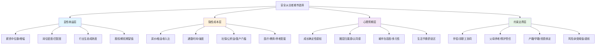

**决策矩阵示例（自评打分 1-5 分）**：
| 维度 | 权重 | 北京 | 上海 | 深圳 | 杭州 | 成都 | 武汉 | 老家二线 |
|------|------|------|------|------|------|------|------|----------|
| 薪资中位数 | 0.20 | 5 | 5 | 5 | 4 | 3 | 3 | 2 |
| 岗位匹配度 | 0.15 | 5 | 5 | 4 | 4 | 3 | 3 | 2 |
| 房价收入比 | 0.15 | 2 | 2 | 2 | 3 | 4 | 4 | 5 |
| 通勤/生活质量 | 0.10 | 2 | 3 | 3 | 4 | 4 | 4 | 5 |
| 圈层/成长预期 | 0.15 | 5 | 5 | 4 | 4 | 3 | 3 | 2 |
| 家庭/伴侣协同 | 0.10 | 视情况 | 视情况 | 视情况 | 视情况 | 视情况 | 视情况 | 5 |
| 落户/资质门槛 | 0.05 | 2 | 2 | 3 | 4 | 4 | 4 | 5 |
| **加权总分** | **1.0** | **3.55** | **3.75** | **3.65** | **3.75** | **3.50** | **3.50** | **3.55** |

> **使用提示**：权重因人而异，「家庭协同」常为否决性约束；「落户门槛」对买房/孩子入学刚需者权重显著上调。

---

## 深度沉淀三：顺丰内鬼泄露面单数据——快递行业个人信息黑产链条与内控失效深度复盘（2016-08-26）

> 以下内容系对原文《某快递公司再现内鬼，泄露客户信息》的知识卡片化重构，保留原有深度分析框架，补充跨期关联与实践转化指南。

### 事件时间轴与核心案件档案

#### 案件一：湖南顺丰员工陈洋——账号倒卖与权限规避
| 关键节点 | 事件详情 | 安全启示 |
|----------|----------|----------|
| **2016-08-26** | 深圳南山区人民法院开庭审理，陈洋被指控侵犯公民个人信息罪 | 司法层面首次公开确认快递内鬼贩卖面单数据构成犯罪 |
| **作案手法** | 以「补录工单、图片看不清」为由，多次向财务及主管索要高权限账号登录内网阿修罗系统 | **社工+权限滥用**组合拳：低权限员工利用业务合理性借口，诱导特权用户违规共享凭证 |
| **技术绕过** | 使用第三方软件突破系统「单张另存、禁止批量下载」限制，实现面单图片及信息批量导出 | **客户端控制不可信**：前端限制易被破解，缺乏服务端速率限制、水印溯源、异常下载检测 |
| **获利模式** | 账号密码出售他人，形成「账号-数据-买家」三级分销 | 凭证泄露比直接倒卖数据更具隐蔽性与持续性，溯源难度指数级上升 |

#### 案件二：研发工程师严某——核心库直连导出百万级数据
| 维度 | 详情 | 风险等级 |
|------|------|----------|
| **身份权限** | 2012.8 入职，任研发工程师，拥有生产数据库直连权限 | 🔴 **极高**——研发权限未隔离，违反「最小权限」「生产环境只读」原则 |
| **作案周期** | 2013.10–2014.6（不足 1 年） | 🔴 **长周期潜伏**，规避了周期性审计窗口 |
| **数据规模** | 单价 0.2–0.5 元/条，获利 36 万 → 推算 **≥ 100 万条** 公民个人信息 | 🔴 **百万级泄露**，触犯《刑法》第 253 条「情节特别严重」量刑标准 |
| **技术路径** | 数据库导出 → 个人网盘中转 → 本地电脑存储 → 分批出售 | **数据流转全链路失控**：无 DLP、无网盘管控、无异常大流量告警 |
| **判决结果** | 福田区法院一审宣判（具体刑期文中未披露） | 司法威慑力度有待后续文书佐证 |

### 黑产产业链全景拆解

#### 上游：数据窃取层——角色分工与工具化演进
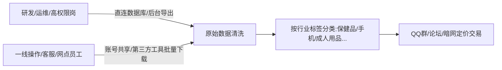
- **工具化标志**：搜索「提取顺丰面单工具」即现成品，说明攻击链已**产品化、服务化（MaaS 雏形）**，门槛极大降低。
- **分类定价**：保健品、壮阳药、丰胸、减肥类面单溢价最高，印证下游为**精准营销/诈骗精准画像**需求。

#### 中游：交易流通层——QQ群半公开市场
| 指标 | 实测数据 | 含义 |
|------|----------|------|
| **单价** | 3.5 元/单（50 单起），300 单以上 3 元/单 | 批发制，边际成本趋近零，规模效应显著 |
| **群命名** | 「顺丰保健品数据面单群」「手机行业面单群」 | **垂直细分**，买家可按业务场景精准采购 |
| **支付结算** | 文中未披露，推测为虚拟币/第三方担保/面交 | 资金流匿名化，打击取证难度大 |

#### 下游：数据消费层——合法与非法边界模糊
| 买家类型 | 使用场景 | 法律风险 |
|----------|----------|----------|
| **电商商家** | 精准推销同品类产品、二次营销 | 违反《消法》《电商法》《个保法》，面临行政处罚与民事赔偿 |
| **刷单团伙** | 真实面单生成虚假物流轨迹，规避平台风控 | 协助刷单构成「非法经营罪」或「破坏计算机信息系统罪」 |
| **诈骗集团** | 精准话术脚本（知姓名、地址、购买记录、单号），实施「冒充快递/客服/公检法」诈骗 | 直接关联「诈骗罪」「侵犯公民个人信息罪」上游犯罪 |

> **作者点评呼应**：「嘴上说着只是买来做营销推广，不拿来做坏事，谁知道？个人觉得除了直接犯罪以外，还是对刷单的需求量会更大些。」——精准切中**灰产合规化话术**与**黑产实质需求**的张力。

### 内控体系五大失效节点深度剖析

#### 权限模型设计缺陷：最小权限原则未落地
- **现状**：研发工程师拥有生产库直连读写权限；一线员工通过「借用主管账号」实现横向越权。
- **标准对标**：
  - 《GB/T 39786-2021 数据安全能力成熟度模型》DSMM-L2 要求「基于角色的访问控制（RBAC）+ 属性访问控制（ABAC）动态授权」
  - 《金融数据安全规范》JR/T 0183 要求「生产数据脱敏、开发环境严禁使用真实数据」
- **整改方向**：研发权限「只读+脱敏」、生产库操作「工单审批+双人复核+全链路审计」、账号共享「零容忍+行为分析告警」。

#### 凭证管理失控：密码轮换沦为形式
- **现状**：阿修罗系统「内网登录+两月一换密」，但主管将账号密码直接交给下属，密码策略失效。
- **根因**：**人员识别与实体账号绑定缺失**，缺乏 MFA、设备指纹、地理围栏等第二因子。
- **对标建议**：参考 [[cve-2022-23131-zabbix-saml-auth-bypass]] 中 SAML SSO 会话伪造风险，推行**零信任网络访问（ZTNA）**，彻底淘汰静态密码单因子认证。

#### 数据防泄漏（DLP）缺位：客户端限制易绕过
- **现状**：前端「单张另存、禁批量下载」被第三方工具瞬间破解，服务端无速率限制、无水印溯源、无异常下载检测。
- **技术债**：将授权控制前置化，忽视**数据层面的固有安全**。
- **参考实践**：
  - [[redis-module-load-rce-exploitation]] 中 Redis 模块加载 RCE 说明服务端插件机制不可信，同理前端 JS 控制不可信。
  - 建设「数据访问代理网关」：所有导出请求经网关统一策略判定（速率/水印/脱敏/审计），物理隔离直连通道。

#### 异常行为监测盲区：百万级导出零告警
- **现状**：严某连续 8 个月、百万条数据导出、网盘中转、本地存储，**全程无任何安全告警触发**。
- **缺失能力**：
  - 数据库审计：大结果集、非常用账号、非常用时间、非常用工具连接
  - 网络流量分析：大流量上传至个人网盘域名、非业务时段数据外传
  - 端点 DLP：大量敏感文件写入个人磁盘、网盘客户端同步
- **建设参考**：[[apt-detection-deployment-strategy]] 中沙箱与威胁感知部署选型，引入 **UEBA（用户与实体行为分析）** 建立基线，对「研发身份+生产库+大结果集+网盘上传」组合特征实时阻断。

#### 管理流程与问责断层：主管违规授权无追责
- **现状**：财务及主管多次违规提供高权限账号，**事前无审批、事中无监控、事后无追责**。
- **文化根因**：业务效率优先、安全合规「挂墙上」、违规操作「大家都这么干」的常态化。
- **治理杠杆**：
  - 将「凭证共享、越权授权」纳入**关键风险指标（KRI）**，绩效挂钩、一票否决。
  - 建立「特权账号全生命周期管理」：申请-审批-授权-监控-回收-复盘，参考 [[kerberos-golden-ticket-attack-mimikatz-implementation]] 中 KRBTGT 哈希保护机制，实施**特权凭证定时轮换+一次性凭证+会话录像回放**。

### 跨期知识关联与演进脉络

#### 301在路上专题演进链
| 阶段 | 代表文章 | 核心观点跃迁 |
|------|----------|--------------|
| **2016 本文** | 顺丰内鬼泄露面单数据 | **现象曝光+产业链拆解+内控五失效**——从单一事件上升到行业系统性风险 |
| **2016 徐玉玉案** | 安全讨论：准大学生被骗后离世 | **源头溯源+十大追问**——直指考生信息泄露链条、虚拟运营商监管真空、黑产利益闭环 |
| **2017** | 信息安全从业者城市选择心理调查 | **人才视角**：折射从业者对机会/成本/归属的权衡，侧面印证一线城市人才虹吸效应 |
| **2016** | 致安全人：真正的财富是健康 | **健康视角**：倡导从业者关注身心健康、工作生活平衡，确立长期主义职业观 |
| **2016** | 挂念：黑客独白 | **文化视角**：黑客群体自我叙事与圈层情感共鸣，记录职业身份确认与情感宣泄 |
| **2016** | **安全顾问式销售，你感兴趣？** | **职业视角**：识别乙方安全公司「顾问式销售/技术型销售」稀缺人才缺口，提供转型路径 |
| **2016** | **苹果漏洞赏金vs Exodus高价收购0day** | **漏洞经济视角**：揭示厂商赏金与灰黑市定价的博弈，漏洞变现路径的多元化 |
| **2019** | [[daily-security-digest-20191220]] 收录 Facebook 手机号泄露、zzzphp SQL注入 | **数据泄露常态化**，技术漏洞与内部威胁双驱动，开始关注供应链安全 |
| **2022** | [[hvv-2021-vulnerability-collection]] HVV 漏洞聚合 | **实战化视角**：内鬼泄露转化为红队「凭证窃取→横向移动→数据窃取」标准战术链 |
| **2023** | [[0x6270-security-team-wechat-archive-202203-202304]] 供应链安全/Notepad++事件 | **供应链视角**：快递面单数据泄露本质是「物流供应链数据安全治理缺失」 |

#### 行业标准与法规映射表
| 法规/标准 | 条款要求 | 本案违规映射 | 整改参考 |
|-----------|----------|--------------|----------|
| **《个人信息保护法》（2021）** | 第 26 条：单独同意、最小必要；第 51 条：分级分类、访问控制、审计日志 | 面单数据无脱敏直连、权限最小化缺失、审计日志无告警 | 建设「个人信息全生命周期管理平台」，落实 PICA 隐私影响评估 |
| **《数据安全法》（2021）** | 第 27 条：重要数据目录、保护清单；第 29 条：风险监测、应急处置 | 面单数据未纳入重要数据目录、无风险监测、事后才知百万级泄露 | 完成数据分级分类，面单数据定级为「核心/重要」，部署实时监测 |
| **《网络安全法》（2017）** | 第 21 条：网络运营者保护义务；第 42 条：内部安全管理制度 | 制度有（密码轮换、下载限制）但执行失效、主管违规无追责 | 制度「可执行、可审计、可追责」，引入自动化合规核查 |
| **GB/T 35273-2020** | 7.2 访问控制、7.5 审计日志、8.3 委托处理安全 | 委托网点/员工访问无最小权限、审计日志无分析、外包风控缺失 | 建立第三方/外包人员统一身份池，最小权限+全链路审计 |

---

## 深度沉淀四：徐玉玉电信诈骗案——考生信息泄露源头溯源与十大安全追问（2016-08）

> 以下内容系对原文《安全讨论：准大学生被骗后离世》的知识卡片化重构，保留原文十大追问框架，补充案件背景、产业链分析、监管演进与治理建议。

### 案件背景与事件复盘

#### 核心事件时间线
| 时间 | 关键节点 | 详情 |
|------|----------|------|
| **2016-08-18** | 正规助学金通知 | 教育部门致电徐玉玉，告知助学金手续办理完成，款项即将发放 |
| **2016-08-19 16:30** | 诈骗电话 | 陌生来电称有 2600 元助学金发放，因前一日正规通知为真，徐玉玉父女未起疑 |
| **2016-08-19** | 被骗 9900 元 | 徐玉玉按对方指引操作，上大学学费 9900 元被转走 |
| **2016-08-21** | 抢救无效离世 | 得知被骗后心脏骤停，经抢救无效去世，年仅 18 岁 |
| **2016-08 下旬** | 全网舆情爆发 | 央媒、地方媒体密集报道，「徐玉玉案」成电信诈骗治理标志性事件 |
| **2016-09 后** | 专项行动启动 | 公安部部署「断卡行动」前身，工信部整治虚拟运营商，教育部加强考生信息保护 |

#### 受害者画像与作案精准度分析
| 维度 | 详情 | 说明 |
|------|------|------|
| **身份标签** | 2016 高考生、南京邮电大学录取、山东临沂罗庄区、家庭贫困、申请助学金 | **多维画像精准匹配**：地域+身份+经济状况+政策需求 |
| **诈骗话术** | 「助学金 2600 元」「教育部门发放」「需配合操作验证」 | **政策模仿度极高**：利用真实助学金政策为诱饵，时间窗口精准卡在发放前夕 |
| **资金流向** | 9900 元学费全额被转走 | **一次性清空**：针对准大学生积攒学费的特点，单笔收割 |
| **心理冲击** | 从「获得助学金」的喜悦→「学费被骗」的绝望→心脏骤停 | **心理落差致死**：经济打击+心理创伤双重打击 |

> **核心洞察**：此案区别于传统「广撒网」诈骗，**实施的是「精准画像+政策模仿+时间窗口」的定向鱼叉式诈骗**，其前提是**考生核心隐私数据（姓名、电话、录取院校、贫困生身份、助学金申请记录）已被泄露并流转至黑产手中**。

---

### 十大安全追问深度拆解与演进回应

#### 追问 1：助学金奖金之事为真，如何这样的信息会被人获取？泄露源在哪？

**原文追问**：助学金申请记录、发放名单、联系方式等核心数据为何在诈骗电话打来前已被掌握？

**溯源分析（2016 视角）**：
| 疑似泄露环节 | 可能主体 | 泄露形式 | 证据链条 |
|--------------|----------|----------|----------|
| **教育部门/学校内部系统** | 助学金审批人员、学生处工作人员 | 导出 Excel/截图/拍照外发 | 权限过大、无水印、无审计 |
| **银行/支付机构** | 助学金发放承办行柜面/运维 | 发放名单、账户信息泄露 | 数据共享协议缺失、脱敏不彻底 |
| **通信运营商/虚拟运营商** | 话单、定位、用户标签数据 | 精准画像标签输出 | 虚拟运营商实名制漏洞、数据转售链条 |
| **第三方服务商/外包商** | 系统开发商、短信服务商、云平台 | 开发/测试环境使用真实数据 | 外包管理缺位、数据脱敏未落地 |
| **考生/家长端泄露** | 填报志愿 APP、查分网站、钓鱼页面 | 主动提交/被钓鱼窃取 | 安全意识薄弱、官方渠道辨识度低 |

**演进回应（2017-2024）**：
- **2017**：《网络安全法》实施，第 42 条明确网络运营者内部管理义务
- **2018**：教育部印发《普通高等学校学生资助工作规范》，要求建立学生资助信息保密制度
- **2021**：《个人信息保护法》第 26 条（单独同意）、第 51 条（分级分类、访问控制、审计日志）落地
- **2022**：《学生个人信息保护规定（征求意见稿）》专门针对学生信息全生命周期保护
- **技术侧**：教育部「全国学生资助管理信息系统」上线，实现助学金申请-审批-发放全流程线上化、留痕化、权限最小化

> **残存缺口**：县区级教育局、乡镇街道经办人员权限管控仍薄弱；银校合作数据传输链路脱敏不彻底；外包开发商测试环境真实数据使用仍普遍存在。

---

#### 追问 2：谁能接触到这些考生信息？

**原文追问**：梳理考生信息全生命周期接触主体清单。

**接触主体全景图（扩展版）**：
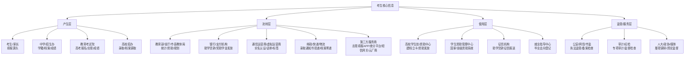

**权限分级管控建议（参考 DSMM/等保 2.0）**：
| 接触主体 | 必知范围 | 访问方式 | 审计要求 | 脱敏要求 |
|----------|----------|----------|----------|----------|
| 中学班主任 | 本班考生基础信息 | 系统角色授权、导出水印 | 操作日志留存 3 年 | 导出脱敏身份证/手机 |
| 县区资助经办 | 本辖区建档立卡生信息 | 专网 VPN+MFA、仅查询 | 全字段审计、异常告警 | 严禁本地存储 |
| 银行柜面/运维 | 发放名单（姓名+账号+金额） | 系统直连、禁止导出 | 核心操作录屏回放 | 发放前脱敏、发放后加密 |
| 虚拟运营商 | 实名认证必要字段 | API 接口调用、最小字段 | 调用频次限制、审计 | 严禁存储/转售/画像输出 |
| 志愿填报 APP | 考生主动授权字段 | OAuth2.0 授权码模式 | 授权记录留存、撤销机制 | 按需申请、用完即删 |

---

#### 追问 3：什么样的系统承载着这些考生助学金数据？

**系统资产画像与风险等级评估**：
| 系统类别 | 典型系统 | 数据敏感级 | 主要风险点 | 防护现状（2016 vs 2024） |
|----------|----------|------------|------------|--------------------------|
| **国家级资助系统** | 全国学生资助管理信息系统 | 核心 | 单点故障、权限集中、跨层级数据聚合 | 2016：分散建设、标准不一<br>2024：国家统建、等保三级、零信任架构 |
| **省市级资助系统** | 省级学生资助管理平台 | 核心 | 与国系对接接口安全、下级权限失控 | 2016：自建、对接松散<br>2024：统一标准、API 网关管控 |
| **高校资助系统** | 校级学生工作/资助管理系统 | 重要 | 开发外包、测试用真实数据、运维权限过大 | 2016：自建/外包混杂<br>2024：纳入校园一网通办、统一身份认证 |
| **银行发放系统** | 助学贷款/奖助学金发放专用系统 | 核心 | 银校数据传输加密、柜面操作留痕、内部人员风控 | 2016：专线/加密不统一<br>2024：金融级标准、人行备案、行为分析 |
| **通信实名/标签系统** | 运营商实名认证库、大数据标签平台 | 核心 | 虚拟运营商数据回传、标签输出审批、画像服务合规 | 2016：虚拟运营商监管真空<br>2024：实名制严管、标签输出需合规审批 |
| **第三方服务平台** | 志愿填报 APP、查分网站、短信网关 | 重要 | 资质审核不严、隐私协议霸王条款、数据本地化缺失 | 2016：备案制、监管弱<br>2024：APP 备案强监管、个人信息保护影响评估强制 |

**关键技术债**：
- **开发测试环境真实数据使用**：外包商、实习生、临时工可直接访问生产级数据
- **跨系统数据同步无统一脱敏网关**：各系统自行实现脱敏逻辑，标准不一、执行不可控
- **日志审计「有存无查、有查无果」**：海量日志缺乏关联分析、基线建模、自动化告警

---

#### 追问 4：学生的安全意识薄弱，安全意识科普在哪？

**原文痛点**：准大学生群体缺乏防诈骗常识，学校/家庭/社会三方教育缺位。

**教育覆盖现状与缺口分析**：
| 教育主体 | 覆盖动作 | 覆盖率/效果 | 核心缺口 |
|----------|----------|-------------|----------|
| **中学（高三阶段）** | 班会讲防诈骗、发宣传单、家长群转发公安提醒 | 覆盖率高、形式主义重、针对性弱 | 无标准化课程、无实战演练、无考核机制 |
| **高校（录取后/入学前）** | 录取通知书夹页防诈骗指南、官网/公众号发布提醒、入学教育第一课 | 覆盖全体新生、但到达率低、时效性差 | 通知书寄送前已泄露、指南内容陈旧、入学教育已晚 |
| **教育部门** | 印发通知、部署专项行动、建立预警机制 | 行政推动有力、但末端落实变形 | 通知层层转发、基层无资源/无能力执行 |
| **公安机关** | 进校园宣讲、发布典型案例、反诈 APP 推广 | 专业度高、但频次低、覆盖面窄 | 警力不足、进校门难、青少年语言不通 |
| **通信运营商** | 反诈短信群发、高频骚扰拦截、实名制管控 | 技术手段强、但精准度低、误拦正常 | 虚拟运营商监管外、骚扰电话号段轮换快 |
| **家庭/社会** | 家长口头叮嘱、亲友圈转发、媒体报道 | 非系统化、碎片化、依赖个体认知 | 代际数字鸿沟、老年人/低学历群体最脆弱 |

**创新科普模式探索（可复用）**：
- **「录取通知书+反诈」捆绑设计**：通知书信封印制防诈骗二维码/关键提醒/官方核验渠道，**物理触达率 100%**
- **「高考志愿填报+防诈」嵌入式教育**：官方志愿填报系统强制观看 3 分钟防诈骗微视频、通过测验才能提交
- **「新生入学+反诈」实战化演练**：军训/入学教育安排模拟诈骗电话/短信/邮件实战演练，落地「识别-举报-求助」肌肉记忆
- **「家长端+反诈」定向推送**：通过教育部门/学校家长群、社区网格员，向考生家长精准推送高频诈骗话术库、核验渠道、求助电话

---

#### 追问 5：为什么这样的事件会持续发生？黑产为什么会持续存在？

**黑产持久化的「利益-成本-风险」模型**：
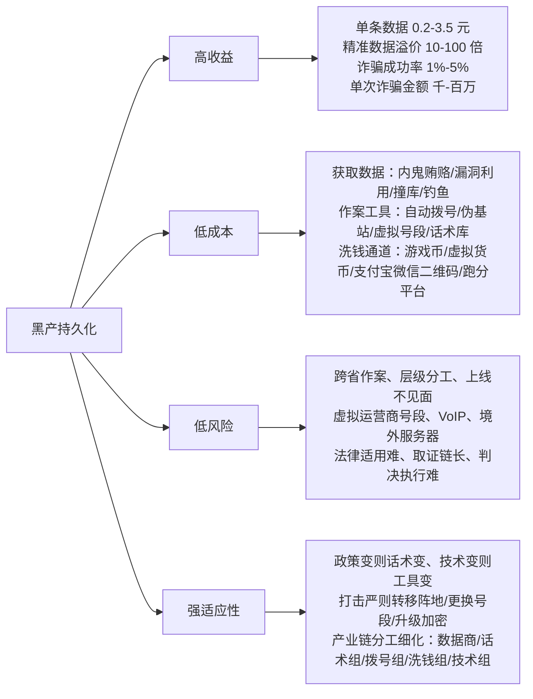

**治理困境的结构性根因**：
| 维度 | 困境表现 | 系统性成因 |
|------|----------|------------|
| **法律滞后性** | 新型诈骗手法层出不穷，立法/司法解释跟不上 | 技术迭代周期（月）vs 立法周期（年）严重错位 |
| **管辖碎片化** | 跨省/跨境作案，立案管辖争议、协作成本高 | 行政区划割裂、证据标准不一、利益协调机制缺失 |
| **取证技术难** | 加密通讯、境外服务器、一次性号码、链式跳板 | 技术侦查手段与犯罪技术对抗升级、隐私保护与取证合规张力 |
| **惩戒震慑力不足** | 判刑多在 3 年以下、罚金低、追赃挽损率低 | 「非法获利高、违法成本低」、犯罪机会成本极低 |
| **源头治理虚化** | 个人信息泄露源头难查、追责链条断裂 | 数据流转链条长、主体多、证据固化难、内鬼定性争议 |

---

#### 追问 6：为什么很多教育机构、中介能光明正大的购买教育相关的考生信息？

**灰产合法化伪装与监管套利链条**：
| 灰产主体 | 合法外衣 | 核心业务 | 数据来源 | 监管盲区 |
|----------|----------|----------|----------|----------|
| **志愿填报机构/APP** | 「大数据精准填报」「名师指导」「录取率承诺」 | 收费咨询、售卖课程、推荐院校/专业 | 购买黑产数据、爬虫抓取、诱导考生授权 | 「商业服务」名义规避「非法获取公民个人信息罪」 |
| **留学/升学中介** | 「背景提升」「文书润色」「名校直通车」 | 高额服务费、推荐项目/院校 | 购买高考/考研/语言考试考生名单 | 合同约定「考生自愿提供」、实为强制/诱导授权 |
| **保险/金融推销** | 「大学生专属险」「助学贷款」「理财入门」 | 保单佣金、贷款利息、理财管理费 | 购买录取名单、新生入学名单、校园卡开户数据 | 「金融营销」豁免条款、实名制漏洞、跨行数据共享 |
| **校园招聘/兼职平台** | 「名企内推」「高薪实习」「技能培训」 | 会员费、培训费、简历优化费 | 爬取校园招聘网、购买就业指导中心数据 | 「就业服务」合规外衣、平台审核把关不严 |

**法律规制演进**：
- **2016**：《刑法修正案（九）》第 253 条「非法获取公民个人信息罪」，但「购买」定性争议大
- **2017**：《网络安全法》第 42 条、第 64 条，明确网络运营者保护义务与处罚
- **2021**：《个人信息保护法》第 13 条（知情同意权）、第 55 条（处罚上限 5000 万/营收 5%）、《刑法修正案（十一）》提高法定刑
- **2022**：《关于规范教育移动应用程序管理的通知》，严控教育 APP 采集范围、禁止强制授权

> **实务难点**：「合法购买」vs「非法获取」边界模糊——中介让考生/家长签署「授权书」，形式上合规，实质上利用信息不对称和地位优势实施「强制授权」，取证定性极难。

---

#### 追问 7：那些承载着重要/核心数据的企业、机构，外包服务/开发商为什么不重视安全？

**外包安全治理「木桶效应」全景图**：
| 外包环节 | 典型乱象 | 根因分析 | 治理杠杆 |
|----------|----------|----------|----------|
| **需求/采购** | 招标文件无安全要求/权重低、最低价中标、安全预算挤压 | 甲方安全意识弱、采购与安全部门割裂、KPI 仅看功能/进度/成本 | 安全要求纳入招标必选项、安全预算单列、引入安全能力成熟度评估 |
| **开发/测试** | 生产数据直接用于开发/测试、脱敏工具缺失、外包人员权限过大 | 开发效率优先、无数据分级分类、缺乏测试数据生成能力 | 建设测试数据工厂、强制脱敏网关、外包人员账号最小权限+审计 |
| **部署/运维** | 外包运维直连生产、VPN 账号共享、运维操作无录像、离职账号未回收 | 运维外包模式成熟度低、零信任未落地、特权账号管理缺位 | 特权访问管理（PAM）、零信任网关、运维操作全程录像回放 |
| **验收/交付** | 验收仅测功能、渗透测试走形式、代码审计不做、安全文档缺失 | 验收标准缺失、第三方评估机构资质参差、甲方无能力复核 | 引入第三方权威评估、源代码交付、安全测试报告作为付款条件 |
| **全生命周期** | 漏洞修复推诿、安全事件瞒报、知识转移缺失、长期依赖外包 | 合同条款模糊、违约成本低、甲方核心技术不自主 | 合同约定 SLA/RPO/RTO、漏洞修复时限、安全事件连带责任、核心能力内化 |

**标准化参考框架**：
- **GB/T 39786-2021 DSMM**：外包商安全能力评估、供应链安全管理
- **GB/T 22239-2019 等保 2.0**：外包服务安全管理要求、外包人员管控
- **ISO 27001/27036**：供应商安全关系管理
- **金融行业 JR/T 0183/0184**：外包风险管理、数据安全专章

---

#### 追问 8：未来针对这样的事情，从学校、培训机构、监管机构、公安等有关部门，包括对于家长、个人在安全方面，应该做哪些事情？

**多方协同治理责任矩阵（RACI 模型）**：
| 治理动作 | 学校 | 培训/中介机构 | 教育/网信/市监等监管 | 公安/检法 | 通信/金融/邮政等基础设施 | 家长/个人 |
|----------|------|---------------|------------------------|-----------|----------------------------|-----------|
| **源头数据分级分类** | R/A | C | A/R | I | R | I |
| **系统安全建设合规** | R/A | R | A | I | R | I |
| **外包供应链安全管控** | R/A | R | A | I | R | I |
| **防诈骗教育常态化** | R/A | C | A | R | C | R |
| **考生/家长精准预警触达** | R | I | A | R | R | C |
| **疑似诈骗线索研判上报** | R | R | I | A | R | R |
| **涉诈账号/号码/域名快速封停** | I | I | R | A | R | I |
| **案件侦破/追赃挽损/判决执行** | I | I | C | A/R | C | C |
| **个人信息泄露溯源问责** | R | R | A | R | R | I |
| **跨部门联动机制建设** | C | I | A | R | R | I |

**关键行动清单（优先级排序）**：
1. **P0-立法/标准层**：出台《学生个人信息保护规定》、制定《教育行业数据分级分类指南》、强制教育 APP 隐私合规认证
2. **P0-技术基建层**：建设全国统一学生资助信息系统（零信任架构）、部署教育专网数据防泄漏网关、接入公安「国家反诈中心」预警平台
3. **P1-组织制度层**：教育系统设立数据安全专员（CISO）、建立「校-警-银-通」联动机制、外包准入白名单+动态考核
4. **P1-教育触达层**：录取通知书「防诈骗专版」、高考志愿填报「必修防诈骗课」、新生入学「实战演练」、家长定向精准推送
5. **P2-持续运营层**：常态化渗透测试/红蓝对抗、黑产情报订阅与画像更新、典型案例库建设与复盘机制、跨区域协作标准化

---

#### 追问 9：用于诈骗的虚拟运营商？这个话题说 10 年都不为过。

**虚拟运营商（MVNO）成为诈骗「号码池」的技术溯源**：
| 特性 | 诈骗利用价值 | 监管演进 |
|------|--------------|----------|
| **号段丰富、申请门槛低** | 批量开卡、频繁换号、规避标记/拦截 | 2014 年放号、2017 年实名制严管、2019 年「断卡行动」重点打击 |
| **实名制执行宽松** | 代实名、批量实名、租借身份证、人脸识别破解 | 三大运营商/虚商强制人脸活体、一证五号、异常预警模型 |
| **话单/信令数据不透明** | 隐藏真实归属地、规避定位、跨省作案难追踪 | 信令数据接入公安大数据平台、虚商话单实时回传 |
| **API/短信网关开放** | 群发诈骗短信、伪造基站下发、验证码轰炸 | 短信网关备案制、模板审核、发送频次限制、变量校验 |
| **合规成本低、利润高** | 低价批发号段给灰产/黑产、形成「号商」产业链 | 牌照续审挂钩合规、违规罚款/暂停业务/吊销牌照 |

**虚商合规治理「组合拳」成效（2017-2024）**：
- **号段收归/清理**：工信部收回违规虚商号段、清理「僵尸虚商」、推动虚商整合重组
- **实名制硬化**：全流程人脸活体、一证五号跨运营商联网核查、异常开卡实时拦截
- **业务管控**：禁止虚商自建短信网关、强制接入三大运营商网关统一管控、API 调用实名认证
- **联合惩戒**：公安+工信部+市监+银行「四部门联合惩戒」，涉诈号码/账号/人员联合黑名单

> **残存挑战**：境外虚商/VoIP/OTT 通讯应用成新载体、eSIM/物联网卡成新号码池、AI 合成语音/视频降低实名核验门槛、**「号码-身份-设备-行为」四要素关联认证**仍未全链路落地。

---

#### 追问 10：数据交易？作案成本？处罚力度？

**黑产经济账本（以考生数据为例）**：
| 环节 | 成本/价格 | 利润率 | 风险溢价 | 关键指标 |
|------|-----------|--------|----------|----------|
| **数据获取（上游）** | 内鬼贿赂：500-5000 元/万条<br/>漏洞利用：0 成本（自有技术）<br/>撞库/钓鱼：人力/工具成本 | 1000%+ | 内鬼风险高（刑事）、技术风险中 | 数据鲜度（T+0 最贵）、字段完整度、画像标签丰富度 |
| **数据清洗/增值（中游）** | 去重/标签/分类：人工/脚本成本<br/>画像建模：算法/算力成本 | 500%+ | 技术门槛低、法律风险中 | 标签准确率、转化率提升倍数 |
| **数据分销（中游）** | 批发：0.2-3.5 元/条<br/>零售：10-100 元/条<br/>定制：千元/批次 | 200-500% | 渠道风险（平台封号）、买家举报 | 客户留存率、复购率、投诉率 |
| **诈骗实施（下游）** | 号码/设备/话术/通道：单次成本 10-100 元<br/>人力/场地/管理：团队化分摊 | 单次成功：万倍利润<br/>整体 ROI：10-100 倍 | 刑事风险极高（主犯 10 年+）、资金冻结风险 | 成功率 1-5%、单笔金额 千-百万、洗钱成功率 |
| **洗钱变现（下游）** | 跑分平台：手续费 5-15%<br/>虚拟币/游戏币：汇率损耗 10-20%<br/>地下钱庄：手续费 3-8% | 隐性利润 | 资金链追踪技术成熟、打击力度大 | 到账时效、资金切割层数、司法管辖规避 |

**处罚力度对比（2016 vs 2024）**：
| 违法主体 | 2016 典型处罚 | 2024 法定上限/实务重罚 | 震慑力缺口 |
|----------|---------------|------------------------|------------|
| **个人信息买卖（非国家工作人员）** | 3 年以下/拘役/罚金 | 7 年以上（情节特别严重）、罚金 50 万+ | 量刑畸轻、缓适用率高、追赃挽损难 |
| **国家工作人员泄露/贩卖** | 3-7 年 | 7 年以上、终身禁入公职 | 内部处分替代刑事、立案门槛高 |
| **网络服务提供者未履行保护义务** | 警告/罚款 1-10 万/责令整改 | 5000 万/营收 5%、吊照、责任人禁业 | 监管执法资源不足、跨区域协作难 |
| **虚拟运营商违规转售号段/放松实名** | 罚款/整改 | 吊销牌照、列入电信业务经营不良名单、法人禁入 | 牌照价值高、整改周期长、利益输送隐蔽 |
| **诈骗犯罪团伙** | 3-10 年/无期/死刑（极少） | 10 年以上/无期/死刑（数额特别巨大/手段特别恶劣） | 跨境追逃难、赃款追回率低、判决执行周期长 |

> **核心矛盾**：**数据黑产「边际成本递减、规模收益递增、风险溢价可控」**，而**治理侧「取证成本高、协作成本高、审判周期长、追赃难度大」**。单纯加大刑罚边际效用递减，必须从**源头切断数据流出、技术提升作案门槛、金融切断洗钱通道、国际加强执法合作**四维发力。

---

### 徐玉玉案治理成效追踪与长效机制建议

#### 专项行动阶段性成果（2016-2024）
| 专项行动 | 时间 | 核心打击重点 | 典型战果 | 长效机制沉淀 |
|----------|------|--------------|----------|--------------|
| **「断卡行动」** | 2020.10-至今 | 电话卡/银行卡/支付账号「两卡」买卖 | 破获案件 30 万+、抓获 50 万+、截断涉诈资金 3000 亿+ | 「断卡」长效机制、银警协作平台、号码标记体系 |
| **「净网行动」** | 2014-至今（常态化） | 网络黑产、个人信息犯罪 | 打击「数据窃取-清洗-贩卖-应用」全链条 | 网络黑产情报库、跨区域协作机制 |
| **「护苗行动」** | 2018-至今 | 未成年人网络保护、校园周边净化 | 清理有害信息 1 亿+、整治违规 APP 5000+ | 未成年人网络保护标准体系 |
| **教育部专项** | 2016-至今 | 考生信息保护、助学金发放规范 | 建立全国学生资助系统、录取通知书防诈版 | 学生个人信息保护规定（立法中） |

#### 长效治理「四梁八柱」架构建议
```mermaid
graph TB
A[考生个人信息全生命周期保护长效机制] --> B[法律法规层]
A --> C[标准规范层]
A --> D[技术基建层]
A --> E[组织管理层]
A --> F[监管执法层]
A --> G[社会共治层]

B --> B1[个人信息保护法/数据安全法/网络安全法]
B --> B2[学生个人信息保护规定(专项立法)]
B --> B3[刑法修正案(十一)/司法解释]
B --> B4[行政处罚法/公职人员政务处分法]

C --> C1[GB/T 35273-2020 个人信息安全规范]
C --> C2[GB/T 39786-2021 DSMM]
C --> C3[教育行业数据分级分类指南]
C --> C4[教育移动应用备案/安全评估规范]

D --> D1[全国学生资助管理信息系统(零信任)]
D --> D2[教育专网数据安全网关(脱敏/水印/审计)]
D --> D3[测试数据工厂/外包开发安全管控平台]
D --> D4[反诈预警平台/号码标记/APP反诈SDK]

E --> E1[教育系统CISO/数据安全专员制度]
E --> E2[外包供应链准入白名单/动态考核]
E --> E3[校-警-银-通-邮联动机制/应急预案]
E --> E4[防诈骗教育纳入国民教育体系/教材]

F --> F1[跨区域协作/证据标准统一/联合惩戒]
F --> F2[行政执法与刑事司法衔接/两法衔接]
F --> F3[公益诉讼/示范判例/惩罚性赔偿]
F --> F4[监管沙箱/合规豁免/首违不罚]

G --> G1[录取通知书防诈版/志愿填报必修课]
G --> G2[家长社区/网格员精准触达/反诈宣传员]
G --> G3[媒体舆论监督/典型案例曝光/法治教育]
G --> G4[白帽子/安全社区漏洞奖励/威胁情报共享]
```

---

## 深度沉淀五：致安全人——真正的财富是健康（2016-08）

> 以下内容系对原文《致安全人：真正的财富是健康》的知识卡片化重构，聚焦安全从业者健康管理、职业可持续性、工作生活平衡等核心议题，提炼可落地的健康管理框架与组织关怀建议。

### 文章元信息
- **发布时间**：2016年8月（原文链接中 `mid=2652521195` 与同期文章 `mid=2652521201/1203/1206` 推测为 2016 年 8 月下旬）
- **原文链接**：http://mp.weixin.qq.com/s?__biz=MzIwMTQ2NzY4NA==&mid=2652521195&idx=1&sn=134e288ca44ae41f66e7ddd203ebf105&chksm=8d0390a0ba7419b6562fc19275f8a6ddafb02d0f28d99ba6fbd64ca8710b6972defb856d7321&scene=126&sessionid=1681656722#rd
- **文章性质**：行业倡议/心理关怀/健康管理建议，属「从业者关怀/职业可持续性」类
- **背景**：301在路上在连续曝光顺丰内鬼案、徐玉玉案等重磅深度报道后，发布的一篇关注从业者身心健康的软性倡议文章，体现「技术-人-组织」三维视角的完整性

### 核心观点提炼

| 核心主张 | 原文支撑 | 现实映照 |
|----------|----------|----------|
| **真正的财富是健康** | 「人真正的财富就是保持一颗正能量的心态，真正的财务是健康和技能」 | 安全行业高薪高压，易陷入「用健康换钱，再用钱买健康」的恶性循环 |
| **身心状态是运转指标** | 「衡量一个人和一个团队、公司的是否正常运转，只需要看这个人的整体状态便知晓」 | 个人状态折射组织健康度，职位/收入仅为表面光鲜 |
| **健康是前途保障** | 「养好身体，多读书，多学习，多求经验，就是前途的保障」 | 技能积累与身体资本同为职业可持续性的双引擎 |
| **精神食粮提供动力** | 「除了毅力，精神食粮也给我们提供了无限的动力」 | 认知升级、价值观建设是抗压力的深层来源 |
| **行动倡议** | 「下周开始每天抽半小时出来，锻炼身体！」 | 从认同走向行动，微习惯养成是破局关键 |

### 安全从业者健康风险画像（基于行业共性外推）

| 风险维度 | 典型表现 | 根因分析 | 后果推演 |
|----------|----------|----------|----------|
| **作息紊乱** | 熬夜分析样本、应急响应倒班、CTF 通宵、跨时区协作 | 业务 7×24、攻防不对等、技术迭代焦虑、KPI 导向 | 昼夜节律破坏、免疫力下降、代谢综合征早发 |
| **久坐不动** | 日均伏案 10+ 小时、缺乏运动习惯、通勤挤占运动时间 | 工作性质决定、工位文化、缺乏运动设施/文化 | 颈椎/腰椎病、深静脉血栓、肥胖、心血管风险 |
| **饮食失序** | 外卖高油盐糖、不规律进餐、咖啡/功能性饮料依赖、应酬饮酒 | 时间稀缺、便利性优先、社交压力、奖赏机制 | 胃肠疾病、脂肪肝、胰岛素抵抗、营养缺乏 |
| **心理内耗** | 高强度认知负荷、漏洞挖掘挫败感、合规压力、35 岁危机焦虑 | 攻防不对等、责任不对称、行业周期切换、评价体系单一 | 焦虑/抑郁倾向、职业倦怠、离职冲动、家庭关系紧张 |
| **社交缺失** | 技术圈层封闭、话题单一、异地漂泊、陪伴家人少 | 专业壁垒、城市选择困境（参考[[#深度沉淀二]]）、时间零和 | 孤独感、社会支持系统脆弱、心理韧性降低 |

### 健康管理「四维模型」构建

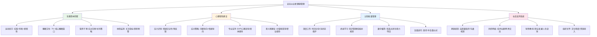

### 微习惯落地清单（参考原文「每天抽半小时锻炼」）

| 场景 | 微习惯设计 | 触发器 | 奖励机制 | 迭代路径 |
|------|------------|--------|----------|----------|
| **工位久坐** | 每 50 分钟站立 2 分钟、做 3 个颈椎/腰椎动作 | 番茄钟/智能手表提醒 | 完成打卡积分兑换装备 | 50/10 → 25/5 → 站立办公桌 |
| **通勤路上** | 地铁/公交站立核心收缩、深呼吸 10 次 | 进站/上车 | 听完一集播客/有声书 | 被动 → 主动 → 骑行/步行通勤 |
| **午休窗口** | 15 分钟午睡 + 10 分钟快走/拉伸 | 午饭后闹钟 | 下午精神饱满感 | 午睡 → 午睡+运动 → 单位健身房 |
| **深夜加班** | 22:00 后禁咖啡、喝温水/花草茶、蓝光眼镜 | 电脑锁屏提醒 | 入睡潜伏期缩短 | 减量 → 替代 → 严守作息红线 |
| **周末恢复** | 周六 1 小时户外运动、周日 30 分钟复盘规划 | 日历固定事件 | 成就感/掌控感 | 被动休息 → 主动恢复 → 生活实验 |

### 组织层面健康关怀建议（给管理者/HR/企业主）

| 关怀维度 | 低成本启动项 | 进阶投入项 | 成熟度指标 |
|----------|--------------|------------|------------|
| **物理环境** | 站立办公区/人体工学椅/健康零食柜/饮水机 | 企业健身房/淋浴间/午休舱/医务室 | 人均健康设施投入、使用率 |
| **制度保障** | 弹性工时/强制下班/年假强休/调休补偿 | 带薪病假/心理假/健康体检假/康复返岗 | 加班时长分布、年假使用率 |
| **健康福利** | 商业医保补充/体检套餐/心理咨询 EAP 额度 | 家庭医保/重疾绿通/健康管理师 1v1/康复保障 | 理赔率、EAP 使用率、体检异常干预率 |
| **文化塑造** | 健康分享会/运动打卡群/领头羊示范/健康 KPI 反向考核 | 健康管理纳入绩效/高管健康仪表盘/健康预算保障 | 离职率、病假率、员工净推荐值 |
| **能力建设** | 健康科普讲座/急救技能培训/人体工学指导 | 个人健康档案/风险分层干预/健康教练认证 | 知识知晓率、行为改变率、指标改善率 |

### 跨期呼应：健康视角补全「技术-人-组织」三元拼图

| 301在路上 2016 系列文章 | 核心关注维度 | 共同指向的行业痛点 |
|-------------------------|--------------|-------------------|
| **顺丰内鬼案** | 数据安全/内控治理/黑产打击 | **技术层**：系统脆弱性、权限失控、监测盲区 |
| **徐玉玉案** | 信息泄露源头/诈骗治理/多方协同 | **社会层**：数据流转失控、监管滞后、受害者保护 |
| **城市选择调查** | 职业发展/生活成本/心理归属/人才流动 | **人才层**：机会成本、生存焦虑、归属缺失、叙事断裂 |
| **安全顾问式销售** | 职业路径/人才缺口/转型指南/乙方生存 | **职业层**：技术变现路径、人才供需错配、角色认知模糊 |
| **致安全人健康倡议** | 身心健康/工作生活平衡/长期主义/组织关怀 | **个人层**：生理透支、心理内耗、认知狭窄、支持缺失 |
| **挂念：黑客独白** | 黑客文化/自我叙事/圈层情感/职业身份 | **文化层**：群体认同、情感宣泄、职业确认、圈层归属 |

> **洞察**：这六篇文章在两个月内密集发布，恰如其分地拼合出 2016 年中国网络安全行业的**全景切面**——**技术治理尚在探索期、数据黑产已成产业化、人才焦虑普遍存在、职业路径迷茫、从业者健康被系统性忽视、黑客文化寻求自我确认**。健康倡议虽显「软性」，实为**职业可持续性的基石**，缺一不可。

### 知识卡片：安全从业者「健康-职业」双轨可持续性评估表

> 建议每半年自测一次，或纳入团队季度复盘、企业年度体检报告解读

| 维度 | 评估项 | 评分标准（1-5 分） | 权重 | 得分 | 行动触发线 |
|------|--------|-------------------|------|------|------------|
| **生理资本** | 体检核心指标（血压/血糖/血脂/尿酸/肝肾功能） | 5=全优，3=1-2 项临界，1=多项异常/未复查 | 0.20 | | ≤2 分必就医 |
| | 运动习惯（频率/强度/持续性） | 5=每周 3+ 次中高强度，3=偶尔运动，1=久坐无运动 | 0.15 | | ≤2 分强制介入 |
| | 睡眠质量（时长/规律/主观恢复感） | 5=7h+ 规律好，3=波动大/补觉，1=长期<6h/失眠 | 0.10 | | ≤2 分调整作息 |
| | 疼痛/不适（颈肩腰/视力/消化/免疫） | 5=无困扰，3=偶发自缓，1=慢性影响工作 | 0.05 | | ≤2 分就医/工改 |
| **心理韧性** | 情绪稳定性（焦虑/抑郁/易怒频次） | 5=情绪自主，3=偶尔波动可调节，1=持续低落/失控 | 0.15 | | ≤2 分寻求专业帮助 |
| | 压力应对（策略丰富度/求助意愿/恢复速度） | 5=多策略/主动求助/快恢复，1=回避/孤军/长陷 | 0.10 | | ≤2 分学习应对技能 |
| | 职业意义感（价值观一致/成就感/使命感） | 5=高度一致/有使命，3=部分一致/谋生为主，1=冲突/空心化 | 0.05 | | ≤2 分职业规划干预 |
| **认知能量** | 深度工作能力（专注时长/产出质量/心流频次） | 5=日均 3h+ 深度，3=碎片化/中断多，1=难以专注 | 0.10 | | ≤2 分环境/流程优化 |
| | 学习迁移（新知获取/实践应用/教学相长） | 5=体系化/落地/输出，3=碎片输入/少输出，1=停滞/焦虑买课 | 0.05 | | ≤2 分调整学习策略 |
| **社会支持** | 家庭关系（陪伴质量/沟通深度/冲突处理） | 5=亲密支持/深度沟通，3=功能性/浅层，1=疏离/高冲突 | 0.05 | | ≤2 分家庭干预/咨询 |
| | 同侪网络（技术交流/情感支持/资源互换） | 5=高质圈层/高频互动，3=泛泛之交/低频，1=孤岛/无圈层 | 0.05 | | ≤2 分主动建设社群 |
| **总分** | **加权汇总** | **≥4.0 优秀，3.0-3.9 良好，2.0-2.9 预警，<2.0 高危** | 1.00 | | **预警启动干预，高危强制介入** |

---

## 深度沉淀六：挂念——黑客独白：黑客文化自我叙事与安全从业者情感共鸣（2016-08）

> 以下内容系对原文《挂念：黑客独白》的知识卡片化重构，聚焦黑客文化自我叙事歌词、安全从业者圈层情感共鸣、职业身份确认与情感宣泄等核心议题，提炼黑客群体文化心理特征与行业情感图谱。

### 文章元信息
- **发布时间**：2016年8月（原文链接中 `mid=2652521192` 与同期文章 `mid=2652521195/1201/1203/1206` 推测为 2016 年 8 月下旬）
- **原文链接**：http://mp.weixin.qq.com/s?__biz=MzIwMTQ2NzY4NA==&mid=2652521192&idx=1&sn=738f7be58b55c22f75eba255c5b62ab7&chksm=8d0390a3ba7419b58bd19b4d31e09ca2dedd66c2ced637dce4d962eacb826b11bbca47d34645&scene=126&sessionid=1681656722#rd
- **文章性质**：文化分享/情感共鸣/圈层认同，属「黑客文化/从业者心理/行业观察」类
- **背景**：301在路上在连续发布重磅深度报道（顺丰内鬼案、徐玉玉案）后，推荐两首歌曲《黑客独白》与《挂念》，以音乐形式表达安全从业者内心真实感受，体现「技术-人-文化」三维视角的完整性

### 核心内容结构

#### 歌曲一：《黑客独白》——于浩宸演唱
**核心主题**：黑客群体自我认同、外界误解与偏见、黑夜生活常态化、技术信仰与职业坚守

**歌词关键意象解码**：
| 意象 | 字面含义 | 隐喻意义 | 群体心理投射 |
|------|----------|----------|--------------|
| **黑夜** | 作息时间倒置 | 自由探索的时空、不被主流理解的领域 | 「我的黑夜比白天多」——时间主权的夺回与重构 |
| **敲打心窝** | 技术直达核心 | 技术能力的直接性与穿透力 | 「我可以直接敲打它心窝」——技术赋能的掌控感与存在感 |
| **姑娘/朋友** | 情感连接对象 | 圈层内的情感支撑与理解 | 「不要远离我」——对圈层认同与情感归属的渴求 |
| **伪善/冷漠** | 白天世界的面具 | 主流社会的虚伪与疏离 | 「黑夜你才能看到真实的自我」——圈层作为真实性的避风港 |
| **什么是黑客** | 身份定义的追问 | 外界标签与自我认知的张力 | 「不是你不是我 中国没有黑客」——去标签化、回归技术本质 |
| **可乐/快乐/唱歌** | 简单纯粹的快乐 | 技术之外的生活图景 | 「陪我喝可乐带你去快乐」——去功利化的圈层社交 |
| **满街黑客/老小黑客** | 身份泛化与消解 | 媒体炒作与商业利用下的身份异化 | 「记者炒黑客 商人爱黑客」——对身份被消费的讽刺与抗拒 |

**文化心理特征提炼**：
1. **时间主权重构**：黑夜非寂寞，而是「黑夜也是生活，黑夜和白天也一样过」——对主流作息规范的解构与自主时区的建立
2. **技术即信仰**：「我只是喜欢做我所做」——技术探索的内驱力超越外部评价体系
3. **圈层真实性**：「白天也有伪善也有冷漠，黑夜你才能看到真实的自我」——圈层内部的真实关系对抗主流社会的异化关系
4. **身份边界模糊**：「什么是黑客谁才是黑客不是你不是我」——拒绝外部定义权，主张技术实践者的自我定义权
5. **情感归属刚需**：「我的姑娘我的朋友快来加我」——高强度认知劳动下的情感补偿与圈层粘合剂

#### 歌曲二：《挂念》——Dream-欢制作，大雨子等演唱
**核心主题**：青春同窗/战友情谊、成长代价与现实妥协、兄弟情义的时空穿越、男儿担当与生命承诺

**歌词叙事弧光分析**：
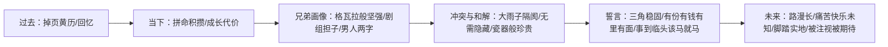

**核心情感锚点**：
| 锚点 | 代表歌词 | 情感功能 |
|------|----------|----------|
| **共同记忆** | 「所有的过去就像一本掉了页的黄历」「在一起的日子我只有放肆和快乐」 | 构建群体身份的历史锚点，对抗当下的原子化漂泊感 |
| **成长代价** | 「也许这就叫做成长」「我们可能得到了太多的快乐，今天我们才会比别人付出的更多」 | 重构苦难叙事，赋予当下压力以意义感 |
| **兄弟原型** | 「你很坚强就像格瓦拉一样」「越是困难越是第一个上」「只是为了两个字男人」 | 确立男性群体中的责任伦理与担当美学 |
| **脆弱与珍视** | 「你生活没有规律，你要注意身体」「我们并不是外人，你是我的瓷器」 | 打破硬汉人设，露出关怀脆弱的柔软内核 |
| **三角稳固** | 「三个人就像三角一样，哪个方向拿出手去都是最尖儿」 | 群体结构的几何隐喻：最小稳定单元、相互支撑、共同进退 |
| **现实主义英雄主义** | 「咱们脚踏实地一步步的走着」「什么都会有的，真的」 | 去理想化、落地化的奋斗叙事，对抗虚无感与焦虑感 |

### 黑客/安全从业者文化心理图谱（基于双歌词交叉分析）

#### 双重叙事张力场
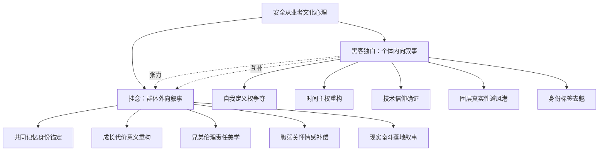

#### 核心心理需求映射表
| 心理需求 | 《黑客独白》表达 | 《挂念》表达 | 行业语境下的满足路径 |
|----------|-------------------|---------------|----------------------|
| **自主性** | 「我只是喜欢做我所做」「黑夜也是生活」 | 「咱们脚踏实地一步步的走着」「我们的路我们自己走着」 | 技术探索自主权、职业选择自主权、作息节奏自主权 |
| **胜任感** | 「我可以直接敲打它心窝」「什么是黑客谁才是黑客」 | 「你已经证明了你的努力」「你很坚强就像格瓦拉一样」 | 技术难题攻克、项目交付成果、攻防演练战果 |
| **归属感** | 「我的姑娘我的朋友不要远离我」「黑夜你才能看到真实的自我」 | 「世上最珍贵的就是友谊」「全世界最无敌的就是咱们的情义」 | 技术社群、战队/战友、导师制、校友网络 |
| **意义感** | 「不要说我没有道德」「不要对我只唱赞歌」 | 「现实才是梦想的初衷」「不在失败我们只有成功」 | 守护数字资产、维护网络秩序、保护弱势群体、技术向善 |
| **安全感** | 「不要说我太执着」「白天的你我擦肩而过」 | 「你是我的瓷器」「你要注意身体」 | 职业稳定性、收入保障、健康管理、家庭支持 |

### 行业文化演进视角下的《挂念：黑客独白》

#### 语境下的文化切片意义
| 维度 | 2016 年行业现状 | 本文文化回应 | 历史定位 |
|------|-----------------|----------------|----------|
| **群体身份** | 「黑客」标签被媒体炒作/商业消费/官方警惕，从业者身份焦虑 | 「不是你不是我 中国没有黑客」「这样的黑客不是我所说」 | **身份边界守卫战**：拒绝异化、回归技术本真 |
| **生存状态** | 高强度攻防/漏洞挖掘/应急响应，黑白颠倒常态化 | 「我的黑夜比白天多」「黑夜的故事比白天多」 | **生存状态书写**：将非标准作息转化为群体特有的时间文化资本 |
| **情感生态** | 高压下情感表达受抑，圈层内部形成独特情感经济 | 两首歌分别承载「圈层认同」与「战友情义」双重情感功能 | **情感基础设施建设**：音乐/歌词作为情感载体的圈层粘合剂 |
| **价值锚定** | 急功近利/浮躁投机/技术变现压力大 | 「现实才是梦想的初衷」「不在失败我们只有成功」 | **价值观校准**：用兄弟情义与现实主义英雄主义对抗功利主义 |

#### 跨期演进：从 2016 到 2024 的文化基因传承
| 文化基因 | 2016 表达 | 2024 变体 | 核心不变量 |
|------------|-----------|-----------|------------|
| **夜猫子作息** | 「我的黑夜比白天多」物理时间倒置 | 远程办公/弹性工时/全球协作下的「异步工作制」 | **时间主权自主配置** |
| **技术信仰** | 「我只是喜欢做我所做」纯粹技术内驱力 | 「造轮子/挖洞/写工具/做开源」技术理想主义 | **技术内驱力超越外部评价** |
| **圈层真实** | 「黑夜才能看到真实自我」圈层去面具化 | 技术社群/开源社区/私有群「去职务化交流」 | **去角色化的真实关系** |
| **兄弟/战友情** | 「三个人就像三角一样」最小稳定结构 | CTF战队/红队/应急小组/创业合伙人「生死与共」 | **高压下的深度信任与互助** |
| **现实主义英雄** | 「只是为了两个字男人」「脚踏实地走着」 | 「守住底线/交付结果/养家糊口/技术传承」 | **责任伦理与落地奋斗的统一** |

### 知识卡片：安全从业者文化心理画像与组织关怀启示

#### 文化心理画像（v1.0）
| 维度 | 核心特征 | 行为表现 | 管理启示 |
|------|----------|----------|----------|
| **时间文化** | 夜间主权、异步节奏、长周期深度工作 | 深夜提交代码/复现漏洞/写报告、白天会议/沟通/协调 | 尊重异步工作节奏、减少无效会议、保护深度工作时段 |
| **身份叙事** | 去标签化、技术实践者自我定义、拒绝异化 | 抵制「黑客/红客/白帽」外部标签、强调「安全研究员/工程师」专业身份 | 专业职级体系建设、技术职业通道畅通、减少行政化头衔 |
| **情感经济** | 圈层内高信任/高强度情感交换、技术之外的纯粹连接 | 战队生死与共、开源协作无偿贡献、私有群吐槽/互助/分享 | 建设技术社群文化、鼓励跨团队技术交流、设立「战友关怀」机制 |
| **价值锚定** | 现实主义英雄主义、责任伦理、技术向善、长期主义 | 守住安全底线、拒绝灰产黑产诱惑、坚持技术传承与人才培养 | 价值观招聘/晋升/考核、设立「安全守护者」荣誉体系、长期激励机制 |
| **脆弱性接纳** | 硬核技术外壳下的身体/情感/社交脆弱性 | 颈椎病/脱发/焦虑/孤独/社恐/亲密关系缺失 | **从「忽视脆弱」转向「系统性关怀」**：健康管理/EAP/家庭支持/社交机会 |

#### 组织关怀「文化-制度-设施」三层落地框架
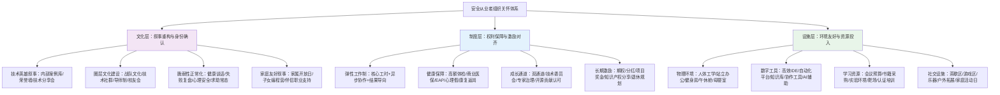

### 跨文呼应：六篇文章的文化拼图

| 文章 | 文化维度 | 核心隐喻 | 共同指向 |
|------|----------|----------|----------|
| **顺丰内鬼案** | **制度文化** | 「权限失控/内控虚设/利益诱惑」 | 组织防御文化的缺失与重建 |
| **徐玉玉案** | **社会文化** | 「数据流转失控/监管滞后/受害者脆弱」 | 行业社会责任文化的觉醒 |
| **城市选择调查** | **生存文化** | 「机会成本/归属焦虑/叙事断裂」 | 人才生存文化的多元化解构 |
| **安全顾问式销售** | **职业文化** | 「技术变现/角色融合/商业落地/人才缺口」 | 职业路径多元化与人才供需匹配 |
| **致安全人健康倡议** | **身体文化** | 「健康为本/微习惯/长期主义」 | 从业者身体文化的主体性确立 |
| **挂念：黑客独白** | **圈层文化** | 「夜猫子时间/技术信仰/兄弟情义/真实自我」 | **安全从业者群体文化自觉的萌芽** |

> **洞察**：《挂念：黑客独白》作为 2016 年系列文章的**文化篇章**，与前五篇「技术/社会/生存/职业/身体」五个维度的现实批判形成互补——**前五篇剖析「客观困境」，本篇书写「主体性确证」**。两首歌分别承担了「个体内向自我对话」（黑客独白）与「群体外向情感连接」（挂念）双重文化功能，共同构建了安全从业者在高压生存环境下的**文化避风港**与**身份锚点**。这不仅是娱乐推荐，更是**行业亚文化的自我书写与确证**。

---

## 深度沉淀七：苹果漏洞赏金计划 vs Exodus Intelligence 高价收购 0day——漏洞经济学与灰黑市博弈透视（2016-08）

> 以下内容系对原文《安全快讯 | 谁更有钱？苹果居然被黑帽公司打脸了！》的知识卡片化重构，聚焦苹果漏洞赏金计划发布背景、Exodus Intelligence 等灰帽/黑帽公司高价收购 0day 的市场对比、漏洞定价机制、白帽子面临的利益抉择及行业生态影响。

### 文章元信息
- **发布时间**：2016年8月（原文链接中 `mid=2652521173` 与同期文章 `mid=2652521189/1192/1195/1201/1203/1206` 推测为 2016 年 8 月上中旬，苹果在 Black Hat 2016 正式宣布漏洞赏金计划后不久）
- **原文链接**：http://mp.weixin.qq.com/s?__biz=MzIwMTQ2NzY4NA==&mid=2652521173&idx=2&sn=81c390f0d33c629b57b418428e59a7ee&chksm=8d03909eba741988c8b3f3de3c3f2f526fe6abb92fe4e03efacb0352ba7d412781545f58bf6e&scene=126&sessionid=1681656727#rd
- **文章性质**：安全快讯/行业观察/市场对比，属「漏洞经济/威胁情报/行业生态」类
- **背景**：苹果公司于 2016 年 8 月 Black Hat 大会上正式宣布推出漏洞赏金计划（此前长期拒绝设立赏金计划），最高奖励 20 万美元。同期，以 Exodus Intelligence 为代表的漏洞经纪公司公开高价收购 0day，形成直接市场对比。

### 核心事件复盘

#### 苹果漏洞赏金计划关键参数（2016 首发版）
| 漏洞类别 | 最高奖励 | 备注 |
|----------|----------|------|
| **iCloud 服务端漏洞** | $200,000 | 最高档，需未经授权访问 iCloud 账户数据 |
| **带外漏洞** | $100,000 | 无需用户交互的远程代码执行 |
| **内核权限提升** | $100,000 | 从沙箱逃逸至内核态 |
| **沙箱逃逸** | $50,000 | 从 App 沙箱突破至用户态 |
| **用户态 RCE** | $25,000 | 需用户交互的远程代码执行 |
| **敏感数据访问** | $50,000 | 绕过 TCC/隐私控制访问敏感数据 |

> **策略意图**：苹果采用「分级定价+邀请制」策略，聚焦高影响力漏洞，试图以「合法合规+品牌声誉+长期关系」对抗灰黑市诱惑。

#### Exodus Intelligence「研究赞助计划」收购价目表（2016 公开版）
| 目标组件 | 最高收购价 | 对比厂商官方赏金 | 溢价倍数 |
|----------|------------|-------------------|----------|
| **iOS 9.3+ 0day** | **$500,000** | Apple $200,000 | **2.5x** |
| **Chrome 0day** | $150,000 | Google $100,000 (max) | 1.5x |
| **Edge 0day** | $125,000 | Microsoft $1,500 (max) | **83x** |
| **Firefox 高危 0day** | $80,000 | Mozilla $5,000~$10,000 | 8-16x |
| **Windows 10 LPE 0day** | $75,000 | Microsoft $1,500~$15,000 | 5-50x |
| **Adobe Reader/Flash 0day** | $60,000 | Adobe $5,000~$15,000 | 4-12x |

> **商业模式**：Exodus 等漏洞经纪商（Vulnerability Broker）通过「低买高卖」获利——向研究者支付上述价格收购独家 0day，再以更高价格转售给政府情报机构、军工承包商、网络武器制造商或大型企业红队。

### 市场博弈深度剖析

#### 三方博弈模型：厂商 vs 经纪商 vs 研究者
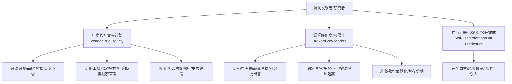

#### 定价锚点差异本质：防御价值 vs 进攻价值
| 定价维度 | 厂商官方赏金（防御侧） | 经纪商/灰黑市（进攻侧） |
|----------|------------------------|------------------------|
| **价值锚点** | **修复成本+品牌声誉损失规避+合规成本** | **武器化利用价值+情报收集效能+目标渗透成功率** |
| **定价逻辑** | 边际成本递增，设封顶线控制预算 | 边际收益递增，稀缺性驱动溢价（独家 0day 无上限） |
| **支付触发** | 漏洞验证通过+补丁发布 | 交付可用 EXP/POC+独家性确认 |
| **买家画像** | 厂商安全团队（单一买家） | 政府/军工/情报机构/红队/犯罪集团（多买家竞价） |
| **生命周期** | 漏洞公开后价值归零 | 漏洞公开前价值最高，公开后可转售「N-day」利用代码 |

#### 苹果「迟到」的战略考量与现实反讽
- **官方理由**：「苹果认为自己的出价永远都超不过黑市和政府的出价，所以出价没有意义。」（原文引用）
- **现实打脸**：计划发布不足一周，Exodus 即以 2.5 倍价格公开收购 iOS 0day。
- **深层逻辑**：
  1. **信号传递**：赏金计划不仅是买漏洞，更是向安全社区、股东、监管释放「重视安全」信号。
  2. **人才筛选**：通过邀请制、分级定价筛选高水平白帽，建立长期合作关系（如 Project Zero 风格）。
  3. **合规护城河**：合法渠道获取漏洞，规避《计算机欺诈和滥用法案》（CFAA）等法律风险。
  4. **生态建设**：引导漏洞流向防御侧，压缩灰黑市供给，抬高攻击者成本（CoA）。

### 白帽子的利益抉择与伦理困境

#### 收入对比测算（以顶级 iOS 0day 为例）
| 变现路径 | 预期收入 | 时间成本 | 法律风险 | 声誉影响 | 可持续性 |
|----------|----------|----------|----------|----------|----------|
| **苹果官方赏金** | $200,000 | 高（审核/配合修复） | 无 | 正面（荣誉/简历/受邀） | 高（长期合作） |
| **Exodus 等经纪商** | $500,000 | 低（交付即付） | 中（合同约束/出口管制） | 中性/负面（灰色地带） | 中（单次交易） |
| **多家经纪商拍卖** | $500k-$1M+ | 中（谈判/竞价） | 高（违反独家/法律） | 负面（信誉破产） | 低（一次性） |
| **政府/军工直销** | $1M+ | 高（背景审查/资质） | 低（合法合同） | 特定圈层正面 | 高（长期供应商） |
| **勒索/犯罪变现** | 不确定/极高 | 低 | 极高 | 极负面 | 极低 |

#### 「盗亦有道」的群体自律机制
> 原文结语：「不过令人欣慰的是，仍有许多白帽子放弃了更高的赏金，而选择将漏洞报告给科技公司，正所谓『盗亦有道』。」

**白帽子坚守官方渠道的核心动因**：
1. **法律安全区**：官方渠道提供《安全港》条款豁免，经纪商合同通常含「出口管制/最终用户证明」陷阱。
2. **职业资本积累**：CVE 编号、厂商致谢榜、受邀顶会、简历亮点、转正/跳槽筹码。
3. **生态共识**：「负责任披露」是社区准入门槛，违者将被拉黑、失去平台资格（H1/BC/Intigriti 等）。
4. **长期博弈**：厂商可能提供持续保留费、咨询合同、股权激励，生命周期价值（LTV）> 单次高价。
5. **道德认同**：「守护用户安全」vs「武装攻击者」的自我定位差异。

### 漏洞市场演进脉络与 2016 关键节点意义

#### 漏洞交易市场发展阶段
| 阶段 | 时间跨度 | 核心特征 | 典型代表 | 定价机制 |
|------|----------|----------|----------|----------|
| **萌芽期** | 1990s-2000s | 邮件列表/论坛公开交易/共享，价格低/无标准 | Bugtraq、Full Disclosure、eBay 拍卖漏洞 | 非标准化、声誉驱动 |
| **商业化启动期** | 2000s-2010s | 厂商赏金计划兴起（Netscape/Mozilla/Google）、经纪商出现（iDefense/TippingPoint/Wabisabi/Zerodium） | Google VRP (2010)、iDefense VCP、Zerodium 成立 (2015) | 双轨制：官方封顶+灰市溢价 |
| **成熟分层期** | 2010s-2020s | 平台化（HackerOne/Bugcrowd/Intigriti）、国家级采购、漏洞衍生品（漏洞保险/期权）、AI 辅助挖掘 | Apple Bounty (2016)、Microsoft Bounty 扩容、Zerodium $1.5M iOS 链、Exodus 公开价目表 | 多层次定价：厂商/平台/经纪商/政府/黑市 |
| **合规化/金融化期** | 2020s-至今 | 漏洞奖励纳入财务预算、漏洞债券/证券化探索、SBOM/VDR 强制披露、出口管制（瓦森纳协议）纳入 0day | CISA KEV 目录、EU CRA、漏洞优先级评分（EPSS/SSVC） | 标准化定价模型、风险量化定价、监管定价 |

#### 年关键里程碑事件
| 事件 | 时间 | 意义 |
|------|------|------|
| **Apple 正式发布漏洞赏金计划** | 2016-08 (Black Hat) | 最后一家「FAANG」巨头加入，标志着厂商赏金成主流标配 |
| **Zerodium 推出 $1M iOS 9 链利用奖励** | 2015-09 / 2016-09 | 单漏洞报价突破百万大关，重塑市场价格锚点 |
| **Exodus Intelligence 公开价目表** | 2016-08 | 经纪商首次透明化报价，倒逼厂商重新评估定价策略 |
| **HackerOne 平台化运营成熟** | 2016 | 平台托管赏金超 $10M，连接企业与全球白帽，标准化流程 |
| **瓦森纳协议修正案纳入「入侵软件」** | 2013/2017 生效 | 0day 出口管制法律化，经纪商合规成本激增 |

### 跨期知识关联与行业映射

#### 与本页面其他文章的呼应
| 本页面文章 | 关联维度 | 共同洞察 |
|--------------|----------|----------|
| **顺丰内鬼案** | 数据变现路径 | 漏洞与数据同属「数字资产」，均面临「内部流失→灰黑市分级定价→精准变现」链条 |
| **徐玉玉案** | 精准画像依赖 | 0day 攻击常为精准诈骗/APT 提供初始访问/权限提升/数据窃取技术基座 |
| **顾问式销售** | 人才变现路径 | 顶级漏洞研究者本质是「技术型销售/顾问」，向厂商/经纪商/政府「销售」漏洞情报 |
| **城市选择/健康/文化** | 从业者生存状态 | 高强度漏洞挖掘（熬夜/逆向/调试）加剧健康透支，圈层文化中「0day 手握几个」成社交货币 |

#### 同期外部知识库对标
| 参考页面 | 关联视角 |
|----------|----------|
| [[cve-digest-20210325]]、[[cve-digest-20210326]] | CVE 漏洞聚合视角：大量 PoC/EXP 公开发布，反映「N-day」市场供给过剩、「0day」稀缺性维持高价 |
| [[apt-c-08-mobile-attack-analysis]] | APT 攻击视角：移动端 0day 为 APT-C-08 等组织提供核心武器，经纪商是关键供应链环节 |
| [[wechat-pc-v8-rce-0day-analysis]] | 实战利用视角：微信 PC 版 0day（Chromium V8）配合 CobaltStrike 实战，印证 0day 武器化价值 |
| [[hvv-2021-vulnerability-collection]] | 红队实战视角：HVV 期间红队大量采购/使用 1-day/0day，经纪商与平台成核心军火库 |

### 知识卡片：漏洞定价模型与研究者决策框架（v1.0）

#### 核心定价公式（概念模型）
$$P_{vuln} = V_{exploit} \times P_{success} \times T_{window} \times S_{exclusivity} \times (1 - R_{legal})$$

| 变量 | 含义 | 厂商视角 | 经纪商视角 | 研究者决策权重 |
|------|------|----------|------------|----------------|
| $V_{exploit}$ | 利用价值（数据窃取/勒索/间谍/破坏） | 修复成本+声誉损失 | 买家支付意愿上限 | 0.3 |
| $P_{success}$ | 利用成功率/稳定性 | 降低成功率=缓解风险 | 高稳定性=高溢价 | 0.2 |
| $T_{window}$ | 0day 生命周期（补丁前窗口） | 缩短窗口=降低损失 | 延长窗口=高价值 | 0.2 |
| $S_{exclusivity}$ | 独家性系数（1=独家，<1=共享） | 不要求独家 | 强要求独家 | 0.15 |
| $R_{legal}$ | 法律/合规风险折扣 | 无风险 | 高风险折扣 | 0.15 |

#### 研究者变现路径决策树
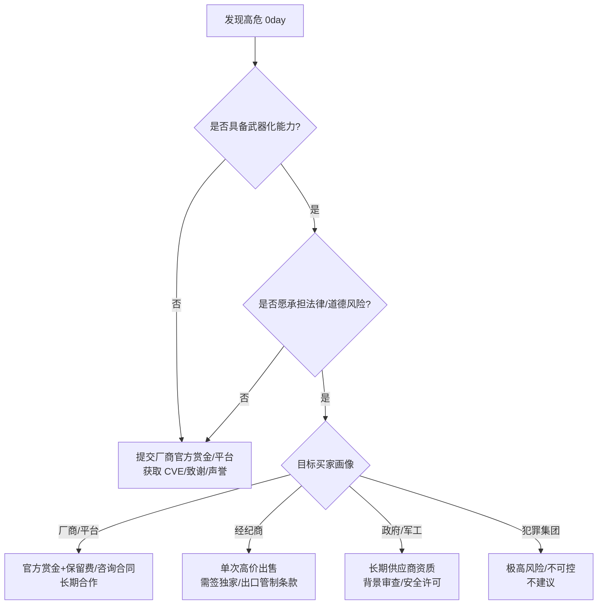

#### 组织层面漏洞采购策略建议（买方视角）
| 组织类型 | 推荐策略 | 关键指标 |
|------------|----------|----------|
| **大型科技厂商** | 分级赏金+邀请制私有计划+平台托管+内部红队+经纪商情报订阅 | 覆盖率/修复时效/白帽留存/成本漏洞比 |
| **金融/关基企业** | 平台私有计划+威胁情报订阅(含 0day 预警)+红队常态化+漏洞保险 | 风险降低量/MTTD/MTTR/保费ROI |
| **中小企业** | 平台公共计划+托管扫描/渗透测试+SaaS WAF/ASP+漏洞订阅 | 单位成本覆盖率/合规达标率 |
| **政府/军工** | 经纪商长期框架协议+自主挖掘团队+盟友情报共享+零日储备库 | 战略漏洞储备量/作战可用性/合规性 |

### 实践价值与应用场景

#### 漏洞应急响应与威胁情报融合
- **0day 预警机制**：订阅 Exodus/Zerodium/经纪商公开价目表/博客/推特，监测目标组件（iOS/Chrome/Edge/Windows/Adobe）报价波动，**报价飙升往往预示在野利用或高可用 0day 存在**。
- **补丁优先级决策**：结合 EPSS/KEV/CISA 目录、经纪商报价、威胁情报「在野利用」标签，建立「补丁优先级 = f(报价, 在野利用, 资产关键度, 补丁可用性)」量化模型。
- **红队武器库建设**：合规前提下，通过平台/经纪商采购 1-day/0day 验证防御有效性，重点覆盖「边界-身份-端点-数据」四层关键路径。

#### 安全预算分配与 ROI 论证
- **赏金预算论证**：参考「厂商赏金 vs 经纪商报价」价格剪刀差，论证「每投入 $1 赏金，节省 $5-10 灰黑市采购成本/事件损失」。
- **漏洞保险定价**：引入经纪商报价作为「漏洞市场公允价值」参考，配合资产价值、暴露面、补丁管理成熟度，精算网络险保费与赔付上限。
- **人才薪酬锚定**：顶级漏洞研究者年产出 1-2 个高危 0day，市场价值 $200k-$500k/个，**薪酬包设计可参考「漏洞产出期权/分红」模式**，对标顾问式销售「技术变现」路径。

#### 人才培养与职业发展指导
- **漏洞研究者成长路径**：CTF/靶场实战 → 平台赏金积累声誉/CVE → 受邀私有计划/保留费 → 独立顾问/经纪商合作/厂商全职/创业。
- **伦理与法律教育必修**：出口管制（EAR/ITAR/瓦森纳）、CFAA/《网络安全法》/《数据安全法》、合同独家条款/责任豁免/赔偿上限、负责任披露流程/时间线/协调机制。
- **健康可持续性**：漏洞挖掘高强度脑力劳动，需引入[[#深度沉淀五]]健康管理框架，避免「用大脑换 0day，用 0day 换钱，用钱买健康」恶性循环。

---

## 衍生知识卡片（七文章共用）

### 卡片 1：快递/物流/教育/金融等高敏感行业个人信息保护「最小可行性防护清单（MVP）」
> 适用于**资源受限、数据敏感、监管重点**行业的数据安全基线建设
| 防护层 | 必做项（P0） | 进阶项（P1） | 成熟度指标 |
|--------|--------------|--------------|------------|
| **数据分级** | 核心业务数据（面单/考生/交易/征信）标记为「核心/重要」，建立资产目录 | 自动化发现+标签化+流向图谱+价值量化 | 100% 核心数据纳管、分级准确率>95% |
| **访问控制** | 研发/运维禁直连生产库；一线账号「一人一号、MFA、最小权限、定时回收」 | ABAC 动态授权+特权会话代理(PAM)+水印溯源+地理围栏 | 越权访问拦截率 100%、特权操作录像回放率 100% |
| **流转管控** | 导出需工单审批、单日限额、全字段水印、禁止个人网盘/非加密传输 | DLP 网关+加密流转+区块链存证+隐私计算(多方安全计算) | 违规导出零发生、跨境流转合规率 100% |
| **监测告警** | 数据库审计+网络流量基线+端点敏感文件监测，三大基线告警 | UEBA 行为画像+威胁情报关联+自动化阻断+攻击链复现 | 百万级导出分钟级发现、内鬼画像命中率>90% |
| **事件响应** | 7×24 小时值守、泄露溯源 SOP、证据固化取证、监管通报模板、追赃挽损流程 | 仿真演练+网络保险转移+跨部门联动+公关舆情应对 | 从发现到阻断 < 30 分钟、通报合规率 100% |
| **供应链** | 外包准入安全评估、合同含安全条款、交付验收含渗透测试、人员离职即回收 | 外包商安全能力成熟度等级要求、源代码托管、持续监测评估 | 外包相关事件占比<10%、整改闭环率 100% |

### 卡片 2：研发/运维/数据分析等高权限人员「内部威胁画像与防控策略」
| 画像维度 | 高风险特征 | 针对性防控 |
|----------|------------|------------|
| **权限特征** | 拥有生产库 Root/SA、K8s cluster-admin、CI/CD 发布权限、大数据平台超管 | 权限「时效化、最小化、双人制、全审计、即时撤销」 |
| **行为基线** | 正常：小结果集、业务工具、工作时间、跳板机、公司设备 | 偏离：大结果集、Navicat/脚本直连、深夜/周末、个人设备、网盘/邮件外发、加密隧道 |
| **动机识别** | 离职跳槽带数据、灰产变现、被胁迫/收买、好奇心越界、报复心理 | 离职前 30/60/90 天分级强化监测、定期背景核查、心理关怀/EAP、利益冲突申报、举报奖励 |
| **技术对抗** | 加密隧道、分卷压缩、隐写术、云盘分片、链式跳板、活在带宽中、时间窗口切割 | 流量解密检测(TLS 1.3 指纹)、文件指纹匹配、端点微隔离(EDR)、零信任网络准入(ZTNA)、蜜罐数据诱捕 |

### 卡片 3：安全从业者城市选择决策辅助工具（交互式 v2.0）
> 可制成 Excel/Notion/小程序/内部系统工具，供个人/导师/HR/园区招商使用
- **输入维度扩展**：
  - 个人画像：年龄/婚恋/技能栈/证书/英语/项目经验/风险偏好/家庭约束/职业锚
  - 城市指标：薪资分位/房价租金/岗位密度/落户门槛/生活质量/圈层浓度/产业政策/人才补贴/通勤半径/医教配套/气候宜居度
- **计算引擎**：
  - 多目标优化（NSGA-II）/ AHP 层次分析 / TOPSIS 逼近理想解
  - 否决性约束硬过滤（如：单身不限、已婚伴侣工作地、父母养老地、户籍限购）
  - 敏感性分析：蒙特卡洛模拟指标波动、权重扰动鲁棒性测试
- **输出产物**：
  - 推荐城市排序（含置信区间）
  - 关键风险提示（薪资倒挂/房价风险/政策变动/圈层断层）
  - 个性化准备清单（简历定制/面试重点/落户材料/居住区域/社交切入/技能补强）
  - 决策复盘模板（半年/年度复盘、偏差归因、策略调整）
- **数据源对接**：
  - 招聘平台薪资热力图、安居客/贝壳房价数据、政府人才政策库、行业协会人才报告、社交媒体圈层画像、通勤地图 API

### 卡片 4：电信网络诈骗全链条治理「打击-防范-管控-建设」四维模型
> 基于徐玉玉案、断卡行动、反诈法（2022）实践提炼
| 维度 | 核心抓手 | 关键指标 | 协同主体 |
|------|----------|----------|----------|
| **打击（源头治理）** | 破案攻坚/跨境追逃/资金追赃/犯罪资产没收/判决执行 | 破案率/追赃率/判决执行率/跨境抓捕数 | 公安/检法/外交/国际刑警/金融监管 |
| **防范（技术固化）** | 反诈预警模型/号码标记/APP反诈SDK/AI反欺诈/隐私计算/区块链存证 | 预警准确率/拦截率/误拦率/用户触达率/模型迭代周期 | 运营商/互联网平台/安全厂商/银行/公安 |
| **管控（制度约束）** | 实名制/一证五号/断卡/反诈法/个人信息保护法/数据分级分类/供应链准入 | 实名覆盖率/违规号码清理率/合规整改率/行政处罚案均罚款 | 工信部/网信办/公安/市监/银保监/教育/住建等 |
| **建设（生态共治）** | 全民反诈教育/反诈志愿者/白帽子奖励/威胁情报共享/反诈保险/国际合作 | 知晓率/举报率/情报贡献度/赔付率/跨境合作案件数 | 学校/社区/媒体/社团/企业/保险/外交 |

### 卡片 5：安全从业者健康管理「个人-团队-组织」三级联动框架
> 整合原文倡议、行业现状、行为科学、管理学原理，产出可落地的健康治理体系

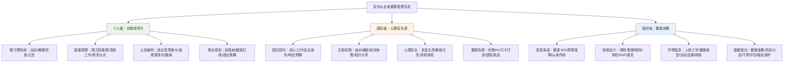

**成熟度分级（参考 CMMI/DSMM 思路）**：
| 级别 | 特征描述 | 关键里程碑 |
|------|----------|------------|
| **L0 混乱** | 无关怀、纯靠自觉、健康透支常态化、离职后才觉醒 | — |
| **L1 初始** | 有体检福利、偶尔团建运动、EAP 采购但利用率<5% | 体检覆盖率>90%、EAP 上线 |
| **L2 管理** | 弹性工时/强制下班/健康打卡群/管理者识别预警/团队复盘含健康 | 制度落地、管理者赋能、数据采集 |
| **L3 定量** | 健康风险分层/精准干预/ROI 核算/健康纳入绩效/供应商准入含健康 | 模型化、证据基、投入产出可视 |
| **L4 优化** | 个性化健康方案/家庭延伸/社区共建/行业标杆输出/健康成战略资产 | 生态化、品牌化、可持续、可复制 |

### 卡片 6：安全从业者文化心理画像与组织关怀文化层落地清单
> 基于《挂念：黑客独白》文化基因提炼，补充健康管理框架的文化维度

| 文化基因 | 组织文化落地动作 | 关键指标 | 避坑指南 |
|----------|------------------|----------|----------|
| **夜猫子时间主权** | 核心工时 10:00-16:00、其余异步、禁止深夜会议/强制回复 | 深度工作时段保护率、深夜消息响应期望值管理 | 避免「弹性」异化为「全天候待命」 |
| **技术信仰确证** | 设立「技术理想主义奖」、开源贡献计入绩效、造轮子鼓励机制 | 非功利性技术探索占比、开源贡献人数/质量 | 避免「技术情怀」成为压榨免费加班的道德绑架 |
| **圈层真实关系** | 无职务头衔技术分享会、跨级导师制、失败复盘免责、私有群文化建设 | 心理安全感评分、跨团队技术协作频次、求助响应时长 | 避免「兄弟文化」异化为排他性小圈子/裙带关系 |
| **兄弟/战友情义** | 战队制项目管理、轮岗互备机制、家属关怀纳入福利、困难互助基金 | 团队稳定性、知识共享广度、家属满意度、互助基金使用率 | 避免「忠诚」异化为不合理牺牲/违规操作的掩护 |
| **现实主义英雄** | 结果导向绩效、底线思维奖励、技术传承师徒制、长期主义激励 | 关键项目交付率、安全零事故率、人才培养输出率、长期留存率 | 避免「英雄主义」异化为个人英雄主义/流程规避/文档缺失 |

### 卡片 7：漏洞经济学决策参考卡——研究者/厂商/经纪商/买方四视角
> 基于苹果 vs Exodus 案例，提炼漏洞定价、交易、治理核心要素

| 视角 | 核心决策变量 | 关键行动 | 避坑指南 |
|------|--------------|----------|----------|
| **研究者（卖方）** | 漏洞等级/武器化难度/独家窗口期/法律风险承受/职业规划 | 分级变现：顶级→经纪商/政府；次级→厂商赏金/平台；批量→平台/厂商保留费 | 切勿同时向多方兜售同一漏洞（违约/法律/信誉三重风险）；警惕经纪商「先验证再付款」陷阱 |
| **厂商（买方-防御）** | 资产关键度/威胁模型/预算上限/修复能力/生态建设 | 分级赏金+私有计划+平台托管+红队对抗+经报订阅+漏洞保险 | 避免「赏金封顶」成为经纪商定价锚点；建立「漏洞采购预算 = f(资产价值, 威胁等级)」动态模型 |
| **经纪商（中间商）** | 买家库深度/独家获取能力/出口管制合规/品牌声誉/资金周转 | 低买高卖+分级分销+法律合规包装+威胁情报增值服务 | 严守「最终用户证明」合规底线；避免单一买家依赖；建立漏洞全生命周期管理（获取-验证-交付-售后-披露） |
| **终端买方（政府/红队/犯罪）** | 作战需求/技能缺口/预算/合规/归因风险 | 需求驱动采购+自主挖掘互补+盟友共享+武器化集成+OPSEC | 政府/军工：合规采购留痕、供应链安全审查；红队：授权范围内使用、避免「野生 0day」失控；犯罪：高风险/不可持续 |

---

## 实践价值与应用场景

### 合规建设实战参考
- **数据分级分类落地样板**：以「面单数据」「考生数据」为切入点，完成「资产梳理-分级定级-流向绘制-风险评估-防护配置-持续监测」闭环，可复制到 CRM、ERP、HR、学生系统、资助系统等核心系统。
- **关键基础设施保护**：快递面单系统、学生资助系统属于「行业重要信息系统」，参考《关键信息基础设施安全保护条例》开展专项备案与测评。
- **外包供应链安全管理**：建立「准入评估-合同约束-过程监管-交付验收-持续考核-退出管理」全生命周期体系，参考 DSMM/等保 2.0/JR/T 0183/ISO 27036。
- **漏洞管理体系建设**：引入「漏洞全生命周期管理」（发现-评估-修复-验证-复盘），接入威胁情报（含经纪商公开价目表）、建立补丁优先级量化模型、配置漏洞保险转移残余风险。

### 红蓝对抗实战转化
- **红队视角**：
  - 凭证获取：钓鱼→主管账号→横向移动→数据库直连（参考 [[shuiying-domain-enumeration-tool]] 域渗透枚举思路）
  - 数据窃取：分卷压缩+加密+云盘分片+DNS 隧道外传（规避 DLP）
  - 溯源对抗：时间戳篡改、日志清理、跳板机链式代理、活在带宽中
  - 精准诈骗模拟：构建考生/快递用户画像库、话术库、号码池、洗钱通道，端到端演练
  - **0day 武器库采购**：合规前提下评估经纪商/平台 0day 质量/价格/交付时效，构建「初始访问-权限提升-横向移动-数据窃取」全链条武器化能力
- **蓝队视角**：
  - 蜜罐数据部署（面单/考生/交易），触发即报警、溯源定位
  - 研发/高权账号「假权限」诱捕，实时录像取证、行为分析
  - 数据水印+区块链存证，事后溯源定责、证据固化
  - UEBA 基线建模：研发身份+生产库+大结果集+非常用时间+网盘上传=高危
  - 反诈演练：模拟诈骗电话/短信/邮件/APP 推送，考核员工/学生/家长「识别-举报-求助」闭环
  - **0day 预警与虚拟补丁**：监测经纪商报价/威胁情报/在野利用，WAF/RASP/微隔离部署虚拟补丁，缩短「补丁窗口期」暴露面

### 安全人才培养案例库
- **案例教学点**：
  - 内部威胁「技术+管理+法律」三维建模（顺丰案/徐玉玉案对比）
  - 权限失控「症状-根因-对策」鱼骨图分析
  - 黑产链条「上中下游」打击策略与取证链构建
  - 职业选择「显性收益-隐性成本-心理预期-约束边界」四维决策模型
  - **顾问式销售转型「技术广度+商业深度+客户信任+方案落地」四维能力模型与自评雷达图**
  - 诈骗治理「打防管建」四维协同与长效机制设计
  - 从业者健康「生理-心理-认知-社会」四维管理与组织关怀体系设计
  - **黑客文化「时间主权/技术信仰/圈层真实/兄弟情义/现实英雄」五基因与组织文化建设**
  - **漏洞经济学「防御价值vs进攻价值/三方博弈/定价锚点/研究者决策树」与组织采购策略**
- **实训靶场**：
  - 模拟「阿修罗系统/学生资助系统」环境，包含权限绕过、批量下载、审计绕过、数据外传全链路攻防演练
  - 模拟「虚拟运营商/短信网关/伪基站」诈骗基础设施搭建与溯源取证演练
  - 模拟「跨省/跨境诈骗案件」多警种协作、电子数据取证、资金追踪冻结实战演练
  - 模拟「高强度应急响应/长周期攻防演练」中的健康管理演练：轮岗休息、营养补给、心理疏导、决策质量监测
  - **模拟「技术社群文化建设」沙盘：圈层冲突调解/知识分享激励/新人融入/失败复盘/跨代际传承**
  - **模拟「顾问式销售实战」沙盘：线索挖掘/需求挖掘/方案设计/投标答辩/谈判签单/交付协同/续费拓展**
  - **模拟「漏洞挖掘-变现-治理」全流程沙盘：靶场挖掘/平台提交/经纪商议价/厂商修复/补丁验证/情报共享/保险理赔**

---

## 页面维护与扩展指南

### 增量更新触发条件
- [ ] 司法文书网公开陈洋、严某、徐玉玉案相关**生效判决书/裁判文书**，补充量刑细节、赔偿执行、追赃挽损、从犯定性情况
- [ ] 顺丰、教育部、工信部、公安部发布**数据安全治理白皮书/最佳实践/专项行动通报**，对标本文失效节点的整改成效
- [ ] 《个人信息保护法》《数据安全法》《反电信网络诈骗法》配套**行业标准/监管指引/司法解释**发布，更新合规映射表
- [ ] 发生**同类新案例**（如其他快递公司、同城配送、电商平台商家后台、招生考试系统内鬼泄露），纳入对比案例库
- [ ] 301在路上发布**新文章**（特别是 2018-2022 年期间），补全索引条目并评估沉淀价值
- [ ] 行业人才报告/薪酬白皮书/城市发展指数/反诈大数据报告/从业者健康调研/黑客文化研究更新，刷新城市选择决策模型参数与诈骗画像库/健康管理基线/文化心理画像/顾问式销售能力模型
- [ ] **安全从业者群体健康调查报告/白皮书**发布（如免费Buf/安全客/行业协会/头部厂商联合发布），纳入健康管理框架校准
- [ ] **黑客/安全从业者亚文化研究成果**发布（学术论文/行业报告/纪录片/口述史），纳入文化心理画像演进脉络
- [ ] **乙方安全公司组织变革/销售体系转型/顾问式销售实践案例**公开，更新人才需求演进图谱
- [ ] **苹果/谷歌/微软等厂商漏洞赏金计划重大调整**、**Zerodium/Exodus 等经纪公司公开报价更新**、**重大 0day 交易案例曝光**（如 NSO Group Pegasus、Citizen Lab 披露等），更新漏洞经济学模型参数

### 关联页面扩展建议
| 目标页面 | 扩展动作 | 价值点 |
|----------|----------|--------|
| [[0w1club-wechat-archive-201707-201903]] | 互引「社团运营/人才培养/职业发展/反诈教育/健康关怀/黑客文化/顾问式销售/漏洞经济」专题，对比高校社团视角与行业媒体视角的职业观/安全观/健康观/文化观/销售观/市场观差异 | 多视角校准人才画像与安全意识教育模型 |
| [[apt-detection-deployment-strategy]] | 互引「UEBA 建设选型」章节，补充「研发高权限账号/考生数据经办人员/销售高权账号异常行为基线」典型场景 | 将 APT 检测能力下沉至内部威胁与业务风控场景 |
| [[secquan-bugwarning-1071987-device-credential-leak]] | 互引「凭证泄露-未授权访问-后台绕过」攻击链，对比物联网设备与业务系统凭证管理异同 | 跨场景复用凭证安全治理模式 |
| [[security-study-group-methodology]] | 在「实战案例库」增补七案作为「内部威胁分析/数据安全治理/黑产溯源/职业规划/顾问式销售转型/反诈治理/健康管理/文化建设/漏洞经济」九大教学模块 | 理论联系实际，产出可复用教学资源 |
| [[insider-threat-courier-waybill-data-leakage]] | 已存在关联，建议双向链接，形成「事件详情-索引总览-专题沉淀」三角引用 | 知识图谱闭环 |
| [[daily-security-digest-20191220]] | 互引「Facebook手机号泄露/zzzphp SQL注入」作为个人信息泄露常态化佐证，补充技术漏洞视角 | 多源泄露路径拼图 |
| [[cve-digest-20210325]]、[[cve-digest-20210326]] | 互引 CVE 漏洞聚合页面，补充「漏洞披露-利用代码发布-经纪商定价-在野利用」全链条市场侧写 | 漏洞生命周期经济学视角补全 |

---

## 结语

**这七篇相隔半年左右的文章，共同拼贴出 2016-2017 年中国网络安全行业的一个立体切面：**

- **数据层面**：传统行业（快递/物流/教育/金融）数字化转型狂奔，海量公民个人信息在「业务系统上云快、安全架构滞后、权限模型失控、监测响应缺位、外包供应链失管」的裂隙中批量流向黑产，形成「窃取-清洗-分类-定价-分销-精准变现」的成熟产业链。**徐玉玉案揭示了「精准画像+政策模仿+时间窗口」的定向鱼叉式诈骗新范式，顺丰案揭示了「内鬼+工具化+分级分销」的数据黑产成熟模式。**
- **漏洞层面**：苹果补齐赏金拼图、Exodus 公开高价收购 0day，**漏洞市场「防御侧定价 vs 进攻侧定价」剪刀差显性化**，白帽子面临「合法低价 vs 灰色高价」的利益抉择，厂商试图用「合规+生态+长期主义」对抗「武器化+独家+短期暴利」的灰黑市逻辑。**漏洞经济学成为连接技术、法律、伦理、地缘政治的关键枢纽。**
- **人才层面**：安全从业者作为这场数字化转型的「建设者/守护者/受害者」，在北上广深的高薪高压与二三线的低薪舒适之间反复权衡，既是「阶级跃迁」的追梦人，也是「房价/通勤/孤独/35岁危机」的承担者。**顾问式销售文章精准识别了乙方安全公司「懂技术的销售/懂销售的技术」稀缺人才缺口，为技术出身渴望商业变现的从业者提供了新路径；漏洞研究者则在「白帽赏金/灰帽经纪/黑帽犯罪/红队实战/政府供职」多条赛道中寻找技术变现最优解。**
- **健康层面**：行业高强度认知负荷、7×24 待命、攻防不对等、合规压力叠加，导致从业者普遍陷入「用健康换钱，再用钱买健康」的恶性循环，**身心健康成为职业可持续性的隐性瓶颈**，却长期被技术迭代、业务 KPI、组织绩效所遮蔽。
- **文化层面**：在高压生存环境下，安全从业者群体通过《黑客独白》与《挂念》两首歌，完成了**群体文化自觉的萌芽**——「我的黑夜比白天多」确证时间主权与技术信仰，「三个人就像三角一样」构建最小稳定信任单元，「脚踏实地一步步走着」确立现实主义英雄主义。这不仅是情感宣泄，更是**职业身份的确证与圈层文化的建设**。
- **治理层面**：无论是《网络安全法》刚颁布时的顺丰内鬼案、徐玉玉案，还是后来《个保法/数安法/反诈法》落地后的各类泄露案，**核心矛盾始终是：数据价值已被下游充分变现（精准营销/刷单/诈骗/情报/助贷/保单），漏洞价值已被进攻侧充分武器化（APT/红队/犯罪/勒索），上游防护成本却极低（内部人员道德/法律成本）、防御投入严重滞后（买设备堆日志事后查）、问责机制长期缺位（主管违规无追责、研发直连成惯例、外包商无约束、虚商监管真空），从业者健康投入更是近乎为零，群体文化建设长期缺位。**

八年过去，法规已立（个保法/数安法/反诈法/刑修十一）、标准已出（DSMM/等保2.0/35273/行业规范）、技术已熟（零信任/DLP/UEBA/水印溯源/区块链存证/隐私计算/PAM/蜜罐/AI反欺诈/漏洞优先级量化），专项行动常态化（断卡/净网/护苗/护网），但**「内鬼泄露」「精准诈骗」「考生信息泄露」「虚商违规」仍是高发常态，「北上广深还是二线」仍是从业者反复纠结的永恒话题，「加班熬夜猝死/抑郁/发际线后移」仍是行业高频自嘲梗，「黑客/红客/白帽」标签之争仍在继续，「顾问式销售/技术型销售」仍是乙方公司招聘 JD 的高频关键词，「苹果赏金 vs Zerodium/Exodus 高价」的剪刀差仍在动态博弈**。根因不在技术，而在：

1. **数据资产「不知、不清、不控」**：面单/考生/交易/征信数据在哪、谁有权限、流向何方、价值几何、泄露代价几何，心中无数。
2. **人员权限「大、散、久、共」**：高权限账号多、分布散、生命周期长、共享成风、离职不回收、异常不告警。
3. **监测响应「盲、慢、软、虚」**：异常不监测、告警不处置、违规不追责、演练不实战、溯源不彻底、判决不执行。
4. **供应链「准入不严、过程不管、交付不查、退出不清」**：外包商成「数据黑洞」，开发用真数据、测试无脱敏、运维直连生产、离职带走代码/数据/账号。
5. **黑产/灰产「利高、本低、险小、适强」**：数据/漏洞边际成本趋零、作案工具服务化、洗钱通道隐蔽化、跨境躲避打击、AI 降低门槛。
6. **人才发展「卷、焦、漂、散」**：内卷无出路、焦虑无归宿、漂泊无归属、离散无传承、技能速贬值。
7. **健康投入「无、滞、浅、散」**：组织无预算、管理无考核、个人无觉醒、干预无体系、文化无支撑。
8. **文化建设「缺、弱、散、虚」**：群体文化自觉缺失、圈层认同脆弱、代际传承断层、文化符号被外部定义/消费/异化。
9. **漏洞治理「两张皮、断层、滞后」**：厂商赏金与灰黑市定价脱节、官方修复与在野利用赛跑、合规采购与实战需求错位、国际出口管制与国内创新张力。

> **「供应链安全中的第三方风控，特别是电商领域、基础岗越大的传统行业更为严重，快递行业的安全性堪忧，坑了多少家合作伙伴」** —— 作者 2016 年的结语拷问，至今仍是每个数据控制者、处理者、监管者必须直面的**战略性问题**。
>
> **「年轻就该去为了梦想去拼一下！」「现在努力的干活，就是想要尽快逃离北上。」** —— 2017 年留言里的两句对话，道尽一代安全人的**进退维谷与破茧重生**。
>
> **「助学金之事为真，如何这样的信息会被人获取？泄露源在哪？」** —— 2016 年徐玉玉案留下的十大追问，至今仍是**数据安全治理、反诈打击、个人信息保护、数字政府建设**必须直面的**战术性问题**。
>
> **「人真正的财富就是保持一颗正能量的心态，真正的财务是健康和技能，养好身体，多读书，多学习，多求经验，就是前途的保障。」** —— 2016 年健康倡议中的核心金句，是**职业可持续性的第一性原理**，亦是**组织长期主义的试金石**。
>
> **「不要说我是什么黑客，就因为我的黑夜比白天多」「三个人就像三角一样，哪个方向拿出手去都是最尖儿」** —— 2016 年文化自觉中的核心隐喻，是**群体身份确证的文化基因**，亦是**组织文化建设的原点坐标**。
>
> **「苹果出价永远超不过黑市，所以出价没有意义」——不到一周，Exodus 以 2.5 倍价格打脸。** —— 2016 年漏洞市场博弈的缩影，揭示**「防御侧边际成本 vs 进攻侧边际收益」的结构性失衡**，唯有「合规护城河+生态长期主义+量化风险投入」可逐步收窄剪刀差。
>
> **「创业，我们在路上；健康，我们携手在路上；文化，我们自觉在路上，下周开始每天抽半小时出来，锻炼身体！」** —— 从「在路上」到「携手在路上」再到「自觉在路上」，从倡议到行动再到文化自觉，这不仅是对个人的嘱托，更是对**行业生态重塑**的微光期许：技术治理有标准、数据流转有秩序、漏洞市场有规制、人才发展有尊严、从业者健康有保障、群体文化有自觉、**技术变现有路径、销售服务有价值、防御投入有回报**。

---

**来源登记**  
- 原文 1：2016左右，301在路上微信公众号，《安全顾问式销售，你感兴趣？》  
  链接：http://mp.weixin.qq.com/s?__biz=MzIwMTQ2NzY4NA==&mid=2652521189&idx=1&sn=5611c7415cb5cef170434d0c6a68a949&chksm=8d0390aeba7419b8bd3e95f34fb543f72a128a254badff956464b290da54e24c1ed0b48a71be&scene=126&sessionid=1681656722#rd  
- 原文 2：2016-08-26，301在路上微信公众号，《某快递公司再现内鬼，泄露客户信息》  
  链接：http://mp.weixin.qq.com/s?__biz=MzIwMTQ2NzY4NA==&mid=2652521206&idx=1&sn=0a5a10eb3f2aede0cf2d43672ee3cd5e  
- 原文 3：2017年前后，301在路上微信公众号，《信息安全，你我为什么(bu)选择北上广深？》  
  链接：http://mp.weixin.qq.com/s?__biz=MzIwMTQ2NzY4NA==&mid=2652521203&idx=1&sn=2d5ba681f51911e9c1f2e55db18a078e  
- 原文 4：2016-08，301在路上微信公众号，《安全讨论：准大学生被骗后离世》  
  链接：http://mp.weixin.qq.com/s?__biz=MzIwMTQ2NzY4NA==&mid=2652521201&idx=1&sn=d38e457a217ac4c8fa575a3ad3546cf3  
- 原文 5：2016-08，301在路上微信公众号，《致安全人：真正的财富是健康》  
  链接：http://mp.weixin.qq.com/s?__biz=MzIwMTQ2NzY4NA==&mid=2652521195&idx=1&sn=134e288ca44ae41f66e7ddd203ebf105&chksm=8d0390a0ba7419b6562fc19275f8a6ddafb02d0f28d99ba6fbd64ca8710b6972defb856d7321&scene=126&sessionid=1681656722#rd  
- 原文 6：2016-08，301在路上微信公众号，《挂念：黑客独白》  
  链接：http://mp.weixin.qq.com/s?__biz=MzIwMTQ2NzY4NA==&mid=2652521192&idx=1&sn=738f7be58b55c22f75eba255c5b62ab7&chksm=8d0390a3ba7419b58bd19b4d31e09ca2dedd66c2ced637dce4d962eacb826b11bbca47d34645&scene=126&sessionid=1681656722#rd  
- 原文 7：2016-08，301在路上微信公众号，《安全快讯 | 谁更有钱？苹果居然被黑帽公司打脸了！》  
  链接：http://mp.weixin.qq.com/s?__biz=MzIwMTQ2NzY4NA==&mid=2652521173&idx=2&sn=81c390f0d33c629b57b418428e59a7ee&chksm=8d03909eba741988c8b3f3de3c3f2f526fe6abb92fe4e03efacb0352ba7d412781545f58bf6e&scene=126&sessionid=1681656727#rd  
- 归档来源：[301在路上-201508-202208_053](../sources/301在路上-201508-202208_053.md)、[301在路上-201508-202208_054](../sources/301在路上-201508-202208_054.md)、[301在路上-201508-202208_055](../sources/301在路上-201508-202208_055.md)、[301在路上-201508-202208_056](../sources/301在路上-201508-202208_056.md)、[301在路上-201508-202208_057](../sources/301在路上-201508-202208_057.md)、[301在路上-201508-202208_058](../sources/301在路上-201508-202208_058.md)、[301在路上-201508-202208_059](../sources/301在路上-201508-202208_059.md)  
- 对比参考：本库内 301在路上 2015-2023 年系列文章结构化归档索引页、同期每日安全看点归档、行业法规标准库、反诈专项行动通报、漏洞赏金/经纪商公开报价历史数据

## 来源

- [301在路上-201508-202208_058](../sources/301在路上-201508-202208_058.md)
- [301在路上-201508-202208_059](../sources/301在路上-201508-202208_059.md)
- [301在路上-201508-202208_063](../sources/301在路上-201508-202208_063.md)
