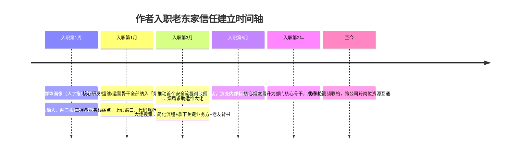
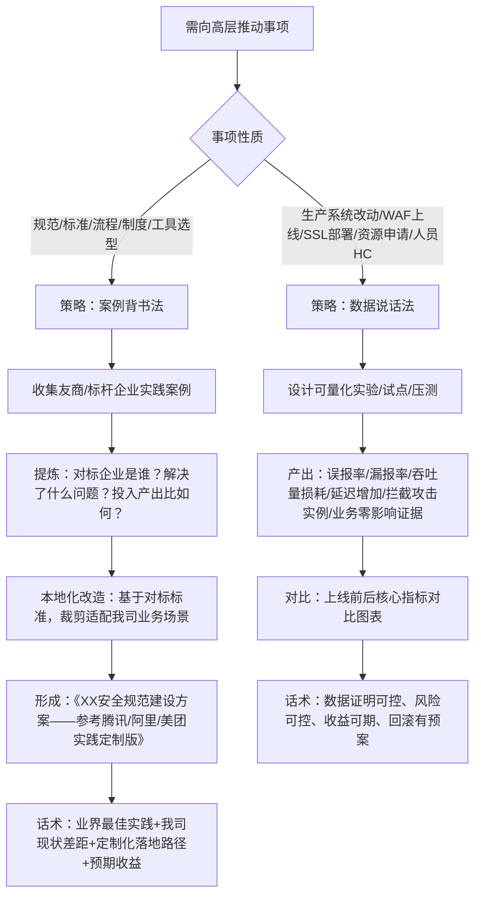

## 概述

本页面沉淀 301在路上 微信公众号发布的 **「互联网企业该如何构建安全团队」系列第六季《沟通的艺术》** 文章。该文为安全团队建设系列的收官之作，由安全从业者 **smarttang** 撰写，系统分享了安全团队在企业内部推动安全工作时的 **沟通协作实战方法论**。

文章核心观点：**沟通能力不看手腕，而看独立人格、真诚与智慧**。通过两个真实案例，分别演示了 **利用非正式社交（吸烟）建立信任网络、跨层级差异化沟通策略、以长期主义化解跨部门阻力** 的完整实战链路，为安全团队从 0 到 1、从 1 到 N 阶段的落地推进提供了可复用的「软实力」操作指南。

> **原文链接**：http://mp.weixin.qq.com/s?__biz=MzIwMTQ2NzY4NA==&mid=2652520421&idx=1&sn=111aed3afe92070ccd9a05cb362151d5  
> **系列定位**：安全团队建设六部曲终篇，前五季分别覆盖团队雏形、安全初期、困惑突破、安全中期、职位规划与工作量化。

---

## 系列文章脉络回顾

| 季度 | 标题 | 核心焦点 | 适用阶段 |
|------|------|----------|----------|
| **第一季** | 成长型互联网企业该如何构建安全团队—第一季 | 团队雏形、定位、核心人员招募 | 0→1 萌芽期 |
| **第二季** | 互联网企业该如何构建安全团队第二季—安全初期 | 基础设施搭建、基线建设、漏洞管理启动 | 1→10 起步期 |
| **第三季** | 互联网企业该如何构建安全团队第三季—困惑与突破 | 业务阻力、资源争夺、价值证明 | 遭遇瓶颈期 |
| **第四季** | 互联网企业该如何构建安全团队第四季—安全中期 | 体系化建设、平台化思维、度量运营 | 规模化发展期 |
| **第五季** | 互联网企业该如何构建安全团队-职位规划与工作量化 | 岗位体系设计、KPI/OKR 量化、绩效闭环 | 组织成熟期 |
| **第六季（本文）** | **互联网企业该如何构建安全团队—沟通的艺术** | **信任建立、跨层沟通、长期主义协作** | **全周期贯穿的软实力** |

> **交叉引用**：[[301-zai-lushang-wechat-archive-201508-202208]] 记录 301在路上 2016-2023 年核心文章合集，含本系列前五季链接与其它反思性内容。

---

## 核心方法论：三层沟通策略模型

文章构建了 **「非正式信任建立 → 向上汇报差异化 → 向下痛点导向 → 跨部门长期主义」** 四维沟通矩阵：

### 非正式社交切入：用「共同属性」破冰建立战友圈

> **核心洞察**：技术人群（研发/运维/安全）多为「单纯、善良、敢爱敢恨、直爽」群体，**共同爱好（烟/酒/音乐/游戏）是最高效的破冰切入点**。

#### 实战操作指南：以「吸烟」为例的信任建立 SOP

| 步骤 | 动作细节 | 产出价值 | 适用场景 |
|------|----------|----------|----------|
| **观察识别** | 入职首周观察：谁抽烟、喝咖啡、聊技术、玩游戏、听什么歌 | 绘制「非正式社交图谱」，标记关键节点人物 | 新环境入职、团队扩编、跨部门初识 |
| **主动搭讪** | 去指定吸烟区/茶水间/活动室，**放慢节奏、点烟/倒茶、旁听/插话** | 低压力建立首次接触，获取部门八卦/业务暗语/决策链情报 | 日常高频、零成本 |
| **情报收集** | 听：业务痛点吐槽、上游下游坑点、领导决策偏好、历史失败案例、人际冲突暗线 | 形成「业务侧视角」的安全切入点清单，避开雷区 | 持续进行、动态更新 |
| **价值交换** | 分享：安全工具脚本、漏洞挖掘技巧、自动化脚本、行业资讯、面试题库 | 建立「利他」人设，沉淀技术信用，为后续求助铺垫 | 阶段性输出、持续复利 |
| **战友锁定** | 识别：**核心业务负责人、运维大佬、研发技术骨干、有话语权的老员工** | 形成 5-8 人核心信任圈，覆盖 安全落地全链路关键节点 | 重点维护、定期联络 |

#### 真实案例复盘：作者入职老东家全记录



> **关键启示**：**技术人的信任一旦建立，边际成本极低、生命周期极长**。早期投入的「两三根烟、几顿饭、几个脚本」，后期回报为「随时响应、跨部门协调、关键节点背书」。

---

### 向上汇报：差异化话术体系——案例背书 vs 数据说话

安全负责人向高层（CTO/VP/CEO/业务总监）汇报，**核心原则：要么拿案例说话，要么拿数据说话**。

#### 话术选择决策树



#### 实战模版：两类汇报文档标准结构

| 文档类型 | 标准章节 | 高层关注点映射 |
|----------|----------|----------------|
| **规范/标准提案** | 1. 行业背景与合规要求<br>2. 标杆企业实践调研（含对标表格）<br>3. 我司现状差距分析<br>4. 定制化标准全文<br>5. 分阶段落地计划（试点→推广→强制）<br>6. 资源需求与ROI测算<br>7. 风险评估与应对预案 | 合规闭环、对标大厂、落地可行、成本可控 |
| **生产系统变更申请** | 1. 变更必要性（漏洞/合规/性能/体验）<br>2. 方案设计与技术选型依据<br>3. **压测/试点数据全套**（核心：对比基线）<br>4. 影响范围评估（业务/用户/监控/回滚）<br>5. 分批次发布窗口与监控指标<br>6. 回滚预案与兜底方案<br>7. 责任人与响应机制 | 零事故、可回滚、有监控、有预案、责任到人 |

---

### 向下/平级协作：痛点导向 + 信任红利复利

针对基层工程师（研发/运维/QA/产品/运营），**不谈大道理，只解决痛点**。

#### 基层工程师关注点画像与对应策略

| 角色 | 核心痛点 | 安全切入价值点 | 推动话术模版 |
|------|----------|----------------|--------------|
| **后端研发** | 上线窗口短、代码扫描误报吵人、依赖库漏洞修不动、安全培训无感 | CI/CD 集成零感知扫描、精准修复建议、自动化依赖升级 PR、实战化代码审计清单 | 「帮你把扫描接入流水线，误报率从 80% 降到 5%，漏洞直接给修复代码片段，不改业务逻辑」 |
| **运维/SRE** | 服务器基线配置繁杂、应急响应被甩锅、权限管理混乱、证书过期年年查 | 自动化基线核查工具、应急响应剧本化、最小权限自动化审计、证书全生命周期托管 | 「写个 Ansible/Terraform 模块，新机器初始化自动合规；证书快过期自动报警并自动续签，不再半夜爬起」 |
| **前端/客户端** | CSP/Referrer/Subresource Integrity 配置难、混合内容报错、SDK 隐私合规 | 通用安全组件库、开发期实时校验插件、合规检查清单化、隐私合规自测工具 | 「封装个 npm 包/三方库，引入即合规；IDE 插件实时提示不安全写法，Commit 前自动拦截」 |
| **产品/运营** | 活动上线安全评估成拦路虎、用户数据脱敏合规、爬虫/薅羊毛业务损失 | 轻量安全自评表、数据分级分类工具、业务风控规则配置平台、活动安全陪跑服务 | 「上线前 10 分钟自测搞定；数据脱敏我给配置规则；薅羊毛我帮你接入风控引擎，配置白名单即用」 |

#### 信任红利释放机制：团建/聚餐/技术分享/工具赠予

| 活动形式 | 频率 | 核心设计 | 信用沉淀 |
|----------|------|----------|----------|
| **技术下午茶** | 双周 | 1个安全实战技巧分享 + 1个业务痛点现场答疑 + 零食/饮料 | 「安全组不只查问题，还帮解决问题」 |
| **跨部门聚餐/团建** | 季度 | 非工作话题、建立人际喜好档案（忌口/爱好/家庭/职业规划） | 人际信任账户存款，关键时刻可透支 |
| **内部工具/脚本开源共享** | 持续 | 将通用脚本（日志分析/资产同步/漏洞复现/报告生成）发布内网 GitLab，README 完善、零依赖、开箱即用 | 技术信用资产化，被引用即口碑传播 |
| **新人安全入职包** | 每期新人入职 | 定制化：业务相关安全清单、常用工具链、应急联系人、避坑指南、安全文化手册 | 首印象锚定「专业、贴心、好合作」 |

---

### 跨部门重大推动：长期主义 + 关键节点突破

#### 案例深度复盘：某互联网公司安全项目半月卡壳 → 一周突破

| 阶段 | 现状 | 痛点根因 | 破局关键动作 | 结果 |
|------|------|----------|--------------|------|
| **Before** | 流程走近半月无反馈，多部门推诿，停留初始阶段，安全负责人心灰意冷 | 缺信任、无利益绑定、流程繁琐、无强背书、基层无动力 | 原负责人寻求外部智囊 A 君支招 | 僵局持续、信心耗尽 |
| **Turn** | A 君**跳槽入职**任安全团队负责人（以技术背景实力入职即核心岗） | 身份变换：外部顾问 → 内部核心决策者 + 资源掌控者 | **上任首周**：1) 与各部门负责人团建（细节打码）建立个人信任 2) 与各部门基层骨干建立直接沟通通道 | 信任网络在权力层与执行层同步铺开 |
| **After** | 原卡半月流程，**仅一周完成闭环** | 上层信任背书 + 基层利益对齐 + 流程简化落地 | 无显性强制手段，纯软实力推动 | 效率提升 5x，安全基线全面落地 |

#### 长期主义决策模型：眼前利益 vs 远期价值

```mermaid
quadrant-chart
    title 跨部门协作决策象限
    x-axis 短期利益牺牲程度 --> 高
    y-axis 长期战略价值 --> 高
    quadrant-1 高短期牺牲/高长期价值: 核心战略投入<br>(主动承担额外工作、让利资源、配合非标流程)
    quadrant-2 低短期牺牲/高长期价值: 高性价比共赢<br>(工具赋能、流程提效、标准降本、技术分享)
    quadrant-3 低短期牺牲/低长期价值: 低优先级维护<br>(合规性回复、例行汇报、基础建设)
    quadrant-4 高短期牺牲/低长期价值: 坚决止损放弃<br>(无价值会议、无反馈沟通、单方面付出无回响)
```

**核心心法**：

> **「眼前的利益并不是特别的重要，要看长远的利益。试想下，你也是从基层摸打滚爬上到管理岗上，为何不站在对方的角度考虑下，帮具体的负责人解决实际问题，自然会认可价值，并且安全成长本身就需要付出，不同的层级，解决不同的需求，自然路会顺很多。」**

---

## 实战清单：安全团队沟通能力自检表

### 非正式信任网络建设度

- [ ] 是否绘制了所在部门/关键协作部门的「非正式社交图谱」？
- [ ] 是否拥有 3-5 个跨部门的「随时可以找人帮忙/问事/吐槽」的信任节点？
- [ ] 是否在过去 3 个月主动发起过非工单类的跨部门交流（吃饭/喝茶/聊天/分享工具）？
- [ ] 是否掌握了核心业务方的：上线窗口、痛点吐槽、领导偏好、历史坑点？

### 向上汇报话术成熟度

- [ ] 是否建立了「标杆企业安全实践案例库」（含对标表、适配建议）？
- [ ] 最近一次生产系统变更申请，是否附带了完整压测/试点对比数据？
- [ ] 是否能在 5 分钟内向非技术高管讲清某安全投入的：必要性、风险、收益、资源、预案？
- [ ] 是否有标准化的「安全规范提案文档模版」和「生产变更申请文档模版」？

### 向下/平级痛点解决度

- [ ] 能否说出研发/运维/前端/产品各角色的 Top 3 安全痛点？
- [ ] 过去半年是否交付过被业务方主动点赞/转发/复用的安全工具/脚本/文档？
- [ ] 是否建立了基层骨干的「安全诉求收集-响应-反馈」闭环机制？
- [ ] 新人入职是否有定制化的「安全入职包」？

### 长期主义跨部门协作度

- [ ] 是否主动承担过「短期我多干点、长期全员受益」的跨部门任务？
- [ ] 是否建立了跨部门的「关键节点人职业发展档案」（晋升/调动/规划）？
- [ ] 遇到部门推诿时，第一反应是「找领导施压」还是「找基层痛点、找共赢切入点」？
- [ ] 是否定期复盘：哪些跨部门关系在升温、哪些在降温、需投入资源修复？

---

## 知识库交叉引用网络

### 同系列前序文章（安全团队建设六部曲）

- [[security-team-building-series]] — 安全团队建设系列总览页（待建立，建议聚合六季内容）
- [[security-career-development-guide]] — 融合 301 阿里安全峰会演讲的系统化职业成长指南，映射「从基局到管理」的成长路径与沟通能力进阶要求

### 沟通协作/软实力/跨部门合作专题

- [[security-consultative-selling-career]] — 技术型销售/顾问式销售四步法：信任建立、需求挖掘、方案定制、长期运营，与本文「痛点导向、长期主义」高度共振
- [[project-management-security-teams]] — 安全项目管理实战：干系人分析、阻力识别、推动策略、度量闭环
- [[stakeholder-management-security]] — 干系人管理在安全团队的落地：权力/利益矩阵、分层沟通策略、联盟构建

### 向上管理/汇报技巧/数据驱动安全专题

- [[security-metrics-kpi-okr]] — 安全度量体系：如何产出高管听得懂的安全数据、ROI 量化、仪表盘建设
- [[business-continuity-disaster-recovery]] — 业务连续性视角的生产变更管理：RTO/RPO、压测标准、回滚预案、高管汇报话术
- [[risk-management-framework]] — 风险语言翻译：将技术风险转化为业务/财务/合规/声誉风险的高管汇报框架

### 向下赋能/工具化/开发者体验专题

- [[devsecops-pipeline-integration]] — CI/CD 安全左移工程化：零感知扫描、精准修复、开发体验优化
- [[security-champion-program]] — Security Champion 计划：在各业务线培植种子选手、建立双向沟通渠道、沉淀最佳实践
- [[developer-security-training]] — 实战化开发者安全培训：代码审计清单、CTF 实战、安全编码规范、游戏化学习

### 信任建立/非正式组织/组织文化专题

- [[organizational-culture-security]] — 安全文化落地：从「合规要求」到「共同价值观」，信任、心理安全感、心智模式转化
- [[psychological-safety-teams]] — 心理安全感构建：允许报错、鼓励提问、共享失败、跨职能心安基石
- [[influence-without-authority]] — 无权影响力：专家权力、信息权力、关系权力、资源互换在安全推动中的实战应用

### 个人效能/职业素养/软技能专题

- [[security-practitioner-health-wellbeing]] — 安全从业者健康管理、职业倦怠预警、OPSEC 实践与生活平衡
- [[time-management-security]] — 安全人时间管理：四象限法则、深度工作、碎片化应急、战略性拒绝
- [[learning-how-to-learn-security]] — 安全领域元学习能力：快速建模、迁移复现、知识图谱构建、教学相长

---

## 版本记录

| 版本 | 日期 | 变更摘要 |
|------|------|----------|
| **v1.0** | 2026-01-20 | 初版发布：结构化沉淀第六季《沟通的艺术》全文，提炼四维沟通矩阵、两大真实案例、实战清单、决策模型，建立 20+ 专题交叉引用 |

---

## 来源登记
- 原文归档：[301在路上-201508-202208_新增](../sources/301在路上-201508-202208_新增.md)（待确认具体归档编号）
- 系列前序文章链接见文中超链接，均为 301在路上 微信公众号历史发布内容
- [301在路上-201508-202208_150](../sources/301在路上-201508-202208_150.md)
