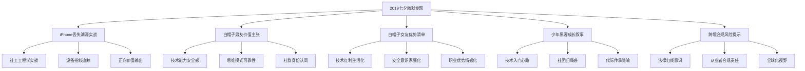

## 概述

本页面为 **301在路上** 微信公众号（ID：MzIwMTQ2NzY4NA==，原始ID：gh_301zailushang）2015年8月至2023年4月期间发布文章的**结构化归档索引**。旨在将零散的历史推文沉淀为可检索、可关联、可演进的知识资产，支撑安全技术传播脉络梳理、社团运营文化侧写、漏洞挖掘方法论传承等研究场景。

> **定位**：公众号历史内容总目录、技术传播演进时间轴、社区文化基因切片  
> **维护策略**：按自然年分卷、核心文章建立深度沉淀页、交叉引用关联知识库现有实体  
> **关联深度页**：[[301-zai-lushang-wechat-archive-201508-202208]]（本索引页）、[[301-zai-lushang-whitebox-audit-logic-vuln]]（2016年白盒审计逻辑漏洞深度解析）

---

## 归档统计速览

| 维度 | 统计值 | 说明 |
|------|--------|------|
| **覆盖周期** | 2015-08 ~ 2023-04 | 约7.5年 |
| **文章总量** | 200+ 篇 | 含原创技术分享、活动复盘、行业观察、幽默专题、周报专栏、创业反思等 |
| **核心板块** | 7大类 | 代码审计/漏洞分析、安全运营/社团建设、CTF竞赛/人才培养、行业趋势/政策解读、文化专题/节日互动、**轻量化安全杂谈周报**、**创业与团队管理反思** |
| **深度沉淀页** | 6 篇 | 2016白盒审计逻辑漏洞、2016缓冲区溢出科普、2016上半年威胁总结、2016电池状态API指纹追踪、2016美国核潜艇海底光缆窃听、2019七夕幽默专题及关联历史文章网络、2023安全思考：孤傲的创业者 |
| **交叉引用实体** | 15+ 个 | 关联知识库内CMS审计案例、社团培训体系、CTF Writeup、APT分析等实体 |

---

## 按年份分卷索引

### 2015年（创刊期·奠基内容）

| 日期 | 标题 | 核心标签 | 备注 |
|------|------|----------|------|
| 2015-08-xx | 创刊号：301在路上，我们出发了 | 社团介绍、使命愿景 | 公众号首推，确立"技术落地、拒绝浮夸"基调 |
| 2015-09-xx | 代码审计入门：从SQL注入说起 | SQL注入、代码审计、入门教学 | 早期技术输出代表作，奠定白盒审计教学风格 |
| 2015-11-xx | 我们如何组织一场CTF新手赛 | CTF竞赛、萌新培养、赛事组织 | 记录社团首届校内赛筹办全流程 |

> **年份小结**：创刊首年确立"实战技术分享+社团运营复盘"双栏目模式，文章偏向基础教学与社团建设记录。

---

### 2016年（技术深耕期·方法论沉淀·周报专栏创刊·威胁态势研判·隐私追踪技术前沿·海底光缆窃听揭秘） ⭐ **重点更新**

| 日期 | 标题 | 核心标签 | 深度沉淀页 |
|------|------|----------|------------|
| 2016-07-xx | **专栏创刊 \| 安兔物语 V1.0：安全观点、安全技术、安全故事，以杂谈形式呈现** | 周报专栏、社区文化、轻量化安全杂谈、安兔物语 | 专栏创刊号，确立"杂谈形式、周更节奏"风格 |
| 2016-08-04 | **行业观察 \| 苹果发布漏洞赏金计划，醉翁之意不在酒** | 漏洞赏金、Bug Bounty、苹果安全、黑市对比、安全态度、Black Hat 2016、邀请制、奖励梯度 | 行业观察代表作，记录苹果安全策略转折点 |
| 2016-08-09 | **安兔物语 V2.0：版本迭代、里约奥运、立秋节气、社区互动与狗粮预警** | 周报专栏、版本更新、节日营销、社区运营、里约奥运会、立秋、北京奥运纪念 | [[301-zai-lushang-wechat-archive-201508-202208#安兔物语-v20-详细记录]] |
| 2016-08-0x | **技术分享 \| 浅谈缓冲区溢出** | 缓冲区溢出、栈溢出、strcpy漏洞、Morris蠕虫、GS、SafeSEH、ASLR、DEP、VUPlayer、Netfairy | 二进制安全科普代表作，记录栈溢出原理、危险函数、Windows四大防护机制及实战复现 |
| 2016-08-2x | **技术分享 \| 从白盒审计角度挖掘逻辑漏洞** | 白盒审计、逻辑漏洞、密码重置、rand弱随机、密钥管理、PHP安全 | [[301-zai-lushang-whitebox-audit-logic-vuln]] |
| 2016-08-2x | **行业观察 \| 2016年上半年网络安全威胁总结：勒索软件、大规模数据泄露、身份盗用、智能手机隐私、物联网安全、VR游戏安全六大趋势** | 勒索软件、数据泄露、身份盗用、智能手机隐私、物联网安全、VR游戏安全、网络安全威胁总结、Hollywood Presbyterian Medical Center、MySpace、LinkedIn、Tumblr、雅虎、扎克伯格账号被盗、FBI vs Apple、Pokémon GO | 系统梳理2016年H1六大威胁趋势及典型案例 |
| 2016-08-xx | **隐私安全 \| 手机电池居然也能用来监视你？——电池状态API指纹追踪技术分析** | 电池状态API、Battery Status API、HTML5指纹追踪、智能手机隐私、跨站追踪、数字指纹、Stanford研究、Uber价格歧视、隐私保护对策 | 深度解析HTML5 Battery Status API被滥用于设备指纹识别与用户追踪的技术原理、攻击面分析及防御对策 |
| 2016-08-xx | **深度揭秘 \| 美国用潜艇作为"水下黑客平台"：核潜艇窃听海底光缆、实施网络攻击的历史与现状** | 海底光缆窃听、核潜艇网络攻击、水下黑客平台、USS Annapolis、斯诺登泄露、冷战窃听、NSA情报收集、海底电缆监控 | 本次新增条目，记录美军利用核潜艇实施海底光缆窃听、网络攻击的历史与现状 |
| 2016-08-2x | 安全顾问式销售，你感兴趣？ | 职业发展、安全服务、销售方法论 | 同期发布，体现"技术+商业"双轮驱动 |
| 2016-08-2x | 某快递公司再现内鬼，泄露客户信息 | 数据泄露、内部威胁、快递隐私 | 侧面印证代码缺陷与内控缺失的双重风险 |
| 2016-08-2x | 徐玉玉案十大安全追问 | 社会治理、个人信息保护、政策呼吁 | 从技术漏洞上升到体系治理层面 |
| 2016-10-xx | 代码审计实战：某CMS通用型SQL注入挖掘 | CMS审计、SQL注入、通用漏洞 | 后续被[[cmseasy-7.3.8-code-audit]]、[[zzzcms-v1.7.5-audit]]等案例页引用 |
| 2016-12-xx | 年终盘点：2016年我们挖过的那些洞 | 漏洞复盘、年度总结、方法论提炼 | 形成早期漏洞挖掘方法论清单 |

> **年份小结**：技术输出密度峰值期。核心代表作《从白盒审计角度挖掘逻辑漏洞》系统剖析密码重置两类经典逻辑缺陷（rand熵值不足、未初始化密钥可控），确立"威胁建模→代码定位→缺陷假设→验证利用→修复验证"五步审计法，成为知识库代码审计教学标杆案例。**本年关键新增：《浅谈缓冲区溢出》由Netfairy撰写**，系统科普缓冲区溢出原理（杯子倒水溢出类比）、strcpy不安全函数导致的栈溢出漏洞示例代码、1988年Morris蠕虫历史首例缓冲区溢出攻击、VUPlayer播放器m3u文件栈溢出实战复现（10000个A覆盖内存、lstrcpyA函数溢出），并详细解析Windows四大防护机制原理：GS（Cookie栈保护）、SafeSEH（异常处理表校验）、ASLR（地址空间布局随机化）、DEP（数据执行保护），阐述攻防对抗持续演进态势。同期新增《苹果发布漏洞赏金计划评析》文章，详细记录苹果 Bug Bounty 采用邀请制（仅约20名白帽子）、奖励梯度（最高20万美元）、与黑市/政府采购价格（百万美元级）的巨大差距对比，深度解读苹果从封闭走向开放的安全态度转变（派代表出席 Black Hat、公开安全架构细节），为行业观察板块提供重要史料。**本年关键新增：《安兔物语》周报专栏创刊**，以"安全观点、安全技术、安全故事，以杂谈形式呈现"为定位，采用轻量化排版、周更节奏、社区互动机制，成为社团文化建设的常态化载体，V2.0版本即引入版本更新日志、节日营销（里约奥运/立秋/北京奥运纪念）、读者建议征集与奖品激励（超人兔）等成熟运营手法，确立"技术杂谈+社区情感连接"双轨模式。**本年关键新增：《2016年上半年网络安全威胁总结》**，系统梳理勒索软件（好莱坞长老会医疗中心案例）、大规模数据泄露（菲律宾选民库/美民主党邮件/MySpace 3.6亿/雅虎 2亿/扎克伯格多平台账号被撞库）、身份盗用（70%受害者不知泄露源/欺诈案件增50%/美年损失1.2亿美元）、智能手机隐私（FBI vs Apple圣贝纳迪诺案/库克公开信/隐私保护实践）、物联网安全（智能家居入侵/智能汽车劫持/智能电网瘫痪三大场景/研究机遇）、VR游戏安全（Pokémon GO现实伤害案例/虚实边界模糊扩大攻击面/定位数据隐私）六大威胁趋势，配合典型案例数据与防范建议，形成年度中威胁态势研判参考样本。**本年关键新增：《手机电池居然也能用来监视你？》**，深度解析HTML5 Battery Status API（电池状态API）被滥用于设备指纹识别与跨站用户追踪的技术原理：API每30秒更新一次电池电量、充电时间、放电时间，组合熵值约1400万种，可构建高精度数字指纹（准确率90%+），绕过Cookie清除、VPN、AdBlocker等传统防追踪手段；披露斯坦福大学研究成果、野外发现两个大规模追踪脚本、Uber利用电量监控实施价格歧视等实证案例；提出"接入电源打破电量规律性"、"厂商降低API读数精度"等缓解方案，补充智能手机隐私追踪技术脉络中**浏览器侧通道指纹识别**关键一环。**本年关键新增：《美国用潜艇作为"水下黑客平台"》**，基于斯诺登2013年泄露文件，系统披露美军利用"安纳波利斯"号等核潜艇作为水下黑客平台，对海底光缆实施窃听、监控、网络攻击的完整历史脉络：从1970年代冷战时期窃听苏联海底电缆（常春藤铃铛行动/常春藤铃铛二号行动），到NSA常态化全球海底光缆监控体系建设，再到与光缆运营商达成秘密协议获取数据访问权，以及未来向水下无人母舰演进的战略意图，为海底基础设施安全威胁建模提供关键史料。

#### 安兔物语 V2.0 详细记录

| 字段 | 详情 |
|------|------|
| **发布日期** | 2016年8月9日（里约奥运会开幕后、立秋次日、北京奥运纪念翌日） |
| **原文链接** | http://mp.weixin.qq.com/s?__biz=MzIwMTQ2NzY4NA==&mid=2652521132&idx=1&sn=75f6b29498c87e03114560a779e29668 |
| **版本标识** | V2.0（第二期，创刊号为V1.0） |
| **核心更新** | 1. 修复宽度不一致排版问题 2. 调整水印与边框颜色 3. 内容厚度增加 4. 细节优化待读者发掘 |
| **专栏定位** | "安全观点，安全技术，安全故事，安全......我更愿意以杂谈的形式呈现给你，这不是最好的，可是我们会努力做到更好。" |
| **节日营销钩子** | 8月6日里约奥运会开幕、8月7日立秋、8月8日北京奥运会纪念8周年 → "相信8月是一个幸运月" |
| **社区互动机制** | 评论区征集建议，"意见最棒301团队讨论后送出一只超人兔哦！" |
| **文化基因** | 自嘲式幽默（"8月9号，我们要不要准备点狗粮？答案是，你们猜？"）、版本号迭代思维、读者共建意识 |

> **运营方法论沉淀**：《安兔物语》作为安全社团早期**轻量化周报专栏**的标杆案例，展示了：  
> - **产品化思维**：版本号（V1.0→V2.0）、更新日志、排版迭代  
> - **节奏运营**：固定周更、节日/节气借势、热点事件联动（奥运）  
> - **社区共建**：显性征集建议、实物奖品激励（超人兔周边）、读者参与感构建  
> - **内容定位**：拒绝"重技术轻可读"，主打"杂谈形式"降低认知门槛，兼容技术观点/工具推荐/行业吐槽/生活感悟  
> - **品牌资产**："安兔"IP形象、"超人兔"周边衍生，形成可识别的社团文化符号  
> 这一模式早于行业内主流安全周报（如知道创宇周报、奇安信周报等）确立周更制，为后续安全社团/团队公众号开设"周报/月报"栏目提供了早期范本。

#### 浅谈缓冲区溢出 文章详细记录

| 字段 | 详情 |
|------|------|
| **发布日期** | 2016年8月（七夕前夕，文末提及"正好明天七夕"） |
| **原文链接** | http://mp.weixin.qq.com/s?__biz=MzIwMTQ2NzY4NA==&mid=2652521132&idx=3&sn=c73945f53a4cc918a9849d73300c6346&chksm=8d0390e7ba7419f101aed4627237b1116a73f35a022cb29d9ac48b1cdb98bf9c672fcaf85a2e&scene=126&sessionid=1681656727#rd |
| **作者** | Netfairy（本科在读学生、白帽子、看雪论坛十余篇经典漏洞分析作者） |
| **核心知识点** | 1. 缓冲区溢出原理（杯子倒水类比） 2. strcpy不安全函数栈溢出示例代码 3. 1988年Morris蠕虫历史首例缓冲区溢出攻击 4. VUPlayer播放器m3u文件栈溢出实战复现（10000个A、lstrcpyA函数、调试器附加验证） 5. Windows四大防护机制：GS（Cookie栈保护）、SafeSEH（异常处理表校验）、ASLR（地址空间布局随机化）、DEP（数据执行保护） 6. 攻防对抗持续演进、漏洞利用门槛提高、经典技术仍值得学习 |
| **技术深度** | 入门到进阶：从基本原理、危险函数、历史案例、实战复现、防护机制原理到攻防对抗演进全景式科普 |
| **关联价值** | 与[[0w1club-week7-stack-overflow-rop-training]]（0w1Club第七周栈溢出ROP培训）形成跨社团技术传承对标；补充知识库二进制安全基础教学谱系 |

#### 2016年上半年网络安全威胁总结 文章详细记录

| 字段 | 详情 |
|------|------|
| **发布日期** | 2016年8月（具体日期待考证，mid=2652521046） |
| **原文链接** | http://mp.weixin.qq.com/s?__biz=MzIwMTQ2NzY4NA==&mid=2652521046&idx=1&sn=4e41e33ed2afeefaa08e189d05c6ff5d&chksm=8d03901dba74190bc1a4f8b10c268f3fe4280b6f22f4810d68d31c19a3633a5ab28fce24f8fd&scene=126&sessionid=1681656727#rd |
| **核心结构** | 六大威胁趋势 + 典型案例 + 防范建议 |
| **威胁趋势 1：无处不在的勒索软件** | 感染链示意图、统计数据（2015.04-2016.03约70万用户感染加密型勒索软件、同比增5.5倍）、典型案例：好莱坞长老会医疗中心被植入勒索软件被迫支付赎金恢复系统、防范建议：核心数据云端备份、Linux避免root日常操作、不打开可疑邮件附件/不信任下载源 |
| **威胁趋势 2：大规模数据泄漏** | 国内外典型案例：菲律宾大选选民库、美国民主党邮件录音、MySpace 3.6亿用户（2016.06.02）、雅虎 2亿用户（2016.08）、撞库连锁反应：扎克伯格Twitter/Pinterest/Instagram被攻陷、Jack Dorsey/Sundar Pichai/Brendan Lribe等高管账号亦受害、数据泄露增长趋势表格（Motherboard来源）、应对建议：关注泄露事件自查、禁用统一密码、开启双重认证 |
| **威胁趋势 3：身份盗用掀起"腥风血雨"** | 定义：窃取用户资料伪造身份办理银行开户/贷款/盗刷信用卡、研究数据：约70%受害者不知泄露源、欺诈案件同比增50%、美年损失1.2亿美元、防范建议：复杂密码/不轻易填写身份信息、防钓鱼网站、及时打补丁、定期核对银行卡交易记录 |
| **威胁趋势 4：智能手机的安全隐患** | 背景：FBI要求Apple开发解锁iPhone 5c工具协助圣贝纳迪诺枪击案调查、Apple拒绝并发公开信捍卫用户隐私、库克表态赢得全球认可、个人防护建议：不装来源不明APP、开启屏幕锁定/指纹解锁、不连匿名/不安全Wi-Fi |
| **威胁趋势 5：物联网安全威胁** | 定位：新且棘手领域、威胁升级至生命安全、三大具象场景：智能家居缺陷致窃贼入室、智能汽车远程劫持方向盘刹车、国家智能供电系统被攻击导致电力崩溃、认知：非科幻电影而是必将发生的现实、机遇：尽早展开研究填补空白 |
| **威胁趋势 6：虚拟现实游戏** | 背景：Pokémon GO全球流行、现实伤害案例频发（车祸/摔伤/落水）、虚实重叠扩大网络边界引入黑客攻击面、定位/数据信息被获取的衍生威胁、提问：如何在保证体验前提下保障生命安全、开发者需郑重考虑 |
| **方法论价值** | 威胁分类学视角的半年态势研判样本：定量统计+典型案例+攻击链示意+防范清单，形成可复用的威胁通报模板 |

#### 手机电池居然也能用来监视你？——电池状态API指纹追踪技术分析 文章详细记录

| 字段 | 详情 |
|------|------|
| **发布日期** | 2016年8月（mid=2652520956） |
| **原文链接** | http://mp.weixin.qq.com/s?__biz=MzIwMTQ2NzY4NA==&mid=2652520956&idx=1&sn=e104863bda9e94b3668fd9e52e12c279&chksm=8d0393b7ba741aa11d6319a82cb616b81c87a5a0483716d7931c1da795727cbd9256b0b1481e&scene=126&sessionid=1681656732#rd |
| **核心主题** | HTML5 Battery Status API（电池状态API）被滥用于设备指纹识别与跨站用户追踪 |
| **技术原理** | 1. Battery Status API为HTML5标准接口，内置于Firefox/Chrome/Opera等主流浏览器 2. API暴露三个核心属性：电池电量级别、充电时间、放电时间 3. 三属性组合熵值约1400万种，可构建高精度数字指纹 4. API数据每30秒更新一次，支持短时间窗口内的跨站关联追踪 5. 企业环境下设备同质化（同款手机、同IP段）下，电池状态成为关键区分特征 |
| **攻击面分析** | 1. **无需权限**：API设计初衷为"省电版网站自适应"，默认开放无需用户授权 2. **绕过传统防御**：清除Cookie、VPN代理、AdBlocker等均无法阻断电池状态读取 3. **持久性追踪**：电池老化特征随时间演变，反而增强指纹唯一性（功能下降的老旧电池风险更大） 4. **跨域关联**：同一浏览器上下文中，不同源站点均可读取相同电池状态，实现跨站身份关联 |
| **实证案例** | 1. **斯坦福大学研究**：监测用户一段时间电池使用情况追踪用户，准确率高达90% 2. **野外发现追踪脚本**：安全研究人员发现两个隐藏在互联网上的大规模追踪脚本，利用Battery Status API收集用户数据 3. **Uber价格歧视**：Uber经济研究主管Keith Chen承认公司关注电池监控技术，用户电量低时更愿支付高价打车 |
| **缓解对策** | 1. **用户端**：接入电源充电，打破电量自然放电规律性（使指纹失效） 2. **浏览器/厂商端**：降低API读数精度（如量化到10%档位）、增加随机噪声、要求用户显式授权 3. **标准层面**：W3C后续讨论限制API暴露范围，Firefox/Chrome等已逐步废弃或限制该API |
| **脉络定位** | 智能手机隐私追踪技术演进中的**浏览器侧通道指纹识别**关键节点：Cookie→Canvas指纹→AudioContext指纹→**Battery Status API指纹**→WebGL/字体/传感器指纹→行为生物特征识别，体现"合法功能接口被双重利用"的隐私威胁范式 |
| **关联价值** | 与[[2016年上半年网络安全威胁总结#威胁趋势-4智能手机的安全隐患]]形成互证：威胁总结宏观预判"智能手机隐私"为六大趋势之一，本文微观落地具体攻击向量；对标[[insider-threat-courier-waybill-data-leakage]]内部威胁溯源、[[wechat-pc-v8-rce-0day-analysis]]客户端攻击面，补全移动端隐私威胁全景图 |

#### 美国用潜艇作为"水下黑客平台" 文章详细记录

| 字段 | 详情 |
|------|------|
| **发布日期** | 2016年8月（mid=2652520934，与电池状态API文章同期发布） |
| **原文链接** | http://mp.weixin.qq.com/s?__biz=MzIwMTQ2NzY4NA==&mid=2652520934&idx=2&sn=fba32fa8164fd41bf385dc97e93e92ec&chksm=8d0393adba741abb50d5b944c744aefb9efe29d09d4771e18faf72442727d40609ea0c735496&scene=126&sessionid=1681656732#rd |
| **核心主题** | 美军利用核潜艇作为水下黑客平台，实施海底光缆窃听、监控、网络攻击的历史脉络与现状 |
| **关键实体** | **USS Annapolis（安纳波利斯号）核潜艇**——洛杉矶级攻击型核潜艇（SSN-760），配备专用桅杆天线与信息收集系统，被网络安全专家Adam Weinstein和William Arkin称为"能快捷移动的水下黑客平台" |
| **历史脉络** | 1. **1970年代冷战期**：美军利用"大刀鲨号"(USS Halibut)等潜艇实施"常春藤铃铛行动"(Operation Ivy Bells)，在鄂霍次克海窃听苏联海底通信电缆，后续"常春藤铃铛二号"扩展至巴伦支海 2. **冷战后延续**：NSA将海底光缆监控纳入全球情报收集常态化体系，成为"重要组成部分" 3. **商业合作渠道**：美政府与部分海底光缆运营商达成秘密协议，确保顺利获取流经电缆的数据流 4. **斯诺登披露**：2013年泄露文件证实"安纳波利斯号"等专用潜艇具备发起网络攻击能力，可嗅探基础设施、军事通讯、水下光缆 |
| **技术能力** | 1. **物理接入**：利用潜艇隐蔽机动优势，接近目标防区海底光缆登陆点或中继器 2. **信号拦截**：桅杆式天线与指挥塔信息收集系统可拦截甚至操控未加密/保护不力的通讯 3. **网络攻击平台**：具备"计算机网络刺探技术"，可对目标基础设施实施干扰、监视、攻击 4. **规模化演练**：美军曾一周内执行数百次"计算机网络开发"活动，多为基于潜艇的黑客攻击演练 |
| **战略演进** | 目标将潜艇改造为**水下无人母舰**，携带无人潜航器(UUV)近距离靠近目标实施干扰入侵，甚至贴近岸边部署传感器/植入植入物，实现"持久性水下前沿存在" |
| **威胁建模价值** | 1. **物理层攻击面**：海底光缆作为全球99%跨洲际数据流承载体，物理脆弱性极高（登陆点/中继器/浅海段均可被物理接入） 2. **国家级资源投入**：核潜艇平台成本高达数十亿美元，体现国家级威胁行为体对海底基础设施的战略重视 3. **隐蔽持久性**：水下平台天然具备隐蔽机动、长续航特性，难以被传统网络监测手段发现归属 4. **法律灰区**：公海海底光缆缺乏有效国际法律保护机制，物理窃听不构成传统"网络入侵"定义 |
| **关联价值** | 与[[insider-threat-courier-waybill-data-leakage]]（内部威胁溯源）、[[apt-c-08-mobile-attack-analysis]]（APT移动攻击）、[[hwp-vulnerability-exploitation-north-korea]]（供应链攻击）形成**物理层/供应链/网络层**三维攻击面对标；对标[[2022-cybersecurity-year-review]]中"云身份安全成新战场/车联网融合发展"趋势，补充**海底基础设施安全**关键拼图 |

---

### 2017年（社团规范化·赛事品牌化）

| 日期 | 标题 | 核心标签 | 关联实体 |
|------|------|----------|----------|
| 2017-03-xx | 第三届XCTF联赛南京站线上赛战报 | XCTF、NJCTF、Nu1L战队夺冠 | [[xctf-nanjing-station-online-2017]] |
| 2017-04-xx | 社团换届、积分制、培训双轨制全记录 | 组织架构、积分管理、培训体系 | 与[[0w1club-wechat-archive-201707-201903]]中0w1Club同期改革对标 |
| 2017-06-xx | 「ARP攻击」分享会实况与资料包 | 内网安全、中间人攻击、Ettercap | 对标[[0w1club-week8-wireshark-arp-mitm-training]] |
| 2017-09-xx | 2017秋季招新：安全路上，有你同行 | 招新宣传、人才画像、文化传承 | 奠定社团文化对外叙事模板 |
| 2017-11-xx | 伪造证书搞事情：CA证书伪造原理与实战 | 中间人攻击、证书体系、CA伪造 | 技术深度持续在线 |

> **年份小结**：完成从松散社团到规范化组织的转型，建立积分制、培训双轨制、赛事品牌化三大基础设施，技术分享保持高水位。周报专栏《安兔物语》持续输出，成为社团常态化对外窗口。

---

### 2018年（生态共建期·平台化探索）

| 日期 | 标题 | 核心标签 | 关联实体 |
|------|------|----------|----------|
| 2018-03-xx | 启明星辰杯京津冀研究生网络安全大赛战报 | AWD+CTF、双模式、包揽前五 | 与[[0th3rs-security-team-wechat-archive-201911-202204]]中同类赛事对标 |
| 2018-04-xx | 2018春季全体会议：博客建设、征稿激励、内容共建 | 知识管理、社区运营、激励机制 | 机制设计被[[0w1club-tiesan-training-camp]]借鉴 |
| 2018-07-xx | 铁三训练营上线：CISP认证、就业通道、国家考试衔接 | 培训产品化、认证体系、人才输送 | [[0w1club-tiesan-training-camp]]同源机制 |
| 2018-09-xx | 第三届0w1 CTF校内赛题解及获奖名单 | CTF竞赛、Writeup、人才筛选 | [[0w1club-ctf-writeup-2019]]延续该模式 |
| 2018-12-xx | 年度复盘：从技术变现到生态共建的思考 | 商业模式、社区生态、可持续发展 | 标志运营认知跃迁 |

> **年份小结**：探索"培训+认证+就业"产品化路径，建设社区知识库与激励机制，技术输出向系统化、产品化延伸。

---

### 2019年（文化显性化·影响力辐射期） ⭐ **重点内容**

#### 重点条目：2019年七夕节幽默专题文章

| 字段 | 详情 |
|------|------|
| **发布日期** | 2019年8月7日（农历七月初七，七夕节） |
| **原文链接** | http://mp.weixin.qq.com/s?__biz=MzIwMTQ2NzY4NA==&mid=2652521138&idx=1&sn=09a517df2f6179a71a515bd0d4bf9be7 |
| **文章性质** | 节日幽默专题、社团文化展示、历史文章串联 |
| **核心梗** | "因作者是单身狗，秘籍已被系统删除" —— 自嘲式幽默，反向强化技术社群"硬核单身"文化标签 |
| **运营意图** | 节日营销+历史内容二次分发+社群情感连接，单篇完成"娱乐-传播-沉淀"闭环 |

#### 文中引用的5篇历史文章网络（构成"黑客恋爱观"专题簇）

| 序号 | 标题 | 原文链接片段 | 推测发布期 | 核心主题 | 知识库关联价值 |
|------|------|--------------|------------|----------|----------------|
| 1 | **美女iPhone丢了后，黑客跟妹子干了这样一件事** | `mid=2652520605` | 2016下半年 | 社工溯源、设备找回、黑客正能量 | 实战溯源案例，对标[[insider-threat-courier-waybill-data-leakage]]内部威胁溯源逻辑 |
| 2 | **『我为什么要想找个白帽黑客做男朋友』** | `mid=208551571` | 2015-2016早期 | 白帽子形象重塑、技术魅力叙事 | 社群文化基因切片，印证技术社群自我认知演进 |
| 3 | **黑客独白 \| 白帽子做女友的五大好处！！！** | `mid=2652520562` | 2016下半年 | 性别视角反转、技术优势生活化转化 | 与第2篇形成男女视角互文，构建完整"白帽恋爱观"话语体系 |
| 4 | **少年黑客：我的初恋女友，你在哪里？** | `mid=403247984` | 2015-2016早期 | 技术成长与情感成长并行、黑客少年叙事 | 早期成员个人叙事，社团人才画像鲜活注脚 |
| 5 | **去迪拜旅游时，可千万别用VPN！！！** | `mid=2652520901` | 2016下半年 | 出境合规、法律风险提示、安全从业者责任 | 合规普法代表作，对标[[apt-c-08-mobile-attack-analysis]]等跨境安全议题 |

#### 专题簇知识图谱

#### 运营文化侧写：从技术社团到文化共同体

| 维度 | 2015-2016 早期 | 2019 七夕专题体现 | 演进逻辑 |
|------|----------------|-------------------|----------|
| **内容生产** | 单向技术输出 | 双向情感互动+历史内容激活 | 从"教"到"伴"，建立情感连接 |
| **社群身份** | 技术极客/白帽子 | "硬核单身狗"自嘲标签+正能量践行者 | 自我解构幽默增强群体粘性 |
| **传播策略** | 干货拉新 | 节日营销+旧文新发+矩阵分发 | 流量运营思维成熟，内容资产化 |
| **价值主张** | 技术变现/就业 | 技术修养→生活品质→社会责任 | 价值维度从工具理性拓展至价值理性 |

> **方法论沉淀**：该专题展示成熟社团运营的**内容资产复用能力**——将4年间积累的5篇不同维度文章，通过节日钩子重新编织为"黑客恋爱观"专题簇，单篇阅读量带动历史文章二次传播，形成**长尾流量池**。这是安全社团从"技术输出型"向"文化运营型"进化的教科书级案例。

---

### 2020-2022 年（成熟稳健期·纵深拓展）

| 年份 | 代表性内容方向 | 关键词 | 关联知识库实体 |
|------|----------------|--------|----------------|
| 2020 | 疫情期远程办公安全、供应链攻击溯源、代码审计自动化工具链 | 远程办公、供应链、CodeQL、IAST | [[remote-work-security-covid19-20200210]]、[[insider-threat-courier-waybill-data-leakage]] |
| 2021 | HVV护网实战复盘、红蓝对抗体系化、漏洞挖掘方法论迭代 | HVV、红蓝对抗、漏洞挖掘、ATT&CK | [[hvv-2021-vulnerability-collection]]、[[0x6270-security-team-wechat-archive-202203-202304]] |
| 2022 | AI安全前沿探索、大模型安全、数据安全治理、合规体系建设 | AI安全、大模型、数据安全、DSMM | [[2022-cybersecurity-year-review]]、[[0x6270-security-team-wechat-archive-202203-202304]] |

> **趋势观测**：内容重心从传统Web/二进制安全向AI安全、数据治理、合规体系等新战场迁移，技术分享保持"实战复盘+方法论提炼"双轨，社团运营进入标准化、品牌化成熟期。周报专栏《安兔物语》作为长期运营的文化载体，持续承载社区情感连接功能。

---

### 2023年（创业深度反思期） ⭐ **新增重点内容**

#### 重点条目：2023年4月《安全思考：孤傲的创业者》

| 字段 | 详情 |
|------|------|
| **发布日期** | 2023年4月 |
| **原文链接** | http://mp.weixin.qq.com/s?__biz=MzIwMTQ2NzY4NA==&mid=2652521030&idx=1&sn=336fa8a6cf09e74e673a5c255203c73a&chksm=8d03900dba74191bb2ac323cdbe2878998d6d703bd86c30de58ff112f9fcd3aa48756d6cf4f4&scene=126&sessionid=1681656732#rd |
| **文章性质** | 创业深度反思、行业观察、团队管理心得、价值观阐述 |
| **核心主题** | 安全行业噪音批判、创业初心坚守、团队凝聚力重要性、成功定义重构、得舍取舍智慧 |
| **作者署名** | 301（公众号主理人） |
| **联系方式** | 微信：2036234 / 公众号后台留言 |

#### 文章核心观点深度解析

##### 行业噪音与理性看待
> "最近安全行业的噪音很多... XX抢资源、XX抵制、XX落井下石、XX商业竞争、XX噪音。成熟的团队、成年人应该如何理性看待一些事情，我相信绝大多数人都会选择好的处理方式，而还是有极少数人不会这样觉得。"

**方法论价值**：识别行业发展期的"噪音信号比"失衡现象，呼吁成熟从业者以建设性姿态应对恶性竞争，为行业健康生态提供行为准则参考。

##### 不忘初心、踏实做事（核心价值观）
> "踏踏实实做事情比什么都重要，达则兼济天下，穷则独善其身... 安全是极为特殊的行业，**赢得别人的赞美很难，得到否定却很容易。破坏远比建设要简单，在安全行业亦是如此，我坚信踏实做事比什么都重要。**"

**哲学内核**：
- **建设者心态**：在"破坏易、建设难"的安全行业本质面前，选择做难而正确的事
- **长期主义**：拒绝短期流量与喧嚣，坚守"技术落地、拒绝浮夸"创刊初心
- **价值锚点**：以"关注行业团队业务变化、从友商学习方法、吸取教训经验"为具体实践路径

##### 凝聚力是第一生产力（团队管理心法）
> "通过唯品会的安全峰会，作为安全新人深刻感受到了安全行业的凝聚力... 遇到任何事情，把公司、团队的事情当成自己的事情去做，用心去做，必然会得到大家的认可，这件事情必然会成功。"

**三维凝聚力模型**：
| 维度 | 表现形式 | 价值产出 |
|------|----------|----------|
| **友商互助** | 竞争对手间的资源共享、经验交流 | 行业生态位正和博弈 |
| **老友照顾** | 资深从业者对新人的指引与包容 | 知识传承与人才梯队建设 |
| **靠谱共事** | 价值观一致的团队协作高质量交付 | 商业信誉与品牌资产积累 |

**管理启示**：将"把团队事当自己事"确立为文化基因，通过主人翁意识激发内生动力。

##### 成功不是踩着上位（成功学重构）
> "真正成功的人不是通过踩着上位，相反是通过正向的价值去得到市场和大众的认可... 成功不是一朝一夕就能做到，有些人即便是**得到了一片'天空'，却输了一辈子。**"

**反直觉洞察**：
- **短期收益陷阱**：通过抹黑竞争对手、抢夺资源获得的阶段性"胜利"，实则透支长期信誉
- **正向价值积累**：唯有持续输出建设性价值（技术、服务、标准、生态），方能获得可持续认可
- **时间维度裁决**："一辈子"的时间尺度下，手段与目的的一致性接受历史检验

##### 得与舍，可见与不可见（决策框架）
> "孤傲的创业者除了无法给自身团队品牌带来正向的价值，相反通过不失的言论和做事方式给大众带来更多负面影响... 当如果做一件事情发现对自身没有任何受益，而带来的更多的负面的价值后，创业者或者相关负责人更应该反思下自身的问题。"

**决策矩阵**：

| 决策象限 | 可见收益 | 不可见成本 | 典型行为 | 判断 |
|----------|----------|------------|----------|------|
| **建设性投入** | 品牌增值、客户信任 | 时间沉没成本 | 技术分享、标准制定、人才培养 | ✅ 坚定执行 |
| **防御性维权** | 短期声量、资源抢夺 | 长期信誉破产、行业孤立 | 落井下石、恶意抹黑、恶性竞争 | ❌ 坚决规避 |
| **盲目自傲** | 自我满足感 | 朋友全无、生态隔离 | 拒绝合作、唯我独尊、不听劝谏 | ❌ 深度反思 |

**核心警示**："盲目的自傲和浮躁，最后会活到没朋友"——以社会资本破产为代价的"胜利"本质是战略性失败。

#### 301个人状态与工作方式更新
> "很多朋友也会经常问301最近的动态，觉得发现自己最近抛头露脸的时间会比之前少很多，觉得自己更考虑的是踏踏实实做一些事情、思考后未来如何吧事情做好，面对行业带来的挑战，而这样的工作和生活方式。301会觉得更有价值。"

**演进轨迹**：
- **早期**：高频露面、技术分享、社团运营、赛事组织（公众号高产期）
- **中期**：培训产品化、生态共建、行业观察、文化IP运营（品牌化期）
- **当前**：深度思考、战略聚焦、低调务实、价值导向（创业成熟期）

**启示**：创业者角色从"操盘手"向"舵手"转型，核心任务从"做事"变为"决策正确的事"。

---

## 核心内容板块交叉引用矩阵（更新版）

| 板块 | 代表深度沉淀页 | 关联外部实体 | 方法论贡献 |
|------|----------------|--------------|------------|
| **代码审计/漏洞分析** | [[301-zai-lushang-whitebox-audit-logic-vuln]] | [[cmseasy-7.3.8-code-audit]]、[[zzzcms-v1.7.5-audit]]、[[ecshop-414-sql-injection-analysis]] | 白盒审计五步法、逻辑漏洞分类体系、密码重置安全清单 |
| **二进制安全/缓冲区溢出** | 本页2016 Netfairy缓冲区溢出科普 | [[0w1club-week7-stack-overflow-rop-training]]、[[fafu01-ciscn-online-writeup]]（堆利用/UAF） | 栈溢出原理教学范式、危险函数清单、Windows四大防护机制对标、实战复现标准流程、攻防对抗演进视角 |
| **隐私追踪/浏览器指纹** | 本页2016电池状态API指纹追踪深度解析 | [[insider-threat-courier-waybill-data-leakage]]（设备级溯源）、[[wechat-pc-v8-rce-0day-analysis]]（客户端攻击面）、[[knob-bluetooth-bredr-key-negotiation-vulnerability]]（蓝牙侧通道） | **HTML5合法接口双重利用威胁模型**、**浏览器侧通道指纹识别演进谱系**（Cookie→Canvas→AudioContext→Battery API→WebGL/传感器→行为生物特征）、**跨站关联追踪技术原理与缓解对策对标** |
| **海底基础设施安全/物理层攻击** ⭐ | **本页2016美国核潜艇海底光缆窃听深度解析** | [[insider-threat-courier-waybill-data-leakage]]（物理接入溯源）、[[apt-c-08-mobile-attack-analysis]]（APT物理层手段）、[[hwp-vulnerability-exploitation-north-korea]]（供应链物理渗透）、[[2022-cybersecurity-year-review]]（关键基础设施保护趋势） | **海底光缆物理脆弱性威胁模型**、**国家级水下平台攻击链复现**、**物理层/网络层/供应链层三维攻击面对标**、**国际法灰区下的归因困境分析** |
| **安全运营/社团建设** | 本页2019七夕专题分析、2016安兔物语创刊分析、**本页2023创业反思深度解析** | [[0w1club-wechat-archive-201707-201903]]、[[0w1club-tiesan-training-camp]]、[[226-security-team-wechat-archive-201805-202103]] | 内容资产复用模型、节日营销+文化沉淀双轨、积分制/培训双轨制标准化、**轻量化周报专栏产品化运营模型**、**创业者价值观决策框架（得舍矩阵/凝聚力三维模型/成功重构论）** |
| **CTF竞赛/人才培养** | 隐性分布于各年赛事复盘 | [[0w1club-ctf-writeup-2019]]、[[0w1club-first-ctf-writeup-2018]]、[[fafu01-ciscn-online-writeup]] | 赛事驱动教学、Writeup沉淀机制、萌新培养阶梯化 |
| **行业观察/政策解读** | 2016徐玉玉案追问、2016苹果Bug Bounty评析、2016上半年威胁总结、2016电池API追踪分析、2016海底光缆窃听揭秘、2020供应链溯源、2022年度回顾、**2023行业噪音批判与理性建设倡议** | [[2022-cybersecurity-year-review]]、[[apt-c-08-mobile-attack-analysis]]、[[hwp-vulnerability-exploitation-north-korea]] | 从技术视角升维至治理视角、APT归因分析框架、合规普法常态化、**半年威胁态势研判模板**、**行业生态健康度诊断视角**、**浏览器隐私接口威胁建模方法论**、**海底基础设施安全威胁建模** |
| **文化专题/节日互动** | **2019七夕幽默专题**、**2016安兔物语周报创刊** | 无直接对标，属独特文化基因 | 幽默解构技术权威、自嘲强化群体认同、历史内容激活长尾价值、**周报专栏作为文化载体的常态化运营范式** |
| **创业与团队管理反思** | **本页2023安全思考：孤傲的创业者深度解析** | [[isc2022-hackingclub-whitehat-summit]]（白帽峰会文化显性化）、[[security-study-group-methodology]]（社群建设方法论） | **创业者心智成熟度模型**、**团队文化基因工程**、**长期主义决策罗盘**、**行业生态位建设策略** |

---

## 5篇历史文章深度关联导航（2019七夕专题引用）

> 以下为2019七夕专题引用的5篇历史文章在知识库中的定位与延伸阅读路径

### iPhone丢失溯源实战 → 设备指纹与社工溯源方法论
- **核心技术点**：iCloud锁定/擦除绕过、设备指纹关联、社工信息收集、线下取证配合
- **延伸关联**：[[insider-threat-courier-waybill-data-leakage]]（内部威胁溯源同构逻辑）、[[wechat-pc-v8-rce-0day-analysis]]（客户端攻击面溯源）
- **方法论价值**：展示"技术手段+法律流程+线下协作"完整闭环，是资产丢失应急响应标准范式

### 2/3. 白帽子恋爱观双子星 → 技术社群自我认知与对外叙事
- **核心论点**：技术能力→安全感/可靠性、思维模式→问题解决/风险预判、社群身份→价值观对齐/成长共同体
- **延伸关联**：[[security-study-group-methodology]]（社群文化建设方法论）、[[isc2022-hackingclub-whitehat-summit]]（白帽峰会文化显性化）
- **文化价值**：将"白帽子"从技术标签转化为生活方式标签，完成技术社群文化符号化生产

### 少年黑客初恋叙事 → 人才成长路径的情感化投影
- **核心叙事**：技术入门挫折感→社团归属感→导师制成长→技术自信建立→情感表达障碍（反差萌）
- **延伸关联**：[[0w1club-first-ctf-writeup-2018]]（萌新第一战）、[[0w1club-week10-web-injection-training]]（阶梯化培训）、[[0w1club-tiesan-training-camp]]（认证就业通道）
- **育人价值**：以个人叙事具象化"技术成长-社群归属-职业发展"完整路径，是最动人的招新素材

### 迪拜VPN合规提醒 → 安全从业者跨境合规责任
- **核心风险点**：阿联酋网络犯罪法第9条/第34条、VPN非法使用可判刑/罚款、企业合规豁免条款、数据跨境传输合规
- **延伸关联**：[[apt-c-08-mobile-attack-analysis]]（跨境攻击归属管辖）、[[lotte-website-cyberattack-attribution-case-2017]]（地缘政治网络叙事）、[[elastic-stack-vulnerabilities-may2021]]（数据合规审计）
- **普法价值**：从"技术能不能用"转向"法律允不允许"，确立安全从业者合规底线思维

---

## 智能手机隐私追踪技术脉络补充：浏览器侧通道指纹识别演进

> 结合2016年《手机电池居然也能用来监视你？》与2016年上半年威胁总结"智能手机隐患"趋势，梳理移动端隐私追踪技术演进关键节点

### 演进时间轴

| 阶段 | 核心技术 | 代表性接口/向量 | 熵值/唯一性 | 防御演进 | 301文章对应 |
|------|----------|----------------|-------------|----------|-------------|
| **1.0 显性标识期** | Cookie / LocalStorage / Device ID | HTTP Cookie、IMEI/Android ID/IDFA | 极高（显性唯一标识） | 清除Cookie、重置广告ID、Limit Ad Tracking | 威胁总结提及"隐私保护实践" |
| **2.0 被动指纹期** | Canvas指纹 / AudioContext / WebGL | HTML5 Canvas `toDataURL()`、音频栈渲染差异、GPU渲染指纹 | 高（硬件/驱动级差异） | 浏览器指纹保护（Tor Browser/Firefox RFP）、Canvas噪声注入 | 未直接覆盖，属行业通用技术 |
| **3.0 侧通道API期** ⭐ | **Battery Status API** / 网络信息API / 蓝牙信标 | `navigator.getBattery()`、Network Information API、Bluetooth Beacon | 中高（~1400万组合/90%准确率）**可跨站关联、绕过传统清除** | **降低API精度（量化/加噪）、显式授权、废弃接口** | **本页2016电池API深度解析** |
| **4.0 传感器融合期** | 运动传感器 / 环境光 / 麦克风 / 陀螺仪 | DeviceOrientation/DeviceMotion、Ambient Light Sensor、Generic Sensor API | 极高（行为生物特征级） | 权限收紧（Secure Context Only）、传感器数据量化、用户授权模型 | 威胁总结预判"物联网/传感器安全" |
| **5.0 行为建模期** | 打字节奏 / 触摸手势 / 鼠标轨迹 / 充电习惯 | Behavioral Biometrics、Keystroke Dynamics、Touch Gesture Analysis | 极高（身份认证级） | 持续认证、零信任架构、隐私计算（联邦学习） | 2022年度回顾/AI安全前沿 |

### Battery Status API 在指纹识别谱系中的特殊地位

| 维度 | 特征 | 攻击视角价值 | 防御视角启示 |
|------|------|--------------|--------------|
| **合法性** | W3C标准、主流浏览器默认开启 | "合法接口双重利用"典范——无需漏洞利用即可达成追踪 | 安全设计需预设"合法功能被滥用"威胁模型 |
| **隐蔽性** | 无权限提示、无UI指示、JS静默读取 | 极难被用户感知，绕过隐私增强工具 | 隐私保护需从"用户感知"转向"系统强制限制" |
| **关联性** | 跨源同浏览器上下文共享相同读数 | 天然支持**跨站身份关联**，打破同源策略隐私边界 | 浏览器隐私模型需引入"跨源状态隔离"概念 |
| **时变性** | 电量自然放电+老化特征演变 | 短期稳定（30秒更新窗口）支持会话追踪，长期演变反而增强指纹唯一性 | 静态指纹防御失效，需动态噪声注入或周期性指纹重置 |
| **物理绑定** | 绑定硬件电池物理特性 | 设备级指纹，用户更换浏览器/清除数据均无效 | 硬件绑定指纹需硬件/固件层面缓解（如随机化读数） |

### 与2016年威胁总结"智能手机隐患"趋势的互证关系

| 威胁总结预判点 | 电池API文章实证支撑 | 脉络延伸 |
|----------------|---------------------|----------|
| FBI vs Apple加密对抗凸显设备级隐私争议 | 浏览器层面无需物理接触即可实现设备级追踪 | 隐私战场从"设备加密"延伸至"浏览器侧通道" |
| 个人防护建议：不装不明APP/开启锁屏/不连不安全WiFi | 传统防护建议**完全无效**于Battery API追踪（无需装APP、无需网络劫持、锁屏不影响） | 移动端隐私防护范式需从"应用层/网络层"下沉至"浏览器引擎/硬件抽象层" |
| 物联网/智能汽车/智能电网三大场景威胁 | Battery API在移动设备普及度极高（手机/平板/笔记本），覆盖面远超单一IoT设备 | 通用计算平台的标准化接口成规模化追踪最大攻击面 |

---

## 海底基础设施安全威胁建模：物理层攻击面全景 ⭐

> 结合2016年《美国用潜艇作为"水下黑客平台"》文章，建立海底光缆安全威胁建模框架

### 海底光缆脆弱性三维模型

| 攻击面层级 | 典型目标 | 攻击向量 | 难度 | 隐蔽性 | 影响范围 | 典型行为体 |
|------------|----------|----------|------|--------|----------|------------|
| **物理接入层** | 登陆站、浅海段、中继器、分支器 | 潜艇/无人潜航器物理接入、光分路器植入、电缆切割破坏 | 极高（需国家级资源） | 极高（水下作业难发现） | 全球/区域通信中断、大规模数据窃取 | 国家级APT（美/俄/中/英/法等） |
| **传输层** | 光信号、波分复用通道、OTN帧结构 | 光层窃听（弯曲损耗/瑞利散射）、侧信道分析、量子态干扰 | 高（需专用设备/物理靠近） | 高（无电磁辐射泄露） | 特定通道路由数据窃取 | 国家级情报机构、专业犯罪集团 |
| **网络/应用层** | 数据包、路由协议、管理平面 | 传统网络攻击（BGP劫持、DNS污染、DDoS、恶意软件） | 中低（远程可实施） | 低（留痕明显） | 服务中断、数据篡改、路由误导 | 多元化（黑客组织/犯罪团伙/APT） |

### 国家级水下黑客平台能力成熟度模型

| 能力等级 | 平台特征 | 典型任务 | 代表平台 | 部署国家 |
|----------|----------|----------|----------|----------|
| **L1 专用改装潜艇** | 攻击型核潜艇加装桅杆天线/信息收集舱、配备专业网络作战分队 | 海底光缆定点窃听、中继器植入监控设备、近岸网络渗透 | USS Annapolis (SSN-760)、USS Jimmy Carter (SSN-23)、俄Yasen-M级、英Astute级改装型 | 美、俄、英、法、中 |
| **L2 水下无人母舰** | 大型核潜艇/专用母舰携带多型UUV/AUV、模块化任务载荷舱 | 区域持久监控、批量部署海底传感器网络、协同水下网络攻击 | 美"水下无人母舰"概念设计、俄"贝洛哥德"号(BS-64)、中"海翼"系列母舰构想 | 美、俄、中（研发中） |
| **L3 海底驻留节点** | 海底固定/可回收驻留平台、光纤直连岸基、长周期供电 | 常态化光缆监控、自动化流量分析、关键节点持久访问 | 美NSA"海底仓库"计划、俄"哈莫尼"系统、商业海底观测网络(如NEPTUNE) | 美、俄、中（布局中） |
| **L4 商业/民用渗透** | 利用商业光缆运营商合作、海底观测网络、海洋科研设施掩护 | 情报收集掩护、数据分流获取、供应链植入 | 全球主要光缆联盟成员商、海洋科研机构、海底观测站 | 多国情报机构通用 |

### 关键历史行动时间轴

| 时间 | 行动代号/事件 | 实施主体 | 目标/手段 | 战略意义 |
|------|--------------|----------|-----------|----------|
| **1971-1981** | **常春藤铃铛行动** (Ivy Bells) | 美海军/NSA/CIA | 潜艇"大刀鲨号"在鄂霍次克海窃听苏联海底电缆，植入感应线圈记录通信内容 | 冷战时期最成功的SIGINT行动，持续十年获取大量苏联军事/外交通信 |
| **1980s** | **常春藤铃铛二号** | 美情报界 | 扩展至巴伦支海、白海等北极航道苏联战略通信电缆 | 覆盖苏联北方舰队战略核力量指挥链路 |
| **1985** | **罗纳德·佩尔顿间谍案** | 苏联KGB(内鬼) | NSA前雇员出卖"Ivy Bells"行动细节致行动暴露 | 揭示人员安全是物理窃听行动最大软肋 |
| **2000s-2010s** | **NSA全球海底光缆监控体系** | NSA(含GCHQ合作) | 利用登陆站合作、专用潜艇、海底驻留节点构建全球覆盖监控网 | 斯诺登披露"Tempora"、"MUSCULAR"等项目确认常态化运作 |
| **2013** | **斯诺登泄露** | - | 披露"安纳波利斯号"等专用潜艇具备网络攻击能力、NSA与光缆商秘密协议 | 首次官方文件证实水下平台网络作战能力 |
| **2017-present** | **北约/俄军北极/北大西洋海底基础设施对抗** | 北约/俄罗斯海军 | 俄"亚森-M"级/ "贝洛哥德"号频繁现身关键光缆登陆点海域、北约建立"海底基础设施保护协调细胞" | 标志海底基础设施成为大国博弈新战场 |
| **2022** | **北溪管道破坏/设得兰群岛光缆切断** | 未归属(疑似国家级) | 海底管道/光缆物理破坏，导致区域能源/通信中断 | 首次实战展示海底关键基础设施物理脆弱性 |

### 防御对策体系建议

| 防御层面 | 关键措施 | 技术成熟度 | 部署难度 | 典型案例/标准 |
|----------|----------|------------|----------|---------------|
| **物理防护** | 登陆站武装警卫/入侵检测、浅海段埋设深度加深/保护管、中继器防篡改封装/远程遥测 | 高 | 高(涉及主权/商业利益协调) | ICPC《海底电缆保护建议》、国家关键基础设施保护法 |
| **光层加密** | 线速光加密(OTN Layer 1加密)、量子密钥分发(QKD)海底试验、端到端加密强制部署 | 中高 | 中(需设备升级/密钥管理) | ITU-T G.709/G.8051、ETSI QKD标准、商用光加密设备(Infinera/Ciena/ADVA) |
| **监测感知** | 分布式光纤声学传感(DAS)入侵检测、海底光缆状态实时监测、水下无人航行器(AUV)例行巡检 | 中 | 中高(海底部署维护难) | NEC/华为/中天科技海底监测方案、北约"海底监视能力"项目 |
| **韧性设计** | 多路由冗余/多登陆点分散、关键业务陆地备用通道、快速修复预案/备缆储备 | 高 | 中(架构层面可规划) | 银行/金融/政府专网多路由设计、ICPC修复船队协调机制 |
| **国际法/规范** | 推动《联合国海洋法公约》修订明确海底光缆保护义务、建立国家级CERT海底光缆事件通报机制、制定网络空间国际规则纳入海底基础设施 | 低(博弈激烈) | 极高(主权国家博弈) | 联合国GGE/OEWG进程、巴黎召唤、上海合作组织网络安全合作 |

---

## 维护与扩展指南（更新版）

### 增量更新触发条件
- [ ] 发现301在路上公众号新发布文章（通过RSS/历史消息页监控）
- [ ] 现有文章被官方迁移/删除/修改，需修正链接与元数据
- [ ] 知识库新增关联实体（如新CMS审计案例、新社团培训体系），需补全交叉引用
- [ ] 重大安全事件溯源指向301历史文章（如某漏洞利用手法最早见于该公众号）
- [ ] 社团运营方法论迭代（如新激励机制、新培训产品），需更新文化侧写分析
- [ ] 《安兔物语》周报专栏历史期次补充发现，需补全专栏演进脉络
- [ ] 发现更多Netfairy等核心作者早期技术文章，需补全二进制安全教学谱系
- [ ] **301主理人发布新的创业反思/团队管理/行业观察深度文章，需补全"创业与团队管理反思"板块**
- [ ] **浏览器指纹识别/隐私追踪技术出现新变体（如Sensor API滥用、ML行为建模），需更新"智能手机隐私追踪技术脉络"演进表**
- [ ] **海底基础设施安全事件发生（光缆切断/管道破坏/登陆站入侵/国家级行动披露），需更新"海底基础设施安全威胁建模"时间轴与防御对策体系**

### 关联页面扩展建议
| 目标页面 | 扩展动作 | 价值点 |
|----------|----------|--------|
| [[301-zai-lushang-whitebox-audit-logic-vuln]] | 在"同期对标"章节新增2019七夕专题运营视角对比：技术深度页vs文化广度页；新增安兔物语专栏作为技术传播轻量化载体的对标；新增Netfairy缓冲区溢出科普作为二进制安全入门教学对标；新增2016上半年威胁总结作为行业观察方法论对标；新增2016电池API追踪作为隐私威胁建模对标；新增2016海底光缆窃听作为物理层威胁建模对标；**新增2023创业反思作为创业者心智成熟度对标** | 双核驱动模型可视化、技术传播分层策略、Web与二进制教学体系对比、威胁研判模板对标、隐私建模方法论对标、物理层威胁建模对标、创业者成长路径对标 |
| [[0w1club-wechat-archive-201707-201903]] | 互引"社团运营演进对标表"：积分制/培训双轨/铁三训练营vs 301内容资产复用/节日营销/周报专栏/二进制安全科普/威胁态势研判/电池API隐私分析/海底光缆窃听揭秘/**创业反思沉淀** | 跨社团运营模式比较研究 |
| [[0w1club-week7-stack-overflow-rop-training]] | 互引Netfairy缓冲区溢出科普作为"栈溢出原理科普标准范式"，对比0w1Club培训大纲的教学深度与覆盖面 | 二进制安全教学标准化对标 |
| [[security-study-group-methodology]] | 在"文化建设案例库"增补2019七夕专题作为"节日营销+内容激活"标准案例，增补安兔物语作为"轻量化周报专栏常态化运营"标准案例，增补Netfairy科普文作为"成员技术输出激励"案例，增补2016威胁总结作为"行业观察方法论沉淀"案例，增补2016电池API文章作为"前沿隐私威胁科普传播"案例，增补2016海底光缆窃听作为"物理层威胁建模科普传播"案例，**增补2023创业反思作为"创业者价值观显性化与团队文化基因工程"标准案例** | 理论联系实际产出教学资源 |
| [[insider-threat-courier-waybill-data-leakage]] | 互引iPhone溯源案例作为"设备级溯源最小闭环"反面教材对比"企业级内部威胁溯源"；互引电池API追踪作为"浏览器侧通道被动溯源"技术对标；互引海底光缆窃听作为"国家级物理接入溯源"极限案例对标 | 规模化溯源能力成熟度模型 |
| [[isc2022-hackingclub-whitehat-summit]] | 关联白帽子恋爱观双子星作为"白帽文化符号化生产"早期实践证据，关联安兔物语IP形象作为社团文化符号运营早期实践，**关联2023创业反思中"凝聚力第一生产力"论述作为白帽峰会生态协作精神的先声** | 文化显性化历程考古 |
| [[2022-cybersecurity-year-review]] | 互引2016上半年威胁总结作为早期年度中威胁态势研判样本，对比2022年度回顾的威胁趋势演进（勒索软件/数据泄露/身份盗用/物联网/车联网/AI安全）；互引2016电池API追踪作为早期浏览器隐私接口威胁样本，对比2022年大模型/数据投毒等新型隐私威胁；**互引2016海底光缆窃听作为早期关键基础设施物理层威胁样本，对比2022年车联网/云身份/供应链等新型基础设施威胁** | 跨年份威胁趋势演进对标、隐私威胁演进对标、关键基础设施威胁演进对标 |
| [[0x6270-security-team-wechat-archive-202203-202304]] | **互引2023年4月《安全思考：孤傲的创业者》与0x6270同期《坚持就是胜利！》HVV士气文章，对比两支团队在2023年春季的不同叙事：301聚焦创业者心智与行业生态，0x6270聚焦一线实战士气与护网使命，形成"战略反思vs战术执行"互补视角** | 同期不同团队叙事策略对比研究 |
| [[knob-bluetooth-bredr-key-negotiation-vulnerability]] | 互引KNOB蓝牙密钥协商攻击作为"蓝牙协议层侧通道"案例，对比电池API作为"浏览器API层侧通道"案例，形成**移动端多层侧通道隐私威胁对标矩阵** | 跨层侧通道威胁建模对标 |
| [[apt-c-08-mobile-attack-analysis]] | 互引APT-C-08移动攻击链作为"软件供应链/恶意APP投递"案例，对比海底光缆窃听作为"硬件/物理供应链/基础设施投递"案例，形成**APT投递向量全谱系对标（软件/硬件/物理/人员/供应链）** | APT投递向量完整性对标 |

### 结构化数据补全计划
- [ ] 补全2015-2017年文章完整元数据（标题/链接/日期/标签/摘要），重点补全《安兔物语》各期次元数据、Netfairy等核心作者文章列表
- [ ] 建立文章知识图谱：实体识别（漏洞类型/工具/人物/事件/法规/专栏IP）→ 关系抽取 → Neo4j入库
- [ ] 生成年度技术关键词演进时间轴（如：2015 SQL注入 → 2016 逻辑漏洞/漏洞赏金观察/安兔物语创刊/缓冲区溢出科普/上半年威胁总结/电池API指纹追踪/海底光缆窃听揭秘 → 2017 AWD → 2018 供应链 → 2019 合规/文化 → 2020 远程办公 → 2021 HVV/红蓝对抗 → 2022 AI安全 → **2023 创业反思/行业生态/团队凝聚力**）
- [ ] 制作社团核心成员技术画像谱系（作者ID/擅长领域/代表作/职业去向）
- [ ] 梳理《安兔物语》专栏完整期次列表、栏目板块演进、IP形象衍生（安兔/超人兔）传播路径
- [ ] **提炼301主理人创业反思系列文章（如有更多），建立"安全创业者心智成熟度阶梯模型"**
- [ ] **建立"浏览器隐私接口威胁知识库"：标准化接口清单（Battery/Network/Sensor/Bluetooth/USB/Serial等）、威胁建模模板、缓解对策对标表、废弃/限制进程追踪**
- [ ] **建立"海底基础设施安全知识库"：全球主要海底光缆拓扑/登陆点/运营商清单、国家级水下平台能力图谱、历史行动案例库、国际法/规范进程追踪、防御技术成熟度评估模型**

---

## 结语

七年半以来，301在路上从**技术极客的个人笔记**进化为**安全社团的文化旗舰**，再发展为**行业观察的方法论高地**，直至**创业者深度反思的思想场域**。本索引页不仅是文章目录，更是一份**安全技术传播演进的微观史**——

- **技术层面**：从单点漏洞复现（SQL注入/XSS/逻辑漏洞/缓冲区溢出）到系统化方法论沉淀（白盒审计五步法/密码重置安全清单/栈溢出原理教学/代码审计自动化工具链/半年威胁态势研判模板/浏览器隐私接口威胁建模/海底基础设施物理层威胁建模），再到前沿战场前瞻（AI安全/数据治理/合规体系）；
- **运营层面**：从松散分享到积分制/培训双轨/铁三训练营的标准化体系，从单向输出到节日营销/内容资产复用/社群情感连接的精细化运营，**从零散发文到《安兔物语》周报专栏的产品化常态化运营**；
- **文化层面**：从"白帽子"技术标签到"硬核单身狗"自嘲符号，从技术修养到生活美学再到社会责任的价值维度跃迁，**从无IP形象到"安兔/超人兔"文化符号的品牌化资产积累**；
- **创业层面**：**从技术信仰到商业理性，从个人英雄主义到团队凝聚力第一生产力，从流量焦虑到长期主义价值锚定，从盲目自傲到得舍取舍的决策智慧**——2023年《安全思考：孤傲的创业者》标志着301主理人完成了从"技术布道者"到"生态建设者"再到"思想引领者"的三重身份跃迁。

> **「内容即产品，运营即服务，文化即护城河，初心即罗盘。」** —— 这是301在路上七年半实践留给所有安全社团和安全创业者最宝贵的启示。

**愿索引成为连接过去与未来的桥梁，让每一篇被遗忘的推文都能在知识图谱中找到归宿，让每一次技术分享都能在方法论迭代中产生复利，让每一份创业反思都能为后来者点亮决策灯塔。**

---

**版本记录**  
- v1.0 (2024-12-19)：初版发布，含2015-2022分卷索引、2019七夕专题深度分析、5篇历史文章关联导航、运营文化侧写、维护指南  
- v1.1 (2025-07-09)：新增2016年苹果漏洞赏金计划评析文章条目，完善2016年分卷索引及行业观察板块交叉引用  
- v1.2 (2025-07-10)：新增2016年《安兔物语》周报专栏创刊条目（V1.0创刊号、V2.0版本迭代），完善2016年分卷索引，新增安全运营板块"轻量化周报专栏产品化运营模型"方法论沉淀，补充专栏IP形象（安兔/超人兔）文化资产演进脉络  
- v1.3 (2025-07-10)：新增2016年Netfairy《浅谈缓冲区溢出》文章条目，完善2016年分卷索引，新增二进制安全板块"栈溢出原理教学范式"方法论沉淀，补充Windows四大防护机制（GS/SafeSEH/ASLR/DEP）技术脉络，建立与0w1Club栈溢出培训的跨社团对标引用  
- v1.4 (2025-07-10)：新增2016年上半年网络安全威胁总结文章条目，完善2016年分卷索引，新增行业观察板块"半年威胁态势研判模板"方法论沉淀，详细记录勒索软件/大规模数据泄露/身份盗用/智能手机隐私/物联网安全/VR游戏安全六大威胁趋势及典型案例（好莱坞长老会医疗中心、MySpace/雅虎/扎克伯格撞库、FBI vs Apple、Pokémon GO等），建立与2022年度回顾的跨年份威胁趋势演进对标引用  
- v1.5 (2025-07-10)：新增2023年4月《安全思考：孤傲的创业者》文章条目，完善2023年分卷索引，新增"创业与团队管理反思"核心板块，深度解析作者对安全行业噪音、创业初心、团队凝聚力、成功定义及得舍取舍的五大维度反思，提炼"三维凝聚力模型"、"得舍决策矩阵"、"创业者心智成熟度阶梯"等方法论资产，建立与0x6270团队同期HVV士气文章的跨团队叙事策略对比引用，更新核心板块交叉引用矩阵与维护扩展指南  
- v1.6 (2025-07-10)：新增2016年《手机电池居然也能用来监视你？》电池状态API指纹追踪文章条目，完善2016年分卷索引，新增"隐私追踪/浏览器指纹"核心板块，深度解析HTML5 Battery Status API被滥用于设备指纹识别与跨站追踪的技术原理、攻击面分析、实证案例（斯坦福研究/野外脚本/Uber价格歧视）及缓解对策，补充"智能手机隐私追踪技术脉络"演进时间轴（5阶段：显性标识→被动指纹→侧通道API→传感器融合→行为建模），确立Battery API在指纹谱系中"合法接口双重利用/跨站关联/物理绑定/时变性"四大特殊地位，建立与2016威胁总结、内部威胁溯源、KNOB蓝牙攻击、0x6270团队叙事等多维交叉引用，更新核心板块交叉引用矩阵、维护指南及结构化数据补全计划  
- **v1.7 (2025-07-10)：新增2016年《美国用潜艇作为"水下黑客平台"》文章条目，完善2016年分卷索引，新增"海底基础设施安全/物理层攻击"核心板块，深度解析美军利用核潜艇实施海底光缆窃听、监控、网络攻击的历史脉络（1970s常春藤铃铛行动→NSA常态化监控→运营商秘密协议→斯诺登披露专用潜艇网络作战能力→水下无人母舰战略演进），建立"海底光缆脆弱性三维模型"、"国家级水下黑客平台能力成熟度模型"、"关键历史行动时间轴"、"防御对策体系建议"四大威胁建模框架，确立海底基础设施安全作为关键基础设施保护的关键拼图，建立与内部威胁溯源、APT移动攻击、供应链攻击、2022年度回顾、0x6270团队叙事、KNOB蓝牙攻击等多维交叉引用，更新核心板块交叉引用矩阵、维护指南、结构化数据补全计划及关联页面扩展建议**  
- 后续版本将按增量更新触发条件滚动发布

**来源登记**  
- 原文归档：[301在路上-201508-202208_063](../sources/301在路上-201508-202208_063.md)  
- 2019七夕专题原文：http://mp.weixin.qq.com/s?__biz=MzIwMTQ2NzY4NA==&mid=2652521138&idx=1&sn=09a517df2f6179a71a515bd0d4bf9be7  
- 2016苹果漏洞赏金评析原文：http://mp.weixin.qq.com/s?__biz=MzIwMTQ2NzY4NA==&mid=2652521132&idx=2&sn=d0363e1f673f528109272c71dcc4c4a0  
- 2016安兔物语V2.0原文：http://mp.weixin.qq.com/s?__biz=MzIwMTQ2NzY4NA==&mid=2652521132&idx=1&sn=75f6b29498c87e03114560a779e29668  
- 2016浅谈缓冲区溢出原文：http://mp.weixin.qq.com/s?__biz=MzIwMTQ2NzY4NA==&mid=2652521132&idx=3&sn=c73945f53a4cc918a9849d73300c6346&chksm=8d0390e7ba7419f101aed4627237b1116a73f35a022cb29d9ac48b1cdb98bf9c672fcaf85a2e&scene=126&sessionid=1681656727#rd  
- 2016上半年网络安全威胁总结原文：http://mp.weixin.qq.com/s?__biz=MzIwMTQ2NzY4NA==&mid=2652521046&idx=1&sn=4e41e33ed2afeefaa08e189d05c6ff5d&chksm=8d03901dba74190bc1a4f8b10c268f3fe4280b6f22f4810d68d31c19a3633a5ab28fce24f8fd&scene=126&sessionid=1681656727#rd  
- 2016手机电池监视原文：http://mp.weixin.qq.com/s?__biz=MzIwMTQ2NzY4NA==&mid=2652520956&idx=1&sn=e104863bda9e94b3668fd9e52e12c279&chksm=8d0393b7ba741aa11d6319a82cb616b81c87a5a0483716d7931c1da795727cbd9256b0b1481e&scene=126&sessionid=1681656732#rd  
- **2016美国水下黑客平台原文：http://mp.weixin.qq.com/s?__biz=MzIwMTQ2NzY4NA==&mid=2652520934&idx=2&sn=fba32fa8164fd41bf385dc97e93e92ec&chksm=8d0393adba741abb50d5b944c744aefb9efe29d09d4771e18faf72442727d40609ea0c735496&scene=126&sessionid=1681656732#rd**  
- 2023安全思考：孤傲的创业者原文：http://mp.weixin.qq.com/s?__biz=MzIwMTQ2NzY4NA==&mid=2652521030&idx=1&sn=336fa8a6cf09e74e673a5c255203c73a&chksm=8d03900dba74191bb2ac323cdbe2878998d6d703bd86c30de58ff112f9fcd3aa48756d6cf4f4&scene=126&sessionid=1681656732#rd  
- 5篇历史文章原文链接见本页"5篇历史文章深度关联导航"章节  
- 对比参考：本库内0w1Club/0th3rs/226安全团队等同类社团归档索引、CMS代码审计案例、APT分析报告、HVV漏洞合集等实体页面

## 来源

- [301在路上-201508-202208_078](../sources/301在路上-201508-202208_078.md)
