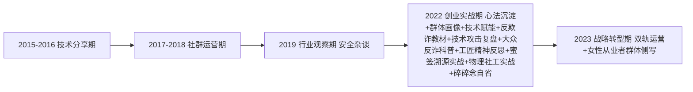

## 概述

本页面沉淀 **301在路上** 微信公众号（ID：`MzIwMTQ2NzY4NA==`）自 2015 年 8 月创立至 2023 年 4 月期间的核心文章条目。公众号主理人 **杨蔚**，资深安全从业者、创业者，内容跨越技术分享、创业感悟、行业观察、职业心理建设、群体文化侧写五大维度，形成「技术信仰为骨、商业逻辑为肉、人文情怀为魂、群体画像为面」的独特知识图谱。

> 关联索引页：[[0w1club-wechat-archive-201707-201903]]（高校社团运营对比）、[[226-security-team-wechat-archive-201805-202103]]（安全团队社区运营对比）、[[zhongan-tianxia-cheetah-mobile-enterprise-security-dialogue]]（安全众测平台生态延伸）、[[social-engineering-attack-techniques]]（社会工程学攻击技术体系与实战复盘）

---

## 核心文章条目详录

### 2022年

#### 8月：别以为你在拼命——创业者碎碎念与心态自省
- **发布日期**：2022-08（文章 mid=2652521225）
- **核心主题**：创业者心态反思、闲适与努力的错觉、人际交往的冷暖体悟、职业倦怠预警
- **关键词**：`职业倦怠` `安全从业者心态` `人生感悟` `创业心理` `努力错觉` `人际冷暖`
- **原文链接**：http://mp.weixin.qq.com/s?__biz=MzIwMTQ2NzY4NA==&mid=2652521225&idx=1&sn=3cd100e294bff89ce36df2accc3a6289&chksm=8d039142ba741854ff6343caf1ec6ee9b685bdf280a94fdb267fbb0a48affb3e323614f4454e&scene=126&sessionid=1681656717#rd
- **结构化看点**：
  - **核心论断**：人是不能闲的，闲久了，努力一下就以为在拼命。
  - **闲适的连锁反应**：
    1. 心静下来久了，会思考（且往往陷入负面循环）
    2. 会发现逐渐失去很多东西（机会、连接、状态）
    3. 会丧失某些安全能力（技术敏感度、实战手感）
    4. 产生错觉：稍微努力一下，就误以为自己在拼命
  - **人际冷暖体悟**：
    - 曾简单思考、帮助他人，不图回报
    - 遭遇落井下石，对人性产生怀疑
    - 最终选择不再书写负能量真实想法，转为自我和解
  - **结尾**：天冷了，各位记得注意保暖——以生活细节关怀收束，展现创业者柔软一面。
- **跨期印证与生态关联**：
  - **同期呼应**：与 2022-08 《梦想要有，赶路要紧》（mid=2652521393）形成「心态建设双子星」——前者以「看破/放下/梦想还在/赶路要紧」四字心法构建创业者心理免疫系统，本文以碎片化随笔记录心理免疫系统建立**之前**的焦灼与迷茫，互补完成「病理-疗愈」双维呈现。
  - **职业倦怠谱系定位**：属于安全从业者「职业倦怠-心态重塑」叙事谱系的典型样本，呼应 2019「安全杂谈」中「圈子浮躁严重、人才稀缺」的行业背景——个体心态失衡往往是行业环境浮躁的微观投射。
  - **内容运营策略映射**：作者自述「本来想写篇真实想法的（有点偏负能量），后来想想还是放弃了」，印证 2019「内容运营」板块「打破路径依赖、内容须反馈业务链条」原则——**主动过滤负面情绪输出，转而输出建设性心法（如后续《梦想要有》），是KOL情绪管理与品牌资产保护的成熟表现**。
  - **安全从业者心理健康侧写**：记录了技术型创始人在业务低谷期面临的「能力退化焦虑、社交信任危机、努力感知扭曲」三重心理陷阱，为安全行业从业者心理健康研究提供一手素材。

#### 8月：一个游戏——物理社工渗透测试实战案例
- **发布日期**：2022-08（文章 mid=2652521234）
- **核心主题**：物理社会工程学渗透测试、实地侦察、尾随入侵、物理访问权限利用、数据窃取全链路复现
- **关键词**：`社会工程学` `物理渗透测试` `尾随入侵` `实地侦察` `USB攻击` `邮箱数据窃取` `安全意识培训` `红队实战`
- **原文链接**：http://mp.weixin.qq.com/s?__biz=MzIwMTQ2NzY4NA==&mid=2652521234&idx=1&sn=3f13949845969204c74f569568206016&chksm=8d039159ba74184f44d7efbd83ba4e36d0ea1d25d64b551dbe292c13b5b2e9678a4294005708&scene=126&sessionid=1681656712#rd
- **结构化看点**：
  - **攻击目标**：应朋友邀请，对其所在公司安全进行测试，目标为拿到最新研发资料
  - **攻击赌约**：一顿小龙虾，体现红队演练的实战化与趣味性
  - **攻击流程全链路复现**：
    1. **实地侦察（两天）**：
       - 选择宾馆作为观察点（摄像头覆盖大门、7天循环录像、同网段易获取权限）
       - 绘制门禁动态画像：4名门卫画像（恪尽职守A、玩忽职守B、新手C、难描述D）
       - 掌握作息规律：早高峰8:40-9:00人流大、出门不验证身份、安保人员持特殊凭证直刷
    2. **伪装与尾随（第三天早高峰）**：
       - 乔装安全工程师，伪造凭证纸条
       - 瞄准玩忽职守门卫B，混入人群尾随入内
    3. **内网物理接入与横向移动**：
       - 无WiFi覆盖（静态IP分配），转而寻找无人工位
       - 发现出差人员工位，U盘启动破解登录密码（10分钟）
       - 遭遇备忘录加密与USB传输限制，转战企业邮箱（阿里邮箱单点登录）
       - 从邮箱附件获取源代码等核心研发资料
    4. **撤离与复盘**：成功带出数据，兑现小龙虾赌约
  - **攻击成功关键要素分析**：
    | 要素 | 具体表现 | 防御启示 |
    |------|----------|----------|
    | **信息采集能力** | 两天实地踩点+监控录像分析，掌握人员、流程、物理布局 | 物理安全需同等重视侦察阶段的暴露面管理 |
    | **随机应变能力** | WiFi不通即时转向物理工位；备忘录加密即时转向邮箱 | 红队需具备多路径预案，防御需全链路覆盖 |
    | **基础技术能力** | U盘破解密码、邮箱单点登录利用、数据打包外带 | 终端物理接口管控、全盘加密、邮箱敏感数据防泄漏 |
    | **人员疏忽利用** | 门卫B玩忽职守、出门不验证、安保人员凭证可视 | 人防是最易失效环节，需技术管控+流程强制双重保障 |
  - **作者核心警示**：
    > 「人才是安全建设中的主要核心，员工的安全意识很重要，一个细节上的看管不到位，即使花了心思和高成本在内网配置或渗透测试等方面来防御威胁，但小小的一个门禁，却让你千里之堤，溃于蚁穴。」
  - **互动引导**：文末邀请读者分享防社工攻击的好建议，形成用户共建防御经验库雏形。
- **跨期印证与生态关联**：
  - **技术体系映射**：[[social-engineering-attack-techniques]] 将「物理侵入+尾随+伪装身份+物理介质攻击+邮箱数据窃取」归类为社会工程学物理攻击链的标准组合拳，本文提供了教科书级的实战样本。
  - **同系列延伸**：与 2022-08 《一通电话损失100万！你敢接？》（mid=2652521324）、《没想到，你是这样的表哥！》（mid=2652521319）、《你的身份被冒用办了车保！》（mid=2652521280）构成「2022年反社会工程学实战复盘四部曲」——本文聚焦**物理红队实战**，前三者分别聚焦 Vishing+BEC 商务欺诈、熟人信任下的技术型文件伪装攻击、大众面电信诈骗全谱系画像，四者互补覆盖「物理/语音/文件/电话」四大攻击向量。
  - **红队实战方法论印证**：呼应 [[redteam-hw-opsec-guidelines]] 中「环境隔离、工具指纹清洗、上线隐匿」等OPSEC要求的物理对应面——物理红队同样需「侦察隐蔽、伪装真实、撤离无痕」。
  - **安全运营价值**：文章采用「赌约引入→侦察详记→攻击复盘→要素分析→核心警示→互动共建」的标准化实战复盘结构，适合作为**红队演练复盘报告模板**与**全员安全意识培训反面教材**直接复用，印证 2019「安全杂谈」中「内容运营须反馈业务链条/打破路径依赖」原则——将实战案例转化为可交付的「防御清单产品」。
- **研究价值**：
  - **物理社工渗透测试的标准化实战样本**：覆盖侦察、伪装、入侵、提权、横移、窃取、撤离全杀伤链，可作为物理红队演练教学标准案例。
  - **「人防失效」的定量化佐证**：门卫B「未细看凭证即放行」直观展示人为因素在物理安全链条中的脆弱性，为「技术管控替代/辅助人防」提供决策依据。
  - **「赌约驱动」的红队激励模型创新**：以「小龙虾」为赌注降低心理负担、提升实战投入度，为红队演练授权范围界定、激励机制设计提供轻量化参考范式。

#### 8月：惊！不买DLP怎么保护企业重要数据！——蜜签数据泄漏溯源实战技巧
- **发布日期**：2022-08（文章 mid=2652521261）
- **核心主题**：数据泄漏溯源、蜜签/蜜罐技术、内部威胁检测、无设备数据防泄漏实战技巧
- **关键词**：`蜜签` `蜜罐` `数据泄漏溯源` `内部威胁检测` `数据防泄漏` `DLP替代方案` `安全运营` `甲方视角`
- **原文链接**：http://mp.weixin.qq.com/s?__biz=MzIwMTQ2NzY4NA==&mid=2652521261&idx=1&sn=c7335d39b12c85cdb3b3115e49529b9d&chksm=8d039166ba74187061379286e3426c5d03f600f7e3f381119599363d368247baadd075107b54&scene=126&sessionid=1681656712#rd
- **核心技术方案**：
  - **场景**：手机注册用户数据泄漏溯源
  - **准备工作**：购买空白手机号作为测试号（蜜签）
  - **前提条件**：
    1. 对公司组织架构、业务流程烂熟于心，清楚各部门数据提取特征
    2. 拥有数据库所有权限或数据提取审批权限，可干预数据真实性
  - **实施流程**：
    1. 在各部门提取的数据中**独立植入**唯一标识的假手机号（蜜签）
    2. 审计部门全程监控，保证公平公正
    3. 静待数据泄漏后被利用（短信/电话联系蜜签号码）
    4. 根据收到联系的蜜签号码反推泄漏部门
  - **核心优势**：
    - 无需购买DLP设备，低成本实现数据泄漏源头定位
    - 兼具溯源与威慑双重效果，优于传统安全意识培训
    - 可追踪至供应商泄漏等延伸链路
- **技术本质分析**：
  - 属于**蜜签/蜜罐技术**在数据安全场景的典型应用
  - 核心思想：**主动欺骗+被动监听+关联溯源**
  - 与传统DLP「阻断+审计」模式互补，解决「事后溯源难」痛点
  - 适用于结构化数据（手机号、身份证号、银行卡号等）泄漏场景
- **实战要点总结**：
  | 要素 | 关键点 |
  |------|--------|
  | **蜜签设计** | 唯一性、隐蔽性、业务合理性（如真实格式手机号） |
  | **植入策略** | 按部门/业务线/供应商维度独立植入，建立映射台账 |
  | **监听机制** | 短信/语音/通讯录同步等多渠道监听，自动化告警 |
  | **溯源研判** | 号码→部门/供应商→人员→设备→渠道，分级定责 |
  | **威慑运营** | 定期通报「抓获」案例，构建「数据有眼睛」心理压力 |
- **局限性说明（作者自述）**：
  > 「此文的小技巧只能作为企业运营过程中的旁门左道，不可作为整个信息安全防御体系的控制环节。」
  - 仅适用于**事后溯源**，无法实时阻断泄漏
  - 依赖攻击者**主动利用**数据（发短信/打电话）
  - 需要**高权限配合**，推广受限于组织政治
  - 无法覆盖非结构化数据、截图拍照等泄漏形式
- **跨期印证与生态关联**：
  - **技术谱系定位**：属于「主动防御/欺骗防御」体系核心技术，关联 [[threat-attribution-tracing-techniques]] 中「VPS渗透溯源/攻击者ID画像」思路——均为「植入标记→等待触发→关联分析」模式。
  - **同期互补**：与 2022-08 社会工程学三部曲（《一通电话》《表哥案例》《车保诈骗》）形成「攻防对照」——前三文复盘**攻击者视角**的数据窃取与利用，本文提供**防御者视角**的数据标记与溯源，完整还原数据泄漏攻防全链路。
  - **工程化延伸**：现代蜜签平台（如蜜罐系统、文档水印、数据水印、Canary Tokens）已将该思路产品化，支持文档/数据库/API/邮件等多载体植入、自动化监听告警、溯源取证报表，本文为早期「手工蜜签」实战样本。
- **研究价值**：
  - **甲方视角数据安全运营实证样本**：记录了「无预算购买DLP、无权限部署设备」约束下，安全人员利用业务熟悉度与权限优势实施低成本溯源的创新实践。
  - **蜜签技术落地的「最小可行性实验」范式**：展示从「购买号码→权限植入→监听等待→溯源定责」的完整闭环，为蜜签系统化建设提供需求原型。
  - **安全运营「威慑大于阻断」的实战佐证**：作者直言「威慑效果优于安全意识培训」，印证心理威慑在内部威胁治理中的独特价值，呼应 [[redteam-hw-opsec-guidelines]] 中「蜜罐识别心态建设」防御视角。

#### 8月：洗尽铅华，工匠精神
- **发布日期**：2022-08（国庆节前发布，文章 mid=2652521272）
- **核心主题**：信息安全行业浮躁现状批判、工匠精神四维解读、职业心态建设、国庆电影推荐
- **关键词**：`工匠精神` `职业心态` `行业反思` `快餐时代` `信息安全人才` `电影推荐` `独创性` `持久性` `创新性` `责任感`
- **原文链接**：http://mp.weixin.qq.com/s?__biz=MzIwMTQ2NzY4NA==&mid=2652521272&idx=1&sn=94c8ac40769a70767f8b8e2aba5450a5&chksm=8d039173ba74186518b136fd9be458fbbacd7d4a6edf868ecacad43c04a3fba8d1a2c371d063&scene=126&sessionid=1681656712#rd
- **结构化看点**：
  - **时代诊断「快餐时代」**：
    - 现象：「短、平、快」（投资少、周期短、见效快）成原则，追求即时利益，不在乎长远发展，「一夜暴发户」心态泛滥
    - 表现：看名著只看精简版，学东西只想报速成班，求名不求实，无法沉下心学技术
    - 作者态度：不苛责、不评论，以文为警钟，给小伙伴启示
  - **行业痛点直指**：
    - 国家政策推动「互联网+」成新常态，信息安全重要性凸显
    - 可怕现状：尖端人才稀缺、科研队伍不足、教育普及率低下、圈子浮躁严重（「蛮瓶子不响，半瓶子晃荡」）
    - 作者心态：有悲有喜，国内信安路漫漫，亟需更多顶尖人才
  - **信息安全从业者「工匠精神」四维定义**：
    1. **独创性/创造性**：技术灵活多变，用技术创造产品，做出能改变生活、改变模式的东西
    2. **持久性/坚持性**：技术需深层研究，学习过程枯燥，坚持注入心血，做到极致，最坏结果大器晚成
    3. **创新性/开拓性**：敢想、将科幻变现实、从0生1，创造伟大高科技产品，但不为创新而创新，产品需有特色
    4. **责任感/使命感**：技术无错、错在人性，利益面前守住技术人底线，用力量维护网络空间、保护无辜者免受难
  - **核心信念**：坚持、不忘初心、专研技术，终有收获；行业「分享」特色将带领更多从业者进阶
  - **国庆电影推荐（工匠精神主题）**：
    《百鸟朝凤》、《活着》、《菊豆》、《红高粱》、《变脸》、《霸王别姬》、《戏梦人生》、《剔透匠》、《寿司之神》、《小森林·夏秋篇》&《小森林·冬春篇》、《入殓师》、《编舟记》、《生缝尺寸心》
  - **文末互推**：附带 8 篇历史高价值文章链接（顾问式销售、企业痛点、人才薪酬、白帽成长独白、WiFi安全、手机丢失应急、招人难题、福利抽奖）
- **跨期印证与生态关联**：
  - **同期呼应**：与 2022-08 《梦想要有，赶路要紧》（mid=2652521393?）形成「心态建设双子星」——前者以「看破/放下/梦想还在/赶路要紧」四字心法构建创业者心理免疫系统，本文以「工匠精神四维」确立从业者职业操守坐标，互补完成「心-行」双维建设。
  - **人才观传承**：呼应 2019「安全杂谈」中「人才稀缺、教育普及率低」判断，将「工匠精神」作为破解人才荒的内生动力方案，印证 [[security-study-group-methodology]] 中「笔记准入制、月度交付、八阶段课程」的严格培养逻辑——唯有工匠式传承方能对抗快餐式浮躁。
  - **学习方法论映射**：四维中的「持久性/深层研究」直接对标 [[reverse-engineering-beginner-learning-path]]「任务驱动学习法」与 [[rop-linux-x86-beginner-tutorial]]「入门核心知识体系」——拒绝速成，拥抱枯燥，方得极致。
  - **行业自省传统**：延续 2018 社群裂变觉醒后的「看破路径依赖」反思，将浮躁根源定性为「短平快原则取代长期主义」，为 2023 战略转型「五大方向」奠定价值观基石。
- **研究价值**：
  - **行业浮躁症的结构性诊断样本**：以「快餐时代」隐喻精准捕捉 2022 年节点信安圈「速成班泛滥、精简版阅读、即时利益至上」的集体心理图景，为行业健康度评估提供可引用的定性证据。
  - **工匠精神的本土化重构范式**：将传统「精雕细琢、精益求精」转译为信安从业者可操作的「独创/持久/创新/责」四维坐标，完成从匠造物理器物到匠造数字安全能力的范式迁移。
  - **文化疗愈功能的媒介实践**：国庆档期推荐 15 部工匠题材影片，以「电影清单」形式完成职业价值观的软性植入与情感共鸣动员，展现安全 KOL 「内容+价值观」双轨运营的成熟手法。

#### 8月：Web安全入门－书籍推荐
- **发布日期**：2022-08（具体日期待考，文章 mid=2652521380）
- **核心主题**：Web安全入门学习路径指引、经典书单推荐、工具书推荐、往期优质文章导读
- **关键词**：`Web安全` `入门书单` `灰帽黑客` `白帽子讲Web安全` `Kali` `渗透测试` `学习路径`
- **原文链接**：http://mp.weixin.qq.com/s?__biz=MzIwMTQ2NzY4NA==&mid=2652521380&idx=1&sn=014fbbd39d4a6d0def9d0de36ea02675&chksm=8d0391efba7418f9fc504cdce13a391dfb59f9b719fa9f438d003c469f3601a7f60354e7a6f3&scene=126&sessionid=1681656706#rd
- **结构化看点**：
  - **入门导图**：提供一张 Web 安全知识导图，明确黑客需要掌握的知识体系框架。
  - **核心入门书籍推荐**：首推《灰帽黑客》（第4版）建立全景认知；进阶推荐 8 本 Web 安全经典书籍：
    1. 《白帽子讲Web安全》
    2. 《Web安全深度剖析》
    3. 《黑客攻防技术宝典—Web实战篇》
    4. 《Web前端黑客技术揭秘》
    5. 《Web应用安全威胁与防治》
    6. 《Web之困：现代Web应用安全指南》
    7. 《XSS跨站脚本攻击剖析与防御》
    8. 《Web应用安全权威指南》
  - **工具与实战书籍**：推荐《Kali大学霸内部资料》（Kali 工具使用）、《安全之路》（渗透测试实战）。
  - **学习方法论强调**：「学习技术知识切不可光看不实践」，倡导工具实操与脚本编写能力同步培养。
  - **往期优质文章导读（其他推荐）**：附带 8 篇历史高价值文章链接，覆盖顾问式销售、企业痛点、人才薪酬、白帽成长独白、WiFi安全、手机丢失应急、招人难题、福利抽奖等运营与技术结合内容。
- **跨期印证**：该文作为 2022 年 8 月技术赋能类代表作，呼应 2019 年「安全杂谈」中「内容运营须反馈业务链条」原则，通过书单降低入门门槛、往期文章导流沉淀私域用户资产。
- **研究价值**：安全 KOL 早期技术布道素材、垂直领域入门书单演变史样本、社群运营「资源包+导读」模式范例。

#### 8月：一通电话损失100万！你敢接？—— 语音钓鱼与商务欺诈实战复盘
- **发布日期**：2022-08（文章 mid=2652521324，早于书单推荐文）
- **核心主题**：语音钓鱼、商务邮件诈骗、社会工程学实战案例、员工安全意识培训、资金授权流程防御
- **关键词**：`社会工程学` `语音钓鱼` `Vishing` `商务邮件诈骗` `BEC` `资金授权` `安全意识` `内部威胁`
- **原文链接**：http://mp.weixin.qq.com/s?__biz=MzIwMTQ2NzY4NA==&mid=2652521324&idx=1&sn=dc9e21aad6c0909eb3dcadd0ef7c32e4&chksm=8d039127ba7418311e8a577c0d547014f09f3146076b1937ef715dda04b4a820514b726eccbc&scene=126&sessionid=1681656712#rd
- **案例复盘**：
  - **受害主体**：A外企财务人员小丽
  - **攻击伪装**：冒充合作企业B的商务经理「陈某」
  - **攻击话术**：声称收款账户变动，需协助在付款系统中调整银行卡号
  - **利用要素**：准确掌握双方合作关系、财务联系方式、对接人姓名（源自B企业系统被攻破）
  - **操作失误**：小丽未核实身份、未向领导汇报、未要求书面确认，直接修改系统账号
  - **损失结果**：半个月后发现款项打入错误账户，A外企损失 100 万，小丽引咎辞职
- **防御对策（文中提炼）**：
  1. **身份核实**：提供公司信息前，必须确认索取人身份
  2. **回拨验证**：无法确认时，通过企业通讯录/员工目录官方号码回拨核实
  3. **敏感操作双控**：涉及金钱、转账、汇款、账户变更等敏感操作，**及时向领导汇报**，核实对方信息，**在双方有书面文件前提下**方可执行变更
- **关联生态**：[[social-engineering-attack-techniques]] 详细复盘「语音钓鱼冒充合作方财务变更收款账户导致百万损失」实战案例及防范清单，归类为社会工程学第四大类攻击链（Vishing）。
- **研究价值**：典型的 **Vishing (Voice Phishing) + BEC (Business Email Compromise) 混合攻击** 样本；印证「70%-80% 安全事故源于内部人员疏忽」的统计规律；适合作为企业财务/行政岗位安全意识培训的标准化反面教材。

#### 8月：没想到，你是这样的表哥！——同事伪装 Java 恶意程序为 .doc 文件实现屏幕监控攻击复盘
- **发布日期**：2022-08（文章 mid=2652521319）
- **核心主题**：社会工程学实战案例、文件伪装攻击、Java 恶意程序、屏幕监控、熟人信任利用、安全意识培训
- **关键词**：`社会工程学` `文件伪装` `Java恶意程序` `屏幕监控` `熟人攻击` `安全意识` `邮件附件攻击` `macOS安全`
- **原文链接**：http://mp.weixin.qq.com/s?__biz=MzIwMTQ2NzY4NA==&mid=2652521319&idx=1&sn=61fb83aff646fab4ba50930d89a0ff6b&chksm=8d03912cba74183a33e85772a668500f946696f2da973e77004ae9bd19d1d41b686f9e4b6679&scene=126&sessionid=1681656712#rd
- **案例复盘（双事件时间线）**：
  - **事件一（2015-09-30，大学时期）**：
    - **攻击向量**：伪装成「老乡群」发送「中秋聚餐照片汇总.rar」
    - **诱饵设计**：利用中秋节团圆情境、老乡群体信任降低警惕
    - **执行结果**：解压无反应，实为病毒；次日同学反馈收到「学习资料」文件、电脑出现奇怪文件
    - **后果**：作者重装系统，养成「陌生邮件直接删除」习惯
  - **事件二（约 2016 年，职场时期）**：
    - **攻击向量**：同事（文中称「小哥」）发送「公司文档.zip」，解压后显示为 `.doc` 文档
    - **伪装技术**：
      - Java 编写的小应用程序
      - 使用系统默认 `.doc` 图标
      - 文件名含「.」误导使用者以为是 Word 文档
      - 依赖受害者环境已安装 JDK（作者偶尔编程已安装）
    - **攻击效果**：点击打开后，攻击者实时监控受害者屏幕（访问 hackernews、pixabay 等网站均被察觉）
    - **发现过程**：攻击者主动通过微信提示「你被我监控了」
    - **排查验证**：修改 macOS 显示选项勾选「种类」，确认文件类型为「应用程序」
- **攻击成功要素分析（作者总结四点）**：
  1. **伪装到位**：文件名命名与显示图标双重蒙蔽，利用同事信任关系
  2. **系统默认视图缺陷**：macOS 默认仅显示文件名、修改日期、大小，**隐藏扩展名/种类**
  3. **运行环境巧合**：受害者 macOS 已安装 JDK，满足 Java 程序执行条件
  4. **安全工具缺位**：macOS 安全性认知导致极少安装杀毒软件，缺乏静态查杀能力
- **防御建议（文末提炼）**：
  1. **不轻信诱导性附件**：陌生人或群发邮件的「吸睛」文件不直接打开；Foxmail 等客户端自动保存附件时，**先查看文件类型**，可执行文件尤其警惕
  2. **部署安全软件与补丁**：及时更新/安装最新安全软件，给电脑打补丁；网页下载资源**打开前查杀**
  3. **强密码策略**：定期更换常用密码，使用「字母+数字+特殊字符 ≥ 8 位」组合，防止攻击者利用应用程序搜集常用密码
- **跨期印证与生态关联**：
  - **同期对比**：与 [[301-zai-lushang-wechat-archive-201508-202208]] 中《一通电话损失100万！你敢接？》（mid=2652521324）同属 2022 年 8 月社会工程学实战复盘系列，前者聚焦 **Vishing+BEC 语音/邮件混合欺诈**，本文聚焦 **熟人信任+文件伪装+屏幕监控** 技术型攻击，互补覆盖「人为操纵」与「技术伪装」两大攻击面。
  - **技术体系映射**：[[social-engineering-attack-techniques]] 将「熟人伪造/账号劫持发送恶意附件」归类为社会工程学第二大类攻击链（人员操纵+CSRF/Iframe 无感触发），本案为「可执行文件伪装文档图标+Java 跨平台执行+屏幕监控载荷」的典型技术实现变体。
  - **平台安全启示**：macOS 默认隐藏扩展名、用户高估原生安全性、开发者群体 JDK 安装率高，形成「高价值目标+低防御姿态」的特定攻击面，印证 [[macos-memory-execution-macho-loader-m1-mitigations]] 中 Apple Silicon M1 强制代码签名、W^X (DEP) 等缓解措施针对此类非签名可执行文件的防御价值。
- **研究价值**：
  - **实证「熟人作案」高成功率**：攻击者为同事、物理隔离办公室、利用工作邮件日常沟通惯性，绕过「陌生人警惕」心理防线。
  - **Java 跨平台恶意代码早期实战样本**：2016 年即利用 Java「一次编写，到处运行」特性配合图标伪装实现 macOS 屏幕监控，早于主流红队工具链（如 Cobalt Strike、Sliver）对 macOS 的系统化支持。
  - **安全意识培训「反面教材」标准化素材**：包含完整攻击链（邮件投递→解压→双击执行→载荷触发→数据外带）、受害者视角心理活动、攻击者复盘讲解、技术排查步骤、可落地防御清单，可直接改编为企业入职/年度安全培训案例库条目。

#### 8月：梦想要有，赶路要紧——创业者心路历程与职业心态沉淀
- **发布日期**：2022-08-31
- **核心主题**：安全创业者心理建设、面对质疑的认知升级、长期主义生存协议
- **关键词**：`看破` `放下` `梦想还在` `赶路要紧` `心理免疫系统` `过程正义`
- **结构化看点**：
  - **心理隐喻体系**：「天阴雨未下透」隐喻创业低谷期、「旅途漫长仰望苍穹」引用鲍勃·迪伦《Blowin' in the Wind》将个体命运置于宏大叙事
  - **四层认知升级**：事实层（做事必出错）、关系层（敌人不信/朋友无须解释）、边界层（他人评价自由与己无关）、本质层（尽心了就好）
  - **核心心法四字诀**：看破→放下→梦想还在→赶路要紧，附可操作化「心理免疫系统构建法」与「创业半年检验清单」
- **跨期印证**：2016《我的天空》歌词「一路向北永不放松」→2018社群裂变运营觉醒→2022商业化探索（签名版书抽奖、Allsec众测福利）→2023战略转型五大方向
- **研究价值**：技术型创始人叙事身份建构样本、垂直KOL情感共鸣运营案例、中国网安行业口述史素材（技术红利期→资本寒冬→合规驱动→众测运营）

#### 8月：安全创业感受与一波福利
- **发布日期**：2022-08 下旬
- **核心主题**：创业半年复盘、团队/项目/模式/毅力四大感悟、福利互动
- **关键结构化洞见**：
  - **团队**：从「招不到人」到「培养新人」模式切换，核心成员连续在岗>6个月
  - **项目**：积累≥3个不同行业标杆案例，复购/转介绍率>30%
  - **模式**：拒绝≥2次高毛利偏离初心商机，建立≥3家友商合作渠道
  - **毅力**：180天想放弃≤5次，恢复行动间隔<48小时

#### 8月：不甘平庸，一个迷恋三尺讲台的白帽黑客
- **发布日期**：2022-08 中旬
- **核心主题**：白帽成长访谈、梦想外溢（成就他人）、技术理想主义传承

#### 8月：工地白帽黑客的故事 + Allsec众测福利
- **发布日期**：2022-08 上旬
- **核心主题**：读者选题回应、社区运营实践、平台推广（众安天下ALLSEC）
- **关联生态**：[[zhongan-tianxia-cheetah-mobile-enterprise-security-dialogue]] 众测标准制定、专家激励计划、远程安全问诊模式

#### 8月：找个白帽子当蓝盆友！——白帽黑客群体画像与生活侧写
- **发布日期**：2022-08（具体日期待考）
- **核心主题**：白帽黑客群体文化画像、生活方式侧写、职业认同感叙事、安全从业者情感世界
- **原文链接**：http://mp.weixin.qq.com/s?__biz=MzIwMTQ2NzY4NA==&mid=2652521393&idx=1&sn=9ad08140e973869dd9bb309245c73f9a
- **核心叙事维度**：

##### 破除刻板印象：从「神秘黑客」到「有温度的年轻人」
> **核心论断**：「真实的白帽们是一群有温度的年轻人。爱分享，执着技术，热心肠，真的去接触他们，你会发现，‘男神’可以不看脸。」
- **反讽开篇**：以「分分钟盗走你的扣扣」「动动手指转走余额」「神秘指数五颗星」等刻板标签引入，随即通过4个月真实接触、500+微信好友的实证观察完成去魅
- **叙事策略**：用「古道侠长」「认真工作的小妖精」「懂浪漫的经济适用男」三重原型重构群体形象，对抗媒介污名化

##### 三大原型深度刻画

| 原型 | 核心特质 | 具象化场景 | 情感功能 |
|------|----------|------------|----------|
| **古道侠长** | 侠义精神、技术向善 | 协助妹子夺回被盗iPhone，全程斗智斗勇小偷 | 建立「技术守护者」道德高地，消解技术恐惧感 |
| **认真工作的小妖精** | 极客专注、技术审美、解题快感 | 攻克难题时「不眠不休、废寝忘食」，解出瞬间「激动不亚于中奖五百万」 | 确立「技术信仰」性感魅力，重塑极客劳动美学 |
| **懂浪漫的经济适用男** | 逻辑思维强、生活细腻、情感内敛 | 情人节写小程序代替玫瑰，「嘲笑你胖却喂你吃肉」、上缴工资卡、下班买菜做饭 | 解构「直男/技术宅」标签，展现理性逻辑与感性生活的融合 |

##### 典型个案深度侧写：办公室白帽「小哥」全息画像
> **田野笔记式记录**：通过具体微观场景构建群体典型代表
- **职业素养维度**：「凡是交给他的事情，一定会保质保量地完成」「承下来的事情就一定要全力以赴，这是做事的态度」
- **社交润滑剂维度**：「一言不合就开车给办公室带来欢乐」「办公室的开心果」
- **生活责任感维度**：每日17:00准时接老婆电话讨论晚餐、「早点下班回家给老婆做饭」、厨艺一流且「进门出门体重相差五斤」
- **认知共情维度**：善于用非技术语言解释技术问题，「判断一个技术人会不会换位思考，就看他能不能用对方能听懂的话解释清楚」
- **成长导师维度**：以过来人身份督促学习、打赌刺激坚持，「那段时间学的东西倒是很难忘记了」

##### 群体共性特征提炼：安全从业者的职业认同与生活哲学
| 维度 | 群体共性 | 叙事证据 | 文化意涵 |
|------|----------|----------|----------|
| **技术伦理** | 技术向善、守护弱势 | 夺回手机、拒绝滥用技术 | 白帽身份的道德锚定 |
| **工作美学** | 极致专注、解题愉悦 | 「不眠不休」「激动如中奖」 | 极客文化的内在奖赏机制 |
| **情感表达** | 逻辑化浪漫、行动派爱意 | 写代码表白、做饭喂胖、上缴工资 | 重构理工男情感表达范式 |
| **生活哲学** | 责任担当、换位思考、持续成长 | 买菜做饭、通俗解释技术、打赌督促 | 职业素养向生活智慧的迁移 |
| **社交角色** | 团队粘合剂、知识传播者 | 办公室开心果、技术导师 | 群体内部的社会资本积累 |

##### 叙事功能与文化干预
- **内部凝聚**：为群体提供「被看见、被理解」的镜像确认，强化职业荣誉感
- **外部破圈**：以「蓝盆友」轻松话题为切入点，降低大众对安全从业者的认知门槛
- **招聘雇主品牌**：隐性展示团队文化（有温度、有担当、有成长），吸引同频人才
- **行业口述史价值**：记录2022年节点白帽黑客群体的真实生活状态，对抗「黑客=犯罪/神秘/冷酷」的单一媒介叙事

#### 10月：你的身份被冒用办了车保！——电信诈骗防范科普实战复盘
- **发布日期**：2022-10（国庆期间发布，文章 mid=2652521280）
- **核心主题**：电信诈骗防范、身份信息泄露应对、社会工程学话术识别、反诈核心口诀普及
- **关键词**：`电信诈骗` `身份冒用` `社会工程学` `安全意识` `反诈科普` `冒充公检法` `ATM诈骗` `八个凡是`
- **原文链接**：http://mp.weixin.qq.com/s?__biz=MzIwMTQ2NzY4NA==&mid=2652521280&idx=1&sn=1f11b608315c59eea215c5a50c1046be&chksm=8d03910bba74181d718f7df0d57a60a890861779bf2f5cfecb4a5fbff2f3c17cf5fdf399b30e&scene=126&sessionid=1681656712#rd
- **结构化看点**：
  - **真实遭遇引入**：作者国庆期间接到冒充车管局电话称“身份被冒用办车保”，机智以幽默回复（“三舅妈的小姨子...”）化解并揭露信息泄露现实。
  - **典型案例密集曝光（2022年8月高发期）**：
    - 云南曲靖蓝女士网购退款诈骗损失10万（8.15）
    - 准大学生徐玉玉被骗9900元悲剧身亡（8.24）
    - 清华老师被冒充公检法诈骗1760万（8.29）
    - 漯河公司员工收到冒充领导短信转账（9.28）
  - **犯罪手段分类归纳**：冒充公检法/官方部门、冒充熟人视频诈骗、虚构中奖/补助、虚构绑架、冒充招生办资助等五大类话术套路。
  - **反诈硬核知识点（可直接落地的防御清单）**：
    1. **ATM功能底线认知**：银行ATM仅具备查询、存取转账、改密三大功能，任何要求操作“远端保全”“开通网银联网退税”等均为诈骗。
    2. **“八个凡是”识骗口诀**：自称公检法要汇款、汇款到“安全账户”、中奖领补助先交钱、家属出事先汇款、索要银行卡/验证码、开通网银接受检查、自称领导要大款、陌生链接登记银行卡信息。
    3. **核心防范心法**：不信天上掉馅饼、亲友借钱必视频/电话核实、告知老人绑架多为虚构需亲自确认。
  - **互动引导**：文末邀请读者分享“与犯罪分子斗智斗勇”经历，形成用户共建反诈案例库雏形。
- **跨期印证与生态关联**：
  - **同系列延伸**：与 2022-08 《一通电话损失100万！你敢接？》（mid=2652521324）、《没想到，你是这样的表哥！》（mid=2652521319）构成「2022年反社会工程学实战复盘三部曲」——前两者分别聚焦 Vishing+BEC 商务欺诈、熟人信任下的技术型文件伪装攻击，本文聚焦 **大众面电信诈骗全谱系画像与标准化防御口诀**，三者互补覆盖「定向高价值目标攻击」与「大规模撒网式诈骗」两大威胁模型。
  - **技术体系映射**：[[social-engineering-attack-techniques]] 将「冒充公检法/官方部门」「冒充熟人/领导」「虚构绑架/中奖」归类为社会工程学第一大类攻击链（人员操纵与心理胁迫），本文提供了该类攻击链在 2022 年下半年的高频实战样本库与标准化对抗清单（ATM功能底线、八个凡是）。
  - **安全运营价值**：文章采用「真实遭遇引入→惨痛案例密集曝光→手段分类归纳→硬核口诀交付→互动共建」的标准化科普结构，适合作为企业/社区**全员安全意识培训标准化教材**直接复用，印证 2019「安全杂谈」中「内容运营须反馈业务链条/打破路径依赖」原则——将反诈科普转化为可交付的「防御清单产品」。
- **研究价值**：
  - **2022年电信诈骗高发期的横切面样本**：8-9月连续四起典型案例（含徐玉玉案、清华老师千万大案）密集记录，还原当时诈骗高压态势。
  - **「ATM功能底线」认知对抗设计**：针对「诱导操作ATM」这一经典利用路径，给出「仅三大功能」的否定性定义，降低用户认知负荷，是反诈科普「白名单思维」的典范实践。
  - **「八个凡是」口诀的标准化传播效能**：将复杂攻击向量压缩为 8 条可背诵、可传播、可考核的行为准则，体现安全知识「产品化、清单化」的传播工程思维。

### 2023年

#### 4月：好端端的姑娘为啥想不通？？——女性网络安全从业者入行动机访谈集
- **发布日期**：2023-04（文章 mid=2652521293）
- **核心主题**：女性安全从业者入行动机、职业选择叙事、性别视角下的安全圈生存观察、群体文化侧写补充
- **关键词**：`女性安全从业者` `入行动机访谈` `职业选择叙事` `白帽黑客群体画像` `安全圈文化` `性别视角`
- **原文链接**：http://mp.weixin.qq.com/s?__biz=MzIwMTQ2NzY4NA==&mid=2652521293&idx=1&sn=7dc0715bc76595a147865ed126ab33ef&chksm=8d039106ba741810353e2b50c8c76cacc5a393e98587be9e82f19619698cf264ab5ddc48f7eb&scene=126&sessionid=1681656712#rd
- **结构化看点**：
  - **访谈缘起**：针对「安全圈电脑辐射大、技术枯燥、蓝孩子撩妹技能差」等刻板印象，采访多位女性从业者探寻真实入行动机。
  - **十位受访者动机画像**：
    | 受访者 | 核心入行动机 | 叙事关键词 | 代表性群体特征 |
    |--------|--------------|------------|----------------|
    | **SASA** | 技术演讲吸引：only-guest幻灯片故事充满魔力 | 神秘感、探索欲 | 技术魅力驱动型 |
    | **清风明月** | 职业发展需要：警校教师发现课程与信息安全相关，想走得更远 | 职业延伸、深造 | 跨界转型型 |
    | **笑然** | 理性判断：看好企业级安全市场 + 黑客神秘感吸引 | 市场判断、技术崇拜 | 理性规划+感性向往混合型 |
    | **艾惠** | 专业对口：大学学信息安全专业，不想浪费所学 | 专业延续、沉没成本规避 | 科班出身坚守型 |
    | **朵朵** | 伴侣影响：男票玩安全，为共同话题 + 行业缺口大 | 情感连接、实用主义 | 社交驱动+机会主义型 |
    | **宫崎没有骏** | 误解入坑：听说搞安全不用敲代码、可在家工作、不用出差 | 认知偏差、生活方式想象 | 信息不对称误入型 |
    | **姜美眉** | 志愿填报失误：填志愿时「脑子进水」选了信息安全专业 | 意外性、宿命感 | 被动选择后主动适应型 |
    | **清风自来** | 领域选择论：选赛道(品牌和市场)，知识恰好遇到安全行业 | 战略选赛道、机遇匹配 | 宏观战略思维型 |
    | **打杂兔** | 少年榜样：高中接触大牛，白帽子代表正义像拯救世界的英雄 | 英雄主义、价值观认同 | 理想主义驱动型 |
    | **阿里燕** | 伙伴带入：身边有喜欢安全的小伙伴，不知不觉被带入坑 | 同伴效应、共同成长 | 社交传染型 |
    | **念** | 高人指引、误打误撞 | 机缘巧合、导师关键作用 | 关键他人影响型 |
    | **Joanne** | 缘分使然：接触过安全圈人觉得有意思 | 群体吸引力、文化认同 | 环境熏陶型 |
    | **路人甲** | 社工动机：最初为社工获取喜欢男神隐私，一发不可收拾 | 社会工程学实战、好奇心驱动 | 技术手段服务个人目的型 |
    | **路人乙** | 经济动机：听说工资高 | 实用主义、薪资导向 | 纯经济理性型 |
    | **路人丁** | 环境偏好：安全圈搞技术的多，勾心斗角少 | 技术人单纯文化、圈层认同 | 文化避风港寻求型 |
    | **路人丙** | 证明自我：唯一只看实力不看学历的圈子，证明靠实力不是靠脸 | 实力至上、反精英主义 | 公平竞争价值观型 |
  - **动机分类学归纳**：
    1. **技术魅力驱动**（SASA、打杂兔、笑然部分）
    2. **职业理性规划**（清风明月、笑然、清风自来、路人乙）
    3. **专业延续/被动选择**（艾惠、姜美眉、宫崎没有骏）
    4. **社交/情感连接**（朵朵、阿里燕、念、Joanne）
    5. **特殊动机**：社工好奇心（路人甲）、文化避风港（路人丁）、公平竞争证明（路人丙）
  - **性别视角的独特洞察**：
    - 文章以「爱美之心人皆有之，姑娘们就更爱美了」开篇，对比「安全圈枯燥/辐射/蓝孩子」刻板印象，制造张力
    - 受访者画像打破「女性不适合技术」偏见：既有「涂指甲油、做面膜、练瑜伽」的生活细节，又有「熬夜攻克bug快感超限量版口红」的职业热情
    - **朵朵「为男票有共同话题」**、**路人甲「为社工男神隐私」** 等动机展现女性入行的关系型动机特征，区别于男性从业者常见的纯技术/经济驱动叙事
  - **互动设计**：文末开放评论区征集「你认识的别的安全圈姑娘怎么入行的」，延续群体共建叙事
- **跨期印证与生态关联**：
  - **同系列延伸**：与 2022-08 《找个白帽子当蓝盆友！》（mid=2652521393）形成「群体画像双子星」——前者以「三大原型+办公室小哥全息画像」构建宏大群体文化图景，本文以「16位女性微叙事拼贴」呈现性别细分视角的入行动机谱系，互补完整白帽黑客群体文化拼图。
  - **叙事策略传承**：沿用「反讽刻板印象→实证破除→重构真实形象」三段式叙事结构，延续 2022 年「蓝盆友」文的去魅与重塑逻辑。
  - **人才图谱补充**：为 [[security-engineer-recruitment-requirements]] 等招聘画像页面提供女性从业者入行动机实证素材，印证「同伴效应/导师指引/文化认同」等非薪资因素在人才吸引中的关键作用。
  - **安全教育启示**：动机谱系揭示「技术演讲/大牛榜样/导师指引/同伴带入」等可复制的入行引导路径，为 [[security-study-group-methodology]] 类社群培养模式提供实证参考。
- **研究价值**：
  - **罕见的女性安全从业者群体动机质性研究样本**：16 位受访者覆盖科班/非科班、主动/被动、理性/感性、技术/社交/经济等全谱系动机类型，填补中文语境下女性网安从业者职业选择叙事的实证空白。
  - **刻板印象对抗的传播学案例**：通过「生活美感细节+技术硬核热情」并置，以「指甲油 vs bug快感」「瑜伽馆 vs 熬夜攻关」强对比，完成对「女性/技术」二元对立叙事的解构。
  - **安全圈亚文化传播机制实证**：「大牛演讲→入行」「男票/小伙伴带入→入行」「社工好奇心→入行」等路径印证「关键他人影响+文化认同+技术魅力」三驱动模型在垂直技术社群传播中的作用。

#### 4月：复更公告——调整为「安全众测/运营/创业/资本/故事」五大方向
- **发布日期**：2023-04（跨年度补充）
- **核心主题**：战略转型、双轨运营、周更承诺
- **转型信号**：看破纯技术分享天花板、放下过往路径依赖、梦想还在（安全生态）、赶路要紧

---

### 2016-2018 年关键里程碑（索引页补充）

| 时间 | 事件/文章 | 战略意义 |
|------|-----------|----------|
| 2015-08 | 公众号创立 | 技术分享起航，确立「301在路上」品牌 |
| 2016-10 | 原创歌曲《我的天空》 | 创业元年情感宣泄，「大声歌唱属于我的梦」确立初心锚点 |
| 2017-11 | 联合FreeBuf投稿送票 | 内容共建获取行业资源，生态建设雏形 |
| 2018-08 | SSC峰会门票赠送、社群裂变 | 运营思维觉醒，看破单纯技术输出局限 |

---

### 年度深度观察：安全杂谈（2019年度核心行业观察文章）
- **发布日期**：2019 年（具体月份待考，文章链接见来源）
- **核心主题**：安全市场趋势演变、机器学习与威胁情报局限性、企业云化驱动安全服务模式变革、安全内容运营路径依赖问题
- **原文链接**：http://mp.weixin.qq.com/s?__biz=MzIwMTQ2NzY4NA==&mid=2652521397&idx=1&sn=9077d9621371e4171bcd46ee5e621457
- **四大板块深度解析**：

#### 关于趋势：供需结构变化驱动市场质变
> **核心论断**：「会导致企业安全市场发生质变的原因在于供需结构的变化。」
- **历史演进脉络**：
  - 90年代后期：PC普及→病毒爆发→杀毒软件市场开启
  - 企业信息化：单点应用（收银）→各部门业务数字化→第一批企业级安全软硬件兴起
  - 近年：移动互联网兴起、企业业务云化趋势
- **方法论启示**：技术创新本身不直接创造市场，只有当供需结构发生重组（如终端普及、业务上云）时，安全市场才会发生质变。创业者应关注「供需结构拐点」而非单一技术热度。

#### 机器学习、威胁情报：技术进步≠市场质变
> **核心论断**：「至少目前阶段无法让企业安全市场发生质变，因为并没有改变企业安全市场的供需结构。」
- **机器学习的定位与极限**：
  - 肯定价值：「把机器学习算法引入网络安全行业是一种了不起的创见」
  - 界定边界：「在很多条件下机器学习都是为了了解最后一公里的问题而存在的」
  - 风险预警：「应用不当会使其成为安全企业的一种技术债务」
- **大数据与威胁情报的本质去魅**：
  - 「不存在一个叫大数据或是威胁情报的东西」
  - 本质：「代表了一种数据利用的思想，就像互联网思维一样」
  - 定位：「单词本身不指代任何东西，只是随着机器学习、知识图谱兴起产生的思想衍生品」
  - 实用价值：「围绕这一思想发展出来的一系列工具及方法对安全行业发展具有很强指导意义」
- **跨页对比**：[[0x6270-security-team-wechat-archive-202203-202304]] 中2022-2023年AI安全议题（对抗样本、提示词注入、模型窃取、数据投毒）印证「最后一公里」论断——技术落地仍面临工程化、对抗性、可解释性三大鸿沟。

#### 云化：企业上云重塑安全服务交付模式
> **核心论断**：「企业云化是未来趋势，核心在于成本问题。安全企业核心不在于搞个业务扔到网上说这是SaaS，而在于云上的企业如何用你的安全服务。」
- **逻辑链条**：企业云化本质=成本优化→安全场景从机房迁移至AWS/阿里云→安全服务必须原生适配云环境
- **标杆案例引用**：
  - **Rubrik**：数据管理平台，直接对接AWS和Azure
  - **PlainID**（以色列）：身份授权平台，云原生架构
- **实战启示**：安全创业者应从「卖盒子/部署软件」转型为「云原生服务交付」，关注云厂商Marketplace、API集成、多云统一策略管理等工程化能力建设。

#### 内容运营：打破路径依赖，回归业务链条反馈
> **核心论断**：「安全圈子的运营基本上都存在一个'路径限制'的问题，别人怎么搞，你自己就怎么搞。」
- **经典反面案例复盘**：
  - **事件**：腾讯发布手机病毒肆虐文章→群众恐慌→下载360手机卫士
  - **核心逻辑**：内容最终必须反馈在公司业务链条上
  - **战略失误**：360是市场Top1，用户遇到安全问题首选360，腾讯内容反而为竞品导流
  - **破局建议**：在内容上突出腾讯手机管家独有优势，高效实现用户导流
- **通用原则**：
  - 想清楚问题再去想解决方案
  - 「如果你家做的是防火墙我建议就别费心思在电信诈骗的公关文怎么写」
  - 运营动作必须与产品护城河、目标用户心智、转化路径强绑定
- **同类对比**：[[0w1club-wechat-archive-201707-201903]] 0w1Club通过「积分制+培训双轨制+铁三赛+博客征稿激励」构建自洽运营闭环；[[226-security-team-wechat-archive-201805-202103]] 226团队通过「Webug靶场+开源项目+征文裂变」形成技术品牌护城河——均印证「差异化运营锚定业务价值」原则。

---

## 知识图谱交叉引用

### 概念演进链条

### 核心观点跨期共振表

| 核心观点 | 2019「安全杂谈」表述 | 2022「梦想要有」表述 | 2022「找个白帽子当蓝盆友」表述 | 2022「Web安全入门书单」表述 | 2022「一通电话损失100万」表述 | 2022「没想到，你是这样的表哥」表述 | 2022「你的身份被冒用办了车保」表述 | 2022「洗尽铅华，工匠精神」表述 | 2022「惊！不买DLP...」表述 | 2022「一个游戏」表述 | 2022「别以为你在拼命」表述 | 2023「好端端的姑娘」表述 | 2023转型实践 |
|----------|---------------------|---------------------|------------------------------|----------------------------|------------------------------|------------------------------|------------------------------|------------------------------|--------------------------|---------------------|--------------------------|--------------------------|--------------|
| **看破本质** | 识别技术热词泡沫（ML/威胁情报非质变杠杆） | 识别外部评价噪音（敌人不信/朋友无须解释） | 识别刻板标签虚妄（神秘/冷酷/犯罪标签） | 识别入门误区（光看不练/无体系） | 识别「熟人/权威」信任滥用（冒充合作方经理） | 识别「同事/工作邮件」信任滥用（伪装文档图标+Java载荷） | 识别「公检法/中奖/绑架」权威/贪婪/恐惧心理操纵 | 识别「快餐时代」浮躁根源（短平快原则取代长期主义） | 识别「DLP设备依赖」路径依赖（设备≠体系，溯源>阻断） | 识别「物理安全/人防」薄弱环节（门禁尾随/人员疏忽） | 识别「闲适/努力错觉/人际冷暖」心理陷阱 | 识别「女性/技术」二元对立虚妄（指甲油vs bug快感） | 看破纯技术分享天花板，放下路径依赖 |
| **锚定供需** | 市场质变源于供需结构变化 | 创业生存锚定「尽心了就好」过程正义 | 群体认同锚定「有温度/执着/热心」真实画像 | 学习需求锚定「体系化书单+实战工具」 | 防御需求锚定「身份核实+书面确认+双控流程」 | 防御需求锚定「文件类型核验+查杀流程+强密码策略」 | 防御需求锚定「ATM功能白名单+八个凡是口诀+核实习惯」 | 人才培养锚定「独创/持久/创新/责」四维工匠坐标 | 数据安全锚定「业务熟悉度+权限优势+蜜签溯源」低成本方案 | 物理安全锚定「实地侦察/伪装尾随/物理接入/数据窃取」全链路 | 心态重塑锚定「认知升级四层+心法四字诀」 | 入行动机锚定「技术魅力/职业规划/社交连接/文化认同」多元谱系 | 锚定安全众测/运营/资本新供需结构 |
| **云原生思维** | 安全服务必须适配云上企业用法 | 团队从「招人」转「培养」模式切换 | 技术能力向生活智慧/情感表达迁移 | 工具书推荐适配 Kali 实战环境 | 流程固化需适配数字化审批系统（替代口头/微信指令） | 终端防御需适配 macOS 默认隐藏扩展名+JDK 环境特性 | 反诈科普需适配大众认知负荷（白名单/口诀/案例驱动） | 学习路径需适配「拒绝速成、拥抱枯燥、深层研究」工匠节奏 | 溯源方案需适配「结构化数据+攻击者利用行为+监听基建」场景 | 物理渗透需适配「监控盲区/门卫画像/早高峰人流/无人工位」环境特征 | 认知重构需适配「闲久思考/失去东西/丧失能力/努力错觉」心理机制 | 女性从业者群体侧写适配多元化人才吸引与留存策略 | 双轨运营适配内容+服务双业务模式 |
| **运营反路径依赖** | 内容须反馈业务链条，防火墙厂商别写诈骗文 | 心理免疫系统：书面复盘→物理隔离→初心回溯→微行动 | 以「蓝盆友」轻叙事破圈，重塑雇主品牌形象 | 书单+往期导读构建「资源包」沉淀用户 | 以「反面教材+标准动作」构建安全意识培训产品化交付 | 以「双事件时间线+技术复盘+防御清单」构建技术型安全培训案例 | 以「真实遭遇+案例密集+分类归纳+口诀交付+互动共建」构建标准化科普教材 | 以「警钟文章+四维定义+电影清单」完成职业价值观软性植入 | 以「旁门左道+自述局限+实战闭环」构建差异化技术分享范式 | 以「赌约驱动+实战复盘+要素分析+核心警示」构建红队演练教学案例 | 以「主动过滤负能量、输出建设性心法」完成KOL情绪管理 | 以「16位女性微叙事拼贴」构建性别视角群体画像，补充「蓝盆友」宏观画像 | 五大方向内容矩阵各自锚定不同商业转化路径 |
| **人才观** | 隐性关注人才培养与团队建设 | 显性提出「培养新人」模式、核心成员留存 | 实证展示白帽群体「责任/共情/成长导师」特质 | 推荐书单作为人才培养标准教材 | 强调「安全意识/流程合规」为核心软素质考察点 | 强调「文件类型识别/环境加固/查杀习惯」为核心硬技能考察点 | 强调「识骗口诀内化/核实肌肉记忆」为全员基础安全素养 | 强调「工匠精神四维」为从业者职业操守核心指标，拒绝速成浮躁 | 强调「业务熟悉度/权限获取/创新溯源」为甲方安全人员核心竞争力 | 强调「侦察分析/伪装渗透/技术变通/流程合规」为物理红队核心能力模型 | 隐性记录创业者「能力退化焦虑/社交信任危机」心理图景 | 揭示「关键他人影响/文化认同/技术魅力」三驱动模型在女性人才吸引中的作用 | 战略转型依赖「有温度的技术人才」文化基因 |

---

## 衍生知识卡片库

### 卡片 1：安全创业者「趋势辨别力」三层判断框架
> 来源：2019「关于趋势」+ 2022「看破/放下」
| 判断层 | 关键问题 | 判断标准 | 反面教材 |
|--------|----------|----------|----------|
| **结构层** | 是否改变供需结构？ | PC普及/业务上云=是；ML算法/威胁情报平台=否 | 追逐「区块链安全」「元宇宙安全」等伪风口 |
| **工程层** | 能否解决最后一公里？ | 云原生交付/Rubrik模式=是；PPT级AI大屏=否 | 机器学习技术债务、威胁情报数据孤岛 |
| **商业层** | 内容/动作是否反馈业务链条？ | 差异化导流/标杆案例复购=是；跟风热点/竞品导流=否 | 防火墙厂商写电信诈骗软文 |

### 卡片 2：「路径依赖」打破清单——安全内容运营版
> 来源：2019「内容运营」+ 0w1Club/226团队对比 + 2022「蓝盆友」破圈实践 + 2022「书单导读」资源包模式 + 2022「反面教材」产品化 + 2022「表哥案例」技术复盘产品化 + 2022「车保案例」标准化科普教材 + 2022「工匠精神」价值观植入 + 2022「蜜签溯源」差异化技术分享 + 2022「一个游戏」红队教学案例 + 2022「别以为你在拼命」情绪管理范式 + 2023「女性微叙事」群体画像差异化
- [ ] **审视模仿对象**：我们在模仿谁？他们的业务模式与我们是否同构？
- [ ] **定位独有优势**：我们的产品/服务在目标客户心智中占据什么独特位置？
- [ ] **设计转化路径**：内容→什么动作→什么指标→最终业务增长？
- [ ] **建立否决机制**：哪些选题/形式明确不做（如防火墙厂商不写诈骗文）？
- [ ] **小步快跑验证**：单篇内容投放→追踪线索质量→迭代选题策略
- [ ] **文化叙事差异化**：能否用「群体画像/生活侧写/情感共鸣/价值观植入/甲方实战干货/红队教学案例/情绪管理范式」构建独特品牌人格？
- [ ] **资源包裹交付**：能否将碎片化内容打包为「书单/工具箱/清单」等高感知价值资产？
- [ ] **案例产品化**：能否将典型攻击案例标准化为「反面教材/演练剧本/考核题库/教学案例」？

### 卡片 3：云化转型安全服务商「三个必须」
> 来源：2019「云化」+ Rubrik/PlainID案例
1. **架构必须云原生**：容器化部署、API-first、多云统一控制面
2. **交付必须服务化**：从License售卖→订阅制、从部署运维→托管运营、从功能清单→SLA承诺
3. **生态必须集成化**：云厂商Marketplace上架、SIEM/SOAR开箱即用集成、CSPM/CWPP能力互补

### 卡片 4：白帽黑客群体文化画像「四维刻画法」
> 来源：2022「找个白帽子当蓝盆友」田野调查笔记 + 2023「好端端的姑娘」女性视角补充
| 维度 | 刻画策略 | 叙事锚点 | 传播价值 | 女性视角补充（2023） |
|------|----------|----------|----------|---------------------|
| **道德原型** | 古道侠长·技术向善 | 夺回被盗手机、拒绝滥用 | 消解技术恐惧、确立守护者形象 | 女性从业者同样展现「技术向善」如SASA被演讲吸引、打杂兔崇拜白帽英雄 |
| **劳动美学** | 极客专注·解题愉悦 | 不眠不休攻关、破解瞬间快感 | 重塑技术劳动性感魅力、内部荣誉感强化 | 「解决bug快感超限量版口红」「不眠不休攻克难题」打破性别技术能力刻板印象 |
| **生活哲学** | 逻辑浪漫·责任担当 | 写代码表白、下班买菜做饭、通俗解释技术 | 破除「直男/社恐」标签、展现全人格魅力 | 女性从业者「涂指甲油/做面膜/练瑜伽」并存「熬夜钻研技术」的生活张力 |
| **群体角色** | 开心果·导师·粘合剂 | 办公室欢乐源泉、打赌督促成长、换位思考沟通 | 实证团队文化活力、雇主品牌隐性展示 | 「为男票共同话题」「高人指引」「同伴带入」揭示女性入行的关系型网络效应 |
| **入行动机谱系** | — | — | — | **技术魅力/职业规划/专业延续/社交连接/特殊动机**五大类型，为人才吸引提供精准抓手 |

### 卡片 5：安全入门者「知识-工具-实战」三位一体学习法
> 来源：2022「Web安全入门－书籍推荐」
| 维度 | 核心动作 | 推荐资源 | 验证指标 |
|------|----------|----------|----------|
| **知识体系** | 看导图→读通识→精读专题 | 《灰帽黑客》4th→8本Web专题书 | 能绘制攻击面威胁模型 |
| **工具掌握** | 装环境→跑流程→改脚本 | 《Kali大学霸内部资料》 | 能独立完成漏洞复现 |
| **实战闭环** | 刷靶场→打CTF→做渗透 | 《安全之路》、BWVS/Pikachu/Webug | 能产出完整渗透测试报告 |

### 卡片 6：企业反商务欺诈「三重验证」标准动作
> 来源：2022「一通电话损失100万」案例复盘 + [[social-engineering-attack-techniques]] 防范清单
| 验证层 | 标准动作 | 执行主体 | 工具/凭证 | 审计留痕 |
|--------|----------|----------|----------|----------|
| **身份验证** | 通过企业通讯录/官方渠道回拨核实来电者身份 | 接线员/财务 | 企业AD/通讯录/CRM系统 | 通话记录/工单系统 |
| **授权验证** | 涉及账户变更/资金支付需书面确认（盖章合同/加签邮件/审批流） | 财务/业务主管 | OA审批流/电子签章/加密邮件 | 审批单据/邮件归档 |
| **流程验证** | 执行双人复核/领导签批/系统强制走审批流，禁止口头/微信指令直改系统 | 财务系统管理员 | ERP/银企直连系统权限配置 | 系统操作日志/变更记录 |

### 卡片 7：终端用户反文件伪装攻击「三步核验」标准动作
> 来源：2022「没想到，你是这样的表哥」案例复盘 + [[social-engineering-attack-techniques]] 技术体系
| 核验层 | 标准动作 | 适用场景 | 工具/配置 | 培训重点 |
|--------|----------|----------|----------|----------|
| **显示配置** | 开启操作系统「显示文件扩展名/种类」选项（Windows：文件夹选项→取消隐藏已知类型扩展名；macOS：访达→显示→显示扩展名） | 所有终端设备部署基线 | 组策略/GPO/Jamf/MDM 下发配置 | 入职必修、年度复训演示操作步骤 |
| **文件类型识别** | 打开前右键→属性/显示简介确认「种类/文件类型」；可执行文件（.exe/.app/.jar/.sh 等）拒绝直接双击 | 邮件附件、网盘下载、即时通讯接收文件 | 杀毒软件右键菜单集成「查看文件类型」 | 识别「图标≠类型」（Word图标可伪装为.exe/.app） |
| **静态查杀习惯** | 网页下载/邮件附件/网盘文件，**打开前右键单文件查杀**或拖入杀毒软件扫描区 | 所有外来文件 | 部署端点EDR/杀毒软件、启用实时监控+右键菜单扫描 | 培养「先查杀后打开」肌肉记忆，模拟钓鱼演练考核通过率 |

### 卡片 8：大众反电信诈骗「白名单+口诀」认知防御体系
> 来源：2022「你的身份被冒用办了车保」案例复盘 + [[social-engineering-attack-techniques]] 攻击链分类
| 防御层 | 核心机制 | 标准化产出 | 适用对象 | 培训交付形式 |
|--------|----------|------------|----------|--------------|
| **认知白名单** | ATM功能仅三项（查询/存取/改密），其余全为诈骗 | 「ATM功能底线清单」海报/卡片 | 全员/老年群体 | 入职/社区讲座发放、贴于ATM机旁 |
| **识骗口诀** | 「八个凡是」覆盖冒充公检法/安全账户/中奖缴费/家属出事/索要验证码/开通网银/领导要款/陌生链接八大高频话术 | 「八个凡是」朗朗上口顺口溜/动画短视频 | 全员/学生/老年群体 | 早会背诵、家庭微信群转发、抖音/视频号投放 |
| **核实肌肉记忆** | 陌生来电/陌生链接/亲友借钱 → **挂断/不点/视频电话核实** 三步走 | 「停挂核」三字诀操作卡/模拟演练脚本 | 重点岗位/高风险人群 | 季度模拟钓鱼演练、通关打卡制 |
| **案例免疫库** | 定期更新典型案例（徐玉玉/清华老师/漯河冒充领导/车保冒用身份） | 「反诈案例周报」/内网专栏 | 全员 | 周会通报、内网推送、知识库沉淀 |

### 卡片 9：安全人才吸引与留存「三驱动模型」——基于女性从业者入行动机实证
> 来源：2023「好端端的姑娘为啥想不通？？」16位受访者动机编码分析
| 驱动类型 | 核心机制 | 典型受访者 | 管理启示 | 可复制动作 |
|----------|----------|------------|----------|------------|
| **技术魅力驱动** | 技术演讲/大牛榜样/技术神秘感激发探索欲 | SASA、打杂兔、笑然(部分) | 技术布道是最强招聘广告 | 定期安排技术大牛分享会、开放技术博客、CTF赛事赞助 |
| **职业理性规划** | 市场判断/赛道选择/专业对口/薪资预期 | 清风明月、笑然、清风自来、路人乙 | 提供清晰职业路径图与市场前景透明化 | 发布岗位晋升路线图、薪资带公开、技能树可视化 |
| **社交/文化认同驱动** | 同伴带入/导师指引/群体文化吸引/伴侣影响 | 朵朵、阿里燕、念、Joanne、路人丁 | 现有员工是最佳猎头，文化认同强于薪资留存 | 员工内推奖励、导师制制度化、团队文化仪式化（如打赌督促成长） |
| **特殊动机转化** | 好奇心/社工/证明自我/避风港 | 路人甲、路人丙 | 非常规动机往往孕育非常规创新 | 设立「好奇心项目」预算、技术实力认证体系替代学历门槛 |
| **性别视角特有** | 关系型动机/生活技术张力/刻板印象突围 | 全体女性受访者 | 女性人才吸引需差异化叙事与支持体系 | 女性技术榜样展示、灵活工作制、技术社群女性分会场 |

### 卡片 10：信息安全从业者「工匠精神」四维养成清单
> 来源：2022「洗尽铅华，工匠精神」核心定义 + 2019「安全杂谈」人才痛点 + 2022「梦想要有」心法
| 维度 | 核心内涵 | 反模式（快餐时代症状） | 养成实操 | 验证指标 |
|------|----------|--------------------------|----------|----------|
| **独创性/创造性** | 用技术创造产品，改变生活模式 | 只用现成工具、不造轮子、CV工程师 | 每季度产出1个原创工具/脚本/方案；维护个人技术博客 | GitHub原创仓库数、技术文章被引用/转载 |
| **持久性/坚持性** | 技术深层研究，耐枯燥，做到极致 | 速成班心态、精简版阅读、浅尝辄止 | 选定1个细分方向深耕≥1年；建立「枯燥日志」记录攻关过程 | 深度技术文档/源码分析报告、长周期项目完成度 |
| **创新性/开拓性** | 敢想、科幻变现实、0到1，有特色不盲目创新 | 为创新而创新、追热点、缺乏落地 | 每半年尝试1个「从0到1」微创新；参与CTF/漏洞挖掘实战 | 原创漏洞挖掘/利用链、CTF原创题解、专利/软著 |
| **责任感/使命感** | 技术无错错在人性，守底线，护网络空间、保无辜 | 灰产黑产参与、漏洞倒卖、技术滥用 | 签署《从业者职业道德承诺》；参与公益众测/应急响应 | 正向披露漏洞数、公益服务时长、拒绝灰黑产记录 |

### 卡片 11：甲方数据安全运营「蜜签溯源」最小可行性实验（MVE）范式
> 来源：2022「惊！不买DLP怎么保护企业重要数据！」实战复盘 + [[threat-attribution-tracing-techniques]] 溯源体系
| 阶段 | 核心动作 | 关键资源 | 成功标准 | 常见坑点 |
|------|----------|----------|----------|----------|
| **准备期** | 业务流程梳理→识别数据流转节点→确定蜜签植入点 | 业务架构图、数据字典、提取权限矩阵 | 能画出「部门-数据-字段-提取频次」全景图 | 只懂安全不懂业务，植入点选错导致蜜签不触发 |
| **制作期** | 申请空白号段/生成唯一标识→建立「蜜签-部门/供应商」映射台账 | 虚拟运营商号段、台账管理表、权限审批单 | 映射台账准确率100%、蜜签格式通过业务校验 | 号码重复/格式不合规导致被清洗、台账丢失导致溯源断链 |
| **植入期** | 利用审批权限/数据库权限→在提取数据中注入蜜签→审计全程留痕 | 数据库写权限/审批流节点、审计日志系统 | 植入过程可审计、不影响业务正常跑批 | 权限不足强行植入触发告警、植入逻辑破坏数据完整性 |
| **监听期** | 部署短信/语音监听→配置自动化告警→建立值班响应流程 | 云通讯API/专用监听号码、告警机器人、值班表 | 监听覆盖率100%、告警延迟<5分钟、响应SLA<30分钟 | 监听号码被标记拦截、告警风暴淹没真阳性、无人值班错失溯源窗口 |
| **溯源期** | 告警触发→号码反查台账→定位部门/人员→取证固证→定责处置 | 台账系统、取证工具链、处置预案 | 溯源准确率>90%、取证链完整、处置闭环率100% | 台账过期失效、供应商泄漏跨组织取证难、定责依据不足引发扯皮 |
| **威慑期** | 脱敏通报案例→全员宣讲「数据有眼睛」→纳入绩效考核 | 内网通报模板、宣讲PPT、HR考核绑定 | 知晓率100%、违规尝试下降趋势、文化指标改善 | 通报过度恐吓引发抵触、未纳入考核流于形式、威慑效力随时间衰减 |

### 卡片 12：物理红队演练「全杀伤链」标准化执行范式
> 来源：2022「一个游戏」实战复盘 + [[redteam-hw-opsec-guidelines]] 红队OPSEC体系 + [[social-engineering-attack-techniques]] 物理攻击链分类
| 阶段 | 核心动作 | 关键技术/战术 | 成功指标 | OPSEC要求 | 防御检测点 |
|------|----------|----------------|----------|-----------|------------|
| **侦察期** | 实地踩点+监控获取+人员画像 | 摄像头录像提取、门卫行为建模、作息规律分析、出入口物理布局测绘 | 掌握目标全天候物理安全态势 | 隐蔽观察点选择、数字痕迹清理、人员伪装准备 | 周边监控盲区、访客登记异常、陌生人长时间停留 |
| **武器化期** | 伪造凭证+伪装准备+工具包装 | 身份证件伪造、工装/工牌定制、U盘/启动盘准备、通讯话术设计 | 伪装通过目标环境人员审视 | 物理道具无追溯关联、数字工具无特征码、通讯加密 | 伪造证件防伪特征、异常U盘插入、未授权设备接入 |
| **投递/入侵期** | 尾随入侵+物理接近 | 早高峰人流掩护、门卫心理弱点利用、安保人员凭证视觉复制 | 成功进入核心办公区 | 入侵路径无监控覆盖、人员行为符合预期、无实物遗留 | 门禁刷卡异常、尾随检测报警、陌生人工位活动 |
| **利用期** | 物理接入+权限提升+横向移动 | 无人工位识别、U盘启动破解密码、全盘加密绕过、单点登录邮箱利用、USB传输限制绕过 | 获取目标核心数据资产 | 操作时间窗口控制、数据外带通道加密、日志清理 | 异常登录、启动介质检测、敏感文件访问、大量数据外传 |
| **撤离期** | 无痕撤离+痕迹清理 | 原状恢复、日志抹除、物理撤离路径规划 | 目标无感知、无取证证据链 | 全链路反取证、人员心理伪装维持 | 门禁出入记录、监控回放、系统审计日志 |
| **复盘期** | 攻击链复盘+防御建议+报告交付 | 杀伤链可视化、要素失效分析、分层防御建议、红蓝对抗演练设计 | 形成可复用的红队能力模型 | 报告脱敏交付、攻击细节分级披露 | 无 |

### 卡片 13：安全从业者心理健康「三重陷阱-四层破局」自救模型
> 来源：2022「别以为你在拼命」碎碎念 + 2022「梦想要有，赶路要紧」心法
| 心理陷阱 | 典型表现 | 破局层级 | 核心行动 | 验证指标 |
|------------|----------|------------|----------|----------|
| **闲适陷阱** | 心静久了→过度思考→失去东西→丧失能力→努力错觉 | **事实层** | 接受「做事必出错」，建立「微行动」最小闭环 | 每日完成1个微任务、周复盘执行率 |
| **信任崩塌** | 单纯帮助→落井下石→人性怀疑→封闭输出 | **关系层** | 区分「敌人不信/朋友无须解释」，止损无效社交 | 有效社交圈层稳定、情绪消耗下降 |
| **评价内耗** | 他人评价自由→自我价值动摇→行动瘫痪 | **边界层** | 确立「他人评价与己无关」，回归「尽心了就好」 | 决策自主度提升、后悔频率降低 |
| **意义消解** | 宏大叙事缺失→初心模糊→想放弃 | **本质层** | 重构「看破/放下/梦想还在/赶路要紧」四字心法 | 创业半年检验清单通过、初心回溯频次 |

---

## 研究与实践价值

### 学术研究维度
- **技术型创始人认知演进纵向案例**：2019理性行业观察→2022感性心理建设+群体田野笔记+技术赋能书单+反欺诈实战教材+技术型攻击复盘+大众反诈科普+工匠精神反思+蜜签溯源实战+物理社工实战+碎碎念自省→2023战略理性回归+性别视角群体侧写，展现「技术理性-人文感性-商业理性-多元包容」四重螺旋上升
- **垂直领域KOL知识生产闭环**：碎片化公众号文章→结构化知识页面→可复用方法论卡片，演示PKM（个人知识管理）最佳实践
- **中国网安行业微观口述史**：单一创业者视角见证2015-2023行业全周期（技术红利→资本寒冬→合规驱动→众测运营）
- **安全从业者群体文化研究一手材料**：2022-2023年节点白帽黑客群体真实生活状态、职业认同叙事、情感表达范式的系统性记录，填补「黑客亚文化」中文语境实证空白；**新增女性从业者入行动机质性研究样本**，打破性别单一叙事。
- **安全教育内容演变史料**：从技术分享到书单推荐、再到实战案例教材化（商务欺诈案例+技术伪装攻击案例+大众电信诈骗科普+蜜签溯源实战+物理红队教学案例）、再到群体画像文化输出（蓝盆友+女性微叙事）、再到职业价值观软性植入（工匠精神+电影清单）、再到情绪管理与心理建设（别以为你在拼命+梦想要有），记录安全入门教育内容形态与传播策略的七阶迭代。
- **社会工程学防御体系建设实证**：以「一通电话损失100万」「表哥Java屏幕监控」「车保冒用身份」「一个游戏物理渗透」为四锚点，关联 [[social-engineering-attack-techniques]] 完整攻击链分类，形成「案例-战术-防御」四元知识单元矩阵。
- **女性STEM从业者职业选择叙事研究**：16位受访者动机编码揭示「技术魅力/职业规划/社交连接/文化认同/特殊动机」五维谱系，为女性网安人才培养政策提供实证基础。
- **职业价值观传播的媒介实践样本**：「工匠精神」文章以「警钟反思+四维定义+电影清单」三段式结构，在国庆档期完成职业操守的文化疗愈式传播，为垂直领域KOL价值观输出提供可复用范式。
- **甲方数据安全运营创新实证**：记录「无预算、无设备、有权限、懂业务」约束下的蜜签溯源MVE范式，为资源受限组织的数据安全建设提供可复制的「最小可行性实验」模板。
- **物理红队演练标准化教学样本**：记录从侦察到撤离的全杀伤链标准化执行过程，为物理安全评估、红队演练授权、人员能力模型构建提供实证参考。
- **安全从业者心理健康实证研究**：记录创业低谷期「闲适-努力错觉-能力退化焦虑-社交信任危机」心理病理全过程，及其通过「认知升级四层-心法四字诀」完成的自我重构，为高压技术职业群体心理干预提供实证参考。

### 实践应用场景
1. **安全创业导师制课程**：
   - 模块一：趋势辨别力（卡片1）
   - 模块二：心理免疫系统构建法（2022文章四步法+卡片13「三重陷阱-四层破局」）
   - 模块三：云原生服务交付转型（卡片3）
   - 模块四：团队文化建设与雇主品牌叙事（卡片4「四维刻画法」）
   - 模块五：入门教育内容产品化设计（卡片5「三位一体学习法」）
   - 模块六：企业安全意识培训产品化设计（卡片6「三重验证」+ 卡片7「三步核验」+ 卡片8「白名单+口诀」）
   - 模块七：多元化人才吸引与留存策略（卡片9「三驱动模型」）
   - 模块八：从业者职业操守养成体系（卡片10「工匠精神四维清单」）
   - 模块九：甲方数据安全运营MVE实战（卡片11「蜜签溯源六阶段法」）
   - 模块十：物理红队演练标准化执行与防御建设（卡片12「全杀伤链六阶段法」）
   - **新增模块十一**：从业者心理健康自救与组织关怀体系（卡片13「三重陷阱-四层破局」）
2. **安全团队内容运营工作坊**：
   - 反路径依赖清单（卡片2）作为选题会标准化工具
   - 业务链条反馈图谱绘制练习
   - 「群体画像/生活侧写/价值观植入/甲方实战干货/红队教学案例/情绪管理范式」差异化选题库建设
   - 「资源包裹交付」内容产品化实操（参考「Web安全入门书单」案例）
   - 「案例教材化」实操（参考「一通电话损失100万」「表哥Java屏幕监控」「车保诈骗八个凡是」「蜜签溯源MVE」「一个游戏物理渗透」五案例教材设计）
   - 「KOL情绪管理」实操（参考「别以为你在拼命」主动过滤负能量、转输出建设性心法策略）
3. **投资尽职调查参考框架**：
   - 用「供需结构变化」判断市场拐点真伪
   - 用「最后一公里工程化能力」评估AI安全项目落地性
   - 用「内容-业务强绑定」评估品牌护城河深度
   - 用「团队文化叙事一致性」评估人才留存与雇主品牌强度
   - 用「入门教育内容资产」评估团队技术传承与人才培养能力
   - 用「安全意识培训产品化能力」评估团队ToB服务交付标准化程度
   - 用「女性人才吸引/留存差异化能力」评估团队组织韧性与创新潜力
   - 用「工匠精神文化基因」评估团队抗浮躁、长期主义执行力
   - 用「甲方实战创新能力（如蜜签溯源MVE）」评估团队贴近业务、解决实际问题的工程落地能力
   - 用「物理红队实战能力」评估团队全维度攻防交付能力与红队成熟度
   - **新增**：用「创始人心理韧性/情绪管理能力」评估团队抗周期穿越周期的软实力
4. **安全行业人才发展与雇主品牌建设**：
   - 引入「四维刻画法」重塑招聘宣传话术体系
   - 设计「技术信仰+生活美学+情感表达」复合型人才画像
   - 建立「导师制/成长打赌/换位思考沟通」团队文化仪式化机制
   - 开发「分阶段书单+靶场实战+工具精通」标准化培养体系
   - 将「反社会工程学/反欺诈流程合规/终端文件核验习惯/识骗口诀内化/工匠精神四维/蜜签溯源实战/物理安全意识/心理健康自救」纳入绩效考核与晋升通道
   - 建立「女性技术榜样展示/灵活工作制/技术社群女性分会场」差异化支持体系
   - 推行「枯燥日志/原创工具/深度攻关/职业道德承诺/蜜签实战演练/物理红队演练/微行动闭环」工匠式成长档案制度

---

## 页面维护与扩展指南

### 增量更新触发条件
- [ ] 301在路上发布新文章（建议在「核心文章条目详录」增补条目）
- [ ] 杨蔚在其他平台（知乎/即刻/大会分享）有新观点表达（在「跨期共振表」增补对比）
- [ ] 行业出现验证/证伪2019预判的新案例（在「概念演进链条」标注验证状态）
- [ ] 衍生卡片在实战中迭代出新版本（版本号管理）
- [ ] 白帽黑客群体文化研究有新实证材料（增补「四维刻画法」案例库）
- [ ] 安全入门教育书单/工具书有新版本发布（更新卡片5资源清单）
- [ ] 典型社会工程学/商务欺诈/文件伪装攻击/电信诈骗/蜜签溯源/物理渗透案例公开（增补卡片6/7/8/11/12对抗清单）
- [ ] 女性网安从业者群体研究有新实证/政策文件（更新卡片9驱动模型与管理启示）
- [ ] 工匠精神养成体系在企业/教育落地有新实践（更新卡片10验证指标与实操细则）
- [ ] 蜜签/蜜罐/数据水印技术产品化有新进展（更新卡片11 MVE范式与工程化延伸）
- [ ] 物理红队演练标准化/工具化/平台化有新进展（更新卡片12执行范式与防御检测点）
- [ ] 安全从业者心理健康干预有新研究/实践案例（更新卡片13自救模型与组织关怀体系）

### 关联页面扩展建议
| 目标页面 | 扩展动作 | 价值点 |
|----------|----------|--------|
| [[0x6270-security-team-wechat-archive-202203-202304]] | 增补「AI安全落地鸿沟」对比专栏 | 印证2019「最后一公里」论断的最新实证 |
| [[zhongan-tianxia-cheetah-mobile-enterprise-security-dialogue]] | 建立「众测平台生态」专题聚合页 | 连接杨蔚创业实践与行业基础设施演进 |
| [[isc2022-hackingclub-whitehat-summit]] | 标注301团队参与白帽峰会生态建设细节 | 补全2022-2023线下生态连接证据 |
| [[0w1club-wechat-archive-201707-201903]] | 对比高校社团与创业团队的「白帽文化」传承差异 | 探讨人才培养路径从校园到产业的文化基因延续 |
| [[226-security-team-wechat-archive-201805-202103]] | 对比安全团队与创业公司的「技术叙事」运营策略 | 总结ToB安全品牌建设的文化叙事最佳实践 |
| [[social-engineering-attack-techniques]] | 互引「一通电话损失100万」「表哥Java屏幕监控」「车保冒用身份」「一个游戏物理渗透」作为Vishing+BEC混合攻击、熟人伪装文件攻击、大众电信诈骗、物理红队标准案例 | 完善社会工程学攻击技术体系的实战样本库 |
| [[macos-memory-execution-macho-loader-m1-mitigations]] | 关联「表哥案例」中macOS隐藏扩展名+JDK环境+无签名可执行文件执行链条 | 实证Apple Silicon M1强制签名/W^X对非签名Java载荷的缓解效果 |
| [[security-engineer-recruitment-requirements]] | 引入卡片9「三驱动模型」作为女性人才吸引留存的实证参考框架 | 完善招聘画像的性别维度与差异化策略 |
| [[security-study-group-methodology]] | 补充「关键他人影响/文化认同/技术魅力」三驱动在社群培养中的实证案例 | 强化零基础安全学习小组组建的理论支撑 |
| [[reverse-engineering-beginner-learning-path]] | 关联「工匠精神」中「持久性/深层研究」维度，作为逆向学习路径的抗浮躁注脚 | 以价值观层面强化技术学习方法论的长期主义导向 |
| [[threat-attribution-tracing-techniques]] | 互引「蜜签溯源」作为威胁溯源技术体系中的「主动欺骗/被动监听」标准案例 | 完善溯源技术谱系的防御视角实战样本 |
| [[redteam-hw-opsec-guidelines]] | 互引「一个游戏」物理红队案例作为OPSEC物理对应面的实证补充 | 完善红队作战守则的物理安全维度 |

---

## 结语

**301在路上八年文章归档，不仅是一份内容目录，更是一份中国网络安全行业从业者的认知成长年轮。**  

从 2015 年纯技术分享的「在路上」，到 2019 年冷峻剖析「供需结构/技术极限/云原生/运营本质」的行业观察者，再到 2022 年在创业风暴中提炼「看破/放下/梦想还在/赶路要紧」的生存协议，同时以「找个白帽子当蓝盆友」的温情笔触完成对从业者群体的深度田野书写，并以「Web安全入门－书籍推荐」践行技术普惠与社群赋能，更以「一通电话损失100万」实战复盘语音钓鱼与商务欺诈，以「没想到，你是这样的表哥」复盘熟人信任下的技术型文件伪装攻击，以「你的身份被冒用办了车保」沉淀大众面电信诈骗全谱系画像与标准化防御口诀，以「洗尽铅华，工匠精神」发出对抗浮躁、回归工匠本真的时代强音，以「惊！不买DLP怎么保护企业重要数据！」记录甲方视角蜜签数据泄漏溯源实战创新，以「一个游戏」复盘物理社工渗透测试全杀伤链标准化执行，以「别以为你在拼命」记录创业者关于闲适、努力错觉与人际冷暖的碎碎念，直至 2023 年以「好端端的姑娘为啥想不通？？」完成对女性从业者群体的性别视角侧写，最终完成「安全众测/运营/创业/资本/故事」五大方向的战略跃迁——**每一篇文章都是杨蔚用真金白银试错换来的坐标点。**

> **「301一直在路上」** —— 这句口号，已从技术分享的路线图，进化为安全创业者穿越周期的精神图腾，更化作白帽黑客群体「有温度、有信仰、有担当、接纳多元、守工匠初心、善用巧思、通晓物理数字双维攻防、懂自我心理建设」的集体自画像。  
> 下一个路口，依然值得期待。

---

**来源登记**  
- 2019「安全杂谈」原文：[微信文章链接](http://mp.weixin.qq.com/s?__biz=MzIwMTQ2NzY4NA==&mid=2652521397&idx=1&sn=9077d9621371e4171bcd46ee5e621457)  
- 2022「找个白帽子当蓝盆友」原文：[微信文章链接](http://mp.weixin.qq.com/s?__biz=MzIwMTQ2NzY4NA==&mid=2652521393&idx=1&sn=9ad08140e973869dd9bb309245c73f9a)  
- 2022「Web安全入门－书籍推荐」原文：[微信文章链接](http://mp.weixin.qq.com/s?__biz=MzIwMTQ2NzY4NA==&mid=2652521380&idx=1&sn=014fbbd39d4a6d0def9d0de36ea02675&chksm=8d0391efba7418f9fc504cdce13a391dfb59f9b719fa9f438d003c469f3601a7f60354e7a6f3&scene=126&sessionid=1681656706#rd)  
- 2022「一通电话损失100万！你敢接？」原文：[微信文章链接](http://mp.weixin.qq.com/s?__biz=MzIwMTQ2NzY4NA==&mid=2652521324&idx=1&sn=dc9e21aad6c0909eb3dcadd0ef7c32e4&chksm=8d039127ba7418311e8a577c0d547014f09f3146076b1937ef715dda04b4a820514b726eccbc&scene=126&sessionid=1681656712#rd)  
- 2022「没想到，你是这样的表哥！」原文：[微信文章链接](http://mp.weixin.qq.com/s?__biz=MzIwMTQ2NzY4NA==&mid=2652521319&idx=1&sn=61fb83aff646fab4ba50930d89a0ff6b&chksm=8d03912cba74183a33e85772a668500f946696f2da973e77004ae9bd19d1d41b686f9e4b6679&scene=126&sessionid=1681656712#rd)  
- 2022「你的身份被冒用办了车保！」原文：[微信文章链接](http://mp.weixin.qq.com/s?__biz=MzIwMTQ2NzY4NA==&mid=2652521280&idx=1&sn=1f11b608315c59eea215c5a50c1046be&chksm=8d03910bba74181d718f7df0d57a60a890861779bf2f5cfecb4a5fbff2f3c17cf5fdf399b30e&scene=126&sessionid=1681656712#rd)  
- 2022「洗尽铅华，工匠精神」原文：[微信文章链接](http://mp.weixin.qq.com/s?__biz=MzIwMTQ2NzY4NA==&mid=2652521272&idx=1&sn=94c8ac40769a70767f8b8e2aba5450a5&chksm=8d039173ba74186518b136fd9be458fbbacd7d4a6edf868ecacad43c04a3fba8d1a2c371d063&scene=126&sessionid=1681656712#rd)  
- 2022「惊！不买DLP怎么保护企业重要数据！」原文：[微信文章链接](http://mp.weixin.qq.com/s?__biz=MzIwMTQ2NzY4NA==&mid=2652521261&idx=1&sn=c7335d39b12c85cdb3b3115e49529b9d&chksm=8d039166ba74187061379286e3426c5d03f600f7e3f381119599363d368247baadd075107b54&scene=126&sessionid=1681656712#rd)  
- 2022「一个游戏」原文：[微信文章链接](http://mp.weixin.qq.com/s?__biz=MzIwMTQ2NzY4NA==&mid=2652521234&idx=1&sn=3f13949845969204c74f569568206016&chksm=8d039159ba74184f44d7efbd83ba4e36d0ea1d25d64b551dbe292c13b5b2e9678a4294005708&scene=126&sessionid=1681656712#rd)  
- 2022「别以为你在拼命」原文：[微信文章链接](http://mp.weixin.qq.com/s?__biz=MzIwMTQ2NzY4NA==&mid=2652521225&idx=1&sn=3cd100e294bff89ce36df2accc3a6289&chksm=8d039142ba741854ff6343caf1ec6ee9b685bdf280a94fdb267fbb0a48affb3e323614f4454e&scene=126&sessionid=1681656717#rd)  
- 2023「好端端的姑娘为啥想不通？？」原文：[微信文章链接](http://mp.weixin.qq.com/s?__biz=MzIwMTQ2NzY4NA==&mid=2652521293&idx=1&sn=7dc0715bc76595a147865ed126ab33ef&chksm=8d039106ba741810353e2b50c8c76cacc5a393e98587be9e82f19619698cf264ab5ddc48f7eb&scene=126&sessionid=1681656712#rd)  
- 2022-2023 系列文章：301在路上公众号历史消息页  
- 对比参考页：本库内相关安全团队/社团归档索引页

## 来源

- [301在路上-201508-202208_050](../sources/301在路上-201508-202208_050.md)
