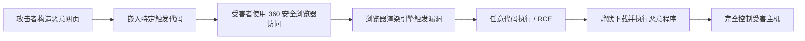

## 漏洞概述

2016年1月，WooYun（乌云）平台连续披露两枚 **360安全浏览器 v8 系列** 远程代码执行（RCE）高危漏洞。攻击者仅需诱导受害者访问精心构造的恶意网页，即可在用户无感知的情况下实现任意代码执行、静默安装恶意程序。当时 360 官方宣称用户基数超 **4 亿**，影响面极广。

| 漏洞编号 | 披露时间 | 发现者 | 影响版本 | 修复版本 |
|----------|----------|--------|----------|----------|
| **WooYun-2016-170984** | 2016-01-19 09:29 | @唐朝实验室 | v8 系列 < v8.1.1.126；v8 之前版本可能受影响 | v8.1.1.126+ |
| **WooYun-2016-172781** | 2016-01-26 13:54 | @心伤的胖子 | v8 系列全版本；v8 之前版本可能受影响 | v8.1.1.128+ |

> **核心危害**：用户访问含特定代码的网站 → 后台静默安装恶意程序 → 完全控制受害主机。

## 漏洞详情

### WooYun-2016-170984（首例）

- **发现时间**：2016-01-19 上午 09:29
- **发现方**：唐朝云安全研究团队 @唐朝实验室
- **漏洞类型**：远程命令执行
- **攻击向量**：诱导用户访问恶意网页
- **利用后果**：任意代码执行、静默植入恶意软件
- **360 响应**：当日中午确认漏洞，评级为**高危**，后续发布更新修复

### WooYun-2016-172781（补丁绕过/新漏洞）

- **发现时间**：2016-01-26 中午 13:54
- **发现方**：白帽子 @心伤的胖子
- **背景**：针对 1 月 19 日修复版本（v8.1.1.126）的后续审计中发现
- **漏洞类型**：远程命令执行（另一处代码缺陷）
- **利用后果**：与首例完全一致，可绕过前一补丁防护
- **360 响应**：确认后表示将紧急发布新版本修复

## 影响范围与版本对照

```
┌─────────────────────────────────────────────────────────────┐
│  360安全浏览器 v8 系列版本影响矩阵                            │
├──────────────────┬──────────────────────┬────────────────────┤
│  版本区间        │ WooYun-2016-170984   │ WooYun-2016-172781 │
├──────────────────┼──────────────────────┼────────────────────┤
│  v8.1.1.128+     │ ✅ 已修复            │ ✅ 已修复          │
│  v8.1.1.126-127  │ ✅ 已修复            │ ❌ 受影响          │
│  v8 系列 <126    │ ❌ 受影响            │ ❌ 受影响          │
│  v8 之前版本     │ ⚠️ 可能受影响        │ ⚠️ 可能受影响      │
└──────────────────┴──────────────────────┴────────────────────┘
```

> **官方最新版本（截至预警发布）**：v8.1.1.128  
> **建议用户行动**：立即升级至 **v8.1.1.128 或更高版本**，避免访问未知链接。

## 攻击链复现逻辑（概念模型）



**关键特征**：
- **零交互**：无需用户点击、下载、确认任何弹窗
- **静默性**：后台自动完成恶意程序部署
- **广泛性**：覆盖 v8 系列主流版本，用户基数 4 亿+

## 时间线回溯

| 日期 | 事件 |
|------|------|
| **2016-01-19 09:29** | @唐朝实验室 提交 WooYun-2016-170984 |
| **2016-01-19 中午** | 360 确认漏洞，评级高危，启动应急修复 |
| **2016-01-19 后续** | 360 发布 v8.1.1.126 修复版本 |
| **2016-01-26 13:54** | @心伤的胖子 提交 WooYun-2016-172781（修复版仍受影响） |
| **2016-01-26 后续** | 360 确认第二漏洞，承诺紧急发布 v8.1.1.128 彻底修复 |
| **预警发布日** | 乌云安全中心发布预警通告，建议用户升级至 v8.1.1.128+ |

## 防护建议

1. **立即升级**：确保 360 安全浏览器版本 **≥ v8.1.1.128**
2. **谨慎点击**：不访问不明来源链接、邮件附件链接、社交软件陌生分享链接
3. **启用防护**：开启浏览器内置恶意网址拦截、下载防护功能
4. **补丁管理**：企业环境通过统一终端管理平台推送浏览器更新
5. **关注 SRC**：持续关注 [360BugCloud 漏洞响应平台]([[360bugcloud-vulnerability-response-platform]]) 及官方安全公告

## 关联背景

- **WooYun 平台**：国内首个白帽子漏洞众测平台（2016 年关停），该事件为其晚期典型高影响力预警案例。平台年度总结见 [[wooyun-2015-annual-security-report]]。
- **厂商响应机制**：360 作为国内头部安全厂商，其 SRC（安全应急响应中心）响应速度与补丁质量直接关系亿级用户安全。此事件暴露「补丁发布后回归测试不足」导致的补丁绕过风险。
- **浏览器安全演进**：此类 RCE 漏洞推动了沙箱隔离、站点隔离、JIT 硬化等现代浏览器安全架构的普及。

## 交叉引用

- [[360bugcloud-vulnerability-response-platform]] — 360 官方漏洞响应平台（SRC）建设案例
- [[wooyun-2015-annual-security-report]] — WooYun 2015 年度安全报告，含平台统计与经典案例复盘
- [[supply-chain-attack-fundamentals]] — 供应链攻击基础，浏览器作为客户端供应链关键节点的风险视角

## 参考资料

- 乌云安全中心预警原文（微信公众号归档）
- WooYun-2016-170984 / WooYun-2016-172781 漏洞详情页（历史快照）
- 360安全浏览器官方版本更新日志

## 来源

- [301在路上-201508-202208_205](../sources/301在路上-201508-202208_205.md)
