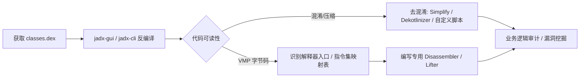

## 概述

Android 应用加固技术经过十余年发展，已历经**四代技术迭代**，保护粒度从文件级逐步细化至函数级、指令级，最终演进为自定义虚拟机执行环境。本页面系统梳理四代加固的核心原理、架构差异、兼容性权衡及典型对抗手段，并汇总当前主流脱壳工具链的适用版本、安装部署与实战命令，为移动端逆向分析与安全评估提供结构化参考。

> **交叉引用**：本页面涉及的逆向工程基础知识可参考 [[reverse-engineering-beginner-learning-path]]；CTF 实战中 Android 逆向题型分析见 [[0w1club-ctf-re-writeup-beginner-challenges]]。

---

## 第一代加固：动态加载

### 核心原理

- 基于 **Java 层 `DexClassLoader` / `PathClassLoader`** 实现运行时加载加密的 `classes.dex`（Payload）
- App 启动时先加载一个轻量 **Loader（壳）**，Loader 解密 Payload 并写入文件系统（`/data/data/pkg/code_cache/` 等），再通过反射调用 `loadClass` 执行原逻辑
- 最早见于恶意软件，后被商业加固厂商采用

### 典型流程

1. 原始 `classes.dex` 加密存放于 `assets/` 或 `lib/` 目录
2. `Application` / `attachBaseContext` 中初始化 Loader
3. Loader 解密 → **落地写文件** → `DexClassLoader` 加载 → 反射调用真实入口

### 关键弱点

| 弱点 | 说明 |
|------|------|
| **必须落地** | 解密后的 DEX 完整存在于文件系统，`cp /data/data/pkg/code_cache/*.dex` 即可获取 |
| **动态加载特征明显** | `DexClassLoader`、`loadClass`、`defineClass` 调用栈易被 Hook 检测 |
| **兼容性好** | 仅用公开 API，几乎无兼容性问题 |

### 对抗手段

- **Xposed / Frida Hook `DexClassLoader` 构造器**：拦截 `dexPath` 参数，转存解密后的 DEX
- **自定义 ClassLoader 继承链分析**：定位 `findClass` / `loadClass` 重写点
- **内存搜索 DEX Magic (`dex\n035\n000`)**：直接从进程内存导出

---

## 第二代加固：不落地加载

### 核心演进目标

> **解决「必须落地」痛点**，实现开发零侵入、发布前一键加固，同时处理 Android 组件生命周期（四大组件、Application、ContentProvider 等）

### 两大技术路线

#### 方案 A：系统 IO 透明加解密（Hook-based）

```text
1. Payload 加密存储于 APK
2. Loader 释放加密 Payload 到文件系统（仍是密文）
3. Inline Hook / GOT Hook 拦截 `read`、`write`、`mmap` 等 libc 函数
4. 虚拟机读取 DEX 时触发 Hook → 实时解密返回明文
5. 虚拟机感知不到加密，正常执行
```

- **兼容性痛点**：Inline Hook 依赖指令长度、寄存器约定，Android 版本、厂商 ROM、ART 运行时差异极大，极易崩溃

#### 方案 B：调用 VM 内部接口（Native JNI-based）

```text
1. Payload 加密存储于 APK
2. Loader 解密至内存缓冲区
3. 通过 JNI 调用 `dalvik_system_DexFile_openInMemory` / `openDexFile_bytearray` 等**非公开内部函数**
4. 直接从内存加载 DEX，无文件落地
```

- **兼容性痛点**：内部函数未导出、签名随版本变化、厂商定制修改（华为、小米、OPPO 等均有私有 ART 补丁），维护成本极高

### 优缺点对比

| 维度 | 方案 A（IO Hook） | 方案 B（VM 内部接口） |
|------|-------------------|----------------------|
| **落地** | 伪落地（密文文件） | 纯内存 |
| **兼容性** | 差（Inline Hook 易碎） | 差（私有符号不稳定） |
| **抗调试** | 中（可绕过 Hook） | 中（可绕过 JNI 调用） |
| **性能损耗** | 较高（每次 IO 进内核） | 较低（一次性内存拷贝） |

### 通用对抗思路

> **核心洞察**：无论哪种方案，**类加载器最终必须找到 DEX 结构体**（`DexFile` / `ClassDef` / `CodeItem`）才能执行。

1. **自定义 VM / Frida 枚举 `ClassLoader` 链** → 遍历 `pathList.dexElements` → 定位 `DexFile` 对象 → 读取 `mCookie` / `mMap` 指针 → Dump 内存区间
2. **绕过 IO Hook**：直接使用 `syscall` (`__NR_read`/`__NR_pread64`) 读取内存映射区，或 `/proc/self/mem` 自读
3. **关键断点**：`dvmDexFileOpenFromFd` / `DexFile::OpenMemory` / `ClassLinker::DefineClass` / `ArtMethod::GetCodeItemOffset`

---

## 第三代加固：指令抽离

### 核心思想

> **保护粒度下沉至函数级**：发布阶段将每个方法的 `CodeItem`（字节码指令数组）剥离至外部加密存储，运行时动态恢复。

### 发布时处理

1. 解析原始 DEX，遍历 `method_ids`
2. 对每个 `CodeItem`：计算偏移、长度 → 剪切 → 加密 → 存入独立 Section / 独立文件 / `assets/`
3. 原 DEX 中对应 `CodeItem` 指针置零 / 填充 NOP / 标记为「外部」

### 运行时恢复策略

| 策略 | 触发时机 | 实现要点 |
|------|----------|----------|
| **加载后全量恢复** | `DexFile` 打开完成、类加载前 | 遍历所有方法，解密 CodeItem → 回填 `ArtMethod::code_item_offset_` / `DexFile::code_items_` |
| **首次执行懒加载** | 解释器进入 `ExecuteSwitchImpl` / `Quick` 入口 | Hook `ArtMethod::GetCodeItemOffset` / `Interpreter::Execute` → 按需解密单个方法 → 缓存 |
| **拦截查找执行代码** | 虚拟机查找字节码指针 | 重写 `ClassLinker::ResolveMethod` / `ArtMethod::GetDexCodeItem` 返回解密后指针 |

### 典型数据结构（ART）

```cpp
// art/mirror/art_method.h 简化
class ArtMethod {
  uint32_t dex_code_item_offset_;  // 指向 CodeItem 在 DEX 中的偏移
  uint32_t dex_method_index_;
  DexFile* dex_file_;
  // 第三代加固会在运行时动态修改 dex_code_item_offset_ 指向解密后的内存缓冲区
};
```

### 对抗难点与突破

- **内存中 Payload 不再连续**：单方法 Dump 需建立「方法索引 → 代码缓冲区」映射表
- **Hook 点更隐蔽**：厂商常在 `ArtMethod::GetCodeItemOffset`、`QuickEntryPoints`、解释器入口植入恢复逻辑
- **通用突破**：Frida 枚举所有 `ArtMethod` → 读取 `dex_code_item_offset_` → 若指向非常规内存区（非 DEX 映射区、匿名 `mmap`、堆）→ Dump 该区域 → 重建 `CodeItem` 结构 → 回填至原始 DEX 模板

---

## 第四代加固：虚机源码保护

### 架构范式转变

| 维度 | 前三代 | 第四代（虚机源码保护） |
|------|--------|------------------------|
| **执行引擎** | ART 解释器 / JIT / AOT | **自定义解释器（VMP 虚拟机）** |
| **指令集** | 标准 Dalvik / Dex 字节码 | **自定义可变字节码指令集** |
| **系统交互** | 直接调用 Android API | **仅通过 JNI 桥接** 调用系统 API |
| **代码形态** | 可被静态识别的 DEX | **二进制 Blob + 解释器** |
| **运行环境** | 共享 ART 堆、线程、类加载器 | **进程内隔离执行环境**（独立堆、栈、线程池） |

### 核心组件

1. **工具链编译器**：Java/Kotlin 源码 → 中间二进制（类 LLVM IR） → 目标平台指令集
2. **运行时**：
   - 解释器核心（指令分发循环、操作数栈、寄存器映射）
   - 内存管理器（独立 GC、对象模型）
   - JNI 桥接层（`JNIEnv` 封装、对象引用转换、异常映射）
   - 反调试/监控探针（`ptrace` 自反调试、时间检测、内存完整性校验、指令流完整性）
3. **指令集变异**：每次编译生成唯一 opcode 映射表、寄存器编码、常量池加密

### 安全特性

| 特性 | 实现机制 |
|------|----------|
| **指令跟踪极难** | 动态分发、opcode 每次构建随机化、控制流平坦化内建 |
| **静态分析失效** | 无标准 DEX 结构、IDA/Ghidra/JADX 无法识别 |
| **动态调试陷阱** | 探针检测 `ptrace`、`/proc/pid/status`、`hardware breakpoint`、单步异常 → 触发陷阱（死循环、崩溃、假路径） |
| **实时更新** | 云端下发新解释器 / 新指令集 / 新加密密钥，热替换 |

### 攻击面分析

> **本质**：自定义 VM 仍需通过 **JNI** 与 Android 系统交互 → **JNI 边界是必经之路**。

| 攻击向量 | 描述 |
|----------|------|
| **JNI 黑盒探测** | 构造 `JNIEnv` 伪对象，调用导出的 `JNI_OnLoad` / 业务.native 方法，记录入参/返回值/内存访问 |
| **内存快照对比** | 执行前后 `heap dump` / `mmap` 区域对比，定位敏感数据（密钥、Token、算法常量） |
| **指令追踪（动态二进制插桩）** | `Frida Stalker` / `DynamoRIO` / `QEMU-user` 记录解释器分发循环 → 还原指令语义 |
| **Side-channel** | 缓存侧信道、分支预测侧信道推测解释器内部状态 |
| **协议逆向** | 抓包分析「实时更新」通信协议，伪造下发恶意解释器 |

---

## 主流脱壳工具链实战速查

### 适用版本矩阵

| 工具 | 核心机制 | 适用 Android | 对抗加固代数 | 依赖环境 |
|------|----------|--------------|--------------|----------|
| **dexdump** | 遍历 `ClassLoader` → `DexFile` → `mmap` Dump | 6.0–8.x | 1、2 代（落地/不落地） | Root + Xposed / VirtualXposed |
| **frida-dexdump** | Frida 枚举 `ClassLinker` / `DexFile` → 进程内存读取 | 7.0–14+ | 1–3 代（含指令抽离部分场景） | Frida Server (Root/Rootless) |
| **DumpDex** | `ptrace` attach → 解析 `link_map` / `DexFile` 结构 → 文件落地 | 5.0–12+ | 1、2 代 | Root + `ptrace` 权限 |
| **FDex2** | Xposed 模块 Hook `BaseDexClassLoader` / `DexFile` → 自动保存 | 5.0–12+ (Xposed 可用版本) | 1、2 代 | Root + Xposed Framework (LSP/EdXposed) |

---

### dexdump（经典 Xposed 插件）

> **项目地址**：多为私有/论坛流传，典型实现基于 `de.robv.android.xposed.XposedHelpers`

**安装步骤**

```bash
# 1. 手机安装 Xposed Framework (Magisk 模块: Riru + EdXposed / LSPosed)
# 2. 将 dexdump.apk / dexdump.jar 推送至 /data/local/tmp/
# 3. Xposed 模块列表勾选 dexdump → 重启
# 4. 目标 App 启动时自动在 /data/data/<pkg>/files/dexdump/ 产出解密 DEX
```

**局限**：Android 9+ `ClassLoader` 结构大变、`libart.so` 符号剥离、SELinux 限制文件写入，成功率骤降。

---

### frida-dexdump（现代首选）

> **项目**：https://github.com/hluwa/frida-dexdump  
> **特点**：纯 Python + Frida，无需 Xposed，支持 Android 10+、指令抽离场景下的「方法级 Dump」扩展。

#### 安装部署

```bash
# Host 端
pip3 install --upgrade frida-tools frida-dexdump

# 手机端（Root 模式）
# 1. 下载对应架构 frida-server (https://github.com/frida/frida/releases)
adb push frida-server-16.x.x-android-arm64 /data/local/tmp/frida-server
adb shell "chmod 755 /data/local/tmp/frida-server"
adb shell "/data/local/tmp/frida-server &"

# 或 Rootless 模式（需 Magisk + Riru + Frida 模块）
```

#### 核心命令

```bash
# 列出设备进程
frida-ps -Ua

# 以包名启动并脱壳（推荐，自动处理启动竞态）
frida-dexdump -U -f cc.rs.yjzh -o ./dump_output

# 已运行进程附着脱壳
frida-dexdump -U -p <PID> -o ./dump_output

# 仅脱特定类/包（配合 --class-filter）
frida-dexdump -U -f com.target.app --class-filter "com.target.core.*" -o ./dump_core

# 启用指令抽离场景下的 CodeItem 重建（实验性）
frida-dexdump -U -f com.target.app --rebuild-codeitem -o ./dump_full
```

#### 输出产物

```
dump_output/
├── classes.dex           # 主 DEX
├── classes2.dex          # MultiDex 分包
├── classes3.dex
└── metadata.json         # 类/方法/字段索引映射，便于 JADX 导入
```

#### 进阶用法：Hook 自定义加载器

```python
# custom_hook.js 注入脚本片段
Java.perform(() => {
  const CustomLoader = Java.use("com.qihoo360.loader.CustomClassLoader");
  CustomLoader.loadClass.overload('java.lang.String', 'boolean').implementation = function(name, resolve) {
    const cls = this.loadClass(name, resolve);
    // 触发 frida-dexdump 内部枚举逻辑
    send({type: 'dexdump_trigger', className: name});
    return cls;
  };
});
```

```bash
frida-dexdump -U -f com.target.app -l custom_hook.js -o ./dump_custom
```

---

### DumpDex（Native ptrace 方案）

> **项目**：https://github.com/WrBug/dumpDex  
> **优势**：无需 Frida/Xposed，纯 C++ `ptrace` 解析目标进程 `link_map` 与 `DexFile` 结构体，适合无法运行 Frida Server 的环境。

#### 编译与部署

```bash
# 源码编译（需 NDK r21+）
git clone https://github.com/WrBug/dumpDex
cd dumpDex
ndk-build NDK_PROJECT_PATH=. APP_BUILD_SCRIPT=./Android.mk APP_ABI=arm64-v8a

# 推送二进制
adb push libs/arm64-v8a/dumpDex /data/local/tmp/
adb shell "chmod 755 /data/local/tmp/dumpDex"
```

#### 使用示例

```bash
# 获取目标 PID
adb shell pidof com.target.app
# 12345

# 执行脱壳（需 root）
adb shell "su -c '/data/local/tmp/dumpDex -p 12345 -o /sdcard/dumpdex_out'"

# 拉取结果
adb pull /sdcard/dumpdex_out ./dumpdex_out
```

#### 关键参数

| 参数 | 说明 |
|------|------|
| `-p <pid>` | 目标进程 PID |
| `-o <dir>` | 输出目录 |
| `-m <maps_filter>` | 只扫描特定内存区域（如 `/data/app/~~/base.apk!classes.dex`） |
| `--dex-version` | 强制指定 DEX 版本号（修复自动识别失败） |

---

### FDex2（Xposed 模块，图形化）

> **项目**：https://github.com/AndnixSH/FDex2  
> **特点**：LSPosed/EdXposed 模块，提供 UI 界面可视化选择目标 App、实时日志、一键导出。

#### 安装流程

1. 手机安装 **LSPosed Manager**（Magisk/KernelSU）
2. 下载 `FDex2-vX.Y.Z-release.apk` 安装
3. LSPosed → 模块 → 勾选 **FDex2** → 作用域勾选目标 App → 重启
4. 打开 FDex2 App → 选择目标包名 → 点击「开始脱壳」
5. 产出目录：`/sdcard/FDex2/<pkg>/`，含 `classes*.dex` 与 `log.txt`

#### 适用场景

- 快速验证「是否为二代不落地加固」
- 配合「应用分身/虚拟机」（VMOS Pro、F1 VM）在无 Root 设备上测试
- 对抗检测 Xposed 的加固：开启 LSPosed「隐藏 Xposed 特征」选项

---

## 脱壳后分析工作流



### 常用后处理工具

| 工具 | 用途 |
|------|------|
| **jadx** | 标准 DEX → Java 伪代码 |
| **Simplify** | 基于抽象解释的死代码消除、常量传播、控制流还原 |
| **Dekotlinizer** | Kotlin 编译器生成的合成方法/元数据还原为可读 Java |
| **ClassyShark** | 快速查看 DEX 结构、方法数、依赖库 |
| **AndroGuard / Dexcalibur** | Python 脚本化分析、CFG 提取、字符串解密自动化 |

---

## 典型加固厂商特征识别速查

| 厂商/方案 | 典型特征串 / 类名 / so 名 | 代数归属 | 推荐脱壳优先级 |
|-----------|---------------------------|----------|----------------|
| **360 加固 / 通付盾** | `libjiagu.so`、`libprotectClass.so`、`com.qihoo360.replugin` | 2 代（不落地） | frida-dexdump → DumpDex |
| **爱加密** | `libegis.so`、`com.aijiami`、资源文件 `assets/egis_*` | 2→3 代过渡 | frida-dexdump (--rebuild-codeitem) |
| **梆梆 / 网秦** | `libsecexe.so`、`libDexHelper.so`、`bangcle` | 2 代 | FDex2 → frida-dexdump |
| **腾讯 乐固 / 御安全** | `libshell.so`、`com.tencent.legu`、`libmsaoaidsec.so` | 2 代（强 Hook 检测） | DumpDex (ptrace 绕过用户态 Hook) |
| **阿里 移动安全 / 硬核加固** | `libsgmain.so`、`libsgsecuritybody.so`、`com.alipay.mobile.security` | 3 代（指令抽离） | frida-dexdump + 自定义 Hook 恢复 CodeItem |
| **百度 麦盾 / 滴滴 虎符** | `libbaiduprotect.so`、`libdididaijia.so`、VMP 解释器 `libvm*.so` | 4 代（虚机源码保护） | **需专用还原器**，常规工具无效 |
| **华为 方舟编译器 / 雅端** | `libarkcompiler.so`、AOT 产物 `*.vdex` `*.odex` | AOT 编译非加固 | 直接分析 `vdex/odex` 配合 `baksmali` |

> **提示**：厂商版本迭代极快，特征串仅供参考，实战中请以 `strings libxxx.so | grep -iE "dex|class|art|oat|vdex"` 动态确认。

---

## 常见反脱壳对抗与绕过清单

| 反脱壳手法 | 检测点 | 绕过思路 |
|------------|--------|----------|
| **检测 Frida Server** | `/data/local/tmp/frida-server`、端口 27042、线程名 `frida:` | 重命名二进制、修改默认端口、`frida-server -l 0.0.0.0:12345`、使用 **Frida Gadget 注入模式** |
| **检测 Xposed / LSPosed** | `XposedBridge` 类、`de.robv.android.xposed` 包、`/data/data/de.robv.android.xposed.installer` | LSPosed「隐藏特征」模式、Magisk Hide / Zygisk、KernelSU 无痕模式 |
| **检测 ptrace / 调试器** | `ptrace(PTRACE_ATTACH)` 失败、`/proc/pid/status` `TracerPid != 0` | `ptrace(PTRACE_TRACEME)` 自绑定、`/proc/pid/status` 伪造、内核模块隐藏 |
| **校验 DEX 校验和 / 签名** | `DexFile` 头部 `checksum`/`signature` 与原 APK 不符 | 内存 Dump 时同步修正头部字段、或使用 `apktool` 重打包时保留原始签名 |
| **动态完整性校验 (CRC/Hash)** | 定时扫描 `.text` / `.data` / `DexFile` 内存区 | Frida `Interceptor` 拦截校验函数返回常量、或 `Memory.protect` 设置 `PAGE_GUARD` 触发单步调试定位校验点 |
| **环境指纹 (Root/模拟器/多开)** | `su` 二进制、`/system/xbin/daemonsu`、`ro.build.tags=test-keys`、Binder 调用栈 | Magisk Hide / Zygisk、模拟器伪造 `build.prop`、VirtualXposed / App Cloner 伪装包名 |
| **JNI 动态注册混淆** | `RegisterNatives` 入参乱序、字符串加密、控制流平坦化 | IDA/Ghidra 批量重命名 `JNI_OnLoad` 分析、Frida `Module.enumerateExportsSync` 枚举导出符号、动态调试 `dlsym` |

---

## 实战案例：某金融 App 三代加固脱壳全记录

> **场景**：目标 App `com.finance.target`，Android 13，Root 设备 (Magisk + KernelSU)，已安装 LSPosed。

### 侦察阶段

```bash
# 1. 基础信息
adb shell pm path com.finance.target
# package:/data/app/~~xxx==/com.finance.target-xxx==/base.apk

# 2. 解包 APK 查壳
apktool d base.apk -o ./apk_out
ls ./apk_out/lib/arm64-v8a/
# libsgmain.so  libsgsecuritybody.so  libjiagu.so  --> 阿里/360 混合加固特征

# 3. 启动 Frida Server (Rootless 模式)
# KernelSU 授予 frida 权限后自动注入
frida-ps -Ua | grep finance
# 12345  com.finance.target
```

### 脱壳尝试 1：frida-dexdump 直连

```bash
frida-dexdump -U -f com.finance.target -o ./dump_v1
# 卡住 30s 无输出，进程被杀 → 疑有反 Frida / 启动期完整性校验
```

### 脱壳尝试 2：Frida Gadget 注入 + 延迟附着

```bash
# 1. 下载 gadget
wget https://github.com/frida/frida/releases/download/16.3.3/frida-gadget-16.3.3-android-arm64.so.xz
unxz frida-gadget-16.3.3-android-arm64.so.xz

# 2. 修改 APK 注入 System.loadLibrary("frida-gadget")
# 使用 apktool 反编译 -> 修改 smali -> 重打包签名 -> 安装
# 详见：https://frida.re/docs/gadget/

# 3. 启动 App，Frida Gadget 监听 27042
frida-dexdump -U --attach-pid 12345 -o ./dump_v2 --rebuild-codeitem
# 成功产出 classes.dex, classes2.dex
```

### 后处理

```bash
# 1. jadx 反编译
jadx -d ./src_v2 ./dump_v2/classes.dex ./dump_v2/classes2.dex

# 2. 发现关键业务类方法体为空 (CodeItem 长度 0) → 确认为指令抽离 (第三代)
# 3. 编写 Frida 脚本 Hook ArtMethod::GetCodeItemOffset 记录恢复后的指针
# 4. 二次 Dump 还原完整 CodeItem
```

---

## 结语与展望

Android 加固技术正从「隐藏代码」向「改变执行语义」演进：**第四代虚机源码保护实质上将 Java/Kotlin 编译为自定义字节码，在进程内构建隔离的解释器生态**。这使得传统「Dump DEX → 反编译」工作流失效，逆向分析重心转向：

1. **解释器逆向**：还原指令集语义、寄存器映射、常量池编码
2. **JNI 边界审计**：梳理所有桥接函数、数据流向、权限边界
3. **动态插桩对抗**：在解释器分发循环、JNI 桥接层植入观测点
4. **云端更新链分析**：评估热更新机制是否引入供应链攻击面

> **工具生态建议**：
> - 关注 **Frida Stalker / DynamoRIO / QEMU-user** 等动态二进制插桩框架在 Android 上的成熟度
> - 参与 **LSPosed / KernelSU / Frida** 社区反检测模块共建
> - 建立团队内部「加固样本库 + 自动化脱壳流水线」，持续跟踪厂商版本迭代

---

## 相关页面

- [[reverse-engineering-beginner-learning-path]] — 逆向工程入门学习路径与核心工具链
- [[0w1club-ctf-re-writeup-beginner-challenges]] — CTF 实战中 Android/ELF 逆向题型分类解析
- [[binary-ninja-ollvm-deobfuscation]] — OLLVM 控制流平坦化去混淆技术（对应指令抽离/VMP 场景的静态对抗）
- [[ida-pro-tips-plugins-python]] — IDA Pro 签名识别、插件开发、Python 脚本辅助分析
- [[v8-issue-944062-gc-arbitrary-write]] — 浏览器内核漏洞利用链（对比移动端 Native 层攻击面）
- [[linux-kernel-hardening-mechanisms]] — Linux 内核缓解技术（对应 Android 系统层防护机制）

## 来源

- [0x00实验室-202108-202304_010](../sources/0x00实验室-202108-202304_010.md)
