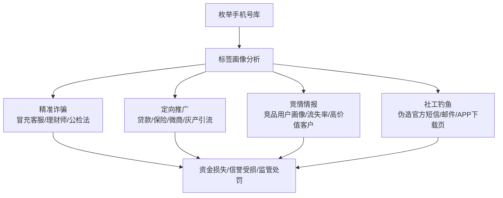

## 概述

本页面系统梳理**注册校验接口缺乏频次限制**与**前端脱敏手机号回显**两类看似低危的业务逻辑缺陷组合形成的**手机号枚举攻击链**。攻击者利用注册接口的“用户是否存在”布尔响应，对脱敏手机号（如 `187****0305`）的中间 4 位进行 10,000 次离线/在线爆破，还原完整手机号。在金融、P2P、电商等高价值场景下，手机号与投资金额、交易记录等敏感信息关联，可导致**精准诈骗、竞争对手定向推广、社工钓鱼**等放大危害。

> **核心结论**：单一缺陷风险可控，组合后形成完整攻击面。企业需从“接口级限流”“脱敏策略”“业务逻辑审计”三个维度构建纵深防御。

---

## 攻击链模型

```mermaid
flowchart LR
    A[前端页面渲染脱敏手机号\n187****0305] --> B[攻击者获取脱敏样本]
    B --> C[定位注册校验 API\nPOST /api/checkPhone\n{phone: \"187xxxx0305\"}]
    C --> D[接口无频次限制/限流可绕过]
    D --> E[遍历 0000-9999 爆破中间 4 位]
    E --> F[根据布尔响应还原完整手机号]
    F --> G[关联业务数据\n投资金额/订单/身份标签]
    G --> H[精准诈骗/定向推广/社工钓鱼]
```

### 关键节点说明

| 节点 | 说明 | 典型特征 |
|------|------|----------|
| **脱敏回显点** | 评论区、个人中心、投资记录、订单列表等 | 固定掩码位数（常见 4 位）、掩码字符固定（`*`/`#`） |
| **校验接口** | 注册页“检查手机号是否占用”、找回密码“验证手机号”、登录页“用户是否存在” | 返回 `true/false`、`exist: 1/0`、`code: 200/400` 等明确布尔语义 |
| **限流缺失** | 无 IP 限流、无设备指纹限流、无账号维度限流、验证码可复用/绕过 | 单接口可高频调用（>100 req/s）、无 WAF 规则拦截 |
| **数据关联** | 手机号即用户唯一标识，绑定实名、投资额、信用额度等 | P2P 投资记录页、电商订单页、保单查询页 |

---

## 技术细节深度解析

### 脱敏回显的信息熵分析

- **掩码位数固定**：国内手机号 11 位，前 3 位运营商归属固定，后 4 位常作为展示尾号，**中间 4 位熵值 = 10⁴ = 10,000**。
- **掩码字符单一**：`****`、`####` 等固定字符，无法区分多用户同尾号场景（如 `187AAAA0305` 与 `187BBBB0305`），导致**误报率 ≈ 用户量 / 10⁴**，百万用户量级误报约 100 条，可通过二次校验（如发送短信验证码接口）去重。

### 注册校验接口的攻击面特征

| 接口类型 | 典型路径 | 请求方式 | 关键参数 | 响应判断依据 |
|----------|----------|----------|----------|--------------|
| 注册查重 | `/api/user/checkPhone` | POST/GET | `phone` / `mobile` | `{"exist":false}` 可注册 |
| 找回密码 | `/api/password/forgot` | POST | `phone` | `{"msg":"验证码已发送"}` 存在用户 |
| 登录探测 | `/api/auth/login` | POST | `phone` + 任意密码 | `{"code":400,"msg":"用户不存在"}` vs `密码错误` |
| 绑定校验 | `/api/bind/check` | POST | `phone` | `{"available":true}` 未绑定 |

> **实战提示**：若接口需图形验证码，可尝试**验证码复用**（同一 token 多次提交）、**验证码识别**（OCR/打码平台）、**前端验证码逻辑绕过**（仅前端校验、Referer 校验缺失）等手段降低爆破成本。

### 爆破可行性数学模型

假设：
- 单请求耗时 `t = 200ms`（含网络延迟）
- 并发数 `c = 50`（避免触发基础 WAF）
- 目标掩码位数 `n = 4`（10,000 组合）

**理论最短耗时**：
$$ T_{min} = \frac{10^n \times t}{c} = \frac{10,000 \times 0.2}{50} = 40 \text{ 秒} $$

**实际工程化考量**：
- 引入随机延迟、IP 轮换、请求头混淆 → 单目标约 **5-15 分钟** 完成
- 批量目标（如评论页 100 条脱敏手机号）可并行化，总耗时线性增长

---

## 金融场景危害放大机制

### 敏感标签自动化打标

| 数据源 | 可关联字段 | 打标示例 |
|--------|------------|----------|
| P2P 投资记录 | `invest_amount`、`project_type`、`yield_rate` | `高净值`、`偏好短期高收益`、`可用资金 > 50万` |
| 电商订单 | `order_total`、`category`、`frequency` | `高频购奢侈品`、`母婴人群`、`海淘用户` |
| 保单查询 | `premium`、`coverage`、`insured_age` | `高保额人群`、`刚需养老险`、`儿童重疾险` |

### 攻击变现路径



### 真实案例复盘（脱敏）

> **某 P2P 平台**：投资记录页展示 `投资人：138****8888  投资金额：¥200,000`，注册接口 `/api/checkMobile` 无限流。攻击者 2 小时枚举 3,000+ 真实手机号，结合投资金额筛选 `>10万` 目标 400 余个，后续通过“平台客服”话术诱导受害者点击钓鱼链接安装恶意 APP，造成单笔最高损失 18 万。

---

## 检测与验证方法论

### 黑盒扫描规则

| 检测项 | Payload 示例 | 判定逻辑 |
|--------|--------------|----------|
| 脱敏回显发现 | 正则 `\d{3}[*#]{3,4}\d{4}` 扫描前端页面 | 命中即标记“脱敏回显点” |
| 校验接口探测 | 遍历常见路径 `/api/checkPhone`、`/user/exist` 等 | 返回包含 `exist`/`available`/`true`/`false` 等关键字 |
| 限流测试 | 同一 IP 连续请求 50 次，观察 HTTP 状态码/响应体变化 | 无 429/验证码/账号锁定 → “疑似无限流” |
| 组合验证 | 取脱敏样本 `138****8888`，爆破中间 4 位，统计命中率 | 命中率 > 0 且响应时间稳定 → “高危确认” |

### 白盒代码审计要点

```java
// 典型漏洞代码模式（Spring Boot）
@PostMapping("/checkPhone")
public Result checkPhone(@RequestParam String phone) {
    // 缺陷 1：无 @RateLimiter 注解
    // 缺陷 2：直接返回布尔值，未做模糊化处理
    boolean exists = userService.existsByPhone(phone);
    return Result.ok(exists);  // 直接返回 true/false
}
```

**审计清单**：
- [ ] Controller 方法是否标注限流注解（`@RateLimiter`、`@SentinelResource`）
- [ ] Service 层是否调用 `RedisLimiter`/`Guava RateLimiter` 等中间件
- [ ] 响应体是否统一为“通用提示”（如“若手机号已注册，验证码已发送”）而非布尔值
- [ ] 是否记录审计日志（IP、手机号、时间、UA）供事后溯源

---

## 修复与缓解策略

### 接口层硬化（首选）

| 方案 | 实现要点 | 适用场景 | 成本 |
|------|----------|----------|------|
| **IP + 手机号双维度限流** | Redis 滑动窗口：`rate:ip:{ip}:{minute} ≤ 20`、`rate:phone:{phone}:{hour} ≤ 5` | 所有校验类接口 | 低 |
| **设备指纹/Token 绑定** | 前端生成 `device_id`，后端校验 `device_id` 与 `session` 绑定，单设备单位时间请求上限 | 注册、登录、找回密码 | 中 |
| **图形/滑块/行为验证码** | 集成极验、Geetest、阿里云验证码，验证通过才放行核心逻辑 | 高价值接口（注册、登录、支付） | 中高 |
| **响应模糊化** | 统一返回 `{"msg":"操作成功，请查收短信"}`，不暴露用户是否存在 | 找回密码、绑定校验、登录 | 低 |

### 脱敏策略升级

| 策略 | 示例 | 优势 | 劣势 |
|------|------|------|------|
| **动态掩码位数** | VIP 用户显示 `138****8888`，普通用户 `138******88` | 增加爆破空间（5 位 = 10 万） | 体验下降，需分级 |
| **伪造尾号池** | 真实尾号 `8888`，展示从 `[6666, 7777, 8888, 9999]` 随机抽取 | 破坏“尾号=真实”假设 | 需前后端配合存储映射 |
| **仅展示脱敏标识** | `投资人：用户A1B2`（内部映射表） | 彻底切断手机号关联 | 需重构前端展示逻辑 |
| **按需脱敏** | 非好友/非关联关系仅显示 `投资人：匿名用户` | 最小权限原则 | 业务复杂度高 |

### 业务逻辑审计体系化

1. **梳理“用户标识回显”全清单**：评论、订单、投资、物流、工单、排行榜等
2. **建立“校验类接口”台账**：注册查重、登录探测、找回密码、绑定校验、优惠券领取资格校验等
3. **矩阵交叉分析**：`回显点 × 校验接口` 形成风险矩阵，优先处理**高价值场景 × 无限流接口**
4. **纳入 SDL 必检项**：上线前必须通过“业务逻辑枚举测试用例”（如《微信支付业务安全规范》4.3 节）

### 监控与应急

- **实时告警**：单 IP 分钟请求校验接口 > 30 次、单手机号小时被查询 > 10 次 → 触发风控拦截/人工复核
- **蜜罐手机号**：在库中植入 `13800000000` 等不可注册号码，被查询即判定为枚举行为
- **应急预案**：发现枚举攻击 → 紧急上限流规则 → 回溯日志提取攻击 IP/指纹 → 推送至威胁情报平台 → 通知受影响用户修改登录凭证/开启二次验证

---

## 交叉引用与延伸阅读

### 内部知识库关联页面

| 页面 | 关联点 | 说明 |
|------|--------|------|
| [[logic-vulnerability-password-reset-audit]] | 逻辑漏洞审计方法论 | 密码重置低熵随机数、加密密钥未初始化两类典型逻辑缺陷，提供白盒审计溯源范式 |
| [[burpsuite-basics-tutorial]] | 爆破实操工具 | Intruder 四大模式（Sniper/Batteringram/Pitchfork/Cluster bomb）可直接用于手机号枚举自动化 |
| [[ctfshow-web-info-gathering-brute-force]] | 爆破技术综述 | 覆盖子域名、目录、验证码、mt_rand 种子等多维度爆破技巧，可迁移至手机号枚举场景 |
| [[ssrf-bypass-techniques]] | 接口探测与绕过 | 302 跳转、DNS 重绑定、伪协议等绕过思路，可辅助发现隐藏校验接口 |
| [[xd-security-logic-vulnerability-notes-day33-36]] | 逻辑漏洞系统化教学 | 越权、支付篡改、验证码/Token 绕过等核心类型与检测工具链（AuthCheck、Burp 插件） |
| [[vulnerability-mining-recon-aiqicha-fofa]] | 资产侦察前置 | 通过 FOFA/爱企查/灯塔系统批量发现目标站点的注册/登录接口入口 |
| [[cookie-security-fundamentals]] | 会话与设备指纹 | HttpOnly、Secure、路径覆盖攻击等 Cookie 安全机制，可结合设备指纹实现更强限流 |
| [[redteam-hw-opsec-guidelines]] | 红队视角规避 | 环境隔离、工具指纹清洗、上线隐匿等 OPSEC 规范，攻击者视角反推防御盲区 |

### 外部参考标准

- **OWASP API Security Top 10 2023** - API2:2023 Broken Authentication、API4:2023 Unrestricted Resource Consumption
- **《金融分布式架构安全规范》（JR/T 0184-2020）** - 6.3 用户标识保护、7.2 接口访问控制
- **《移动金融客户端应用软件安全技术规范》（JR/T 0165-2020）** - 5.4.3 敏感信息脱敏展示
- **GDPR 第 25 条** - 数据保护设计与默认原则（Data Protection by Design and by Default）

---

## 结语

**手机号枚举攻击链**虽由两个“低危”缺陷拼装，但在**数据价值密度高**的金融、电商、医疗等场景极易放大为**批量精准社工、定向诈骗、竞情窃取**等实质性损失。防御核心在于**打破组合条件**：

1. **接口侧**：强制限流 + 响应模糊化 + 设备指纹，使“单接口高频探测”失效
2. **展示侧**：动态脱敏 / 伪造映射 / 按需最小化，使“前端获取高熵样本”失效
3. **运营侧**：建立业务逻辑漏洞矩阵、纳入 SDL、部署实时监控与蜜罐，形成“开发-测试-运营”闭环

> **给开发/安全团队的行动清单**：
> - [ ] 本周内导出所有“用户标识回显页面”清单
> - [ ] 本周内导出所有“用户存在性校验接口”清单
> - [ ] 两周内完成交叉矩阵风险评级，高危项强制整改
> - [ ] 上线前强制通过“枚举攻击模拟测试用例”
> - [ ] 接入实时限流监控与蜜罐告警

---

## 更新记录

| 版本 | 日期 | 变更摘要 | 维护人 |
|------|------|----------|--------|
| 1.0 | 2024-01-15 | 初版创建：攻击链建模、技术细节、金融场景放大、修复策略、交叉引用 | 知识库策展人 |

## 来源

- [301在路上-201508-202208_065](../sources/301在路上-201508-202208_065.md)
