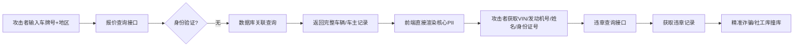

## 漏洞概述

阳光保险车险报价查询系统存在严重的**业务逻辑漏洞**，攻击者仅需提供目标车辆的**车牌号码**与**地区**，无需验证车主真实身份信息，即可通过报价查询接口获取该车辆及车主的完整核心 PII（Personally Identifiable Information，个人可识别信息），包括：

- **车架号（VIN）**
- **发动机号**
- **车主姓名**
- **身份证号码**

部分地区查询结果甚至包含更详细的车辆与车主信息。利用获取的发动机号等要素，攻击者可进一步查询车主**近期违章记录**，构建完整的**精准诈骗攻击链**。

> **影响面**：覆盖阳光保险承保的海量车主数据，属于典型的**垂直领域业务逻辑缺陷导致的敏感信息横向枚举漏洞**。

## 攻击链复现

### 入口点：车险报价查询页面

攻击者访问阳光保险官网车险报价查询页面，输入目标车牌号与地区，**个人信息字段可随意填写**，无需与真实车主信息匹配。

```text
输入字段：
- 车牌号：目标车牌（如 京A·88888）
- 地区：对应城市
- 车主姓名：任意字符
- 身份证号：任意字符
- 手机号：任意字符
```

### 信息泄露：核心 PII 直接回显

提交后，系统直接在页面回显该车辆的完整核心标识信息：

| 字段 | 示例 |
|------|------|
| 车架号 | LSVAL41Z882104231 |
| 发动机号 | 12345678 |
| 车主姓名 | 张三 |
| 身份证号 | 110101199001011234 |

不同地区返回字段略有差异，部分地区包含更详细的车辆配置、初登日期等信息。

### 横向扩展：违章记录关联查询

利用获取的**发动机号**、**车架号**、**车主姓名**、**身份证号**四要素，攻击者可通过交管部门或第三方违章查询接口，精准获取目标车主的**近期违章记录**（时间、地点、违章代码、扣分、罚款金额）。

### 武器化：精准诈骗与社会工程学攻击

结合违章记录的真实性，攻击者可实施高可信度的**精准诈骗**：

- **冒充交警/车管所**：引用具体违章时间、地点、代码，要求缴纳罚款或点击钓鱼链接处理
- **冒充保险公司**：以“车险理赔”、“年检提醒”为由，结合车架号、身份证号建立信任，诱导转账或安装木马 APK
- **社工库撞库**：身份证号 + 姓名 + 手机号（可通过其他渠道获取）撞库撞开更多账号（邮箱、社交软件、金融账户）

> **实战案例参考**：[[boarding-pass-social-media-leakage-risk]] 中类似通过登机牌信息登入航司系统实施恶意改签/退票的攻击链；[[sim-swap-attack-case-study-alipay-bank-theft]] 中利用个人信息实施补卡攻击劫持手机号进而盗刷支付宝/银行卡的完整链路。

## 根因分析

### 业务逻辑缺陷

| 缺陷点 | 说明 |
|--------|------|
| **身份验证缺失** | 报价查询接口未校验请求者是否为真实车主或授权代理人，仅依赖车牌号这一**公开准标识符** |
| **信息回显过度** | 报价业务仅需返回保费试算结果，却直接回显车架号、发动机号、身份证号等**非业务必需的核心 PII** |
| **无速率限制/风控** | 同一 IP/会话可高频遍历车牌号，批量收集车主数据，构建**车主画像数据库** |
| **横向越权** | 任意车牌号均可查询，属于典型的 **IDOR（Insecure Direct Object Reference）** 与**水平越权**组合 |

### 数据流视角



## 影响评估

| 维度 | 等级 | 说明 |
|------|------|------|
| **机密性** | **Critical** | 核心 PII（身份证号、姓名、VIN、发动机号）全量泄露 |
| **完整性** | Low | 漏洞本身不涉及数据篡改，但泄露信息可用于后续欺诈篡改业务数据 |
| **可用性** | None | 无直接影响 |
| **合规性** | **Critical** | 违反《网络安全法》、《个人信息保护法》、GB/T 35273 等法规标准 |
| **衍生风险** | **High** | 精准诈骗、身份盗用、社工库撞库、车辆克隆/套牌犯罪 |

## 修复与防范对策

### 业务层修复

| 措施 | 实施要点 |
|------|----------|
| **最小化回显** | 报价结果页**仅展示保费试算**，移除车架号、发动机号、身份证号等非必需字段 |
| **强身份验证** | 引入**车主实名认证**（人脸识别、短信验证码、数字证书）或**授权委托验证**，确保查询者为车主本人或合法代理 |
| **敏感字段脱敏** | 若业务必须回显部分标识，采用**动态脱敏**（如身份证号仅显示前 1 后 2：`110101********1234`） |
| **准入控制** | 将报价查询纳入**鉴权体系**，未登录/未实名用户仅能查询通用费率表，无法查询具体车辆信息 |

### 技术层加固

| 措施 | 实施要点 |
|------|----------|
| **接口限流与风控** | 单 IP/设备/账号/手机号维度的**频次限制**、**异常行为画像**（短时大量不同车牌查询） |
| **审计日志** | 记录每次查询的**请求方标识、车牌号、返回字段、时间戳**，满足事后溯源与合规审计 |
| **数据分级分类** | 将车架号、发动机号、身份证号标记为**最高敏感级**，存储加密、传输加密、访问最小权限 |
| **API 安全网关** | 在网关层拦截包含敏感字段的异常响应，防止误配置导致的数据流出 |

### 运营与生态层面

- **供应链安全**：保险公司、4S 店、维修厂、违章查询平台等**上下游合作方**需签署数据保护协议（DPA），定期开展安全评估
- **用户教育**：通过 APP 推送、短信提醒车主**警惕冒充交警/保险/车管所的精准诈骗**，不点不明链接、不装不明 APK
- **应急响应预案**：建立**数据泄露应急演练机制**，一旦发现泄露，能在 1 小时内完成接口下线、数据溯源、用户通知、监管报告

## 关联知识体系

| 关联页面 | 关联说明 |
|----------|----------|
| [[api-business-logic-phone-enumeration]] | 同类**业务逻辑漏洞导致信息枚举泄露**的通用模式与修复对策 |
| [[boarding-pass-social-media-leakage-risk]] | **公开准标识符（车牌/登机牌）关联核心 PII**实施精准社会工程学攻击的同构案例 |
| [[automotive-security-fundamentals]] | 车联网安全威胁面全景，本漏洞属于**车辆全生命周期数据链条中保险环节的泄露** |
| [[credential-stuffing-password-hygiene]] | 泄露的身份证号+姓名+手机号可直接用于**撞库/社工库攻击**，放大危害 |
| [[supply-chain-attack-fundamentals]] | 保险公司作为**车辆数据聚合节点**，其安全失陷属于典型供应链数据泄露场景 |
| [[sim-swap-attack-case-study-alipay-bank-theft]] | 个人信息泄露后**补卡攻击劫持手机号进而盗刷金融账户**的完整衍生链路 |
| [[medical-data-security-breaches]] | 跨行业对比：医疗/保险/车管等**垂直领域高敏感数据聚合方**的共性防护缺失 |

## 时间线

| 日期 | 事件 |
|------|------|
| 2015-11-23 | 乌云白帽提交漏洞报告《阳光保险某安全漏洞可查询海量车主信息》 |
| 2015-11-24 | 乌云平台公开漏洞详情（本文归档文章发布日期） |
| 后续 | 阳光保险修复漏洞，下线/改造报价查询接口，增加实名认证与脱敏措施 |

## 总结

阳光保险车险报价系统漏洞是**垂直行业业务系统因「功能优先、安全缺位」导致核心 PII 大规模泄露**的典型样本。其核心教训在于：

1. **公开准标识符（车牌号）不应直接作为敏感数据的访问凭证**
2. **业务接口必须遵循「最小权限、最小回显」原则**
3. **身份认证与授权应前置于数据查询，而非事后补救**
4. **单一数据泄露可通过关联扩展形成组合拳攻击（违章记录→精准诈骗→身份盗用→金融损失）**

该案例应纳入**保险、车联网、政务、金融等高敏感数据聚合业务**的安全建设必修课，推动从「合规驱动」向「数据安全治理体系化」转型。

---

> **原文来源**：WooYun 乌云漏洞报告平台微信公众号（wooyun_org）2015-11-24 发布《给我你的车牌号，我就能知道你是谁》  
> **归档日期**：2015-11-24  
> **关键词**：阳光保险、车险报价、PII 泄露、车架号、发动机号、身份证号、违章记录、精准诈骗、业务逻辑漏洞、IDOR、水平越权

## 来源

- [301在路上-201508-202208_197](../sources/301在路上-201508-202208_197.md)
