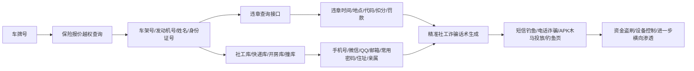

## 概述

本页面结构化沉淀乌云平台（WooYun）于2015年曝光的**车主数据非法交易与聚合利用**黑产链条。核心发现：**仅凭一个车牌号，攻击者即可通过保险报价系统的授权逻辑缺陷，查询到车架号、发动机号、车主姓名、身份证号码及近期违章记录**，配合「社工库」实现精准社会工程学诈骗。

> **关键洞察**：车险作为强制险种，聚合了最全维度的车主PII（Personally Identifiable Information），成为仅次于公安交管系统的**最大车主数据聚集地**。保险公司内部系统的横向越权、未鉴权查询接口，是黑产上游获取数据的核心突破口。

---

## 黑产链条全景拆解

### 上游：数据源头与泄露渠道

| 数据源头 | 典型泄露环节 | 数据维度 | 备注 |
|----------|--------------|----------|------|
| **汽车经销商（4S店）** | 销售线索管理系统、CRM导出、员工离职带走 | 姓名、电话、身份证、住址、车架号、发动机号 | 早期曝光多为「卖车线索」名义批量售卖 |
| **保险公司** | **车险报价/核保/理赔系统越权查询**、**内部员工违规导出**、第三方代理平台接口未鉴权 | **全维度PII + 违章记录 + 理赔记录** | **本文核心案例：阳光保险报价页面未校验身份即可查询** |
| **车辆管理所/交管系统** | 内部人员违规查询、外包运维账号失管 | 车辆档案、违章、年检、过户记录 | 风险等级最高，但获取难度大 |
| **违章查询/代缴平台** | 爬虫抓取、API滥用、数据库拖库 | 车牌、车架号、发动机号、违章明细 | 多为灰产「查违章」小程序/公众号积累 |
| **二手车交易/过户中介** | 过户资料扫描件留存、ERP系统弱口令 | 身份证复印件、行驶证、登记证书 | 配合「过户代办」场景获取高信任度资料 |

### 中游：数据清洗、聚合与「社工库」建库

1. **以车牌号为主键（Primary Key）跨源关联**  
   - 将4S店线索数据、保险核保数据、违章查询数据按「车牌-车架号-发动机号」三元组去重融合
2. **补全维度**  
   - 通过「社工库」（如早期的「裤子库」「开房记录库」「快递地址库」）反查手机号、微信/QQ号、邮箱、常用密码、家庭成员信息
3. **打标签分级定价**  
   - 「精准车主」（含违章记录、高保费车型、豪车车主）→ 单价 ¥5–50/条  
   - 「普通车主」（仅基础身份+车辆信息）→ 单价 ¥0.5–2/条  
   - 「新车主/刚过户」（购车意向强、保险到期续保窗口期）→ 溢价 3–5 倍

### 下游：变现场景与攻击链

| 变现场景 | 典型话术/手法 | 依赖数据字段 | 危害等级 |
|----------|---------------|--------------|----------|
| **精准违章诈骗** | 「您在[时间][地点]有未处理违章，点击链接缴纳滞纳金」 | 车牌、违章时间/地点/代码、车架号、发动机号 | ⭐⭐⭐⭐⭐ |
| **保险续保钓鱼/欺诈** | 冒充保险公司/4S店「续保优惠」「送保养」，诱导点击APK木马或钓鱼页 | 姓名、电话、车型、保险到期日、保费金额 | ⭐⭐⭐⭐ |
| **车贷/GPS拆除/典当诈骗** | 「帮您解除GPS」「低息车贷」「代办过户」 | 完整身份证、车辆登记证、行驶证、征信报告截图 | ⭐⭐⭐⭐ |
| **定向推销/骚扰** | 洗车、保养、装潢、ETC办理、加油卡推销 | 姓名、电话、车型、里程、常驻地 | ⭐⭐⭐ |
| **实体犯罪前置侦察** | 碰瓷、盗抢车辆、跟踪定位 | 住址、常驻轨迹、车辆外观特征、独居/女性车主标签 | ⭐⭐⭐⭐⭐ |

---

## 核心案例复盘：阳光保险车险报价页面越权查询漏洞

> **来源**：WooYun 漏洞报告《阳光保险某安全漏洞可查询海量车主信息（车架号、发动机号、姓名、身份证号等）》  
> **发现时间**：2015年11月左右  
> **漏洞类型**：**业务逻辑越权 / 未鉴权敏感信息查询**

### 攻击路径复现

1. **入口**：阳光保险官网「车险报价/在线投保」页面  
2. **输入**：目标车牌号 + 地区（车主真实投保地区）  
3. **关键缺陷**：**个人信息表单（姓名、身份证号、手机号）无需与车辆真实信息一致，随意填写即可通过校验**  
4. **返回**：系统直接回显该车牌对应的  
   - 车架号（VIN）  
   - 发动机号  
   - 车主姓名  
   - 身份证号码  
   - 部分地区额外返回：品牌型号、初登日期、使用性质、违章记录  

### 技术根因分析

| 缺陷分类 | 具体表现 | 安全设计缺失 |
|----------|----------|--------------|
| **身份认证缺失** | 报价环节未校验「人车一致性」，仅校验车牌格式与地区匹配 | 无实名认证、无短信验证码、无车架号/发动机号后4位二次核验 |
| **授权控制缺失** | 查询接口未绑定用户会话/Token，无访问频率限制，无敏感字段脱敏返回 | 违反最小权限原则：报价仅需「保费」，不应返回「身份证号」 |
| **数据分级保护缺失** | 身份证号、发动机号等高敏感字段明文回显前端，未加密/遮掩 | 未落实《个人信息安全规范》（GB/T 35273-2017 前身标准）中的脱敏要求 |

### 衍生利用：违章记录精准获取

- 利用获取的 **发动机号 + 车架号 + 车牌号**，调用各地交管「机动车违章查询」接口（多数无验证码或仅简单图形验证码）  
- 批量脚本化查询 → 生成「车牌-违章明细-车主身份」结构化数据包 → 供诈骗团队「话术定制」使用

---

## 攻击链建模：从「单点泄露」到「全维度画像」

---

## 关联威胁情报与历史事件

| 事件/专题 | 关联性 | 交叉引用页面 |
|-----------|--------|--------------|
| **315晚会历年曝光隐私黑产** | 同类「数据黑市交易、精准诈骗」典型场景 | [[315-security-exposures]] |
| **45亿条中文平台数据泄露事件(2023)** | 大规模PII聚合、凭证填充、下游诈骗链路一致 | [[data-breach-45billion-chinese-platforms-analysis]] |
| **公安部打击黑客窃取50亿条公民信息案** | 车主数据作为「公民个人信息」核心子集，同属打击重点 | [[mps-major-personal-info-theft-case]] |
| **运营商流量劫持替换APK投放木马** | 下游诈骗常配合流量劫持、钓鱼APK分发 | [[isp-traffic-hijacking-apk-replacement-case-study]] |
| **蜜签/金丝雀令牌数据泄漏溯源技术** | 企业可植入假车主数据追踪泄露源头（4S店/保险/中介） | [[honeytoken-data-leak-detection-technique]] |

---

## 防御与合规建议

### 面向保险公司/车险中介平台（数据控制方）

1. **报价/核保环节强制「人车一致性」校验**  
   - 必须验证：车架号后4/6位 + 发动机号后4位 + 车主身份证号后4位 + 短信验证码  
   - 引入「车辆识别码( VIN )+ 身份证」双因子认证，参考银行卡「卡bin+身份证+手机号」模型
2. **敏感字段分级脱敏返回**  
   - 身份证号：`110************1234`  
   - 发动机号：`********1234`  
   - 手机号：`138****1234`  
   - 仅在「核保通过/出单」环节经显式授权后全量返回
3. **接口层面的风控能力**  
   - 单IP/单设备/单账号/单车牌 查询频率限制（如 5次/分钟、20次/小时）  
   - 引入设备指纹、行为验证码、IP信誉库拦截爬虫/撞库脚本  
   - 审计日志留存 ≥ 6 个月，含请求参数、返回字段掩码、调用方身份
4. **数据分级分类与最小化使用**  
   - 按《数据安全法》《个保法》落实「重要数据」「核心数据」识别备案  
   - 报价微服务仅调用「保费计算引擎」，不应直连「车主核心档案库」

### 面向车主/个人用户（数据主体）

1. **警惕「精准违章/续保」短信/电话**  
   - 官方渠道核实：交管12123 APP、保险公司官方客服电话、4S店专属顾问  
   - **不点陌生链接、不装不明APK、不透露验证码/身份证正反面照片**
2. **最小化授权原则**  
   - 4S店/保险代理人索要身份证复印件时，**手写「仅限办理[具体业务]使用，复印无效」**  
   - 优先使用「电子保单」「电子行驶证」减少纸质资料流转
3. **定期自查泄露面**  
   - 使用「蜜签」手机号注册保险/4S会员，监控骚扰电话来源溯源泄露环节 → [[honeytoken-data-leak-detection-technique]]  
   - 关注「信用报告」查询记录，发现异常车贷查询及时投诉

### 面向监管/行业协会（治理层）

1. **推动「车险数据合规白名单」机制**  
   - 明确保险公司、4S店、代理平台、违章查询平台的**数据调用范围、脱敏标准、审计留存、违规处罚**  
   - 建立「车主信息查询授权码」体系：车主一次性授权码，单次有效，审计可追溯
2. **打击「社工库」上下游**  
   - 重点查处「开房记录库」「快递地址库」「车主数据库」的**建库者、销售者、购买使用者**  
   - 依据《刑法》第253条之一（非法获取公民个人信息罪）、第287条之二（为网络犯罪提供帮助罪）定性处罚
3. **建立跨部门数据流向溯源平台**  
   - 公安、银保监、工信部、市监联合，对「车牌→车主PII」高频查询接口实施**统一准入、实名认证、调用审计**

---

## 结语

**车牌号已成为连接「物理身份」与「数字画像」的超级主键**。保险报价系统的逻辑缺陷，仅是黑产上游「低成本、高精度」获取车主全维度PII的一个缩影。随着《个人信息保护法》《数据安全法》落地，合规成本上升将倒逼车险全链路（报价-核保-理赔-续保）重构**最小化数据流转**架构；同时，**蜜签溯源、行为风控、跨部门打击**需形成常态化联动，才能切断「车牌→PII→违章→诈骗」的黑产闭环。

---

## 相关页面交叉引用索引

- [[315-security-exposures]] — 315曝光隐私黑产全景，含数据黑市交易链条
- [[data-breach-45billion-chinese-platforms-analysis]] — 45亿条数据泄露事件深度复盘，PII聚合与凭证填充攻击链
- [[mps-major-personal-info-theft-case]] — 公安部打击50亿条公民信息犯罪案，法律定性与打击脉络
- [[honeytoken-data-leak-detection-technique]] — 蜜签/金丝雀令牌低成本溯源数据泄露源头实战
- [[isp-traffic-hijacking-apk-replacement-case-study]] — 运营商流量劫持投放钓鱼APK，下游诈骗分发手法
- [[security-practitioner-legal-compliance]] — 安全从业者法律合规红线，含个人信息保护法、刑法修正案实务解读
- [[white-hat-ethics-industry-trust]] — 白帽子伦理与行业信任，漏洞披露规范与媒体误读应对

## 来源

- [301在路上-201508-202208_197](../sources/301在路上-201508-202208_197.md)
