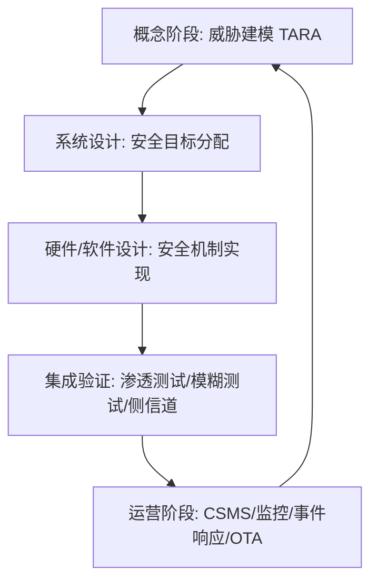

## 核心背景：汽车即“带轮子的电脑”

现代汽车已高度计算机化、网联化，自动驾驶趋势使其对车载网络的依赖度大幅提升。**数据安全专家 Craig Smith** 在《汽车黑客手册：防入侵指南》中指出：汽车行业研发会议多为机械工程师，网络安全视角长期缺位，导致车载系统存在大量可被利用的安全漏洞。

> **关键洞察**：智能汽车的安全问题不再是单纯的 IT 安全，而是关乎人身安全的**网络物理系统（CPS）安全**。

## 核心威胁面与实战攻击链

### 车载网络接入与恶意代码植入

- **攻击入口**：OBD-II 接口、车载信息娱乐系统（IVI）、远程信息处理单元（TCU/Telematics）、蓝牙/Wi-Fi/蜂窝网络模块。
- **实战演示**：Craig Smith 通过接入车载联网系统植入恶意代码，实现对**雨刷、灯光、变速器、刹车、油门**等物理执行机构的远程控制。

### CAN 总线：车载网络的“命脉”与核心攻击面

CAN（Controller Area Network）总线是车内 ECU 通信的骨干，**缺乏身份认证、加密与访问控制**，成为攻击者的首选目标。

| 攻击类型 | 原理 | 典型后果 |
| --- | --- | --- |
| **报文嗅探/重放** | 监听总线流量，记录特定 ID 报文并重放 | 解锁车门、启动引擎、控制转向/制动 |
| **报文注入/伪造** | 向总线发送伪造仲裁 ID 与数据载荷 | 篡改仪表盘读数、干扰 ADAS 传感器融合 |
| **总线关闭/拒绝服务** | 恶意节点主导总线仲裁或发送错误帧 | 导致关键 ECU 通信中断、车辆失控 |

> **实战入门参考**：[[can-bus-reverse-engineering-icsim-tutorial]] 搭建 ICSim 虚拟仪表盘，使用 `can-utils` 完成流量捕获、重放、二分法定位车门控制帧 ID（0x19B）与 Python 高频 ID 统计辅助逆向全流程。

### 无线与近场攻击面扩展

- **蓝牙低功耗 (BLE) 配对流量解密**：利用 `crackle` 破解 SMP Legacy Pairing 短期密钥，还原 LTK 解密链路层流量。详见 [[automotive-protocol-analysis-uart-ble]] 与 [[cicv-2022-crypto-forensics-writeup]]。
- **UART 固件调试接口**：物理访问主机板载 UART，波形反转识别与 PulseView 解码提取固件/调试 Shell。
- **USB HID 流量取证**：键盘/鼠标报告描述符解析、摩斯码隐写与扩展维吉尼亚密码破解，见 [[usb-hid-traffic-forensics]]。

## 入侵检测系统（IDS）的局限性

厂商常宣称的“内嵌入侵监测系统，检测到攻击即切断网络”存在根本矛盾：

| 维度 | 传统车辆 | 高度自动驾驶/无人驾驶车辆 |
| --- | --- | --- |
| **网络依赖度** | 低，断网不影响核心驾驶功能 | **极高**，感知-决策-执行全链路依赖车载以太网/CAN-FD/柔性射线总线 |
| **切断网络后果** | 仅丧失远程诊断、娱乐等非核心功能 | **直接导致车辆失去感知与协同控制能力，酿成安全事故** |
| **检测有效性** | 基于规则/签名，易被变种攻击绕过 | 高吞吐、低延迟、加密流量环境下传统特征匹配失效 |

**结论**：单纯依赖“检测-阻断”模式在自动驾驶场景**不可行**，需转向**纵深防御**：安全启动、通信加密认证、硬件隔离（Hypervisor/TEE）、运行时完整性度量、异常行为建模（基于总线负载、报文时序、信号物理合理性）。

## 漏洞赏金计划与白帽子生态建设

### 厂商主动开放 SRC 的里程碑案例

- **FCA (Fiat-Chrysler Automobiles)**：2016 年宣布漏洞赏金 **$150–$1,500**，按严重程度分级支付，成为车企主动拥抱白帽生态的标志性事件。
- **通用汽车、特斯拉、宝马、大众** 相继上线 HackerOne/自建平台，奖金上限升至 **$10,000–$100,000**（远程代码执行/车辆控制类）。

### 赏金分级典型参考（以某主流车企 SRC 为例）

| 严重等级 | 典型漏洞类型 | 赏金范围 |
| --- | --- | --- |
| **Critical** | 远程无需交互控制车辆动力/制动/转向、TCU/RCE、固件签名绕过 | $10,000–$100,000 |
| **High** | 近场攻击（蓝牙/Wi-Fi/OBD）实现车辆控制、IVI 权限提升、V2X 伪造 | $3,000–$10,000 |
| **Medium** | 信息泄露（VIN/行程/隐私数据）、CAN 报文注入需物理接入、逻辑越权 | $500–$3,000 |
| **Low** | 非敏感信息泄露、UI 级 XSS/CSRF、配置不当 | $100–$500 |

### 生态建设的关键支柱

1. **合法授权与免责通道**：提供**受控测试环境（Cyber Range/数字孪生平台）**、**安全研究者授权信**、**数据脱敏样本**，消除法律顾虑。
2. **工具链开放与标准化**：推广 **OpenXC、CANard、UDSim、CANoe/CANape 自动化测试套件**，降低门槛。
3. **人才培养赛事**：**智能网联汽车漏洞挖掘大赛（CICV）**、**强网杯车联网赛道**、**Pwn2Own Automotive**，见 [[cicv-2022-crypto-forensics-writeup]] 与 [[usb-hid-traffic-forensics]] 实战复盘。
4. **威胁情报共享**：建立 **ISAC（Information Sharing and Analysis Center）** 机制，汇聚 OEM、Tier1、安全厂商、白帽社区的漏洞情报与缓解方案。
5. **法规与标准对齐**：UN R155（网络安全管理体系 CSMS）、UN R156（软件更新管理体系 SUMS）、ISO/SAE 21434（汽车网络安全工程）、GB/T 39792/39793 国标落地。

## 经典公开研究工具与资源

| 工具/项目 | 类型 | 核心能力 | 获取渠道 |
| --- | --- | --- | --- |
| **CANSPY** | 审计工具 | CAN 总线嗅探、报文过滤、异常基线学习、攻击重放 | Black Hat 2016 发布，GitHub 开源 |
| **ICSim** | 仿真靶场 | 虚拟仪表盘+虚拟 CAN 网络，支持 `can-utils` 全套工具实战 | GitHub: `zombieCraig/ICSim` |
| **openxc-platform** | 数据接口 | 标准化车辆数据读取（OBD-II/蓝牙/USB），Python/Node.js/Go SDK | Ford 牵头，Apache 2.0 |
| **CANard** | 攻击框架 | 自动化报文重放、模糊测试、仲裁 ID 推断、DoS 生成 | GitHub: `ericevenchick/canard` |
| **UDSim** | 仿真器 | UDS (ISO 14229) 诊断协议模拟，支持种子-密钥、闪存编程流程 | GitHub: `mguip/UDSim` |
| **CARING** | 检测引擎 | 基于规则+机器学习的 CAN 入侵检测，支持实时部署在网关 ECU | 论文配套开源 |

## 防御体系建设路线图（参考 ISO/SAE 21434 V-Model）

### 关键技术控制点清单

| 层级 | 控制措施 | 对应威胁 |
| --- | --- | --- |
| **通信层** | CAN-FD + SecOC (AUTOSAR) / 车载以太网 MACsec/IPsec / V2X PKI 证书体系 | 报文伪造、重放、中间人 |
| **执行层** | 安全启动、信任链、硬件隔离、MPU/TEE、Hypervisor 虚拟化隔离 | 恶意固件、权限提升、横向移动 |
| **数据层** | 关键数据加密存储、密钥管理 (HSM/KMS)、隐私数据最小化采集 | 数据泄露、隐私合规 |
| **运营层** | 车队级异常检测 (SIEM)、OTA 安全签名与分阶段灰度、漏洞全生命周期管理 | 0-day 利用、供应链投毒、大规模召回 |

## 交叉引用与延伸阅读

- **CAN 总线逆向实战入门**：[[can-bus-reverse-engineering-icsim-tutorial]]
- **车联网协议分析（UART/BLE）实战**：[[automotive-protocol-analysis-uart-ble]]
- **CICV 2022 智能网联汽车漏洞挖掘赛 Writeup**：[[cicv-2022-crypto-forensics-writeup]]
- **USB HID 流量取证与嵌套压缩包/古典密码破解**：[[usb-hid-traffic-forensics]]
- **漏洞赏金计划演变史与国内外 SRC 对比**：[[bug-bounty-program-history-evolution]]
- **360 BugCloud 开源漏洞响应平台案例**：[[360bugcloud-vulnerability-response-platform]]
- **红队 OPSEC 规范（适用于车联网渗透测试授权项目）**：[[redteam-hw-opsec-guidelines]]

## 小结

智能汽车网络安全已从“车载信息娱乐系统加固”上升为**关乎人身安全的系统工程**。核心路径是：

1. **承认 CAN 总线固有不安全**，在架构层面引入加密认证与域控制器隔离。
2. **摒弃“断网止损”单一策略**，构建**可运行态感知+主动免疫**的纵深防御体系。
3. **拥抱白帽生态**，通过**高额赏金、授权靶场、赛事选拔、情报共享**形成“以攻促防”正向循环。
4. **落地法规标准**（UN R155/ISO 21434/GB 39792），将安全工程化、可审计、可度量。

> “汽车行业的网络安全保障，少不了黑客这一角色。我们应该通过培养、吸引、鼓励白帽子们来参与到汽车行业的安全建设中来，一同推进汽车安全的发展。” —— 全球汽车安全峰会共识

## 来源

- [301在路上-201508-202208_089](../sources/301在路上-201508-202208_089.md)
