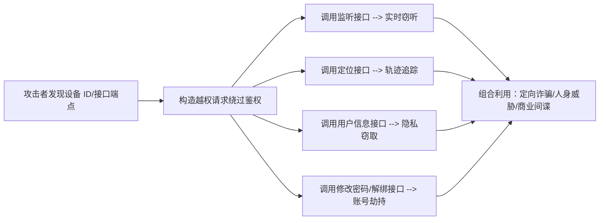

## 事件背景与核心发现

央视《焦点访谈》栏目曝光儿童智能手表安全漏洞，国内网络安全反馈机构 **乌云网** 报告指出：主流儿童智能手表存在严重安全缺陷，攻击者可在家长与儿童完全不知情的情况下，实施**实时定位追踪**、**环境窃听**、**绑定关系劫持**及**家庭敏感信息窃取**。

> **核心风险点**：
> - **实时定位与轨迹复现**：精准掌握手表位置，完整获取儿童日常行走路线
> - **环境窃听**：模拟家长身份发起监听请求，手表主动回拨攻击者电话
> - **账号劫持**：通过修改家长端登录密码，切断家长与手表的绑定关系
> - **家庭隐私泄露**：提取家长手机号、身份信息、住址、常去区域及家庭关系图谱

## 技术成因分析

### 服务端访问控制缺失

技术人员演示表明，**漏洞根因在于手表厂商服务器未对访问者进行严格身份审查与权限校验**，导致攻击者可越权调用核心功能接口：

| 漏洞类型 | 技术表现 | 业务影响 |
|----------|----------|----------|
| **水平越权 / 破坏性认证绕过** | 未验证请求发起者是否为合法绑定家长 | 任意用户可发起监听、定位、解绑操作 |
| **敏感信息过度返回** | 接口返回家长手机号、身份证、住址等非必要字段 | 家庭隐私数据批量泄露 |
| **关键操作缺乏二次验证** | 修改密码、解绑设备无需原密码或短信验证码 | 账号被永久劫持，家长失去监护入口 |

> **关键洞察**：修补此类漏洞技术门槛低（仅需基础 Web 开发经验即可实现 RBAC、字段脱敏、操作审计），核心障碍在于**厂商安全意识缺位**与**缺乏合规强制标准**。

## 行业现状与监管空白

### 智能穿戴设备安全规范缺失

- **国家层面**：截至曝光时，针对儿童智能手表等智能穿戴设备**无统一信息安全强制性标准**
- **市场现状**：产品质量参差不齐，月销过万的热销款同样存在高危漏洞
- **功能悖论**：以“安全”为核心卖点的设备，因安全缺陷反成**家庭隐私窃听器**

### 法律与合同责任

法律专家明确：**用户与厂商存在买卖合同关系，保障用户信息安全属厂商基本法定义务**。厂商未尽安全加固义务，构成违约与侵权双重责任。

## 攻击链复现与威胁建模

### 典型攻击路径

### 威胁放大效应

| 阶段 | 风险描述 | 关联场景 |
|------|----------|----------|
| **信息侦察** | 掌握儿童行踪规律、家庭住址、父母身份 | 精准诱拐、敲诈勒索 |
| **持久潜伏** | 劫持账号后长期监控，家长无感知 | 长期隐私窃取、商业情报收集 |
| **横向拓展** | 利用家长手机号、身份证进一步撞库、社工 | 账号体系沦陷、金融欺诈 |

## 防御与整改指引

### 厂商侧（主体责任）

1. **服务端强制鉴权**：所有设备控制、数据查询接口均需验证 JWT/Session 合法性与设备归属关系
2. **最小权限返回**：接口仅返回业务必要字段，敏感信息（身份证、住址）严禁前端直出
3. **关键操作多因子验证**：修改密码、解绑、恢复出厂需短信/邮件二次确认
4. **审计与告警**：记录所有敏感操作日志，异常高频调用触发风控拦截
5. **SDL 落地**：引入 [[web-app-security-review-checklist]] 需求阶段威胁建模，上线前通过 [[code-audit-global-protection-blindspots]] 视角的白盒审计

### 监管侧（标准制定）

- 推动制定《儿童智能穿戴设备信息安全技术规范》，纳入强制性认证目录（如 CCC）
- 明确数据本地化存储、传输加密（TLS 1.2+）、固件签名验证、OTA 升级完整性校验等基线要求

### 用户侧（风险降低）

- 选购通过权威安全认证、厂商具备漏洞响应机制（SRC）的产品
- 定期检查绑定设备列表，发现异常设备立即解绑并修改密码
- 关闭非必要的“远程监听”“实时上传位置”功能

## 交叉引用与知识关联

| 维度 | 关联页面 | 说明 |
|------|----------|------|
| **IoT 设备安全基线** | [[automotive-security-fundamentals]]、[[ble-smart-bracelet-protocol-analysis-attack]] | 车联网/可穿戴设备通用的协议逆向、固件提取、服务端越权测试方法论 |
| **越权漏洞挖掘与审计** | [[code-audit-global-protection-blindspots]]、[[logic-vulnerability-password-reset-audit]]、[[xd-security-logic-vulnerability-notes-day33-36]] | 代码审计视角的水平/垂直越权、IDOR、步骤跳过、服务端验证割裂等模式识别 |
| **移动/嵌入式设备渗透** | [[android-shelling-unshelling-techniques]]、[[ft232h-spi-flash-firmware-extraction]]、[[nodemcu-esp8266-firmware-lua-tutorial]] | 固件提取、动态调试、协议分析全链路工具链 |
| **隐私合规与数据保护** | [[api-business-logic-phone-enumeration]]、[[cookie-security-fundamentals]]、[[domain-registrar-security-guide]] | 敏感信息脱敏、会话管理、资产归属保护的工程化落地 |
| **红队实战与威胁模拟** | [[redteam-hw-opsec-guidelines]]、[[shiro-internal-penetration-case-study]]、[[listed-company-penetration-test-case-study]] | 从初始访问（IoT 设备）到内网横向、数据窃取的完整攻击链复盘 |

## 时间线与后续影响

| 时间节点 | 事件 | 影响 |
|----------|------|------|
| **2017-07** | 央视《焦点访谈》播出曝光报道 | 引发社会广泛关注，多款热销手表下架整改 |
| **2017-08** | 工信部约谈相关厂商，责令整改 | 推动行业自查，部分厂商上线紧急补丁 |
| **2018-05** | 《儿童智能手表安全技术规范》（团标）发布 | 填补标准空白，明确鉴权、加密、隐私最小化要求 |
| **2021-11** | 《个人信息保护法》施行 | 为用户追责提供法律依据，倒逼厂商合规投入 |
| **持续** | 同类漏洞在低价/白牌设备中反复出现 | 凸显**供应链安全**与**全生命周期 SDL**的必要性 |

## 总结

儿童智能手表漏洞事件是 **IoT 设备“重功能、轻安全”、厂商“重出货、轻运维”、监管“重事后、轻事前”** 的典型缩影。技术层面属于**经典授权绕过与越权访问**，修复成本低但需厂商建立 **SDLC 安全左移** 机制；治理层面需**标准先行、法律兜底、市场倒逼**三管齐下，将“儿童安全”从营销口号落实为可审计、可追责的工程指标。

> **延伸阅读**：回复「窃听」可查看 301在路上归档的《警惕智能设备！那些可能在你家中上演的“窃听风暴”》技术细节补充。

## 来源

- [301在路上-201508-202208_191](../sources/301在路上-201508-202208_191.md)
