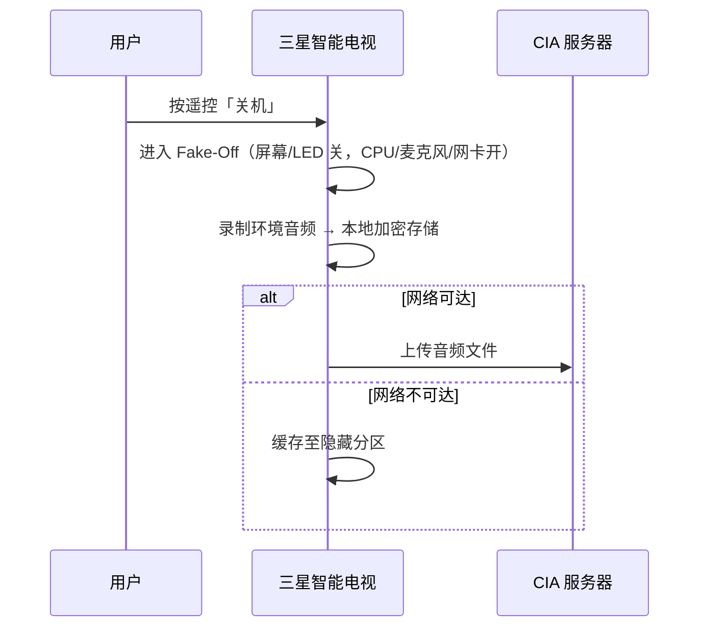

## 事件概述

2017 年 3 月 7 日，维基解密以 **「Vault 7」** 为代号，公开发布了源自美国中央情报局（CIA）网络情报中心（CCI）的 8,761 份机密文档，这是迄今为止规模最大的 CIA 机密文件泄露事件。泄露文档揭示了 CIA 面向全平台（Windows、macOS、Linux、iOS、Android、智能电视、车载系统）的攻击武器库、协作开发流程、前哨基地部署及工具失控后的扩散风险。

> **来源确认**：爱德华·斯诺登（Edward Snowden）在社交媒体上评价泄露文档「看来是真的」。CIA 与白宫均拒绝确认或否认文件真实性，仅表述为「不予置评」与「尚未全面评估」。

---

## CIA 黑客工具库全景

### 覆盖平台与目标设备

| 平台 / 设备类别 | 代表性工具 / 框架 | 核心能力 |
|----------------|------------------|----------|
| **Windows** | Hive、Cutthroat、Swindle 等 Loader/Implant 框架 | 进程注入、内存驻留、内核提权、反取证 |
| **macOS / OSX** | DarkMatter、SeaPea、NightSkies 等 | 内核扩展、启动项持久化、SIP 绕过 |
| **Linux** | 多款 Rootkit 与 Kernel Module 级植入体 | 模块隐藏、系统调用劫持、容器逃逸 |
| **iOS** | 利用 Safari/WebKit 0day、基带漏洞实现远程安装 | 越狱级持久化、键盘记录、通讯录/短信窃取 |
| **Android** | 针对特定厂商/版本的提权链（如 Samsung、Nexus） | 静默安装、短信/通话记录/定位上传 |
| **智能电视** | **Weeping Angel**（与英国 MI5/BTSS 合作） | Fake-Off 模式窃听、音频上传 |
| **车载系统 / 无人驾驶** | 针对 ECU、CAN 总线、信息娱乐系统的研究文档 | 刹车/转向干预、定位追踪、车内录音 |

> **关联技术页**：
> - [[windows-x86-stack-overflow-shellcode-execution]] — Windows x86 栈溢出 Shellcode 执行基础
> - [[macos-memory-execution-macho-loader-m1-mitigations]] — macOS 内存执行与 M1 缓解措施
> - [[linux-kernel-hardening-mechanisms]] — Linux 内核硬化机制
> - [[android-shelling-unshelling-techniques]] — Android 加固与脱壳对抗
> - [[automotive-protocol-analysis-uart-ble]] — 车联网 UART/BLE 协议分析
> - [[ble-smart-bracelet-protocol-analysis-attack]] — BLE 智能穿戴设备协议逆向攻击
> - [[iot-reconnaissance-information-gathering]] — IoT 设备信息收集与攻击面测绘

### 工具开发与管理基础设施

- **EDG（Engineering Development Group）**：CIA 内部负责漏洞挖掘、Exploit 开发、植入体编写的核心研发组。
- **工程化流程**：代码版本控制、自动化构建、单元测试、跨平台适配、反杀软/反沙箱模块化（如 **Stolen Goods** 反病毒规避框架）。
- **分类分级**：工具按敏感度分为「公开」「秘密」「绝密」，植入体带有水印、自毁时限、地理围栏等 OPSEC 控制。

> **关联红队工程化页**：
> - [[cobalt-strike-4.7-bof-internals]] — Cobalt Strike BOF 加载器内部实现
> - [[pe-manual-mapping-loader-implementation]] — PE 手动映射加载器实现全流程
> - [[aceldr-technical-analysis]] — PE 不落地执行技术（RDI/sRDI/Donut/pe2shc）
> - [[inceptor-av-edr-evasion-framework]] — Inceptor 免杀框架完整工作流
> - [[rust-proc-macro-win32-dynamic-import]] — Rust 宏实现 Win32 API 动态导入
> - [[0x727-cobalt-strike-aggressor-script-toolkit]] — 0x727 Aggressor Script 工具包

---

## Weeping Angel：智能电视变身窃听器

### 技术原理

| 维度 | 细节 |
|------|------|
| **代号** | Weeping Angel（哭泣天使，Doctor Who 同名怪物致敬） |
| **合作方** | 英国 MI5 / BTSS（Technical Security Services） |
| **目标设备** | 三星 F 系列智能电视（运行 Linux 内核的 Tizen 前身系统） |
| **植入向量** | 物理接触（USB）或供应链植入，需 Root 权限 |
| **核心机制** | **Fake-Off 模式**：用户按遥控关机 → 电视进入伪待机，屏幕熄灭、LED 灭，但 CPU/麦克风/网卡持续供电 |
| **数据采集** | 环境音频录制 → 本地压缩加密 → 待网络可用时上传至 CIA 服务器 |
| **持久化** | 修改启动脚本、内核模块级驻留，恢复出厂设置亦难清除 |

### 攻击流程图解

### 缓解与防御

1. **物理隔离**：不联网使用、拔掉以太网/关闭 Wi-Fi、拔掉电源（终极方案）。
2. **固件验证**：定期校验固件签名，警惕供应链投毒。
3. **麦克风硬件开关**：选购带物理麦克风断路开关的设备。
4. **网络监控**：在网关侧部署流量基线分析，发现设备「关机」后仍有外联流量即报警。

> **关联 IoT 安全页**：
> - [[ble-packet-capture-comparison]] — BLE 抓包方案对比（可用于分析智能电视蓝牙侧信道）
> - [[nrf-sniffer-ble-setup-guide]] — nRF Sniffer 环境部署
> - [[usb-hid-traffic-forensics]] — USB HID 流量取证（含键盘/鼠标报告描述符解析）
> - [[ft232h-spi-flash-firmware-extraction]] — SPI Flash 固件提取与完整性校验
> - [[badusb-hid-attack-arduino-leonardo]] — BadUSB HID 攻击原理与防御视角

---

## 加密通讯「绕过」实为「端点攻击」

泄露文档显示 CIA **并未破解 Signal/Telegram/WhatsApp 等应用的传输层加密协议**，而是通过**完全控制目标端操作系统**，在明文处理环节（键盘记录、屏幕截图、内存读取、通知栏读取、数据库直读）获取聊天内容。

| 技术手法 | 说明 | 对应防御 |
|----------|------|----------|
| **键盘记录 / 输入法劫持** | 在 OS 层拦截按键、读取输入法缓存 | 硬件加密键盘、虚拟键盘随机布局、输入法进程隔离 |
| **屏幕截图 / 远程桌面** | 定时/触发式截屏、录屏 | 屏幕水印、DRM 保护、禁止截屏 API（FLAG_SECURE） |
| **内存读取 / 数据库直读** | 以 Root/System 权限读取应用沙箱 SQLite、SharedPreferences | 硬件隔离（TEE/SE）、应用层加密存储（SQLCipher）、密钥不落地 |
| **通知栏 / 辅助功能滥用** | 读取系统通知预览内容 | 关闭锁屏通知预览、限制辅助功能权限 |
| **推送服务劫持** | 拦截 FCM/APNs 下行载荷 | 端到端加密载荷、推送仅含唤醒指令 |

> **关联移动/通讯安全页**：
> - [[android-shelling-unshelling-techniques]] — Android 加固对抗与脱壳工具链
> - [[ios-reverse-engineering-basics]] — iOS 逆向基础（如有该页可补）
> - [[cookie-security-fundamentals]] — Cookie/会话令牌安全
> - [[jwt漏洞原理与实战利用]] — JWT 算法混淆、密钥爆破、kid 注入等
> - [[openid-connect-acr-amr-2fa-bypass]] — OIDC acr_values 降级绕过 2FA
> - [[qq-sso-local-endpoint-credential-theft]] — QQ SSO 本地端点凭证窃取

---

## 法兰克福领事馆：欧非中「黑客前哨站」

### 定位与伪装

- **物理位置**：德国法兰克福美国总领事馆（Consulate General Frankfurt）。
- **掩护身份**：外交官、技术行政人员，持外交护照，享受《维也纳外交关系公约》豁免权。
- **代号**：**「Center for Cyber Intelligence Europe (CCIE)」** —— CIA 网络情报中心欧洲分部。
- **辐射范围**：欧洲、中东、非洲（EMEA）三大洲。

### 作战模式

1. **近距离物理接入**：利用外交豁免携带攻击硬件（如 **SOMBERKNAVE** 硬件植入器、**ROCKYMOUNTAIN** 无线注入套件）入驻目标机房/数据中心。
2. **无线攻击**：部署 **WIFEEVIL** 等 Wi-Fi 侧信道/中间人设备，覆盖使馆区、酒店、会议中心。
3. **供应链拦截**：与 BND（德国联邦情报局）合作拦截目标采购的网络设备、服务器，植入固件级后门。
4. **人员轮换**：黑客以「轮换任务」名义短期入境，规避长期驻留暴露风险。

> **关联红队基建与物理安全页**：
> - [[domain-registrar-security-guide]] — 域名劫持与注册商安全（供应链视角）
> - [[social-engineering-attack-techniques]] — 社会工程学：域名注册商客服欺骗、心理战术
> - [[phishing-website-creation-tutorial]] — 钓鱼网站制作与防御
> - [[redteam-hw-opsec-guidelines]] — HW/红队演练 OPSEC 守则（环境隔离、工具指纹清洗、上线隐匿）
> - [[c2-redirectors-malleable-c2-profiles]] — C2 重定向器与 Malleable C2 Profile 流量混淆
> - [[named-pipe-smb-detection-sysmon]] — SMB 命名管道检测（主机/网络层面）
> - [[smb-named-pipe-c2-communication]] — SMB 命名管道 C2 通信机制

---

## 工具失控与扩散风险

### 失控成因

| 因素 | 说明 |
|------|------|
| **去中心化开发** | 承包商、分包商、外包团队广泛参与，代码库分散于多个非密网段 |
| **缺乏销毁机制** | 任务结束后植入体、Exploit、文档未集中销毁，留存于开发机、备份带、Git 仓库 |
| **内部泄露** | 疑似内部人员（或承包商）批量拷贝归档文档后外泄 |
| **武器化门槛降低** | 文档包含详细使用手册、配置模板、甚至现成二进制，脚本小子可直接「开箱即用」 |

### 扩散后果评估

1. **归因混淆**：攻击者可直接使用 CIA 工具链发动攻击，将责任嫁祸 CIA（「伪旗行动」）。
2. **防御失效**：杀软/EDR 厂商需紧急补充特征库，但变种生成极易（工具本身支持模块化重组）。
3. **二次开发扩散**：开源社区、地下论坛快速移植、改造，形成「CIA 式」攻击工具生态。
4. **供应链放大**：固件级植入体（如 **Sonic Screwdriver** BIOS/UEFI 模块）若流出，将导致硬件层面的持久化灾难。

> **关联威胁情报与溯源页**：
> - [[threat-attribution-tracing-techniques]] — 威胁溯源技术体系（含 CIA Vault 7 伪旗能力案例）
> - [[xd-security-incident-response-notes]] — 应急响应标准流程、日志分析、溯源工具箱
> - [[memory-scanning-tools-evasion-techniques]] — 内存扫描工具与 UDRL 规避对抗
> - [[backdoor-persistence-techniques]] — 后门持久化七大类别实战手法
> - [[process-injection-tampering-techniques]] — 进程镂空/篡改五大技术对比与 Sysmon Event ID 25 检测

---

## 中文对话框：意外的「语言防火墙」

### 事件还原

> 一名 CIA 特工（代号化）自 2009 年服役，尝试在 Windows 目标机上安装测试软件。安装程序弹出**中文对话框**，特工尝试修改系统区域、强制安装程序语言均无效。最终一名讲中文的同事翻译对话框内容后才得以继续。

### 技术根因

1. **源码级中文硬编码**：中国开发者习惯在代码、资源文件、错误消息、调试日志中直接使用中文字符串。
2. **资源文件未分离**：安装程序将中文资源内嵌且无语言回退机制，系统 Locale 非中文时仍加载中文资源。
3. **签名/校验绑定语言资源**：某些保护壳将语言资源纳入签名范围，修改资源导致签名失效、安装拒绝。

### 安全启示

| 维度 | 启示 |
|------|------|
| **攻击端** | 语言/区域设置可成为反分析、反自动化的低成本手段（如恶意软件检测到中文环境即退出） |
| **防御端** | 故意在关键路径植入非预期语言资源、混淆字符串，干扰自动化安装/分析流程 |
| **归因干扰** | 故意留下中文/俄文/阿拉伯文等语言痕迹，误导溯源分析师判断攻击者国别 |

> **关联对抗溯源与代码混淆页**：
> - [[binary-ninja-ollvm-deobfuscation]] — Binary Ninja 去除 OLLVM 流程平坦化
> - [[argument-spoofing-edr-evasion]] — Argument Spoofing 对抗 EDR 进程创建监控
> - [[phantom-dll-hollowing-technique]] — Phantom DLL Hollowing 内存注入隐藏
> - [[ppl-injection-createprocess-bof-fix]] — PPL 注入 CreateProcess 句柄继承绕过
> - [[mimikatz-sekurlsa-pth-internals]] — Mimikatz sekurlsa::pth Pass-the-Hash 内存补丁
> - [[mimikatz-source-code-architecture-golden-ticket-audit]] — Mimikatz 源码架构与黄金票据生成

---

## 真实性评估与后续影响

| 评估维度 | 结论 |
|----------|------|
| **文档真实性** | 斯诺登背书、安全社区技术细节自洽、工具代码可编译运行 → **高度可信** |
| **时效性** | 文档覆盖 2013–2016 年，部分 0day 在泄露前已被厂商修补（如 Apple iOS 10.1.1、Google Pixel 3 月补丁） |
| **归因政治化** | 美国政府未正式承认，但后续「Vault 8」等系列泄露佐证了档案库真实存在 |
| **长尾效应** | 衍生出 **NotPetya、WannaCry**（利用 NSA Equation Group 工具，而非 CIA）等全球性勒索事件，推动了「网络武器不扩散」国际讨论 |

---

## 防御建议清单

### 个人/终端用户

- [ ] 智能电视/音箱等 IoT 设备：**物理断电**、**关闭麦克风**、**隔离 VLAN**、**固件自动更新**。
- [ ] 移动端：**锁屏隐藏通知**、**仅安装官方应用**、**启用生物识别+强密码**、**定期重启清理内存驻留**。
- [ ] 通讯软件：**开启「安全编号」验证**、**禁用云备份聊天记录**、**谨慎授予辅助功能/无障碍权限**。
- [ ] 电脑/服务器：**及时打补丁**、**启用 BitLocker/FileVault/LUKS 全盘加密**、**配置 UEFI 密码/安全启动**、**部署 HIDS/EDR**。

### 企业/组织

- [ ] **资产测绘**：全网资产纳管，识别智能会议设备、投影仪、打印机等影子 IT。
- [ ] **供应链验收**：关键硬件（服务器、网络设备、BIOS/UEFI 固件）验收时校验哈希、固件签名。
- [ ] **网络分段**：核心业务、办公网、IoT 网、DMZ 严格微隔离，东西向流量全记录。
- [ ] **威胁狩猎**：部署 **Sysmon + Elastic/ELK + Sigma 规则**，重点监控进程注入、计划任务、WMI、SMB 命名管道异常。
- [ ] **应急预案**：建立「疑似国家级 APT 入侵」专项响应剧本，含证据保全、溯源取证、对外通报流程。

> **关联蓝队建设页**：
> - [[xd-security-blue-team-defense]] — ATT&CK 映射、HFish 蜜罐、NIDS/HIDS 部署、检测规则编写
> - [[xd-security-incident-response-notes]] — 应急响应流程、日志分析、自动化工具箱
> - [[named-pipe-smb-detection-sysmon]] — Sysmon Event ID 17/18 命名管道检测策略
> - [[memory-scanning-tools-evasion-techniques]] — 内存扫描工具原理与 UDRL 规避对抗
> - [[cobalt-strike-ssl-keystore-evasion]] — Cobalt Strike SSL 证书指纹规避与重签名
> - [[c2-redirectors-malleable-c2-profiles]] — C2 基础设施隐匿：重定向器、Domain Fronting、CDN

---

## 交叉引用索引

| 领域 | 相关知识页 |
|------|------------|
| **威胁情报与溯源** | [[threat-attribution-tracing-techniques]] |
| **红队基建与 OPSEC** | [[redteam-hw-opsec-guidelines]]、[[c2-redirectors-malleable-c2-profiles]]、[[internal-network-pivoting-techniques]] |
| **C2 通信隐匿** | [[cobalt-strike-external-c2-smb-beacon]]、[[smb-named-pipe-c2-communication]]、[[named-pipe-smb-detection-sysmon]]、[[pystinger-socks4-proxy-webshell-pivoting]]、[[http-proxy-tunneling-goproxy-netsh]]、[[frp内网渗透应用]] |
| **持久化与提权** | [[backdoor-persistence-techniques]]、[[windows-scheduled-task-persistence-techniques]]、[[schtask-persistence-tool]]、[[ppl-injection-createprocess-bof-fix]]、[[windows-token-nerfing-pplguard-trusted-labels]] |
| **内存执行与规避** | [[aceldr-technical-analysis]]、[[pe-manual-mapping-loader-implementation]]、[[inceptor-av-edr-evasion-framework]]、[[memory-scanning-tools-evasion-techniques]]、[[phantom-dll-hollowing-technique]] |
| **进程注入技术** | [[process-injection-tampering-techniques]]、[[argument-spoofing-edr-evasion]] |
| **凭证窃取与横向移动** | [[mimikatz-sekurlsa-pth-internals]]、[[mimikatz-source-code-architecture-golden-ticket-audit]]、[[jumbo-internal-penetration-cheatsheet]]、[[xd-security-internal-network-penetration-notes-day67-68]]、[[xd-security-internal-network-penetration-notes-day69-70]] |
| **IoT/硬件安全** | [[iot-reconnaissance-information-gathering]]、[[ble-smart-bracelet-protocol-analysis-attack]]、[[automotive-protocol-analysis-uart-ble]]、[[usb-hid-traffic-forensics]]、[[ft232h-spi-flash-firmware-extraction]]、[[badusb-hid-attack-arduino-leonardo]]、[[nrf-sniffer-ble-setup-guide]]、[[ble-packet-capture-comparison]] |
| **移动端安全** | [[android-shelling-unshelling-techniques]]、[[macos-memory-execution-macho-loader-m1-mitigations]]、[[qq-sso-local-endpoint-credential-theft]] |
| **Web/应用安全** | [[php-webshell-fundamentals-chopper-analysis]]、[[php-webshell-obfuscation-av-evasion]]、[[php伪协议与反序列化利用]]、[[fastjson-deserialization-gadgets-shiro-anteros]]、[[thinkphp5-deserialization-chain-analysis]]、[[struts2-memory-shell-injection]]、[[oasys-system-code-audit]] |
| **二进制逆向分析** | [[ghidra-reverse-engineering-framework-introduction]]、[[binary-ninja-ollvm-deobfuscation]]、[[ida-pro-tips-plugins-python]]、[[peda-buffer-overflow-analysis-guide]]、[[rop-linux-x86-beginner-tutorial]]、[[stack-overflow-fundamentals-tutorial]]、[[heap-overflow-principles-unlink-exploitation]]、[[heap-off-by-one-null-exploitation]] |
| **漏洞复现与 CVE** | [[cve-2021-44228-log4j2-rce]]、[[cve-2021-21974-vmware-esxi-slp-heap-overflow]]、[[cve-2023-21716-word-rtf-heap-overflow-analysis]]、[[cve-2023-24055-keepass-plaintext-transmission]] 等 |
| **训练与实战靶场** | [[vulnhub-platform-resource-index]]、[[pikachu-target-writeup-part1-setup-brute-force]]、[[upload-labs-file-upload-bypass-writeup]]、[[ctf-show-php-command-execution-bypass-techniques]]、[[xd-security-pentest-course-curriculum]] |

---

## 小结

Vault 7 泄露不仅展示了国家级网络武器库的**广度（全平台覆盖）**、**深度（固件/内核/硬件级持久化）**、**工程化成熟度（模块化、自动化、OPSEC 内置）**，更暴露了**工具失控后的扩散灾难性后果**。防御者需从「防病毒」转向「防攻击者」：**假设失陷、持续监测、分段限权、快速响应**，并在归因分析中警惕「语言/时区/工具链」等易被伪造的痕迹。

> **一句话防御策略**：**物理隔离高风险设备、全盘加密终端存储、零信任网络微隔离、基于行为的内存/流量威胁狩猎、供应链固件完整性验证、应急响应剧本常态化演练。**

## 来源

- [301在路上-201508-202208_023](../sources/301在路上-201508-202208_023.md)
