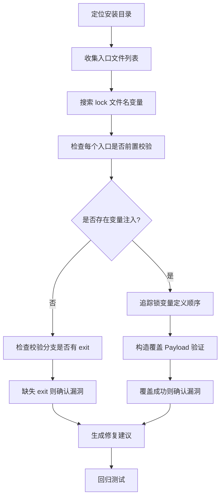

## 概述

PHP Web 应用的安装向导是代码审计中高危漏洞的聚集区。攻击者若能绕过安装锁机制触发**重装逻辑**，往往可导致任意管理员账号创建、数据库配置篡改、甚至直接 Getshell。本页基于资深白帽子李斌（汽车之家高级安全工程师、前 360 核心成员）在「代码审计的艺术」系列第十一篇中的实战总结，提炼出 **四大典型漏洞类型**，并给出可落地的审计检测清单与修复模式。

> **适用场景**：CMS、OA、ERP、电商系统等所有包含 Web 安装向导的 PHP 应用。  
> **核心风险**：重装覆盖配置 → 拿到数据库凭据 / 创建超管账号 → 后台 Getshell → 服务器沦陷。

---

## 漏洞分类体系

| 编号 | 类型 | 核心成因 | 典型代码模式 | 风险等级 |
|------|------|----------|--------------|----------|
| **INST-01** | 无锁文件验证 | 安装完成后未生成 `install.lock` 或未在入口校验 | 直接访问 `install/index.php` 即可重装 | 🔴 Critical |
| **INST-02** | 步骤跳过绕过 | 仅在 Step 1 校验 lock，Step 2+ 无校验 | `if (step==1) check_lock();` | 🟠 High |
| **INST-03** | 变量覆盖劫持 | `foreach($_REQUEST as $k=>$v) $$k=$v` 覆盖锁文件路径变量 | `file_exists($insLockfile)` 前存在变量注入 | 🔴 Critical |
| **INST-04** | 缺失 exit 终止 | 校验 lock 后仅 JS 跳转，PHP 继续执行 | `echo "<script>alert('已安装');location.href='...'</script>";` 无 `exit()` | 🟠 High |

---

## 详细漏洞剖析与检测指引

### INST-01 无锁文件验证

#### 漏洞代码模式
```php
// install/index.php - 入口文件完全没有 lock 校验
// 直接渲染安装向导页面或处理安装逻辑
```

#### 审计检测点
1. 搜索安装目录入口文件：`install/index.php`、`install/install.php`、`setup/index.php`
2. 确认是否存在 **生成 lock 文件** 的逻辑（通常在最后一步写入 `../data/install.lock` 或 `./install.lock`）
3. 确认 **每个安装步骤入口** 是否均包含 `if (file_exists($lockfile)) exit/die;`

#### 修复模式
```php
// 统一入口守卫
$lockFile = dirname(__FILE__) . '/../data/install.lock';
if (file_exists($lockFile)) {
    header('HTTP/1.1 403 Forbidden');
    exit('System already installed. Remove install.lock to reinstall.');
}
```

---

### INST-02 步骤跳过绕过

#### 漏洞代码模式
```php
// install/index.php
$step = isset($_GET['step']) ? $_GET['step'] : 1;

if ($step == 1) {
    // 仅 Step 1 校验 lock
    if (file_exists($lockfile)) exit('Already installed');
    show_license_agreement();
} elseif ($step == 2) {
    // Step 2 直接进入数据库配置，无 lock 校验
    show_db_config_form();
} elseif ($step == 3) {
    // Step 3 执行安装，写入配置、创建管理员
    do_install();
}
```

#### 绕过利用链
```
GET /install/index.php?step=2  → 绕过 Step 1 校验直接配置数据库
GET /install/index.php?step=3  → 直接触发安装写入恶意配置
```

#### 审计检测点
- 搜索 `step`、`action`、`act` 等流程控制参数
- 追踪每个分支是否**统一前置** lock 校验，而非仅在首步校验
- 关注 `switch($step)`、`if/elseif` 链中是否遗漏分支

#### 修复模式
```php
// 统一前置守卫，而非分支内校验
$lockFile = '../data/install.lock';
if (file_exists($lockFile)) exit('Installed');

$step = max(1, intval($_GET['step'] ?? 1));
// 后续逻辑...
```

---

### INST-03 变量覆盖劫持

#### 漏洞代码模式
```php
// install/index.php 顶部
foreach ($_REQUEST as $_k => $_v) {
    ${$_k} = _runmagicquotes($_v);  // 变量注入：$_REQUEST['insLockfile']='' 覆盖 $insLockfile
}

$insLockfile = '../data/install.lock';  // 定义在覆盖之后，但若定义在前则被覆盖

if (file_exists($insLockfile)) exit('Installed');  // file_exists('') 返回 false → 绕过
```

#### 根因分析
| 因素 | 说明 |
|------|------|
| **变量注入点** | `foreach ($_REQUEST/$_GET/$_POST/$_COOKIE as $k=>$v) $$k=$v` |
| **覆盖目标** | 锁文件路径变量（`$insLockfile`、`$lockfile`、`$install_lock` 等） |
| **利用条件** | 变量定义在注入代码**之前**，或注入后未重新赋值 |
| **绕过原理** | `file_exists('') === false` / `file_exists('nonexist') === false` |

#### 审计检测清单
1. 全局搜索 `foreach.*_REQUEST`、`extract(`、`import_request_variables(`
2. 定位安装向导文件中是否存在上述模式
3. 追踪锁文件变量定义位置：**是否在变量注入之后重新赋值？**
4. 构造 PoC：`?insLockfile=1` 或 `?lockfile=./notexist` 验证绕过

#### 修复模式
```php
// 方案 1：禁用变量注入（推荐）
// 删除 foreach ($_REQUEST ...) 等历史遗留代码
// 显式获取所需参数：$step = $_GET['step'] ?? 1;

// 方案 2：若必须保留，锁变量定义在注入之后且不可被覆盖
foreach ($_REQUEST as $_k => $_v) ${$_k} = _runmagicquotes($_v);
$insLockfile = realpath(__DIR__ . '/../data/install.lock');  // 强制重写
if (file_exists($insLockfile)) exit('Installed');
```

---

### INST-04 缺失 exit 终止

#### 漏洞代码模式
```php
if (file_exists($lockfile)) {
    echo "<script>alert('系统已安装过，请勿重复安装！');location.href='index.php';</script>";
    // 缺少 exit() / die()，PHP 继续向下执行安装逻辑
}

// 后续安装代码继续运行...
$dbhost = $_POST['dbhost'];
// ... 最终完成重装
```

#### 攻击利用
- 浏览器执行 JS 跳转，**但服务端已完成重装逻辑**
- Burp Suite / curl 直接发包可观测到安装成功响应
- 结合条件竞争可批量自动化重装

#### 审计检测点
- 搜索 `file_exists.*lock`、`install.lock` 等校验代码
- 检查校验分支内是否**必须**包含 `exit`、`die`、`return`（函数上下文）
- 关注 `header('Location: ...')` 后无 `exit` 的同类问题

#### 修复模式
```php
if (file_exists($lockfile)) {
    // API/JSON 响应场景
    if (is_ajax()) json_exit(403, 'Already installed');
    // 页面场景
    header('HTTP/1.1 403 Forbidden');
    exit('<h1>System already installed</h1><p>Remove install.lock to reinstall.</p>');
}
```

---

## 标准化审计检测清单（Checklist）

> 将以下清单纳入代码审计 SOP，覆盖所有含安装向导的 PHP 项目。

| # | 检测项 | 搜索关键字/定位方法 | 判定标准 | 备注 |
|---|--------|---------------------|----------|------|
| 1 | **锁文件生成** | `install.lock`、`install_lock`、`locked`、`.installed` | 安装最后一步**必须**写入文件 | 文件权限建议 0444 |
| 2 | **全流程入口守卫** | 入口文件、`step`/`action` 分支首行 | **每个**可访问安装步骤入口均前置 `file_exists($lock) && exit` | 含 AJAX 接口 |
| 3 | **变量注入排查** | `foreach.*_REQUEST`、`extract(``,`import_request_variables` | 安装目录**严禁**存在；若不可删除，锁变量须在注入后强制重写 | 结合 [[php-basics-syntax-fundamentals]] 变量解析机制 |
| 4 | **终止函数完整性** | `file_exists.*lock` 所在分支 | 必含 `exit`/`die`/`return`；`header()` 后必跟 `exit` | 参考 [[logic-vulnerability-password-reset-audit]] 同类缺失 exit 模式 |
| 5 | **步骤参数遍历** | `step`、`action`、`act`、`do` 等 | 手工/自动化遍历 1~N 步，验证无锁绕过 | 可编写半自动化脚本 |
| 6 | **配置写入权限** | `fwrite`、`file_put_contents`、配置文件路径 | 配置文件写入前再次校验 lock；配置文件目录不可写入 PHP | 防二次利用 |
| 7 | **安装目录清理** | 部署文档、运维规范 | 生产环境**必须**删除或重命名 `install/` 目录 | 纵深防御 |

---

## 实战审计工作流示例



---

## 关联漏洞类型与扩展阅读

| 场景 | 关联页面 | 说明 |
|------|----------|------|
| 变量覆盖通用原理 | [[php-basics-syntax-fundamentals]] | PHP 变量解析、可变变量、引用机制 |
| 逻辑漏洞挖掘方法论 | [[logic-vulnerability-password-reset-audit]] | 同类「缺失 exit」「低熵随机数」「密钥未初始化」模式 |
| 文件包含导致的安装页包含 | [[php-file-inclusion-vulnerability]] | LFI/RFI 可能直接包含安装脚本触发重装 |
| 反序列化链触发安装逻辑 | [[xd-security-deserialization-xxe-notes-day37-39]] | PHAR 反序列化 `file_exists`/`fopen` 触发安装锁校验绕过 |
| 代码审计工具链 | [[pocsuite3-vulnerability-testing-framework]]、[[sqlmap-comprehensive-guide]] | 半自动化检测安装重装漏洞 |

---

## 修复最佳实践总结

1. **统一守卫**：在安装目录公共引入文件（如 `install/common.php`）头部实现 `install_lock_check()`，所有步骤 `require_once` 即可。
2. **不可变锁变量**：使用常量 `define('INSTALL_LOCK', __DIR__.'/../data/install.lock');` 而非变量。
3. **强制终止**：封装 `ajax_exit()`、`page_exit()` 统一输出并 `exit`。
4. **部署层面纵深防御**：
   - Web 服务器配置 `location /install { deny all; }`（Nginx）或 `Require all denied`（Apache）
   - 部署脚本自动 `rm -rf install/` 或重命名为随机名
   - `install.lock` 文件权限 `0444` + `chattr +i`（条件允许）

---

## 变更记录

| 版本 | 日期 | 变更说明 |
|------|------|----------|
| 1.0 | 2024-01-15 | 初版：基于「代码审计的艺术」第十一篇归档文章结构化沉淀，建立四大类型模型与检测清单 |

---

> **引用来源**：李斌《白帽子分享之代码审计的艺术—第十一篇：安装问题》（原刊于 301 微信公众号，现归档于本知识库）。  
> **适用对象**：代码审计工程师、渗透测试人员、PHP 应用开发/运维人员、安全合规审计人员。

## 来源

- [301在路上-201508-202208_072](../sources/301在路上-201508-202208_072.md)
