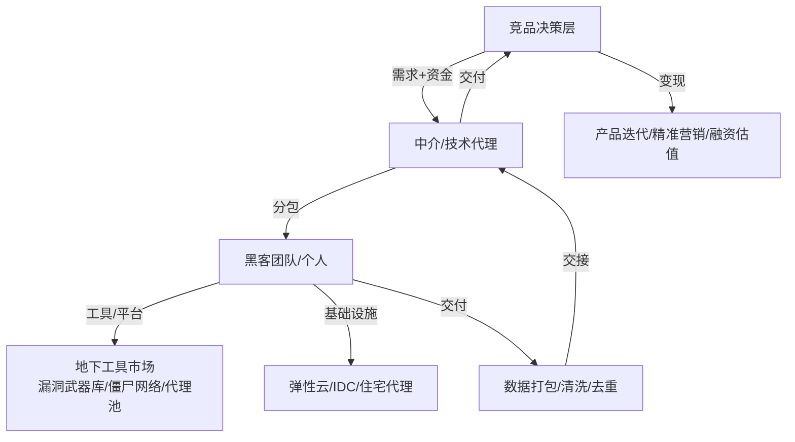
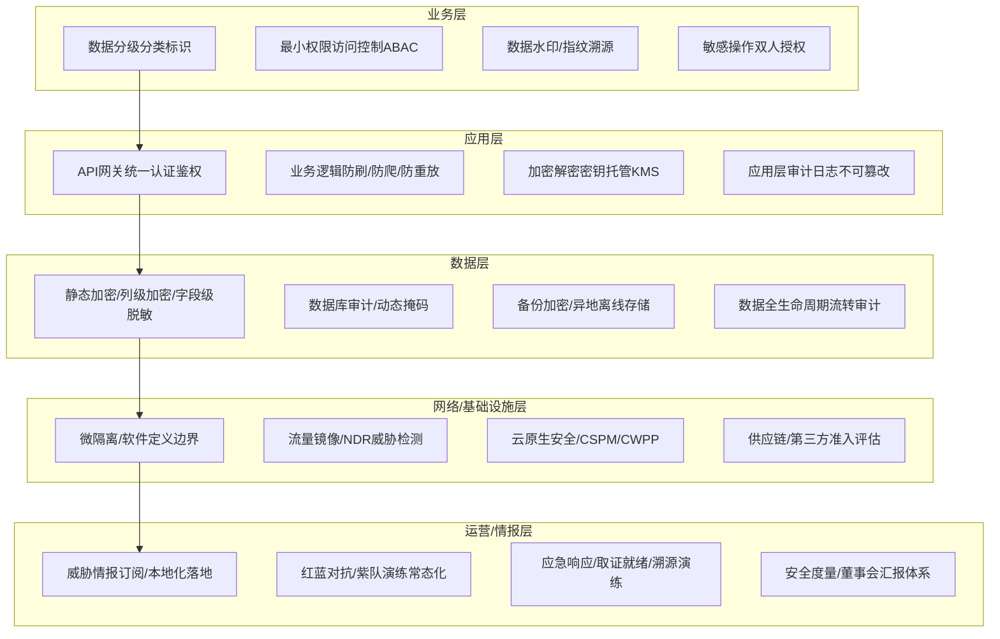

## 案件概况

### 事件时间线
- **发现时间**：2015年10月，酷米客发现北京数据中心异常流量
- **披露时间**：2016年7月，南方网《深圳一公交软件数据疑被黑客盗走 案值20亿》报道
- **文章发布**：2016年7月13日，301在路上微信公众号发布安全观点复盘文章

### 核心损失数据
| 维度 | 数据指标 | 说明 |
|------|----------|------|
| 直接投入成本 | 近亿元人民币 | 数据采集、清洗、建模、存储的直接资金投入 |
| 衍生估值 | 约20亿元人民币 | 数据资产的商业化潜在价值评估 |
| 异常流量峰值 | 100万+ 次/天/单IP | 北京服务器单IP单日访问量，正常阈值为10万次/天 |
| 攻击溯源地 | 浙江杭州 | 入侵服务器IP归属地 |

### 受害主体画像
- **公司名称**：酷米客（总部位于深圳）
- **业务定位**：公交实时软件服务商，大数据信息服务提供商
- **核心资产**：公交出行大数据（线路、站点、实时到站、用户出行画像等）
- **数据保护机制**：专门设计的加密算法 + 数据来源验证机制

## 攻击溯源与技术复盘

### 异常流量检测
酷米客数据团队通过监控系统发现北京服务器单IP日访问量异常飙升至**100万次以上**，远超正常热点地区**10万次/天**的基线。这种量级偏差直接触发了内部安全告警。

> **关键技术点**：大数据平台的流量基线建模与异常检测能力，是发现此类低频高量级数据窃取攻击的前置条件。参考 [[threat-attribution-tracing-techniques#流量回溯与异常基线建模]] 中的流量回溯方法论。

### IP 溯源与基础设施定位
通过**IP源地址追溯**，技术团队将攻击流量归属至**浙江省杭州市**的服务器集群。这一溯源结果直接指向攻击者托管的跳板/控制节点，而非攻击者真实物理位置。

> **溯源局限性提示**：单纯依赖IP地址溯源极易被代理、跳板、云主机等手段混淆。完整攻击归因需结合 [[threat-attribution-tracing-techniques#VPS渗透溯源与攻击者ID画像]] 中的多维度取证：恶意样本分析、C2基础设施关联、攻击工具链指纹、时区/语言/键盘布局等行为画像。

### 数据加密与验证机制的旁路绕过
文章提及数据受「专门设计的加密算法」与「验证数据来源的验证机制」保护，但攻击者仍实现大规模窃取。推测存在以下旁路路径：

| 防护层 | 可能的绕过手法 | 对应技术参考 |
|--------|----------------|--------------|
| 传输加密 | 中间人攻击、证书伪造、TLS降级 | [[ssl-tls-security-hardening]] |
| 应用层加密 | 密钥泄露、白盒加密破解、内存抓取 | [[whitebox-cryptanalysis]], [[memory-scanning-tools-evasion-techniques]] |
| 数据来源验证 | 伪造合法客户端指纹、重放攻击、API滥用 | [[api-business-logic-phone-enumeration#业务逻辑绕过]], [[mobile-app-security-hardening]] |
| 访问控制 | 凭证填充、会话劫持、越权访问 | [[credential-stuffing-password-hygiene]], [[logic-vulnerability-password-reset-audit#越权绑定与修改]] |

> **核心教训**：单一加密/验证机制无法抵御拥有内网渗透能力的高级持续性威胁（APT）。需构建 [[web-app-security-review-checklist#威胁建模与数据流分析]] 中所述的纵深防御体系：数据分级分类、最小权限、零信任网络、数据水印与溯源、异常行为分析（UEBA）。

## 商业间谍动机与竞争情报安全

### 攻击动机分析：典型的「竞品数据窃取」
本案呈现标准的**商业间谍**特征：
1. **目标明确**：仅针对核心大数据资产，非破坏性勒索或广撒网挖矿
2. **资源投入大**：雇佣黑客团队、搭建杭州服务器集群、持续窃取月级周期
3. **变现路径清晰**：窃取数据直接用于竞品产品迭代、运营决策、用户画像构建
4. **规避法律风险**：通过「雇佣黑客」切割直接责任，形成灰色产业链

> **同类案例对比**：参考 [[social-engineering-attack-techniques#源代码窃取与红队物理渗透]] 中的物理渗透窃取源代码案例，以及 [[medical-data-security-breaches#黑产精准诈骗下游变现链条]] 中的数据黑市流转模式。本案属于「竞争情报窃取」细分赛道，区别于「勒索软件」「挖矿」「破坏性攻击」。

### 竞争情报安全盲区
301文章直指痛点：**「大家都在谈大数据下的各种产业，而更多的服务提供商，在大数据信息的保护下，是严重缺失的」**。典型盲区包括：

| 盲区类别 | 具体表现 | 建设对策 |
|----------|----------|----------|
| **数据资产清单缺失** | 不知道有哪些核心数据、存储在哪、谁有访问权限 | 实施 [[data-asset-inventory-classification]] 数据资产梳理与分级分类 |
| **威胁建模偏颇** | 只防外部入侵，忽视内部泄露、供应链投毒、竞品雇佣攻击 | 引入 [[threat-modeling-methodologies#PASTA威胁建模]] 覆盖商业间谍攻击树 |
| **安全投入错位** | 重合规轻实战，重边界轻数据，重合规轻检测响应 | 落实 [[redteam-hw-opsec-guidelines#红队演练实战化]] 以攻促防 |
| **法律/取证准备不足** | 事后无法形成证据链，维权成本高、周期长 | 建立 [[digital-forensics-readiness#数字取证就绪]] 能力，保全日志、流量、镜像 |

## 大数据公司安全建设系统性缺失

### 行业共性痛点（301视角总结）
> 「依托于云计算、大数据、互联网金融等领域的企业应该醒醒了。」

| 痛点维度 | 典型现象 | 根因分析 |
|----------|----------|----------|
| **安全预算分配** | 安全支出<IT总预算3%，多用于合规采购而非核心防护 | 业务侧不懂安全ROI，安全侧不会谈业务语言 |
| **人才结构失衡** | 运维多、开发多，专职红蓝对抗/威胁狩猎/数据安全极少 | 招聘JD模板陈旧，缺乏 [[security-engineer-recruitment-requirements#核心能力维度]] 定义的复合型人才 |
| **技术债务累积** | 早期为快速上线牺牲安全，后期「补不上、改不动、不敢动」 | 缺乏 [[web-app-security-review-checklist#需求阶段安全评审]] 的安全左移机制 |
| **数据全生命周期失管** | 采集无脱敏、存储无加密、流转无审计、销毁无验证 | 缺失 [[data-lifecycle-security-governance]] 数据安全治理框架 |

### 酷米客案暴露的具体技术短板
1. **流量基线建模滞后**：事后发现异常，缺乏实时UEBA/NDR能力
2. **数据访问审计盲区**：无法在第一时间定位「谁在何时通过何种方式访问了何数据」
3. **加密密钥管理风险**：「专门设计的加密算法」若密钥管理薄弱（硬编码、配置文件明文、未轮换），等同于裸奔
4. **供应链/第三方风险未管控**：杭州服务器是否为竞品租赁的云资源？是否存在内鬼协助？

## 地下产业链变现模式与打击难点

### 黑客雇佣服务化链条

### 变现路径与定价参考（地下市场行情）
| 数据类型 | 典型定价区间 | 买家画像 | 风险等级 |
|----------|--------------|----------|----------|
| 公交出行OD数据(Origin-Destination) | 50万-500万/城市/年 | 竞品、地图厂商、广告DSP、城市规划咨询 | 高(含轨迹隐私) |
| 用户画像标签库 | 0.1-1元/条 | 精准营销、金融风控、保险定价 | 极高(个人信息保护法) |
| 实时到站/拥挤度API | 按调用量/包年 | 竞品接入、第三方应用集成 | 中 |
| 原始日志全量镜像 | 200万-2000万/份 | 数据黑产、情报机构、学术灰产 | 极高 |

> **法律风险提示**：《刑法》第285条（非法侵入计算机信息系统罪）、第286条（破坏计算机信息系统罪）、第253条（侵犯公民个人信息罪）、《数据安全法》《个人信息保护法》《反不正当竞争法》第9条（商业秘密保护）构成立体打击框架。但**「雇佣黑客」切割链条、跨地域取证难、数据资产价值量化难、电子证据固化难**导致定罪量刑门槛高。

## 防御体系建设指南：从「事后溯源」转向「事前抵御」

### 分层防御架构（参考零信任与数据安全最佳实践）

### 关键能力建设优先级（针对大数据型中小企业）

| 优先级 | 能力项目 | 核心指标 | 参考实施指南 |
|--------|----------|----------|--------------|
| **P0** | 核心数据资产清单与分级 | 100%核心数据识别、分级、责任人落实 | [[data-asset-inventory-classification]] |
| **P0** | 生产环境访问管控与审计 | 0个共享账号、100%操作审计、异常实时告警 | [[privileged-access-management]] |
| **P0** | 关键数据加密与密钥管理 | 密钥托管HSM/KMS、轮换周期≤90天、无硬编码 | [[encryption-key-management-best-practices]] |
| **P1** | 网络流量全量镜像与NDR部署 | 核心VPC/IDC 100%镜像、异常基线建模覆盖率≥90% | [[network-traffic-analysis-ndr]] |
| **P1** | API/数据服务防滥用体系 | 限流/风控/指纹识别/设备绑定/行为分析 | [[api-security-gateway-protection]] |
| **P1** | 应急响应与数字取证就绪 | 取证镜像获取<30分钟、证据链完整性可验证 | [[digital-forensics-readiness]] |
| **P2** | 红蓝对抗常态化演练 | 季度实战化演练、平均检出时间<4小时、整改闭环100% | [[redteam-hw-opsec-guidelines]] |
| **P2** | 威胁情报本地化运营 | IOC自动封锁、TTP映射MITRE ATT&CK、竞品威胁专题研判 | [[threat-intelligence-platform-operations]] |
| **P3** | 数据水印与溯源体系 | 核心数据集100%植入水印、泄露源定位精度≥单用户/单接口 | [[data-watermarking-traceability]] |

## 法律合规与维权实务建议

### 证据保全关键动作（事发前准备+事发中响应）
| 阶段 | 动作 | 工具/方法 | 法律效力要点 |
|------|------|-----------|--------------|
| **平时** | 关键日志归档上链/时间戳服务 | 区块链存证、可信时间戳、公证处存证 | 证明日志「未被篡改」「生成时间真实」 |
| **平时** | 核心系统镜像定期快照 | 云厂商快照、离线冷备、磁盘镜像dd | 保全系统状态原貌 |
| **事发** | 立即隔离受影响系统(不关机) | 网络微隔离、安全组封禁、流量镜像切分 | 保持内存证据、防止攻击者清理痕迹 |
| **事发** | 内存/磁盘/日志全量取证 | Volatility、FTK、EnCase、磁盘镜像、流量包 | 遵循《电子数据取证规范》GA/T 1052-2013 |
| **事发** | 公证购买/下载泄露数据样本 | 公证员全程监督、屏幕录像、哈希固化 | 证明数据「真实存在」「来源可追溯」 |
| **事后** | 委托司法鉴定机构出具报告 | 资质齐全鉴定所、专业人员、规范流程 | 法院采信核心证据，支撑赔偿主张 |

### 维权路径选择
1. **刑事报案**：公安经侦/网安立案 → 打击黑客团队、追赃挽损 → 需达立案标准(损失>50万/非法获利>1万/侵入系统>20个)
2. **民事诉讼**：主张侵犯商业秘密/不正当竞争/侵犯个人信息 → 请求停止侵权、赔偿损失、公开致歉 → 举证责任倒置(反不正当竞争法第32条)
3. **行政投诉**：网信办/公安/市场监管/工信部多头并行 → 监管处罚、行业通报 → 配合刑民事程序
4. **行业自律/媒体曝光**：安全社区披露技术细节(脱敏) → 提升攻击成本、震慑潜在犯罪者 → 注意勿泄露调查细节

## 交叉引用知识图谱

### 核心技术专题页
- [[threat-attribution-tracing-techniques]] — 攻击溯源全技术栈：IP定位、钓鱼邮件反查、VPS渗透溯源、恶意样本分析、主机入侵取证、流量回溯、反溯源对抗
- [[vulnerability-mining-recon-aiqicha-fofa]] — 攻击侧视角：企业资产测绘、FOFA语法、指纹识别、攻击面管理
- [[redteam-hw-opsec-guidelines]] — 攻击者OPSEC：环境隔离、工具指纹清洗、C2隐匿、日志反取证、蜜罐识别
- [[social-engineering-attack-techniques]] — 社会工程学全谱系：域名劫持、人员操纵、物理渗透、钓鱼邮件、电信诈骗、供应链攻击

### 防御建设专题页
- [[web-app-security-review-checklist]] — SDLC安全左移：需求阶段威胁建模、OWASP SDL实践、评审检查清单
- [[data-asset-inventory-classification]] — 数据资产梳理分级（待创建，建议补充）
- [[privileged-access-management]] — 特权访问管理：堡垒机、JIT、会话审计、零信任网关
- [[encryption-key-management-best-practices]] — 密钥管理全生命周期：HSM/KMS、轮换、分发、撤销、审计
- [[network-traffic-analysis-ndr]] — 网络流量分析与威胁检测：镜像采集、基线建模、异常检测、威胁狩猎
- [[api-security-gateway-protection]] — API安全网关：认证鉴权、限流熔断、风控引擎、业务逻辑防护
- [[digital-forensics-readiness]] — 数字取证就绪：证据保全、工具链、人员授权、演练机制
- [[data-watermarking-traceability]] — 数据水印溯源：隐形水印、指纹嵌入、泄露源定位、司法取证对接

### 案例与归档页
- [[301-zai-lushang-wechat-archive-201508-202208]] — 301在路上归档索引，含本文原文及杨蔚成长访谈、XCTF赛事、乌云众测等深度内容
- [[medical-data-security-breaches]] — 2016-2017典型医疗数据泄露案例复盘：黑产精准诈骗变现链条、个人防护指南
- [[credential-stuffing-password-hygiene]] — 撞库攻击深度复盘：4000万iCloud勒索案、双因子认证普及困境、密码复用根因
- [[domain-registrar-security-guide]] — 域名安全配置五大核心措施：注册商选择、账号强度、邮箱保护、域名锁定、WHOIS隐私

## 301原文核心观点摘录与延伸思考

> **「利用商业/PR，市场营销手段获取用户很容易，通过产品功能的角度获取用户信息也容易。如何把安全工作落实到位，守护好自家的节操很难；但不用安全技术作恶这事应该挺容易吧？」**

### 延伸讨论题（供安全团队内部研讨/面试考察）
1. **数据资产估值方法论**：如何向CEO/CFO证明「投入500万建设数据安全体系」能保护「20亿估值数据资产」？参考FAIR模型、单一损失期望值(SLE)、年化损失期望值(ALE)量化表达。
2. **竞品威胁建模实战**：将「竞品雇佣黑客窃取核心数据」建模为攻击树，识别关键攻击路径，推导检测/阻断/延缓控制点，形成紫队演练场景库。
3. **地下产业链情报渗透**：如何通过蜜罐、沙箱、代理池监控、漏洞情报订阅、暗网论坛爬虫，提前感知「针对本公司的定向攻击任务发布」？
4. **法律反制成本收益比**：刑事报案→立案→侦查→起诉→审判全流程12-36个月，企业需投入法务/外聘律师/鉴定费/公证费/取证费，预期回收率多少？是否应并行民事诉讼/行政投诉/行业曝光？
5. **安全文化建设**：如何让「不作恶」从口号变成工程约束？如：代码审计必须含隐私合规检查、上线前需数据安全评估、异常访问自动触发合规复核、离职交接含数据资产清点。

## 更新记录
| 版本 | 日期 | 更新内容 | 维护人 |
|------|------|----------|--------|
| 1.0 | 2024-01-15 | 初版创建：案件复盘、溯源分析、动机剖析、防御指南、交叉引用 | 知识库策展人 |
| 1.1 | 2024-01-20 | 补充法律维权实务、地下产业链变现模型、301核心观点延伸讨论 | 知识库策展人 |

---

**归档来源**：301在路上微信公众号《安全观点|又一件互联网友商数据“窃取”案》（2016-07-13）  
**关联归档页**：[[301-zai-lushang-wechat-archive-201508-202208]]  
**标签体系**：#商业间谍 #大数据安全 #攻击溯源 #地下产业链 #数据资产保护 #威胁情报 #红蓝对抗 #合规法务

## 来源

- [301在路上-201508-202208_111](../sources/301在路上-201508-202208_111.md)
