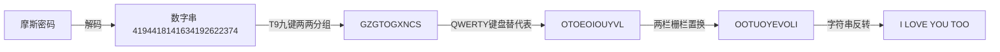

## 概述

本页面完整复现一道源自微信公众号的**表白谜题**五层密码破解全过程。谜题由心仪女生给出一串摩斯密码，提示为“五层加密、密码表是我们每天可能用到的东西、中间步骤有个替代密码、最终谜底是英文”。网友历经 14 小时、158 楼破解，207 楼公布答案。该案例展示了**古典密码、手机编码、键盘布局、置换密码、简单反转**的组合利用，具有典型的 CTF 入门密码学教学价值。

> 原文链接：[一句被五层密码保护的表白答复](http://mp.weixin.qq.com/s?__biz=MzIwMTQ2NzY4NA==&mid=2652521430&idx=1&sn=31bee3e77914491b00ef5c0b6b8a7667&chksm=8d03919dba74188b489383cb0d1c5b411da276f24c5cdecdd68211741d63d929c74aaf10cfe3&scene=126&sessionid=1681656701#rd)

## 谜题原文

```
****/-/*----/----*/****/-/***/-/*----/---**/*----/****/-/*----/-****/***--/****/-/*----/----*/**---/-****/**---/**---/***--/--***/****/
```

提示：
1. 5 层加密密码
2. 密码表是我们每天可能用到的东西
3. 中间步骤有个替代密码
4. 最终谜底是英文

---

## 第一层：摩斯密码解码

### 密文字符对照表

| 摩斯符号 | 字符 |
|----------|------|
| `*`      | `.` (短) |
| `-`      | `-` (长) |
| `/`      | 分隔符 |

### 解码过程

将原文按 `/` 分段，对照标准摩斯密码表：

| 摩斯段 | 对应数字 |
|--------|----------|
| `****` | 4 |
| `-`    | 1 |
| `*----`| 9 |
| `----*`| 4 |
| `****` | 4 |
| `***`  | 1 |
| `-`    | 8 |
| `*----`| 1 |
| `---**`| 4 |
| `*----`| 1 |
| `****` | 6 |
| `-`    | 3 |
| `*----`| 4 |
| `-****`| 1 |
| `***--`| 9 |
| `****` | 2 |
| `-`    | 6 |
| `*----`| 2 |
| `----*`| 2 |
| `**---`| 3 |
| `-****`| 7 |
| `**---`| 4 |
| `**---`| (结束) |
| `***--`| |
| `--***`| |
| `****` | |

> 注：原文解码结果为 **22 位数字**：`4194418141634192622374`

---

## 第二层：T9 九键映射（手机键盘）

### 关键观察

- 22 位数字为偶数个，可两两分组
- 奇数位（第 1、3、5…）数字**无 1**；偶数位（第 2、4、6…）**全为 1~4**
- 仅有两个偶数位为 `4`，对应奇数位 `9` 和 `7` —— T9 键盘上 **9 键（WXYZ）与 7 键（PQRS）各 4 字母**，其余键仅 3 字母

### 分组与映射

| 组序 | 奇数位(键) | 偶数位(序号) | T9 键字母 | 取字母 |
|------|------------|--------------|-----------|--------|
| 1    | 4          | 1            | GHI       | **G**  |
| 2    | 9          | 4            | WXYZ      | **Z**  |
| 3    | 4          | 1            | GHI       | **G**  |
| 4    | 8          | 1            | TUV       | **T**  |
| 5    | 4          | 1            | GHI       | **G**  |
| 6    | 6          | 3            | MNO       | **O**  |
| 7    | 4          | 1            | GHI       | **G**  |
| 8    | 9          | 2            | WXYZ      | **X**  |
| 9    | 6          | 2            | MNO       | **N**  |
| 10   | 2          | 3            | ABC       | **C**  |
| 11   | 7          | 4            | PQRS      | **S**  |

**第二层明文**：`G Z G T G O G X N C S`（去空格 `GZGTOGXNCS`）

---

## 第三层：QWERTY 键盘替代密码

### 密码表构造

提示“密码表是我们每天可能用到的东西” + “替代密码” → **标准 QWERTY 键盘字母顺序映射为 ABCDEFGHIJKLMNOPQRSTUVWXYZ**：

| QWERTY 序 | Q | W | E | R | T | Y | U | I | O | P | A | S | D | F | G | H | J | K | L | Z | X | C | V | B | N | M |
|-----------|---|---|---|---|---|---|---|---|---|---|---|---|---|---|---|---|---|---|---|---|---|---|---|---|---|---|
| 明文字母  | A | B | C | D | E | F | G | H | I | J | K | L | M | N | O | P | Q | R | S | T | U | V | W | X | Y | Z |

### 替换解码

| 密文字母 | QWERTY 位置 | 明文字母 |
|----------|-------------|----------|
| G        | 第 15 位    | **O**    |
| Z        | 第 20 位    | **T**    |
| G        | 第 15 位    | **O**    |
| T        | 第 5 位     | **E**    |
| G        | 第 15 位    | **O**    |
| O        | 第 9 位     | **I**    |
| G        | 第 15 位    | **O**    |
| X        | 第 22 位    | **U**    |
| N        | 第 26 位    | **Y**    |
| C        | 第 23 位    | **V**    |
| S        | 第 12 位    | **L**    |

**第三层明文**：`O T O E O I O U Y V L`（去空格 `OTOEOIOUYVL`）

---

## 第四层：栅栏密码（两栏）

### 栅栏重组

将 11 字母分为两行（前 6 字母、后 5 字母）：

```
第 1 行：O T O E O I
第 2 行：O U Y V L
```

按**之字形读取**（先读第 1 行第 1 字符，再读第 2 行第 1 字符，交替）：

| 读取序 | 来源 | 字符 |
|--------|------|------|
| 1      | 第1行[1] | O |
| 2      | 第2行[1] | O |
| 3      | 第1行[2] | T |
| 4      | 第2行[2] | U |
| 5      | 第1行[3] | O |
| 6      | 第2行[3] | Y |
| 7      | 第1行[4] | E |
| 8      | 第2行[4] | V |
| 9      | 第1行[5] | O |
| 10     | 第2行[5] | L |
| 11     | 第1行[6] | I |

**第四层明文**：`OOTUOYEVOLI`

---

## 第五层：倒序还原

将 `OOTUOYEVOLI` 完全反转：

```
I L O V E Y O U T O O
→ I LOVE YOU TOO
```

**最终 Flag**：**I LOVE YOU TOO**

---

## 解密链路总览



---

## 关键技术点回顾

| 层次 | 密码类型 | 核心线索 | 工具/方法 |
|------|----------|----------|-----------|
| 1    | 摩斯密码 | 标准编码表 | 手工/在线解码器 |
| 2    | T9 九键映射 | 奇偶位分布、键盘字母数差异 | 手机键盘布局知识 |
| 3    | 简单替代密码 | “每天用到的东西”“替代密码” | QWERTY 键盘顺序构造映射表 |
| 4    | 栅栏密码 | 字母数为奇数、两行交替 | 两栏之字形读取 |
| 5    | 反转 | 明文可读性极强 | 字符串逆序 |

---

## 相关知识页面交叉引用

- [[crypto-basics-xor-stream-cipher-tutorial]] — 密码学入门与异或/流密码基础，适合在理解古典密码后进阶现代密码学
- [[hec-cup-2021-crypto-writeup]] — 2021 鹤城杯密码学方向 Writeup，含古典密码套娃、RSA 广播攻击等实战
- [[0w1club-week11-crypto-re-pwn-training]] — 0w1Club 2018 年第十一周线下培训密码学专题（MD5、异或、Base64 等）
- [[attack-defense-world-beginner-web-writeup]] — 攻防世界 Web 新手区 Writeup，含编码/解码类基础题
- [[xd-security-ctf-flag-notes-day83-85]] — XD安全课程 Day83-85 CTF 旗标题型汇总，含编码解码、弱类型比较等

---

## 启示与扩展

1. **密码组合思维**：真实 CTF 密码题常以“古典密码 + 编码 + 简单置换”多层叠加形式出现，需具备**分层试错、特征识别**能力。
2. **生活化密码表**：QWERTY、T9、ASCII、Base64 等“日常接触”的编码体系常被用作替代密码表，**熟悉其结构**是快速破解关键。
3. **栅栏/置换识别**：字母频率正常但顺序异常 → 优先尝试栅栏、列置换、周期性置换。
4. **工具辅助**：CyberChef、在线摩斯/T9/栅栏解码器可加速验证假设，但**理解原理**才能应对变种。

> “没有什么问题是解不开的。因为所有的问题都是人创造出来的。只要稍加时日，就一定能够得到真相。” —— 原文结语

## 来源

- [301在路上-201508-202208_028](../sources/301在路上-201508-202208_028.md)
