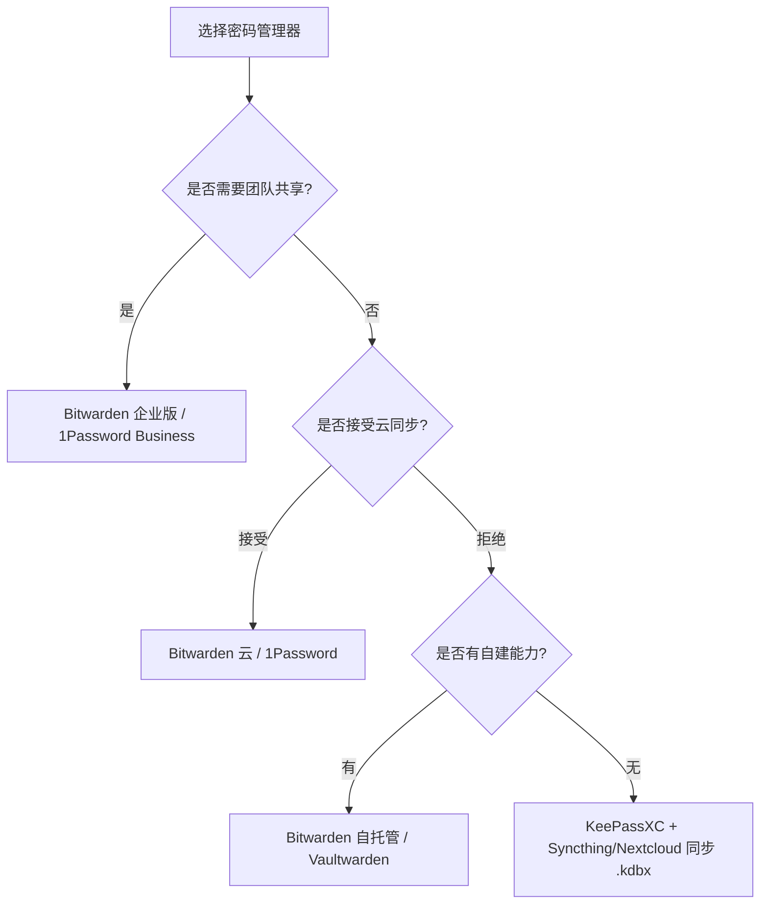

## 撞库攻击核心原理

### 定义与攻击链路
撞库攻击（Credential Stuffing）是指攻击者利用已泄露的用户名/邮箱与密码组合（凭证对），通过自动化工具批量尝试登录其他网站或服务的攻击手法。其核心前提是**用户在多个平台复用相同或相似的密码**。

典型攻击链路：
1. **数据获取**：从历史数据泄露事件（如 LinkedIn 2012、MySpace 2013、Tumblr 2016 等）获取数亿级凭证库
2. **清洗聚合**：去重、格式标准化、按邮箱域名/用户名分桶
3. **自动化验证**：使用分布式代理池、无头浏览器或专用撞库框架（Sentry MBA、OpenBullet 等）对目标站点发起登录请求
4. **有效凭证筛选**：记录登录成功的账号，后续用于账号接管、信息窃取、金融诈骗或转卖变现

### 与暴力破解的本质区别
| 维度 | 暴力破解 | 撞库攻击 |
|------|----------|----------|
| 字典来源 | 通用弱口令字典、生成规则 | 真实泄露的明文/哈希凭证 |
| 成功率 | 极低（依赖密码强度） | 较高（依赖密码复用率） |
| 流量特征 | 单账号多密码尝试 | 多账号单/少密码尝试 |
| 防御重点 | 账号锁定、验证码、限流 | 设备指纹、行为分析、多因子认证 |

## 实战案例复盘：OurMine 入侵 Niantic CEO 推特账户

### 事件时间线
- **2016 年 7 月**：OurMine 黑客组织宣布入侵 Niantic CEO John Hanke 的个人推特账户
- **攻击持续**：账户被控制长达 12 小时未恢复，暴露企业应急响应缺失
- **攻击手法**：OurMine 在被控账号发推称「Hanke 的密码是 `nopass`」，并暗示可能源自近期 LinkedIn、MySpace、Tumblr 等泄露库的撞库攻击
- **组织画像**：OurMine 来自沙特，核心成员约 3 人，擅长入侵知名人士/CEO 社交媒体账户，以「安全测试」名义实施勒索式营销，曾入侵 Google、Facebook、Twitter、Oculus 等高管账户 → 详见 [[ourmine-hacking-group-profile]]

### 关键教训提炼
1. **弱密码直通车**：`nopass` 这类极简密码在任何字典中均处于前列，毫无抵抗力
2. **密码复用致命伤**：若 Hanke 在 LinkedIn 等泄露站点使用相同密码，撞库即可直接命中
3. **高价值目标无特权**：CEO 账户未启用双因子认证（2FA），无专人监控异常登录
4. **应急响应真空**：12 小时未夺回控制权，反映组织层面缺乏账户接管应急预案

## 密码复用风险深度剖析

### 复用模式与攻击面扩大
| 复用模式 | 风险等级 | 典型场景 |
|----------|----------|----------|
| 完全相同密码 | 极高 | 核心邮箱=社交媒体=银行=内网 VPN |
| 核心前缀+站点后缀 | 高 | `P@ssw0rd_FB` / `P@ssw0rd_Gmail` |
| 键盘模式微调 | 中高 | `qwer1234` → `qwer1234!` |
| 分级复用（低/中/高敏感度分组） | 中 | 论坛共用 A，购物共用 B，银行独用 C |

### 真实泄露数据佐证
- **2023 年 45 亿条中文平台泄露数据** 显示：京东、淘宝、美团等主流平台凭证大量重合 → [[data-breach-45billion-chinese-platforms-analysis]]
- **公安部「50 亿条公民信息」案** 揭示：黑产从服务器入侵→数据清洗→撞库盗刷形成完整黑灰产链条 → [[mps-major-personal-info-theft-case]]
- **IoT 设备弱口令横向移动**：打印机、摄像头、UPS 等设备默认口令被撞库后作为内网跳板 → [[iot-device-compromise-internal-penetration]]

## 弱密码危害量化分析

### 常见弱密码类型及破解成本
| 密码类型 | 示例 | 离线破解时间（单张 RTX 4090，SHA-1） | 在线撞库成功率 |
|----------|------|----------------------------------------|----------------|
| 纯数字 ≤10 位 | `1234567890` | < 1 秒 | 极高 |
| 纯小写 ≤8 位 | `password` | < 1 分钟 | 极高 |
| 常见单词+数字 | `pokemon123` | < 1 小时 | 高 |
| 键盘走位 | `qwertyuiop` | < 1 分钟 | 高 |
| 个人信息组合 | `john1985` | < 1 天（社工库辅助） | 中高 |
| 12+ 位随机字符 | `Xk9#mP2$vL5!` | > 百万年 | 极低（仅撞库风险） |

### 企业层面连锁反应
1. **供应链渗透**：员工个人账户被撞库 → VPN/代码仓库/云控制台沦陷
2. **业务邮箱入侵（BEC）**：高管邮箱被接管 → 伪造转账指令、窃取商业机密
3. **合规法律责任**：《网络安全法》《个人信息保护法》要求采取必要技术措施，弱密码策略可能被认定为未尽保护义务 → [[security-practitioner-legal-compliance]]

## 密码管理器选型建议

### 核心评估维度
| 维度 | 关键指标 | 说明 |
|------|----------|------|
| **加密架构** | 零知识证明、端到端加密、主密钥派生算法（Argon2/PBKDF2 迭代数） | 服务端不可解密用户密文 |
| **同步机制** | 本地优先、可选云同步、支持 WebDAV/自建同步 | 避免单点故障与供应商锁定 |
| **跨平台支持** | Windows/macOS/Linux/iOS/Android/浏览器扩展/CLI | 覆盖全设备场景 |
| **自动填充** | 网页/原生 App/命令行/SSH 密钥管理 | 减少手动复制粘贴暴露风险 |
| **安全审计** | 开源/第三方审计报告/漏洞赏金计划 | 透明度与可信度指标 |
| **应急功能** | 紧急联系人/遗产继承/强制解锁延迟 | 账户持有人失联场景 |

### 主流方案对比（截至 2024）
| 产品 | 许可证 | 架构特点 | 适用人群 |
|------|--------|----------|----------|
| **Bitwarden** | AGPL-3.0 | 开源、可自托管、零知识、跨平台全覆盖 | 个人/团队/企业首选 |
| **1Password** | 专有 | 闭源、Secret Key 双因子加密、Watchtower 监控 | 重体验、预算充足用户 |
| **KeePassXC** | GPL-3.0 | 纯本地文件、无云同步、插件生态丰富 | 高安全需求、自管能力强 |
| **Pass / gopass** | GPL-3.0 | Git + GPG 加密、CLI 原生、适合 DevOps | 极客/运维/开发者 |
| **Dashlane / LastPass** | 专有 | 历史漏洞较多、近年架构改进 | 存量用户迁移建议 |

### 部署建议矩阵

## 账户安全最佳实践清单

### 个人用户版
1. **全站点唯一随机密码**：≥16 位、含大小写数字符号，由密码管理器生成并存储
2. **强制启用多因子认证（MFA）**：优先级 `WebAuthn/FIDO2 硬件密钥` > `TOTP 应用` > `推送确认` > `短信/邮箱验证码`
3. **定期巡检泄露状态**：订阅 [Have I Been Pwned](https://haveibeenpwned.com/) 通知、使用密码管理器内置泄露监控
4. **关键账户隔离**：主邮箱、密码管理器主密码、银行/证券、云服务商控制台 **绝不复用**、仅配置硬件密钥
5. **恢复选项加固**：密保问题填写随机答案（存入密码管理器）、移除电话号码恢复、配置备用硬件密钥
6. **设备信任管理**：定期审查活跃会话、撤销异地/久未用设备、开启登录告警

### 企业/组织版
1. **统一身份认证（IdP）强制 MFA**：所有 SaaS/VPN/内网应用接入 SSO，禁用本地账户密码登录
2. **密码策略现代化**：
   - 取消定期强制轮换（NIST SP 800-63B 建议）
   - 实施泄露密码拦截（集成 HIBP API 或商业威胁情报）
   - 禁止常见弱密码、上下文相关词汇（公司名、产品名）
3. **特权账户管理（PAM）**：
   - 管理员账户与日常账户分离
   - 会话录像、即时提权、检出/检入凭证轮换
   - 服务账户使用托管标识/证书而非静态密码
4. **撞库攻击检测与响应**：
   - 登录行为分析：不可能旅行、设备指纹变更、Tor/代理 IP、异常 User-Agent
   - 账户锁定策略：IP 维度 + 用户维度分级、避免拒绝服务
   - 蜜签/金丝雀令牌植入：在内部系统预置假凭证，触发即告警 → [[honeytoken-data-leak-detection-technique]]
5. **供应链凭证治理**：
   - 第三方供应商账户最小权限、定期轮换、合同约定泄露通报 SLA
   - 代码仓库/制品库/CI/CD 密钥扫描（GitGuardian、TruffleHog、Gitleaks）
6. **应急演练与红队测试**：每季度模拟账户接管场景，验证检测规则、响应手册、取证就绪度

## 交叉引用与延伸阅读

- **攻击组织画像**：[[ourmine-hacking-group-profile]] — OurMine 手法、动机、知名案例全景
- **大规模泄露溯源**：[[data-breach-45billion-chinese-platforms-analysis]] — 45 亿条中文数据泄露分析与缓解措施
- **黑产链条复盘**：[[mps-major-personal-info-theft-case]] — 50 亿公民信息案全链条起底
- **内网弱口令横向**：[[iot-device-compromise-internal-penetration]] — IoT/OT 设备默认口令成横向移动跳板
- **泄露早期预警**：[[honeytoken-data-leak-detection-technique]] — 低成本蜜签部署实战指南
- **医疗数据泄露**：[[medical-data-security-breaches]] — 医疗行业典型泄露案例与个人防护清单
- **法律合规边界**：[[security-practitioner-legal-compliance]] — 授权测试、漏洞披露、数据保护合规全景
- **社工库实战查证**：[[osint-social-engineering-scam-investigation-case-study]] — 利用社工库锁定诈骗分子身份全过程

---

> **一句话总结**：撞库攻击的本质是**凭证复用**与**弱密码**的共振，唯一根治之道是**全站点唯一高强度随机密码 + 硬件级 MFA + 持续泄露监控**，工程化落地需依赖**零知识密码管理器**与**现代化身份治理体系**。

## 来源

- [301在路上-201508-202208_079](../sources/301在路上-201508-202208_079.md)
