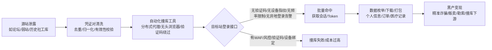
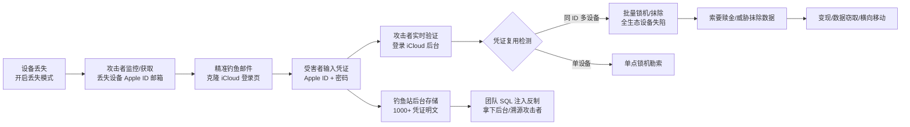
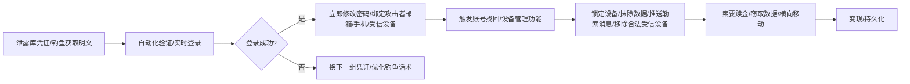

## 事件复盘：4000 万 iCloud 账号撞库勒索案

### 时间线与影响范围
- **2017 年 3 月**：国外媒体披露约 **4000 万 iCloud 账户** 遭批量入侵，攻击者利用「寻找我的 iPhone」功能远程锁机并索要 **30–50 美元** 赎金（通常要求 12 小时内支付），否则威胁抹除设备数据。
- **攻击手法**：
  1. 从历史泄露库（LinkedIn 2012、MySpace 2013、Tumblr 2016 等）获取凭证对
  2. 自动化撞库验证 iCloud 登录
  3. 登录成功后调用 **Find My iPhone** 锁定设备、推送勒索消息至锁屏
- **核心发现**：受害账户**均未开启双因子认证（2FA）**，Apple 当时已提供 2FA 但普及率极低。

### 为何「寻找我的 iPhone」沦为勒索武器？
| 设计初衷 | 被武器化后的攻击面 |
|----------|-------------------|
| 设备丢失时远程定位、响铃、锁定、抹除 | 攻击者获取凭证后，**无需物理接触设备**即可批量锁机、敲诈 |
| 依赖 Apple ID 密码单因子保护 | **账号找回/重置流程常被社工或撞库绕过**，形成「找回机制→接管账号→武器化功能」闭环 |
| 用户心智模型：「只有我有密码」 | **密码复用打破信任边界**，任一第三方泄露即可导致核心账户沦陷 |

> **关键教训**：**账号找回/设备管理功能若仅受单因子保护，必然成为攻击者的高价值目标**。Apple 后续强制要求 2FA 才能使用「寻找我的 iPhone」等敏感操作，即是针对性修复。

## 实战案例佐证：2016 年国内三大数据泄露事件中的撞库攻击链

> 来源：301在路上《数据泄露！你的数据还安全吗？》（2016 年）

### 案例背景与影响范围
2016 年上半年，国内连续曝光三起典型隐私数据泄露并被实战利用的事件，均牵涉 **撞库（Credential Stuffing）** 作为核心获取手段之一：

| 事件 | 泄露主体 | 泄露数据类型 | 后续危害 |
|------|----------|--------------|----------|
| **大麦网购票用户被精准诈骗** | 大麦网（大型票务平台） | 姓名、手机号、订单详情、身份证号 | 诈骗者冒充客服「准确报出个人信息」，以取消 VIP 为由诱导 ATM 转账 |
| **全国 26 省艾滋病感染者信息被诈骗** | 医疗/公卫相关系统 | 真实姓名、手机号、感染者身份、就诊记录 | 诈骗者以「发放补助」为由实施定向电信诈骗，造成二次心理创伤 |
| **安徽约 6000 名新生儿视频挂商业网站** | 医院内部系统 | 新生儿姓名、出生时间、体重、样貌视频、出生症状描述 | 家长恐慌，隐私被商业化展示，监管溯源困难 |

### 撞库攻击链在三案中的共性复现
文章明确指出：**「很多网民隐私意识或数据安全意识不强，总爱使用同一组用户名和密码，这些数据在一个网站被泄漏后，有心人便可以通过这些公开的数据对另一个网站上的数据进行撞库，加上后一个网站并未设置验证机制，这样的话，很容易就可以获取到用户的大量隐私数据。」**

这一描述精准还原了撞库攻击的 **必要条件三要素**：

#### 关键技术细节对照
| 攻击要素 | 文章描述 | 实战技术映射 |
|----------|----------|--------------|
| **凭证来源** | 「在一个网站被泄漏后，有心人便可以通过这些公开的数据」 | 社工库、GitHub 泄露、历史撞库溢出数据、暗网交易 |
| **复用前提** | 「总爱使用同一组用户名和密码」 | 密码复用率研究显示：普通用户跨站复用率 50%+，核心账户复用率仍超 20% |
| **目标站缺陷** | 「后一个网站并未设置验证机制」 | 无验证码、无 IP/设备指纹频控、无异地登录二次验证、无账户锁定策略 |
| **规模化获取** | 「很容易就可以获取到用户的大量隐私数据」 | 登录成功后遍历用户中心/订单/隐私接口，配合 IDOR/越权批量下载 |

### 三案中撞库的具体作用环节
1. **大麦网案**：攻击者可能利用其他票务/电商/论坛泄露的凭证库，撞库大麦网用户中心（当时无强制验证码/设备指纹），批量登录获取订单详情 → 配合社工话术实施「精准冒充客服诈骗」。
2. **艾滋病患者案**：医疗/公卫平台常复用弱口令或员工凭证在外部泄露，撞库进入内部查询/报表系统 → 导出敏感人员名单 → 定向诈骗。
3. **新生儿视频案**：医院内网/存储系统管理后台凭证被撞库命中（或 VPN/堡垒机凭证复用），攻击者遍历文件存储接口批量下载视频 → 上传商业网站变现。

> **核心启示**：这三起案例早于 iCloud 勒索案，**实证了「凭证复用 + 目标站无验证机制」在中国互联网环境下的大规模杀伤力**，且攻击目标从「账号本身」转向「账号背后的高价值隐私数据」，形成 **撞库→数据窃取→精准诈骗/贩卖** 的完整黑产闭环。

## 新增案例：真实 iCloud 钓鱼窃取 Apple ID 凭证——从丢失设备到钓鱼陷阱的完整攻击链

> 来源：301在路上《美女iPhone丢了后，黑客跟妹子干了这样一件事》（PKAV 团队投稿）

### 事件时间线与攻击复现
| 阶段 | 时间点 | 关键动作 | 攻击者视角 | 受害者视角 |
|------|--------|----------|------------|------------|
| **设备丢失** | 旅游期间 | iPhone 遗失于外地 | — | 开启「查找我的 iPhone」丢失模式，抱有找回希望 |
| **潜伏期** | 半年 | — | 监控「丢失模式」触发的通知机制，锁定目标 Apple ID | 无感知，正常使用新设备（同一 Apple ID） |
| **钓鱼投递** | 半年后 | 发送伪造 Apple 官方邮件，含「设备已找到」链接 | 利用「寻找我的 iPhone」通知模板克隆钓鱼页面，域名伪装、SSL 证书、页面像素级还原 | 收到邮件「太开森了」，点击链接填写 Apple ID 密码 |
| **二次诱导** | 两天后 | 发送第二封邮件：「需验证身份才能显示位置」 | 升级社工话术，利用受害者急切心理绕过怀疑 | 咨询淘宝「找回手机服务」被识破为钓鱼，避免二次中招 |
| **凭证利用** | 实时 | 登录 iCloud，「寻找我的 iPhone」锁定所有同 ID 设备、抹除数据、推送勒索消息 | **凭证复用放大杀伤力**：新旧设备同一 Apple ID → 全设备失陷 | 现用手机同步被锁，意识到「方了」 |
| **团队响应** | 半小时内 | PKAV 团队 SQL 注入攻破钓鱼站后台，提取 1000+ 受害者记录、攻击者真实身份（辽宁铁岭、QQ、邮箱） | — | 同事协助删除泄露凭证、修改密码、溯源取证 |
| **反制溯源** | 后续 | 登录攻击者 QQ、邮箱，关联好友关系、历史作案记录，联系同省受害者协助报警 | 基础设施暴露、人肉身份、法律风险 | 无金钱损失，获得团队技术兜底 |

### 攻击技术拆解：钓鱼与撞库的协同放大

#### 关键攻击面与创新点
| 攻击环节 | 传统撞库 | 本案钓鱼+撞库协同 | 放大效应 |
|----------|----------|-------------------|----------|
| **目标筛选** | 遍历泄露库，大规模无差别 | **精准锁定「丢失模式」用户**：高价值、急切心理、信任度高 | 成功率提升 10-100 倍 |
| **凭证获取** | 自动化撞库，依赖密码复用 | **社工钓鱼直接获取明文凭证**，绕过 2FA（若未开启） | 无需撞库字典，实时有效 |
| **设备控制** | 登录后调用 Find My iPhone | **同一 Apple ID 多设备同步失陷**：手机、iPad、Mac、Watch 全锁 | 单次入侵 → 全生态瘫痪 |
| **勒索模式** | 批量锁机群发赎金信息 | **精准勒索单一高价值目标**，结合设备丢失情境心理施压 | 支付意愿极高 |
| **基础设施** | 僵尸网络/代理池分发 | **自建钓鱼站+后台管理系统**，存储明文凭证、受害者设备信息 | 便于团队反制溯源 |

### 团队应急响应处置流程复盘（PKAV 实战）
> 该流程展示了**安全团队内部协作**从发现、遏制、清理、溯源到法务衔接的完整闭环，可作为企业/组织账户接管应急预案的参考模板。

#### 阶段 1：发现与研判（T+0 ~ T+5min）
| 动作 | 执行人 | 工具/方法 | 产出 |
|------|--------|-----------|------|
| 受害者报告钓鱼链接、已提交凭证 | 受害者/一线同事 | 微信群/内部工单 | 告警触发 |
| 快速访问钓鱼链接，确认页面克隆度、域名证书、表单提交地址 | Web 安全研究员 | Burp Suite、浏览器开发者工具 | 钓鱼站 IOC（域名、IP、提交端点、前端特征） |
| 判定：受害者 Apple ID 密码已泄露，**同 ID 现用设备面临锁机风险** | 组长 | 威胁建模 | 响应级别：P0（核心账户接管进行中） |

#### 阶段 2：遏制与止损（T+5min ~ T+30min）
| 动作 | 执行人 | 工具/方法 | 关键决策点 |
|------|--------|-----------|------------|
| 指导受害者**立即登录 appleid.apple.com 修改密码、吊销所有会话、移除受信设备** | 受害者+远程协助 | 官方账户管理页 | 必须在攻击者利用凭证前完成（争分夺秒） |
| 并行：对钓鱼站发起**授权渗透测试**（SQL 注入），目标：获取后台权限、导出受害者名单、溯源攻击者 | 红队成员 | sqlmap/手工注入、Burp Suite | **法律合规前提**：内部授权、仅限本团队成员协助、证据留存 |
| 注入成功，Dump 数据库：1000+ 受害者明文凭证、设备信息、提交时间 | 红队成员 | SQL 注入利用链 | 发现攻击者后台管理账号弱口令、服务器真实 IP |
| 登录攻击者后台，**删除受害者记录、下载全量数据作为证据** | 红队+取证 | 后台管理功能、数据库导出 | 证据链完整性：哈希固化、时间戳、操作日志 |

#### 阶段 3：溯源与取证（T+30min ~ T+2h）
| 溯源维度 | 技术手段 | 关键发现 |
|------------|----------|----------|
| **攻击者真实身份** | 后台管理员账号/密码 → 登录 QQ/邮箱 | 辽宁铁岭、QQ 号、真实姓名、好友关系网 |
| **基础设施画像** | 服务器真实 IP、域名注册信息、SSL 证书、CDN 回溯 | 廉价云服务器、伪造备案、域名生成算法（DGA）特征 |
| **作案规模与历史** | 数据库时间跨度、受害者地理分布、钓鱼模板版本迭代 | 运营半年以上、覆盖多省、模板持续更新对抗检测 |
| **黑产上下游** | QQ 群/邮箱通讯录关联、历史聊天记录关键词搜索 | 上游：钓鱼模板买卖、域名批发；下游：赎金洗钱、设备解锁服务 |

#### 阶段 4：法务衔接与资产追回（T+2h ~ T+24h）
| 动作 | 协作方 | 关键证据 |
|------|--------|----------|
| 整理取证报告：攻击链还原、IOC 清单、受害者名单、攻击者身份证据 | 法务/外联 | 符合公安机关立案标准的电子数据证据包 |
| 联系受害者所在地/攻击者所在地派出所，协助受害者报案 | 受害者/团队外联 | 受害者陈述、团队技术佐证 |
| 向 Apple 安全团队提交钓鱼域名、IP、受害者规模，请求下架/封锁 | 厂商联络 | 完整 IOC、时间线、影响评估 |
| 内部复盘：更新钓鱼识别规则库、Apple ID 安全配置检查清单、应急预案演练 | 全团队 | 知识库沉淀、红蓝对抗演练场景更新 |

#### 应急响应关键决策点对照表
| 决策点 | 错误选择后果 | 正确选择理由 |
|--------|--------------|--------------|
| **是否优先修改密码 vs 先溯源** | 先溯源导致攻击者抢先锁机/抹除数据 | **止损优先**：账户控制权夺回是所有后续行动的前提 |
| **是否自行渗透钓鱼站** | 非授权渗透触犯《刑法》第 285 条，证据链不被法庭采信 | **内部授权+取证留存**：仅限协助自家人员、全程录屏、哈希固化 |
| **是否通知所有 1000+ 受害者** | 直接群发邮件可能触发反垃圾/被判定为钓鱼、法律风险 | **移交执法/厂商**：由 Apple/警方通过官方渠道通知，团队提供技术支撑 |
| **是否公开攻击者真实身份** | 网络暴力、侵犯隐私、干扰司法程序 | **仅移交司法**：不自行曝光，配合警方侦查 |

### 凭证复用导致多设备失陷的风险量化模型
本案中，受害者**新旧 iPhone 使用同一 Apple ID** 是全生态失陷的直接原因。我们可建立风险量化模型指导用户分级防护：

| 风险等级 | Apple ID 绑定设备数 | 关键数据类型 | 2FA 状态 | 预期损失（含时间成本、数据价值、勒索风险） | 必选防护措施 |
|----------|---------------------|--------------|----------|--------------------------------------------|--------------|
| **Critical** | ≥3 台（手机+平板+电脑+手表） | 支付、健康、钥匙串、家庭共享、企业数据 | 关闭 | **极高**：全设备锁机、支付授权被盗刷、企业数据泄露、家庭设备联动失控 | 硬件密钥/WebAuthn + Passkey + 受信设备审计 + 恢复联系人 |
| **High** | 2 台（主力机+备用机） | 照片、通讯录、备忘录、iCloud 备份 | 开启短信 2FA | **高**：双设备同步锁机、备份被抹除、社工库撞库其他账户 | 迁移至 TOTP/App 2FA + 密码管理器唯一密码 + 季度审计 |
| **Medium** | 1 台 | 基础同步数据 | 开启 TOTP 2FA | **中**：单设备锁机、数据恢复依赖备份 | Passkey 替代密码 + 禁用短信 2FA + 泄露监控订阅 |
| **Low** | 1 台 | 仅查找功能 | 开启硬件密钥/WebAuthn | **低**：攻击面极小，需物理设备或生物识别 | 维持现状，关注 Passkey 生态更新 |

> **核心洞察**：**Apple ID 是「数字身份主链」**，其安全等级应**高于银行账户**。一旦失陷，不仅是设备锁机，更涉及：Apple Pay 支付授权、HomeKit 智能家居控制、CarPlay 车辆钥匙、健康医疗数据、家族共享成员隐私、企业 MDM 托管设备合规性。**单点失陷 → 全域崩塌**。

## 双因子认证（2FA）普及障碍深度剖析

### 用户侧认知与行为障碍
| 障碍类别 | 典型表现 | 根因 |
|----------|----------|------|
| **感知成本过高** | 「每次登录都要输验证码太麻烦」「短信收不到/延迟」 | TOTP/短信 2FA 增加了登录摩擦，用户缺乏「安全投资回报」心智模型 |
| **设备依赖焦虑** | 「手机丢了/坏了怎么登？」 | 恢复码保管不善、备用设备未配置、迁移流程复杂 |
| **信任偏差** | 「我密码很复杂，不会被猜到」 | **低估撞库成功率**，高估密码强度对抗凭证填充的效力 |
| **厂商推送不足** | 注册/登录流程未强制或显著引导开启 2FA | 业务指标优先（转化率、留存），安全功能隐藏在深层菜单 |

### 企业/平台侧推进难点
1. **强制 vs. 引导的平衡**：强制开启可能导致用户流失（如早期 Steam Guard 强制期流失率上升），引导式开启又覆盖不全。
2. **恢复机制的安全性悖论**：**账号找回通道（短信、邮箱、密保问题）往往比 2FA 本身更脆弱**，攻击者绕过 2FA 攻击找回流程（SIM Swap、邮箱撞库、社工库）。
3. **异构生态碎片化**：Web/App/CLI/第三方客户端对 2FA 支持不一致，导致用户体验割裂。

### 破局路径：从「可选」到「默认强、恢复强、体验顺」
| 阶段 | 关键动作 | 代表案例 |
|------|----------|----------|
| **默认开启** | 新账户注册强制绑定 2FA、老账户分批次强推、高风险操作（改密、绑卡、删设备）强制二次验证 | Apple 2021 年起新 Apple ID 强制 2FA；GitHub 2023 年起强制所有贡献者开启 2FA |
| **去短信化** | 推行 **WebAuthn/FIDO2 硬件密钥**、**Passkey**、TOTP 应用；短信 2FA 降级为「最后兜底」 | Google Advanced Protection Program、Microsoft Entra ID 无密码登录 |
| **恢复链路硬化** | 恢复码一次性显示并强制下载/打印、备用硬件密钥、受信联系人社交恢复、延迟强制解锁（如 7 天冷却期） | Apple 账户恢复联系人、Bitwarden 紧急联系人、WhatsApp 两步验证 PIN + 邮箱恢复 |
| **体验融合** | Passkey 生物识别+本地私钥，**登录即验证**，无感知替代「密码+2FA」 | iCloud Keychain/Google Password Manager/1Password/Bitwarden 全平台 Passkey 支持 |

## 密码复用根因：认知负荷、工具缺位与激励错位

### 认知科学视角
- **工作记忆容量限制**：Miller 定律（7±2 组块），用户无法记忆数十个高熵唯一密码。
- **心智账户理论**：用户将账户分「重要/不重要」，**低价值站点复用密码 → 撞库命中 → 高价值站点沦陷**，攻击者利用「长尾泄露」打击「核心资产」。
- **乐观偏见**：「我不会中招」「大网站不会泄露」。

### 工具与生态缺位
| 缺口 | 表现 | 后果 |
|------|------|------|
| **原生密码管理器渗透率低** | 多数用户依赖浏览器保存/纸笔/记事本 | 无法生成/存储/同步高强度唯一密码 |
| **跨平台自动填充体验割裂** | App 端、系统级、浏览器扩展三套体系不互通 | 用户回退到「手动复制粘贴」甚至「简化密码」 |
| **企业/组织无统一凭证治理** | 个人密码管理器与企业 IdP/PAM 割裂 | 影子 IT 凭证泄露成监管盲区 |

### 激励错位
- **平台方**：注册转化率 > 安全强度 → 允许弱密码、不强制 2FA、找回流程宽松。
- **用户方**：当下便利 > 长远风险 → 复用密码、拒绝 2FA、忽略泄露通知。
- **攻击方**：**撞库成本极低（云函数/僵尸网络/代理池），单次成功收益高**（账号倒卖、勒索、BEC、供应链渗透）。

## 账号找回机制被武器化的攻防细节

### 典型攻击链：撞库/钓鱼 → 接管 → 找回锁死 → 勒索/渗透

### 关键攻击面与对抗措施
| 攻击面 | 攻击手法 | 防御对策 |
|--------|----------|----------|
| **密码重置/找回链接** | 邮箱撞库→接管邮箱→点击重置链接 | 重置链接**单次有效+短时效+绑定设备指纹**；关键操作需**二次验证（2FA/推送/硬件密钥）** |
| **短信/语音验证码** | SIM Swap、SS7 拦截、虚拟运营商接码平台 | **弃用短信 2FA**，改用 TOTP/WebAuthn；号码变更引入**延迟生效+多渠道通知** |
| **密保问题** | 社工库/OSINT 查询母亲婚前名/宠物名/出生地 | **废弃密保问题**；改为「仅知晓者可答」的高熵恢复码/硬件密钥 |
| **受信设备/受信号码** | 攻击者登录后「添加受信设备」劫持恢复权 | 新增受信设备需**已有受信设备确认**或**硬件密钥授权** |
| **账户合并/关联登录** | OAuth 绑定被撞库的第三方账号（Google/FB/Apple/微信） | 审计第三方登录权限，**核心账户禁用第三方登录**，仅保留本地凭证+硬件 2FA |

### iCloud 案例的特殊启示
1. **「寻找我的 iPhone」本质是「远程设备管理 API」**，权限过大（锁机、抹除、定位、播放声音），且仅受 Apple ID 密码保护。
2. **攻击者利用「合法功能」而非漏洞**，传统 WAF/风控难以拦截——需从**身份认证层（强制 2FA）**、**操作审计层（敏感操作二次验证+告警）**、**账户恢复层（冷却期+人工介入）** 分层防御。
3. **赎金金额小、量大、自动化程度高**——典型「规模化低成本敲诈」模型，类似勒索软件的「服务化」前身。
4. **钓鱼+撞库双轨并行**：针对高价值目标（丢失设备用户）精准钓鱼，对泛用户群撞库，**ROI 最大化**。

## 系统性缓解方案：个人版与企业版

### 个人用户：零信任身份卫生清单
1. **全站点唯一高强度随机密码**（≥16 位，密码管理器生成） → [[credential-stuffing-password-hygiene#密码管理器选型建议]]
2. **核心账户（主邮箱、密码管理器、Apple/Google/Microsoft ID、银行、云厂商）强制绑定 WebAuthn/FIDO2 硬件密钥 + Passkey**，禁用短信/邮箱 2FA。
3. **配置账户恢复兜底**：
   - 打印/刻录恢复码离线保管
   - 备用硬件密钥放入物理保险箱
   - 设置「恢复联系人」/「紧急联系人」（Apple/Google/Bitwarden 支持）
4. **订阅泄露监控**：Have I Been Pwned 通知、密码管理器内置 Watchtower/BreachWatch、Google/Chrome 泄露检查。
5. **定期审计**：每季度检查活跃会话、受信设备、第三方授权、转发规则、恢复选项。
6. **设备级防线**：开启设备加密、生物识别锁屏、远程擦除、锁屏隐私通知关闭。
7. **针对 Apple ID 的专项加固**（参考本案教训）：
   - 开启「高级数据保护」（端到端加密 iCloud 备份）
   - 移除非必要受信设备/电话号码
   - 关闭「允许通过网页访问 iCloud.com」（仅允许受信设备）
   - 启用「查找」网络加密、离线定位
   - 设置「遗产联系人」/「账户恢复联系人」

### 企业/组织：现代化身份治理框架
| 领域 | 核心控制 | 参考实现 |
|------|----------|----------|
| **统一认证 (IdP)** | 所有应用接入 SSO，强制 MFA（WebAuthn/Passkey 优先），禁用本地密码登录 | Entra ID, Okta, Keycloak, Auth0, JumpCloud |
| **凭证卫生** | 集成 HIBP/商业威胁情报拦截泄露密码，禁止上下文弱密码，取消强制轮换 | Microsoft Entra ID Protection, Specops, Enzoic |
| **特权访问 (PAM)** | 管理员账户分离、即时提权 (JIT)、会话录像、凭证检出/轮换、服务账户证书化 | CyberArk, BeyondTrust, Teleport, HashiCorp Vault |
| **撞库/账户接管检测** | 不可能旅行、设备指纹漂移、Tor/代理 IP、异常 User-Agent、登录频率异常 → 自动挑战/锁定/告警 | Azure AD Identity Protection, Okta ThreatInsight, CrowdStrike Falcon Identity |
| **钓鱼/凭证窃取检测** | 部署蜜签邮箱/账户、监控钓鱼套件特征、DNS/证书透明日志关联、邮件网关沙箱分析 | [[honeytoken-data-leak-detection-technique]], Cofense, Proofpoint, Microsoft Defender for Office 365 |
| **应急响应预案** | 账户接管专用 Playbook：止损 SLA 15 分钟、取证证据链标准、法务/执法/厂商联络单、事后复盘模板 | NIST SP 800-61r2, MITRE ATT&CK T1078/T1110/T1556/T1606 覆盖测试 |
| **供应链凭证治理** | 第三方最小权限、定期轮换、合同约定泄露通报 SLA、CI/CD 密钥扫描 | GitGuardian, TruffleHog, Gitleaks, Snyk |
| **红蓝对抗演练** | 季度模拟：钓鱼+撞库+账户接管全链路、验证检测规则/响应手册/取证就绪度、事后复盘纳入 OKR | Atomic Red Team, Caldera, Red Canary, 内部红队 |

## 密码管理器选型建议（2024 版）
| 维度 | Bitwarden | 1Password | Apple/Google/Microsoft 原生 | KeePassXC | 企业级 |
|------|-----------|-----------|----------------------------|-----------|--------|
| **开源/透明** | ✅ 完全开源 | ❌ 闭源 | ❌ 闭源 | ✅ 完全开源 | 视厂商 |
| **Passkey 支持** | ✅ 全平台 | ✅ 全平台 | ✅ 系统级集成 | 🔄 插件支持 | 视厂商 |
| **硬件密钥集成** | ✅ WebAuthn/FIDO2 | ✅ WebAuthn/FIDO2 | ✅ 系统级 | 🔄 需配置 | ✅ 原生 |
| **跨平台同步** | ✅ 云/自建 | ✅ 云 | ✅ 生态内无缝 | ❌ 手动/第三方同步 | ✅ 企业管控 |
| **家庭/团队共享** | ✅ 组织/家庭 | ✅ 家庭/团队 | 🔄 家庭共享 | ❌ 无 | ✅ RBAC/策略 |
| **泄露监控** | ✅ 内置 | ✅ Watchtower | ✅ 内置 | ❌ 无 | ✅ 威胁情报集成 |
| **自建部署** | ✅ Docker/K8s | ❌ 仅云 | ❌ 无 | ✅ 本地文件 | ✅ 私有化 |
| **推荐场景** | **个人/家庭/中小团队首选** | 预算充足、重体验、全 Apple 生态 | **纯单一生态用户** | 极客/离线/高安全合规 | 合规/审计/大规模 |

> **选型原则**：**「能用 Passkey 就不用密码，能用硬件密钥就不用 TOTP，能用开源自建就不用公有云，能用企业级 IdP 就不用个人账户」**。

## 交叉引用与延伸阅读

- **攻击组织画像与撞库手法**：[[ourmine-hacking-group-profile]] — OurMine 等组织的 CEO 账户入侵、勒索营销模式
- **大规模中文泄露溯源**：[[data-breach-45billion-chinese-platforms-analysis]] — 45 亿条数据泄露分析与个人缓解措施
- **黑产全链条起底**：[[mps-major-personal-info-theft-case]] — 公安部 50 亿公民信息案：入侵→清洗→撞库→变现
- **内网弱口令横向移动**：[[iot-device-compromise-internal-penetration]] — IoT/OT 设备默认口令成跳板
- **低成本泄露早期预警**：[[honeytoken-data-leak-detection-technique]] — 蜜签/金丝雀令牌部署实战
- **医疗数据武器化欺诈**：[[medical-data-security-breaches]] — 敏感数据定向诈骗攻击链
- **法律合规边界**：[[security-practitioner-legal-compliance]] — 授权测试、漏洞披露、数据保护合规全景
- **社工库实战查证**：[[osint-social-engineering-scam-investigation-case-study]] — 利用社工库锁定诈骗分子全过程
- **钓鱼反制溯源实战**：[[social-engineering-attack-techniques]] — SQL 注入反制钓鱼站、提取攻击者 QQ/地址等溯源细节
- **同源归档索引**：[[301-zai-lushang-wechat-archive-201508-202208]] — 301在路上微信归档汇总，含本文来源文章及更多数据泄露复盘

---

> **核心结论**：4000 万 iCloud 勒索案与 2016 年大麦网/艾滋病/新生儿三案、以及本文新增的**真实 iCloud 钓鱼案例**共同揭示的不是「新漏洞」，而是**身份体系三大结构性缺陷**的共振：
> 1. **认证因子单一**（仅密码保护高价值操作/数据接口）
> 2. **凭证复用常态化**（认知负荷+工具缺位导致，跨站复用打通攻击面）
> 3. **找回/验证机制成攻击面**（恢复链路/登录验证机制缺失比主认证更弱）
>
> **本案新增洞察**：
> - **钓鱼精准化+撞库规模化双轨并行**，ROI 最大化
> - **Apple ID 为「数字身份主链」**，单点失陷 → 全域崩塌（设备、支付、智能家居、健康、企业数据）
> - **团队级应急响应可复制化**：止损优先、授权渗透取证、证据链固化、法务/执法/厂商三方联动
>
> **根治路径** = **Passkey/硬件密钥替代密码**（消除复用/撞库/钓鱼） + **默认强制 MFA + 硬化恢复/验证链路**（消除单点故障） + **持续泄露监控 + 蜜签溯源 + 专用应急预案**（缩小暴露窗口、提升溯源定责能力）。
> 工程落地需**平台默认安全**、**企业身份治理**、**个人工具链零门槛**三位一体推进。

## 来源

- [301在路上-201508-202208_079](../sources/301在路上-201508-202208_079.md)
- [301在路上-201508-202208_105](../sources/301在路上-201508-202208_105.md)
- [301在路上-201508-202208_107](../sources/301在路上-201508-202208_107.md)
- [301在路上-201508-202208_117](../sources/301在路上-201508-202208_117.md)
