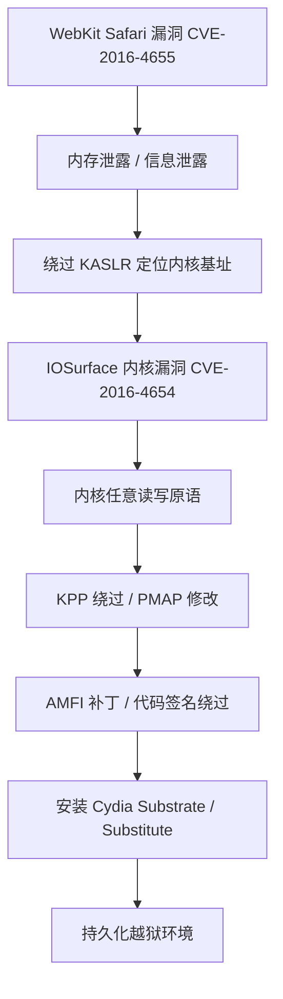

## 漏洞概述

**CVE-2016-4654** 是一个影响 iOS 9.x 版本的内核内存损坏漏洞，由中国**盘古安全团队**发现并负责任地报告给苹果。该漏洞允许任意应用程序在内核权限下执行任意代码，是一个典型的**本地权限提升**漏洞。

苹果于 **2016 年 8 月 4 日** 发布 **iOS 9.3.4** 正式修复此漏洞，同期还发布了针对旧设备的安全更新。此漏洞正是盘古团队用于 **iOS 9.3.3 越狱工具** 的核心内核漏洞。

## 影响范围

| 设备类型 | 受影响版本 | 修复版本 |
|---------|-----------|---------|
| iPhone 5s 及更新机型 | iOS 9.0 - 9.3.3 | iOS 9.3.4 |
| iPad Air 及更新机型 | iOS 9.0 - 9.3.3 | iOS 9.3.4 |
| iPod touch 第 6 代 | iOS 9.0 - 9.3.3 | iOS 9.3.4 |
| iPhone 4s | iOS 9.0 - 9.3.3 | iOS 9.3.5 |
| iPad 2 / 3 / 4, iPad mini 第 1 代 | iOS 9.0 - 9.3.3 | iOS 9.3.5 |
| iPod touch 第 5 代 | iOS 9.0 - 9.3.3 | iOS 9.3.5 |

> **注意**：苹果为无法升级至 iOS 9.3.4 的 32 位设备单独发布了 iOS 9.3.5 安全更新。

## 漏洞技术细节

### 漏洞类型
- **分类**：内核内存损坏 / 越界写入
- **CWE**：CWE-787 (Out-of-bounds Write)
- **攻击向量**：本地，需要应用程序执行权限
- **权限要求**：无特殊权限，沙箱内应用即可触发
- **影响**：内核态任意代码执行，完全绕过沙箱、代码签名、AMFI 等安全机制

### 根因分析
该漏洞存在于 **IOSurface** 框架的内核驱动中（`IOSurfaceRootUserClient`）。IOSurface 是 iOS/macOS 中用于进程间共享图形缓冲区的核心组件。

具体触发路径：
1. 应用通过 `IOSurfaceCreate` 创建共享表面
2. 利用特定的 `IOSurface` 属性操作接口（如 `IOSurfaceSetValue` / `IOSurfaceGetValue`）
3. 通过精心构造的恶意属性字典，触发内核端对象引用计数管理逻辑缺陷
4. 导致 **use-after-free (UAF)** 或 **out-of-bounds write** 原语
5. 结合内核堆喷射技术，劫持内核控制流

### 核心利用原语
盘古团队在 iOS 9.3.3 越狱中展示了该漏洞可构造以下原语：
- **内核任意读/写** (kread/kwrite)
- **内核任意函数调用** (kexecute)
- **绕过 KPP (Kernel Patch Protection)** —— 通过修改内核页表或利用 PMAP 机制
- **AMFI 绕过** —— 修改 `amfi_allow_any_signature` 或补丁 `AMFI.kext`
- **代码签名绕过** —— 修改 `cs_blob` 验证逻辑或 `proc` 结构体标志位

## 盘古 iOS 9.3.3 越狱利用链

盘古团队发布的 **Pangu9** 越狱工具（2016-07-28 发布）完整利用链如下：

> **关键点**：CVE-2016-4654 是**内核提权**的核心漏洞，配合 CVE-2016-4655 (WebKit 信息泄露) 绕过 KASLR，构成完整越狱链。

## 苹果修复方案

### iOS 9.3.4 修复要点 (Security Content)
> "An application may be able to execute arbitrary code with kernel privileges. **Pangu Team** reported this issue."
> "This issue was addressed through improved memory handling."

具体修复措施：
1. **IOSurfaceRootUserClient::setValue() / getValue()** 增加了严格的输入验证与边界检查
2. 引入 **硬化后的对象引用计数管理**，防止 UAF
3. 加强了 **内核堆分配器的完整性校验** (kalloc/kfree 检查)
4. 修复了导致越界写入的逻辑分支

### 缓解措施对比
| 缓解技术 | iOS 9.3.3 | iOS 9.3.4+ |
|---------|-----------|-----------|
| KASLR | ✅ | ✅ |
| KPP (Kernel Patch Protection) | ✅ | ✅ (加强) |
| AMFI | ✅ | ✅ |
| PAN (Privileged Access Never) | ❌ (ARMv8.1+) | ❌ |
| PAC (Pointer Authentication) | ❌ | ❌ |
| IOSurface 输入验证 | ❌ | ✅ **新增** |
| 内核堆完整性校验 | 基础 | **增强** |

## 检测与防御

### 主机层面检测
- **内核完整性监控**：监控关键内核数据结构（如 `proc->p_csflags`, `amfi_allow_any_signature`, `cs_blob`）是否被篡改
- **异常 IOSurface 调用审计**：通过 `DTrace` / `Kernel Event Tracing` 监控 `IOSurfaceRootUserClient` 异常高频调用
- **内存完整性扫描**：定期扫描内核代码段、页表是否被修改

### 网络/行为层面
- **越狱检测 SDK**：检测 Cydia、Substrate、越狱特征文件（`/bin/bash`, `/Applications/Cydia.app`, `/Library/MobileSubstrate/MobileSubstrate.dylib` 等）
- **完整性校验**：应用启动时验证代码签名、主二进制哈希、关键框架哈希

### 缓解建议
1. **及时更新**：所有 iOS 9 设备务必升级至 9.3.4 或 9.3.5
2. **避免越狱**：越狱会永久降低设备安全态势，禁用多项核心缓解措施
3. **MDM 合规策略**：企业环境配置合规策略，阻断越狱设备访问企业资源
4. **应用加固**：关键业务应用集成反越狱、反调试、代码混淆、完整性校验

## 关联漏洞与对比

| CVE编号 | 漏洞类型 | 利用场景 | 修复版本 | 发现者 |
|---------|---------|---------|---------|-------|
| **CVE-2016-4654** | IOSurface 内核内存损坏 | iOS 9.3.3 越狱 (内核提权) | iOS 9.3.4 | 盘古团队 |
| CVE-2016-4655 | WebKit 信息泄露 | iOS 9.3.3 越狱 (绕过 KASLR) | iOS 9.3.4 | 盘古团队 |
| CVE-2016-1757 | IOKit 内核 UAF | iOS 9.2.1 越狱 | iOS 9.3 | Luca Todesco |
| CVE-2016-7612 | IOSurface UAF | iOS 10.1.1 越狱 (yalu102) | iOS 10.2 | Luca Todesco / Marco Grassi |
| **CVE-2016-5195** (Dirty COW) | Linux 内核竞态条件 | Android/Linux 提权 | Linux 4.8.3 | Phil Oester |

> **延伸阅读**：[[cve-2022-0847-dirty-pipe-linux-kernel-privilege-escalation]] 另一个经典的内核管道缓冲区漏洞；[[vulnhub-doubletrouble-writeup]] 实战复现了 Dirty COW 提权链。

## 时间线

| 日期 | 事件 |
|------|------|
| 2016-07-28 | 盘古团队发布 **Pangu9** 支持 iOS 9.2-9.3.3 越狱工具 |
| 2016-08-01 | 苹果确认漏洞，发布安全公告 HT207006 |
| 2016-08-04 | 苹果发布 **iOS 9.3.4** 正式修复 CVE-2016-4654/4655 |
| 2016-08-25 | 苹果发布 **iOS 9.3.5** 修复 32 位设备同类漏洞 + 三个零日 (Trident) |
| 2016-09-13 | iOS 10 发布，引入更强内核缓解 (KPP 加强、内核栈保护等) |

## 参考资源

### 官方公告
- Apple Security Advisory: [HT207006](https://support.apple.com/en-us/HT207006) - iOS 9.3.4 security content
- CVE 官方记录: [CVE-2016-4654](https://cve.mitre.org/cgi-bin/cvename.cgi?name=CVE-2016-4654)

### 技术分析 (社区公开资料)
- Pangu Team Blog: "Pangu 9.3.3 Jailbreak Technical Details" (已下线，可通过 Wayback Machine 查阅)
- Ian Beer (Project Zero): "Exploiting the iOS 10 Kernel" - 相关内核攻击面分析
- Stefan Esser (i0n1c): "iOS Kernel Exploitation" 系列演讲

### 盘古团队相关贡献
- iOS 7.1.x / 8.x / 9.x 多代越狱工具发布
- 负责任披露流程推动苹果安全响应机制成熟
- 相关技术分享推动 iOS 安全研究社区发展

## 交叉引用

- [[macos-memory-execution-macho-loader-m1-mitigations]] — macOS/iOS 内存执行技术演进与 Apple Silicon 缓解措施
- [[vulnhub-doubletrouble-writeup]] — 另一经典内核提权漏洞 Dirty COW (CVE-2016-5195) 实战复现
- [[cve-2022-0847-dirty-pipe-linux-kernel-privilege-escalation]] — Linux 内核管道缓冲区漏洞对比分析
- [[process-injection-tampering-techniques]] — 进程注入与镂空技术，理解内核态代码执行后的利用手法
- [[memory-scanning-tools-evasion-techniques]] — 内存扫描对抗，越狱后环境如何规避检测
- [[redteam-hw-opsec-guidelines]] — 红队行动中利用内核漏洞的 OPSEC 考量

## 总结

CVE-2016-4654 是 iOS 安全史上具有里程碑意义的内核漏洞：
1. **技术代表性**：展示了 IOSurface 攻击面的高危性，后续多个越狱 (yalu102 等) 均复用该组件
2. **产业影响**：直接导致 iOS 9.3.3 成为"最后可完美越狱的主流版本"，推动大量用户停留在旧版本
3. **防御演进**：倒逼苹果在 iOS 10+ 大幅强化 KPP、引入 KTRR (Kernel Text Read-Only Region)、PAC 等硬件辅助缓解
4. **负责任披露典范**：盘古团队选择报告而非黑市出售，体现了国内白帽力量的国际话语权

> **安全启示**：内核攻击面收敛、内存安全语言 (Rust/Swift) 在内核组件中的采用、硬件辅助完整性保护 (PAC/BTI/MTE) 是现代移动端内核安全演进的三大核心方向。

## 来源

- [301在路上-201508-202208_073](../sources/301在路上-201508-202208_073.md)
