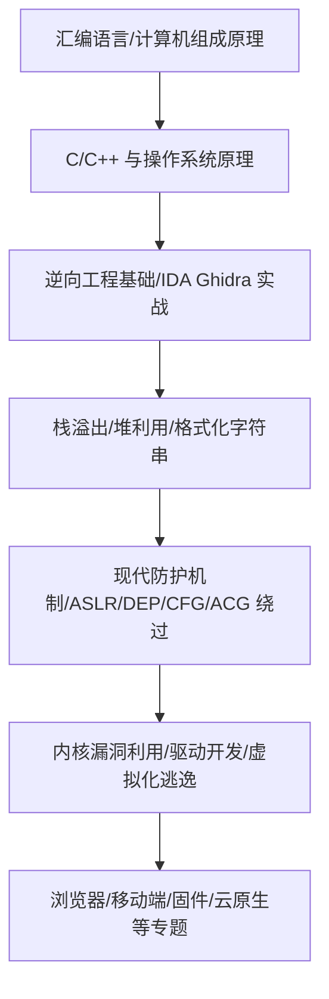

## 概述

本期每日安全看点收录三篇高质量安全技术资源，分别聚焦 **SRC 漏洞挖掘实战技巧**、**IoT 物联网实验室搭建指南** 以及 **逆向工程与二进制利用经典书籍合集**，为安全研究者提供从实战方法论、环境搭建到理论夯实的完整参考。

## 主要内容

### SRC 漏洞挖掘技巧：三步走收集高质量信息

**来源链接**：[https://mp.weixin.qq.com/s/mAVa00D1m4iENzfbKNIhbA](https://mp.weixin.qq.com/s?__biz=MjM5OTk2MTMxOQ==&mid=2727832272&idx=1&sn=ac7142aef5fa638201994806fe60d455&scene=21#wechat_redirect)

#### 核心要点
文章系统梳理了 SRC（安全应急响应中心）漏洞挖掘的信息收集方法论，提出 **三步走策略**：

| 步骤 | 核心任务 | 关键技术点 |
|------|----------|------------|
| **第一步：资产发现** | 全面梳理目标攻击面 | 子域名枚举、C段扫描、SSL证书关联、搜索引擎语法、FOFA/ZoomEye/Shodan 空间测绘 |
| **第二步：指纹识别** | 精准识别技术栈与组件 | Wappalyzer/WhatWeb 指纹识别、CMS 指纹、中间件版本、框架特征、云厂商标识 |
| **第三步：漏洞匹配** | 基于指纹定向挖掘 | CVE/POC 库检索、组件已知漏洞匹配、配置错误审计、业务逻辑缺陷挖掘 |

#### 实战建议
- **自动化与人工结合**：工具跑批量，人工深挖高价值目标
- **持续监控**：建立资产变更监控机制，新上线系统优先测试
- **漏洞验证规范**：规范化复现流程，提高提交通过率

> **关联阅读**：次日看点 [[daily-security-digest-20200312]] 继续分享漏洞挖掘技巧系列文章链接。

---

### 如何自建 IoT 实验室

**来源链接**：[https://mp.weixin.qq.com/s/ekx8U3PAV0eh2loIYbxrnw](https://mp.weixin.qq.com/s?__biz=MzUzMjcxMzg5Mg==&mid=2247485755&idx=1&sn=e8ad6219848728a303e3323229f9eb9a&scene=21#wechat_redirect)

#### 实验室架构设计
文章详细介绍了从零搭建个人/团队级 IoT 安全研究环境的完整方案：

##### 硬件层
- **核心设备**：路由器、智能摄像头、智能音箱、网关、传感器节点
- **调试接口**：USB-TTL、JTAG/SWD、SPI/I2C 烧录器、逻辑分析仪
- **无线抓包**：HackRF One、Yard Stick One、Ubertooth One、Alfa 网卡

##### 固件分析环境
| 组件 | 推荐工具/方案 |
|------|---------------|
| 固件提取 | Binwalk、DD、Flashrom、JTAG 调试器 |
| 文件系统分析 | Firmwalker、FirmAE、Sasquatch、Jefferon |
| 模拟运行 | QEMU User-mode/Full-system、Firmadyne、IoTFuzzer |
| 静态分析 | IDA Pro/Ghidra、Binwalk、Strings、File |

##### 网络通信分析
- **协议逆向**：Wireshark、MQTT.fx、CoAP Client、ModbusPoll
- **流量复放/模糊测试**：Boofuzz、AFL/AFL++、自定义 Python/Scapy 脚本
- **中间人攻击**：Bettercap、MITMProxy、自建 Rogue AP

##### 漏洞挖掘工作流
1. **固件获取** → 官网下载/物理提取/OTA 抓包
2. **静态分析** → 硬编码凭证、后门账号、私钥泄露、不安全配置
3. **动态调试** → 网络服务 Fuzzing、Web 界面漏洞、移动端 App 交互分析
4. **无线侧** → 配对/认证绕过、重放攻击、加密实现缺陷
5. **供应链** → 组件版本追踪、SBOM 分析、已知 CVE 匹配

> **关联资源**：IoT 设备凭证泄露与未授权访问实战案例可参考 [[secquan-bugwarning-1071987-device-credential-leak]]。

---

### 逆向与二进制利用书籍集合

**来源链接**：[https://github.com/hdbreaker/ExploitingBooks](https://github.com/hdbreaker/ExploitingBooks)

#### 项目简介
GitHub 仓库 `hdbreaker/ExploitingBooks` 精心整理了 **逆向工程、二进制漏洞利用、恶意代码分析** 领域的经典与前沿书籍资源，涵盖理论基础、实战技巧、工具使用等多个维度。

#### 核心书单分类

##### 逆向工程基础与进阶
- 《逆向工程核心原理》（Reversing: Secrets of Reverse Engineering）
- 《IDA Pro 权威指南》（The IDA Pro Book）
- 《加密与解密》（第 3/4 版）
- 《恶意代码分析实战》（Practical Malware Analysis）

##### 二进制漏洞利用
- 《0day 安全：软件漏洞分析技术》（第 2 版）
- 《漏洞战争》（软件漏洞分析精粹）
- 《Shellcoder's Handbook》
- 《The Art of Exploitation》
- 《Advanced Windows Exploitation》

##### 系统内核与底层安全
- 《Windows 内核原理与实现》
- 《Linux 内核设计与实现》
- 《Rootkit: Subverting the Windows Kernel》
- 《Mac OS X and iOS Internals》

##### 现代利用缓解绕过
- 《ROP 攻击与防御》
- 《浏览器安全白皮书》（Browser Security Handbook）
- 《Heap Exploitation》系列资料
- 《Windows 内核提权漏洞利用技术》

##### 专题方向
- **Android/iOS 逆向**：《Android 软件安全与逆向分析》、《iOS Application Security》
- **固件/嵌入式逆向**：《实战物联网固件分析》、《嵌入式设备固件安全分析》
- **CTF 竞技**：《CTF 竞赛权威指南》、《Pwn 入门到精通》

#### 学习路线建议

#### 使用提示
- 仓库持续更新，建议 **Watch/Star** 跟踪新增资源
- 部分书籍附带配套代码、练习环境、视频教程链接
- 结合 [[ctftime-writeup-digest-20210325]] 等 CTF Writeup 实战练习，理论联系实际

---

## 关联导航

| 日期 | 看点主题 | 链接 |
|------|----------|------|
| 2020-03-11 | 本期：SRC挖掘/IoT实验室/逆向书籍 | **当前页面** |
| 2020-03-12 | wget CVE/渗透测试/JSC WebKit/漏洞挖掘技巧 | [[daily-security-digest-20200312]] |
| 2020-03-16 | Linux内核调试/NETGEAR RCE/V8利用/SSH蠕虫/SMBGhost | [[daily-security-digest-20200316]] |
| 2020-03-17 | CVE-2020-0768/苹果隐私/VSCode RCE | [[daily-security-digest-20200317]] |
| 2020-03-18 | 反序列化/fastjson/Shiro/Weblogic/ATT&CK/APP渗透/Windows提权 | [[daily-security-digest-20200318]] |

---

## 标签索引

`#每日安全看点` `#SRC漏洞挖掘` `#BugBounty` `#IoT安全` `#物联网实验室` `#逆向工程` `#二进制利用` `#书单推荐` `#2020年3月`

## 来源

- [0th3rs安全团队-201911-202204_066](../sources/0th3rs安全团队-201911-202204_066.md)
