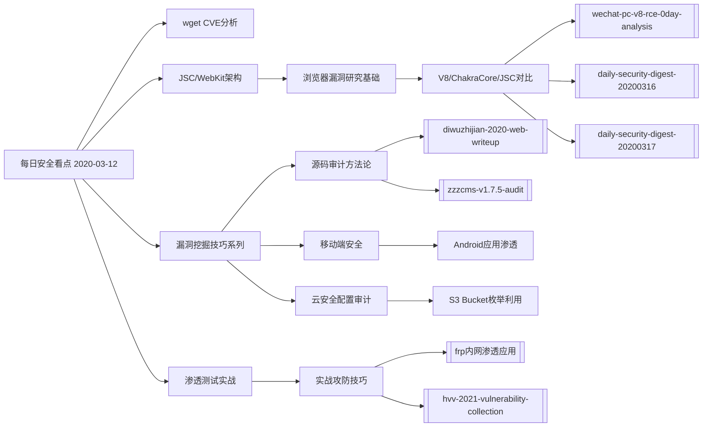

## 概述

本页面汇总 2020 年 3 月 12 日发布的每日安全看点，收录了四个方向的优质安全技术资源：wget 经典漏洞深度分析、实战渗透测试案例复盘、JavaScriptCore 与 WebKit 架构学习路线、以及漏洞挖掘实战技巧系列。

## 核心内容

### wget 1.19.1 CVE 漏洞分析

- **资源链接**：[wget 1.19.1 CVE分析](https://mp.weixin.qq.com/s?__biz=MzI0NzEwOTM0MA==&mid=2652474508&idx=1&sn=66e7be729a51ff8c9dd542bfd699e92c&scene=21#wechat_redirect)
- **关注点**：对 wget 1.19.1 版本中特定 CVE 漏洞的技术细节剖析，涉及漏洞成因、触发条件及利用方式
- **延伸阅读**：可结合 [[cve-digest-20200426]] 中的漏洞聚合视角，对比不同时期的漏洞分析方法论

### 真实渗透测试案例复盘

- **资源链接**：[这是一篇“不一样”的真实渗透测试案例分析文章](https://mp.weixin.qq.com/s?__biz=MzI2NDk0MTM5MQ==&mid=2247483670&idx=1&sn=1063bf299a8894f87521e8d73a687ff3&scene=21#wechat_redirect)
- **特色**：强调“不一样”的视角，可能包含非标准攻击路径、业务逻辑漏洞挖掘或红蓝对抗实战复盘
- **关联实践**：可参考 [[frp内网渗透应用]] 中的隧道技术、[[hvv-2021-vulnerability-collection]] 中的实战漏洞利用案例

### JSC 与 WebKit 架构学习资料整理

- **资源链接**：[JSC 与 WebKit 架构相关资料整理](https://zon8.re/posts/jsc-architecture-reading-list-for-vulnerability-researchers/)
- **目标受众**：面向漏洞研究者的阅读清单，系统梳理 JavaScriptCore 引擎与 WebKit 浏览器引擎核心架构
- **核心价值**：为浏览器漏洞挖掘（如 V8、ChakraCore、JSC）提供理论基础
- **关联页面**：
  - [[daily-security-digest-20200316]] 中的 V8引擎利用入门
  - [[daily-security-digest-20200317]] 中的 ChakraCore CVE-2020-0768 分析
  - [[wechat-pc-v8-rce-0day-analysis]] 中的 V8 漏洞实战利用链

### 漏洞挖掘技巧系列（Craig Hays 撰写）

| 篇次 | 标题 | 链接 | 核心主题 |
|------|------|------|----------|
| 1 | Always Read the Source Code | [链接](https://craighays.com/bug-bounty-hunting-tips-1-always-read-the-source-code/) | 源码审计核心思想、白盒挖掘方法论 |
| 2 | Target Their Mobile Apps (Android Edition) | [链接](https://craighays.com/bug-bounty-hunting-tips-2-target-their-mobile-apps-android-edition/) | Android 应用攻击面、移动端漏洞挖掘技巧 |
| 3 | Kicking S3 Buckets | [链接](https://craighays.com/bug-bounty-hunting-tips-3-kicking-s3-buckets/) | AWS S3 存储桶配置错误利用、云资产发现 |

- **系列特点**：实战导向，从源码审计延伸到移动端与云配置审计，覆盖现代 Bug Bounty 主流攻击面
- **学习建议**：结合 [[diwuzhijian-2020-web-writeup]] 中的 PHP/Java 代码审计实战、[[zzzcms-v1.7.5-audit]] 的 CMS 审计方法论综合提升

## 同期相关安全看点

- [[daily-security-digest-20200316]] — 3 月 16 日看点：Linux 内核动态调试、NETGEAR RCE、V8 利用入门、SSH 蠕虫、SMBGhost (CVE-2020-0796) 分析
- [[daily-security-digest-20200317]] — 3 月 17 日看点：ChakraCore CVE-2020-0768、苹果剪贴板隐私、VSCode RCE 隐患
- [[daily-security-digest-20200318]] — 3 月 18 日看点：反序列化漏洞复现合集、ATT&CK 欺骗防御、Weblogic CVE-2020-2555

## 知识关联图谱

## 标签索引

`#每日安全看点` `#wget` `#CVE分析` `#渗透测试` `#JSC` `#WebKit` `#浏览器安全` `#漏洞挖掘` `#Bug Bounty` `#源码审计` `#Android安全` `#云安全` `#2020年3月`

## 来源

- [0th3rs安全团队-201911-202204_065](../sources/0th3rs安全团队-201911-202204_065.md)
