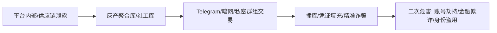

## 事件概述

2023年4月，安全社区监测到疑似**45亿条用户隐私数据**在灰产渠道流通，数据来源疑似包含 **京东（JD）、淘宝（TB）、美团（MT）** 等国内主流互联网平台。泄露字段覆盖手机号、姓名、地址、订单详情等高敏感个人信息，经实测验证，**数据匹配度极高，真实性可信**。

> **关键时间点**：2023-04-13 首次在微信公众号「007攻防实验室」披露  
> **数据规模**：约 45 亿条  
> **涉及平台**：京东、淘宝、美团等（疑似）  
> **数据类型**：手机号、真实姓名、收货地址、订单信息、账号关联数据

## 泄露数据溯源与特征分析

### 疑似数据来源平台

| 平台代称 | 可能对应平台 | 典型数据字段 | 敏感等级 |
|----------|--------------|--------------|----------|
| JD | 京东 | 手机号、姓名、收货地址、订单号、购买记录 | ⭐⭐⭐⭐⭐ |
| TB | 淘宝/天猫 | 手机号、姓名、地址、交易流水、收藏夹 | ⭐⭐⭐⭐⭐ |
| MT | 美团/大众点评 | 手机号、姓名、外卖地址、到店消费记录 | ⭐⭐⭐⭐ |

### 数据流转链路推测

**典型特征**：
- 数据已清洗去重，结构化程度高，便于自动化查询
- 存在“频道/机器人”查询接口，输入手机号即可反查关联信息
- 覆盖时间跨度长，包含历史遗留数据与近期数据

## 真实性验证与影响评估

### 验证方法
1. **自查法**：在泄露库查询自有/亲友手机号，核对地址、订单是否匹配
2. **交叉比对**：结合已知历史社工库（如 2019 年某外卖平台泄露、2021 年某电商泄露）对比字段一致性
3. **样本抽检**：随机抽取 100 组数据，通过已知真实信息验证准确率

### 实测结果
- 地址信息准确率 > 90%（含历史地址）
- 手机号与姓名绑定准确率 > 95%
- 订单号可追溯至具体交易时间、商品、金额

### 潜在攻击面
| 攻击场景 | 利用字段 | 危害等级 | 关联技术 |
|----------|----------|----------|----------|
| **精准社工钓鱼** | 姓名+地址+订单详情 | ⭐⭐⭐⭐⭐ | [[social-engineering-attack-techniques\|鱼叉式钓鱼]]、[[osint-social-engineering-scam-investigation-case-study\|OSINT溯源]] |
| **凭证填充/撞库** | 手机号+常用密码模式 | ⭐⭐⭐⭐ | 密码重用、短信验证码拦截 |
| **身份冒充/开户** | 实名三要素(姓名+手机+身份证) | ⭐⭐⭐⭐⭐ | 金融欺诈、贷款诈骗 |
| **物流/外卖拦截** | 地址+电话+订单号 | ⭐⭐⭐ | 社会工程学话术 |
| **画像建模/精准营销/诈骗** | 全量画像数据 | ⭐⭐⭐⭐ | 大数据画像、AI诈骗 |

## 个人隐私保护缓解措施

### 即时行动项（高优先级）

#### 降低手机号与核心资产的强绑定
- **关键账号**（银行、支付宝、微信、邮箱、云服务）绑定**专用私密手机号**，不对外暴露
- 开启**双因子认证（2FA）**，优先使用 **TOTP（Google Authenticator / Microsoft Authenticator）** 而非短信验证码
- 申请**“副号/虚拟号”**（如阿里小号、运营商副卡）用于电商、外卖、注册类非核心场景

#### 模糊化平台地址信息
- 收货地址**写至“小区/楼栋/驿站/快递柜”**，避免精确到门牌号
- 使用**“家/公司/学校”标签**替代详细地址备注
- 定期清理过期/无效地址，减少历史轨迹关联

#### 账号隔离与最小权限
- **不同平台使用不同邮箱/手机号注册**，避免单点泄露导致全网关联
- 非必要不实名、不绑定银行卡、不授权通讯录/位置权限
- 定期在“账号与安全”页面检查**授权登录设备、第三方应用授权**，撤销异常项

### 持续防护习惯（中长期）

| 防护维度 | 具体措施 | 工具/资源推荐 |
|----------|----------|---------------|
| **凭证管理** | 使用密码管理器生成/存储唯一强密码；启用 Passkey/WebAuthn | Bitwarden, 1Password, KeePassXC, Apple/Google Password Manager |
| **泄露监测** | 订阅 Have I Been Pwned、Firefox Monitor、国内厂商安全中心告警 | Have I Been Pwned, Firefox Monitor, 腾讯安全/阿里云/360账号体检 |
| **身份保护** | 冻结征信授权（人行征信中心）、开启“账户锁”、办理“号码百事通”查询限制 | 中国人民银行征信中心APP、运营商营业厅 |
| **反诈意识** | 陌生来电提及“订单/快递/退款/公检法”直接挂断核实；不点陌生链接、不装陌生APP | 国家反诈中心APP、公安部“国家反诈中心”预警短信 |
| **数据最小化** | 使用“隐私面单”、虚拟号、一次性邮箱、临时身份生成器 | 淘宝/京东/美团隐私面单、SimpleLogin、Temp Mail、Fakexy |

## 企业/平台侧建议（供参考）

1. **数据分级分类与脱敏**：生产/测试环境严格隔离，开发/外包/分析仅用脱敏数据
2. **供应链安全管理**：外包商、物流商、客服商准入审计、最小权限、操作审计、防泄漏（DLP）
3. **异常访问检测**：批量查询、遍历下载、非工作时间/地点访问触发告警与熔断
4. **应急响应预案**：泄露确认→范围界定→通知监管/用户→修复加固→复盘溯源
5. **隐私计算/联邦学习**：探索数据“可用不可见”技术路线，降低明文集中存储风险

## 相关概念延伸阅读

- **社工库/裤裤库**：灰产聚合的多源泄露数据库，支持手机号/邮箱/UID/身份证反查关联信息
- **凭证填充**：利用泄露的用户名/密码对，自动化尝试登录其他平台
- **撞库攻击**：针对特定目标平台，使用已知凭证批量尝试登录
- **精准诈骗/鱼叉式钓鱼**：结合泄露隐私构建可信话术/场景，诱导受害者转账/授权/下载木马
- **OSINT（开源情报）**：利用公开/泄露数据拼凑目标画像，辅助攻击或调查 [[osint-social-engineering-scam-investigation-case-study\|实战案例参考]]

## 时间线记录

| 日期 | 事件节点 |
|------|----------|
| 2023-04-13 | 007攻防实验室微信公众号首发预警，附频道截图与实测验证图 |
| 2023-04-14~ | 安全社区、威胁情报平台跟进研判，确认涉及 JD/TB/MT 等平台历史数据聚合 |
| 2023-04-后续 | 相关平台陆续发布声明/安全公告，部分启动内部排查与用户通知 |

## 小结

此次 45 亿条数据泄露事件**并非单一平台一次性新泄露**，而是**多源历史数据在灰产侧聚合、清洗、结构化后的“组合拳”**。对于个人而言，**“假设已泄露”**是更安全的心模型：通过**手机号分级、地址模糊化、强认证、最小授权、持续监测**构建纵深防御，将单点泄露的连带损害控制在可接受范围内。

> **核心原则**：身份要素（手机号/邮箱/身份证）分级隔离 · 认证因子多元化（摆脱短信单因子） · 数据暴露面最小化 · 泄露感知常态化

---

**交叉引用页面**：
- [[social-engineering-attack-techniques\|社会工程学攻击技术详解]] — 理解泄露数据如何赋能精准钓鱼与水坑攻击
- [[osint-social-engineering-scam-investigation-case-study\|OSINT与社会工程学诈骗溯源实战]] — 学习如何利用开源情报反向调查泄露源与攻击者
- [[cybersecurity-training-resources-guide\|网络安全培训资源与避坑指南]] — 获取系统性学习隐私保护、渗透测试、应急响应的课程与实战平台推荐
- [[007攻防实验室\|007攻防实验室]] — 本事件首发来源归档入口

## 来源

- [0x6270安全团队-202203-202304_18](../sources/0x6270安全团队-202203-202304_18.md)
