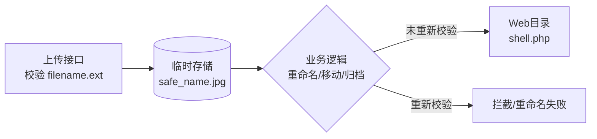

## 概述

本文复现一次针对教育行业SRC（安全应急响应中心）目标站点的渗透测试全过程。攻击链条完整覆盖**资产发现 → 弱口令认证绕过 → 存储型XSS → 文件上传白名单绕过 → Getshell → 后渗透维持**，展示了从信息收集到代码执行的典型Web渗透路径。案例中利用的技术手法均为基础且高频漏洞类型，适合作为SRC漏洞挖掘入门与实战复盘的参考。

> **安全合规提示**：本文仅用于技术研究与防御体系建设，所有测试均在授权范围内进行。未经授权对目标系统进行渗透测试属于违法行为。

---

## 攻击链总览

| 阶段 | 核心动作 | 关键漏洞/技术 | 结果 |
|------|----------|---------------|------|
| 1. 资产发现 | FOFA语法搜索 | 资产测绘、搜索引擎利用 | 定位目标管理后台 |
| 2. 认证绕过 | 弱口令尝试 | 默认口令 `admin/123456` | 登录后台管理系统 |
| 3. 客户端攻击 | 课程列表XSS测试 | 存储型XSS（回显点） | 存储恶意Payload，触发弹窗 |
| 4. 服务端攻击 | 文件上传绕过 | 白名单校验不完全、二次重命名绕过 | 上传PHP Webshell |
| 5. 权限维持 | 蚁剑连接 | Webshell交互管理 | 获取服务器持久化控制权 |

---

## 详细复现过程

### 资产发现：FOFA精准定位

作者初期尝试Google Hacking语法搜索，但因语法库陈旧、新资产收录不足而未果。转而借用 **FOFA** 账号进行资产测绘，快速定位到目标学校的管理后台入口。

- **工具选择**：FOFA（网络空间测绘引擎）优于传统搜索引擎的实时资产更新能力
- **核心思路**：利用`title`、`header`、`body`、`cert`等字段组合，缩小教育行业后台系统范围
- **经验总结**：单一搜索引擎盲区大，建议组合使用 FOFA、ZoomEye、Hunter、Quake 等多源测绘平台交叉验证

> **关联阅读**：[[phishing-website-creation-tutorial]] 中同样提到利用自动化工具（SET）快速克隆目标页面，体现信息收集阶段「工具化、自动化」的共性思想。

---

### 认证绕过：默认弱口令直捣黄龙

后台登录页面未启用验证码、账号锁定策略及多因子认证，直接尝试通用弱口令 `admin/123456` 即成功登录。

- **漏洞成因**：
  - 系统初始化未强制修改默认凭据
  - 无暴力破解防护（验证码、IP限频、账号锁定）
  - 无异地登录告警、设备指纹识别等二次验证机制
- **防御建议**：
  - 强制首次登录修改高强度密码（≥12位、多字符集）
  - 部署验证码/滑块验证/双因子认证（TOTP、短信、硬件Key）
  - 实施登录审计与异常行为告警（新设备、新IP、非工作时间）

---

### 存储型XSS：课程列表回显点挖掘

登录后台后，作者通过功能点遍历发现 **「课程列表/添加课程」** 存在前台回显，且未对输入进行充分过滤与编码。

#### 漏洞验证

```html
<script>alert(1)</script>
```

- **注入位置**：课程名称/描述等文本输入框
- **触发场景**：管理员/教师查看课程列表时自动执行
- **漏洞类型**：存储型XSS（持久化、危害面广）

#### 利用价值

- 窃取管理员 Cookie/Session 实现账号劫持
- 钓鱼欺骗内部人员（伪造登录框、下载恶意文件）
- 结合CSRF推进后台敏感操作（添加管理员、修改权限）

#### 修复方案

| 防护层面 | 措施 |
|----------|------|
| 输入端 | 严格白名单校验（长度、字符集、业务规则） |
| 存储端 | 入库前 HTML 实体编码或结构化存储（不存原始HTML） |
| 输出端 | **上下文感知编码**（HTML实体/JS/URL/CSS编码），使用模板引擎自动转义（如Jinja2 `autoescape`、Thymeleaf `th:text`） |
| 策略层 | 部署严格 **CSP（Content-Security-Policy）**，禁用 `inline-script`、`eval`，限制 `script-src` 来源 |

---

### 文件上传绕过：从白名单到Getshell

同一后台存在文件上传功能（如课程封面、附件上传），作者在此实现 **任意文件上传 → PHP Webshell 落地**。

#### 初步测试与拦截分析

| 测试文件 | 结果 | 推断 |
|----------|------|------|
| `shell.php` | 拦截 | 后缀黑/白名单校验 |
| `shell.php.jpg` | 拦截 | 双重后缀检测、Content-Type校验 |
| `shell.pHp` | 拦截 | 大小写不敏感校验 |
| `shell.php.` / `shell.php%00.jpg` | 拦截 | 截断/特殊字符过滤 |

**结论**：服务端实施了 **扩展名白名单 + 大小写归一化 + 双后缀检测 + 空字节截断防护** 的多层校验。

#### 绕过思路：利用「二次重命名/移动」逻辑缺陷

作者观察到：上传接口仅校验「原始文件名」，而后续业务逻辑（如保存、归档、重命名）可能**再次处理文件名且无校验**。

**实战操作**：
1. 上传合法后缀文件（如 `normal.jpg`），抓包记录返回的临时路径/文件ID
2. 利用后台「重命名/编辑」功能，将文件名修改为 `shell.php`
3. 服务端直接 `rename()` 或 `move_uploaded_file()` 至 Web 目录，**跳过扩展名校验**

> **核心原理**：**校验与使用分离**（TOCTOU变体）。前端/网关校验 `filename` 参数，后端业务逻辑信任数据库/存储中已落地的「安全文件名」，二次操作时未重新校验。

#### Webshell 定位与连接

- 上传成功后响应未直接回显路径
- 通过 **查看首页源代码** 搜索特征字符串（如上传文件名、hash、时间戳）定位实际物理路径
- 使用 **蚁剑** 连接 Webshell，执行 `system('id')` 验证权限

```text
蚁剑配置示例：
URL: http://target.edu.cn/upload/tmp_20230416/shell.php
Password: pass
Encoder: PHP_BASE64 (绕过WAF)
```

---

### 后渗透与痕迹清理（作者未展开，补充最佳实践）

| 动作 | 工具/命令 | 目的 |
|------|-----------|------|
| 权限枚举 | `whoami`、`id`、`sudo -l`、`getcap -r / 2>/dev/null` | 确认当前权限、提权面 |
| 内网探测 | `ifconfig`/`ip a`、`netstat -antup`、`ps aux`、`arp -a` | 拓扑梳理、横向目标 |
| 凭证搜集 | `/etc/shadow`、`~/.ssh/`、浏览器密码、配置文件DB密码 | 横向移动跳板 |
| 持久化 | SSH公钥植入、systemd timer、cron、PHP `auto_prepend_file` | 维持长期访问 |
| 日志清理 | `history -c`、清理 `/var/log/`、Web访问日志、数据库审计日志 | 反取证 |

---

## 漏洞成因深度剖析

### 文件上传漏洞分类对照

| 分类 | 本案例特征 | 典型绕过手法 |
|------|------------|--------------|
| 客户端校验 | 无（直接抓包绕过） | 禁用JS、Burp Suite改包 |
| 服务端MIME校验 | 可能存在（未绕过细节） | 修改 `Content-Type: image/jpeg` |
| 扩展名黑名单 | 非（使用白名单） | 双写、大小写、空字节、`.htaccess` |
| **扩展名白名单** | **核心防护** | **二次重命名、解析漏洞、条件竞争、容器解析差异** |
| 文件内容校验 | 未提及（图片马未测试） | 图片马、多格式文件、魔数绕过 |
| 存储路径可控 | 否（随机目录） | 路径穿越、`../`、符号链接 |
| **二次渲染/重命名** | **关键突破点** | **业务逻辑缺陷、API权限越界** |

### 「校验-使用分离」模式的通用利用模型



**防御核心**：**全链路校验**——任何涉及文件名变更、文件移动、路径拼接的操作，均需调用统一校验函数；或采用「不落地原名」策略：存储时统一重命名为随机ID，元数据（原名、类型）仅存数据库，Web访问通过ID路由，彻底切断「用户可控文件名」与「物理路径」的映射。

---

## 实战工具链清单

| 阶段 | 工具 | 关键作用 |
|------|------|----------|
| 资产发现 | **FOFA**、**ZoomEye**、**Hunter**、**Quake**、Google Hacking | 资产测绘、端口/服务/标题指纹识别 |
| 流量分析 | **Burp Suite Pro**（Repeater/Intruder/Logger++）、**OWASP ZAP** | 请求复现、Fuzzing、漏洞验证 |
| 弱口令 | **Hydra**、**Medusa**、**Burp Intruder**、字典（SecLists、FuzzDB） | 认证暴力破解、喷射测试 |
| XSS验证 | **XSS Payloads**（PortSwigger、PayloadsAllTheThings）、**BeEF**、**XSStrike** | Payload构造、盲打平台、利用框架 |
| 文件上传 | **Upload Scanner (Burp插件)**、**FuzzUpload**、**自定义脚本** | 多维度绕过自动化测试 |
| Webshell管理 | **蚁剑**、**冰蝎**、**Godzilla**、**Behinder** | 交互式Shell、流量加密、免杀 |
| 后渗透 | **LinPEAS/WinPEAS**、**SharpHound/BloodHound**、**Impacket**、**CrackMapExec** | 权限枚举、横向移动、域渗透 |

---

## 修复与加固清单（Checklist）

### 认证体系
- [ ] 禁用默认账号/弱口令，强制首登改密
- [ ] 启用 MFA（TOTP/WebAuthn/短信/邮件）
- [ ] 登录接口：验证码 + IP限频 + 账号锁定 + 设备指纹
- [ ] 审计日志：登录成功/失败、来源IP、UA、地理位置、风险评分

### 输入输出安全
- [ ] 全站部署 **CSP Level 2/3**（`script-src 'self' 'nonce-xxx'`、`object-src 'none'`、`base-uri 'self'`）
- [ ] 模板引擎开启 **自动转义**，禁用 `|safe`/`raw` 等过滤器
- [ ] 富文本编辑器：白名单标签/属性/协议（DOMPurify、xss-filter）
- [ ] HTTP响应头：`X-Content-Type-Options: nosniff`、`X-Frame-Options: DENY`、`Referrer-Policy: strict-origin-when-cross-origin`

### 文件上传
- [ ] **仅允许白名单扩展名**，大小写归一化后比对
- [ ] **文件名去特征化**：存储为 `UUID + 随机串`，元数据入库
- [ ] **存储与Web根目录隔离**：对象存储/OSS/独立存储服务器，非Web可执行目录
- [ ] **内容校验**：魔数检测、图片重绘、Office/PDF转PDF、病毒扫描
- [ ] **全链路校验**：任何重命名/移动/复制/归档操作均调用统一校验库
- [ ] **上传目录执行权限收回**：`php_admin_flag engine off` / Nginx `location ~ \.php$ { deny all; }`

### 运维监控
- [ ] Webshell检测：文件完整性监控（FIM）、流量行为分析（RASP/WAF）、定期扫描
- [ ] 异常告警：新增可执行文件、高危函数调用（`eval`/`system`/`proc_open`）、异常出站连接
- [ ] 应急预案：隔离、取证、溯源、补丁、复盘

---

## 经验总结与思考

1. **工具决定广度，思路决定深度**  
   FOFA 等测绘平台极大拓宽资产发现面，但后续漏洞挖掘仍依赖对业务逻辑的深度理解（如二次重命名绕过）。

2. **基础漏洞组合拳威力巨大**  
   弱口令 + XSS + 文件上传，均属 OWASP Top 10 基础类型，但串联形成完整杀伤链。防御端需**系统性加固**，而非单点修补。

3. **业务逻辑漏洞隐蔽性强**  
   文件上传绕过非典型「绕过校验」，而是利用「校验与使用分离」的架构缺陷。代码审计/威胁建模需重点覆盖**状态变更类接口**（重命名、移动、审核、发布、归档）。

4. **痕迹与溯源**  
   作者提交漏洞后因重复被驳回（PS彩蛋），侧面反映 SRC 平台去重机制成熟，**漏洞报告时效性** 与 **完整利用链证据**（POC视频、关键截图、修复建议）同等重要。

5. **授权与合规**  
   实战中严格遵循「最小权限、最小范围、可回滚」原则，避免数据破坏、业务中断，所有动作留存审计日志，配合厂商验证复现。

---

## 相关知识页面

- [[phishing-website-creation-tutorial]] — 社会工程学与钓鱼页面制作，涉及同类信息收集与自动化工具应用
- [[reverse-engineering-beginner-learning-path]] — 逆向工程入门路线，为二进制层面漏洞分析（如上传组件解析漏洞）提供基础
- [[crypto-basics-xor-stream-cipher-tutorial]] — 密码学基础，辅助理解Webshell流量加密（冰蝎/Godzilla）对抗WAF原理
- [[0w1club-week11-crypto-re-pwn-training]] — 社团培训体系视角的CTF/PWN/逆向技能树，拓展实战技能广度

---

## 更新日志

| 版本 | 日期 | 变更说明 |
|------|------|----------|
| 1.0 | 2023-04-16 | 初稿：结构化整理原文攻击链，补充防御清单与深度剖析 |
| 1.1 | 2024-12-19 | 增加 Mermaid 流程图、工具链表、合规提示、关联页面交叉引用 |

---

> **免责声明**：本页面所有技术细节均来源于公开实战分享文章，仅供安全研究、教学演示与防御体系建设参考。任何个人或组织不得利用此信息从事未授权渗透测试、漏洞利用或非法入侵活动，否则后果自负。

## 来源

- [0x00实验室-202108-202304_011](../sources/0x00实验室-202108-202304_011.md)
