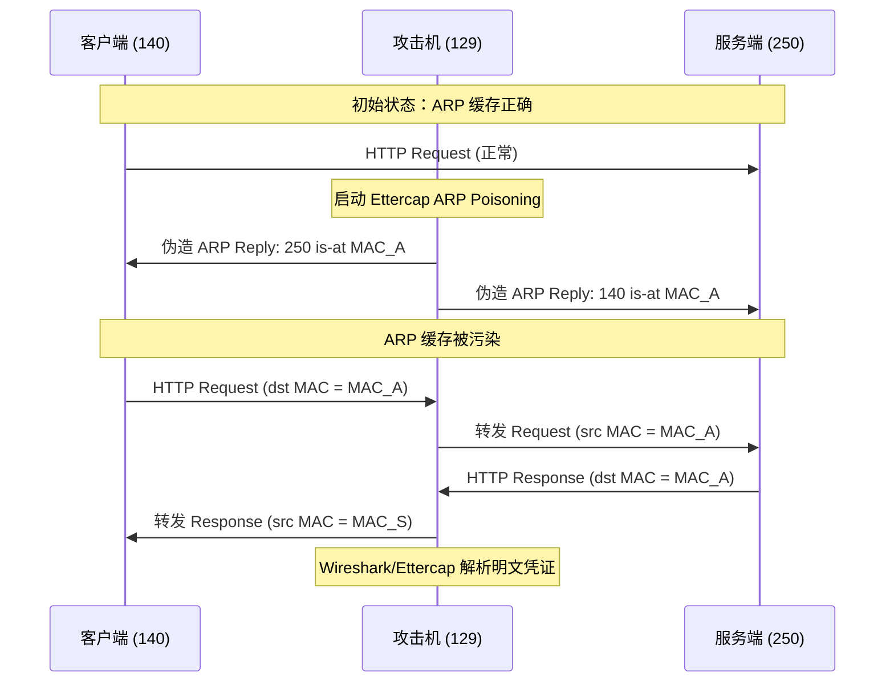

## 概述

本页面整理自无名安全团队归档文章《ARP中间人攻击-ettercap神器》，系统记录了在 Kali Linux 环境下利用 Ettercap 图形界面对局域网内主机实施 ARP 投毒（ARP Poisoning）、开启 IP 转发实现中间人位置、并通过 Wireshark 与 Ettercap 监听模式截获明文凭证的完整实战流程。实验拓扑包含攻击机、Web 服务器靶机、客户端靶机三角色，覆盖攻击前基线确认、攻击实施、流量劫持验证、凭证窃取及防御思考全链路。

## 实验环境

| 角色 | 系统 | IP 地址 | 备注 |
|------|------|---------|------|
| 攻击机 | Kali Linux | 192.168.168.129 | 运行 Ettercap、Wireshark |
| 靶机 1（服务端） | Windows Server 2008 | 192.168.168.250 | 部署 Web 登录服务 |
| 靶机 2（客户端） | CentOS 7 | 192.168.168.140 | 访问 Web 服务，模拟受害用户 |

三台主机处于同一二层广播域，满足 ARP 广播包可达条件。

## 核心原理

### ARP 协议缺陷

ARP（Address Resolution Protocol）设计假设局域网内所有节点可信，**无身份认证机制**。攻击者渗透入内网后，持续向目标发送伪造的 ARP 应答包（Gratuitous ARP），利用“缓存以最新包为准”的特性，将目标 ARP 缓存中的 **IP-MAC 映射篡改为攻击者 MAC**，从而在逻辑上插入通信链路中间。

### 中间人位置建立条件

1. **双向投毒**：同时欺骗客户端（网关/服务端 IP 对应 MAC 改为攻击者）与服务端（客户端 IP 对应 MAC 改为攻击者）。
2. **IP 转发**：攻击机开启 `net.ipv4.ip_forward=1`，将截获的报文原样转发，保证通信不中断（无感知）。
3. **流量镜像/监听**：在攻击机上抓包或启用 Ettercap 内置嗅探模块，解析应用层明文协议（HTTP、FTP、Telnet 等）。

## 实战步骤复现

### 攻击前基线确认

在客户端（CentOS 7）执行：

```bash
arp -n
# 或
ip neigh show
```

确认 192.168.168.250 对应的 MAC 为真实网卡地址。同时访问 `http://192.168.168.250` 验证 Web 服务正常。

### Ettercap 图形界面发起 ARP 投毒

```bash
sudo ettercap -G
```

操作流程：
1. **Sniff → Unified sniffing** → 选择接口（如 `eth0`）。
2. **Hosts → Scan for hosts** → **Hosts list** 查看发现的主机。
3. 将 192.168.168.140（客户端）加为 **Target 1**，192.168.168.250（服务端）加为 **Target 2**。
4. **Mitm → ARP poisoning** → 勾选 *Sniff remote connections* → OK。
5. **Start → Start sniffing**。

此时 Ettercap 状态栏显示 `ARP poisoning victims: GROUP 1 <-> GROUP 2`，开始成对发送伪造 ARP 应答。

### 验证投毒生效

回到客户端再次执行 `arp -n`，观察 192.168.168.250 的 MAC 已变为攻击机（192.168.168.129）的 MAC。服务端同理。

### 开启 IP 转发

```bash
echo 1 > /proc/sys/net/ipv4/ip_forward
# 永久生效可写入 /etc/sysctl.conf
```

开启后，攻击机内核将按路由表转发收到的穿透流量，维持双方会话完整。

### Wireshark 抓包验证劫持链路

在攻击机启动 Wireshark，过滤器 `ip.addr == 192.168.168.140 && ip.addr == 192.168.168.250`。客户端继续访问 Web 页面，Wireshark 可看到完整的 TCP 三次握手、HTTP 请求/响应，**源/目的 MAC 均为攻击机**，确认中间人位置已建立。

### Ettercap 监听模式嗅探凭证

Ettercap 顶栏 **Plugins → Manage plugins** 加载 `autoadd`、`find_*` 等插件，或直接使用内置 **Profiles** 解析 HTTP Basic/Digest、FTP、POP、IMAP 等明文协议。

客户端在登录页输入账号密码提交，Ettercap 窗口下方 **Connections** 列表实时弹出：

```
HTTP: 192.168.168.140:xxxx -> 192.168.168.250:80
USER: admin
PASS: 123456
```

实现明文凭证无感知窃取。

## 攻击流程时序图



## 防御与检测体系

| 层面 | 措施 | 说明 |
|------|------|------|
| **主机加固** | 静态 ARP 绑定 `arp -s <IP> <MAC>` | 关键网关/服务器 IP-MAC 固化，防篡改 |
| | 启用 `arp_ignore`/`arp_announce` 内核参数 | 限制 ARP 应答行为，减少被欺骗面 |
| **网络设备** | 动态 ARP 检测 (DAI) / IP Source Guard | 交换机端口级校验 ARP 包合法性 |
| | 端口隔离 / Private VLAN | 限制二层广播域范围，阻断横向投毒 |
| **流量监测** | 镜像流量至 IDS/IPS | 规则匹配高频 Gratuitous ARP、MAC-IP 冲突 |
| | 部署 Netflow/sFlow 审计 | 发现异常单播/广播比例突变 |
| **应用层** | 全站 HTTPS (HSTS) | 即使劫持链路，TLS 加密防凭证明文泄露 |
| | 双因子认证 (2FA) | 降低单因子凭证被窃后的复用风险 |

## 实战场景延伸

- **内网横向移动**：拿到一组凭证后，结合 [[smb-named-pipe-c2-communication]] 中的 SMB Beacon 横向传播。
- **凭证碰撞/重放**：结合 [[lm-ntlm-hash-generation-analysis]] 离线破解 NTLMv2 挑战/响应，或直接 Pass-the-Hash。
- **DNS 劫持组合**：Ettercap 支持 `dns_spoof` 插件，可将特定域名解析至恶意服务器，进一步实施钓鱼或驱动下载；参考 [[0w1club-training-shellshock-cgi-exploitation]] 中 CGI 环境变量注入链思路。
- **物理接入变种**：利用 [[badusb-hid-attack-arduino-leonardo]] 物理植入设备触发 ARP 投毒脚本，绕过 NAC 准入控制。

## 工具链对比

| 工具 | 模式 | 特点 | 适用场景 |
|------|------|------|----------|
| **Ettercap** | GUI / CLI / Daemon | 插件化、支持主动/被动嗅探、内置协议解析 | 快速实战、教学演示、内网渗透标准件 |
| **Bettercap** | CLI / Web UI | 模块化、支持 BLE/无线/HID、Lua 脚本扩展 | 现代红队作业、多协议融合攻击 |
| **ARPspoof (dsniff)** | CLI | 单一功能、极简依赖 | 嵌入式设备、最小化落地 |
| **MITMf** | CLI | 集成 BeEF、SMB 中继、HTTPS 降级 | 复合式中间人框架（已停更） |

## 交叉引用

- [[0w1club-training-shellshock-cgi-exploitation]] — 同属无名安全团队归档，展示 Shellshock 与 Dirty COW 组合链，可对比 ARP MITM 在内网渗透不同阶段的定位。
- [[smb-named-pipe-c2-communication]] — SMB 命名管道横向移动，常作为 ARP MITM 后续立足点扩展手段。
- [[badusb-hid-attack-arduino-leonardo]] — 物理接入触发 ARP 投毒的硬件实现路径。
- [[named-pipe-smb-detection-sysmon]] — 蓝队视角检测 SMB Beacon 与命名管道异常，配合 ARP 异常监测构建纵深防御。
- [[vulnhub-doubletrouble-writeup]] — VulnHub 靶机实战中同样涉及内网渗透与提权链，可作为实战靶场练习 ARP MITM 后渗透阶段。

## 思考与拓展

1. **为什么 ARP 欺骗能成功？**  
   根因：ARP 协议无认证、广播域内隐性信任、缓存更新策略“最后写入者胜”。

2. **如何发现 ARP 欺骗？**  
   - 主机端：定期 `arp -n` 对比网关 MAC，或运行 `arpwatch`/`XArp` 守护进程。  
   - 网络端：交换机开启 DAI 记录违规日志，Netflow 统计 ARP 广播风暴阈值告警。

3. **实战价值？**  
   内网立足点获取后，若凭证碰撞失效，部署 ARP MITM 可被动收集高价值明文凭证（VPN、OA、数据库管理端口等），配合 [[mimikatz-source-code-architecture-golden-ticket-audit]] 进一步构造黄金票据实现域控持久化。

4. **DNS 欺骗可行性？**  
   Ettercap 内置 `dns_spoof` 插件，配合 `etter.dns` 映射文件即可实现域名劫持，原理同 ARP 投毒——利用协议无认证缺陷，在 UDP 53 端口注入伪造应答。

## 版本历史

- **2021-10-24** 初版：整理自无名安全团队微信归档文章，建立基础知识页面结构。
- **2024-12-19** 重构：引入 Mermaid 时序图、工具对比表、防御矩阵、交叉引用索引，提升知识复用密度。

## 来源

- [0x00实验室-202108-202304_061](../sources/0x00实验室-202108-202304_061.md)
