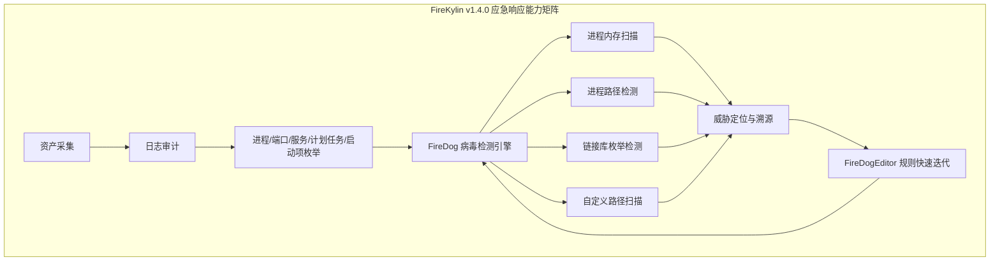

## 概述

**FireKylin**（中文名：火麒麟）是一款国产网络安全应急响应工具，名称取自中国神兽麒麟，寓意守护中国网络安全。v1.4.0 版本带来特大更新，核心亮点是集成 **FireDog 病毒检测引擎**，大幅增强恶意代码发现与溯源能力。

> 原文来源：微信公众号文章「网络安全应急响应工具-FireKylin v1.4.0」

## 版本更新日志 (v1.4.0)

### 集成 FireDog 病毒检测引擎（核心特性）

FireKylin v1.4.0 原生集成 **FireDog 病毒检测引擎**，提供四大维度的病毒检测能力：

| 检测维度 | 说明 |
|---------|------|
| **进程内存检测** | 扫描运行中进程的内存空间，发现无文件落地的恶意代码、Shellcode 注入、反射式 DLL 注入等内存级威胁 |
| **进程路径检测** | 对进程对应的可执行文件路径进行静态特征匹配与信誉校验 |
| **进程链接库检测** | 枚举进程加载的所有动态链接库（DLL），检测 DLL 劫持、恶意模块注入、模块隐藏等技术 |
| **自定义路径检测** | 支持用户指定任意文件/目录进行病毒扫描，适配应急响应现场的针对性排查需求 |

此功能使 FireKylin 从单纯的「信息采集/取证工具」进化为具备**主动查杀能力**的应急响应一体化平台，填补了国产工具在内存级恶意代码检测上的空白。相关内存扫描对抗技术可参考 [[memory-scanning-tools-evasion-techniques]]。

### UI 界面美观度优化

对客户端界面进行全面视觉重构，提升交互体验与信息密度，便于分析师在高压应急场景下快速定位关键异常。

### 修复 Windows Agent 内存占用过高问题

**问题背景**：Windows Agent 在采集系统日志（Windows Event Logs）时，因日志量大、解析逻辑未做流式处理，导致内存持续增长，甚至触发 OOM 或被 EDR 判定为异常行为。

**修复方案**：
- 引入分批读取与流式解析机制
- 优化日志缓存释放策略
- 降低常驻内存占用，提升长时间运行稳定性

该修复涉及 Windows 事件日志采集的底层实现细节，可关联 [[xd-security-incident-response-notes]] 中的日志分析与溯源章节。

### 内置 FireDogEditor 编辑器

随版本发布配套的 **FireDogEditor**，用于：
- 编写/维护 FireDog 引擎的规则集（特征码、行为规则、YARA 规则等）
- 规则语法高亮、语法检查、本地测试
- 规则打包分发至 FireKylin 客户端

实现了「规则开发 → 测试验证 → 一键下发」的完整闭环，支撑威胁情报快速转化为检测能力。

## 架构定位与应用场景

### 典型应急场景

| 场景 | FireKylin 角色 | 关键能力 |
|------|----------------|----------|
| 勒索病毒爆发 | 受控主机快速排查 | 内存扫描发现加密进程、链接库检测识别恶意 DLL |
| APT 攻击溯源 | 长周期驻留 Agent | 低内存占用持续采集日志、定期内存巡检 |
| 供应链投毒排查 | 文件完整性核验 | 自定义路径扫描对比基线、进程路径信誉校验 |
| 红蓝对抗蓝队 | 实时态势感知 | 规则热更新、可视化异常进程拓扑 |

## 技术细节补充

### FireDog 引擎检测原理推测

基于功能描述，FireDog 引擎至少包含以下检测模块：

1. **静态特征匹配**：MD5/SHA256 信誉库、YARA 规则、字符串特征
2. **启发式/行为规则**：API 调用序列分析、敏感行为组合判定（如 `OpenProcess` + `VirtualAllocEx` + `WriteProcessMemory` + `CreateRemoteThread`）
3. **内存扫描技术**：
   - 进程内存区域枚举（`VirtualQueryEx`）
   - 可执行内存页（RWX/MEM_IMAGE）重点扫描
   - PE 头特征识别、Shellcode 熵值分析、IAT 异常检测
4. **模块完整性校验**：对比磁盘 DLL 与内存 DLL 差异，发现模块隐藏、Inline Hook、IAT Hook

相关内存检测与对抗技术详见 [[memory-scanning-tools-evasion-techniques]]、[[aceldr-technical-analysis]]（PE 不落地执行技术）、[[phantom-dll-hollowing-technique]]（幽灵 DLL 空洞化）。

### Windows Agent 内存优化关键点

- **事件日志采集 API**：`EvtQuery` / `EvtNext` 流式读取替代一次性加载
- **内存管理**：及时调用 `EvtClose` 释放句柄，避免句柄泄漏
- **批量处理**：分批次写入本地数据库/上传服务端，避免大对象驻留堆
- **GC 友好**：C# 实现时避免大对象堆（LOH）碎片化，使用 `ArrayPool`/`MemoryPool`

可参考 [[windows-scheduled-task-persistence-techniques]] 中的长期运行 Agent 设计思路。

## 获取方式

公众号后台回复 **「应急1」** 获取工具下载链接。

## 交叉引用与延伸阅读

| 相关主题 | 页面 | 关联点 |
|---------|------|--------|
| 应急响应标准流程与工具箱 | [[xd-security-incident-response-notes]] | 日志分析、Webshell 排查、勒索病毒处置、自动化工具箱 |
| 内存扫描工具与对抗技术 | [[memory-scanning-tools-evasion-techniques]] | Hunt-Sleeping-Beacons、BeaconHunter、pe-sieve、Moneta、MalMemDetect 等检测原理与 UDRL 规避 |
| PE 不落地执行技术 | [[aceldr-technical-analysis]] | 反射式加载、进程镂空、模块隐藏等 FireDog 需重点检测的攻击面 |
| Windows 内核回调防御 | [[windows-kernel-callback-injection-defense]] | ObRegisterCallbacks 拦截进程注入，与 FireDog 内存检测形成纵深防御 |
| 威胁溯源与攻击归因 | [[threat-attribution-tracing-techniques]] | 结合 FireKylin 采集的进程/网络/日志证据链进行溯源 |
| 红队内存规避框架 | [[inceptor-av-edr-evasion-framework]] | Full Unhooking、Direct Syscalls、Manual DLL Mapping 等对抗 FireDog 类引擎的技术 |
| Cobalt Strike 内存特征 | [[cobalt-strike-4.7-bof-internals]] | BOF 加载器、Sleep Kit、PPL 注入等 FireDog 需覆盖的 C2 框架特征 |

## 版本历史

| 版本 | 发布时间 | 核心变更 |
|------|----------|----------|
| v1.4.0 | 2024-01 附近 | 集成 FireDog 引擎、UI 优化、Agent 内存修复、内置 FireDogEditor |
| v1.3.x | - | 基础资产采集、日志审计、进程/端口/服务枚举 |

> 注：具体历史版本信息以官方发布为准，归档文章仅记录 v1.4.0 更新内容。

## 小结

FireKylin v1.4.0 通过集成 **FireDog 病毒检测引擎**，实现了从「事后取证」到「事中查杀」的能力跨越，尤其在 **进程内存扫描**、**链接库完整性校验** 两大无文件攻击检测高地上填补了国产工具空白。配合 **FireDogEditor** 规则快速迭代机制，形成「情报→规则→检测→响应」闭环，是当前国产应急响应工具体系中极具竞争力的单品。

后续可关注：
- FireDog 引擎规则库更新频度与威胁情报接入来源
- Linux/macOS Agent 同步支持进度
- 与主流 SIEM/SOAR 平台的集成适配情况
- 对抗高级内存规避技术（如 [[inceptor-av-edr-evasion-framework]]、[[aceldr-technical-analysis]] 所述技术）的实战检测效果

## 来源

- [102网络攻防实验室-202102-202203_3](../sources/102网络攻防实验室-202102-202203_3.md)
